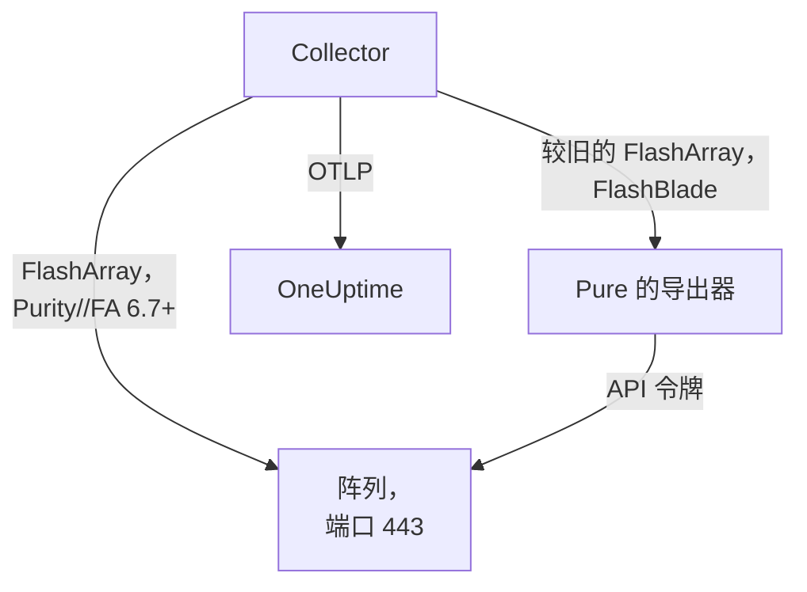

# 存储阵列代理

OneUptime Storage Array 代理监控存储阵列：容量和数据缩减、延迟、IOPS 和带宽、卷、主机、Pod 和复制、硬件健康状况、文件系统和存储桶。它是一个标准的 OpenTelemetry Collector，使用只读用户的 API 令牌抓取阵列的 OpenMetrics 端点，在每个指标上打上阵列的身份信息，并把它发送到 OneUptime。[存储阵列监控](/docs/monitor/storage-array-monitor) 会根据到达的数据发出告警。

:::cards
- [安装代理](#安装代理): 先创建只读用户，再使用安装脚本或 Docker Compose。
- [代理收集的内容](#代理采集的内容): 每个端点，以及基于它构建的页面。
- [监控多个阵列](#监控多个阵列): 每个阵列一个代理，都在同一台机器上。
- [故障排查](#故障排查): 一个诊断脚本，以及常见问题。
:::

## 工作原理

Storage Arrays 是一个对每个厂商都以相同方式工作的产品。它支持：

| 阵列 | 代理如何读取它 | Collector 配置 |
| --- | --- | --- |
| **Pure Storage FlashArray**，Purity//FA 6.7 及更高版本 | 阵列自己的 OpenMetrics 端点（`https://<array>/metrics/...?namespace=purefa`）：Collector 旁边不需要运行任何东西 | `otel-collector-config.yaml`（默认） |
| **Pure Storage FlashArray**，较旧的 Purity//FA | Pure 的 FlashArray OpenMetrics 导出器，由同一个 Compose 文件作为 `pure-fa-exporter` 服务运行 | `otel-collector-config.flasharray-exporter.yaml` |
| **Pure Storage FlashBlade** | Pure 的 FlashBlade OpenMetrics 导出器，由同一个 Compose 文件作为 `pure-fb-exporter` 服务运行 | `otel-collector-config.flashblade.yaml` |

Pure Storage 于 2026 年 2 月更名为 **Everpure**。FlashArray、FlashBlade 和 Purity 保留了原名，`purefa_*` 和 `purefb_*` 指标也没有改名，因此本页的所有内容都适用于以任一名称销售的阵列。



一个代理监控一个阵列：请为每个阵列运行一个代理（参见 [监控多个阵列](#监控多个阵列)）。阵列会随其第一批数据自行注册，名称就是代理作为 `storage.array.name` 打到每个指标上的名称。

## 开始之前

- Docker Engine 20.10 或更高版本，带 Docker Compose v2 插件，所在机器能通过 HTTPS（TCP 443）访问阵列的管理接口。
- 阵列上的一个管理员帐户，用于创建具有内置 **readonly** 角色的用户及其 API 令牌。
- 一个摄取密钥。在 **项目设置 → 遥测与 APM → 摄取密钥** 下创建一个并复制其值。

### 在哪里运行代理

代理通过 HTTPS 与阵列的管理接口通信，因此可以运行在任何装有 Docker 并能通过 TCP 443 路由到管理网络的机器上：一台监控主机，或一台小型管理 VM。最好选择自身存储不在所监控阵列上的机器：如果阵列宕机，你的监控不应随之宕机。可选的 syslog 监听器还要求阵列能通过 syslog 端口访问代理（参见 [发送阵列的 syslog](#可选-发送阵列的-syslog)）。

## 安装代理

:::steps
### 创建只读用户和 API 令牌

代理只做读取。请给它一个专用用户，使用内置的 **readonly** 角色，绝不要用管理员，并为该用户创建 API 令牌。创建令牌时请 **不设过期时间**，否则令牌过期的那天代理就会停止工作。

:::tabs
@tab Purity CLI
以管理员身份 SSH 登录到 FlashArray。第一个命令会询问新用户的密码；第二个命令会输出其 API 令牌，即一个 UUID：

```bash
pureadmin create --role readonly oneuptime
pureadmin create --api-token oneuptime
```
@tab FlashArray GUI
1. 打开 _Settings → Users and Policies_（在较旧的版本中为 _Settings → Access_）。
2. 在 **Users** 面板的 ⋮ 菜单中选择 **Create User…**，将用户命名为 `oneuptime`，并为其授予 readonly 角色。
3. 在新用户的 ⋮ 菜单中选择 **Create API Token…**，将 **Expires In** 留空，然后复制令牌。
@tab FlashBlade
以同样的方式创建具有 **readonly** 角色的用户及其 API 令牌：在 FlashBlade GUI 的用户设置中创建，或在 Purity//FB CLI 中使用 `pureadmin`。在没有本地用户的版本中，请使用目录服务（LDAP 或 Active Directory）帐户，其所在组映射到 readonly 角色。FlashBlade 的 API 令牌以 `T-` 开头。
:::

### 检查 FlashArray 是否提供自己的指标

Pure 为 **Purity//FA 6.7.0 及更高版本** 记录了原生 OpenMetrics 端点（Pure 的 FlashArray 导出器的弃用通知中写的是 6.6.11 及更高版本）。最快的确认方法是在将要运行代理的机器上询问阵列：

```bash
curl -k 'https://<array>/metrics/array?namespace=purefa' --header 'Authorization: Bearer <api-token>' | grep purefa_info
```

出现 `purefa_info{...} 1` 行表示阵列原生提供其指标：请使用默认配置。出现 `404` 表示不提供：请使用导出器配置，它会在 Collector 旁边运行 Pure 的导出器。Pure 已弃用该导出器，因此阵列升级后请改用原生配置。FlashBlade 始终通过 Pure 的 FlashBlade 导出器，因此 FlashBlade 可以跳过这一步。

### 安装并启动代理

:::tabs
@tab install.sh
下载安装脚本，并在将要托管代理的机器上运行它：

```bash
curl -sSL https://raw.githubusercontent.com/OneUptime/oneuptime/master/agents/StorageArrayAgent/install.sh -o install.sh
bash install.sh
```

脚本会询问这是哪种阵列（提供原生指标的 FlashArray、运行较旧 Purity//FA 的 FlashArray，或 FlashBlade），然后询问你的 OneUptime URL、摄取密钥、阵列的名称、阵列的管理地址和只读用户的 API 令牌（读取时不回显）。它安装到 `/opt/oneuptime-storage-array-agent`，下载 Compose 文件和全部三个 Collector 配置，写入一个 `0600` 权限的 `.env` 文件，其中包含匹配的配置和 Compose 配置文件，并用 Docker Compose 启动代理。它会按你输入的原样为 Docker Compose 给每个值加上引号。再次运行它会复用现有 `.env` 中的所有内容，不会再次询问，并在替换你编辑过的文件之前将其保存为 `<file>.bak.<timestamp>`。
@tab Docker Compose
从 [StorageArrayAgent 目录](https://github.com/OneUptime/oneuptime/tree/master/agents/StorageArrayAgent) 下载 `docker-compose.yml` 和三个 `otel-collector-config*.yaml` 文件到一个新文件夹中：

```bash
curl -fsSLO https://raw.githubusercontent.com/OneUptime/oneuptime/master/agents/StorageArrayAgent/docker-compose.yml
curl -fsSLO https://raw.githubusercontent.com/OneUptime/oneuptime/master/agents/StorageArrayAgent/otel-collector-config.yaml
curl -fsSLO https://raw.githubusercontent.com/OneUptime/oneuptime/master/agents/StorageArrayAgent/otel-collector-config.flasharray-exporter.yaml
curl -fsSLO https://raw.githubusercontent.com/OneUptime/oneuptime/master/agents/StorageArrayAgent/otel-collector-config.flashblade.yaml
```

在它们旁边创建一个 `.env` 文件。它保存着 API 令牌，因此请用 `chmod 600 .env` 保持其私密。对于提供原生指标的 FlashArray：

```bash title=".env"
ONEUPTIME_URL=YOUR_ONEUPTIME_URL
ONEUPTIME_TELEMETRY_INGESTION_KEY=YOUR_TELEMETRY_INGESTION_TOKEN
STORAGE_ARRAY_NAME=my-storage-array
STORAGE_SYSTEM=purestorage.flasharray
STORAGE_ARRAY_COLLECTOR_CONFIG=otel-collector-config.yaml
COMPOSE_PROFILES=
PURE_FA_ENDPOINT=fa-prod-01.example.com
PURE_FA_API_TOKEN=YOUR_READ_ONLY_API_TOKEN
PURE_FB_ENDPOINT=
PURE_FB_API_TOKEN=
STORAGE_ARRAY_INSECURE_SKIP_VERIFY=true
```

对于运行较旧 Purity//FA 的 FlashArray，设置 `STORAGE_ARRAY_COLLECTOR_CONFIG=otel-collector-config.flasharray-exporter.yaml` 和 `COMPOSE_PROFILES=flasharray-exporter`。对于 FlashBlade，设置 `STORAGE_SYSTEM=purestorage.flashblade`、`STORAGE_ARRAY_COLLECTOR_CONFIG=otel-collector-config.flashblade.yaml` 和 `COMPOSE_PROFILES=flashblade`，并填写 `PURE_FB_ENDPOINT` 和 `PURE_FB_API_TOKEN`，而不是 `PURE_FA_*` 这一对。启动代理：

```bash
docker compose up -d
```
:::

### 检查代理是否在运行

```bash
docker compose ps
docker logs -f oneuptime-storage-array-agent
```

`docker compose ps` 会列出 Collector（`oneuptime-storage-array-agent`），使用导出器配置时还会列出导出器（`pure-fa-exporter` 或 `pure-fb-exporter`）。Collector 启动后，其日志中应出现这一行：

```text
Everything is ready. Begin running and processing data.
```

### 在 OneUptime 中找到阵列

打开 **产品 → 基础设施 → Storage Arrays → All Storage Arrays**。第一次抓取之后（大约一分钟），阵列就会出现，带有它的容量、性能、未关闭的告警和硬件。卷、主机和 Pod 会在 2 分钟内出现，FlashBlade 的文件系统和存储桶在 5 分钟内出现，FlashArray 目录在 30 分钟内出现。
:::

## 环境变量

安装脚本把这些变量写入 `/opt/oneuptime-storage-array-agent/.env`；Docker Compose 安装从 `.env`（位于 `docker-compose.yml` 旁边）中读取它们。更改其中一个后，请在该文件夹中运行 `docker compose up -d`。

| 变量 | 必需 | 说明 |
| --- | --- | --- |
| `ONEUPTIME_URL` | 是 | 你的 OneUptime URL，例如 `https://oneuptime.com` 或你的自托管实例。如果实例只支持 HTTP，请使用 `http://` 及其端口。 |
| `ONEUPTIME_TELEMETRY_INGESTION_KEY` | 是 | 来自 **项目设置 → 遥测与 APM → 摄取密钥** 的摄取密钥。 |
| `STORAGE_ARRAY_NAME` | 是 | 阵列在 OneUptime 中注册所用的名称，作为 `storage.array.name` 资源属性打到每个指标上。请保持不变：之后更改它会注册另一个阵列。缺少它时 Collector 拒绝启动。 |
| `STORAGE_SYSTEM` | 否 | 平台，作为 `storage.system` 资源属性打上：`purestorage.flasharray` 或 `purestorage.flashblade`。默认为 `purestorage.flasharray`。 |
| `STORAGE_ARRAY_COLLECTOR_CONFIG` | 否 | 运行哪个随附的 Collector 配置：`otel-collector-config.yaml`（FlashArray，原生：默认）、`otel-collector-config.flasharray-exporter.yaml`（较旧的 FlashArray）或 `otel-collector-config.flashblade.yaml`（FlashBlade）。 |
| `COMPOSE_PROFILES` | 否 | 启动所选配置要抓取的导出器：原生 FlashArray 配置留空，另外两种配置分别为 `flasharray-exporter` 或 `flashblade`。 |
| `PURE_FA_ENDPOINT` | FlashArray | FlashArray 的管理地址：主机名或 IP，不带 `https://`。 |
| `PURE_FA_API_TOKEN` | FlashArray | 具有 readonly 角色的 FlashArray 用户的 API 令牌。 |
| `PURE_FB_ENDPOINT` | FlashBlade | FlashBlade 的管理地址：主机名或 IP，不带 `https://`。 |
| `PURE_FB_API_TOKEN` | FlashBlade | 具有 readonly 角色的 FlashBlade 用户的 API 令牌。 |
| `STORAGE_ARRAY_INSECURE_SKIP_VERIFY` | 否 | `true` 在原生端点上接受阵列的自签名证书；`false` 则验证它。默认为 `true`。Pure 的导出器从不验证阵列的证书，因此它对导出器不适用。 |

## 代理如何抓取

- **每个端点一个抓取作业，各自按其价值决定读取频率。** FlashArray：`/metrics/array` 每 60 秒一次；`/metrics/volumes`、`/metrics/hosts` 和 `/metrics/pods` 每 2 分钟一次；`/metrics/directories` 每 30 分钟一次，这是 Pure 自己的建议，因为计算目录空间对阵列来说开销很大。FlashBlade：`/metrics/array` 每 60 秒一次；`/metrics/filesystems` 和 `/metrics/objectstore` 每 5 分钟一次，同样遵循 Pure 的建议，以低于阵列的频率读取文件系统和对象存储端点。
- **每个作业都给其序列打上 `scrape_endpoint: <endpoint>` 标签。** 每个端点还会导出 `purefa_info` 或 `purefb_info`，因此 OneUptime 知道一个批次是哪些指标族的完整列表：已删除的卷、主机、Pod、文件系统或存储桶正是这样离开清单，而不是一直滞留。请保持这些标签与随附时一致。
- **按卷和按主机的延迟保留三个维度。** 每个卷和主机最多按十六个 `dimension` 导出其延迟。一条 `metric_relabel_configs` 规则保留 `usec_per_read_op`、`usec_per_write_op` 和 `usec_per_mirrored_write_op`，丢弃 QoS 速率限制、队列、SAN 和服务时间的细分，这些细分会使大型阵列的序列数成倍增加。`purefa_array_performance_latency_usec` 上的阵列级细分会保留。删除该规则即可同时保留按卷的细分。
- **API 令牌是 Bearer 令牌。** 原生配置把它发送给阵列本身；导出器配置只通过 Compose 网络把它发送给导出器，导出器的端口从不发布。
- **没有 `send_batch_max_size`。** OneUptime 每个请求都根据一次完整的抓取重建清单，因此随附的 `batch` 处理器从不把一次抓取拆分到多次导出中。请保持随附的 batch 设置不变。

## 代理采集的内容

Pure 的语义约定由 FlashArray 原生端点和两个导出器共享。每个值都是阵列自己计算出的仪表值（延迟以每次操作的微秒计，吞吐量以每秒计），因此无需计算速率，对象则由 **数据点标签** 命名：卷、Pod、目录、文件系统和存储桶用 `name`，主机用 `host`，FlashArray 硬件用 `component_name`。代理会添加 `storage.array.name` 和 `storage.system` 资源属性，因此 OneUptime 会把所有内容归到你的阵列下：

| 端点 | 指标族 | OneUptime 据此构建的内容 |
| --- | --- | --- |
| FlashArray `/metrics/array` | `purefa_info`、`purefa_alerts_open`、`purefa_array_space_*`、`purefa_array_performance_*`、`purefa_hw_component_status`、`purefa_hw_component_temperature_celsius`、`purefa_hw_controller_info`、`purefa_drive_capacity_bytes`、`purefa_network_interface_*` | 阵列的名称、Purity 版本和系统 ID；容量、已用空间和数据缩减；未关闭的告警数；阵列的健康状况；**Hardware** 页面（组件、驱动器、控制器、网络接口） |
| FlashArray `/metrics/volumes` | `purefa_volume_performance_*`、`purefa_volume_space_*`、`purefa_volume_qos_*` | **卷** 页面：每个卷的预配大小和物理大小、数据缩减、读写延迟、IOPS 和带宽 |
| FlashArray `/metrics/hosts` | `purefa_host_connectivity_info`、`purefa_host_connections_info`、`purefa_host_performance_*`、`purefa_host_space_*` | **主机** 页面：每台主机的连接性（是否有冗余路径）、已连接的卷、延迟、IOPS 和带宽 |
| FlashArray `/metrics/pods` | `purefa_pod_performance_*`、`purefa_pod_space_*`、`purefa_pod_replica_links_*`、`purefa_pod_mediator_status` | **Replication** 页面：ActiveCluster 和 ActiveDR Pod、副本链接状态和滞后 |
| FlashArray `/metrics/directories` | `purefa_directory_performance_*`、`purefa_directory_space_*` | **Directories** 页面（FlashArray File Services） |
| FlashBlade `/metrics/array` | `purefb_info`、`purefb_alerts_open`、`purefb_array_space_*`、`purefb_array_performance_*`、`purefb_hardware_health` | FlashBlade 的名称、Purity 版本和系统 ID；容量和数据缩减；未关闭的告警数；阵列的健康状况；**Hardware** 页面 |
| FlashBlade `/metrics/filesystems` | `purefb_file_systems_space_*`、`purefb_file_systems_performance_*` | **File Systems** 页面：每个文件系统的预配空间和已用空间、数据缩减、延迟、IOPS 和带宽 |
| FlashBlade `/metrics/objectstore` | `purefb_buckets_space_*`、`purefb_buckets_quota_space_bytes`、`purefb_buckets_object_count`、`purefb_buckets_performance_*`、`purefb_object_store_accounts_*` | **Buckets** 页面：每个存储桶的空间、配额、对象数和性能，按帐户分组 |

阵列在其 **概览** 上显示的健康状况：当它报告未关闭的严重告警，或有硬件组件、驱动器或控制器处于严重、故障、缺失或不健康状态时为 **严重**；当它报告未关闭的警告告警，或有降级或状态未知的组件时为 **Warning**；否则为 **OK**。在监控条件中，阵列的属性要加上 `resource.` 前缀（`resource.storage.array.name`、`resource.storage.system`），而数据点标签保持原样（`name`、`host`、`dimension`、`space`）。

## 可选 — 发送阵列的 syslog

默认情况下，代理只发送指标，因此阵列的 **日志** 页面保持为空。阵列会把它们的告警和审计事件作为 syslog 转发，每个随附的 Collector 配置中都有一对已注释掉的 `syslog` 接收器（端口 5514 上的 TCP 和 UDP，RFC 3164），连接到一个已注释掉的 `logs` 管道，该管道会打上 `storage.array.name`，使日志落到你的阵列上。

:::steps
### 打开接收器

在你使用的 Collector 配置中取消注释两个 `syslog/*` 接收器和 `logs` 管道。RFC 3164 时间戳不带时区：除非阵列的时钟使用 UTC，否则请把 `location` 设为阵列的时区。

### 开放端口

取消注释 `ports:` 块（位于 `docker-compose.yml` 中），让机器发布 `5514/tcp` 和 `5514/udp`，然后运行 `docker compose up -d`。在机器的防火墙中为阵列的管理网络开放该端口。

### 让阵列指向代理

请以管理员身份执行此操作，而不是以只读的监控用户身份。在 FlashArray 上，打开 _Settings → System → Syslog Servers_，添加 `udp://<agent-host>:5514`（或 `tcp://<agent-host>:5514`）并发送一条测试消息。在 FlashBlade 上，在其 syslog 设置中添加一个使用相同 URI 的 syslog 服务器。两种阵列都接受 `PROTOCOL://HOST:PORT` 形式，通过它们的 REST API（`syslog-servers`）也是如此。
:::

一个 syslog 接收器只在一种传输方式上监听，所以 TCP 和 UDP 是两个接收器：如果只需要其中一个，就让另一个保持注释状态。标准 Collector 镜像可以原样读取 syslog：不需要自定义镜像。

## 用项目标签标记阵列

以 `oneuptime.label.` 开头的资源属性会成为存储阵列上的项目标签：`oneuptime.label.<dimension>=<value>` 就是标签 `<dimension>:<value>`。在你使用的 Collector 配置的 `resource` 处理器中，紧挨着 `storage.array.name` 添加这些属性：

```yaml
processors:
  resource:
    attributes:
      # ...existing attributes...
      - key: oneuptime.label.team
        value: storage
        action: upsert
      - key: oneuptime.label.env
        value: production
        action: upsert
```

Collector 只在启动时读取其配置：请运行 `docker compose restart oneuptime-storage-array-agent`。之后阵列会显示标签 `team:storage` 和 `env:production`。标签匹配不区分大小写，因此现有的 `Production` 标签会被复用而不是重复创建，并且代理绝不会删除别人在 OneUptime 中添加的标签。

## 监控多个阵列

一个代理读取一个阵列。要从同一台机器监控多个阵列，请把每个代理安装到各自的文件夹中，并使用各自的 `.env`，例如 `INSTALL_DIR=/opt/oneuptime-storage-array-agent-fa02 bash install.sh`，并为每个代理设置各自的 `container_name`（位于其 `docker-compose.yml` 中，例如 `oneuptime-storage-array-agent-fa02`）：两个容器不能同名。用 `-d` 把文件夹传给诊断脚本。

## 作为 systemd 服务运行

要让代理随机器启动并在失败时重启，请安装它的 systemd 单元。该单元假定代理位于 `/opt/oneuptime-storage-array-agent`，即安装脚本放置它的位置：

```bash
sudo curl -fsSL https://raw.githubusercontent.com/OneUptime/oneuptime/master/agents/StorageArrayAgent/systemd/oneuptime-storage-array-agent.service -o /etc/systemd/system/oneuptime-storage-array-agent.service
sudo systemctl daemon-reload
sudo systemctl enable --now oneuptime-storage-array-agent
```

## 升级代理

代理会把其文件固定的 Collector 版本报告为它的 **代理版本**。当该版本早于此 OneUptime 版本固定的版本时，阵列的 **概览** 页面上会在它旁边出现一个警告标志。选择它即可查看这些命令。在其文件开始报告版本之前安装的代理不会显示版本，直到以这种方式升级为止。

Collector 镜像固定在 `docker-compose.yml` 中，其配置是旁边的文件，因此仅拉取镜像并不能让代理升级。请再次运行 `install.sh`：它会复用你现有 `.env` 中的每个值（不会再询问任何内容），刷新 `docker-compose.yml` 和三个 Collector 配置（你编辑过的文件会保存为 `<file>.bak.<timestamp>`），并重新创建代理，使 Collector 读取新的配置。安装在 `/opt/oneuptime-storage-array-agent` 之外的代理需要指定其文件夹：`INSTALL_DIR=<folder> bash install.sh`。

```bash
curl -sSL https://raw.githubusercontent.com/OneUptime/oneuptime/master/agents/StorageArrayAgent/install.sh -o install.sh
bash install.sh
```

如果是用 Docker Compose 安装的，请在代理的文件夹中重新下载 Compose 文件和三个 Collector 配置（并重新做一遍你对它们所做的任何修改），然后拉取镜像并重新创建代理：

```bash
curl -fsSLO https://raw.githubusercontent.com/OneUptime/oneuptime/master/agents/StorageArrayAgent/docker-compose.yml
curl -fsSLO https://raw.githubusercontent.com/OneUptime/oneuptime/master/agents/StorageArrayAgent/otel-collector-config.yaml
curl -fsSLO https://raw.githubusercontent.com/OneUptime/oneuptime/master/agents/StorageArrayAgent/otel-collector-config.flasharray-exporter.yaml
curl -fsSLO https://raw.githubusercontent.com/OneUptime/oneuptime/master/agents/StorageArrayAgent/otel-collector-config.flashblade.yaml
docker compose pull
docker compose up -d --force-recreate
```

## 卸载代理

```bash
cd /opt/oneuptime-storage-array-agent
docker compose down
```

然后，如果不再需要，请在阵列上删除只读用户及其 API 令牌。

## 故障排查

:::details 先运行诊断脚本
代理附带一个脚本 [`troubleshoot.sh`](https://github.com/OneUptime/oneuptime/blob/master/agents/StorageArrayAgent/troubleshoot.sh)，它会检查整条链路：容器运行时；按 Collector 访问它的方式检查阵列端点（原生端点或 Pure 的导出器：DNS、TLS、FlashArray 是否有原生端点，以及阵列是否接受 API 令牌，脚本通过 stdin 把令牌交给 curl）；打到每个指标上的阵列名称；令牌的格式；Collector 自身的指标；以及 OneUptime 是否接受摄取密钥。最后一项检查最重要。OneUptime 会以 `401` 拒绝错误的密钥（已禁用的密钥或浏览器密钥为 `422`），而 Collector 会把两者都视为永久性错误：它丢弃该批次并记录一条 `Exporting failed` 错误，而容器仍保持健康，这很容易被忽略。该脚本从代理的网络内部请求 `GET <url>/otlp/v1/validate`，直接得到 `200`（有效）或 `401`（无效），在较旧的服务器上回退到 `POST /fluentd/v1/logs`。

```bash
curl -sSL https://raw.githubusercontent.com/OneUptime/oneuptime/master/agents/StorageArrayAgent/troubleshoot.sh -o troubleshoot.sh
bash troubleshoot.sh    # add -d <dir> if you installed outside /opt/oneuptime-storage-array-agent
```

它最后会输出一个指明最可能原因的结论。
:::

:::details OneUptime 中没有出现阵列
1. 查看 Collector 的日志：`docker logs oneuptime-storage-array-agent`。`server returned HTTP status 401` 表示阵列拒绝了 API 令牌，`404` 表示 FlashArray 没有原生端点，`x509` 表示在阵列的自签名证书上开启了 TLS 验证，`no such host` 或 `connection refused` 表示 `PURE_FA_ENDPOINT` 或 `PURE_FB_ENDPOINT` 错误，导出时出现 `401` 表示摄取密钥错误。
2. 从代理的网络中询问阵列。Collector 镜像没有 shell 也没有 curl，因此请从其网络中的一个容器发起请求：`docker run --rm --network container:oneuptime-storage-array-agent curlimages/curl -sk -H 'Authorization: Bearer <api-token>' 'https://<array>/metrics/array?namespace=purefa'` 应输出 `purefa_*` 行。
3. 检查 `STORAGE_ARRAY_NAME` 是否已设置：阵列是通过其 `storage.array.name` 资源属性找到的，缺少它时 Collector 拒绝启动。
:::

:::details 阵列显示为已断开
当 OneUptime 在 15 分钟内没有从阵列收到任何数据时，阵列会变为已断开；OneUptime 每 5 分钟检查一次，并且它自身未在接收数据的时间不计入在内。请检查 Collector 是否在运行（`docker compose ps`）、其日志是否没有抓取或导出错误，以及机器是否仍能访问阵列和你的 OneUptime URL。收到下一批数据后，阵列会重新变为已连接。
:::

:::details FlashArray 返回 404
它的 Purity//FA 没有原生 OpenMetrics 端点。请再次运行 `install.sh` 并选择较旧 Purity 的选项，或者设置 `STORAGE_ARRAY_COLLECTOR_CONFIG=otel-collector-config.flasharray-exporter.yaml` 和 `COMPOSE_PROFILES=flasharray-exporter`（在 `.env` 中），然后运行 `docker compose up -d`。把阵列升级到 Purity//FA 6.7 或更高版本后，请切回原生配置并去掉该配置文件。
:::

:::details 阵列拒绝 API 令牌
请检查你粘贴的是 API 令牌而不是用户的密码、该用户仍然存在并具有 readonly 角色，以及令牌没有过期。创建一个新令牌（在 FlashArray 上使用 `pureadmin create --api-token oneuptime`），把它放入 `.env` 并运行 `docker compose up -d`。通过 Pure 的导出器时，被拒绝的令牌会在 Collector 的日志中显示为来自导出器的 HTTP `400`，其正文为 `failed to login`。
:::

:::details x509 或 TLS 错误
阵列默认出示自签名证书，没有任何 Docker 镜像信任它。要么设置 `STORAGE_ARRAY_INSECURE_SKIP_VERIFY=true`（在私有管理网络中这是实际的选择），要么在阵列上安装由 Collector 镜像信任的 CA 颁发的证书。
:::

:::details 无法解析 pure-fa-exporter 或 pure-fb-exporter
导出器没有运行：`COMPOSE_PROFILES` 必须与 `STORAGE_ARRAY_COLLECTOR_CONFIG` 匹配（FlashArray 导出器配置用 `flasharray-exporter`，FlashBlade 配置用 `flashblade`）。修正 `.env` 并运行 `docker compose up -d`；之后 `docker compose ps` 会列出导出器。
:::

:::details 已删除的卷或主机仍留在清单中
当对某个端点的一次完整抓取中不再有某个对象时，OneUptime 会移除该对象，它通过 `scrape_endpoint` 标签识别这一点。如果你用自己的配置替换了随附的 Collector 配置，请在其抓取作业上保留 `scrape_endpoint` 标签；否则对象只有在过期时才会离开清单。
:::

:::details 指标落到了错误的阵列下
OneUptime 根据 `storage.array.name` 注册存储阵列，代理从 `STORAGE_ARRAY_NAME` 中获取该值。在第一批数据之后更改它，会创建第二个阵列，而不是重命名第一个。
:::

:::details 不通过代理发送指标
代理就是一个标准的 Collector 配置，因此你已经在运行的 Collector 也能完成同样的工作：把抓取作业和 `resource` 处理器从随附的配置复制到你自己的配置中。`storage.array.name` 资源属性负责在 OneUptime 中注册阵列，而删除 `service.name` / `service.instance.id` 可以防止数据被归到某个服务下：请两者都保留，并保留 `scrape_endpoint` 标签。
:::

## 后续步骤

:::cards
- [存储阵列监控](/docs/monitor/storage-array-monitor): 针对告警、容量、延迟、硬件、主机路径、复制和文件系统发出告警。
- [VMware 代理](/docs/telemetry/vmware): 在这个阵列上运行 VMware？也可以查看它的数据存储和 VM。
- [主机 OpenTelemetry Collector](/docs/telemetry/host-otel-collector): 从操作系统的角度查看使用该阵列的机器。
:::
