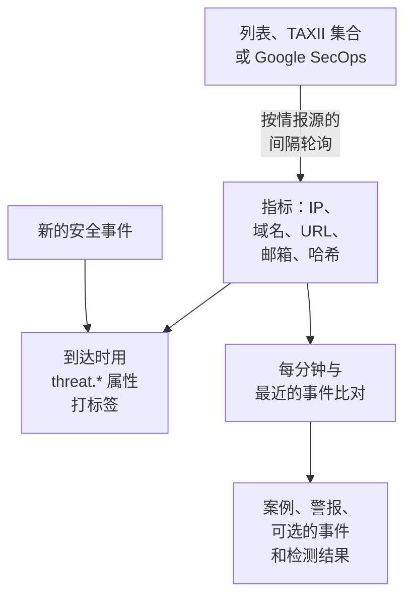

# 威胁情报(STIX/TAXII)

威胁情报源会把已知恶意的 IP 地址、域名、URL、电子邮件地址和文件哈希带进 OneUptime，并在你的 [安全事件](/docs/telemetry/security-events) 提到其中之一时告诉你。一个情报源读取一个来源：https 地址上的指标列表（例如 OneUptime 一键添加的免费列表）、来自你自己的 MISP、OpenCTI 或 OpenTAXII 服务器或某个提供商、包含 STIX 2.1 指标的 TAXII 2.1 集合，或者 Google SecOps 在你的事件中发现的指标。

:::cards
- [添加免费列表](#添加免费列表): Feodo Tracker、Emerging Threats 和 Tor 出口节点，一键添加。
- [订阅情报源](#订阅情报源): 列表的地址、TAXII 集合或 Google SecOps 连接。
- [会摄取什么](#会摄取什么): OneUptime 保留的指标模式，以及保留多久。
- [如何找到匹配](#如何找到匹配): 事件到达时打标签，并每分钟比对一次。
- [威胁级别](#威胁级别): 指标的 confidence 如何变成严重程度。
:::

## 工作原理



## 开始之前

- 对于列表：一个 `https` 地址，下载得到每行一个指标的文本文件。
- 对于 TAXII 情报源：一个发布 STIX 2.1 `indicator` 对象的 TAXII 2.1 服务器，以及要轮询的集合的 ID。TAXII 情报源可以匿名登录，也可以使用 bearer 令牌或 HTTP 基本身份验证登录。
- 对于 Google SecOps 情报源：一个服务账户能够搜索指标匹配的 [Google SecOps 连接](/docs/integrations/google-secops#设置托管连接器)，`roles/chronicle.viewer` 角色可以做到。
- 不支持要求 TLS 客户端证书（双向 TLS）的服务器，例如 CISA AIS。MITRE 的公共 ATT&CK 服务器发布的是技术和组织，而不是指标，所以指向它的情报源会一直为空。
- 一个可以创建情报源的角色：Project Owner、Project Admin、Security Admin 或 Security Member。Security Viewer 可以读取情报源和指标。请参阅 [角色](/docs/permissions/reference#角色)。

## 添加免费列表

**威胁情报** 上的 **免费列表** 卡片可以一键添加免费的封锁列表：在某个列表上点击 **添加列表**，OneUptime 就会创建一个按该列表的计划下载它的情报源。项目已在读取的列表会显示 **已添加**。

| 列表 | 发布者 | 读取 | 置信度 | 匹配时打开 |
| --- | --- | --- | --- | --- |
| Feodo Tracker 僵尸网络 C2 服务器 | abuse.ch | 每小时 | 90，Critical | 一个案例和一个警报 |
| Emerging Threats 失陷主机 | Proofpoint Emerging Threats | 每天 | 70，High | 一个案例和一个警报 |
| Tor 出口节点 | The Tor Project | 每小时 | 30，Low | 一个案例 |

每个列表的卡片都链接到它的条款：Feodo Tracker 可免费用于任何用途（CC0），Emerging Threats 列表采用 BSD 许可证。从列表添加的情报源和其他情报源一样编辑和删除。

## 订阅情报源

:::steps
### 前往 Threat Intel

打开 **产品 → Security Events → 检测 → 威胁情报** 。

### 创建情报源

点击 **创建威胁情报源**，选择它的 **来源**：**指标列表**、**TAXII 集合** 或 **Google SecOps**。下一步只询问该来源所需的内容：列表的 **列表 URL**、集合的 **TAXII 服务器** 和 **登录**，或者 **Google SecOps 连接**。**匹配时** 在最后。各字段见下表。

### 检查第一次轮询

一两分钟内，情报源所在行会显示 **最近轮询** ，**最近一次轮询摘要** 会说明这次轮询取回了什么。指标会出现在情报源下方的 **指标** 表中。
:::

| 字段 | 填写内容 |
| --- | --- |
| **来源** | 指标从哪里来。它在创建情报源时确定：换一个来源就是一个新的情报源。 |
| **列表 URL** | 对于列表：一个文本文件的 `https` 地址，文件每行一个 IP 地址、域名、URL 或文件哈希。 |
| **置信度** | 对于列表：列表的可信程度，1 到 100。列表上的每个指标都会获得这个值，它决定 [威胁级别](#威胁级别)；留空则为 Medium。 |
| **Google SecOps 连接** | 对于 Google SecOps：用其密钥读取 Google SecOps 所发现指标的连接。没有连接时，**连接 Google SecOps** 会打开 **连接**。 |
| **TAXII API 根 URL** | 服务器的 TAXII 2.1 API 根，例如 `https://taxii.example.com/api1/`。集合在它下面寻址。 |
| **集合 ID** | 发布指标的集合。 |
| **轮询间隔（分钟）** | 读取来源的频率：1 到 1440 分钟，默认 60。列表最多每 15 分钟读取一次。 |
| **最低置信度** | 对于 TAXII 集合或 Google SecOps：置信度低于该值的指标会被跳过，0 到 100，设为 0 时全部保留。没有置信度的指标总能通过。 |
| **登录** | OneUptime 的登录方式：公共集合选 **无需登录**，服务器运营方提供的令牌选 **Bearer 令牌**，HTTP 基本身份验证选 **用户名和密码**。 |
| **API 令牌**、**Basic Auth 用户名** 和 **Basic Auth 密码** | 只询问所选登录方式需要的项。 |
| **匹配时打开案例** | 默认打开：每个提到指标的事件都会打开一个关于该指标的 [案例](/docs/telemetry/security-cases)，或并入已有的关于该指标的未关闭案例。 |
| **警报和事件** | 默认 **创建警报**：每个匹配的指标都会打开一个警报。 |
| **警报严重性** | 该情报源打开的每个警报的严重程度。留空时使用每个指标的威胁级别。 |
| **声明事件** 或 **两者** | 在 **警报和事件** 下。事件会驱动值班升级、SLA 和状态页面，而对于指标匹配，通常警报就足够了。 |
| **事件严重性** | 与 **警报严重性** 相同，用于事件。 |
| **匹配时写入 Detection Finding** | 默认打开：每次匹配都会向事件流写入一个检测结果。 |

TAXII 情报源的令牌和密码会被加密，保存后不会再显示。要更改它们，请在情报源所在行中选择 **更新凭据** ，然后选择 **Bearer 令牌**、**用户名和密码** 或会清除已保存内容的 **无需登录** ：你的选择会替换情报源的登录方式，所以保存令牌会清除已保存的密码，反之亦然。

### 如何轮询情报源

每次轮询都通过 TAXII 的 `added_after` 游标请求自上次以来新增的对象，并最多读取 10 页、每页 500 个对象。因此大型集合会在多次轮询中完成同步：仍有剩余页面时，**最近一次轮询摘要** 会说明。要更快完成一次大的首次同步，请把 **轮询间隔（分钟）** 调低，最低到 1，直到追上为止。

轮询使用用户代理 `OneUptime/<version> (+https://oneuptime.com)` 表明身份。如果提供商的防火墙返回 `403`，请让对方放行它：许多防火墙会拦截看起来像无名脚本的请求。

已停用的情报源既不会被轮询，也不会被比对。它已经拥有的指标会继续为新事件打标签，直到它们过期。

### 如何读取列表

- 每次轮询都会下载整个列表并逐行读取：读取每行的第一个值，直到空格、制表符、逗号或分号为止。以 `#`、`;` 或 `//` 开头的行是注释，地址或域名后面的端口会被去掉，像 `198.51.100.0/24` 这样的地址范围会被跳过。
- 一个值在最后一次读到它的轮询之后的 2 天内保持为活动指标，列表删除的值从下一次轮询起不再匹配。没有变化的列表每天也会重写一次。
- 一个列表最多包含 50,000 个指标。**最近一次轮询摘要** 会说明读取了多少个、跳过了多少行、遗漏了多少个。
- 地址必须使用 `https`，并遵守与连接相同的出站规则：在 OneUptime Cloud 上，私有地址会被拒绝。

### 如何读取 Google SecOps

- 每次轮询都会读取 Google SecOps 自上次轮询以来记录的指标匹配，以及 Mandiant 的属性：匹配到的域名、地址或文件哈希，它的置信度、类别，以及与它相关的活动和攻击者。第一次轮询读取最近 7 天。
- 一个指标在 Google SecOps 最后一次看到它之后的 30 天内保持活动，或直到它的来源表示它不再活动；分析师在 Google SecOps 中静音的指标在这里也不再匹配。
- Google SecOps 标记为活跃入侵的匹配为 Critical，高优先级的匹配至少为 High。

## 会摄取什么

对于 TAXII 集合，OneUptime 保留模式为下列类型之一上的简单相等比较的 STIX `indicator` 对象。列表和 Google SecOps 提供同样的类型：

| 类型 | 示例模式 |
| --- | --- |
| IPv4 地址（`ipv4-addr`） | `[ipv4-addr:value = '198.51.100.7']` |
| IPv6 地址（`ipv6-addr`） | `[ipv6-addr:value = '2001:db8::7']` |
| 域名（`domain-name`） | `[domain-name:value = 'evil.example']` |
| URL（`url`） | `[url:value = 'http://evil.example/payload']` |
| 电子邮件地址（`email-addr`） | `[email-addr:value = 'billing@evil.example']` |
| 文件哈希，SHA-256（`file-hash-sha256`） | `[file:hashes.'SHA-256' = 'e3b0…b855']` |
| 文件哈希，SHA-1（`file-hash-sha1`） | `[file:hashes.'SHA-1' = 'da39…0709']` |
| 文件哈希，MD5（`file-hash-md5`） | `[file:hashes.MD5 = 'd41d…427e']` |

用 `OR` 连接的比较，无论在同一个 `[...]` 内还是跨多个，都没有问题，每个值都会成为一个单独的指标：

```text
[domain-name:value = 'evil.example' OR domain-name:value = 'evil2.example']
[ipv4-addr:value = '198.51.100.7'] OR [url:value = 'http://evil.example/x']
```

任何其他模式，包括带 `AND`、`FOLLOWEDBY`、`NOT`、`LIKE`、`MATCHES`、`WITHIN` 之类时间限定符或其他对象类型的模式，都会被整体跳过，并在 **最近一次轮询摘要** 中计为不支持。只翻译 `AND` 模式的一部分，会比情报源作者的本意匹配到多得多的内容。

### 指标保持有效多久

- 指标从它的 `valid_from` 开始匹配，直到它的 `valid_until`。没有 `valid_until` 时，它从 `valid_from` 起保持有效 365 天，再次轮询也不会延长。
- 已撤销的指标，或被更新为过去的 `valid_until` 的指标，在更新被轮询到时立即停止匹配。提供商从更新后的模式中删除的值也是如此。
- 值以小写形式存储，匹配时不区分大小写。

**指标** 表按存储的样子列出指标，并显示 **状态** 为 **活动**、**已过期** 或 **已吊销** 。重新轮询的指标可能会暂时显示两次，已过期或已撤销的行会一直留在列表中，直到存储清理将其删除，最多在过期后约一个月。比对始终会检查有效期和撤销状态，所以这样的行永远不会匹配。

## 如何找到匹配

### 事件到达时打标签

每个传入的安全事件，无论来自摄取 API 还是某个连接，都会在存储之前与你的有效指标进行检查。当它的某个 observable（从事件中提取的 IP、主机、域名、哈希和用户）等于某个指标的值时，事件会被打上以下属性：

| 属性 | 值 |
| --- | --- |
| `threat.matched` | 在打过标签的事件上始终为 `"true"` |
| `threat.indicator_id` | STIX 指标的 ID；对于那些来源，则为 `list` 或 `google-secops` |
| `threat.indicator_type` | 指标的类型，例如 `ipv4-addr` 或 `file-hash-sha256` |
| `threat.indicator_value` | 匹配到的值，小写 |
| `threat.feed` / `threat.feed_id` | 指标来自的情报源 |
| `threat.confidence` | 指标的 STIX confidence |
| `threat.match_count` | 事件的 observable 中有多少个与指标匹配 |

当多个指标与同一个事件匹配时，由 confidence 最高的那个填写这些值。它们是普通属性，所以你可以在 **事件** 中搜索它们，用它们过滤安全事件监视器，并在检测规则中使用它们：

```yaml title="threat-intel-logon.yml"
title: High-confidence indicator in a successful logon
level: critical
detection:
  selection:
    threat.matched: 'true'
    threat.confidence|gte: 80
    className: Authentication
    statusName: Success
  condition: selection
```

打标签只知道事件到达时已经存在的指标：事件之后永远不会被重新打标签。

### 每分钟比对一次

每分钟，每个已启用情报源的有效指标都会与事件时间晚于该情报源上次检查的事件进行比对。这样可以捕获在事件打标签之后才到达的情报。

- 第一次检查覆盖最近 15 分钟。发生中断后，下一次检查最多补上最近 24 小时。
- 每个时间窗口只检查一次。在其时间窗口检查完之后才到达的情报，只作用于之后的事件。
- 迟到的事件，即时间早于上次检查的事件，到达时仍会被打标签，但不会被比对。
- 每次检查都会把每个匹配的指标值记录为 Detection Finding，每个情报源最多 10,000 个。警报、事件和案例只为出现在最多事件中的 100 个值打开；其余的值共用一个关于该情报源的案例，情报源的 **最近一次匹配错误** 会说明有多少匹配。

### 匹配会带来什么

- 一个标题为 `[Threat Intel] <feed name> — <indicator value>` 的警报，在保持打开期间每个情报源和值只有一个。警报解决后，下一次匹配会打开一个新的。警报不会自动解决。
- 一个事件，仅在 **警报和事件** 设为 **声明事件** 或 **两者** 时创建，并以同样的方式去重。
- 一个 Threat Intel 检测结果，在打开 **匹配时写入 Detection Finding** 时写入：一个来自产品 `OneUptime Threat Intel` 的 `Detection Finding` 事件（OCSF 类别 2004），以指标的威胁级别作为严重程度，并带有以下属性：

| 属性 | 值 |
| --- | --- |
| `oneuptime.threat.feed_id` / `oneuptime.threat.feed_name` | 情报源 |
| `oneuptime.threat.indicator_id` | STIX 指标的 ID；对于那些来源，则为 `list` 或 `google-secops` |
| `oneuptime.threat.indicator_type` / `oneuptime.threat.indicator_value` | 匹配到了什么 |
| `oneuptime.threat.confidence` | 指标的 confidence |
| `oneuptime.threat.match_count` | 这个检测结果背后有多少个事件 |

检测结果本身永远不会被比对，所以一次匹配不会引发另一次匹配。

## 威胁级别

指标没有 Sigma 级别：由它们的 STIX `confidence` 来设定威胁级别。

| 指标的 confidence | 威胁级别 |
| --- | --- |
| 90 到 100 | Critical |
| 70 到 89 | High |
| 40 到 69 | Medium |
| 1 到 39 | Low |
| 未评分（0 或缺失） | Medium |

未评分的指标按 Medium 计算：毕竟有人选择把它放进了情报源。威胁级别就是检测结果的严重程度，并按以下顺序从你项目的严重程度中为警报选择严重程度：

1. 情报源的 **警报严重性**（或 **事件严重性** ），如果已设置：它适用于该情报源的每次匹配。
2. 与威胁级别同名的严重程度，例如 High，不区分大小写。
3. 按等级：Critical 和 High 取用你最严重的严重程度，Medium 和 Low 取用最轻的。

威胁级别属于每个指标，而不属于情报源，所以同一个情报源可能在同一分钟内打开一个 Critical 警报和一个 Low 警报。**最低置信度** 按同一个数字过滤：最小值设为 70 时只保留 High 和 Critical 指标，外加总能通过的未评分指标。

## 监视情报源的匹配

情报源所在行中的 **创建监视器** 操作会打开一个新的安全事件监视器，统计该情报源的检测结果：事件类别为 `Detection Finding`，按 `oneuptime.threat.feed_id` 中的情报源 ID 过滤（绝不用名称，因为重命名会改变名称），时间范围为最近一小时。可以用它发现突然激增的匹配，或一个原本活跃的情报源突然安静下来。

## 保留和计费

指标是配置，不是遥测数据，不按摄取的数据计费。匹配写入的检测结果是普通的安全事件，像其他事件一样计费和保留：请参阅 [安全事件](/docs/telemetry/security-events#保留和计费)。

## 故障排除

:::details 轮询后设置了 Last Error
`401` 或 `403`：凭据错误或缺失；请用 **更新凭据** 替换。`403` 也可能是提供商的防火墙拦截了用户代理。`404`：请检查 **TAXII API 根 URL** （通常以 `/api1/` 之类的路径结尾）和 **集合 ID** 。下一次轮询成功后，错误就会清除。
:::

:::details 情报源在轮询，但没有出现指标
请阅读 **最近一次轮询摘要** 。没有取回对象：集合为空，或没有发布指标。不支持的模式：提供商使用了本页列为会被跳过的模式特性。低于最低 confidence：请调低 **最低置信度** 。已失效：提供商发送的指标已经被撤销或已经过期。
:::

:::details 有指标，但什么都没匹配
比对是把指标的值与事件的 observable 进行比较，而不是与每个字段比较：请在 **事件** 中打开一个你预期会匹配的事件，检查它的 observable 中是否包含该值。只有状态为 **活动** 的指标才会匹配。如果情报源的 **状态** 显示 **匹配失败** ，可以通过它所在行的 **查看错误** 查看原因。
:::

:::details 列表情报源的最近错误显示地址返回了一个网页
**列表 URL** 打开的是一个页面，例如登录页或错误页，而不是列表：请在浏览器中打开它，并复制文件本身的地址。文本中不含任何 IP 地址、域名、URL 或文件哈希的列表也会以同样方式被拒绝，情报源的指标保持原样。
:::

:::details Google SecOps 情报源的最近错误显示 HTTP 403
连接的服务账户无法搜索指标匹配：请授予它 `roles/chronicle.viewer`。如果连接已被删除，情报源会说明这一点：编辑它并选择另一个 **Google SecOps 连接**。
:::

:::details 匹配了，但没有打开警报
**警报和事件** 设为 **声明事件** 或 **都不**，或者同一情报源和值的警报仍处于打开状态，之后的匹配都会并入其中。项目至少需要一个警报严重程度，情报源才能打开警报。
:::

## 后续步骤

:::cards
- [安全事件](/docs/telemetry/security-events): 发送事件、搜索它们并编写检测规则。
- [Google SecOps](/docs/integrations/google-secops): 导入 Chronicle 的检测和事件。
- [权限参考](/docs/permissions/reference): Security 角色以及每个角色能做什么。
:::
