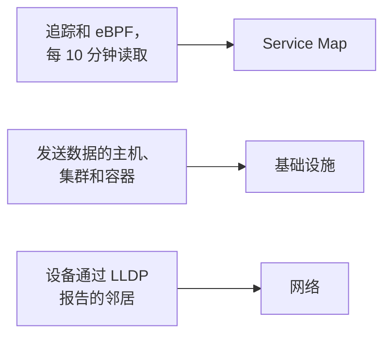

# 拓扑

拓扑描绘你的系统如何连接：哪些服务调用哪些服务、什么在哪里运行，以及你的网络设备如何布线。OneUptime 根据你已经在发送的遥测构建它，因此无需手动绘制，而且一眼就能看出错误和事件在哪里。

:::cards
- [打开拓扑](#打开拓扑): 同一页面上的三个视图。
- [阅读服务地图](#阅读服务地图): 谁调用谁，以及这些调用有多健康。
- [探索你的基础设施](#探索你的基础设施): 每个服务在哪里运行。
- [打开资源自己的地图](#打开资源自己的地图): 深入查看一个 vCenter、集群或主机。
- [查看你的网络](#查看你的网络): 设备及其链路，实时显示。
:::

## 地图如何构建

拓扑的每个视图都由不同类型的遥测构建：

- **只绘制活跃过的内容。** 视图显示在时间范围内发送过数据的服务和资源，以及在该范围内观察到的连接。打开 **显示不活跃项** 可同时绘制沉默的部分。
- **调用按最近的时间窗口统计。** OneUptime 每 10 分钟查找一次服务之间的调用，流量数字覆盖最近 15 分钟，而不是整个时间范围。
- **网络视图是实时的。** 它显示设备当前的连接方式，因此没有时间范围。

## 开始之前

- **正在到达的遥测。** 服务地图需要追踪：请参阅 [OpenTelemetry](/docs/telemetry/open-telemetry)。基础设施视图需要一台发送数据的主机或一个集群：请参阅 [Kubernetes 代理](/docs/telemetry/kubernetes-agent)。网络视图需要网络设备：请参阅 [网络设备监控](/docs/monitor/network-device-monitor)。
- **能够读取遥测的角色。** Project Owner、Project Admin、Project Member、Viewer、Telemetry Admin、Telemetry Member 或 Telemetry Viewer，或者拥有 Read Telemetry Service 权限的自定义角色。

## 打开拓扑

前往 **产品 → 可观测性 → 拓扑**。**资产清单 → Topology Map** 会打开同一个页面。页面打开时显示 **过去 1 天** 的 **Service Map**。

| 视图 | 它回答的问题 |
| --- | --- |
| **Service Map** | 哪些服务相互依赖？ |
| **基础设施** | 你的基础设施中什么在哪里运行？ |
| **网络** | 你的网络设备是如何连接的？ |

在时间选择器旁边，**显示不活跃项** 会加入在该范围内没有发送数据的内容，刷新按钮会重新加载视图。**显示内容 · 关于这些数据** 说明视图绘制了什么以及多久计算一次。地址栏会记住你所在的视图，因此你分享的链接会打开同一个视图。

## 阅读服务地图

**Service Map** 绘制每个发送过数据的服务，以及它们调用的数据库、API 和消息代理，即使后者自己不发送遥测。箭头从调用方指向被调用方，线越粗表示请求越多。上方的计数显示它绘制了多少服务、依赖和连接，以及其中多少需要关注。

每个服务都会显示其状态，根据它在最近 15 分钟内收到的调用计算：

| 状态 | 条件 |
| --- | --- |
| **健康** | 收到的调用中最多 1% 失败。 |
| **Some errors** | 超过 1% 且少于 5% 失败。 |
| **High error rate** | 5% 或更多失败。 |
| **Entry point** | 它没有收到调用，但发出过调用：例如 Web 前端或计划任务。 |
| **No calls observed** | 它既没有发出也没有收到调用。 |

有活跃事件或警报的服务会改为显示其数量，并且与处于 **Some errors** 或 **High error rate** 的服务一样，算作需要关注。

:::steps
### 找到需要关注的服务

点击 **需要关注**，只保留这些服务及其直接连接，或者在地图上方的搜索框中按名称搜索。

### 打开一个服务

点击一个服务，查看它最近 15 分钟的请求、错误和平均延迟，它的 **活跃事件** 和 **活跃警报**，以及指向 **此服务的追踪** 和 **清单详情** 的链接。

### 打开一个连接

点击一个箭头，查看它的请求速率、错误率和平均延迟。在你已插桩的两个服务之间，它还有调用、错误和延迟的 **History**。
:::

**连接标签** 会在每个箭头上写一个数字：**请求速率**、**错误率** 或 **平均延迟**，也可以在鼠标悬停之前不显示。**表格** 列出同样的服务及其 **请求**、**错误率**、**平均延迟** 和 **连接**，**在地图上显示** 会把其中一个绘制到地图上。

## 探索你的基础设施

**基础设施** 显示你的服务在哪里运行：集群、主机、Pod、容器，以及其他发送数据的资源。同一工作负载的副本会合并为一个条目，你可以打开任何内容查看其内部。

- **按你的方式浏览。** 以 **列表** 或 **地图** 显示，从整个基础设施一直到单个 Pod。上方的计数显示它绘制了多少资源和工作负载、能放置多少服务，以及省略了多少沉默的资源。
- **查找资源。** 按名称搜索，然后点击 **查看详情** 打开它的页面。
- **在视图之间切换。** 资源上列出的服务会在 **Service Map** 中打开，服务所运行的资源会在 **基础设施** 中打开。

## 打开资源自己的地图

vCenter、Kubernetes 集群、主机、Docker 或 Podman 主机、Docker Swarm、Proxmox 或 Ceph 集群以及存储阵列，各自都有自己的 **拓扑** 页面。它根据该资源自己的清单深入绘制这一个资源：什么在什么里面，每个部分按其状态着色，每个未关闭的事件和警报都显示在它所涉及的部分上。

- **找到需要关注的内容。** **需要关注** 只保留有问题的部分及通往每个部分的路径，搜索可以找到资源中任何位置的部分。
- **仔细查看。** 点击某个部分可查看它是什么以及指向其自身页面的链接，点击 **聚焦于此** 则只绘制该部分、其内部内容及与其关联的内容。
- **双向往返。** **在拓扑中打开** 会在 **基础设施** 中打开该资源，而其 **打开 vCenter 拓扑**、**打开集群拓扑**、**打开主机拓扑** 或 **打开存储阵列拓扑** 按钮会带你回来。

## 查看你的网络

**网络** 是你的网络设备的实时地图，根据设备通过 LLDP（在 Cisco 设备上还有 CDP）报告的邻居构建。它没有时间选择器：连接会自行刷新。

如果你把设备分组到站点中，视图会在你的站点上打开：选择一个站点，或者切换到 **All devices**。**Map options** 用于排列地图并选择要包含的内容，**导出 PDF** 会保存你看到的地图。网络设备的页面也会绘制同样的地图：请参阅 [网络拓扑](/docs/monitor/network-device-monitor#网络拓扑)。

## 故障排除

:::details 服务地图显示了服务，但没有连接
OneUptime 每 10 分钟在你的追踪中查找一次服务之间的调用。当请求把追踪上下文（`traceparent` 请求头）从一个已插桩的服务带到下一个服务时（就像 OpenTelemetry 的 HTTP 和 gRPC 插桩那样）、当服务为它调用的数据库和 API 报告客户端 Span 时，或者当 Kubernetes 代理在启用 eBPF 的情况下运行时，它就能看到调用。
:::

:::details 我移除的服务仍然在地图上
它在时间范围内发送过数据。请选择更短的范围，或等到它最后的遥测超出该范围。打开 **显示不活跃项** 时，地图还会绘制已经停止发送数据的内容。
:::

:::details 地图提示只显示了其中一部分
非常大的项目会达到地图的上限，并会有通知说明它显示了多少资源或连接。搜索一个服务，或在表格中使用 **在地图上显示**，以绘制可读的一部分。
:::

## 后续步骤

:::cards
- [服务目录](/docs/telemetry/services): 关于一个服务的一切。
- [跟踪浏览器](/docs/telemetry/traces-explorer): 每个箭头背后的请求。
- [资产清单概览](/docs/inventory/overview): 地图绘制的每个资源。
- [网络设备监控](/docs/monitor/network-device-monitor): 把你的网络放到地图上。
:::
