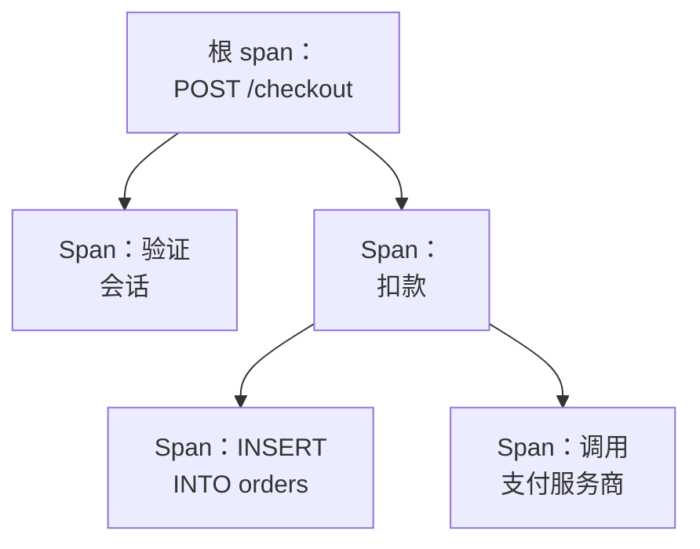

# 跟踪浏览器

跟踪浏览器帮你找到经过你的服务的请求：慢的、失败的、涉及某个客户账户的。搜索并过滤你的服务发送的 span，然后打开一条追踪，以瀑布图、火焰图或服务地图查看请求的每一步。

:::cards
- [查找请求](#查找请求): 搜索 span，然后按服务、状态或类型过滤。
- [阅读追踪](#阅读追踪): 时间花在了哪里，哪一步失败了。
- [用图表展示 span](#用图表展示-span): 请求数和响应时间，按你的方式分组。
- [追踪洞察](#追踪洞察): 错误率、延迟和最慢的请求。
- [用 AI 查找并修复慢操作和失败的操作](#用-ai-查找并修复慢操作和失败的操作): 修复它们、并补上追踪所缺埋点的拉取请求。
:::

## 追踪和 span

一条追踪就是一个请求在你的系统中经过的路径。它的每一步，例如一个 HTTP 处理程序、一次数据库查询或对另一个服务的调用，都是一个 span，而 span 会嵌套在启动它们的 span 之内。追踪的第一个 span 没有父级，它就是根 span：请求的入口。

浏览器的每一行都是一个 span，所以繁忙的服务会用它的数据库查询和内部调用填满列表。要让每个请求只显示一行，请在侧栏的 **Span 类别** 下选择 **Root spans**。

浏览器有五个标签页：

| 标签页 | 用途 |
| --- | --- |
| **查看者** | 搜索和过滤 span，并打开它们的追踪。打开时显示最近一小时的 span，最新在前，每页 50 个。 |
| **洞察** | 每个服务的请求率、错误率和延迟，以及值得一看的请求。 |
| **人工智能** | OneUptime 在你的追踪中发现的慢操作、失败的操作和缺失的追踪埋点，以及 OneUptime AI 对它们做了什么。参见 [用 AI 查找并修复慢操作和失败的操作](#用-ai-查找并修复慢操作和失败的操作)。 |
| **设置指南** | 如何使用你的某个 [摄取密钥](/docs/telemetry/ingestion-keys)，通过 OpenTelemetry 发送追踪。 |
| **设置** | span 到达时会发生什么：**管道**、**丢弃过滤器**、**清理规则** 和 **记录规则**。 |

## 开始之前

- **正在到达的追踪。** 使用 [OpenTelemetry](/docs/telemetry/open-telemetry) 为你的服务埋点。**设置指南** 标签页会显示适合你的语言的代码。
- **可以读取遥测的角色。** Project Owner、Project Admin、Project Member、Viewer、Telemetry Admin、Telemetry Member 或 Telemetry Viewer，或者拥有 Read Telemetry Service Traces 权限的自定义角色。角色的范围决定你能看到谁的 span：参见 [遥测](/docs/permissions/index#遥测)。

## 查找请求

:::steps
### 打开查看者

前往 **产品 → 可观测性 → 跟踪**。**查看者** 按最新在前列出最近一小时的 span，每个都带有状态、服务、名称和持续时间。

### 选择时间范围

在时间选择器中选择一个范围，或者在列表上方的图表上拖动，放大某个峰值。双击图表即可缩小回去。参见 [放大时间范围](/docs/telemetry/charts-and-time-ranges)。

### 搜索

输入查询并按 Enter，例如 `service:checkout status:error duration:>500`。单独的词会搜索 span 名称，`@key:value` 会搜索某个属性，例如 `@http.route:/orders`。参见 [搜索语法](/docs/telemetry/search-syntax#追踪)。

### 用过滤条件缩小范围

点击 **过滤器** 侧栏中的某个值，把它添加为筛选标签。侧栏可以按 **服务**、发送该 span 的主机、集群或其他资源、**状态**、**Span 类别**、**存在异常**、**Span 类型**、**Span 名称**、**服务实例** 和 **主机名称** 过滤。

### 打开 span

点击一行将其展开：它的属性，以及它记录的日志和异常。点击 **See full trace** 打开整条追踪。
:::

你的搜索、筛选标签和时间范围都保存在页面地址中，因此刷新、书签或分享出去的链接都会打开相同的 span。

## 阅读追踪

追踪页面以请求的几个数字开头：

| 数字 | 含义 |
| --- | --- |
| 持续时间 | 整个请求花了多长时间。 |
| Span 数 | 追踪包含多少个 span。 |
| 服务数 | 请求经过了多少个服务。 |
| 错误数 | 有多少个 span 以错误状态结束。点击它只显示这些 span。 |
| 深度 | 嵌套 span 的最深链条。 |

在它们下方，从四种视图中选择一种：

| 视图 | 显示内容 |
| --- | --- |
| **Waterfall** | 时间线上的每个 span，嵌套在启动它的 span 之下。打开 **Critical path** 可以突出显示决定请求耗时的那条 span 链。 |
| **火焰图** | 以堆叠条形显示同一棵树，最宽的条耗时最长。 |
| **Service map** | 请求经过的服务，以及它们之间的调用。 |
| **Operations** | 每个服务和 span 名称一行，显示调用数、错误、自身耗时和总耗时。从同一个父 span 调用 10 次或以上的操作会被标记：这通常是 N+1 查询，或可以批量处理的循环。 |

在任意视图中点击一个 span 即可打开它的面板，其中有属性、事件、日志、异常和链接标签页，有的话还有它的性能剖析或 LLM 调用。用视图旁边的搜索框（按 `/`）按名称、ID 或服务搜索追踪中的 span，打开 **Errors only** 则只保留失败的 span。

大型追踪每次加载 500 个 span。点击追踪底部的按钮可以加载更多，或全部加载。

> [!TIP]
> **使用 AI 修复性能问题** 只会出现在值得修复的追踪上：其中有 N+1 查询、本可以并行却依次执行的调用，或一个占用请求大部分时间的调用，并且确实耗费了时间（这些调用合计 100 ms 或以上，单个调用 500 ms 或以上，且至少占请求的十分之一）。它会说明发现了什么，例如“同一条数据库查询在 ReportService.build 中执行了 40 次”，并启动一个 AI 任务，打开一个修复该问题的 pull request。如果此追踪的修复已经完成，它会链接到该修复的任务，而不是再提供一次修复。如果有其他原因让 AI 无法工作，例如套餐、已用完的 AI 积分或没有在线的 Runner，它会说明原因，并给出解决问题的链接。参见 [代码](/docs/ai/ai-agent)。

## 用图表展示 span

列表上方的图表按状态拆分，显示 span 数量随时间的变化。在图表标题中选择其他度量，即可改为显示它们的平均、中位数（P50）或 P95 响应时间。

想看更多，请把列表从 **跨度** 切换到 **Analytics**。选择时间序列、排行列表或表格；度量请求数、错误数或响应时间（平均值、P50、P90、P95、P99、最小值或最大值）；按 span 名称、服务、状态、span 类型或任意属性分组，然后再按第二个字段分组。排行列表或表格显示前 5 到 100 个分组。

## 跟随、保存和分享

- 点击列表上方的 **已暂停** 打开实时更新。按钮随后显示为 **实时**，列表每 10 秒检查一次新的 span。再次点击即可暂停。
- **已保存的视图** 会以一个名称为项目中的每个人保留搜索、过滤条件和时间范围。保存的视图与 [日志浏览器](/docs/telemetry/logs-explorer#保存视图) 中的用法相同。
- **日志** 和 **指标** 按钮会针对同一时间窗口打开相应的浏览器，并尽可能带上它们能使用的过滤条件。指向按钮即可看到它无法带过去的内容。

## 追踪洞察

**洞察** 标签页汇总某个时间范围内的请求：

- 请求数、错误率，以及 P50、P95 和 P99 延迟；
- 按错误率排序的服务健康表，需要关注的服务排在最前；
- 最近失败的请求，以及最慢的请求。

用时间选择器旁边的下拉菜单把它限定到部分服务。

## 用 AI 查找并修复慢操作和失败的操作

OneUptime 每小时在每个服务最近一小时的追踪中查找很慢、会失败或其追踪无法说明原因的操作，并将发现连同证据记录为 AI 洞察。随后 OneUptime AI 会调查每一条，并打开一个修复它的拉取请求。绝不会自动合并：每个拉取请求都由你的团队审查。

操作是一个服务中同名的 span，例如 `GET /orders`。服务在最近一小时内发送了至少 100 个 span 后，OneUptime 就会读取它，并记录三类发现：

| 发现 | OneUptime 何时记录 | 拉取请求 |
| --- | --- | --- |
| **慢操作** | 在至少 20 个 span 上，操作的 P99 为 1 秒或更长，且其最慢的请求重复一种耗费实际时间的模式：同一调用一再重复、本可并行却依次进行的调用，或占用请求大部分时间的单个调用。 | 让操作更快。 |
| **失败的操作** | 操作至少有 20 个 span 失败，占 5% 或更多，且最近的失败通过异常或错误消息说明了原因。 | 修复它失败的原因。 |
| **缺失的追踪埋点** | 追踪无法说明原因：一个服务的 500 个或更多 span 每个都是其追踪的根，下面没有该服务的 span；一个慢请求把 60% 或更多的时间（且 500 ms 或更多）花在一个下面没有任何追踪的 span 中；或者一个操作的失败既没有记录错误消息，也没有记录异常。 | 补上缺失的追踪埋点。 |

只有在找到出错的代码后，OneUptime AI 才会自行为失败的操作打开拉取请求。来自其他地方的失败，例如某个依赖宕机，不会得到拉取请求，除非有人通过 **用 AI 修复** 请求一个。

### 开启

**跟踪 → 人工智能 → 设置** 中有 **查找并修复慢操作和失败的操作** 开关，新项目默认开启。当 **启用 AI** 关闭时，仍会发现慢操作和失败的操作，但 OneUptime AI 不会对它们做任何事。要打开拉取请求，OneUptime AI 需要在 [代码](/docs/ai/ai-agent) 中连接的存储库：页面会先说明缺少什么。每个存储库的代码都在该存储库于“代码”中选择的 Runner 上修改。

OneUptime AI 每天（UTC）最多自行打开 5 个拉取请求，每条发现一个，且绝不超过存储库对打开的 AI 拉取请求的上限。

### AI 规则

没有规则时，OneUptime AI 会立即调查它在你的追踪中发现的每个问题，并为每个它能修复的问题打开拉取请求。**更多设置** 下的 **AI 规则** 会分三步缩小范围：

| 步骤 | 决定什么 |
| --- | --- |
| **匹配** | 哪些服务：所选的服务、带有特定标签的服务，或名称匹配某个模式的服务。 |
| **调查** | **立即**，或 **仅在等待后仍被发现时**：在等待期间消失的问题不会被调查。 |
| **修复** | **不修复**、**修复前先询问** 或 **无需询问直接修复**。先询问时，拉取请求交给人来打开：这条发现会提供 **用 AI 修复**。 |

在 **更多字段** 中，规则会选择 OneUptime AI 可为其使用的代码存储库、MCP 服务器和 LLM 提供商。若未选择任何项，它可以使用全部，并使用项目的默认 LLM 提供商。

### 查看它做了什么

- **跟踪 → 人工智能 → 洞察** 列出 OneUptime 发现的内容，每条发现都附有证据和 **在追踪中打开**，它会在 **查看者** 中打开这条发现所涉及的、发现当时那一小时的 span。对于失败的操作，**创建监视器** 会针对其失败的 span 设置一个追踪监视器。
- **跟踪 → 人工智能 → 日志** 按最新优先列出每次调查和每个拉取请求，以及各自的状态和每次调查的发现。
- 在“代码”中，任务会说明是 OneUptime 启动的，并附有指向其发现的链接，拉取请求则会说明打开它的原因。

## span 到达时会发生什么

**设置** 标签页包含 OneUptime 在 span 到达时应用的规则，与日志的做法相同。它们作用于之后到达的 span，而不是已存储的 span。每个 span 保留多长时间，也是在它到达时决定的：请参阅 [数据保留](/docs/telemetry/data-retention)。

| 规则 | 作用 |
| --- | --- |
| **丢弃过滤器** | 丢弃你不想保留的 span，或者只保留其中的一部分样本。参见 [丢弃或采样记录](/docs/telemetry/drop-filters-and-scrub-rules#丢弃或采样记录)。 |
| **清理规则** | 遮盖 span 属性中的敏感数据。参见 [清理敏感数据](/docs/telemetry/drop-filters-and-scrub-rules#清理敏感数据)。 |
| **管道** | 更改和丰富 span：每个管道用过滤条件匹配 span，然后依次运行它的处理器。 |
| **记录规则** | 每分钟把 span 数、错误数和持续时间转换为新的指标。参见 [日志记录规则](/docs/telemetry/log-recording-rules)。 |

## 故障排除

:::details 追踪提示找不到 span
span 通常在请求结束后一分钟内到达。点击追踪页面上的 **刷新** 再检查一次。
:::

:::details 有些 span 位于瀑布图的顶层
它们指向一个 OneUptime 尚未收到的父 span，通常是因为写入父 span 的服务还没有把追踪发送到 OneUptime。也为那个服务埋点。
:::

:::details 列表的行数远多于请求数
每一行是一个 span，而不是一个请求。在侧栏的 **Span 类别** 下选择 **Root spans**，让每个请求只显示一行。
:::

## 后续步骤

:::cards
- [搜索语法](/docs/telemetry/search-syntax): 搜索框能理解的所有过滤条件。
- [跟踪监控](/docs/monitor/traces-monitor): 在请求失败或变慢时收到警报。
- [异常跟踪](/docs/telemetry/exceptions): 分诊你的 span 记录的错误。
- [日志浏览器](/docs/telemetry/logs-explorer): 阅读一个请求写下的日志行。
:::
