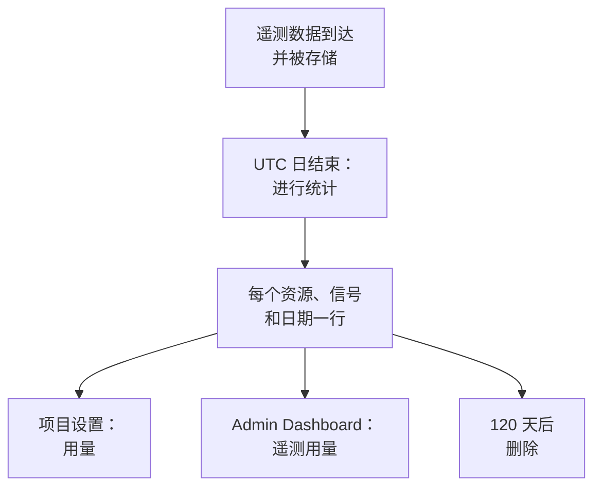

# 遥测用量

查看每个项目及其中每个服务或资源发送了多少遥测数据：日志、指标、追踪及其异常、性能剖析数据、会话回放和安全事件。每个 OneUptime 安装都会统计用量，无论是否启用计费，因此你无需查询 ClickHouse 就能找出是什么占满了存储。

:::cards
- [用量如何统计](#用量如何统计): 每天一次，按资源和信号统计。
- [查看项目的用量](#查看项目的用量): 项目设置 → 遥测与 APM → 用量。
- [查看所有项目的用量](#查看所有项目的用量): Admin Dashboard，供实例管理员使用。
- [用量保留多长时间](#用量保留多长时间): 未更改时为 120 天。
:::

## 用量如何统计

每天一次，在一天按 UTC 结束后，OneUptime 会按信号统计每个项目的每个资源当天发送的数据，并把统计结果保存为每个资源、信号和日期一行。



- **一天结束后才会统计。** 每一天大约在次日 08:00 UTC 前统计完成，因此今天的用量明天才会显示。未能统计的日期会在一周内重试。
- **大小是存储的大小。** 每个信号按存储它的行在压缩前的大小统计。会话回放按录制器上传的字节数统计。
- **追踪包含其异常，性能剖析数据包含其样本。**
- **OneUptime 自己的遥测不计入。** 监视器、警报、事件和 SLO 的读数、数据可观测性的读数以及会话回放预算指标都由 OneUptime 自己写入。
- **在 OneUptime Cloud 上，遥测按这些行计费。** 在没有计费的安装上，用量的统计不产生任何费用，也不会为其收费，即使之后启用了计费也是如此。

## 开始之前

- **能读取项目遥测的角色。** 项目所有者、项目管理员、项目成员、查看者、遥测管理员、遥测成员或遥测查看者，或者某个账单角色。角色必须覆盖整个项目：仅限于某些标签的角色看不到用量。
- **项目中有遥测数据。** 用量统计的是项目的 [摄取密钥](/docs/telemetry/ingestion-keys) 发送的遥测数据。

## 查看项目的用量

:::steps
### 打开用量

前往 **项目设置 → 遥测与 APM → 用量**。侧边菜单中的 **遥测与 APM** 默认是折叠的：点击它即可展开。

### 选择时间范围

页面默认显示 **最近 30 天**。在 **遥测用量** 卡片右上角的框中选择 **最近 7 天** 或 **最近 90 天**。时间范围截止到昨天，即已统计的最近一天。

### 找出增长的部分

**按资源统计的用量** 卡片列出在该时间范围内发送过数据的每个服务和资源，用量最大的排在最前。点击列标题可按该列排序，点击资源名称可打开其页面。
:::

该页面有三张卡片：

| 卡片 | 显示内容 |
| --- | --- |
| **遥测用量** | 该时间范围的 **总计**、每个信号的总计，以及每天的图表，各信号堆叠显示。 |
| **按资源统计的用量** | 每个 **资源** 及其类型、每个信号一列、**总计**，以及其遥测数据的 **保留期**。 |
| **遥测使用历史** | 每个信号、资源和日期一行，可按 **产品**、**天** 和 **服务** 筛选。 |

未指明服务的遥测数据列为 **未知服务**。此后已被删除的资源，或你的角色无法读取其类型的资源，会以其类型和 ID 的开头列出。

## 谁能看到什么

| 角色 | 能看到 |
| --- | --- |
| 项目所有者、项目管理员、账单管理员、账单成员、账单查看者、Manage Billing | 每个资源发送了多少数据、保留多长时间，以及在 OneUptime Cloud 上的费用 |
| 项目成员、查看者、遥测管理员、遥测成员、遥测查看者 | 每个资源发送了多少数据以及保留多长时间 |

用量的费用只在 OneUptime Cloud 上显示：没有计费的安装不会为用量收费。价格请参阅 [账单与用量](/docs/configuration/billing#使用历史)。

## 查看所有项目的用量

在自托管安装上，实例管理员可以在 Admin Dashboard 中查看所有项目的用量：

:::steps
### 打开遥测用量

在 Admin Dashboard 中打开菜单，点击 **遥测用量**。列表显示在该时间范围内发送过数据的每个项目，用量最大的排在最前，每个信号一列，另有 **总计**。

### 找出用量最大的项目

在卡片右上角选择时间范围，然后点击列标题按该列排序：**总计**、某个信号，或按名称排序的 **项目**。

### 打开项目

点击项目名称。它在 Admin Dashboard 中 **项目** 下的 **遥测用量** 页面按日期、信号和资源显示其用量，与项目成员看到的一致。
:::

## 用量保留多长时间

无论是否启用计费，用量都会保留 120 天，除非你更改。这是用量统计数据的保留时长，而不是遥测数据本身的保留时长：后者请参阅 [数据保留](/docs/telemetry/data-retention)。

:::steps
### 打开数据保留

在 Admin Dashboard 中，前往 **设置 → 数据保留**。

### 设置天数

在 **遥测用量保留** 卡片上，点击 **编辑遥测用量保留**，在 **遥测用量保留期（天）** 中输入 30 到 1095 之间的天数，然后点击 **保存更改**。留空则为 120 天。
:::

早于该时长的用量每天删除一次。保留期绝不短于 30 天：已统计的日期绝不会被删除后再统计一次。

## 通过 API 读取用量

`GET /api/telemetry-usage/project` 返回一个项目在一段 UTC 日期范围内的用量，与页面显示的一致。使用拥有上述角色之一的 [API 密钥](/docs/permissions/index#api-密钥) 调用它：

```bash
curl 'https://oneuptime.com/api/telemetry-usage/project?startDay=2026-10-01&endDay=2026-10-31' \
  -H "ApiKey: $ONEUPTIME_API_KEY"
```

`startDay` 和 `endDay` 是写成 `YYYY-MM-DD` 的日期，两端都包含在内，范围最长可达 1095 天。响应包含总计、每天按信号的用量和每个资源按信号的用量，单位为 GB；只有在启用计费且该密钥能读取账单时才包含费用。

## 故障排除

:::details 用量页面显示“暂无遥测用量”
一天按 UTC 结束后才会统计，约在次日 08:00 UTC 前完成：今天才开始发送数据的项目明天才会显示第一天。请在各个探索器中确认项目收到了遥测数据。
:::

:::details 数字比我的 ClickHouse 磁盘占用还大
用量是行在压缩前的大小。ClickHouse 会压缩它存储的数据，因此它占用的磁盘要小好几倍。
:::

:::details 资源以其类型和 ID 列出
该资源在发送遥测数据后已被删除，或者你的角色无法读取这类资源。它的用量仍会被统计。
:::

## 后续步骤

:::cards
- [丢弃过滤器与清理规则](/docs/telemetry/drop-filters-and-scrub-rules): 停止存储你不需要的遥测数据。
- [数据保留](/docs/telemetry/data-retention): 按需保留遥测数据，不多留一天。
- [账单与用量](/docs/configuration/billing): OneUptime Cloud 上遥测的费用。
- [摄取密钥](/docs/telemetry/ingestion-keys): 把遥测发送到你的项目。
:::
