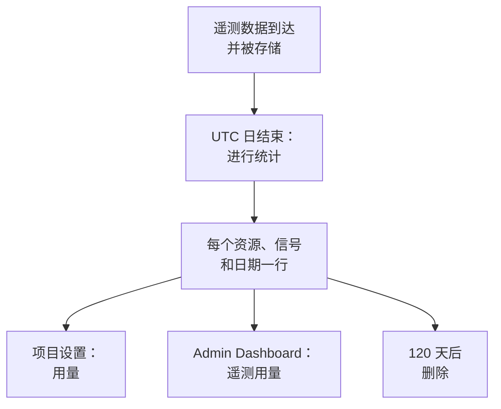

# 遥测用量

查看每个项目及其中每个服务或资源发送了多少遥测数据：日志、指标、追踪、异常、性能剖析数据、会话回放和安全事件。每个 OneUptime 安装都会统计用量，无论是否启用计费，因此你无需查询 ClickHouse 就能找出是什么占满了存储。

:::cards
- [用量如何统计](#用量如何统计): 每天一次，按资源和信号统计。
- [查看项目的用量](#查看项目的用量): 项目设置 → 遥测与 APM → 用量。
- [随数据到达查看用量图表](#随数据到达查看用量图表): 每 5 分钟一次，以指标形式。
- [查看所有项目的用量](#查看所有项目的用量): Admin Dashboard，供实例管理员使用。
- [用量保留多长时间](#用量保留多长时间): 未更改时为 120 天。
:::

## 用量如何统计

每天一次，在一天按 UTC 结束后，OneUptime 会按信号统计每个项目的每个资源当天发送的数据，并把统计结果保存为每个资源、信号和日期一行。



- **一天结束后才会统计。** 每一天大约在次日 08:00 UTC 前统计完成，因此今天的用量明天才会显示。未能统计的日期会在一周内重试。
- **大小是存储的大小。** 每个信号按存储它的行在压缩前的大小统计。会话回放按录制器上传的字节数统计。
- **异常单独显示。** 从跨度和日志中记录的异常有单独的总计、单独的一列，并在图表中单独占一部分，**追踪** 统计的是跨度，**日志** 统计的是日志记录。异常没有单独的行：每个追踪行或日志行会注明其中有多少是异常。在异常单独显示之前统计的日期，异常仍像以前一样包含在 **追踪** 中。
- **性能剖析数据包含其样本。**
- **OneUptime 自己的遥测不计入。** 监视器、警报、事件和 SLO 的读数、数据可观测性的读数以及会话回放预算指标都由 OneUptime 自己写入。
- **在 OneUptime Cloud 上，遥测按这些行计费。** 在没有计费的安装上，用量的统计不产生任何费用，也不会为其收费，即使之后启用了计费也是如此。
- **异常随发现它的产品计费。** 在 OneUptime Cloud 上，在跨度中发现的异常随 **追踪** 计费，在日志记录中发现的异常随 **日志** 计费。日志和追踪每 GB 的价格相同，因此每个异常只按同样的价格计费一次，只发送日志的项目也绝不会被收取追踪费用。在日志中发现的异常改为随 **日志** 计费之前统计的日期，这些异常仍保留在 **追踪** 中。
- **预算与用量分开计数。** [摄取预算](/docs/telemetry/ingestion-budgets) 在遥测数据到达时按解压后的大小计数，因此可以在当天就拦下当天的遥测数据。设置了预算时，此页面最上方会显示今天的预算。异常没有单独的预算：它们计入其所属的追踪或日志的预算。

## 开始之前

- **能读取项目遥测的角色。** 项目所有者、项目管理员、项目成员、查看者、遥测管理员、遥测成员或遥测查看者，或者某个账单角色。角色必须覆盖整个项目：仅限于某些标签的角色看不到用量。
- **项目中有遥测数据。** 用量统计的是项目的 [摄取密钥](/docs/telemetry/ingestion-keys) 发送的遥测数据。

## 查看项目的用量

:::steps
### 打开用量

前往 **项目设置 → 遥测与 APM → 用量**。侧边菜单中的 **遥测与 APM** 默认是折叠的：点击它即可展开。

### 选择时间范围

页面默认显示 **最近 30 天**。在 **遥测用量** 卡片右上角的框中选择 **最近 7 天** 或 **最近 90 天**。时间范围截止到昨天，即已统计的最近一天。

### 找出增长的部分

**按资源统计的用量** 卡片列出在该时间范围内发送过数据的每个服务和资源，用量最大的排在最前。点击列标题可按该列排序，点击资源名称可打开其页面。
:::

该页面有三张卡片：

| 卡片 | 显示内容 |
| --- | --- |
| **遥测用量** | 该时间范围的 **总计**、每个信号的总计，以及每天的图表，各信号堆叠显示。 |
| **按资源统计的用量** | 每个 **资源** 及其类型、每个信号一列、**总计**，以及其遥测数据的 **保留期**。 |
| **遥测使用历史** | 每个产品、资源和日期一行，可按 **产品**、**天** 和 **服务** 筛选。**追踪** 行包含其跨度及在其中发现的异常，**日志** 行包含其日志记录及在其中发现的异常，与它们的计费方式一致。每一行都在 **已引入的数据（GB）** 列中注明其中有多少是异常。 |

未指明服务的遥测数据列为 **未知服务**。此后已被删除的资源，或你的角色无法读取其类型的资源，会以其类型和 ID 的开头列出。

## 谁能看到什么

| 角色 | 能看到 |
| --- | --- |
| 项目所有者、项目管理员、账单管理员、账单成员、账单查看者、Manage Billing | 每个资源发送了多少数据、保留多长时间，以及在 OneUptime Cloud 上的费用 |
| 项目成员、查看者、遥测管理员、遥测成员、遥测查看者 | 每个资源发送了多少数据以及保留多长时间 |

用量的费用只在 OneUptime Cloud 上显示：没有计费的安装不会为用量收费。价格请参阅 [账单与用量](/docs/configuration/billing#使用历史)。

## 随数据到达查看用量图表

用量行要到第二天才会出现。要在几分钟内用图表查看每个服务发送了多少，并在它发送得更多时收到警报，项目所有者或项目管理员可以把项目的用量发布为指标：

:::steps
### 开启

前往 **项目设置 → 遥测与 APM → 用量**，打开页面底部的 **更多设置**，然后在 **以指标形式查看用量** 卡片上开启 **将用量发布为指标**。切换后会立即保存。

### 查看图表

OneUptime 每 5 分钟把每个服务和资源在这 5 分钟内每个信号发送的量写成指标 `oneuptime.telemetry.usage.bytes`，单位为字节 (`By`)。在 [指标浏览器](/docs/telemetry/metrics-explorer) 中查看其总和的图表，或者用 [指标监控](/docs/monitor/metrics-monitor) 针对它发出警报。
:::

每个数据点都带有以下属性：

| 属性 | 值 |
| --- | --- |
| `projectId` | 项目的 ID。 |
| `signal` | `logs`、`traces`、`metrics` 或 `profiles`。 |
| `resourceType` | 资源的类型：服务为 `OpenTelemetry`，主机为 `Host`，依此类推。 |
| `resourceId` | 服务或资源的 ID。 |
| `resourceName` | 写入数据点时它的名称。 |

- **随到达计数。** 每个数据点是该资源在到达数据中所占的份额，按解压后的大小计算，与摄取预算的计数方式相同，因此可能比统计已存储数据的用量行更大。
- **通过 OpenTelemetry 发送。** 通过 OTLP 发送的日志、追踪、指标和性能剖析数据会被计数。安全事件、会话回放以及来自 Fluent Bit、Fluentd 或 syslog 的日志不会。
- **每个数据点属于其资源。** 能读取某个服务或资源遥测数据的人，就能读取它的数据点：仅限部分标签的角色只能看到这些标签的数据点。
- **它们不产生任何费用。** 这些数据点不计入任何预算，也不计为用量，其保留时长与监控指标相同：除非实例管理员更改，否则为 30 天。以 `oneuptime.telemetry.usage.` 开头的指标名称为它们保留：你的应用以这样的名称发送的指标会被丢弃。
- **默认关闭。** 关闭时不会写入任何内容，已写入的数据点会保留到过期为止。

## 查看所有项目的用量

在自托管安装上，实例管理员可以在 Admin Dashboard 中查看所有项目的用量：

:::steps
### 打开遥测用量

在 Admin Dashboard 中打开菜单，点击 **遥测用量**。列表显示在该时间范围内发送过数据的每个项目，用量最大的排在最前，每个信号一列，另有 **总计**。

### 找出用量最大的项目

在卡片右上角选择时间范围，然后点击列标题按该列排序：**总计**、某个信号，或按名称排序的 **项目**。

### 打开项目

点击项目名称。它在 Admin Dashboard 中 **项目** 下的 **遥测用量** 页面按日期、信号和资源显示其用量，与项目成员看到的一致。
:::

## 用量保留多长时间

无论是否启用计费，用量都会保留 120 天，除非你更改。这是用量统计数据的保留时长，而不是遥测数据本身的保留时长：后者请参阅 [数据保留](/docs/telemetry/data-retention)。

:::steps
### 打开数据保留

在 Admin Dashboard 中，前往 **设置 → 服务器 → 数据保留**。

### 设置天数

在 **遥测用量保留** 卡片上，点击 **编辑遥测用量保留**，在 **遥测用量保留期（天）** 中输入 30 到 1095 之间的天数，然后点击 **保存更改**。留空则为 120 天。
:::

早于该时长的用量每天删除一次。保留期绝不短于 30 天：已统计的日期绝不会被删除后再统计一次。

## 通过 API 读取用量

`GET /api/telemetry-usage/project` 返回一个项目在一段 UTC 日期范围内的用量，与页面显示的一致。使用拥有上述角色之一的 [API 密钥](/docs/permissions/index#api-密钥) 调用它：

```bash
curl 'https://oneuptime.com/api/telemetry-usage/project?startDay=2026-10-01&endDay=2026-10-31' \
  -H "ApiKey: $ONEUPTIME_API_KEY"
```

`startDay` 和 `endDay` 是写成 `YYYY-MM-DD` 的日期，两端都包含在内，范围最长可达 1095 天。响应包含总计、每天按信号的用量和每个资源按信号的用量，单位为 GB；只有在启用计费且该密钥能读取账单时才包含费用。异常位于 `Exceptions` 下，与 `Traces` 和 `Logs` 分开；在异常单独显示之前统计的日期，其异常包含在 `Traces` 中。

## 故障排除

:::details 用量页面显示“暂无遥测用量”
一天按 UTC 结束后才会统计，约在次日 08:00 UTC 前完成：今天才开始发送数据的项目明天才会显示第一天。请在各个探索器中确认项目收到了遥测数据。
:::

:::details 数字比我的 ClickHouse 磁盘占用还大
用量是行在压缩前的大小。ClickHouse 会压缩它存储的数据，因此它占用的磁盘要小好几倍。
:::

:::details 资源以其类型和 ID 列出
该资源在发送遥测数据后已被删除，或者你的角色无法读取这类资源。它的用量仍会被统计。
:::

:::details 追踪在异常出现的那天减少了
以前，异常计入 **追踪** 中。从单独统计异常的第一天起，**追踪** 统计跨度，**异常** 统计异常。两者相加等于原来的 **追踪**，也就是追踪的计费依据。
:::

:::details 从某一天起日志费用增加、追踪费用减少
以前，在日志记录中发现的异常随 **追踪** 计费。从变更后统计的第一天起，它们随发现它们的产品 **日志** 计费。日志和追踪每 GB 的价格相同，因此两者加起来的费用与以前相同。
:::

## 后续步骤

:::cards
- [丢弃过滤器与清理规则](/docs/telemetry/drop-filters-and-scrub-rules): 停止存储你不需要的遥测数据。
- [数据保留](/docs/telemetry/data-retention): 按需保留遥测数据，不多留一天。
- [账单与用量](/docs/configuration/billing): OneUptime Cloud 上遥测的费用。
- [摄取密钥](/docs/telemetry/ingestion-keys): 把遥测发送到你的项目。
- [摄取预算](/docs/telemetry/ingestion-budgets): 限制项目一天内每个信号最多发送多少。
:::
