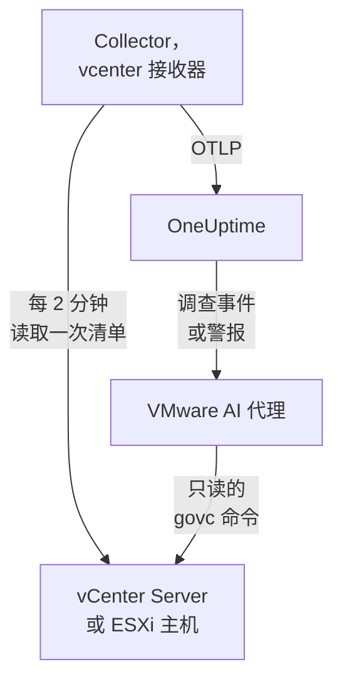

# VMware 代理

OneUptime VMware 代理监控 VMware vSphere：vCenter Server、ESXi 主机、虚拟机、数据存储、集群、资源池和 vSAN。它是一个标准的 OpenTelemetry Collector，其 [`vcenter` 接收器](https://github.com/open-telemetry/opentelemetry-collector-contrib/tree/main/receiver/vcenterreceiver) 使用只读用户读取 vSphere API，为每个指标打上你的 vCenter 名称，并发送到 OneUptime：vCenter 上无需插件，VM 内部也无需安装任何东西。[VMware 监控](/docs/monitor/vmware-monitor) 会根据收到的数据发出警报。

:::cards
- [安装代理](#安装代理): 先创建只读用户，然后使用安装脚本、Docker Compose 或 systemd。
- [代理收集的内容](#代理采集的内容): 每个 vSphere 对象、它的身份和它的指标。
- [AI 代理](#ai-代理): 让 OneUptime AI 在调查时读取 vCenter。
- [故障排查](#故障排查): 一个诊断脚本，以及常见问题。
:::

## 工作原理

一个代理监控一个 vSphere 端点：一个 **vCenter Server**，涵盖它管理的每个数据中心、集群和主机；或者一台不受任何 vCenter 管理的 **独立 ESXi 主机**。每个 vCenter 运行一个代理。Collector 每次收集时遍历一次整个清单（默认每 2 分钟一次），并为每个对象发送一个资源。同一个 Compose 文件还会在旁边运行供 OneUptime AI 使用的 VMware AI 代理。不想运行 Docker？同一个 Collector 使用同样的配置，也可以作为 systemd 服务运行在任何 Linux 机器上。



vCenter 会随其第一批数据，以代理作为 `vmware.vcenter.name` 打到每个指标上的名称自行注册。若要完全不运行代理来监控 vCenter，请参见 [无需代理的 VMware](/docs/telemetry/vmware-agentless)：你的某个探针会用只读帐户收集相同的数据。

## 开始之前

- Docker Engine 20.10 或更高版本，带 Docker Compose v2 插件；或者，若不使用 Docker 安装，则需要一台装有 systemd 235 或更高版本的 Linux 机器（x86_64 或 arm64）。无论哪种方式，该机器都必须能通过 HTTPS（TCP 443）访问 vCenter。
- vCenter Server 或 ESXi 7.0 或更高版本：接收器支持 vSphere 7 和 8。
- 一个能创建 vSphere 用户并在顶层 vCenter 对象上为其授予角色的帐户。
- 一个摄取密钥。在 **项目设置 → 遥测与 APM → 摄取密钥** 下创建一个并复制其值。

### 在哪里运行代理

代理通过 HTTPS 与 vCenter 通信，因此不必运行在它附近；理想情况下，它既不应运行在 vCenter Server Appliance 上，也不应运行在它所监控集群中的 VM 里：一旦该集群宕机，你的监控也会随之宕机。独立硬件上的一台小型管理 VM、一台监控主机，或任何运行 Docker（或者在不用 Docker 时，任何带 systemd 的 Linux 机器）并能通过 TCP 443 访问 vCenter 的机器，都是合适的位置。可选的 syslog 监听器还要求 ESXi 主机能通过 syslog 端口访问代理（参见 [发送 ESXi syslog](#可选-发送-esxi-syslog)）。

## 安装代理

:::steps
### 创建只读 vSphere 用户

代理只做读取：清单、性能计数器和 vSAN 统计信息。请给它一个专用帐户，并使用内置的 **Read-Only** 角色，而不是管理员。

:::tabs
@tab vSphere Client
1. 创建帐户：打开 _Menu → Administration → Single Sign On → Users and Groups_，选择 `vsphere.local` 域（或你的身份源），单击 **Add**，将用户命名为 `oneuptime` 并设置密码。该用户就是 `oneuptime@vsphere.local`。
2. 授予角色：在 _Hosts and Clusters_ 清单中选择顶层的 **vCenter Server** 对象，打开 **Permissions** 选项卡，单击 **Add**，选择该用户，将角色设为 **Read-Only**，并勾选 **Propagate to children**。
@tab govc
在具有管理员凭据的机器上：

```bash
govc sso.user.create -p 'a-strong-password' -R ReadOnly oneuptime
govc permissions.set -principal oneuptime@vsphere.local -role ReadOnly -propagate=true /
```
@tab PowerCLI
在以管理员身份连接到 vCenter 的会话中：

```powershell
New-SsoPersonUser -UserName oneuptime -Password 'a-strong-password'
New-VIPermission -Entity (Get-Folder -NoRecursion) -Principal 'VSPHERE.LOCAL\oneuptime' -Role ReadOnly -Propagate:$true
```
@tab ESXi Host Client
对于独立 ESXi 主机（没有 vCenter），在 _Host → Manage → Security & Users → Users_ 下创建用户，并在 _Host → Manage → Security & Users → Permissions_ 下为其授予 Read-Only 角色。或者在主机的 shell 中运行 `esxcli system account add`，然后运行 `esxcli system permission set --id oneuptime --role ReadOnly`。
:::

> [!IMPORTANT]
> 传播是人们容易遗漏的部分。接收器会遍历数据中心、集群、主机、VM、数据存储和资源池，用户看不到的每个对象都会被静默忽略。在 vCenter 对象上授予但未启用传播的 Read-Only 角色，只会得到一个空清单和一个全是零的仪表板。

### 安装并启动代理

:::tabs
@tab install.sh
下载安装脚本，并在将要托管代理的机器上运行它：

```bash
curl -sSL https://raw.githubusercontent.com/OneUptime/oneuptime/master/agents/VMwareAgent/install.sh -o install.sh
bash install.sh
```

脚本会询问你的 OneUptime URL、摄取密钥、vCenter 名称、vCenter 端点和只读凭据（读取密码时不回显），以及 AI 代理是否可以应用修复（如果可以，还会询问它专用的 vSphere 用户以及它绝不能更改的 VM）。它安装到 `/opt/oneuptime-vmware-agent`，写入一个 `0600` 权限的 `.env` 文件，并用 Docker Compose 启动代理。它会按你输入的原样为 Docker Compose 给每个值加上引号，因此包含 `$`、`#`、空格或引号的密码也能按输入的原样工作。再次运行脚本会复用现有 `.env` 中的所有内容，不会再次询问，这就是 [升级代理](#升级代理) 的方式。
@tab Docker Compose
从 [VMwareAgent 目录](https://github.com/OneUptime/oneuptime/tree/master/agents/VMwareAgent) 下载 `docker-compose.yml` 和 `otel-collector-config.yaml` 到一个新文件夹中，然后在它们旁边创建一个 `.env` 文件。它保存着密码，因此请用 `chmod 600 .env` 保持其私密：

```bash title=".env"
ONEUPTIME_URL=YOUR_ONEUPTIME_URL
ONEUPTIME_TELEMETRY_INGESTION_KEY=YOUR_TELEMETRY_INGESTION_TOKEN
VMWARE_VCENTER_NAME=my-vcenter
VCENTER_ENDPOINT=https://vcsa.example.com
VCENTER_USERNAME=oneuptime@vsphere.local
VCENTER_PASSWORD=a-strong-password
VCENTER_INSECURE_SKIP_VERIFY=true
VCENTER_COLLECTION_INTERVAL=2m
```

包含 `$`、`#`、空格或引号的密码要放在单引号中（参见 [vCenter 拒绝登录](#故障排查)）。启动代理：

```bash
docker compose up -d
```
@tab systemd
代理不需要 Docker：它就是一个 OpenTelemetry Collector 二进制文件和一个配置文件。在装有 systemd 235 或更高版本的 Linux 机器（x86_64 或 arm64；Ubuntu 18.04、Debian 10、RHEL 8 或更新版本）上，将代理固定的 `otelcol-contrib` 版本与同一个 `otel-collector-config.yaml` 一起作为 systemd 服务运行。代理为此提供的单元 [`oneuptime-vmware-agent-native.service`](https://github.com/OneUptime/oneuptime/blob/master/agents/VMwareAgent/systemd/oneuptime-vmware-agent-native.service) 会以一个临时的非特权用户运行 Collector，不带任何 capabilities，也没有任何可写入的位置。

下载 Collector、配置和单元，并将它们安装到 `/opt/oneuptime-vmware-agent`：

```bash
cd "$(mktemp -d)"
VERSION=0.161.0   # the collector release the agent pins
ARCH=$(uname -m | sed 's/x86_64/amd64/;s/aarch64/arm64/')
curl -fL -o otelcol-contrib.tar.gz \
  https://github.com/open-telemetry/opentelemetry-collector-releases/releases/download/v${VERSION}/otelcol-contrib_${VERSION}_linux_${ARCH}.tar.gz
curl -fsSLO https://raw.githubusercontent.com/OneUptime/oneuptime/master/agents/VMwareAgent/otel-collector-config.yaml
curl -fsSL -o oneuptime-vmware-agent.service \
  https://raw.githubusercontent.com/OneUptime/oneuptime/master/agents/VMwareAgent/systemd/oneuptime-vmware-agent-native.service

sudo install -d -m 0755 /opt/oneuptime-vmware-agent
sudo tar --no-same-owner --preserve-permissions -xzf otelcol-contrib.tar.gz -C /opt/oneuptime-vmware-agent otelcol-contrib
sudo install -m 0644 otel-collector-config.yaml /opt/oneuptime-vmware-agent/otel-collector-config.yaml
sudo install -m 0644 oneuptime-vmware-agent.service /etc/systemd/system/oneuptime-vmware-agent.service
```

设置写在 `/opt/oneuptime-vmware-agent/.env` 中：与 Docker 安装的 `.env` 相同的变量。它保存着密码，因此在打开之前，请让它只有 root 可读：

```bash
sudo touch /opt/oneuptime-vmware-agent/.env
sudo chmod 600 /opt/oneuptime-vmware-agent/.env
sudoedit /opt/oneuptime-vmware-agent/.env
```

在其中写入以下内容：

```bash
ONEUPTIME_URL=YOUR_ONEUPTIME_URL
ONEUPTIME_TELEMETRY_INGESTION_KEY=YOUR_TELEMETRY_INGESTION_TOKEN
VMWARE_VCENTER_NAME=my-vcenter
VCENTER_ENDPOINT=https://vcsa.example.com
VCENTER_USERNAME="oneuptime@vsphere.local"
VCENTER_PASSWORD="a-strong-password"
VCENTER_INSECURE_SKIP_VERIFY=true
VCENTER_COLLECTION_INTERVAL=2m
```

读取这个文件的是 systemd，而不是 shell：把用户名和密码放在双引号中，每个 `\` 写作 `\\`，每个 `"` 写作 `\"`（`DOMAIN\user` 写作 `"DOMAIN\\user"`），而 `$`、`#`、`'` 和空格按原样写入。这是所有 systemd 版本都以相同方式读取的形式；较旧的版本（例如 RHEL 8 的版本）即使在单引号内也会丢掉反斜杠。然后启动代理，并让它在每次开机时启动：

```bash
sudo systemctl daemon-reload
sudo systemctl enable oneuptime-vmware-agent
sudo systemctl restart oneuptime-vmware-agent
```

这种安装只运行 Collector：[AI 代理](#ai-代理) 仅以容器镜像形式提供。每个 vCenter 运行一个代理：如果你要从 Docker 安装迁移过来，请先在那里运行 `docker compose down`，否则每个指标都会到达两次。
:::

### 验证安装

检查代理是否在运行，并阅读 Collector 的日志：

```bash
docker compose ps
docker logs -f oneuptime-vmware-agent
```

用 systemd 安装的？请改为检查服务及其日志：

```bash
systemctl status oneuptime-vmware-agent --no-pager
sudo journalctl -u oneuptime-vmware-agent -f
```

Collector 启动后，其日志中应出现这一行：

```text
Everything is ready. Begin running and processing data.
```

### 在 OneUptime 中找到 vCenter

在第一次完整的清单遍历完成之前不会发送任何数据，因此请等待一个收集间隔（默认 2 分钟）。然后打开 **产品 → 基础设施 → VMware → 所有 vCenter**：vCenter 就在那里，带有它的数据中心、集群、ESXi 主机、虚拟机、数据存储和资源池。
:::

## 环境变量

Docker Compose 从 `.env`（位于 `docker-compose.yml` 旁边）中读取这些变量；systemd 安装从 `/opt/oneuptime-vmware-agent/.env` 中读取它们，其单元提供相同的默认值。

| 变量 | 必需 | 说明 |
| --- | --- | --- |
| `ONEUPTIME_URL` | 是 | 你的 OneUptime URL，例如 `https://oneuptime.com` 或你的自托管实例。如果实例只支持 HTTP，请使用 `http://` 及其端口。 |
| `ONEUPTIME_TELEMETRY_INGESTION_KEY` | 是 | 来自 **项目设置 → 遥测与 APM → 摄取密钥** 的摄取密钥。 |
| `VMWARE_VCENTER_NAME` | 是 | vCenter 在 OneUptime 中的名称，作为 `vmware.vcenter.name` 资源属性打到每个指标上。请保持不变：之后更改它会注册另一个 vCenter。默认为 `vmware-vcenter`。 |
| `VCENTER_ENDPOINT` | 是 | vCenter Server 或独立 ESXi 主机的协议和主机，**不带** `/sdk`，例如 `https://vcsa.example.com`。 |
| `VCENTER_USERNAME` | 是 | 具有 Read-Only 角色的 vSphere 用户，例如 `oneuptime@vsphere.local`（对于 Active Directory 身份源则为 `DOMAIN\user`）。 |
| `VCENTER_PASSWORD` | 是 | 该用户的密码。如果其中包含 `$`、`#`、空格或引号，在 Docker 安装的 `.env` 中要用单引号括起来（`install.sh` 会替你完成），在 systemd 安装的文件中则用双引号括起来（参见 [故障排除](#故障排查)）。 |
| `VCENTER_INSECURE_SKIP_VERIFY` | 否 | `true` 接受 vCenter 默认的自签名（VMCA）证书；`false` 保持 TLS 验证开启。默认为 `false`。 |
| `VCENTER_COLLECTION_INTERVAL` | 否 | 读取整个清单的频率。对于非常大的 vCenter，请调高到 `5m` 或 `10m`。默认为 `2m`。 |

AI 代理自己的设置见 [AI 代理](#ai-代理)。

## 代理采集的内容

每隔 `VCENTER_COLLECTION_INTERVAL`，接收器会遍历整个 vSphere 清单，并为每个对象发送一个 OpenTelemetry 资源。每个对象的身份都在它的 **资源属性** 中——`vcenter.datacenter.name`、`vcenter.cluster.name`、`vcenter.host.name`、`vcenter.vm.name` / `vcenter.vm.id`、`vcenter.datastore.name`、`vcenter.resource_pool.name` / `vcenter.resource_pool.inventory_path`——代理还会在此之上添加 `vmware.vcenter.name`，因此 OneUptime 会把所有内容归到你的 vCenter 之下：

| vSphere 对象 | 身份（资源属性） | 指标 |
| --- | --- | --- |
| 数据中心 | `vcenter.datacenter.name` | `vcenter.datacenter.cluster.count`、`vcenter.datacenter.host.count`、`vcenter.datacenter.vm.count`、`vcenter.datacenter.datastore.count`、`vcenter.datacenter.disk.space`、`vcenter.datacenter.cpu.limit`、`vcenter.datacenter.memory.limit` |
| 集群 | + `vcenter.cluster.name` | `vcenter.cluster.cpu.effective`、`vcenter.cluster.cpu.limit`、`vcenter.cluster.memory.effective`、`vcenter.cluster.memory.limit`、`vcenter.cluster.host.count`、`vcenter.cluster.vm.count`、`vcenter.cluster.vm_template.count`、`vcenter.cluster.vsan.*`（吞吐量、操作、延迟、拥塞） |
| ESXi 主机 | + `vcenter.host.name`（主机在集群中时还有 `vcenter.cluster.name`） | `vcenter.host.cpu.usage` / `.capacity` / `.utilization` / `.reserved`、`vcenter.host.memory.usage` / `.utilization` / `.capacity`、`vcenter.host.disk.latency.avg` / `.latency.max` / `.throughput`、`vcenter.host.network.usage` / `.throughput` / `.packet.rate` / `.packet.drop.rate` / `.packet.error.rate`、`vcenter.host.vsan.*` |
| 虚拟机 | + `vcenter.host.name`、`vcenter.vm.name`、`vcenter.vm.id`（实例 UUID）；`vcenter.resource_pool.*` 或 `vcenter.virtual_app.*` | `vcenter.vm.disk.usage`、`vcenter.vm.disk.utilization`、`vcenter.vm.memory.usage` / `.utilization` / `.ballooned` / `.swapped` / `.swapped_ssd`；仅限已开机的 VM：`vcenter.vm.cpu.usage`、`vcenter.vm.cpu.readiness`、`vcenter.vm.cpu.utilization`、`vcenter.vm.disk.latency.avg` / `.latency.max` / `.throughput`、`vcenter.vm.network.*`、`vcenter.vm.vsan.*` |
| VM 模板 | `vcenter.vm_template.name`、`vcenter.vm_template.id` | 仅 `vcenter.vm.disk.usage` |
| 数据存储 | + `vcenter.datastore.name` | `vcenter.datastore.disk.usage`、`vcenter.datastore.disk.utilization` |
| 资源池 | + `vcenter.resource_pool.name`、`vcenter.resource_pool.inventory_path` | `vcenter.resource_pool.cpu.usage` / `.cpu.shares`、`vcenter.resource_pool.memory.usage` / `.memory.shares` / `.memory.ballooned` / `.memory.swapped` / `.memory.granted` |

计数和容量类指标会按 **数据点属性** 展开，而这正是你在监控条件中用来筛选和分组的依据：

| 属性 | 取值 | 所在指标 |
| --- | --- | --- |
| `direction` | 磁盘为 `read` / `write`，网络为 `transmitted` / `received` | 磁盘延迟和吞吐量、网络吞吐量和数据包速率 |
| `disk_state` | `available` / `used` | `vcenter.datastore.disk.usage`、`vcenter.vm.disk.usage`、`vcenter.datacenter.disk.space` |
| `status` | `red` / `yellow` / `green` / `gray`（对象在 vSphere 中的总体状态） | `vcenter.datacenter.cluster.count` / `.host.count` / `.vm.count` |
| `power_state` | 主机：`on` / `off` / `standby` / `unknown`；VM：`on` / `off` / `suspended` / `unknown` | `vcenter.datacenter.host.count` / `.vm.count`、`vcenter.cluster.vm.count` |
| `effective` | `true` / `false`（以字符串存储） | `vcenter.cluster.host.count` |
| `object` | 网卡、磁盘或 vCPU 实例（例如 `vmnic0`） | 主机和 VM 按设备划分的磁盘和网络序列 |
| `cpu_reservation_type` | `total` / `used` | `vcenter.host.cpu.reserved` |
| `type` | 内存：`guest` / `host` / `overhead`、`private` / `shared`；vSAN：`read` / `write` / `unmap` | 资源池内存序列、vSAN 延迟和操作 |

单位是接收器自己的 OTLP 单位，由 OneUptime 换算后显示：CPU 使用量和容量为 `MHz`，利用率和 CPU 就绪为 `%`，主机、VM 和资源池的内存为 `MiBy`，集群和数据中心的内存以及所有磁盘空间为 `By`，主机和 VM 的磁盘延迟为 `ms`，vSAN 延迟为 `us`（微秒）。在监控条件中，身份属性要加上 `resource.` 前缀（`resource.vcenter.host.name`、`resource.vmware.vcenter.name`），而数据点属性保持原样（`disk_state`、`power_state`、`status`）。

`vcenter.host.memory.capacity` 在上游默认关闭；随附的配置将其打开，因为 OneUptime 计算主机内存利用率时要除以它。`otel-collector-config.yaml` 中的一条注释列出了其他可选指标（`vcenter.vm.cpu.time`、`vcenter.vm.memory.granted`、`vcenter.host.memory.active`、`vcenter.host.memory.ballooned`、`vcenter.host.memory.granted`、`vcenter.vm.network.broadcast.packet.rate`、`vcenter.vm.network.multicast.packet.rate`）：可以用同样的方式打开其中任何一个。

### VM 电源状态

接收器不会发送 VM 的电源状态指标。它 **只为已开机的 VM** 发送 `vcenter.vm.cpu.*`，因此 OneUptime 会根据每次收集中到达的内容推断状态：报告了 CPU 指标的 VM 为 **Powered on**；只报告了内存和磁盘使用量的 VM 为 **Powered off**（或已挂起：vSphere 在这里不区分两者）。VM 模板没有电源状态。这种推断 **一次读取一整次收集**，所以随附的 `batch` 处理器设置了很大的 `send_batch_size`，并且有意不设置 `send_batch_max_size`：一次收集如果被拆分到两次导出中，就会把清单计数清零并把 VM“关机”。请保持随附的 batch 设置不变。

## OneUptime 中的 vCenter


**概览** 页面首先回答“这个 vCenter 是否健康”：有效主机、按容量加权的主机 CPU 和内存、最满的数据存储，以及 VM 最差的 CPU 就绪时间。当某项性能下降时，它会指出负责的对象，你无需自己去找。

### ESXi 主机


### 虚拟机


已关机的虚拟机和模板也会列出。vCenter 只为已开机的 VM 报告 CPU 计数器，因此它们的 CPU 列显示 N/A，而不是一个具有误导性的零。

### 数据存储


## 可选 — 发送 ESXi syslog

默认情况下，代理只发送指标，因此 vCenter 的 **日志** 页面保持为空。ESXi 主机（以及 vCenter 本身）可以把 syslog 转发到任何监听器，随附的 `otel-collector-config.yaml` 中有一对已注释掉的 `syslog` 接收器（端口 5514 上的 TCP 和 UDP，RFC 3164：ESXi 自己的格式），连接到一个已注释掉的 `logs` 管道，该管道会打上 `vmware.vcenter.name`，使日志落到你的 vCenter 上。

:::steps
### 打开接收器

取消注释两个 `syslog/*` 接收器和 `logs` 管道（位于 `otel-collector-config.yaml` 中）。

### 开放端口

取消注释 `ports:` 块（位于 `docker-compose.yml` 中），让机器发布 `5514/tcp` 和 `5514/udp`，然后运行 `docker compose up -d`。使用 systemd 时无需发布端口，因为 Collector 直接在机器上监听：请改为运行 `sudo systemctl restart oneuptime-vmware-agent`。在机器的防火墙中为 ESXi 管理网络开放该端口。

### 让每台 ESXi 主机指向代理

在 vSphere Client 中选择主机，打开 _Configure → System → Advanced System Settings_，编辑 `Syslog.global.logHost` 并将其设为 `udp://<agent-host>:5514`（或 `tcp://<agent-host>:5514`；多个目标用逗号分隔）。然后在 _Configure → System → Firewall → Edit → syslog_ 下允许出站流量。或者在每台主机上使用 `esxcli`：

```bash
esxcli system syslog config set --loghost='udp://<agent-host>:5514'
esxcli system syslog reload
esxcli network firewall ruleset set --ruleset-id=syslog --enabled=true
```

使用 PowerCLI 对整个集群进行设置：`Get-VMHost | Get-AdvancedSetting -Name Syslog.global.logHost | Set-AdvancedSetting -Value 'udp://<agent-host>:5514' -Confirm:$false`。
:::

一个 syslog 接收器只在一种传输方式上监听，所以 TCP 和 UDP 是两个接收器：如果只需要其中一个，就让另一个保持注释状态。对于 TLS syslog（`ssl://`），请在代理前面终止 TLS；接收器本身使用普通的 TCP 和 UDP。标准 Collector 镜像可以原样读取 syslog：不需要自定义镜像。

## 用项目标签标记 vCenter

以 `oneuptime.label.` 开头的资源属性会成为 vCenter 上的项目标签：`oneuptime.label.<dimension>=<value>` 就是标签 `<dimension>:<value>`。在 `resource` 处理器（位于 `otel-collector-config.yaml` 中）里，紧挨着 `vmware.vcenter.name` 添加这些属性：

```yaml
processors:
  resource:
    attributes:
      # ...existing attributes...
      - key: oneuptime.label.team
        value: platform
        action: upsert
      - key: oneuptime.label.env
        value: production
        action: upsert
```

Collector 只在启动时读取其配置：请运行 `docker compose restart oneuptime-vmware-agent`，使用 systemd 时则运行 `sudo systemctl restart oneuptime-vmware-agent`。之后 vCenter 会显示标签 `team:platform` 和 `env:production`。标签匹配不区分大小写，因此现有的 `Production` 标签会被复用而不是重复创建，并且代理绝不会删除别人在 OneUptime 中添加的标签。

## 作为 systemd 服务运行

Docker 安装也可以在 systemd 下运行，使其随机器启动并在失败时重启。它的单元封装了 Docker Compose，并假定代理位于 `/opt/oneuptime-vmware-agent`，即安装脚本放置它的位置：

```bash
sudo curl -fsSL https://raw.githubusercontent.com/OneUptime/oneuptime/master/agents/VMwareAgent/systemd/oneuptime-vmware-agent.service -o /etc/systemd/system/oneuptime-vmware-agent.service
sudo systemctl daemon-reload
sudo systemctl enable --now oneuptime-vmware-agent
```

不使用 Docker 的安装本身就是一个 systemd 服务，带有自己的单元。

## 升级代理

代理会把其文件固定的 Collector 版本报告为它的 **代理版本**。当该版本早于此 OneUptime 版本固定的版本时，vCenter 的 **概览** 页面和 **所有 vCenter** 列表中会在它旁边出现一个警告标志。选择它即可查看这些命令。在其文件开始报告版本之前安装的代理不会显示版本，直到以这种方式升级为止。

Collector 固定在 `docker-compose.yml` 中（不使用 Docker 时则由你下载的版本固定），其配置是旁边的一个文件，因此仅拉取镜像并不能让代理升级：

:::tabs
@tab install.sh
请再次运行 `install.sh`：它会复用你现有 `.env` 中的每个值（不会再询问任何内容），刷新 `docker-compose.yml` 和 `otel-collector-config.yaml`，并重新创建代理，使 Collector 读取新的配置。

```bash
curl -sSL https://raw.githubusercontent.com/OneUptime/oneuptime/master/agents/VMwareAgent/install.sh -o install.sh
bash install.sh
```
@tab Docker Compose
在代理的文件夹中重新下载这两个文件（并重新做一遍你对它们所做的任何修改），然后拉取镜像并重新创建代理：

```bash
curl -fsSLO https://raw.githubusercontent.com/OneUptime/oneuptime/master/agents/VMwareAgent/docker-compose.yml
curl -fsSLO https://raw.githubusercontent.com/OneUptime/oneuptime/master/agents/VMwareAgent/otel-collector-config.yaml
docker compose pull
docker compose up -d --force-recreate
```
@tab systemd
再次运行安装命令：它们会下载此 OneUptime 固定的版本以及最新的 `otel-collector-config.yaml` 和单元，并保持你的 `.env` 不变（请重新做一遍你对配置所做的任何修改）。然后重启服务：

```bash
cd "$(mktemp -d)"
VERSION=0.161.0   # the collector release the agent pins
ARCH=$(uname -m | sed 's/x86_64/amd64/;s/aarch64/arm64/')
curl -fL -o otelcol-contrib.tar.gz \
  https://github.com/open-telemetry/opentelemetry-collector-releases/releases/download/v${VERSION}/otelcol-contrib_${VERSION}_linux_${ARCH}.tar.gz
curl -fsSLO https://raw.githubusercontent.com/OneUptime/oneuptime/master/agents/VMwareAgent/otel-collector-config.yaml
curl -fsSL -o oneuptime-vmware-agent.service \
  https://raw.githubusercontent.com/OneUptime/oneuptime/master/agents/VMwareAgent/systemd/oneuptime-vmware-agent-native.service

sudo install -d -m 0755 /opt/oneuptime-vmware-agent
sudo tar --no-same-owner --preserve-permissions -xzf otelcol-contrib.tar.gz -C /opt/oneuptime-vmware-agent otelcol-contrib
sudo install -m 0644 otel-collector-config.yaml /opt/oneuptime-vmware-agent/otel-collector-config.yaml
sudo install -m 0644 oneuptime-vmware-agent.service /etc/systemd/system/oneuptime-vmware-agent.service
sudo systemctl daemon-reload
sudo systemctl restart oneuptime-vmware-agent
```
:::

## 卸载代理

:::tabs
@tab Docker Compose
```bash
cd /opt/oneuptime-vmware-agent
docker compose down
```
@tab systemd
```bash
sudo systemctl disable --now oneuptime-vmware-agent
sudo rm /etc/systemd/system/oneuptime-vmware-agent.service
sudo systemctl daemon-reload
sudo rm -r /opt/oneuptime-vmware-agent
```
:::

然后，如果不再需要，请在 vCenter 中删除 `oneuptime` 用户的权限，如果你为 AI 代理创建过专用用户，也一并删除。

## AI 代理

代理的 `docker-compose.yml` 还会运行 **VMware AI 代理**，即 `oneuptime-vmware-ai-agent`（镜像 `oneuptime/resource-ai-agent:release`）。当 OneUptime AI 调查此 vCenter 上的事件或警报时，它通过该代理运行只读的 `govc` 命令——`govc vm.info web-01`、`govc events -n 50 /DC/vm/web-01`、`govc metric.sample -n 12 /DC/vm/web-01 cpu.usage.average`——并且仅在你允许时应用修复，例如把 VM 重新开机。它和 Collector 一样，注册为名为 `VMWARE_VCENTER_NAME` 的 vCenter，并显示在 OneUptime 中该 vCenter 的 **人工智能 → AI 代理** 页面上。

- **AI 调查默认开启。** 代理连接后，OneUptime AI 会用它来调查该 vCenter 上的事件和警报，vCenter 的 **概览** 页面会显示代理的状态。要停止，请在代理运行的位置设置 `ONEUPTIME_AI_INVESTIGATION=false`（AI 代理页面上 **AI 可以执行的操作** 下的 **更改** 会显示方法），或者不安装代理。
- **vSphere 角色就是硬性边界。** 调查以 Collector 的 **Read-Only** 用户（`VCENTER_USERNAME` / `VCENTER_PASSWORD`）登录，该用户只能读取，别无他用。修复需要一个 AI 代理专用的用户，其角色可以为 VM 开机、关机和重置（`VirtualMachine.Interact.PowerOn`、`PowerOff` 和 `Reset`），只在 AI 可以修复的文件夹上授予，并设置为 `ONEUPTIME_AI_VCENTER_USERNAME` / `ONEUPTIME_AI_VCENTER_PASSWORD`。
- 除非你设置 `ONEUPTIME_AI_ALLOW_WRITES=true`，否则它是 **只读** 的；`ONEUPTIME_AI_WRITE_TARGETS`（VM 和主机名称或清单路径）限制修复可以触及的范围。它绝不会更改以 `VCENTER_ENDPOINT` 中的主机命名的 VM（通常是 vCenter 设备），并且只通过这个名称识别设备：当 `VCENTER_ENDPOINT` 是 IP 地址，或者设备的 VM 另有名称时，请把该 VM 连同代理运行所在的 VM 一起放入 `ONEUPTIME_AI_PROTECTED_TARGETS`。`ONEUPTIME_AI_FIXES`（位于同一个 `.env` 中）决定修复如何运行——`ask-for-approval`（由人逐一批准）、`automatic` 或 `bypass-approval`——AI 代理页面会以只读方式显示它（[AI 可以执行的操作，由代理设定](/docs/ai/infrastructure-ai-agents#what-ai-may-do-set-by-the-agent)）。
- 若要验证 vCenter 的证书而不是跳过验证，请把它的 CA 挂载到容器中并设置 `VCENTER_CA_FILE`；在有多个数据中心的 vCenter 上，请设置 `GOVC_DATACENTER`。
- 它以 UID 1000 运行且不带任何 capabilities，绝不运行客户机操作、快照、`esxcli` 或任何创建或销毁 VM 的操作。如果你不使用 OneUptime AI，请把 `oneuptime-vmware-ai-agent` 服务从 `docker-compose.yml` 中删除。
- 不使用 Docker 的安装没有 AI 代理：它仅以容器镜像形式提供。要添加一个，请在任何能访问 vCenter 的机器上用 Docker 运行它——下载 `docker-compose.yml`，在它旁边写一个 `.env`，填入 `/opt/oneuptime-vmware-agent/.env` 中的设置，并按 Docker Compose 的要求用单引号括起来，然后用 `docker compose up -d oneuptime-vmware-ai-agent` 只启动 AI 代理（不要启动 Collector，它已经在运行）。

它可以运行什么、修复如何工作以及如何排查它的问题：[Infrastructure AI Agents](/docs/ai/infrastructure-ai-agents#vmware-vcenter)。代理的 README 中有修复角色的确切命令。

## 故障排查

:::details 先运行诊断脚本
代理附带一个脚本 [`troubleshoot.sh`](https://github.com/OneUptime/oneuptime/blob/master/agents/VMwareAgent/troubleshoot.sh)，它会检查整条链路：容器运行时、vCenter 是否响应并接受凭据、打到每个指标上的 vCenter 名称、令牌的格式、Collector 自身的指标，以及 OneUptime 是否接受摄取密钥。最后一项检查最重要。OneUptime 会以 `401` 拒绝错误的密钥（已禁用的密钥或浏览器密钥为 `422`），而 Collector 会把两者都视为永久性错误：它丢弃该批次并记录一条 `Exporting failed` 错误，而容器仍保持健康，这很容易被忽略。该脚本从代理的网络内部请求 `GET <url>/otlp/v1/validate`，直接得到 `200`（有效）或 `401`（无效），在较旧的服务器上回退到 `POST /fluentd/v1/logs`，并以同样的方式请求 `<VCENTER_ENDPOINT>/sdk/vimServiceVersions.xml`，因此 DNS、防火墙和 TLS 故障会以 Collector 遇到时的样子完全呈现出来。

```bash
curl -sSL https://raw.githubusercontent.com/OneUptime/oneuptime/master/agents/VMwareAgent/troubleshoot.sh -o troubleshoot.sh
bash troubleshoot.sh    # add -d <dir> if you installed outside /opt/oneuptime-vmware-agent
```

它最后会输出一个指明最可能原因的结论。
:::

:::details 不使用 Docker 安装时
诊断脚本需要 Docker。没有 Docker 时，Collector 直接在机器上运行，因此请直接检查同一条链路：服务及其日志、Collector 自身网络路径上的 vCenter API、OneUptime 是否接受摄取密钥（`"valid":true` 以及 `"keyType":"Server"`），以及 Collector 自身的计数器。它在 `127.0.0.1:8890` 上提供这些计数器，而不是 `8888`，以便能与另一个 Collector 并行运行：

```bash
systemctl status oneuptime-vmware-agent --no-pager
sudo journalctl -u oneuptime-vmware-agent -n 100 --no-pager
curl -sk https://<vcenter-host>/sdk/vimServiceVersions.xml
curl -s -H "x-oneuptime-token: <key>" https://<oneuptime-host>/otlp/v1/validate
curl -s http://127.0.0.1:8890/metrics | grep -E 'otelcol_(receiver_accepted|exporter_sent|exporter_send_failed)_metric_points'
```

该日志的读法与容器日志相同，因此下面的条目同样适用。不断重启的服务会记录原因：`Failed with result 'resources'` 表示 systemd 无法读取 `/opt/oneuptime-vmware-agent/.env`，`cannot unmarshal the configuration` 或 `requires positive value` 表示其中某个值不是 Collector 接受的值。systemd 用自己的规则读取 `.env`，较旧的版本（例如 RHEL 8 的版本）即使在单引号内也会丢掉反斜杠：请把用户名和密码放在双引号中，每个 `\` 写作 `\\`，每个 `"` 写作 `\"`，这是所有版本都按原样读取的唯一形式。由于 Collector 信任机器的 CA 存储，你可以保持 TLS 验证开启：把 vCenter 的根证书（`.0` 文件，位于 `certs/lin/` 下，包含在 `https://<vcenter>/certs/download.zip` 中）添加到 `/usr/local/share/ca-certificates/` 并使用 `.crt` 名称，然后在 Debian 和 Ubuntu 上运行 `update-ca-certificates`；或者添加到 `/etc/pki/ca-trust/source/anchors/`，然后在 RHEL 上运行 `update-ca-trust`；之后重启服务。
:::

:::details OneUptime 中没有出现 vCenter
1. 查看 Collector 的日志：`docker logs oneuptime-vmware-agent`。登录错误（`incorrect user name or password`、`InvalidLogin`）表示凭据错误，`x509: certificate signed by unknown authority` 表示在自签名证书上开启了 TLS 验证，`connection refused` 或 `no such host` 表示 `VCENTER_ENDPOINT` 错误，导出时出现 `401` 表示摄取密钥错误。
2. 检查 vCenter 是否能从代理的网络中响应。Collector 镜像没有 shell 也没有 curl，因此请从其网络中的一个容器发起请求：`docker run --rm --network container:oneuptime-vmware-agent curlimages/curl -sk https://<vcenter-host>/sdk/vimServiceVersions.xml` 应输出一个提到 `urn:vim25` 的 XML 文档。
3. 检查 `VMWARE_VCENTER_NAME` 是否已设置：vCenter 是通过其 `vmware.vcenter.name` 资源属性找到的。
4. 等待一个收集间隔：在第一次完整的清单遍历完成之前不会发送任何数据。
:::

:::details vCenter 显示为已断开
当 OneUptime 在 15 分钟内没有从 vCenter 收到任何数据时，vCenter 会变为已断开；OneUptime 每 5 分钟检查一次，并且它自身未在接收数据的时间不计入在内。请检查 Collector 是否在运行、其日志是否没有导出错误，以及一次收集能否在 `VCENTER_COLLECTION_INTERVAL` 内完成（参见下面关于大型清单的条目）。收到下一批数据后，vCenter 会重新变为已连接。
:::

:::details x509 或 TLS 错误
vCenter 设备出示的是由它们自己的 VMCA 颁发的证书，没有任何 Docker 镜像信任它。要么设置 `VCENTER_INSECURE_SKIP_VERIFY=true`（在私有管理网络中这是实际的选择），要么把 vCenter 的机器证书替换为 Collector 镜像信任的 CA 颁发的证书。**不要** 把端点指向 `http://` URL：vCenter 只通过 HTTPS 提供其 API。
:::

:::details vCenter 拒绝登录（401 或 InvalidLogin）
请使用完整的主体名称——`oneuptime@vsphere.local`，或者对于 Active Directory 身份源使用 `DOMAIN\user` / `user@domain.example`——并检查密码在 `.env` 中是如何书写的。Docker Compose v2 会展开未加引号的值和双引号值中的 `$VAR` 引用，并把空格后跟 `#` 视为注释的开始，因此包含 `$`、`#`、空格或引号的密码必须放在单引号中——`VCENTER_PASSWORD='p@ss$word'`——这正是 `install.sh` 写入的形式。本身包含单引号的密码要放在双引号中，每个 `$` 写作 `$$`，`"` / `\` 用反斜杠转义。被锁定的帐户（失败尝试过多）也会拒绝正确的密码：请检查 _Administration → Single Sign On → Users and Groups_。
:::

:::details 出现了主机，但没有 VM、数据存储或集群（NoPermission）
Read-Only 角色是在没有 **Propagate to children** 的情况下授予 vCenter 对象的，或者授予在比 vCenter 根更窄的对象上。用户看不到的对象会被静默忽略。请在启用传播的情况下修正顶层 vCenter 对象上的权限；下一次收集会填满清单。
:::

:::details 所有 VM 都显示为已关机
VM 的电源状态是根据与其内存和磁盘数据点在同一次收集中到达的 `vcenter.vm.cpu.*` 数据点推断的（参见 [VM 电源状态](#vm-电源状态)）。如果你修改了 `batch` 处理器并添加了 `send_batch_max_size`，大型清单就会被拆分到多次导出中，CPU 数据点会落到与其余数据不同的请求里：请恢复随附的 batch 设置。
:::

:::details 大型清单：收集缓慢，出现 vpxd.stats.maxQueryMetrics 错误
每次收集都会遍历整个清单，并为每批对象执行一次性能查询。对于拥有数千台 VM 的 vCenter：

- 把 `VCENTER_COLLECTION_INTERVAL` 调高到 `5m` 或 `10m`。耗时超过间隔的收集会被跳过，而不是重叠执行，因此间隔太短只会留下空缺。
- 接收器每次性能查询最多请求 `max_query_metrics: 256` 个实体。vCenter 用 `vpxd.stats.maxQueryMetrics` 对此加以限制（vCenter 7 和 8 中默认为 256）。如果管理员调低了它，Collector 会记录 `The maximum number of performance metrics per query exceeded`：请把 `max_query_metrics`（位于 `otel-collector-config.yaml` 中）相应调低，或者在 _vCenter → Configure → Advanced Settings_ 下调高 vCenter 设置。
- 注意 Collector 的内存：随附的 `memory_limiter` 允许 512 MiB。如果日志显示限制器正在丢弃数据，请调高 `limit_mib`（并给容器更多内存）。
:::

:::details 监控独立 ESXi 主机（没有 vCenter）
让 `VCENTER_ENDPOINT` 指向主机本身（`https://esxi01.example.com`），并使用具有 Read-Only 角色的本地 ESXi 用户。一台主机知道的所有内容都会被收集：主机本身、它的 VM、数据存储和资源池。独立主机没有数据中心或集群对象，因此这些页面保持为空；它也没有 vCenter REST API，因此诊断脚本会把凭据检查报告为无法确定（这种情况下答案在 Collector 的日志中）。
:::

:::details 指标落到了错误的 vCenter 下
OneUptime 按 vCenter 的 `vmware.vcenter.name` 注册 vCenter，代理从 `VMWARE_VCENTER_NAME` 获取该值。在第一批数据之后更改它，会创建第二个 vCenter，而不是重命名第一个。
:::

:::details 不通过代理发送指标
vSphere 没有自己的 OpenTelemetry 推送，因此代理（或任何带有 `vcenter` 接收器的 OpenTelemetry Collector）就是接入途径。如果你已经在运行 Collector，请把 `vcenter` 接收器添加到其中一个，而不是运行这个代理：把 `vcenter` 接收器和 `resource` 处理器从随附的 `otel-collector-config.yaml` 复制到你自己的配置中。`vmware.vcenter.name` 资源属性是在 OneUptime 中注册 vCenter 的依据，而删除 `service.name` / `service.instance.id` 可以防止数据被归到某个服务下：两者都要保留。
:::

## 后续步骤

:::cards
- [VMware 监控](/docs/monitor/vmware-monitor): 针对主机、VM、数据存储、集群、数据中心和 vSAN 发出警报。
- [无需代理的 VMware](/docs/telemetry/vmware-agentless): 改为让探针收集 vCenter。
- [Infrastructure AI Agents](/docs/ai/infrastructure-ai-agents): VMware AI 代理可以运行什么，以及修复如何工作。
- [主机 OpenTelemetry Collector](/docs/telemetry/host-otel-collector): VM 内部或代理所在机器的操作系统视图。
:::
