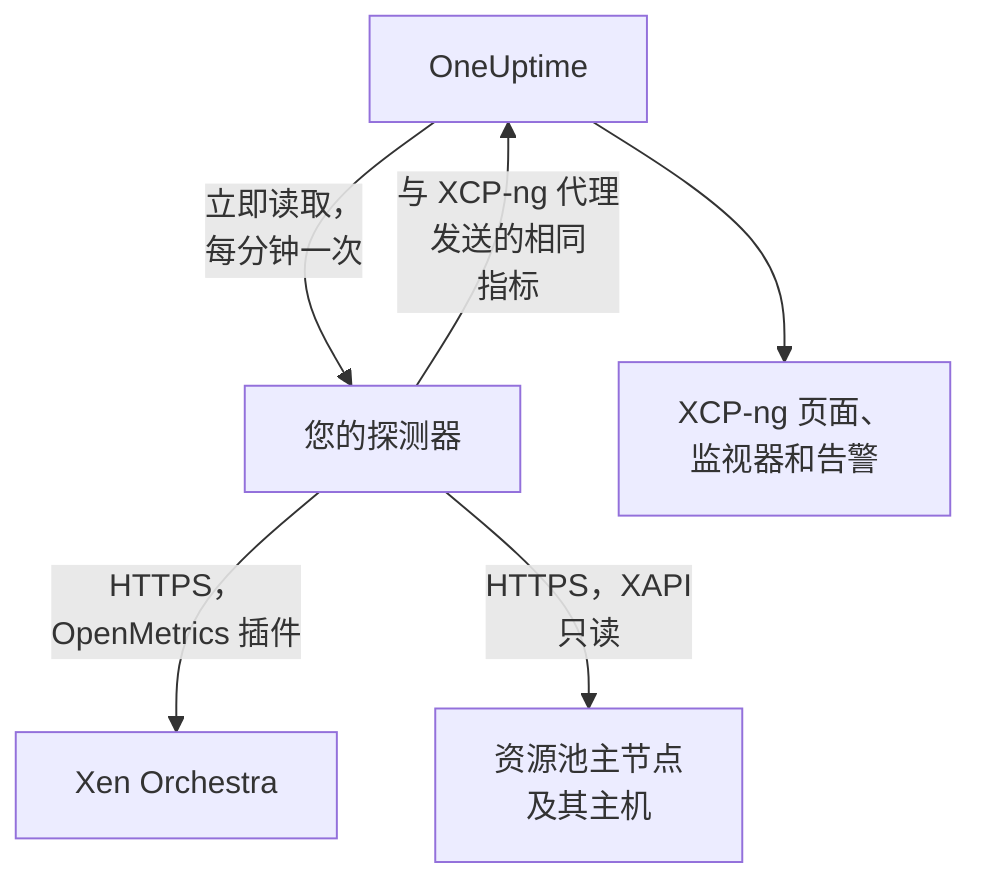

# 无需代理的 XCP-ng

无需安装任何东西即可监控 XCP-ng 资源池：由 OneUptime 探测器读取它们，要么通过管理它们的 Xen Orchestra，要么对于没有 Xen Orchestra 的资源池，直接从资源池主节点上的 XAPI 读取。每个资源池都会获得与 [XCP-ng 代理](/docs/telemetry/xcp-ng) 发送的资源池相同的页面、[XCP-ng 监视器](/docs/monitor/xcp-ng-monitor) 和模板。没有需要安装、升级或保持运行的代理。

:::cards
- [开始之前](#开始之前)：一个能访问 Xen Orchestra 或资源池的探测器，以及只读访问权限。
- [连接 Xen Orchestra](#连接-xen-orchestra)：它管理的每个资源池，通过一个连接。
- [连接没有 Xen Orchestra 的资源池](#连接没有-xen-orchestra-的资源池)：一个资源池，从其主节点读取。
- [故障排除](#故障排除)：每条消息的含义以及解决方法。
:::

## 工作原理

探测器每分钟读取每个连接，并将读取到的内容发送到 OneUptime：

- **Xen Orchestra**：探测器使用插件的密钥读取 Xen Orchestra 的 OpenMetrics 插件，与 XCP-ng 代理的做法完全相同，因此 Xen Orchestra 管理的每个资源池都会以相同的序列到达。
- **资源池的 XAPI**：探测器登录资源池主节点，执行 Xen Orchestra 插件自己执行的读取：资源池的记录，以及从每台运行中的主机读取的该主机的指标。它将这些转换为插件提供的相同序列，因此资源池的读取方式与通过 Xen Orchestra 完全一样。它还会将资源池的 XAPI 消息（例如崩溃的虚拟机或 HA 丢失的主机）发布到资源池的动态中。

每个资源池都会在首次读取时按其 UUID 注册，与代理的资源池一样，并显示在 **XCP-ng → 所有资源池** 下。

## 选择哪种连接方式

| | 从探测器读取 Xen Orchestra | 从探测器读取资源池的 XAPI | XCP-ng 代理 |
|---|---|---|---|
| 您运行的内容 | 您已在运行的探测器，或新的探测器 | 您已在运行的探测器，或新的探测器 | 代理，运行在单独的机器上 |
| 读取的对象 | Xen Orchestra 管理的每个资源池 | 一个资源池 | Xen Orchestra 管理的每个资源池 |
| 所需内容 | OpenMetrics 插件的密钥，以及可选的只读 API 令牌 | 资源池账户：root，或拥有 read-only 角色的 Active Directory 用户 | OpenMetrics 插件的密钥 |
| 密钥保存位置 | 在 OneUptime 中加密，只发送给探测器 | 在 OneUptime 中加密，只发送给探测器 | 在代理的 `.env` 文件中 |
| 资源池动态中的 XAPI 消息 | 不包含 | 包含 | 不包含 |

三者都发送相同的序列。一个资源池同一时间只由其中一个读取，因此无论由谁读取，其历史记录始终是一条线。

## 开始之前

- **一个能通过 TCP 443 访问该地址的探测器。** 通常是同一网络中的 [自定义探测器](/docs/probe/custom-probe)。在 OneUptime Cloud 上，共享探测器从不接收 XCP-ng 密钥，因此请添加您自己的探测器。在自托管实例上，实例自己的探测器也可以读取。
- **对于 Xen Orchestra：** 已开启 OpenMetrics 插件的 Xen Orchestra 6.9 或更高版本：按照 [开启 OpenMetrics 插件](/docs/telemetry/xcp-ng#启用-openmetrics-插件) 操作并复制其密钥。可选：拥有内置 **Read only** 角色的 Xen Orchestra 用户的 API 令牌：OneUptime 会检查它是否只读，并在其过期前提醒您。
- **对于没有 Xen Orchestra 的资源池：** XCP-ng 8.2 或更高版本，以及其主节点的地址。XAPI 的角色只适用于 Active Directory 用户，因此它唯一的本地账户 `root` 可以更改资源池中的一切。要以只读方式访问，请将资源池加入 Active Directory，并为某个用户授予 `read-only` 角色。

> [!IMPORTANT]
> 请通过 Xen Orchestra 或通过其 XAPI 连接一个资源池，不要两者都用：第二个读取该资源池的连接会把它留给第一个。

## 连接 Xen Orchestra

:::steps
### 打开连接
在 OneUptime 中打开 **XCP-ng → 连接**，然后点击 **连接 XCP-ng**。

### 选择 Xen Orchestra
在 **读取对象** 下选择 **Xen Orchestra**。输入 **Xen Orchestra 地址**，即您在浏览器中打开它所用的地址，例如 `https://xo.example.com`，并选择能访问它的探测器。

### 输入插件的密钥
粘贴 **OpenMetrics 密钥**。如果有只读用户的 **API 令牌**，也请添加。

### 测试连接并信任证书
点击 **测试连接**。Xen Orchestra 使用自签名证书，因此测试会显示该证书：检查其指纹，然后点击 **信任此证书**。结果会列出 Xen Orchestra 提供的资源池及其主机、虚拟机和存储库。

### 命名并连接
名称默认为 Xen Orchestra 的主机名，它读取的每个资源池都会显示该名称。点击 **连接 XCP-ng**，连接页面随即打开。
:::

## 连接没有 Xen Orchestra 的资源池

:::steps
### 从连接页面开始
在 OneUptime 中打开 **XCP-ng → 连接**，然后点击 **连接 XCP-ng**。

### 选择资源池
在 **读取对象** 下选择 **没有 Xen Orchestra 的资源池**。输入 **资源池主节点地址**，例如 `https://10.0.0.10`，并选择能访问它的探测器。

### 输入账户
输入 **用户名** 和 **密码**：`root`，或拥有 read-only 角色的 Active Directory 用户，并带上域名书写，例如 `EXAMPLE\oneuptime`。

### 测试连接并信任主节点的证书
点击 **测试连接**。每台 XCP-ng 主机都使用自签名证书，因此测试会显示主节点的证书：检查其指纹，然后点击 **信任此证书**。结果会说明主节点运行的 XCP-ng 版本以及该账户可以读取的内容，并在该账户可以更改资源池时提醒您。

### 为资源池命名并连接
点击 **连接 XCP-ng**，连接页面随即打开。
:::

连接页面会显示其读取情况。在一分钟内开始的首次读取之前，它显示 **检查中**，之后显示 **正在收集**，它读取的资源池会出现在 **它读取的资源池** 下。

如果 20 分钟内没有探测器来读取该连接（因为探测器离线或版本过旧），页面会显示 **未在收集** 并说明原因。当没有任何探测器可以读取该连接时，页面会立即显示 **未在收集** 并说明需要更改的内容：缺少密钥、用户名或密码，未设置读取它的探测器，其探测器无权读取它（OneUptime Cloud 上的共享探测器，或其他项目的探测器），或其探测器已断开连接。

## 代理已在发送的资源池

由 XCP-ng 代理注册的资源池，会由第一个读取它的连接接管：其历史记录作为一条线延续，资源池的动态会提示可以停止代理。

> [!WARNING]
> 一旦探测器读取了代理的资源池，请停止 XCP-ng 代理。两者同时运行时，每个指标都会到达两次。

要切换回来，请打开资源池的 **设置** 页面。其 **数据收集** 卡片为探测器读取的资源池提供 **使用 XCP-ng 代理**，为代理发送的资源池提供 **使用探测器收集**。切换回代理的资源池会一直由代理负责，无论连接读取什么。

## 证书

探测器从不跳过证书验证。每个连接都会完成完整的 TLS 握手，然后：

- 如果没有受信任的证书，该证书必须由探测器所在机器信任的证书颁发机构为您输入的地址签发；
- 如果有受信任的证书，该地址必须出示正是这一证书，并以其 SHA-256 指纹识别，无论证书上写的是什么名称。Xen Orchestra 自己的证书不包含任何地址，正是以这种方式被信任的。

要检查指纹，请在探测器所在的机器上运行 `openssl s_client -connect xo.example.com:443 </dev/null | openssl x509 -noout -fingerprint -sha256`，并将其与证书本身比较：在资源池主节点上运行 `openssl x509 -noout -fingerprint -sha256 -in /etc/xensource/xapi-ssl.pem`。

对于资源池，您信任的是主节点的证书。资源池本身会列出其每台主机提供的证书，探测器读取其他每台主机时都会固定到该证书。当另一台主机成为主节点时，探测器只会跟随到资源池在上次读取时担保过的主机。当证书变化时，读取会以 **证书已更改** 停止，并显示新证书：在您于连接页面信任它之前，不会发送任何内容。

## 已保存的密钥

密钥、令牌和密码都经过加密且只能写入：任何人都无法读回它们，API 也从不返回它们。它们只会发送给读取该连接的探测器，探测器只将其保存在内存中。

已保存的密钥只会发送到输入时对应的地址、经由对应的探测器、发往对应的证书。在 **编辑连接** 中更改地址、探测器或受信任的证书都需要重新输入密钥，因此能编辑连接的人无法把它发送到别处，未重新输入的已保存 API 令牌会被遗弃。信任探测器在已保存地址上找到的证书则会保留它们。**移除 API 令牌** 会从 OneUptime 中删除令牌：也请在 Xen Orchestra 中吊销它。

## API 令牌

API 令牌是可选的：指标通过插件的密钥到达。有令牌时，每次读取最多每小时检查它一次：

- **它只读取。** 用户是管理员、或角色可以更改任何内容的令牌，会测试失败，并在连接页面上显示为问题。OneUptime 只保存只读令牌。
- **它读取 OneUptime 需要的内容。** 对于用户无权读取的列表，Xen Orchestra 会返回空列表，因此令牌必须能读取告警、消息和备份日志。内置的 **Read only** 角色三者都能读取。
- **它何时过期。** Xen Orchestra 会在令牌过期的那一刻遗弃它。在此两周前，连接页面以及它读取的每个资源池的动态都会提示。请为同一用户创建新令牌，并在 **编辑连接** 中输入。

## 参考

| 设置 | 默认值 | 说明 |
|---|---|---|
| 读取间隔 | 1 分钟 | 1 到 60 分钟。每分钟一次与 XCP-ng 代理一致；大型 Xen Orchestra 可降低读取频率以减轻其负担。 |
| 同时读取数 | 每个探测器 4 个 | 比其间隔还慢的读取会被跳过，从不堆积。 |
| 最大读取量 | 约 48 MiB | 更大的 Xen Orchestra 需要使用 XCP-ng 代理。 |
| XAPI 消息 | 每次读取 200 条 | 从资源池连接的那一刻起，每条只送达一次，最旧的优先。 |
| 连接测试 | 90 秒内开始 | 没有探测器及时领取、或运行超过 150 秒的测试，会被判定为失败。 |

## 故障排除

:::details 证书不受信任
Xen Orchestra 和 XCP-ng 主机默认使用自签名证书。请将显示的指纹与证书核对，然后点击 **信任此证书**。
:::

:::details 证书已更改
在您信任新证书之前，不会发送任何内容。如果您已续订证书，请检查新指纹并信任它，然后在 **编辑连接** 中重新输入密钥。
:::

:::details Xen Orchestra 拒绝了密钥
请从 Xen Orchestra 的 **Settings → Plugins → openmetrics** 重新复制密钥，并在 **编辑连接** 中输入。
:::

:::details OpenMetrics 插件没有响应
请在 Xen Orchestra 的 **Settings → Plugins** 中加载 **openmetrics**，并开启 **Auto-load**，使其在重启后自动恢复。
:::

:::details 此 Xen Orchestra 没有 OpenMetrics 插件
该插件需要 Xen Orchestra 6.9 或更高版本，在 Xen Orchestra Appliance 上还需要 Premium 许可证。没有许可证时，请改为通过 XAPI 连接每个资源池。
:::

:::details 没有已连接的资源池
Xen Orchestra 没有报告任何已连接的资源池。请在 Xen Orchestra 中添加或重新连接资源池，然后再次测试。
:::

:::details 该 API 令牌可以更改 Xen Orchestra
OneUptime 只保存只读令牌。请为一个只拥有内置 **Read only** 角色副本、没有其他角色的用户创建令牌。
:::

:::details 该 API 令牌无法读取告警、消息或备份
请为令牌的用户授予 Xen Orchestra 内置 **Read only** 角色的副本，该角色三者都能读取。
:::

:::details API 令牌已过期
请在 Xen Orchestra 中为只读用户创建新令牌，并在 **编辑连接** 中输入。在此期间，指标会继续到达。
:::

:::details XAPI 拒绝了登录
请检查用户名和密码。Active Directory 用户要带上域名书写，例如 `EXAMPLE\oneuptime`。
:::

:::details 此主机不是资源池主节点
资源池的成员会以消息中列出的主节点地址作答。请输入该地址，然后再次测试。
:::

:::details 该账户无法读取资源池
请为该 Active Directory 用户授予资源池的 read-only 角色，或使用拥有该角色的账户。
:::

:::details 探测器没有收到响应
探测器所在网络无法通过 TCP 443 访问该地址。请在防火墙中放行，或选择同一网络中的探测器。
:::

:::details 探测器未领取此任务
探测器已离线，或运行的 OneUptime 版本早于 XCP-ng 读取功能。请在 **自定义探测器** 表中检查它是否已连接，并更新它。
:::

:::details 此连接过大，无法由探测器读取
其指标超出了探测器单次上传的大小上限。请为它使用 [XCP-ng 代理](/docs/telemetry/xcp-ng)。
:::

## 后续步骤

:::cards
- [XCP-ng 监视器](/docs/monitor/xcp-ng-monitor)：针对资源池、主机、虚拟机和存储库发出告警。
- [自定义探测器](/docs/probe/custom-probe)：在资源池所在网络中运行探测器。
- [XCP-ng 代理](/docs/telemetry/xcp-ng)：改用代理读取 Xen Orchestra。
:::
