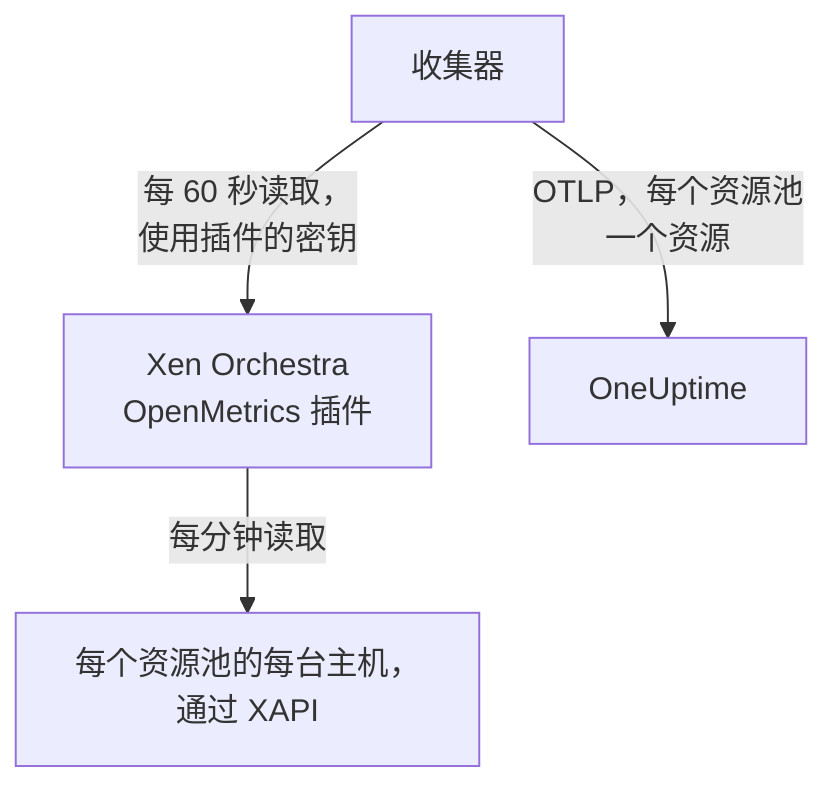

# XCP-ng 代理

OneUptime 的 XCP-ng 代理监控由 Xen Orchestra 管理的 XCP-ng 资源池：它们的主机、虚拟机、存储库和虚拟磁盘。它是一个标准的 OpenTelemetry Collector，使用插件的密钥读取 Xen Orchestra 自带的 OpenMetrics 插件，并把读到的内容发送到 OneUptime，每个资源池都会连同其清单出现在那里。资源池或 Xen Orchestra 的任何密码都不会到达代理。[XCP-ng 监视器](/docs/monitor/xcp-ng-monitor) 会针对传入的数据发出警报。

:::cards
- [安装代理](#安装代理): 启用插件，然后使用安装脚本或 Docker Compose。
- [Xen Orchestra 的证书](#xen-orchestra-的证书): 代理如何信任 Xen Orchestra，绝不跳过校验。
- [代理采集的内容](#代理采集的内容): 插件的每个序列，以及实际上是速率的计数器。
- [故障排查](#故障排除): 一个诊断脚本，以及常见问题。
:::

## 你会得到什么

- **每个资源池单独呈现。** Xen Orchestra 管理的每个资源池都会成为 OneUptime 中的一个 XCP-ng 资源池，按其 XAPI UUID 识别，并以 Xen Orchestra 中的名称命名。同一个 Xen Orchestra 后面的两个资源池就是两个资源池，在 OneUptime 中重命名资源池也是安全的：遥测数据按 UUID 关联到它。
- **它的清单。** 资源池的主机、虚拟机、存储库和虚拟磁盘，以及它们的状态和指标。控制域（dom0）会作为虚拟机上报，除非你要求显示，资源池的页面会隐藏它们。
- **每个 Xen Orchestra 一个代理。** 插件会提供其 Xen Orchestra 所连接的每个资源池，因此一个代理即可读取全部资源池，之后连接的资源池会在下一次读取时出现。

## 工作原理

代理是你在一台机器上用 Docker Compose 运行的一个容器：一个标准的 OpenTelemetry Collector，没有 OneUptime 自己的镜像。它每 60 秒以插件的密钥作为 Bearer 令牌，通过 Xen Orchestra 自己的地址和证书向 Xen Orchestra 请求 `/openmetrics/metrics`。插件通过 XAPI 以 60 秒的分辨率读取每台主机的指标。收集器保留资源池的序列，按资源池分组，并通过 OTLP 发送到 OneUptime。



每个资源池在首次发送数据时自行注册，使用代理作为 `xcp_ng.pool.id` 打在其序列上的 UUID，以及 Xen Orchestra 给它的名称 `xcp_ng.pool.name`。在 Xen Orchestra 中没有名称的资源池会被命名为“Pool”加上其 UUID 的开头部分，直到你重命名它。

## 开始之前

- Xen Orchestra 6.9 或更高版本，已连接到你要监控的资源池，并带有其 OpenMetrics 插件。在 Xen Orchestra Appliance（XOA）上，该插件需要 Premium 许可证；从源码构建的 Xen Orchestra 自带该插件。
- 在一台能通过 HTTPS 访问 Xen Orchestra 的机器上，安装带有 Docker Compose v2 插件的 Docker Engine 20.10 或更高版本，以及 `curl` 和 `openssl`。
- Xen Orchestra 上的一张证书，其中写明代理所连接的地址。Xen Orchestra 为自己生成的自签名证书没有写任何地址，因此当前的任何 TLS 客户端都无法校验它；从源码构建的 Xen Orchestra 在你为它配置证书之前只提供明文 HTTP：请参阅 [Xen Orchestra 的证书](#xen-orchestra-的证书)。
- 一个摄取密钥。在 **项目设置 → 遥测与 APM → 摄取密钥** 下创建一个并复制其值。
- 从该机器到你的 OneUptime URL 的出站 HTTPS。

### 支持的版本

| | 支持 | 原因 |
| --- | --- | --- |
| Xen Orchestra | 6.9 或更高版本，带 OpenMetrics 插件 `xo-server-openmetrics` 1.9 | 该插件在 Xen Orchestra 重启后仍保留其密钥，包含读取时内存泄漏的修复，并提供资源池页面读取的每个序列：主机和虚拟机的状态、存储库和虚拟磁盘。较旧的插件可能在重启时生成新的密钥，把代理拒之门外，直到有人重新复制它。 |
| XCP-ng | 8.3 LTS | Vates 提供支持至 2028 年 11 月 30 日。XCP-ng 8.2 已于 2025 年 9 月 16 日结束生命周期。 |
| XenServer | 尚未试过 | Xen Orchestra 会用相同的序列报告它所管理的 XenServer 资源池，所以应该可以工作，但还没有人用 OneUptime 试过。 |

### 在哪里运行代理

代理通过 HTTPS 与 Xen Orchestra 通信，因此它可以运行在任何装有 Docker 并能访问到它的机器上：Xen Orchestra 所在的机器本身、一台监控主机或一台小型管理虚拟机。最好选择一台其虚拟机不运行在被监控资源池上的机器：资源池宕机时，你的监控不应随之宕机。一个代理读取一个 Xen Orchestra；如需读取多个，请参阅 [读取多个 Xen Orchestra](#读取多个-xen-orchestra)。

## 启用 OpenMetrics 插件

代理通过 Xen Orchestra 的 OpenMetrics 插件，使用插件的密钥读取每个资源池。

:::steps
### 启用插件

在 Xen Orchestra 中打开 *Settings → Plugins*，找到 **openmetrics** 并启用它。它首次启动时会生成一个密钥，Xen Orchestra 会在重启之间保留它。

### 复制其密钥

打开插件的设置并复制它的 **Prometheus secret**：你将在下一步把它交给代理。你也可以在那里输入并保存你自己的密钥。请妥善保管：拥有它的人可以读取每个资源池的指标。

### 检查它是否响应

插件在 Xen Orchestra 自己的地址上、使用其自己的证书，在 `/openmetrics/metrics` 上响应，并且只响应带有其密钥的请求。它的健康检查不需要密钥，因此只有这一个请求可以用 `-k` 跳过证书校验；代理从不这样做：

```bash
curl -k https://xo.example.com/openmetrics/health
```

只要插件在运行，它就会返回 `{"status":"ok"}`。返回 `404` 表示插件未启用。
:::

## 安装代理

:::steps
### 安装并启动代理

每个 OneUptime 都提供其自身发布版本的代理安装脚本和文件：下面的命令从 `https://oneuptime.com` 下载它们，因此在自托管的 OneUptime 上请把这个地址替换为你的 URL。安装脚本会先保存为 `install.sh`，方便你在运行前先阅读它。

:::tabs
@tab install.sh
下载安装脚本，并在将要托管代理的机器上运行它：

```bash
curl -fsSL https://oneuptime.com/install/xcp-ng-agent -o install.sh
bash install.sh
```

脚本会询问你的 OneUptime URL、摄取密钥、你在浏览器中打开 Xen Orchestra 时所用的地址（例如 `https://xo.example.com` 或 `https://10.0.0.5:8443`）、插件的密钥（输入时不显示），以及这个 Xen Orchestra 在 OneUptime 中的名称。然后它读取 Xen Orchestra 的证书：这台机器已经信任的证书会用其 CA 证书包校验；其他任何证书都会连同其 SHA-256 指纹显示出来，在你把该指纹与 Xen Orchestra 所在机器上的指纹核对之后，回答 **y** 即可只信任该证书。它从不关闭校验。最后，在安装任何东西之前，它会用密钥向插件请求指标，并列出 Xen Orchestra 报告的资源池。它安装到 `/opt/oneuptime-xcp-ng-agent`，以 `0600` 权限写入 `.env` 文件和 `xo-ca.pem`（代理为 Xen Orchestra 信任的证书），并用 Docker Compose 启动代理。再次运行脚本时，它会复用该 `.env` 中的所有内容，而不会再次询问；这就是 [升级代理](#升级代理) 的方法。
@tab Docker Compose
从你的 OneUptime 下载 `docker-compose.yml` 和 `otel-collector-config.yaml` 到一个新文件夹中：

```bash
mkdir oneuptime-xcp-ng-agent && cd oneuptime-xcp-ng-agent
curl -fsSLO https://oneuptime.com/install/xcp-ng-agent/docker-compose.yml
curl -fsSLO https://oneuptime.com/install/xcp-ng-agent/otel-collector-config.yaml
```

在它们旁边创建一个 `.env` 文件。它包含插件的密钥，因此请用 `chmod 600 .env` 保持私密：

```bash title=".env"
ONEUPTIME_URL=YOUR_ONEUPTIME_URL
ONEUPTIME_TELEMETRY_INGESTION_KEY=YOUR_TELEMETRY_INGESTION_TOKEN
XO_SCHEME=https
XO_ADDRESS=xo.example.com
XO_OPENMETRICS_SECRET='your-plugin-secret'
XO_NAME='Xen Orchestra'
XO_TLS_SERVER_NAME=
```

`XO_ADDRESS` 是 Xen Orchestra 的 `host` 或 `host:port`，不带 `https://`。请用单引号括起插件的密钥，并把其中的每个 `$` 写成 `$$`：收集器会再读取一次该值，会把 `$` 当作变量的开头。含有 `'` 的密钥无法放在单引号中：请让安装脚本来写入它，或在 Xen Orchestra 中选择另一个密钥。

然后把 Xen Orchestra 的证书保存为 `xo-ca.pem`，放在 `docker-compose.yml` 旁边：代理只依据这个文件校验 Xen Orchestra。要信任 Xen Orchestra 自己的证书，请读取它，并在使用之前把它的指纹与 Xen Orchestra 所在机器上的指纹核对：

```bash
openssl s_client -connect xo.example.com:443 -servername xo.example.com </dev/null 2>/dev/null \
  | openssl x509 -out xo-ca.pem
openssl x509 -in xo-ca.pem -noout -fingerprint -sha256
```

如果证书由你自己的 CA 签发，请改为把该 CA 的证书复制到 `xo-ca.pem`；如果由公共 CA 签发，请复制这台机器的 CA 证书包（`cp /etc/ssl/certs/ca-certificates.crt xo-ca.pem`）。启动代理：

```bash
docker compose up -d
```
:::

### 检查代理是否在运行

```bash
docker compose ps
docker logs -f oneuptime-xcp-ng-agent
```

`docker compose ps` 会显示收集器 `oneuptime-xcp-ng-agent`。启动后，它的日志中应出现这一行：

```text
Everything is ready. Begin running and processing data.
```

### 在 OneUptime 中找到资源池

打开 **产品 → 基础设施 → XCP-ng → 所有资源池**。Xen Orchestra 报告的每个资源池都会在首次读取约一分钟后出现，使用 Xen Orchestra 给它的名称，并带有其主机、虚拟机和存储。它的 **拓扑** 页面会把它们画成一张图：请参阅 [拓扑](/docs/telemetry/topology#打开资源自己的地图)。
:::

## Xen Orchestra 的证书

代理在每次读取时都会校验 Xen Orchestra 的证书，只依据 `xo-ca.pem`，从不跳过校验：插件的密钥随每个请求一起发送。`xo-ca.pem` 包含以下三者之一：

- **Xen Orchestra 自己的证书**，通过其 SHA-256 指纹固定（`XO_TLS_FINGERPRINT`）：代理只信任该证书。
- **签发它的 CA**（`XO_CA_FILE`），用于你自己的 CA 签发的证书。
- **这台机器的 CA 证书包**，用于这台机器已经信任的证书，例如公共 CA 签发的证书。

无论哪种情况，证书都必须写明代理所连接的地址。代理校验证书所签发的名称，即其主题备用名称（subject alternative names），就像当前每个 TLS 客户端那样，而从不校验主题本身。Xen Orchestra 为自己生成的自签名证书没有写任何名称，因此无论是否固定，代理都无法信任它，并会以 `x509: certificate is not valid for any names` 失败；安装脚本遇到这样的证书会停止并说明原因。

### 为 Xen Orchestra 配置写明其地址的证书

使用你自己的 CA 或公共 CA 签发的证书，或者在 Xen Orchestra 所在的机器上生成一张写明 Xen Orchestra 地址的自签名证书，把它的名称和地址写进主题备用名称：

```bash
sudo mkdir -p /etc/ssl/xo
sudo openssl req -x509 -newkey rsa:2048 -nodes -days 825 \
  -subj "/CN=xo.example.com" \
  -addext "subjectAltName=DNS:xo.example.com,IP:10.0.0.5" \
  -keyout /etc/ssl/xo/key.pem -out /etc/ssl/xo/cert.pem
```

让 xo-server 的 HTTPS 监听器指向这两个文件（运行 xo-server 的用户，默认是 root，必须能够读取它们），写在单独的配置文件中：在 XOA 上是 `/etc/xo-server/config.httpscert.toml`，对于从源码构建的 Xen Orchestra，则放在 xo-server 的 `config.toml` 旁边。Xen Orchestra 的监听器带有编号，第二个 `http.listen.1` 就是它的 HTTPS 监听器：

```toml
[http.listen.1]
port = 443
cert = '/etc/ssl/xo/cert.pem'
key = '/etc/ssl/xo/key.pem'
```

然后用 `systemctl restart xo-server` 重启 xo-server，再安装代理，或重新运行安装脚本：它会读取新证书并显示其指纹供你核对。也可以让 Xen Orchestra 自己申请 Let's Encrypt 证书，XOA 就可以这样做（请参阅 Xen Orchestra 的文档）：它受到公共信任，所以代理无需任何设置。如果证书用不同于 `XO_ADDRESS` 中地址的名称写明 Xen Orchestra，请把 `XO_TLS_SERVER_NAME` 设置为该名称；安装脚本在可以时会根据证书填入它。

固定的证书续期后，代理会停止读取 Xen Orchestra，直到它信任新证书。重新运行安装脚本：它会显示新的指纹并停止，不做任何更改。请在 Xen Orchestra 所在的机器上核对该指纹，然后用它再运行一次脚本：`XO_TLS_FINGERPRINT=<new fingerprint> bash install.sh`。如果用 Docker Compose 安装，请重新写入 `xo-ca.pem` 并运行 `docker compose up -d --force-recreate`。

## 环境变量

安装脚本会把它们写入 `/opt/oneuptime-xcp-ng-agent/.env`；Docker Compose 安装会从 `.env`（位于 `docker-compose.yml` 旁边）读取它们。更改变量后，请在该文件夹中运行 `docker compose up -d`。

| 变量 | 必需 | 说明 |
| --- | --- | --- |
| `ONEUPTIME_URL` | 是 | 你的 OneUptime URL，例如 `https://oneuptime.com` 或你的自托管实例。如果实例只支持 HTTP，请使用 `http://` 及其端口。 |
| `ONEUPTIME_TELEMETRY_INGESTION_KEY` | 是 | 来自 **项目设置 → 遥测与 APM → 摄取密钥** 的摄取密钥。 |
| `XO_URL` | 安装脚本 | 你在浏览器中打开 Xen Orchestra 时所用的地址，例如 `https://xo.example.com` 或 `https://10.0.0.5:8443`。安装脚本会从中得出 `XO_SCHEME` 和 `XO_ADDRESS`。 |
| `XO_SCHEME` | 否 | `https`，默认值。`http` 仅用于实验环境：此时密钥会以未加密的形式在网络上传输。 |
| `XO_ADDRESS` | 是 | Xen Orchestra 的 `host` 或 `host:port`，不带协议。 |
| `XO_OPENMETRICS_SECRET` | 是 | OpenMetrics 插件的密钥，作为 Bearer 令牌发送。其中的每个 `$` 都写成 `$$`。 |
| `XO_NAME` | 否 | 这个 Xen Orchestra 在 OneUptime 中的名称，作为 `xen_orchestra.name` 设置在它读取的每个资源池上，并显示在每个资源池的 **设置** 中。默认是 Xen Orchestra 的地址。 |
| `XO_TLS_FINGERPRINT` | 安装脚本 | Xen Orchestra 自己证书的 SHA-256 指纹，格式与 `openssl x509 -fingerprint -sha256` 的输出相同，冒号可省略，用于代理只信任该证书的情况。安装脚本会拒绝与之不符的证书。 |
| `XO_CA_FILE` | 安装脚本 | 签发 Xen Orchestra 证书的 CA 证书包；安装脚本会用它校验证书，并把它复制到 `xo-ca.pem`。 |
| `XO_TLS_SERVER_NAME` | 否 | 当 `XO_ADDRESS` 是证书中未写明的地址时，用来校验 Xen Orchestra 证书的名称。留空：使用 `XO_ADDRESS` 中的主机。 |

## 代理采集的内容

代理每分钟读取一次插件，插件通过 XAPI 以 60 秒的分辨率读取每台主机的轮询数据库（round-robin database）。代理保留 `xcp_*` 序列，并把每个序列的资源池移到发送它们所用的资源上，成为 `xcp_ng.pool.id`（资源池的 UUID，永不改变）和 `xcp_ng.pool.name`：

| 类别 | 序列 |
| --- | --- |
| 资源池 | `xcp_pool_connected`，只要 Xen Orchestra 连接着该资源池就存在 |
| 主机 | `xcp_host_status`（其电源状态以及是否已启用）、`xcp_host_uptime_seconds`、`xcp_host_cpu_average`、`xcp_host_cpu_core_usage`、`xcp_host_load`、`xcp_host_load_average`、`xcp_host_memory_*`、`xcp_host_running_vcpus`、按物理接口的 `xcp_host_network_*`、按存储库的 `xcp_host_disk_*`、`xcp_host_power_consumption_watts` |
| 虚拟机 | `xcp_vm_status`、`xcp_vm_uptime_seconds`、`xcp_vm_cpu_usage`、`xcp_vm_cpu_core_usage`、`xcp_vm_runstate_*`（CPU 争用）、`xcp_vm_memory_*`、按接口的 `xcp_vm_network_*`、按磁盘的 `xcp_vm_disk_*`、`xcp_vm_power_consumption_watts` |
| 存储 | `xcp_sr_physical_size_bytes`、`xcp_sr_physical_usage_bytes`、`xcp_sr_virtual_size_bytes`、`xcp_vdi_virtual_size_bytes`、`xcp_vdi_physical_usage_bytes` |
| XOSTOR | `xcp_xostor_*`，在运行 XOSTOR 的资源池上 |

控制域会作为带有 `is_control_domain="true"` 的虚拟机上报。来自 Xen Orchestra 的每个序列都保留其名称和标签，例如 `uuid`、`host_name`、`vm_name`、`sr_name` 和 `tags`；[XCP-ng 监视器](/docs/monitor/xcp-ng-monitor#收集的指标) 列出了它们全部。

### 实为速率的计数器

Xen Orchestra 把八个吞吐量序列声明为计数器并命名为 `_total`，尽管每个序列存放的都是 XAPI 的每秒速率：`xcp_host_network_receive_bytes_total`、`xcp_host_network_transmit_bytes_total`、`xcp_vm_network_receive_bytes_total`、`xcp_vm_network_transmit_bytes_total`、`xcp_vm_network_receive_errors_total`、`xcp_vm_network_transmit_errors_total`、`xcp_vm_disk_read_bytes_total` 和 `xcp_vm_disk_write_bytes_total`。如果按计数器读取，每张网络和磁盘吞吐量图表都会出错：下降的速率会被读成计数器重置。代理的 `transform/xcp-ng-rates` 处理器会把它们变成仪表（gauge），名称和值不变，因此 OneUptime 会按它们本来的样子把它们存为速率，单位为每秒字节数或每秒错误数。OneUptime 也会转换仍以计数器形式到达的任何序列，例如来自你自己配置的收集器的序列。

### OneUptime 添加的内容

OneUptime 会在每个资源池的数据到达时为其派生四个 0/1 序列，警报模板会读取它们：

| 序列 | 为 1 的条件 |
| --- | --- |
| `xcp_ng.host.running` | Xen Orchestra 报告主机为 Running；为 Halted 或状态为 Unknown 时为 0 |
| `xcp_ng.host.enabled` | 主机已启用；处于维护模式或正在疏散、XAPI 不会在其上启动任何虚拟机时为 0 |
| `xcp_ng.vm.running` | 虚拟机为 Running；为 Halted、Paused 或 Suspended 时为 0 |
| `xcp_ng.vm.stopped_after_running` | 过去 24 小时内运行过的虚拟机为 Halted 或 Paused |

它还会在每个数据点上打上 `xcp_ng.scope`（`pool`、`host`、`vm`、`sr`、`vdi` 或 `xostor`）和 `xcp_ng.id`（该对象的 UUID），监视器和仪表板会按它们过滤：请参阅 [资源标识](/docs/monitor/xcp-ng-monitor#资源标识)。

### 代理不保留的内容

- Xen Orchestra 自己的进程序列（`xo_*`），它们不属于任何资源池，以及收集器自己的读取序列。
- Xen Orchestra 通过 IPMI 读取的主机功率：插件发送这项读数时不带其资源池，因此它也不属于任何资源池。每台虚拟机的估算份额 `xcp_vm_power_consumption_watts` 会保留。

## 资源池的页面显示什么

从 **产品 → 基础设施 → XCP-ng → 所有资源池** 打开一个资源池。它的菜单包含：

| 页面 | 显示什么 |
| --- | --- |
| **概览** | 资源池的健康状况和需要关注的事项、它的主机、虚拟机和存储、最繁忙的虚拟机和主机，以及读取它的 Xen Orchestra 和代理版本。 |
| **主机**、**虚拟机**、**存储** | 每台主机、每台虚拟机和每个存储库，各有自己的页面和图表。**虚拟机** 会隐藏控制域，除非你要求显示，存储库的页面会显示其虚拟磁盘。 |
| **拓扑** | 资源池、它的主机、每台主机上的虚拟机以及它们使用的存储库，画成一张图。 |
| **资源使用情况** | 资源池的主机、虚拟机、存储、磁盘和网络随时间变化的图表，每台主机、虚拟机或每个存储库一条线。 |
| **建议** | 可以启用的 [警报模板](/docs/monitor/xcp-ng-monitor#现成的警报模板)，每个模板一个监视器。 |
| **指标**、**日志** | 资源管理器中资源池的每个序列，限定在该资源池。代理只发送指标，因此 **日志** 只显示你带着资源池的 `xcp_ng.pool.id` 发送的日志。 |
| **事件**、**警报**、**计划维护** | 提到该资源池的那些。 |
| **动态** | 资源池在 OneUptime 中发生的事情：何时被添加、更改、归档或恢复，谁是它的所有者，以及在它上面运行过的所有者规则和标签规则。 |
| **所有者** | 手动或通过所有者规则得知它的人。 |
| **设置** | 它的名称、读取它的 Xen Orchestra、它在那里的名称和代理版本，以及其遥测数据的保留时长。 |
| **文档** | 这份设置说明，已填好你的 URL 和密钥。 |

资源池的 **概览** 会根据需要关注的事项给出它的健康状况：**健康**、**性能下降** 或 **不健康**，并在 **需要关注** 下按紧急程度从高到低显示：

- **严重：** 处于 Halted 状态或处于 Xen Orchestra 无法确定的状态（Unknown）的主机；使用率超过 95%、虚拟机已无法写入的存储库。
- **值得一看：** 已禁用、处于维护模式或正在疏散的主机；过去 24 小时内运行过、现为 Halted 或 Paused 的虚拟机；使用率超过 90%、Storage Repository Near Full 警报会触发的存储库，或通过精简配置分配超出其大小的存储库。

挂起的虚拟机（Suspended）是有意挂起的，永远不计入，一天内没人见过运行的虚拟机和控制域也一样。ISO 库和可移动介质不包含虚拟机磁盘，因此资源池的存储数字不包括它们。

当 Xen Orchestra 连续 15 分钟不再报告某个资源池时，该资源池会变为 **已断开**，其页面保留它最后报告的内容。不再出现在 Xen Orchestra 报告中的主机、虚拟机、存储库或虚拟磁盘会在 15 分钟后离开清单；停止虚拟机绝不会移除它。

## 用项目标签标记资源池

以 `oneuptime.label.` 开头的资源属性会成为代理读取的每个资源池上的项目标签：`oneuptime.label.<dimension>=<value>` 就是标签 `<dimension>:<value>`。请把这些属性添加到 `resource` 处理器（位于 `otel-collector-config.yaml` 中），放在 `oneuptime.agent.version` 旁边：

```yaml
processors:
  resource:
    attributes:
      # ...existing attributes...
      - key: oneuptime.label.team
        value: platform
        action: upsert
      - key: oneuptime.label.env
        value: production
        action: upsert
```

收集器只在启动时读取其配置：请运行 `docker compose restart oneuptime-xcp-ng-agent`。之后资源池会显示标签 `team:platform` 和 `env:production`。标签比较时不区分大小写，因此现有的标签 `Production` 会被复用而不是重复创建，代理也绝不会移除有人在 OneUptime 中添加的标签。重新运行安装脚本会替换已编辑的 `otel-collector-config.yaml`，并把你的版本保存在旁边，名为 `otel-collector-config.yaml.bak.<timestamp>`。

## 读取多个 Xen Orchestra

一个代理读取一个 Xen Orchestra 及其管理的每个资源池。要从同一台机器读取第二个 Xen Orchestra，请在单独的文件夹中用单独的 `.env` 安装第二个代理，例如 `INSTALL_DIR=/opt/oneuptime-xcp-ng-agent-lab bash install.sh`，并为它指定自己的 `container_name`，写在它的 `docker-compose.yml` 中（例如 `oneuptime-xcp-ng-agent-lab`）：两个容器不能同名。给每个代理指定自己的 `XO_NAME`，这样每个资源池的 **设置** 会显示是哪个 Xen Orchestra 在读取它，并用 `-d` 把文件夹传给诊断脚本。

切勿让两个代理通过同时管理同一资源池的两个 Xen Orchestra 读取该资源池：按其 UUID 它在 OneUptime 中是一个资源池，会被重复报告。

## 作为 systemd 服务运行

要让代理随机器一起启动并在失败时重启，请安装它的 systemd 单元。该单元假定代理位于 `/opt/oneuptime-xcp-ng-agent`，也就是安装脚本放置它的位置：

```bash
sudo curl -fsSL https://oneuptime.com/install/xcp-ng-agent/systemd/oneuptime-xcp-ng-agent.service -o /etc/systemd/system/oneuptime-xcp-ng-agent.service
sudo systemctl daemon-reload
sudo systemctl enable --now oneuptime-xcp-ng-agent
```

## 升级代理

代理会把其文件固定的收集器版本作为 **代理版本** 上报，显示在每个资源池的 **概览** 和 **设置** 中。当它比此 OneUptime 版本固定的版本旧时，旁边会出现一个警告标记。选择它即可看到下面这些命令。

收集器镜像固定在 `docker-compose.yml` 中，其配置是旁边的一个文件，所以仅拉取镜像并不能让代理升级。请重新运行 `install.sh`：它会复用你现有 `.env` 中的每个值（不会再次询问），以同样的方式校验 Xen Orchestra 的证书，刷新 `docker-compose.yml` 和 `otel-collector-config.yaml`（你编辑过的文件会保留为 `<file>.bak.<timestamp>`），拉取镜像并重新创建代理，让收集器读取新配置。安装在 `/opt/oneuptime-xcp-ng-agent` 以外的代理需要指定其文件夹：`INSTALL_DIR=<folder> bash install.sh`。

```bash
curl -fsSL https://oneuptime.com/install/xcp-ng-agent -o install.sh
bash install.sh
```

用 Docker Compose 安装的？请在代理的文件夹中重新下载这两个文件（并重新应用你对它们所做的修改），然后拉取镜像并重新创建代理。你的 `.env` 和 `xo-ca.pem` 会保留：

```bash
curl -fsSLO https://oneuptime.com/install/xcp-ng-agent/docker-compose.yml
curl -fsSLO https://oneuptime.com/install/xcp-ng-agent/otel-collector-config.yaml
docker compose pull
docker compose up -d --force-recreate
```

## 卸载代理

```bash
cd /opt/oneuptime-xcp-ng-agent
docker compose down
```

然后，如果没有其他东西读取它，请在 Xen Orchestra 中关闭 OpenMetrics 插件。

## 故障排除

:::details 先运行诊断脚本
代理附带一个脚本 [`troubleshoot.sh`](https://oneuptime.com/install/xcp-ng-agent/troubleshoot.sh)，它按数据传输的顺序检查整条链路：容器；从代理自身网络访问 Xen Orchestra 的地址；插件的健康检查；依据 `xo-ca.pem` 校验 Xen Orchestra 的证书，以及固定的证书是否仍是它出示的证书；插件的密钥；Xen Orchestra 报告的资源池；摄取密钥的格式；收集器自身的指标；以及 OneUptime 是否接受该摄取密钥。最后一项检查最重要。OneUptime 会以 `401` 拒绝错误的密钥（已停用的密钥或浏览器密钥为 `422`），而收集器把两者都视为永久错误：它会丢弃该批次并只记录一条 `Exporting failed` 错误，在容器保持健康时很容易被忽略。脚本会从代理的网络调用 `GET <url>/otlp/v1/validate`，立即得到 `200`（有效）或 `401`（无效），在较旧的服务器上则回退到 `POST /fluentd/v1/logs`。它从不打印密钥。

```bash
curl -fsSL https://oneuptime.com/install/xcp-ng-agent/troubleshoot.sh -o troubleshoot.sh
bash troubleshoot.sh    # add -d <dir> if you installed outside /opt/oneuptime-xcp-ng-agent
```

它最后会输出一个指明最可能原因的结论。
:::

:::details Xen Orchestra 拒绝密钥（401）
收集器记录 `server returned HTTP status 401 Unauthorized`。从 *Settings → Plugins → openmetrics* 重新复制密钥，把 `XO_OPENMETRICS_SECRET`（位于 `.env` 中）设置为它，用单引号括起，并把每个 `$` 写成 `$$`，然后在代理的文件夹中运行 `docker compose up -d`。6.8 之前的 Xen Orchestra 可能在重启时生成新的密钥：请升级它。
:::

:::details 插件没有响应（404、500、502 或 503）
Xen Orchestra 有响应，但它的 OpenMetrics 插件没有。请在 *Settings → Plugins → openmetrics* 下启用插件，并确认 Xen Orchestra 为 6.9 或更高版本。XOA 需要 Premium 许可证才能使用该插件。只要插件在运行，`/openmetrics/health` 无需密钥即返回 `{"status":"ok"}`。
:::

:::details 证书错误
- `x509: certificate is not valid for any names`：证书没有写明任何地址，例如 Xen Orchestra 自己的自签名证书。[为 Xen Orchestra 配置写明其地址的证书](#为-xen-orchestra-配置写明其地址的证书)。
- `x509: certificate is valid for <names>, not <address>`：请用其中一个名称连接，或把 `XO_TLS_SERVER_NAME` 设置为其中之一。
- `x509: cannot validate certificate for <IP> because it doesn't contain any IP SANs`：`XO_ADDRESS` 是证书中未写明的 IP 地址。请把 `XO_TLS_SERVER_NAME` 设置为证书中写明的名称，或重新运行会自动完成这一步的安装脚本。
- `x509: certificate signed by unknown authority`：`xo-ca.pem` 既不包含该证书，也不包含签发它的 CA。证书已续期，或文件中是另一张证书：请在 Xen Orchestra 所在的机器上核对新的指纹，并用它运行安装脚本（`XO_TLS_FINGERPRINT=<new fingerprint> bash install.sh`），或重新写入该文件。
- `unable to read CA cert`：`xo-ca.pem` 缺失或无法读取。请重新运行安装脚本。
:::

:::details 读取超时（context deadline exceeded）
Xen Orchestra 收集指标的时间超过了代理的上限 50 秒，因此那次读取什么也不会发送：通常是它的某个资源池中有一台主机没有响应它。请在 Xen Orchestra 中检查资源池的主机；代理会在一分钟后再次读取。
:::

:::details 资源池显示为已断开
当某个资源池连续 15 分钟没有读到任何数据时，OneUptime 会把它标记为已断开；OneUptime 每 5 分钟检查一次，它自己没有接收数据的时间不计入。

1. 如果这个 Xen Orchestra 的所有资源池都已断开，请检查代理：在代理的文件夹中运行 `docker compose ps` 和 `docker logs oneuptime-xcp-ng-agent`。
2. 如果只有一个，说明 Xen Orchestra 已不再报告它：在 Xen Orchestra 的 *Settings → Servers* 下，资源池的服务器必须处于已连接状态。资源池的主机、虚拟机和存储会保持 Xen Orchestra 最后报告的样子。
:::

:::details 缺少某个资源池
Xen Orchestra 只报告它所连接的资源池，而代理只读取这个 Xen Orchestra。请在 Xen Orchestra 的 *Settings → Servers* 下连接资源池的服务器；该资源池会在下一次读取时出现在 OneUptime 中。由另一个 Xen Orchestra 管理的资源池需要在那个 Xen Orchestra 旁边部署自己的代理。
:::

:::details 吞吐量图表看起来不对
存放速率的八个 `_total` 序列必须以仪表的形式到达 OneUptime。如果你用自己的配置替换了随附的 `otel-collector-config.yaml`，请保留其中的 `transform/xcp-ng-rates` 处理器。请按原样读取它们，单位为每秒字节数或每秒错误数：对它们再求每秒速率就成了速率的速率。
:::

:::details 不通过代理发送指标
代理只是收集器的一份标准配置，因此你已在运行的收集器也可以完成同样的工作：把随附配置中的读取作业和处理器复制到你的配置中。资源属性 `xcp_ng.pool.id` 会在 OneUptime 中注册每个资源池，`groupbyattrs` 处理器会让每个资源池成为一个资源，而删除 `service.name` 和 `service.instance.id` 可避免数据落到某个服务下：请保留这三项，以及 `transform/xcp-ng-rates`。
:::

## 插件尚未覆盖的内容

Xen Orchestra 的 OpenMetrics 插件提供的是指标，因此你在 XCP-ng 资源池中关注的部分内容还不在其中：

- 除 XOSTOR 之外的 **告警**、**HA 状态**、**资源池主节点**、**缺失的补丁**、**备份** 和 **快照**，以及主机物理接口（PIF）的 **链路状态**。它们来自 Xen Orchestra 的 REST API，见 [#10997](https://github.com/OneUptime/oneuptime/issues/10997)。
- **没有 Xen Orchestra 的资源池**，或位于没有插件所需 Premium 许可证的 XOA 之后的资源池：它们直接通过 XAPI 读取，见 [#10999](https://github.com/OneUptime/oneuptime/issues/10999)。
- **无需代理即可连接**，从 OneUptime 探测器连接，就像 VMware 那样：[#10996](https://github.com/OneUptime/oneuptime/issues/10996)。

## 后续步骤

:::cards
- [XCP-ng 监控](/docs/monitor/xcp-ng-monitor): 资源池、主机、虚拟机和存储库的警报。
- [Proxmox 代理](/docs/telemetry/proxmox): 以同样的方式监控 Proxmox VE 集群。
- [主机 OpenTelemetry Collector](/docs/telemetry/host-otel-collector): 从虚拟机内部看到的操作系统视图。
:::
