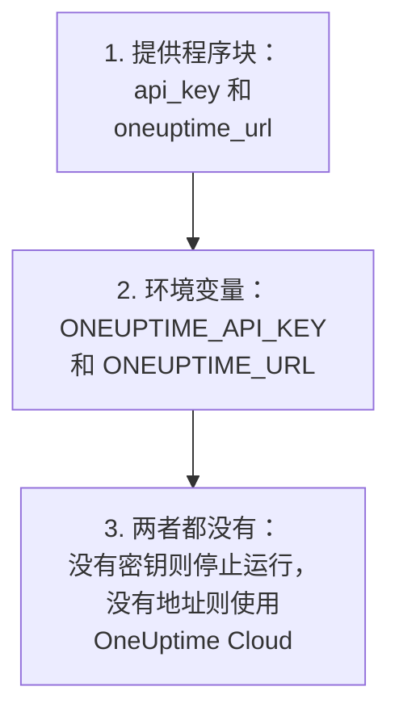
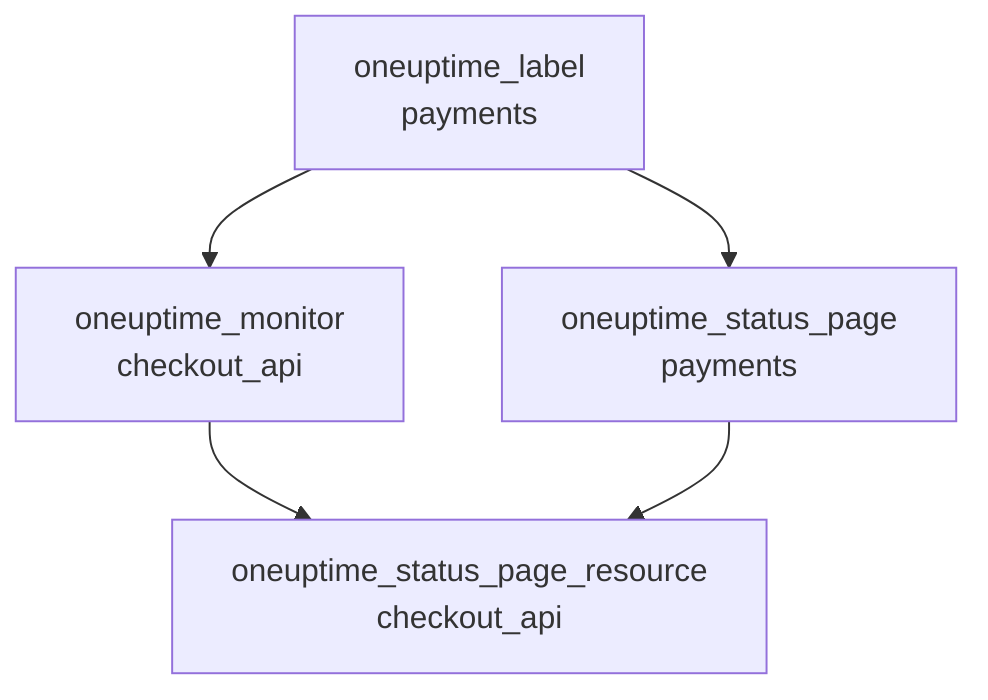

# 完整指南

本指南介绍首次 apply 之后的内容：提供程序如何找到 API 密钥，如何为一个或多个项目组织配置，资源之间如何相互引用，如何读取你不管理的记录，如何保证 state 的安全，以及如何升级。第一次使用提供程序？请从 [快速开始](/docs/terraform/quick-start) 开始。

:::cards
- [配置提供程序](#配置提供程序): API 密钥和地址，以及提供程序从哪里读取它们。
- [组织配置](#组织配置): 文件、项目，以及用一个块创建多个资源。
- [读取已有的内容](#读取已有的内容): 数据源，以及查找如何匹配。
- [保证 state 安全](#保证-state-安全): 远程后端，以及永远不要提交的内容。
:::

## 配置提供程序

提供程序接受两项设置。每项都来自提供程序块，否则来自环境变量：

| 设置 | 环境变量 | 两者都未设置时 |
| --- | --- | --- |
| `api_key` | `ONEUPTIME_API_KEY` | 提供程序在计划任何内容之前就会停止：`Missing API Key` |
| `oneuptime_url` | `ONEUPTIME_URL` | `https://oneuptime.com`，即 OneUptime Cloud |



`oneuptime_url` 是你的 OneUptime 的地址，不带 `/api`：地址没有协议时，提供程序会加上 `https://`，并在末尾加上 `/api`。`api_key` 是敏感值，因此 Terraform 从不打印它。

密钥必须是你所管理项目的 API 密钥，并且有权创建、读取、更改和删除配置中的每种记录：参见 [创建项目 API 密钥](/docs/terraform/quick-start#创建项目-api-密钥)。自托管 OneUptime 的主 API 密钥不属于任何项目，因此用它执行的创建操作会以 `ProjectId required` 失败。

### 向提供程序提供密钥

:::tabs
@tab 环境变量
```bash
export ONEUPTIME_API_KEY="<your-api-key>"
# Only on a self-hosted OneUptime:
export ONEUPTIME_URL="https://oneuptime.example.com"
```

```hcl title="main.tf"
provider "oneuptime" {}
```
@tab Terraform 变量
```hcl title="variables.tf"
variable "oneuptime_api_key" {
  description = "API key of the OneUptime project"
  type        = string
  sensitive   = true
}

provider "oneuptime" {
  api_key = var.oneuptime_api_key
}
```

```hcl title="terraform.tfvars"
oneuptime_api_key = "<your-api-key>"
```
:::

环境变量能让密钥不出现在任何文件中。变量文件在你自己的机器上很方便：把 `terraform.tfvars` 添加到 `.gitignore`。在流水线中，请设置 `TF_VAR_oneuptime_api_key`，而不是写入该文件。

### 在 CI/CD 中运行

把密钥作为机密交给作业，放在环境变量 `ONEUPTIME_API_KEY` 中：

:::tabs
@tab GitHub Actions
```yaml title=".github/workflows/oneuptime.yml"
name: OneUptime
on:
  push:
    branches: [main]

jobs:
  apply:
    runs-on: ubuntu-latest
    env:
      ONEUPTIME_API_KEY: ${{ secrets.ONEUPTIME_API_KEY }}
    steps:
      - uses: actions/checkout@v4
      - uses: hashicorp/setup-terraform@v3
      - run: terraform init -input=false
      - run: terraform plan -input=false -out=tfplan
      - run: terraform apply -input=false tfplan
```
@tab GitLab CI
```yaml title=".gitlab-ci.yml"
apply:
  image:
    name: hashicorp/terraform:latest
    entrypoint: [""]
  rules:
    - if: $CI_COMMIT_BRANCH == $CI_DEFAULT_BRANCH
  script:
    - terraform init -input=false
    - terraform plan -input=false -out=tfplan
    - terraform apply -input=false tfplan
```
:::

在 GitHub 中，在 **Settings → Secrets and variables → Actions** 下添加机密；在 GitLab 中，添加一个同名的已屏蔽 CI/CD 变量。把 state 放在 [远程后端](#保证-state-安全) 中，这样每次运行都会从上一次运行留下的 state 开始。

## 组织配置

一种效果很好的组织方式：

```text
oneuptime/
├── main.tf          # the terraform and provider blocks
├── variables.tf     # input variables
├── outputs.tf       # the IDs other configurations need
├── shared.tf        # labels, teams and monitor statuses
├── monitors.tf      # monitors and monitor groups
├── status-pages.tf  # status pages and their domains
└── on-call.tf       # on-call policies and escalation rules
```

- **每个项目一份配置。** 一个 API 密钥属于一个项目，因此一份配置自然只管理一个项目。
- **共享的记录只定义一次。** 在一个文件中定义标签、团队和监视器状态，其他地方都通过地址引用它们。

### 管理多个项目

要在一份配置中管理多个项目，请为每个项目给提供程序设置一个别名，每个别名使用对应项目的密钥。资源用 `provider` 指定它使用的别名：

```hcl
provider "oneuptime" {
  alias   = "production"
  api_key = var.production_api_key
}

provider "oneuptime" {
  alias   = "staging"
  api_key = var.staging_api_key
}

resource "oneuptime_label" "staging_critical" {
  provider = oneuptime.staging

  name  = "critical"
  color = "#FF5733"
}
```

像上面一样，把 `production_api_key` 和 `staging_api_key` 声明为标记了 `sensitive` 的变量。

### 用一个块创建多个资源

`for_each` 为 map 中的每个条目创建一个资源。这些监视器共享条件，只有名称和地址不同：

```hcl
variable "websites" {
  type = map(string)
  default = {
    homepage = "https://example.com"
    docs     = "https://docs.example.com"
  }
}

resource "oneuptime_monitor" "website" {
  for_each = var.websites

  name                = "Website: ${each.key}"
  monitor_type        = "Website"
  monitoring_interval = "*/5 * * * *"

  monitor_steps = [{
    monitor_destination      = each.value
    monitor_destination_type = "URL"

    criteria = [
      {
        name                  = "Offline"
        filter_condition      = "Any"
        change_monitor_status = true
        monitor_status_id     = data.oneuptime_monitor_status.offline.id

        filters = [
          {
            check_on    = "Is Online"
            filter_type = "False"
          }
        ]
      }
    ]
  }]
}
```

向 map 中添加一个站点，下一次 apply 就会创建它的监视器。删除一个，apply 就会删除对应的监视器。

## 引用其他资源

引用另一个资源属性的资源依赖于那个资源，Terraform 会按这些引用安排工作顺序。这里，标签最先创建、最后删除，因为监视器和状态页面引用了它：



```hcl
resource "oneuptime_label" "payments" {
  name        = "payments"
  description = "Payment infrastructure"
  color       = "#2ECC71"
}

resource "oneuptime_monitor" "checkout_api" {
  name         = "Checkout API"
  description  = "Availability of the checkout API"
  monitor_type = "Manual"
  labels       = [oneuptime_label.payments.id]
}

resource "oneuptime_status_page" "payments" {
  name                  = "Payments Status"
  page_title            = "Payments Status"
  is_public_status_page = true
  labels                = [oneuptime_label.payments.id]
}

resource "oneuptime_status_page_resource" "checkout_api" {
  status_page_id = oneuptime_status_page.payments.id
  monitor_id     = oneuptime_monitor.checkout_api.id
  display_name   = "Checkout API"
}
```

你很少需要 `depends_on`：只有当 Terraform 无法从属性中看出某种顺序时才添加它。像 `labels` 这样的 ID 列表是集合，调整顺序不会改变任何内容。

## 读取已有的内容

每个资源都有一个同名的数据源。数据源读取一条不由当前配置管理的记录，比如在仪表板中或由另一份配置创建的记录，这样你就可以引用它，而不必接管它。

```hcl
data "oneuptime_label" "critical" {
  name = "critical"
}

data "oneuptime_monitor_status" "offline" {
  is_offline_state = true
}

data "oneuptime_status_page" "main" {
  id = "5f8a1b2c-3d4e-4f6a-8b9c-0d1e2f3a4b5c"
}

resource "oneuptime_monitor" "database" {
  name         = "Database Health"
  monitor_type = "Manual"
  labels       = [data.oneuptime_label.critical.id]
}
```

查找如何匹配：

| 你设置的内容 | 找到的内容 | 错误 |
| --- | --- | --- |
| `id` | 具有该 ID 的记录 | 没有记录具有该 ID 时为 `Not Found` |
| 其他任意简单参数，一个或多个 | 与它们全部匹配的唯一记录 | 没有匹配时为 `Not Found`，匹配多于一条时为 `Ambiguous Match` |
| `id` 加另一个参数，或什么都不设置 | 无 | `Invalid Lookup` |

简单参数指文本、数字以及真或假：名称、优先级、像 `is_offline_state` 这样的标志。不能按列表、JSON 值、时间戳或机密查找。如果要接管一条记录而不只是读取它，请 [导入它](/docs/terraform/importing-resources)。

## 保证 state 安全

Terraform 的 state 保存着它管理的所有内容的 ID 和属性，其中包括机密。请把它放在支持锁定的远程后端中，这样团队共享同一份 state，两次运行也不会同时写入它。任何标准后端都可以，例如 S3 存储桶：

```hcl
terraform {
  backend "s3" {
    bucket       = "my-terraform-state"
    key          = "oneuptime/production.tfstate"
    region       = "us-east-1"
    encrypt      = true
    use_lockfile = true
  }
}
```

`use_lockfile` 需要 Terraform 1.10 或 OpenTofu 1.10 及以上版本。在此之前，S3 后端使用 DynamoDB 表（`dynamodb_table`）加锁。

- **不要手动编辑 state。** 请使用 `terraform state mv` 和 `terraform state rm`。
- **不要提交 `terraform.tfstate`，也不要提交含有机密的 `.tfvars` 文件。**

## 漂移，以及不会造成漂移的情况

`terraform plan` 会把 OneUptime 与你的配置进行比较，并列出不同之处。有些差异永远不会显示：

- **时间按时刻比较。** `2030-06-01T02:00:00Z` 与服务器写出同一时刻的方式视为相同。
- **服务器添加的默认值**，无论是在监视器的步骤中还是在 JSON 值中，都不算与你所写内容的差异。
- **服务器持续更新的内容**，例如监视器的当前状态，也不算差异。

但每次运行都会计算的值就是差异：`timestamp()` 每次运行都会给出一个新时间，所以计划总会显示它。请改为写固定时间：

```hcl
resource "oneuptime_scheduled_maintenance_event" "database_upgrade" {
  title       = "Database upgrade"
  description = "Planned PostgreSQL upgrade"
  starts_at   = "2030-06-01T02:00:00Z"
  ends_at     = "2030-06-01T04:00:00Z"
}
```

## 升级提供程序

:::steps
### 阅读发行说明

[Terraform Registry](https://registry.terraform.io/providers/oneuptime/oneuptime) 和 [提供程序的 GitHub 发布](https://github.com/OneUptime/terraform-provider-oneuptime/releases) 列出了变更内容。

### 提高版本约束

`{{TERRAFORM_PROVIDER_VERSION}}` 已经会选用每个 {{TERRAFORM_PROVIDER_MAJOR}}.x 版本。新的主版本需要新的约束。

### 下载新版本

```bash
terraform init -upgrade
```

### 先计划再应用

运行 `terraform plan`，只有当计划为空或只显示你预期的更改时才应用。
:::

在自托管的 OneUptime 上，请先升级 OneUptime，再升级提供程序：提供程序不能比你的 OneUptime 更新。参见 [自托管设置](/docs/terraform/self-hosted)。

## 后续步骤

:::cards
- [监控步骤](/docs/terraform/monitor-steps): 决定监视器检查什么，以及每个结果意味着什么。
- [示例](/docs/terraform/examples): 常用资源的现成配置。
- [导入资源](/docs/terraform/importing-resources): 把你在仪表板中创建的内容交给 Terraform 管理。
- [故障排除](/docs/terraform/troubleshooting): 常见错误及其解决方法。
:::
