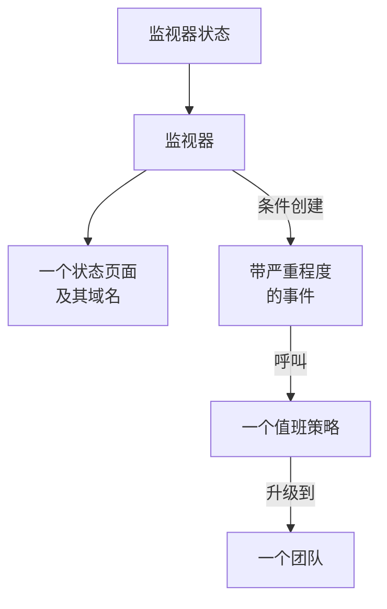

# 示例

适用于大多数项目最先创建的资源的现成配置。每个块都可以直接在下面的提供程序设置之上应用，其中大多数来自提供程序的端到端测试，这些测试在每次变更时都会把它们应用到真实的 OneUptime 上。

:::cards
- [监视器](#监视器): 网站、API、ping、端口、SSL 证书、heartbeat 和手动监视器。
- [状态页面](#状态页面): 带有一个组和一个监视器的状态页面，以及自定义域名。
- [团队和值班](#团队和值班): 一个团队，以及呼叫该团队的值班策略。
- [事件和维护](#事件和维护): 严重程度、状态、一个声明的事件和一个维护窗口。
:::



## 提供程序设置

每个示例都假定使用以下设置，API 密钥放在环境变量 `ONEUPTIME_API_KEY` 中：

```hcl title="main.tf"
terraform {
  required_providers {
    oneuptime = {
      source  = "oneuptime/oneuptime"
      version = "{{TERRAFORM_PROVIDER_VERSION}}"
    }
  }
}

provider "oneuptime" {
  # On a self-hosted OneUptime, add your OneUptime's address:
  # oneuptime_url = "https://oneuptime.example.com"
}
```

## 标签

标签用于对记录进行排序和筛选。大多数资源在 `labels` 中接受一组标签 ID：

```hcl
resource "oneuptime_label" "production" {
  name        = "production"
  description = "Production infrastructure"
  color       = "#FF5733"
}
```

## 监视器

下面的监视器使用每个项目一开始就有的三个状态来设置自己的状态，这些状态通过数据源读取：

```hcl
data "oneuptime_monitor_status" "operational" {
  name = "Operational"
}

data "oneuptime_monitor_status" "degraded" {
  name = "Degraded"
}

data "oneuptime_monitor_status" "offline" {
  name = "Offline"
}
```

每个监视器的 `monitor_steps` 说明它检查什么，以及如何判定每个结果：[监控步骤](/docs/terraform/monitor-steps) 解释了每个属性。

### 网站监视器

网站无响应时为 offline，以 200 响应时为 online。端到端测试 `35-monitor-with-steps` 会应用一个执行这些检查的监视器：

```hcl
resource "oneuptime_monitor" "website" {
  name                = "Website"
  description         = "Homepage availability and status code"
  monitor_type        = "Website"
  monitoring_interval = "*/5 * * * *"
  labels              = [oneuptime_label.production.id]

  monitor_steps = [{
    monitor_destination      = "https://example.com"
    monitor_destination_type = "URL"
    request_type             = "GET"

    criteria = [
      {
        name                  = "Offline"
        description           = "The website does not respond"
        filter_condition      = "Any"
        change_monitor_status = true
        monitor_status_id     = data.oneuptime_monitor_status.offline.id

        filters = [
          {
            check_on    = "Is Online"
            filter_type = "False"
          }
        ]
      },
      {
        name                  = "Online"
        description           = "The website responds with 200"
        filter_condition      = "All"
        change_monitor_status = true
        monitor_status_id     = data.oneuptime_monitor_status.operational.id

        filters = [
          {
            check_on    = "Is Online"
            filter_type = "True"
          },
          {
            check_on    = "Response Status Code"
            filter_type = "Equal To"
            value       = "200"
          }
        ]
      }
    ]
  }]
}
```

### API 监视器

一个带请求头和 JSON 请求体的 `POST`，响应缓慢时为 degraded。端到端测试 `35-monitor-with-steps` 会应用一个类似的 API 监视器：

```hcl
resource "oneuptime_monitor" "orders_api" {
  name         = "Orders API"
  description  = "Health check of the orders API"
  monitor_type = "API"

  monitor_steps = [{
    monitor_destination      = "https://api.example.com/v1/health"
    monitor_destination_type = "URL"
    request_type             = "POST"
    request_headers = {
      "Content-Type" = "application/json"
      "Accept"       = "application/json"
    }
    request_body = jsonencode({ check = "health" })

    criteria = [
      {
        name                  = "Offline"
        description           = "The API does not answer, or answers with an error"
        filter_condition      = "Any"
        change_monitor_status = true
        monitor_status_id     = data.oneuptime_monitor_status.offline.id

        filters = [
          {
            check_on    = "Is Online"
            filter_type = "False"
          },
          {
            check_on    = "Response Status Code"
            filter_type = "Greater Than Or Equal To"
            value       = "500"
          }
        ]
      },
      {
        name                  = "Slow"
        description           = "The API takes more than two seconds"
        filter_condition      = "All"
        change_monitor_status = true
        monitor_status_id     = data.oneuptime_monitor_status.degraded.id

        filters = [
          {
            check_on    = "Response Time (in ms)"
            filter_type = "Greater Than"
            value       = "2000"
          }
        ]
      },
      {
        name                  = "Online"
        description           = "The API answers in time"
        filter_condition      = "All"
        change_monitor_status = true
        monitor_status_id     = data.oneuptime_monitor_status.operational.id

        filters = [
          {
            check_on    = "Is Online"
            filter_type = "True"
          }
        ]
      }
    ]
  }]
}
```

### Ping 监视器

Ping 监视器接受主机名或 IP 地址，而不是 URL：

```hcl
resource "oneuptime_monitor" "gateway" {
  name         = "Gateway"
  description  = "The gateway answers ping"
  monitor_type = "Ping"

  monitor_steps = [{
    monitor_destination      = "gateway.example.com"
    monitor_destination_type = "Hostname"

    criteria = [
      {
        name                  = "Unreachable"
        filter_condition      = "Any"
        change_monitor_status = true
        monitor_status_id     = data.oneuptime_monitor_status.offline.id

        filters = [
          {
            check_on    = "Is Online"
            filter_type = "False"
          }
        ]
      },
      {
        name                  = "Reachable"
        filter_condition      = "All"
        change_monitor_status = true
        monitor_status_id     = data.oneuptime_monitor_status.operational.id

        filters = [
          {
            check_on    = "Is Online"
            filter_type = "True"
          }
        ]
      }
    ]
  }]
}
```

### 端口监视器

端口监视器额外添加要检查的 `port`，写成数字：

```hcl
resource "oneuptime_monitor" "database_port" {
  name         = "Database port"
  description  = "PostgreSQL accepts connections"
  monitor_type = "Port"

  monitor_steps = [{
    monitor_destination      = "db.example.com"
    monitor_destination_type = "Hostname"
    port                     = 5432

    criteria = [
      {
        name                  = "Closed"
        filter_condition      = "Any"
        change_monitor_status = true
        monitor_status_id     = data.oneuptime_monitor_status.offline.id

        filters = [
          {
            check_on    = "Is Online"
            filter_type = "False"
          }
        ]
      },
      {
        name                  = "Open"
        filter_condition      = "All"
        change_monitor_status = true
        monitor_status_id     = data.oneuptime_monitor_status.operational.id

        filters = [
          {
            check_on    = "Is Online"
            filter_type = "True"
          }
        ]
      }
    ]
  }]
}
```

### SSL 证书监视器

与仪表板中新建的 SSL 证书监视器一样，证书无效时为 offline，14 天内到期时为 degraded：

```hcl
resource "oneuptime_monitor" "certificate" {
  name         = "example.com certificate"
  description  = "The TLS certificate of example.com"
  monitor_type = "SSL Certificate"

  monitor_steps = [{
    monitor_destination      = "https://example.com"
    monitor_destination_type = "URL"

    criteria = [
      {
        name                  = "Not valid"
        description           = "Expired, self-signed, untrusted or not reachable"
        filter_condition      = "Any"
        change_monitor_status = true
        monitor_status_id     = data.oneuptime_monitor_status.offline.id

        filters = [
          {
            check_on    = "Is Not A Valid Certificate"
            filter_type = "True"
          }
        ]
      },
      {
        name                  = "Expires soon"
        description           = "Valid, and expires in 14 days or less"
        filter_condition      = "All"
        change_monitor_status = true
        monitor_status_id     = data.oneuptime_monitor_status.degraded.id

        filters = [
          {
            check_on    = "Is Valid Certificate"
            filter_type = "True"
          },
          {
            check_on    = "Expires In Days"
            filter_type = "Less Than Or Equal To"
            value       = "14"
          }
        ]
      },
      {
        name                  = "Valid"
        filter_condition      = "All"
        change_monitor_status = true
        monitor_status_id     = data.oneuptime_monitor_status.operational.id

        filters = [
          {
            check_on    = "Is Valid Certificate"
            filter_type = "True"
          }
        ]
      }
    ]
  }]
}
```

### 手动监视器

手动监视器不检查任何东西：它的状态由你自己设置。它不需要 `monitor_steps`：

```hcl
resource "oneuptime_monitor" "payment_provider" {
  name         = "Payment provider"
  description  = "Set by hand during the provider's incidents"
  monitor_type = "Manual"
}
```

### Heartbeat 监视器

入站请求监视器等待请求，而不是发送请求：这里是一个每晚报到的备份任务。25 小时内没有收到请求时，它会变为 offline：

```hcl
resource "oneuptime_monitor" "nightly_backup" {
  name         = "Nightly backup"
  description  = "The backup job sends a heartbeat when it finishes"
  monitor_type = "Incoming Request"

  monitor_steps = [{
    criteria = [
      {
        name                  = "No heartbeat"
        filter_condition      = "Any"
        change_monitor_status = true
        monitor_status_id     = data.oneuptime_monitor_status.offline.id

        filters = [
          {
            check_on    = "Incoming Request"
            filter_type = "Not Recieved In Minutes"
            value       = "1500"
          }
        ]
      },
      {
        name                  = "Heartbeat received"
        filter_condition      = "All"
        change_monitor_status = true
        monitor_status_id     = data.oneuptime_monitor_status.operational.id

        filters = [
          {
            check_on    = "Incoming Request"
            filter_type = "Recieved In Minutes"
            value       = "1500"
          }
        ]
      }
    ]
  }]
}

output "nightly_backup_heartbeat_key" {
  value     = oneuptime_monitor.nightly_backup.incoming_request_secret_key
  sensitive = true
}
```

任务使用 `terraform output -raw nightly_backup_heartbeat_key` 打印出的密钥，把请求发送到 `https://oneuptime.com/heartbeat/YOUR_SECRET_KEY`：参见 [入站请求监控](/docs/monitor/incoming-request-monitor)。服务器监视器的代理也以同样的方式通过 `server_monitor_secret_key` 进行身份验证。

### 监视器组

监视器组以单一状态显示一组监视器：

```hcl
resource "oneuptime_monitor_group" "storefront" {
  name        = "Storefront"
  description = "Everything the shop needs"
}

resource "oneuptime_monitor_group_resource" "website" {
  monitor_group_id = oneuptime_monitor_group.storefront.id
  monitor_id       = oneuptime_monitor.website.id
}

resource "oneuptime_monitor_group_resource" "orders_api" {
  monitor_group_id = oneuptime_monitor_group.storefront.id
  monitor_id       = oneuptime_monitor.orders_api.id
}
```

## 状态页面

### 带有一个组和一个监视器的状态页面

状态页面显示资源，并且可以把它们分到不同的组中。端到端测试 `42-status-page-resources` 会应用这套设置：

```hcl
resource "oneuptime_status_page" "public" {
  name                  = "Public Status"
  description           = "Customer-facing status page"
  page_title            = "System Status"
  page_description      = "Check our system status and incident history"
  is_public_status_page = true
}

resource "oneuptime_status_page_group" "services" {
  status_page_id = oneuptime_status_page.public.id
  name           = "Services"
}

resource "oneuptime_status_page_resource" "website" {
  status_page_id       = oneuptime_status_page.public.id
  status_page_group_id = oneuptime_status_page_group.services.id
  monitor_id           = oneuptime_monitor.website.id
  display_name         = "Website"
}
```

### 自定义域名

三个资源协同工作：项目的域名、状态页面，以及把两者连接起来的状态页面域名。`full_domain` 和 CNAME 验证令牌由服务器填写：不要设置它们。端到端测试 `12-status-page-domain` 和 `25-status-page-with-domain` 会应用这套设置：

```hcl
resource "oneuptime_domain" "company" {
  domain = "example.com"
}

resource "oneuptime_status_page_domain" "status" {
  domain_id      = oneuptime_domain.company.id
  status_page_id = oneuptime_status_page.public.id
  subdomain      = "status"
}

output "status_page_address" {
  # The subdomain and the domain, such as status.example.com.
  value = oneuptime_status_page_domain.status.full_domain
}
```

新域名必须先通过 DNS 验证，状态页面才会在该域名上响应。

## 团队和值班

### 团队及其成员

```hcl
resource "oneuptime_team" "sre" {
  name        = "SRE"
  description = "Site reliability engineering"
}

variable "alice_user_id" {
  description = "Alice's user ID, the last part of the address of her page under Users"
  type        = string
}

resource "oneuptime_team_member" "alice" {
  team_id = oneuptime_team.sre.id
  user_id = var.alice_user_id
}
```

已经在项目中的人会立即加入团队。其他人会收到邀请，接受后即加入团队。端到端测试 `33-team-crud` 会应用这个团队。

### 呼叫团队的值班策略

策略的第一条规则呼叫团队；如果没有人确认，策略会从头再来，最多两次：

```hcl
resource "oneuptime_on_call_policy" "primary" {
  name                                             = "Primary on-call"
  description                                      = "First line for production incidents"
  repeat_policy_if_no_one_acknowledges             = true
  repeat_policy_if_no_one_acknowledges_no_of_times = 2
}

resource "oneuptime_escalation_rule" "first_line" {
  on_call_duty_policy_id    = oneuptime_on_call_policy.primary.id
  name                      = "Page the SRE team"
  description               = "Moves on after 5 minutes without an acknowledgement"
  order                     = 1
  escalate_after_in_minutes = 5
}

resource "oneuptime_team_on_call_duty_escalation_rule" "sre" {
  on_call_duty_policy_id                 = oneuptime_on_call_policy.primary.id
  on_call_duty_policy_escalation_rule_id = oneuptime_escalation_rule.first_line.id
  team_id                                = oneuptime_team.sre.id
}
```

监视器的条件通过它们所创建事件上的 `on_call_policy_ids` 呼叫策略：参见 [事件和警报](/docs/terraform/monitor-steps#事件和警报)。

## 事件和维护

### 严重程度和状态

严重程度表示事件影响的大小，状态是事件生命周期中的各个阶段。`order` 表示每一项的排列位置：

```hcl
resource "oneuptime_incident_severity" "sev1" {
  name        = "SEV-1"
  description = "Full outage, all hands"
  color       = "#E74C3C"
  order       = 1
}

resource "oneuptime_incident_state" "mitigated" {
  name        = "Mitigated"
  description = "Impact contained, fix in progress"
  color       = "#F39C12"
  order       = 3
}
```

`oneuptime_alert_severity` 和 `oneuptime_alert_state` 以同样的方式用于警报。端到端测试 `03-incident-severity` 和 `04-incident-state` 会应用它们。

### 声明事件

事件通常由监视器创建，但事件本身也是一种资源，这很适合演练日。它是一个真实的事件，所以请不要让演练出现在你的状态页面上：

```hcl
resource "oneuptime_incident" "drill" {
  title                     = "Disaster recovery drill"
  description               = "A game day: we fail over the database"
  incident_severity_id      = oneuptime_incident_severity.sev1.id
  is_visible_on_status_page = false

  should_status_page_subscribers_be_notified_on_incident_created = false
}
```

端到端测试 `28-incident-crud` 会应用一个事件。

### 计划维护

一个时间固定、显示在你的状态页面上的维护窗口：

```hcl
resource "oneuptime_scheduled_maintenance_event" "database_upgrade" {
  title                       = "Database maintenance"
  description                 = "Planned PostgreSQL upgrade: writes pause briefly"
  starts_at                   = "2030-06-01T02:00:00Z"
  ends_at                     = "2030-06-01T04:00:00Z"
  is_visible_on_status_page   = true
  monitors                    = [oneuptime_monitor.website.id]
  change_monitor_status_to_id = data.oneuptime_monitor_status.degraded.id
}
```

时间使用 RFC 3339 格式，同一时刻换一种写法不算更改。端到端测试 `30-scheduled-maintenance-crud` 会应用维护事件。

要在事件进行期间让其监视器处于某个状态，请用 `monitors` 关联这些监视器，并把 `change_monitor_status_to_id` 设为你的某个监视器状态：事件开始时监视器切换到该状态，事件结束时恢复为正常运行。在事件开始之前，Terraform 会就地修改 `change_monitor_status_to_id`。事件开始后，其监视器已经处于该状态，修改它的 apply 会以“Change Monitor Status to can no longer be changed: this event has already started.”失败。

## 探针

你自己的探针从你的网络发起检查。它的密钥是探针登录时使用的机密，所以请通过变量传入：

```hcl
variable "probe_key" {
  description = "The key the probe signs in with"
  type        = string
  sensitive   = true
}

resource "oneuptime_probe" "eu_west" {
  key           = var.probe_key
  name          = "EU West"
  description   = "Probe in our eu-west-1 network"
  probe_version = "1.0.0"

  should_auto_enable_probe_on_new_monitors = true
}
```

运行探针时，把 `PROBE_ID` 设为探针的 `id`，把 `PROBE_KEY` 设为密钥：参见 [自定义探针](/docs/probe/custom-probe)。端到端测试 `23-probe-crud` 会应用探针。

## 后续步骤

:::cards
- [监控步骤](/docs/terraform/monitor-steps): 监视器检查和条件的每个属性。
- [导入资源](/docs/terraform/importing-resources): 把你在仪表板中创建的内容交给 Terraform 管理。
- [完整指南](/docs/terraform/complete-guide): 数据源、state、CI/CD 和升级。
:::
