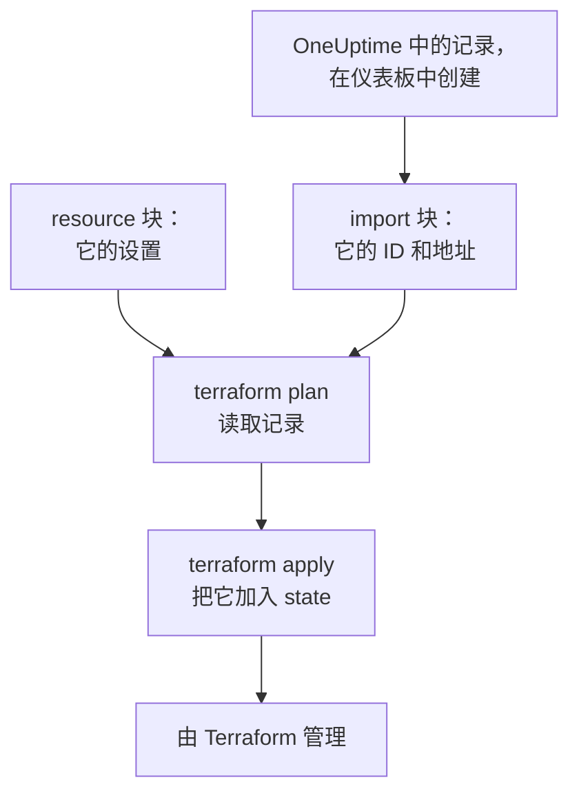
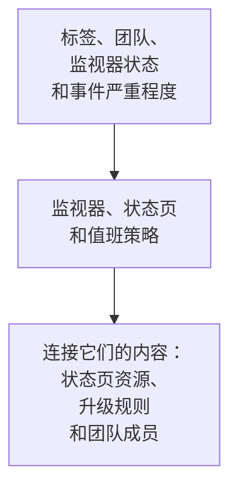

# 导入资源

用 Terraform 管理 OneUptime，不必从头再来。导入你已有的监视器、状态页、团队和其他记录，此后 Terraform 就按它们现有的样子管理它们。导入只做读取：在你应用计划好的更改之前，OneUptime 中什么都不会改变。

:::cards
- [导入的工作方式](#导入的工作方式): 导入读取什么，你又要写什么。
- [导入一个资源](#导入一个资源): 从仪表板中它的页面开始，分四步完成。
- [导入多个资源](#导入多个资源): 整个列表的 import 块，以及 Terraform 替你写出的配置。
- [停止管理某个资源](#停止管理某个资源): 把它交还给仪表板，而不删除它。
:::

## 导入的工作方式

导入把 OneUptime 中已有的记录与你配置中的 `resource` 块关联起来。你写一个 `import` 块，其中包含记录的 ID 和它要放到的地址。下一次 `terraform plan` 按 ID 读取该记录，显示它将被导入，并列出记录与你的配置之间的每一处差异。`terraform apply` 把它加入 Terraform 的 state，此后该记录就像 Terraform 创建的任何东西一样受到管理。



按记录现有的样子写 `resource` 块。两者不同的地方，计划会同时显示导入和一处更改，应用它就会更改 OneUptime 中的记录。

### 可以导入什么

提供程序的每个资源都可以按 ID 导入，`oneuptime_file` 除外：OneUptime API 无法读回文件，所以提供程序会回答 `Import Not Supported`。数据源从不导入。要在配置中使用某条记录而不管理它，请改用[数据源](/docs/terraform/complete-guide#读取已有的内容)读取它。

## 开始之前

- **Terraform 1.5 或更高版本，或 OpenTofu 1.6 或更高版本。** 本页的 `import` 块需要这些版本。更早的 Terraform 请通过[命令行](#通过命令行导入)导入。
- **能读取你要导入内容的 API 密钥。** 导入用提供程序的密钥读取每条记录，之后要管理它，还需要更改和删除它的权限。请参阅[创建项目 API 密钥](/docs/terraform/quick-start#创建项目-api-密钥)。
- **配置中的提供程序**，按[快速开始](/docs/terraform/quick-start#让-terraform-指向-oneuptime)中的方式设置。

## 导入一个资源

仪表板会写出你正在查看的资源的配置及其 `import` 块，所以你很少需要手写。

:::steps
### 打开资源的 Terraform 页面

在仪表板中打开监视器、状态页或其他资源。在它的侧边菜单中打开 **开发者**，然后打开 **Terraform**。

### 复制它的配置

该页面根据资源的当前设置写出它的 `resource` 块，并写出一个包含其 ID 的 `import` 块。把两者都放进一个 `.tf` 文件：

```hcl title="status-pages.tf"
resource "oneuptime_status_page" "public_status" {
  name       = "Public Status"
  page_title = "Acme Status"

  # Secrets are not shown here: master_password, embedded_overall_status_token.
  # Terraform leaves them as they are in OneUptime.
}

import {
  to = oneuptime_status_page.public_status
  id = "68a1b2c3-d4e5-4f6a-8b9c-0d1e2f3a4b02"
}
```

它写出与默认值不同的设置，每个 ID 后面的注释会说明该 ID 指向的记录。机密从不显示：资源需要的机密从标记为 `sensitive` 的变量中读取，注释会列出被省略的那些。

### 运行计划

运行 `terraform plan`。它以 `Plan: 1 to import, 0 to add, 0 to change, 0 to destroy.` 结束：Terraform 找到了这条记录，你的配置与它一致。

### 应用

运行 `terraform apply`。状态页现在已进入 Terraform 的 state，下一次计划会回答 `No changes.` 之后你可以删除 `import` 块，也可以把它留作资源来源的备注：资源一旦受管理，它就不再起任何作用。
:::

### 自己编写这些块

不使用仪表板时，两个块都由你自己写。先用资源需要的属性写出 `resource` 块，然后运行 `terraform plan`。你的配置与记录不同的地方，计划会在导入旁边显示更改：

```text
  # oneuptime_label.critical will be updated in-place
  # (imported from "68a1b2c3-d4e5-4f6a-8b9c-0d1e2f3a4b03")
  ~ resource "oneuptime_label" "critical" {
      ~ color = "#FF5733" -> "#000000"
    }

Plan: 1 to import, 0 to add, 1 to change, 0 to destroy.
```

把记录的值复制到你的配置中（此处为 `color = "#FF5733"`），然后再次运行计划，直到计划只显示导入、没有更改。记录的 ID 可以在三个地方找到：

| 位置 | 方法 |
| --- | --- |
| 资源的页面 | 它的详细信息卡片最后有一行 **ID**。点击 ID 或旁边的复制按钮，即可复制完整的 ID。 |
| 地址栏 | ID 位于列表名称之后：`/dashboard/<project-id>/monitors/<monitor-id>`。 |
| API | 每条记录都在 `_id` 中带有自己的 ID。 |

## 导入多个资源

要导入某一类的所有监视器、状态页或其他资源，请从它们的列表开始。

:::steps
### 打开列表的 Terraform 页面

打开列表，然后在它的侧边菜单中依次打开 **开发者** 和 **Terraform**，例如 **监控 → 开发者 → Terraform**。

### 复制 import 块

该页面为每条记录（前 100 条）写出一个 `import` 块，地址由记录的名称生成。把它们放进一个单独的文件，例如 `imports.tf`：

```hcl title="imports.tf"
import {
  to = oneuptime_monitor.homepage
  id = "68a1b2c3-d4e5-4f6a-8b9c-0d1e2f3a4b01"
}

import {
  to = oneuptime_monitor.checkout_api
  id = "68a1b2c3-d4e5-4f6a-8b9c-0d1e2f3a4b05"
}
```

### 让 Terraform 写出配置

运行计划，并为 Terraform 写出的配置指定一个文件名。该文件必须尚不存在：Terraform 只会写入新文件。

```bash
terraform plan -generate-config-out=monitors.tf
```

Terraform 读取每条记录并写出 `resource` 块，对象是每个还没有对应块的 `import` 块。它会警告配置生成是实验性功能，所以请阅读它写出的内容。

### 检查并应用

在新文件中，把其他记录的 ID 替换为对它们资源的引用，例如 `labels = [oneuptime_label.critical.id]`，这样 Terraform 就知道按什么顺序工作。运行 `terraform plan`，直到它只显示导入，然后运行 `terraform apply`。
:::

### 整个项目

逐个列表地导入项目，从被其他记录引用的记录开始。这样每个资源块都可以通过地址而不是 ID 引用前面的资源：



每个项目一开始就有的记录，例如它的监视器状态和事件严重程度，通常用数据源读取比导入更好：这样 Terraform 可以引用它们，但从不更改或删除它们。当 `terraform plan` 回答 `No changes.` 时，项目就导入完成了。

## 通过命令行导入

`terraform import` 一次导入一个资源，适用于所有版本的 Terraform 和 OpenTofu。先写出 `resource` 块，然后用块的地址和记录的 ID 运行命令：

```bash
terraform import oneuptime_status_page.public_status 68a1b2c3-d4e5-4f6a-8b9c-0d1e2f3a4b02
terraform import oneuptime_label.critical 68a1b2c3-d4e5-4f6a-8b9c-0d1e2f3a4b03
terraform import oneuptime_team.sre 68a1b2c3-d4e5-4f6a-8b9c-0d1e2f3a4b04
```

每条命令都以 `Import successful!` 结束。与 `import` 块不同，该命令会立即写入 state，不会先给出计划供你检查：之后请运行 `terraform plan`，并修改配置，直到计划回答 `No changes.`

## 停止管理某个资源

要把资源交还给仪表板而不删除它，请把它的 `resource` 块替换为保留记录的 `removed` 块：

```hcl
removed {
  from = oneuptime_team.sre

  lifecycle {
    destroy = false
  }
}
```

计划会说明该团队将不再由 Terraform 管理，并且不会销毁任何东西。应用它，然后删除 `removed` 块。带 `destroy = false` 的 `removed` 块需要 Terraform 1.7 或更高版本，或 OpenTofu 1.10 或更高版本。在更早的版本上，请改为运行 `terraform state rm oneuptime_team.sre`。

> [!WARNING]
> 删除 `resource` 块会在下一次 apply 时删除它在 OneUptime 中的记录。在 Terraform 中，没有 `destroy = false` 的 `removed` 块也会这样做：请始终写上 `lifecycle` 块。

## 须知

- **导入不会更改任何内容，但下一次 apply 会。** 应用一个在导入旁边显示更改的计划，会更改 OneUptime 中的记录。请先让计划只显示导入。
- **机密不会被读回。** OneUptime 从不返回的机密，例如监视器机密的 `secret_value`，在导入后不在 state 中。如果你的配置设置了它，第一次计划会把它显示为一处更改，应用后会再次写入该机密。
- **每条记录只用一份配置。** 导入到两份配置中的记录，每次 apply 都会被改回各自配置所写的样子。
- **导入的记录就是受管理的记录。** `terraform destroy` 会把它们从 OneUptime 中删除，就像 Terraform 创建的记录一样。

## 故障排除

:::details 消息“Cannot import non-existent remote object”
没有记录具有该 ID，或者提供程序的 API 密钥无权读取它：OneUptime 对这两种情况的回答相同。请检查 ID，以及密钥能否读取该类记录。
:::

:::details 消息“Import Not Supported”
`oneuptime_file` 是唯一无法导入的资源。请不要导入它，改为让 Terraform 创建一个新文件。
:::

:::details 消息“Invalid ID format”
传入的不是记录的 ID，例如是一个名称。导入需要 ID，即类似 `68a1b2c3-d4e5-4f6a-8b9c-0d1e2f3a4b02` 的 UUID：请从资源的页面复制它。
:::

:::details 消息“Target generated file already exists”
`-generate-config-out` 指定了一个已经存在的文件。请指定一个新文件，或把该文件的内容移到别处再删除它。
:::

:::details 消息“Resource already managed by Terraform”
`terraform import` 收到的地址已在 state 中。请把记录导入到另一个地址，或用 `terraform state list` 查看该地址中有什么。
:::

## 后续步骤

:::cards
- [完整指南](/docs/terraform/complete-guide): 数据源、资源之间的引用以及 state。
- [监控步骤](/docs/terraform/monitor-steps): 查看并更改导入的监视器检查的内容。
- [示例](/docs/terraform/examples): 常用资源的现成配置。
- [故障排除](/docs/terraform/troubleshooting): 常见错误及其修复方法。
:::
