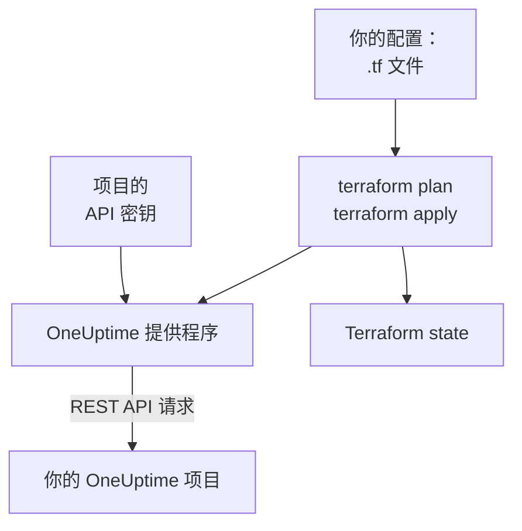

# Terraform 概览

OneUptime 的 Terraform 提供程序让你以代码的方式管理 OneUptime 项目。在 `.tf` 文件中描述监视器、状态页面、值班策略、团队、标签以及项目中的其他记录，用 `terraform plan` 查看将要发生的更改，再用 `terraform apply` 完成更改。它既适用于 OneUptime Cloud，也适用于自托管的 OneUptime，并且同样支持 OpenTofu 和 Terraform。

:::cards
- [提供程序的工作方式](#提供程序的工作方式): 你的配置、计划，以及背后的 API 请求。
- [安装提供程序](#安装提供程序): 提供程序块，以及该选的版本。
- [让仪表板来写](#让仪表板来写): 为已有资源生成配置和 import 块。
- [可以管理的内容](#可以管理的内容): 资源、数据源，以及它们的属性怎么写。
:::

## 提供程序的工作方式

提供程序是 Terraform 从注册表下载的插件。执行 `terraform apply` 时，它把计划中的每项更改转换成一次对 OneUptime REST API 的请求，请求使用项目的 API 密钥。Terraform 会把它创建的内容记录在 state 中，因此下一次计划只显示此后发生变化的内容。



一个 API 密钥属于一个项目，并决定 Terraform 能在其中读取和更改什么，所以一份配置管理一个项目。要管理多个项目，请为每个项目给提供程序设置一个 [别名](/docs/terraform/complete-guide#管理多个项目)。

## 开始之前

- **Terraform 1.5 或更高版本，或 OpenTofu 1.6 或更高版本。** 仪表板生成的 `import` 块需要这些版本。
- **项目的 API 密钥。** [快速开始](/docs/terraform/quick-start#创建项目-api-密钥) 介绍了如何在 **项目设置 → 高级 → API 密钥** 中创建。
- **在 OneUptime Cloud 上，需要 Growth 套餐或更高。** 项目的 API 密钥只在该套餐上有效。

## 安装提供程序

把提供程序添加到一个 `.tf` 文件中。`terraform init` 从 Terraform Registry 下载它，`tofu init` 从 OpenTofu Registry 下载它：

```hcl title="main.tf"
terraform {
  required_providers {
    oneuptime = {
      source  = "oneuptime/oneuptime"
      version = "{{TERRAFORM_PROVIDER_VERSION}}"
    }
  }
}

provider "oneuptime" {
  # The API key comes from the ONEUPTIME_API_KEY environment variable.
  # On a self-hosted OneUptime, add your OneUptime's address:
  # oneuptime_url = "https://oneuptime.example.com"
}
```

不要把密钥写进文件：在运行 Terraform 之前导出它，或者通过标记为 `sensitive` 的变量传入。[完整指南](/docs/terraform/complete-guide#配置提供程序) 列出了向提供程序提供密钥和地址的所有方式。

### 选择版本

提供程序的版本跟随 OneUptime 的版本：提供程序 {{TERRAFORM_PROVIDER_MAJOR}}.x 由 OneUptime {{TERRAFORM_PROVIDER_MAJOR}}.x 生成。上面的约束 `{{TERRAFORM_PROVIDER_VERSION}}` 会选用最新的 {{TERRAFORM_PROVIDER_MAJOR}}.x 版本，这对 OneUptime Cloud 来说是正确的。在自托管的 OneUptime 上，请使用不比你的 OneUptime 更新的最新提供程序：[自托管设置](/docs/terraform/self-hosted) 介绍了如何固定版本。

## 让仪表板来写

已有的资源不必手写。OneUptime 仪表板中的每个资源（监视器、状态页面、工作流、值班策略等）在侧边菜单中都有一个 **开发者** 分区，打开之前处于折叠状态。其中的 **Terraform** 页面会根据你自己的项目替你写好配置。

:::steps
### 打开资源

打开你想交给 Terraform 管理的监视器、状态页面或其他资源。

### 打开它的 Terraform 页面

在侧边菜单中依次打开 **开发者** 和 **Terraform**。

### 复制配置

该页面根据资源的当前设置写出配置，并附带一个 `import` 块。每个 ID 后面的注释给出它所指向记录的名称（`incident_severity_id = "..." # Critical Incident`）。

### 计划并应用

运行 `terraform plan`：它会显示该资源将被导入，且没有需要更改的内容。应用之后，Terraform 就会接管该资源。
:::

在配置下方，**进一步扩展** 列出了人们常在该资源旁边添加的内容，并通过地址引用该资源：事件的负责团队、状态页面的监视器组、值班策略的升级规则。

列表页面（例如 **事件** 或 **监视器**）也有同样的分区。在那里，**Terraform** 页面会用你项目自己的记录写出一个新资源，填好大多数人会设置的字段：一个使用你的某个严重程度的事件，一个带有仪表板为新监视器提供的条件、并关联到你的状态的监视器。它还提供现成的 **常用配置**（带有一个组和一个监视器的状态页面、呼叫团队的值班策略、每周的值班轮换），并为你已有的每个资源（前 100 个）提供一个 `import` 块，可直接用于 `terraform plan -generate-config-out`。两个页面都会提供适用于你的 OneUptime 的提供程序块：正确的 `oneuptime_url`，以及与你的 OneUptime 匹配的版本约束。

这些页面从不显示机密。当配置需要机密时（例如监视器的 `Authorization` 请求头），会从标记为 `sensitive` 的 Terraform 变量中读取。不需要的机密会被省略，Terraform 会保持它们在 OneUptime 中的原样。

同一分区中还有一个 **API** 页面，提供该资源的 `curl` 命令；以及一个 **AI 助手** 页面，可把 Claude、GitHub Copilot 或 Cursor 连接到 [MCP 服务器](/docs/ai/mcp-server)。

## 可以管理的内容

对于可以通过 OneUptime API 创建的每种记录，提供程序都有一个名为 `oneuptime_<name>` 的资源。大多数配置从以下资源开始：

| 资源 | 说明 |
| --- | --- |
| `oneuptime_monitor` | 监视器：网站、API、ping、端口、SSL 证书、服务器、入站请求、手动以及其他所有类型 |
| `oneuptime_monitor_status` | 监视器状态，例如 Operational、Degraded 或 Offline |
| `oneuptime_monitor_group` | 以单一状态显示的监视器组 |
| `oneuptime_status_page` | 公开或私有的状态页面 |
| `oneuptime_status_page_domain` | 状态页面的自定义域名 |
| `oneuptime_domain` | 项目中已为状态页面验证的域名 |
| `oneuptime_label` | 用于排序和筛选记录的标签 |
| `oneuptime_team`, `oneuptime_team_member` | 团队，以及团队成员 |
| `oneuptime_on_call_policy`, `oneuptime_escalation_rule` | 值班策略，以及它按顺序呼叫的规则 |
| `oneuptime_incident`, `oneuptime_incident_severity`, `oneuptime_incident_state` | 事件，以及事件的严重程度和状态 |
| `oneuptime_alert`, `oneuptime_alert_severity`, `oneuptime_alert_state` | 警报，以及警报的严重程度和状态 |
| `oneuptime_scheduled_maintenance_event` | 计划维护时间窗口 |
| `oneuptime_probe` | 你自己的探针，从你的网络发起检查 |

[Terraform Registry](https://registry.terraform.io/providers/oneuptime/oneuptime/latest/docs) 列出了每个资源及其所有属性。

### 读取已有的内容

每个资源都有一个同名的数据源，例如 `data "oneuptime_label"`。数据源读取一条不由当前配置管理的记录，例如在仪表板中创建的记录。可以按 `id` 查找，也可以按其他简单参数查找：你设置的每个参数都必须匹配，并且必须恰好有一条记录与它们全部匹配。

```hcl
data "oneuptime_monitor_status" "offline" {
  name = "Offline"
}

# Any plain argument works. Set several, and all of them must match.
data "oneuptime_monitor_status" "offline_state" {
  is_offline_state = true
}
```

没有匹配或匹配多于一条都会报错，而不是返回空结果或任意结果。规则见 [完整指南](/docs/terraform/complete-guide#读取已有的内容)。

### 已重命名的资源

资源名称会把 IoT、vCenter 这样的词保持完整：`oneuptime_iot_fleet` 和 `oneuptime_vcenter`，而旧版提供程序中是 `oneuptime_io_t_fleet` 和 `oneuptime_v_center`（它们的标签规则、负责人和动态也是如此）。旧名称仍可作为已弃用的别名使用，使用旧名称的计划会给出提示。要切换，请在配置中重命名资源并添加一个 `moved` 块，Terraform 会保留现有资源，而不是替换它：

```hcl
# Was: resource "oneuptime_io_t_fleet" "factory"
resource "oneuptime_iot_fleet" "factory" {
  name = "Factory floor"
}

moved {
  from = oneuptime_io_t_fleet.factory
  to   = oneuptime_iot_fleet.factory
}
```

把资源移到另一种类型需要 Terraform 1.8 或更高版本。在更旧的引擎上，暂时保留旧名称即可：它仍然可用。

## 属性的写法

属性遵循 OneUptime API，使用 snake_case：

| 值的类型 | 写法 | 示例 |
| --- | --- | --- |
| 文本、数字、真或假 | 原样书写 | `is_public_status_page = false` |
| 对另一条记录的引用 | 它的 ID，通常是另一个资源的 `id` | `incident_severity_id = oneuptime_incident_severity.sev1.id` |
| 引用列表 | 一组 ID，顺序无关紧要 | `labels = [oneuptime_label.critical.id]` |
| 颜色、域名和其他包装值 | 它们的普通值 | `color = "#FF5733"` |
| 日期和时间 | RFC 3339 格式的文本 | `starts_at = "2030-06-01T02:00:00Z"` |
| 监视器的检查 | 有类型的嵌套属性：参见 [监控步骤](/docs/terraform/monitor-steps) | `monitor_steps = [{ ... }]` |
| 其他结构化设置 | 用 `jsonencode()` 写的 JSON | `log_monitor = jsonencode({ ... })` |

有两类值属于服务器，你不需要填写：

- **资源内部的 ID。** 监视器的步骤和条件，以及它们的事件模板和警报模板，都有服务器分配并在每次 apply 中保持不变的 ID，因此事件会一直指向触发它们的条件。
- **服务器持续更新的内容。** 监视器的当前状态，或它最后一次收到 heartbeat 的时间，可能在 `terraform plan` 和 `terraform apply` 结束之间发生变化。对于你没有设置的内容，提供程序会保留计划中的值，下一次 refresh 再读取服务器的值，因此这既不会让 apply 失败，也不会显示为更改。

## 获取帮助

- 错误报告和功能请求：[github.com/OneUptime/oneuptime/issues](https://github.com/OneUptime/oneuptime/issues)。
- 提供程序由 [OneUptime 主仓库](https://github.com/OneUptime/oneuptime) 中的 OneUptime OpenAPI 规范生成。已发布的提供程序仓库是只读的，所以请在主仓库中报告问题。

## 后续步骤

:::cards
- [快速开始](/docs/terraform/quick-start): 创建 API 密钥，十分钟内应用你的第一批资源。
- [完整指南](/docs/terraform/complete-guide): 身份验证、项目结构、数据源、state 和升级。
- [监控步骤](/docs/terraform/monitor-steps): 决定监视器检查什么，以及每个结果意味着什么。
- [示例](/docs/terraform/examples): 常用资源的现成配置。
- [导入资源](/docs/terraform/importing-resources): 把你在仪表板中创建的内容交给 Terraform 管理。
:::
