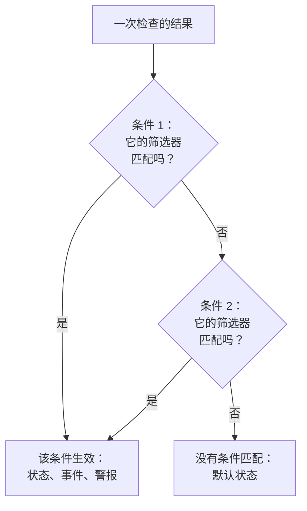
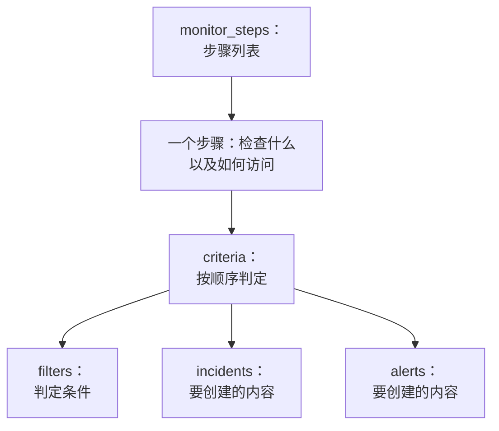

# 监控步骤

`monitor_steps` 是 `oneuptime_monitor` 的一个属性，说明监视器检查什么，以及如何判定每个结果：要检查的地址、要发送的请求，以及把结果变成监视器状态、事件或警报的条件。本页解释它的每个部分。

:::cards
- [如何判定一次检查](#如何判定一次检查): 按顺序排列的条件，以及第一个匹配的条件。
- [编写步骤](#编写步骤): 步骤的结构、一个完整示例，以及值的两条规则。
- [筛选器参考](#筛选器参考): 筛选器可以检查什么，以及如何比较。
- [常见错误](#常见错误): 最常出问题的地方，以及解决办法。
:::

## 如何判定一次检查

每次检查都会给出一个结果：探针的响应、脚本的返回值，或检查读取的遥测数据。然后，步骤的条件按顺序判定这个结果。第一个筛选器匹配的条件决定会发生什么：它可以更改监视器的状态、创建事件和创建警报。对这次检查而言，它之后的条件不会被查看。



因此条件的顺序很重要：把会发出警报的条件放在前面，最严重的放在最前，健康状态的条件放在最后。[条件属性](#条件属性) 解释了原因，以及唯一的例外。

## 编写步骤

`monitor_steps` 是直接用 HCL 编写的有类型对象列表。没有 `jsonencode()`，没有 `{_type, value}` 包装，没有 camelCase 键，也不需要写 ID：提供程序把你的 HCL 转换为 API 的格式，服务器为每个步骤、条件、事件模板和警报模板分配 ID。服务器会在每次 apply 中保留这些 ID，按名称（否则按位置）把每个条件和模板与它所替换的那个对应起来，因此探针结果会留在各自的步骤上，事件也会一直指向触发它们的条件。



最小的有用步骤检查一个地址，并有一个带一个筛选器的条件：

```hcl
resource "oneuptime_monitor" "example" {
  name         = "Example"
  description  = "The smallest monitor_steps"
  monitor_type = "Website"

  monitor_steps = [{
    monitor_destination      = "https://example.com"
    monitor_destination_type = "URL"
    request_type             = "GET"

    criteria = [
      {
        name             = "Check if online"
        description      = "The website responds"
        filter_condition = "All"

        filters = [
          {
            check_on    = "Is Online"
            filter_type = "True"
          }
        ]
      }
    ]
  }]
}
```

在 `monitor_steps` 中处处适用两条规则：

- **不用的就省略。** 你没有设置的属性不会发送给 API。永远不要把 `[]`、`{}` 或 `""` 当作占位符：提供程序会拒绝空字符串、空列表和空 map，因此缺少值始终表示“未设置”。
- **筛选器的值是字符串。** 筛选器的 `value` 是字符串，即使是数字也一样：写 `value = "200"`，而不是 `value = 200`。像 `port` 这样的数值设置是数字。

:::details 从 monitor_steps 还是 JSON 的提供程序 1.x 迁移
在提供程序 1.x 中，`monitor_steps` 是用 `jsonencode({ _type = "MonitorSteps", value = { ... } })` 写的 JSON 字符串。请改用本页的有类型属性重写：去掉 `_type` 和 `value` 包装，把 camelCase 键写成 snake_case（`monitorDestination` 变为 `monitor_destination` 和 `monitor_destination_type`，`filterCondition` 变为 `filter_condition`，`checkOn` 变为 `check_on`），并删除每个 `id`。现在所有 ID 都由服务器分配，这也解决了 issue [#2291](https://github.com/OneUptime/oneuptime/issues/2291) 中硬编码随机 ID 的问题。以 JSON 字符串保存的 state 不会自动升级：请应用新的配置。
:::

### 完整示例

这个网站监视器检查的内容与提供程序端到端测试中的网站监视器（测试 `35-monitor-with-steps`）相同：网站无响应时为 offline，以 200 响应时为 online。

```hcl
resource "oneuptime_monitor_status" "operational" {
  name                 = "Operational"
  description          = "Monitor is operational"
  color                = "#2ecc71"
  priority             = 1
  is_operational_state = true
}

resource "oneuptime_monitor_status" "offline" {
  name                 = "Offline"
  description          = "Monitor is offline"
  color                = "#e74c3c"
  priority             = 3
  is_operational_state = false
}

resource "oneuptime_monitor" "website" {
  name         = "Website"
  description  = "Website monitor with explicit steps"
  monitor_type = "Website"

  monitor_steps = [{
    monitor_destination      = "https://example.com" # what to check
    monitor_destination_type = "URL"                 # URL, Hostname or IP
    request_type             = "GET"                 # the HTTP method

    criteria = [ # judged in order: the first match decides
      {
        name                  = "Offline"
        description           = "Check if website is offline"
        filter_condition      = "Any"
        change_monitor_status = true
        create_incidents      = false
        create_alerts         = false
        monitor_status_id     = oneuptime_monitor_status.offline.id

        filters = [
          {
            check_on    = "Is Online"
            filter_type = "False"
          }
        ]
      },
      {
        name                  = "Online"
        description           = "Check if website is online"
        filter_condition      = "All" # All: every filter, Any: at least one
        change_monitor_status = true
        create_incidents      = false
        create_alerts         = false
        monitor_status_id     = oneuptime_monitor_status.operational.id

        filters = [
          {
            check_on    = "Is Online"
            filter_type = "True"
          },
          {
            check_on    = "Response Status Code"
            filter_type = "Equal To"
            value       = "200" # a string, even for a number
          }
        ]
      }
    ]
  }]
}
```

条件可以像这里的 `oneuptime_monitor_status.offline.id` 一样通过资源引用状态，也可以通过 [数据源](/docs/terraform/complete-guide#读取已有的内容) 引用你项目中已有的状态。

## 步骤属性

`monitor_steps` 的每一项是一个要检查的对象：

| 属性 | 类型 | 使用者 | 说明 |
| --- | --- | --- | --- |
| `monitor_destination` | string | 网站、API、Ping、IP、端口、SSL 证书、NTP | 要检查的 URL、主机名或 IP 地址。需要 `monitor_destination_type`。 |
| `monitor_destination_type` | string | 同上 | `URL`、`Hostname` 或 `IP`，取决于监视器类型接受什么：网站、API 和 SSL 证书监视器用 URL；Ping、IP、端口和 NTP 监视器用主机名或 IP 地址。 |
| `port` | number | 端口、NTP | 要检查的 TCP 端口，例如 `443`。对于 NTP，是时间服务器响应的 UDP 端口：未设置时为 `123`。 |
| `request_type` | string | 网站、API | HTTP 方法：`GET`、`POST`、`PUT`、`DELETE`、`HEAD` 或 `PATCH`。未设置时服务器使用 `GET`。 |
| `request_headers` | map(string) | 网站、API | 要发送的请求头：`{ "Accept" = "application/json" }`。 |
| `request_body` | string | API | 文本形式的请求体。 |
| `do_not_follow_redirects` | bool | 网站、API | 在第一个响应处停止，而不是跟随重定向。 |
| `allow_self_signed_certificates` | bool | 网站、API | 接受自签名的 TLS 证书。 |
| `tls_client_certificate` | string | 网站、API | 用于双向 TLS 的客户端证书：PEM，或 `{{monitorSecrets.name}}` 引用。 |
| `tls_client_key` | string（敏感） | 网站、API | 客户端证书的私钥。与证书一起设置。 |
| `tls_client_key_passphrase` | string（敏感） | 网站、API | 私钥的密码短语。 |
| `request_timeout_in_ms` | number | 由探针执行的检查 | 单次尝试允许的时长，单位为毫秒。探针会把超过 60000 的值降为 60000。 |
| `retry_count` | number | 由探针执行的检查 | 首次尝试失败后的重试次数：`0` 只检查一次，`3` 最多检查四次。探针会把超过 3 的值降为 3。 |
| `custom_code` | string | Custom JavaScript Code、Synthetic | 步骤运行的脚本。 |
| `screen_size_types` | list(string) | Synthetic | `Mobile`、`Tablet` 和 `Desktop`。 |
| `browser_types` | list(string) | Synthetic | `Chromium` 和 `Firefox`。 |
| `retry_count_on_error` | number | Synthetic | 脚本失败时的重试次数：`0` 只运行一次。 |
| `criteria` | list（必填） | 全部 | 如何判定每个结果：参见 [条件属性](#条件属性)。 |

### 各监视器类型的设置

除地址外还有更多设置的监视器类型，会把设置（日志查询、数据库连接、要监视的集群）放在各自的属性中，以 `jsonencode()` 写成原始 JSON：`log_monitor`、`trace_monitor`、`llm_monitor`、`metric_monitor`、`exception_monitor`、`profile_monitor`、`dns_monitor`、`domain_monitor`、`dnssec_monitor`、`sql_monitor`、`database_monitor`、`external_status_page_monitor`、`network_device_monitor`、`kubernetes_monitor`、`docker_monitor`、`docker_swarm_monitor`、`host_monitor`、`podman_monitor`、`proxmox_monitor`、`vmware_monitor`、`ceph_monitor`、`storage_array_monitor` 和 `iot_monitor`。

它们的 JSON 与仪表板的相同，键使用 camelCase。其中的 ID 按 API 的写法书写：`{ _type = "ObjectID", value = "..." }`。一个统计某个服务错误数的 Logs 监视器：

```hcl
resource "oneuptime_service" "checkout" {
  name = "checkout"
}

resource "oneuptime_monitor" "checkout_errors" {
  name         = "Checkout errors"
  monitor_type = "Logs"

  monitor_steps = [{
    log_monitor = jsonencode({
      attributes          = {}
      body                = "error"
      severityTexts       = ["Error"]
      telemetryServiceIds = [{ _type = "ObjectID", value = oneuptime_service.checkout.id }]
      lastXSecondsOfLogs  = 300
    })

    criteria = [
      {
        name             = "Errors found"
        filter_condition = "Any"

        filters = [
          {
            check_on    = "Log Count"
            filter_type = "Greater Than"
            value       = "0"
          }
        ]
      }
    ]
  }]
}
```

> [!TIP]
> 写对这个 JSON 最简单的方法：先在仪表板中设置好监视器，然后打开它的 **开发者** 分区和 **Terraform**。该页面会写出监视器的 `monitor_steps`，连同 `jsonencode()` 在内。

## 条件属性

`criteria` 的每一项是一条规则：当它的筛选器匹配时，执行它所规定的操作。

条件从上往下判定，第一个匹配的条件说了算，所以要把会发出警报的条件放在前面，最严重的放在最前（先严重，再警告），健康状态的条件放在最后。把健康条件放在最上面，是构建出一个永远不报警的监视器最常见的方式：像 `Is Online` 为 `True`，或指标值 `Greater Than` `0` 这样宽泛的规则几乎会匹配每次检查，它下面的条件永远不会被查看。放在最后时，它只会在上面的条件都没有匹配时才匹配，这正是你想要的。

分组的指标监视器是唯一的例外。当指标监视器的查询被分组时（在 `metric_monitor` 的 JSON 中，于 `metricViewConfig.queryConfigs[].metricQueryData.groupByAttributeKeys` 设置了 `groupByAttributeKeys`），监视器会为每个分组（每台主机、每个容器或每个挂载点）分别创建警报或事件，并且会判定所有条件，因此在同一次检查中，严重条件和警告条件可能分别对不同主机触发。同时违反两者的主机仍只会被呼叫一次，由第一个匹配的条件触发，所以最严重的条件仍应放在最前。参见 [指标监控](/docs/monitor/metrics-monitor)。

| 属性 | 类型 | 说明 |
| --- | --- | --- |
| `name` | string（必填） | 仪表板显示的名称。 |
| `description` | string | 仪表板显示的描述。 |
| `filter_condition` | string（必填） | `All`：所有筛选器都必须匹配。`Any`：匹配一个即可。 |
| `filters` | list（必填） | 判定条件，至少一个：参见 [筛选器参考](#筛选器参考)。 |
| `change_monitor_status` | bool | 匹配时是否更改监视器的状态。 |
| `monitor_status_id` | string | 要切换到的 `oneuptime_monitor_status` 的 ID。当 `change_monitor_status` 为 `true` 时设置。 |
| `create_incidents` | bool | 匹配时是否创建事件。 |
| `incidents` | list | 要创建的事件。除非 `create_incidents = true`，否则省略。 |
| `create_alerts` | bool | 匹配时是否创建警报。 |
| `alerts` | list | 要创建的警报。除非 `create_alerts = true`，否则省略。 |
| `is_enabled` | bool | 未设置时服务器上为 `true`。设为 `false` 可以保留条件但不用它判定。 |
| `incident_grouping` | string (JSON) | 仅限入站请求监视器：为请求中找到的每个值创建一个事件，例如 `jsonencode({ groupByJSONPath = "..." })`。 |
| `open_for_every_email` | bool | 仅限入站邮件监视器：设为 `true` 时，每封匹配的邮件都会新建一个事件（和警报），而不是一次只有一个。 |

### 事件和警报

`incidents` 的每一项接受 `title` 和 `description`（两者都必填）、`incident_severity_id`、`auto_resolve_incident`、`remediation_notes`、`on_call_policy_ids`、`label_ids`、`owner_team_ids`、`owner_user_ids`、`show_incident_on_status_page` 和 `is_private`。`alerts` 的每一项接受同样的属性，但使用 `alert_severity_id` 和 `auto_resolve_alert`，并且没有 `show_incident_on_status_page`。

这个条件会把监视器标记为 offline，创建一个呼叫值班策略的事件，并在网站恢复后解决它：

```hcl
criteria = [
  {
    name                  = "Offline"
    description           = "The site is unreachable"
    filter_condition      = "Any"
    change_monitor_status = true
    monitor_status_id     = oneuptime_monitor_status.offline.id
    create_incidents      = true

    filters = [
      {
        check_on    = "Is Online"
        filter_type = "False"
      }
    ]

    incidents = [
      {
        title                 = "Website is down"
        description           = "The website did not respond to the probe."
        incident_severity_id  = oneuptime_incident_severity.critical.id
        auto_resolve_incident = true
        on_call_policy_ids    = [oneuptime_on_call_policy.primary.id]
      }
    ]
  }
]
```

## 筛选器参考

筛选器有 `check_on`（查看什么）、`filter_type`（如何比较）和 `value`（与什么比较，写成字符串；对于 `True`、`False` 这类真假检查则省略）。

筛选器也可以判定一个时间窗口，而不是最近一次检查：设置 `evaluate_over_time = true`，在 `evaluate_over_time_minutes` 中设置窗口长度，并在 `evaluate_over_time_type` 中设置如何读取窗口：`Average`、`Sum`、`Maximum Value`、`Minimum Value`、`All Values` 或 `Any Value`。

`All Values` 表示窗口中的每次检查都违反了规则，因此只有当窗口被数据覆盖时它才会匹配：刚创建的监视器会等待窗口填满，而不是在第一次检查时就匹配。窗口至少应为监视器 `monitoring_interval` 的两倍；否则窗口中只有一次检查，“所有值”就和“任意值”意思相同。`Any Value` 在一次违反规则的检查时就会匹配，这是有意设计的。

`evaluate_over_time_no_data_policy` 规定窗口中数据不足时筛选器的行为：`Ignore`（默认）不匹配，`Trigger` 像 heartbeat 那样把缺失的数据视为故障，`Treat As Zero` 则把窗口当作单个零值进行比较。

### 筛选器可以检查什么

各监视器类型最常用的 `check_on` 值。仪表板的条件编辑器提供相同的值，并列出全部值：

| 监视器类型 | `check_on` 值 |
| --- | --- |
| 网站 / API | `Is Online`、`Response Time (in ms)`、`Response Status Code`、`Response Body`、`Response Header`、`Response Header Value`、`JavaScript Expression`、`Is Request Timeout` |
| Ping / IP | `Is Online`、`Response Time (in ms)`、`Packet Loss (in %)`、`Jitter (in ms)`、`Is Request Timeout` |
| 端口 | `Is Online`、`Response Time (in ms)`（仪表板中的总连接时间）、`Port DNS Lookup Time (in ms)`、`Port TCP Connect Time (in ms)`、`Is Request Timeout` |
| SSL 证书 | `Is Valid Certificate`、`Is Not A Valid Certificate`、`Is Self Signed Certificate`、`Is Expired Certificate`、`Expires In Days`、`Expires In Hours` |
| 入站请求 | `Incoming Request`、`Request Body`、`Request Header`、`Request Header Value`、`JavaScript Expression` |
| 入站邮件 | `Email Received`、`Email Subject`、`Email From Address`、`Email To Address`、`Email Body` |
| 服务器 | `Is Online`、`CPU Usage (in %)`、`Memory Usage (in %)`、`Disk Usage (in %)`（配合 `disk_path`）、`Server Process Name` |
| 日志 | `Log Count` |
| 追踪 | `Span Count` |
| 异常 | `Exception Count` |
| 性能剖析 | `Profile Count` |
| AI / LLM | `Bad AI Answers (in %)`、`Bad AI Answers`、`AI Answers` |
| 指标 | `Metric Value`（指标筛选器可以接受 `metric_monitor_options` JSON） |
| 自定义代码 / Synthetic | `Result Value`（可以比较返回数据中的某个字段，在 `custom_code_monitor_options` JSON 中指定，例如 `jsonencode({ resultValuePath = "status" })` — 见下文）、`Error`、`Execution Time (in ms)` |
| DNS | `DNS Is Online`、`DNS Response Time (in ms)`、`DNS Record Value`、`DNS Record Exists` |
| 域名 | `Domain Expires In Days`、`Domain Is Expired`、`Domain Registrar`、`Domain Name Server` |
| DNSSEC | `DNSSEC Chain Is Valid`、`DNSSEC DS Record Exists At Parent`、`DNSSEC Signature Expires In Days` |
| SQL 查询 | `SQL Is Online`、`SQL Query Row Count`、`SQL Query Scalar Value` |
| 数据库健康 | `Database Is Online`、`Database Metric`（配合在 `database_monitor_options` JSON 中指定序列，例如 `jsonencode({ metricType = "oneuptime.monitor.database.connections.used.percent" })`）、`Database Collection Error` |
| 外部状态页面 | `External Status Page Is Online`、`External Status Page Active Incidents`、`External Status Page Component Status` |
| NTP | `NTP Is Online`、`NTP Is Synchronized`、`NTP Stratum`、`NTP Clock Offset (in ms)`、`NTP Response Time (in ms)`、`NTP Root Dispersion (in ms)`（`NTP Is Online` 和 `NTP Is Synchronized` 不接受 `value`） |
| 网络设备（SNMP） | `SNMP Device Is Online`（它响应 ping 或 SNMP）、`SNMP Walk Is Succeeding`（能响应但无法遍历时为 false）、`SNMP OID Value`（SNMP 筛选器可以接受 `snmp_monitor_options` JSON） |

### 筛选器如何比较

| 种类 | `filter_type` 值 |
| --- | --- |
| 真或假 | `True`、`False` |
| 数字 | `Equal To`、`Not Equal To`、`Greater Than`、`Less Than`、`Greater Than Or Equal To`、`Less Than Or Equal To` |
| 文本 | `Contains`、`Not Contains`、`Starts With`、`Ends With`、`Is Empty`、`Is Not Empty` |
| Heartbeat | `Recieved In Minutes`、`Not Recieved In Minutes`（拼写与 API 一致） |
| 服务器进程 | `Is Executing`、`Is Not Executing` |
| 脚本 | `Evaluates To True` |
| 异常检测（用于指标、日志和追踪） | `Anomalously High`、`Anomalously Low`、`Anomalous` |

一个在 SSL 证书 14 天内到期时匹配的筛选器：

```hcl
filters = [
  {
    check_on    = "Expires In Days"
    filter_type = "Less Than Or Equal To"
    value       = "14"
  }
]
```

提供程序在计划时就会检查 `check_on`、`filter_type` 和其他固定列表，因此拼写错误会在向 API 发送任何内容之前就失败。这些值是 API 为仪表板条件编辑器中各选项起的名称。

### 比较脚本结果中的某个字段

自定义代码监视器或 Synthetic 监视器的脚本会返回 `data`，由 `Result Value` 筛选器进行比较。当 `data` 是对象或数组时，`custom_code_monitor_options` 指定要比较其中的哪个字段：即仪表板 Result Value 筛选器中的 **字段路径**。嵌套字段用点号，数组元素用 `[n]`；要比较整个值，则省略该属性：

```hcl
monitor_steps = [{
  custom_code = <<-EOT
    const response = await axios.get("https://api.example.com/health");
    // For example { status: "UP", checks: [{ name: "db", latency: 12 }] }
    return { data: response.data };
  EOT

  criteria = [
    {
      name             = "Unhealthy"
      filter_condition = "Any"
      filters = [
        {
          check_on                    = "Result Value"
          filter_type                 = "Not Equal To"
          value                       = "UP"
          custom_code_monitor_options = jsonencode({ resultValuePath = "status" })
        },
        {
          check_on                    = "Result Value"
          filter_type                 = "Greater Than"
          value                       = "500"
          custom_code_monitor_options = jsonencode({ resultValuePath = "checks[0].latency" })
        }
      ]
    }
  ]
}]
```

`Greater Than` 和其他数字条件只匹配数值类型的字段，返回数据中不存在的字段只匹配 `Is Empty`。路径和条件的工作方式参见 [根据返回的数据告警](/docs/monitor/custom-code-monitor#根据返回的数据告警)。

## 常见错误

1. **空占位符。** `incidents = []`、`request_headers = {}` 和 `description = ""` 会被拒绝：请改为省略该属性。
2. **该用字符串的地方用了数字。** 筛选器的 `value` 是字符串，即使是数字也一样：`value = "200"`。像 `port`、`retry_count`、`request_timeout_in_ms` 和 `evaluate_over_time_minutes` 这样的数值设置接受数字。
3. **目标类型错误。** 对单纯的主机名使用 `monitor_destination_type = "URL"`，或对完整 URL 使用 `Hostname`，都会导致检查失败。网站和 API 监视器接受 URL；Ping、IP 和端口监视器接受主机名或 IP 地址。
4. **没有状态的状态更改。** 没有 `monitor_status_id` 的 `change_monitor_status = true` 会匹配，但没有可切换的状态。
5. **ID。** `monitor_steps` 的任何一项都没有 `id` 属性。如果你是从旧的 JSON 迁移过来的，请删除它们：ID 由服务器分配。
6. **手写的 JSON。** 用 `jsonencode()` 编写 `log_monitor` 和其他设置，这样 Terraform 会为它们加上引号，并且每次都以相同的方式写出 JSON。对于 `metric_monitor`，请提供仪表板写出的完整对象：服务器会对它进行规范化。

## 没有条件匹配时

没有匹配任何条件的检查会把监视器置于默认状态：项目的正常运行状态，也就是仪表板为新监视器选择的状态。条件启用了自动解决的未解决事件也会被解决。如果想自己决定每种结果，请像本页的示例那样，在列表末尾放一个宽泛的健康条件。

## 没有步骤的监视器

`monitor_steps` 是可选的，但没有它而创建的监视器没有用来判定结果的条件：探针会跳过没有步骤的监视器，它会一直停留在初始状态。你的 state 会让该属性保持为空，计划也保持干净。手动监视器从不需要步骤：它的状态由你自己设置。其他所有类型都至少需要一个步骤才能检查任何东西。

## 传输格式

在提供程序背后，API 仍使用自己的 JSON，其中每个复杂对象都被包装为 `{_type, value}`：

```json
{
  "_type": "MonitorSteps",
  "value": {
    "monitorStepsInstanceArray": [
      {
        "_type": "MonitorStep",
        "value": {
          "monitorDestination": { "_type": "URL", "value": "https://example.com" },
          "requestType": "GET",
          "monitorCriteria": {
            "_type": "MonitorCriteria",
            "value": { "monitorCriteriaInstanceArray": [ { "_type": "MonitorCriteriaInstance", "value": { "...": "..." } } ] }
          }
        }
      }
    ]
  }
}
```

提供程序在写入时根据你的 HCL 构建它，在读取时再转换回 HCL，并省略服务器管理的内容（ID 和服务器添加的默认值）。只有当你自己读取 API 的响应时才会遇到它，例如在读取 `monitorSteps` 的脚本中。

## 后续步骤

:::cards
- [示例](/docs/terraform/examples): 现成可用的 Ping、端口、SSL 证书和 API 监视器。
- [完整指南](/docs/terraform/complete-guide): 数据源、state 和升级。
- [指标监控](/docs/monitor/metrics-monitor): 指标查询、分组和异常检测。
- [故障排除](/docs/terraform/troubleshooting): 包括对监视器 apply 后出现的不一致结果。
:::
