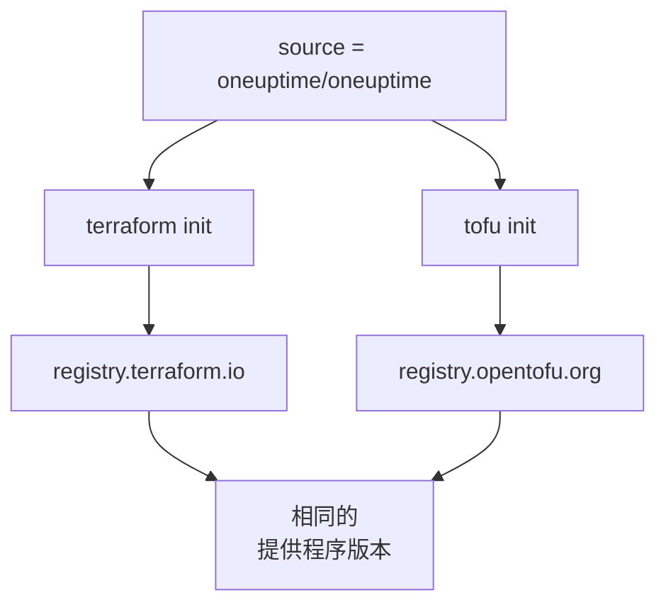

# OpenTofu

OneUptime 提供程序在 [OpenTofu](https://opentofu.org) 上的工作方式与在 Terraform 上相同。它发布在 [OpenTofu Registry](https://search.opentofu.org/provider/oneuptime/oneuptime/latest) 上，每个发布在发布之前都会在两者下通过相同的端到端测试。你的配置不需要改变：凡是本文档运行 `terraform` 的地方，都可以改为运行 `tofu`，命令照样有效。

:::cards
- [在 OpenTofu 中使用提供程序](#在-opentofu-中使用提供程序): 相同的配置，用 `tofu` 运行。
- [与 Terraform 的不同之处](#与-terraform-的不同之处): 注册表、锁文件、`.tofu` 文件和版本。
- [把配置迁移到 OpenTofu](#把配置迁移到-opentofu): 分四步切换现有配置。
- [可复用的模块](#可复用的模块): 为一个服务提供监视器、值班策略和状态页。
:::

## 在 OpenTofu 中使用提供程序

你需要 OpenTofu 1.6 或更高版本。像在 Terraform 中一样声明提供程序：

```hcl title="main.tf"
terraform {
  required_providers {
    oneuptime = {
      source  = "oneuptime/oneuptime"
      version = "{{TERRAFORM_PROVIDER_VERSION}}"
    }
  }
}

provider "oneuptime" {
  # The API key comes from the ONEUPTIME_API_KEY environment variable.
  # On a self-hosted OneUptime, add your OneUptime's address:
  # oneuptime_url = "https://oneuptime.example.com"
}
```

然后用 `tofu` 运行它：

```bash
export ONEUPTIME_API_KEY="<your-api-key>"
tofu init
tofu plan
tofu apply
```

`tofu init` 会从 OpenTofu Registry 下载提供程序。[快速开始](/docs/terraform/quick-start)、[完整指南](/docs/terraform/complete-guide)、[监控步骤](/docs/terraform/monitor-steps)、[示例](/docs/terraform/examples)和[导入资源](/docs/terraform/importing-resources)中的所有内容都原样适用，仪表板的 **Terraform** 页面写出的配置也无需更改即可使用。

### 不要在源地址中写注册表

`source = "oneuptime/oneuptime"` 没有指定注册表，所以每个引擎都从自己的注册表读取它：



不要写主机名。写了主机名，每个引擎都会使用那个注册表：写成 `registry.terraform.io/oneuptime/oneuptime` 时，OpenTofu 也会从 Terraform Registry 下载，而 Terraform 会以 `authentication signature from unknown issuer` 拒绝 OpenTofu Registry 的副本。

## 与 Terraform 的不同之处

| 项目 | 在 OpenTofu 下 |
| --- | --- |
| 注册表 | `oneuptime/oneuptime` 即 `registry.opentofu.org/oneuptime/oneuptime`，它发布的版本与 Terraform Registry 相同。 |
| 签名 | `tofu init` 会提示跳过了签名校验：OpenTofu Registry 没有这个提供程序的签名密钥，所以 OpenTofu 用注册表的校验和来校验下载内容。 |
| `terraform` 块 | 仍然是 `terraform`：它是语言的一部分，OpenTofu 会原样读取。 |
| `.tofu` 文件 | OpenTofu 1.8 及更高版本也读取 `.tofu` 文件；对于 `.tf` 文件，如果存在同名的 `.tofu` 文件，就会跳过它。Terraform 只读取 `.tf` 文件。 |
| `required_version` | OpenTofu 的版本从 1.6.0 开始，所以为 Terraform 写的 `>= 1.5.0` 接受任何 OpenTofu。 |
| 锁文件 | 写的是 `registry.opentofu.org/oneuptime/oneuptime`。切换引擎会重写该条目：请提交这次更改。 |
| State | OpenTofu 会原样读取 Terraform 写入的 state。 |
| 变量 | `TF_VAR_name` 在 OpenTofu 下同样会设置变量。 |
| CLI 配置文件 | `~/.tofurc` 或 `~/.terraformrc`，或 `TF_CLI_CONFIG_FILE` 指定的文件。 |
| `removed` 块 | 其中的 `lifecycle` 块需要 OpenTofu 1.10 或更高版本。没有它时，Terraform 会销毁记录，而 OpenTofu 会忘记资源并保留记录。 |
| 迁移到已重命名的资源类型 | 用 `moved` 块从 `oneuptime_io_t_fleet` 迁移到 `oneuptime_iot_fleet`，或在其他已重命名的类型之间迁移，需要 OpenTofu 1.12 或更高版本。 |

## 把配置迁移到 OpenTofu

由 Terraform 管理的配置可以连同其 state 原样迁移到 OpenTofu：

:::steps
### 安装 OpenTofu

安装 OpenTofu：1.6 就足以使用提供程序，而 1.12 或更高版本还能把资源迁移到已重命名的类型，例如从 `oneuptime_io_t_fleet` 迁移到 `oneuptime_iot_fleet`。

### 用 tofu 初始化

在配置所在的文件夹中运行 `tofu init`。它会从 OpenTofu Registry 下载提供程序，并提示它更改了锁文件：提供程序的条目现在指向 OpenTofu Registry。

### 运行计划

运行 `tofu plan`。它会读取 Terraform 留下的 state，并回答 `No changes.`

### 提交锁文件

提交 `.terraform.lock.hcl`，从现在起用 `tofu` 运行这份配置，CI 中也是如此。
:::

## 可复用的模块

OneUptime 仓库中的 [`Examples/opentofu/`](https://github.com/OneUptime/oneuptime/tree/master/Examples/opentofu) 包含可以直接运行的配置，以及一个为一个服务完成设置的模块：为你提供的每个地址创建一个网站监视器，为它创建的所有内容加上一个标签，创建一个带一条升级规则的值班策略，以及一个列出这些监视器的状态页。它是普通的 HCL，所以在 Terraform 下也能使用。

```hcl title="main.tf"
module "storefront" {
  source = "github.com/OneUptime/terraform-provider-oneuptime//modules/monitoring-and-incident-response?ref=vX.Y.Z"

  service_name          = "storefront"
  status_page_is_public = true

  monitors = {
    homepage = { url = "https://example.com" }
    checkout = { url = "https://example.com/checkout" }
    api      = { url = "https://api.example.com/health", expected_status_code = "204" }
  }
}
```

把 `vX.Y.Z` 替换为已发布的提供程序版本，例如[提供程序的发布](https://github.com/OneUptime/terraform-provider-oneuptime/releases)中最新的那个：模块与提供程序一起发布，它的仓库在每个发布中都会变化。

该模块不会创建监视器状态或事件严重程度。它会按名称查找每个项目一开始就有的那些：`Operational`、`Offline` 和 `Critical Incident`。如果你的项目重命名了它们，请设置 `operational_monitor_status_name`、`offline_monitor_status_name` 或 `incident_severity_name`。

在你指定通知谁之前，它的升级规则不会通知任何人：请用模块的输出为它添加一个团队：

```hcl title="main.tf"
resource "oneuptime_team" "storefront" {
  name = "Storefront"
}

resource "oneuptime_team_on_call_duty_escalation_rule" "storefront" {
  on_call_duty_policy_id                 = module.storefront.on_call_policy_id
  on_call_duty_policy_escalation_rule_id = module.storefront.escalation_rule_id
  team_id                                = oneuptime_team.storefront.id
}
```

## 后续步骤

:::cards
- [快速开始](/docs/terraform/quick-start): 创建 API 密钥并应用你的第一批资源。
- [注册表使用](/docs/terraform/registry): 版本如何编号，以及锁文件。
- [自托管设置](/docs/terraform/self-hosted): 你自己的 OneUptime，以及离线机器的镜像。
- [故障排除](/docs/terraform/troubleshooting): 常见错误及其修复方法。
:::
