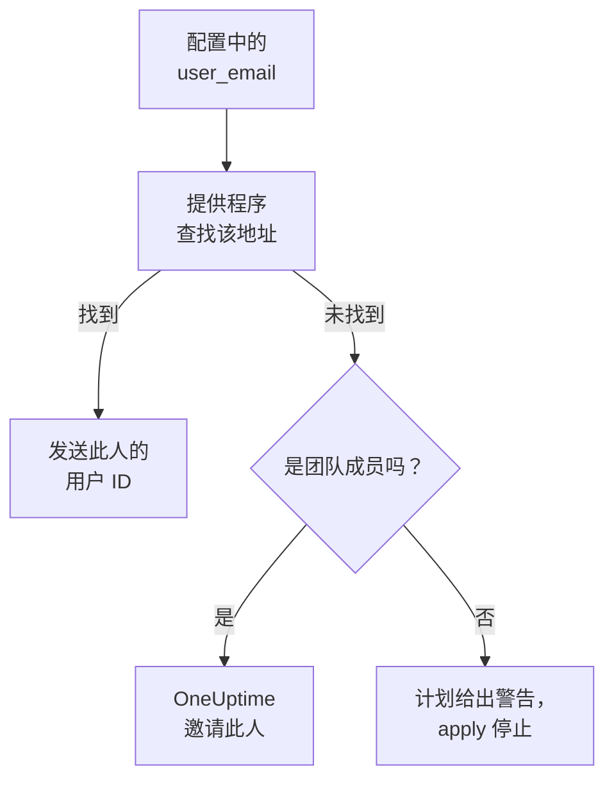

# 人员与团队

把项目里有谁记在 Terraform 配置中：团队和团队成员、谁在值班、谁拥有什么。用电子邮件地址指定每个人：提供程序会找到此人，并邀请项目里的新人。

:::cards
- [用电子邮件地址指定人员](#用电子邮件地址指定人员): 每个用户 ID 旁边的属性。
- [让新人加入](#让新人加入): 邀请某人，并给此人一个团队、值班轮次和要拥有的东西。
- [让人离开](#让人离开): 移除某人，以及 OneUptime 随之移除的内容。
- [导入已有的成员](#导入已有的成员): 按其团队和地址导入。
:::

## 工作方式

提供程序在 API 密钥所属项目的人员中查找该地址：项目的成员，以及受邀加入项目的人。它把找到的人的 ID 发给 API。用项目里无人使用的地址指定的团队成员，会改为邀请这个地址。



只会搜索 API 密钥自己的项目。项目以外的人永远不会被找到，提供程序也无法知道某个地址在别处是否有账户。

## 开始之前

- **能读取项目团队的 API 密钥。** 提供程序通过团队找到人员。
- **要添加新人，需要能邀请人员的密钥。** 请参阅[邀请成员](/docs/permissions/inviting-people)。

## 用电子邮件地址指定人员

每个指定人员的资源，都在用户 ID 旁边接受此人的电子邮件地址。两者给出其一：

| 用户 ID | 电子邮件地址 |
| --- | --- |
| `user_id` | `user_email` |
| `owner_users` | `owner_user_emails` |
| `assigned_to_user_id` | `assigned_to_user_email` |
| `override_user_id` | `override_user_email` |

查找地址时不区分大小写，并按你写的样子保存在 state 中。用户 ID 会被填入，以便其他资源引用它。

## 让新人加入

此配置把项目新人 Alice 加入一个团队，从她第一天起给她值班轮次，并让已在项目中的 Bob 成为一个监视器的所有者：

```hcl title="people.tf"
resource "oneuptime_team" "sre" {
  name        = "SRE"
  description = "Site reliability engineering"
}

# New to the project: OneUptime invites her.
resource "oneuptime_team_member" "alice" {
  team_id    = oneuptime_team.sre.id
  user_email = "alice@example.com"
}

resource "oneuptime_on_call_policy_schedule" "weekly" {
  name     = "SRE weekly"
  timezone = "UTC"
}

resource "oneuptime_on_call_schedule_layer" "weekly" {
  on_call_duty_policy_schedule_id = oneuptime_on_call_policy_schedule.weekly.id
  name                            = "Weekly"
  starts_at                       = "2030-01-07T09:00:00Z"
  hand_off_time                   = "2030-01-14T09:00:00Z"
}

# Named through her membership, so she is invited first.
resource "oneuptime_on_call_schedule_layer_user" "alice" {
  on_call_duty_policy_schedule_id       = oneuptime_on_call_policy_schedule.weekly.id
  on_call_duty_policy_schedule_layer_id = oneuptime_on_call_schedule_layer.weekly.id
  user_id                               = oneuptime_team_member.alice.user_id
}

resource "oneuptime_monitor" "api" {
  name         = "Public API"
  monitor_type = "Manual"
}

# In the project already: named by his address.
resource "oneuptime_monitor_user_owner" "api" {
  monitor_id = oneuptime_monitor.api.id
  user_email = "bob@example.com"
}
```

`terraform apply` 通过电子邮件邀请 Alice，与从仪表板发出的邀请一样。如果她没有账户，OneUptime 会为她创建一个。在她接受之前，`has_accepted_invitation` 保持为 `false`，而她接受邀请不会成为计划中的变更。已在项目中的人会立即加入新团队。

要让此配置邀请的人值班或成为所有者，请用 `user_id = oneuptime_team_member.<name>.user_id` 引用其成员资格：这样 Terraform 会先邀请此人，再在其他地方指定此人。项目里无人使用的地址，在计划中是警告，在 apply 中是错误。

## 查找某人

数据源 `oneuptime_user` 按 `email`、`name` 或 `id` 查找某人，并读取此人的用户 ID、姓名、是否已加入，以及所在的团队：

```hcl
data "oneuptime_user" "alice" {
  email = "alice@example.com"
}

output "alice_teams" {
  value = data.oneuptime_user.alice.team_ids
}
```

## 让人离开

从配置中删除此人的成员资格并应用。离开项目中的最后一个团队后，此人就离开了项目，OneUptime 会把此人从每个值班排班、升级规则和替班中移除，也从此人拥有的东西中移除：除已结束的事件、告警和维护事件之外的一切。请在同一次变更中删除指定此人的块，否则下一次计划会为一个已不在项目中的人重新创建它们。

此人的 OneUptime 账户仍归此人所有：离开的只是项目。必须保留成员的团队，不会让已接受邀请的最后一名成员离开。

## 导入已有的成员

没有任何页面显示成员资格的 ID，所以请按其团队的 ID 和此人的地址导入：

```bash
terraform import oneuptime_team_member.alice 6b1d1c2e-4f3a-4b5c-8d6e-7f8091a2b3c4/alice@example.com
```

地址会保持你写的样子，所以请按配置中的写法来写。成员资格自身的 ID 也能导入它，此时地址从 OneUptime 读取，为小写。

所有者和值班行也以同样方式导入，按它们所属的内容。监视器的所有者按监视器的 ID 和此人的地址导入。指向团队或排班的行，例如所有者团队，或升级规则呼叫的团队，按两个 ID 导入：

```bash
terraform import oneuptime_monitor_user_owner.api 68a1b2c3-d4e5-4f6a-8b9c-0d1e2f3a4b01/bob@example.com
terraform import oneuptime_escalation_rule_team.sre 68a1b2c3-d4e5-4f6a-8b9c-0d1e2f3a4b06/6b1d1c2e-4f3a-4b5c-8d6e-7f8091a2b3c4
```

## 有人更改了地址时

在 OneUptime 中更改地址的人，对 Terraform 来说仍是同一个人：在你写入新地址之前什么都不会变，写入后只有 `user_email` 改变。

## 故障排除

:::details 计划提示某个地址还不在此项目中
项目中以及受邀的人中，都没有人使用这个地址。请先用 `oneuptime_team_member` 邀请此人。如果该成员资格在同一配置中，请用 `user_id = oneuptime_team_member.<name>.user_id` 引用它，而不是用地址。如果此人在 OneUptime 中改了地址，请使用新地址。
:::

:::details apply 提示该用户已被邀请加入此团队
此人已在团队中。请导入该成员资格，而不是创建它，做法见[导入已有的成员](#导入已有的成员)。
:::

## 后续步骤

:::cards
- [导入资源](/docs/terraform/importing-resources): 把项目的其余部分也纳入 Terraform 管理。
- [邀请成员](/docs/permissions/inviting-people): OneUptime 中邀请的工作方式。
- [示例](/docs/terraform/examples): 常用资源的现成配置。
:::
