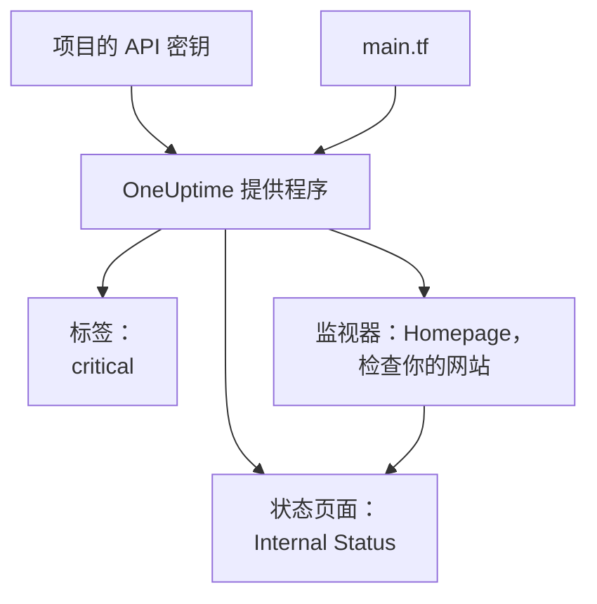

# 快速开始

本指南带你在大约十分钟内，从零开始得到一个由 Terraform 管理的 OneUptime 项目。你将创建一个 API 密钥，让 Terraform 指向你的项目，并应用一个标签、一个检查你网站的监视器，以及一个显示它的私有状态页面。然后修改其中一个资源，最后清理。

:::cards
- [开始之前](#开始之前): Terraform、一个项目，以及支持 API 密钥的套餐。
- [创建你的第一批资源](#创建你的第一批资源): 从 API 密钥到已应用的计划，共六个步骤。
- [修改资源](#修改资源): 编辑配置，计划并应用。
- [故障排除](#故障排除): 首次运行可能遇到的错误。
:::



## 开始之前

- **Terraform 1.5 或更高版本，或 OpenTofu 1.6 或更高版本。** 使用 OpenTofu 时，凡是本指南运行 `terraform` 的地方都改为运行 `tofu`。
- **一个 OneUptime 项目。** 位于 [oneuptime.com](https://oneuptime.com) 或你自己的 OneUptime 上，且你可以在其中创建 API 密钥。
- **在 OneUptime Cloud 上，需要 Growth 套餐或更高。** 项目的 API 密钥只在该套餐上有效。

## 创建你的第一批资源

:::steps
### 创建项目 API 密钥

在 OneUptime 仪表板中，打开 **项目设置 → 高级 → API 密钥**，然后点击 **创建API 密钥**。为它填写 **名称**，例如 `terraform`，并在 **访问** 下选择 **项目管理员**：Terraform 会创建、读取、更改和删除它管理的每种记录，而 **项目管理员** 可以完成所有这些操作。如果想要权限更窄的密钥，请选择 **稍后选择权限**，然后在密钥页面上只添加你需要的权限。

密钥从今天起一年后过期。要选择其他日期，请在创建前展开 **更多字段**，或稍后在密钥页面上更改日期。密钥创建后会打开它的页面：从 **API 密钥详情** 卡片中复制 **API 密钥**。

### 让 Terraform 能使用密钥

把密钥放进你运行 Terraform 的 shell 的环境变量 `ONEUPTIME_API_KEY` 中，这样它就永远不会出现在文件里：

:::tabs
@tab Linux
```bash
export ONEUPTIME_API_KEY="<your-api-key>"
```
@tab macOS
```bash
export ONEUPTIME_API_KEY="<your-api-key>"
```
@tab Windows
```powershell
$env:ONEUPTIME_API_KEY = "<your-api-key>"
```
:::

### 让 Terraform 指向 OneUptime

新建一个空文件夹，并在其中创建一个名为 `main.tf` 的文件：

```hcl title="main.tf"
terraform {
  required_providers {
    oneuptime = {
      source  = "oneuptime/oneuptime"
      version = "{{TERRAFORM_PROVIDER_VERSION}}"
    }
  }
}

provider "oneuptime" {
  # The API key comes from ONEUPTIME_API_KEY.
  # On a self-hosted OneUptime, add your OneUptime's address:
  # oneuptime_url = "https://oneuptime.example.com"
}
```

在自托管的 OneUptime 上，请先阅读 [自托管设置](/docs/terraform/self-hosted)，再选择提供程序版本。

### 描述你的资源

把这些块添加到 `main.tf`。它们读取每个项目一开始就有的两个监视器状态，并创建一个标签、一个每五分钟检查一次 `https://example.com` 的监视器（把这里换成你自己的网站），以及一个显示该监视器的私有状态页面：

```hcl title="main.tf"
data "oneuptime_monitor_status" "operational" {
  name = "Operational"
}

data "oneuptime_monitor_status" "offline" {
  name = "Offline"
}

resource "oneuptime_label" "critical" {
  name        = "critical"
  description = "Resources that page on-call when down"
  color       = "#FF5733"
}

resource "oneuptime_monitor" "homepage" {
  name                = "Homepage"
  description         = "Checks that the homepage responds"
  monitor_type        = "Website"
  monitoring_interval = "*/5 * * * *"
  labels              = [oneuptime_label.critical.id]

  monitor_steps = [{
    monitor_destination      = "https://example.com"
    monitor_destination_type = "URL"
    request_type             = "GET"

    criteria = [
      {
        name                  = "Offline"
        description           = "The homepage does not respond"
        filter_condition      = "Any"
        change_monitor_status = true
        monitor_status_id     = data.oneuptime_monitor_status.offline.id

        filters = [
          {
            check_on    = "Is Online"
            filter_type = "False"
          }
        ]
      },
      {
        name                  = "Online"
        description           = "The homepage responds"
        filter_condition      = "All"
        change_monitor_status = true
        monitor_status_id     = data.oneuptime_monitor_status.operational.id

        filters = [
          {
            check_on    = "Is Online"
            filter_type = "True"
          }
        ]
      }
    ]
  }]
}

resource "oneuptime_status_page" "internal" {
  name                  = "Internal Status"
  description           = "Status of our internal services"
  page_title            = "Service Status"
  is_public_status_page = false
}

resource "oneuptime_status_page_resource" "homepage" {
  status_page_id = oneuptime_status_page.internal.id
  monitor_id     = oneuptime_monitor.homepage.id
  display_name   = "Homepage"
}

output "monitor_id" {
  value = oneuptime_monitor.homepage.id
}
```

监视器的 `monitor_steps` 说明它检查什么，以及每个结果意味着什么：每次检查后，第一个匹配的条件决定它的状态。[监控步骤](/docs/terraform/monitor-steps) 解释了每个部分。

### 计划并应用

:::tabs
@tab Terraform
```bash
terraform init
terraform plan
terraform apply
```
@tab OpenTofu
```bash
tofu init
tofu plan
tofu apply
```
:::

`init` 会下载提供程序。计划以 `Plan: 4 to add, 0 to change, 0 to destroy.` 结尾。输入 `yes` 应用它；完成后，Terraform 会打印新监视器的 ID。

### 检查仪表板

在 OneUptime 仪表板中：

- **监视器** 列出了带有 `critical` 标签的 `Homepage`。它的第一次检查会在几分钟内到来。
- **状态页面** 列出了显示 `Homepage` 的 `Internal Status`。
- **项目设置 → 基础 → 标签** 列出了 `critical`，颜色就是你设置的颜色。

再次运行 `terraform plan`。它会回答 `No changes.`：OneUptime 中的内容与配置完全一致。
:::

## 修改资源

修改配置，而不是仪表板。在 `main.tf` 中把标签的 `color` 设为 `"#2ECC71"`，然后计划并应用：

```bash
terraform plan
terraform apply
```

计划以 `Plan: 0 to add, 1 to change, 0 to destroy.` 结尾：标签会被就地修改。如果有人在仪表板中修改了由 Terraform 管理的资源，这一更改会出现在下一次计划中，应用后会恢复为配置中的内容。

## 清理

如果这只是试用，请删除配置创建的内容：

```bash
terraform destroy
```

这会删除标签、监视器、状态页面及其资源。两个监视器状态会保留：数据源只读取它们。

## 故障排除

:::details 消息“Missing API Key”
提供程序没有找到 API 密钥。在你运行 Terraform 的 shell 中导出 `ONEUPTIME_API_KEY`，或在提供程序块中设置 `api_key`，然后重新运行命令。
:::

:::details 消息“the OneUptime API returned status 400: Invalid API Key”
密钥输入有误、已过期或已删除，或者它属于另一个 OneUptime，而不是 `oneuptime_url` 指向的那个。请从密钥页面重新复制密钥，或创建一个新密钥。
:::

:::details 消息“the OneUptime API returned status 402: API keys need the Growth plan”
在 OneUptime Cloud 上，项目的 API 密钥只在 Growth 或更高套餐上有效。在 **项目设置 → 账单和发票 → 账单** 中升级项目后，同一个密钥即可重新使用。
:::

:::details 消息“the OneUptime API returned status 422: You do not have permissions to create Monitor”
密钥没有该类记录的权限。在密钥页面上授予它 **项目管理员**，或消息中提到的权限。
:::

:::details 消息“No monitor status matches {name = "Offline"}”
你项目的监视器状态使用了其他名称。请使用你在 **监控 → 设置 → 监视器状态** 中看到的名称，或改为按 `is_offline_state = true` 查找状态。
:::

## 后续步骤

:::cards
- [完整指南](/docs/terraform/complete-guide): 身份验证、项目结构、数据源、state 和升级。
- [监控步骤](/docs/terraform/monitor-steps): 决定监视器检查什么，以及每个结果意味着什么。
- [示例](/docs/terraform/examples): 常用资源的现成配置。
- [导入资源](/docs/terraform/importing-resources): 把你在仪表板中创建的内容交给 Terraform 管理。
:::
