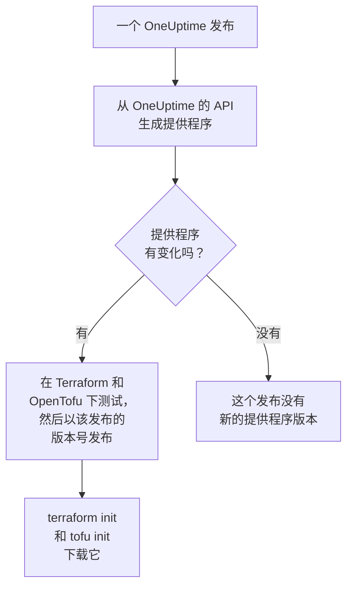

# 注册表使用

OneUptime 提供程序发布在 [Terraform Registry](https://registry.terraform.io/providers/oneuptime/oneuptime) 和 [OpenTofu Registry](https://search.opentofu.org/provider/oneuptime/oneuptime/latest) 上。`terraform init` 和 `tofu init` 会从那里下载它：无需手动安装任何东西。本页介绍发布了哪些内容、版本如何编号，以及如何迁移到更新的版本。

:::cards
- [发布了什么](#发布了什么): 各个平台的提供程序、它的参考文档以及它的版本。
- [版本如何编号](#版本如何编号): 提供程序的版本就是发布它的 OneUptime 发布版本。
- [锁文件](#锁文件): 每台机器安装的版本和校验和。
- [迁移到更新的版本](#迁移到更新的版本): 阅读变更内容，下载新版本，然后运行计划。
:::

## 发布了什么

每个 OneUptime 发布都会从 OneUptime 自己的 API 生成提供程序。如果提供程序有变化，该发布会在提供程序通过 Terraform 和 OpenTofu 下的端到端测试后，以该发布的版本号发布它：



| 内容 | 位置 |
| --- | --- |
| 提供程序，适用于 Linux、macOS、Windows、FreeBSD、OpenBSD 和 Solaris | 由 `terraform init` 和 `tofu init` 下载，附带 OneUptime 签名的校验和 |
| 每个资源和数据源的参考文档，包含其每个属性 | 注册表的文档，按产品分组：监视器、状态页、事件、值班等 |
| 在 OpenTofu 中使用提供程序的指南 | 注册表的指南 |
| 每个版本，最新的在前 | 注册表的版本列表 |

参考文档说明每个属性是什么。本文档则展示如何把它们组合起来使用：请从 [Terraform 概览](/docs/terraform/index)开始。

## 版本如何编号

提供程序的版本就是发布它的 OneUptime 发布的版本：提供程序 {{TERRAFORM_PROVIDER_MAJOR}}.0.20 随 OneUptime {{TERRAFORM_PROVIDER_MAJOR}}.0.20 一起推出。提供程序没有变化的发布不会发布提供程序，所以版本之间会有空缺，而只指定一个确切版本的约束可能会指向一个不存在的版本。请改为写一个范围：

| 你使用的是 | 约束 | Terraform 安装的版本 |
| --- | --- | --- |
| OneUptime Cloud | `{{TERRAFORM_PROVIDER_VERSION}}` | 最新的 {{TERRAFORM_PROVIDER_MAJOR}}.x 提供程序 |
| 自托管 OneUptime | 以你的 OneUptime 版本为终点的范围，例如 `>= {{TERRAFORM_PROVIDER_MAJOR}}.0, <= {{TERRAFORM_PROVIDER_MAJOR}}.0.40` | 不比你的 OneUptime 更新的最新提供程序 |

在自托管 OneUptime 上，比你的 OneUptime 更新的提供程序可能会发送你的 OneUptime 尚不具备的设置：[自托管设置](/docs/terraform/self-hosted#选择提供程序版本)介绍了如何编写它的范围。

```hcl title="main.tf"
terraform {
  required_providers {
    oneuptime = {
      source  = "oneuptime/oneuptime"
      version = "{{TERRAFORM_PROVIDER_VERSION}}"
    }
  }
}
```

源地址没有指定注册表：Terraform 从 Terraform Registry 读取它，OpenTofu 从 OpenTofu Registry 读取它，两者发布相同的版本。

## 锁文件

`terraform init` 会把它选定的版本及其下载内容的校验和记录在 `.terraform.lock.hcl` 中。请提交这个文件：这样每台机器和每次 CI 运行都会安装完全相同的版本，直到你选择另一个版本。校验和覆盖注册表发布的每个平台，所以一个锁文件可以同时用于 Linux、macOS 和 Windows 机器。

```hcl title=".terraform.lock.hcl"
provider "registry.terraform.io/oneuptime/oneuptime" {
  version     = "{{TERRAFORM_PROVIDER_MAJOR}}.0.20"
  constraints = "{{TERRAFORM_PROVIDER_VERSION}}"
  hashes = [
    "h1:...",
    "zh:...",
  ]
}
```

锁文件中写有注册表。OpenTofu 写的是 `registry.opentofu.org/oneuptime/oneuptime`，而 Terraform 在同一位置写的是 `registry.terraform.io/oneuptime/oneuptime`，所以切换引擎会更改锁文件：`init` 会替换该条目，并提示你提交这次更改。

## 迁移到更新的版本

:::steps
### 阅读变更内容

[OneUptime 的发布](https://github.com/OneUptime/oneuptime/releases)说明了每个发布更改了什么，包括提供程序。[提供程序的发布](https://github.com/OneUptime/terraform-provider-oneuptime/releases)链接到自上一个发布以来的变更。

### 下载新版本

```bash
terraform init -upgrade
```

`init -upgrade` 会选用你的约束所允许的最新版本，显示它，并更新 `.terraform.lock.hcl`。约束 `{{TERRAFORM_PROVIDER_VERSION}}` 接受每个 {{TERRAFORM_PROVIDER_MAJOR}}.x 发布；新的主版本需要新的约束。

### 在应用之前运行计划

运行 `terraform plan`，只有当它为空或只显示你预期的更改时才应用。提交更新后的锁文件。
:::

在自托管 OneUptime 上，请先升级 OneUptime，再提高提供程序范围的终点。

## 代码在哪里

提供程序在 [OneUptime 主仓库](https://github.com/OneUptime/oneuptime)中从 OneUptime API 生成，每个版本都由发布它的那个发布构建。它自己的仓库 [OneUptime/terraform-provider-oneuptime](https://github.com/OneUptime/terraform-provider-oneuptime) 存放的是生成器写出的内容，所以更改都在主仓库中进行：请在 [github.com/OneUptime/oneuptime/issues](https://github.com/OneUptime/oneuptime/issues) 报告问题，包括文档问题。

## 后续步骤

:::cards
- [自托管设置](/docs/terraform/self-hosted): 适用于你自己的 OneUptime 的版本范围，以及离线机器的镜像。
- [OpenTofu](/docs/terraform/opentofu): 相同的提供程序和配置，使用 `tofu`。
- [完整指南](/docs/terraform/complete-guide): 身份验证、项目结构、数据源、state 和升级。
- [故障排除](/docs/terraform/troubleshooting): 常见错误及其修复方法。
:::
