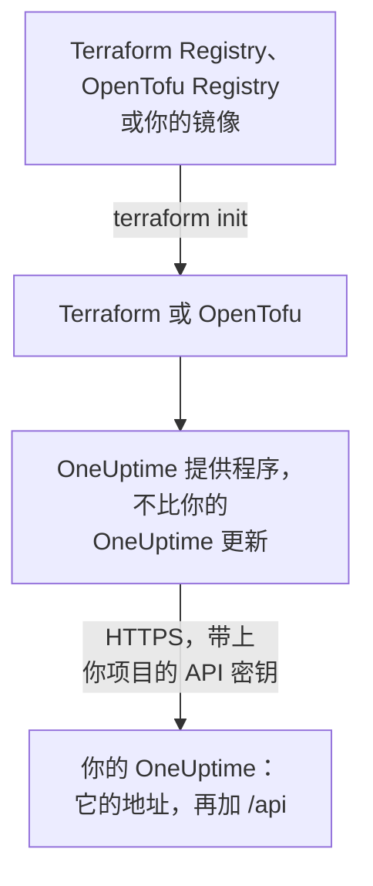

# 自托管设置

提供程序在你自己的 OneUptime 上的工作方式与在 OneUptime Cloud 上相同：同样的资源、同样的属性和同样的项目 API 密钥。需要你自己设置的是：你的 OneUptime 的地址、与之匹配的提供程序版本，以及在需要时，为无法访问互联网的机器准备的镜像和对私有证书颁发机构的信任。

:::cards
- [让提供程序指向你的 OneUptime](#让提供程序指向你的-oneuptime): 它的地址，以及你项目的 API 密钥。
- [选择提供程序版本](#选择提供程序版本): 不比你的 OneUptime 更新的最新提供程序。
- [无法访问互联网时](#无法访问互联网时): 把提供程序镜像到你的网络中。
- [TLS 和证书](#tls-和证书): 私有证书颁发机构、代理和普通 HTTP。
:::



## 让提供程序指向你的 OneUptime

把 `oneuptime_url` 设为你打开仪表板时使用的地址：协议和主机，不带路径。地址没有协议时，提供程序会加上 `https://`，并在末尾加上 `/api`，所以 `https://oneuptime.example.com` 会把每个请求发送到 `https://oneuptime.example.com/api`。

```hcl title="main.tf"
terraform {
  required_providers {
    oneuptime = {
      source  = "oneuptime/oneuptime"
      version = "{{TERRAFORM_PROVIDER_MATCHING}}"
    }
  }
}

provider "oneuptime" {
  oneuptime_url = "https://oneuptime.example.com"
  # The API key comes from the ONEUPTIME_API_KEY environment variable.
}
```

地址也可以改为来自环境变量 `ONEUPTIME_URL`，这样同一份配置可以指向多个安装：

```bash
export ONEUPTIME_URL="https://oneuptime.example.com"
export ONEUPTIME_API_KEY="<your-api-key>"
```

地址就是你的安装对外提供服务的主机：使用 Docker Compose 时是 `HOST` 和 `HTTP_PROTOCOL`（位于 `config.env` 中），使用 Helm 时是 `host` 和 `httpProtocol`（位于 chart 的 values 中）。

密钥是你所管理项目的 API 密钥，与 OneUptime Cloud 上一样，在你的 OneUptime 仪表板中的 **项目设置 → 高级 → API 密钥** 下创建。自托管 OneUptime 的主 API 密钥不属于任何项目，所以用它进行的创建会失败并显示 `ProjectId required`。

> [!TIP]
> 你的 OneUptime 会替你写出这个块。在仪表板中打开任意资源或列表，然后在它的侧边菜单中依次打开 **开发者** 和 **Terraform**：它显示的提供程序块包含你的 OneUptime 的地址，以及与之匹配的版本范围。

## 选择提供程序版本

使用不比你的 OneUptime 更新的最新已发布提供程序。提供程序的版本跟随 OneUptime 的版本：更改了提供程序的 OneUptime 发布会以该发布自己的版本号发布提供程序，而比你的 OneUptime 更新的提供程序可能会发送你的 OneUptime 尚不具备的设置。

所以，请像仪表板那样写一个以你的 OneUptime 版本为终点的范围。上面的块使用 `{{TERRAFORM_PROVIDER_MATCHING}}`，即与提供本文档的 OneUptime 匹配的范围：当你在自己的 OneUptime 上阅读本文档时，这个范围就是你的范围。否则，请写入你自己的版本：

:::steps
### 查看你的 OneUptime 版本

向你的 OneUptime 查询：

```bash
curl https://oneuptime.example.com/version
```

回答是 JSON，例如 `{"version":"{{TERRAFORM_PROVIDER_MAJOR}}.0.40","commit":"..."}`。作为主管理员，你也可以打开管理员仪表板页眉中的版本标签：参阅[查看当前版本](/docs/installation/upgrading#查看当前版本)。

### 把它写进范围

范围从主版本开始，到你的版本结束。对于 OneUptime {{TERRAFORM_PROVIDER_MAJOR}}.0.40：

```hcl title="main.tf"
terraform {
  required_providers {
    oneuptime = {
      source  = "oneuptime/oneuptime"
      version = ">= {{TERRAFORM_PROVIDER_MAJOR}}.0, <= {{TERRAFORM_PROVIDER_MAJOR}}.0.40"
    }
  }
}
```

Terraform 会选用范围内最新的提供程序。没有更改提供程序的 OneUptime 发布不会发布提供程序，范围会跳过不存在的版本。

### 下载提供程序

运行 `terraform init`。它会显示安装的版本，并将其记录在 `.terraform.lock.hcl` 中。
:::

升级时，请先升级 OneUptime。然后把范围的终点提高到它的新版本，并运行 `terraform init -upgrade`。

## 无法访问互联网时

当运行 Terraform 的机器无法访问注册表时，请把提供程序复制到你的网络中一次，再让 Terraform 指向这份副本。

:::steps
### 镜像提供程序

在一台可以访问互联网的机器上，在包含你配置的文件夹中，为你的机器所运行的每个平台下载提供程序。不带 `-platform` 时，该命令只下载它自身平台的提供程序：

:::tabs
@tab Terraform
```bash
terraform providers mirror -platform=linux_amd64 -platform=darwin_arm64 /srv/terraform-mirror
```
@tab OpenTofu
```bash
tofu providers mirror -platform=linux_amd64 -platform=darwin_arm64 /srv/terraform-mirror
```
:::

该文件夹会在注册表地址下存放提供程序，例如 `registry.terraform.io/oneuptime/oneuptime/`。把它复制到你的网络中。

### 让 Terraform 指向镜像

编写一个 CLI 配置文件，从该文件夹安装 OneUptime 提供程序，其他一切照常安装：

:::tabs
@tab Terraform
```hcl title="mirror.tfrc"
provider_installation {
  filesystem_mirror {
    path    = "/srv/terraform-mirror"
    include = ["registry.terraform.io/oneuptime/oneuptime"]
  }
  direct {
    exclude = ["registry.terraform.io/oneuptime/oneuptime"]
  }
}
```
@tab OpenTofu
```hcl title="mirror.tfrc"
provider_installation {
  filesystem_mirror {
    path    = "/srv/terraform-mirror"
    include = ["registry.opentofu.org/oneuptime/oneuptime"]
  }
  direct {
    exclude = ["registry.opentofu.org/oneuptime/oneuptime"]
  }
}
```
:::

在 Terraform 和 OpenTofu 都会读取的 `TF_CLI_CONFIG_FILE` 中指定它：`export TF_CLI_CONFIG_FILE=/etc/terraform/mirror.tfrc`。

### 初始化

运行 `terraform init`：它会从镜像安装提供程序。它会警告锁文件现在只有这个平台的校验和。要记录所有平台的校验和，请在可以访问互联网的机器上运行 `terraform providers lock`，并带上相同的 `-platform` 选项，然后把 `.terraform.lock.hcl` 与配置一起提交。
:::

每次提高版本范围时，都要重新镜像。

## TLS 和证书

提供程序会用运行 Terraform 的机器的信任存储来校验你的 OneUptime 的证书，没有可以跳过校验的设置。如果证书来自私有证书颁发机构，请把该机构加入每台运行 Terraform 的机器和 CI 运行器的信任存储：

:::tabs
@tab Debian / Ubuntu
```bash
sudo cp my-ca.crt /usr/local/share/ca-certificates/
sudo update-ca-certificates
```
@tab RHEL / Fedora
```bash
sudo cp my-ca.crt /etc/pki/ca-trust/source/anchors/
sudo update-ca-trust
```
:::

在 Linux 上无法更改信任存储的地方，例如 CI 容器中，请把 `SSL_CERT_FILE` 设为一个同时包含你的证书颁发机构和公共证书颁发机构的文件。在 macOS 和 Windows 上，请把证书颁发机构加入系统的证书存储。

- **代理。** 提供程序通过 `HTTPS_PROXY` 中的代理发送请求，但发往 `NO_PROXY` 中主机的请求除外。OneUptime 前面的反向代理必须原样转发每个 `/api` 路径和 `APIKey` 请求头。
- **普通 HTTP。** `http://` 地址可用于测试安装。API 密钥会随每个请求发送，所以其他情况请使用 HTTPS。

## 故障排除

:::details 消息“x509: certificate signed by unknown authority”
运行 Terraform 的机器不信任你的 OneUptime 的证书：按 [TLS 和证书](#tls-和证书)中的说明添加你的证书颁发机构。
:::

:::details 消息“invalid character '<' looking for beginning of value”
回答的是网页而不是 API：`oneuptime_url` 带有路径，或者是代理作出了回答。请把它设为仅包含你的 OneUptime 地址。
:::

:::details 消息“no available releases match the given constraints”
没有已发布的提供程序符合版本约束，例如约束只指定了一个 OneUptime 从未发布过的版本。请按[选择提供程序版本](#选择提供程序版本)中的说明写一个范围。
:::

:::details 消息“ProjectId required”
该密钥是主 API 密钥，不属于任何项目。请在 **项目设置 → 高级 → API 密钥** 下创建项目的 API 密钥。
:::

[故障排除](/docs/terraform/troubleshooting)中列出了其他错误及每个错误的含义。

## 后续步骤

:::cards
- [快速开始](/docs/terraform/quick-start): 创建 API 密钥并应用你的第一批资源。
- [注册表使用](/docs/terraform/registry): 提供程序发布在哪里，以及版本的编号方式。
- [故障排除](/docs/terraform/troubleshooting): 常见错误及其修复方法。
- [升级](/docs/installation/upgrading): 在提高提供程序范围之前先升级你的 OneUptime。
:::
