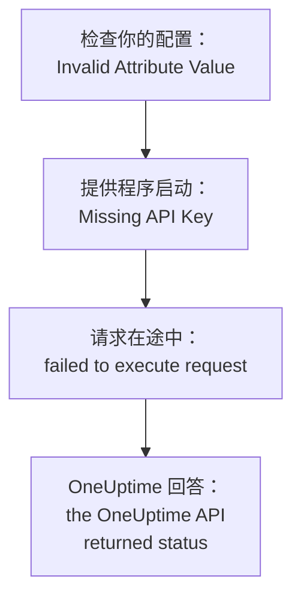

# 故障排除

在下表中查找 Terraform 打印的消息或你看到的现象：每一行都指向对应的修复方法。表格之后的各节按错误的来源分组，逐一解释每个错误。

:::cards
- [查找你的错误](#查找你的错误): 本页的所有消息和现象，以及修复方法。
- [API 密钥、权限和套餐](#api-密钥权限和套餐): OneUptime 拒绝提供程序的密钥时。
- [无法稳定的计划](#无法稳定的计划): 反复出现的更改，以及离开 state 的资源。
- [连接自托管 OneUptime](#连接自托管-oneuptime): 地址、证书和代理。
:::

## 查找你的错误

| 消息或现象 | 怎么做 |
| --- | --- |
| `Missing API Key` | 为提供程序提供密钥：参阅 [`Missing API Key` 或 `Invalid API Key`](#missing-api-key-或-invalid-api-key) |
| `Invalid API Key` | 重新复制密钥，或创建一个新密钥：参阅 [`Missing API Key` 或 `Invalid API Key`](#missing-api-key-或-invalid-api-key) |
| `ProjectId required` | 使用项目的 API 密钥，而不是主密钥：参阅 [`ProjectId required`](#projectid-required) |
| `You do not have permissions to create Monitor` | 为密钥授予消息中提到的权限：参阅[密钥缺少权限](#密钥缺少权限) |
| `API keys need the Growth plan` | 把项目改回 Growth 套餐：参阅[需要付款](#需要付款) |
| 针对单个资源或单项设置的 `402` | 升级套餐，或把该设置保留为默认值：参阅[需要付款](#需要付款) |
| `This project has been blocked` | 请主管理员解除对项目的封禁：参阅[被封禁的项目](#被封禁的项目) |
| `references records that are not in this project` | 使用你自己项目中记录的 ID：参阅[来自其他项目的 ID](#来自其他项目的-id) |
| 数据源返回的 `Not Found` 或 `Ambiguous Match` | 修正查找的参数：参阅[找不到或找到多个结果的查找](#找不到或找到多个结果的查找) |
| `Cannot import non-existent remote object` | 检查 ID 和密钥的权限：参阅[导入资源](/docs/terraform/importing-resources#故障排除) |
| `Provider produced inconsistent result after apply` | 升级提供程序：参阅[apply 之后结果不一致](#apply-之后结果不一致) |
| 计划创建了一个你没有添加的资源 | 密钥已无法读取它，OneUptime 回答了 `404`：先恢复密钥的读取权限，再用 `terraform import` 导入该资源：参阅[资源离开 state，下一次 apply 又创建了它](#资源离开-state下一次-apply-又创建了它) |
| apply 之后 `priority` 或 `order` 发生变化 | 为每一项分配一个其他项都没有的编号：参阅[会移动的优先级或顺序](#会移动的优先级或顺序) |
| `Invalid Configuration for Read-Only Attribute` | 从配置中删除该属性：参阅[只读属性](#只读属性) |
| `has been renamed to` | 用 `moved` 块重命名资源类型：参阅[已重命名的资源类型](#已重命名的资源类型) |
| 用 Terraform 创建的监视器始终不显示它的检查 | 升级 OneUptime：参阅[步骤 ID 出现之前创建的监视器](#步骤-id-出现之前创建的监视器) |
| `must contain at least 1 elements` | 省略该属性，而不是留空：参阅[空值](#空值) |
| `.tf` 文件中有来自仪表板的 JSON | 把它写成 HCL：参阅[来自仪表板的 JSON](#来自仪表板的-json) |
| `no available releases match the given constraints` | 使用版本范围，而不是单个确切版本：参阅[从未发布过的版本](#从未发布过的版本) |
| `x509: certificate signed by unknown authority` | 信任你的证书颁发机构：参阅[证书](#证书) |
| `invalid character '<' looking for beginning of value` | 让 `oneuptime_url` 指向 OneUptime 本身：参阅[返回网页而不是 API](#返回网页而不是-api) |
| `connection refused` 或 `Client.Timeout exceeded` | 检查地址、网络和代理：参阅[连接失败](#连接失败) |

## 如何阅读错误

错误会指出失败的步骤，而它的消息说明错误来自哪里：



- 在任何请求之前出现的错误，例如 `Invalid Attribute Value`，与你的配置有关：提供程序在与 OneUptime 通信之前会检查配置。
- `failed to execute request` 表示请求始终没有得到回答：参阅[连接自托管 OneUptime](#连接自托管-oneuptime)。
- `the OneUptime API returned status` 是 OneUptime 的回答：状态码和其后的消息说明 OneUptime 拒绝了什么。

提供程序会说明它当时在做什么：更改时是 `Unable to create monitor` 和 `Unable to update monitor`，读取资源时是 `Unable to parse label response`。OneUptime 拒绝的读取以摘要 `Parse Error` 报告，但其后的消息是 OneUptime 的回答，而不是解析问题。

## API 密钥、权限和套餐

### `Missing API Key` 或 `Invalid API Key`

`Missing API Key` 会让提供程序在发出任何请求之前就停止：提供程序块中的 `api_key` 和环境变量 `ONEUPTIME_API_KEY` 都没有设置。请在你运行 Terraform 的 shell 中导出该变量，或通过标记为 `sensitive` 的变量传入密钥。

`Invalid API Key` 是 OneUptime 对它不认识的密钥的回答：密钥输入有误、已过期或已删除，或者属于另一个 OneUptime，而不是 `oneuptime_url` 指向的那个。请从 **项目设置 → 高级 → API 密钥** 下的密钥页面重新复制密钥，或创建一个新密钥。

### `ProjectId required`

提供程序需要它所管理项目的 API 密钥：项目正是由这个密钥确定的。自托管 OneUptime 的主 API 密钥不属于任何项目，所以用它进行的每次创建都会失败并显示 `ProjectId required`。请按[创建项目 API 密钥](/docs/terraform/quick-start#创建项目-api-密钥)中的方法创建项目的 API 密钥，并改用它。

### 密钥缺少权限

`You do not have permissions to create Monitor` 及类似消息会随状态 `422` 返回：密钥不能对该类记录执行此操作。消息会列出允许此操作的权限。请在 **项目设置 → 高级 → API 密钥** 下打开密钥的页面，为它授予其中一个权限，或授予 **项目管理员**。导入只需要读取权限。

### 需要付款

- **每个请求都返回 402 Payment Required** — `API keys need the Growth plan...`：在 OneUptime Cloud 上，项目低于 **Growth**，而项目的 API 密钥（包括提供程序使用的密钥）在低于该套餐时停止工作。在项目回到 Growth 之前，提供程序的每次调用都会被拒绝，`terraform plan` 也不例外；回到之后同一个密钥又能使用，你的配置无需任何更改。请在 **项目设置 → 账单和发票 → 账单** 中升级，或在此期间在仪表板中管理项目。参阅[低于其套餐时的 API 密钥和 SCIM](/docs/api-reference/api-reference#低于其套餐时的-api-密钥和-scim)。
- **402 Payment Required** — 你达到了 OneUptime 套餐的某项限制，或者配置开启了你的套餐不包含的设置（私有状态页、电子邮件报告、公开仪表板、IP 允许列表等），无论 `terraform apply` 是用它创建资源还是之后更改资源。Terraform 会原样显示 OneUptime 的消息。请升级套餐，或精简配置。

把这类设置改回默认值（也就是关闭该功能）在任何套餐上都可以，所以关闭付费功能的配置在试用期结束或套餐降级后也能应用。

你的套餐所售卖、且项目在降级后仍保留的资源也是如此，包括 SSO 提供程序、SCIM 连接、API 密钥、值班计划，以及 Slack 和 Microsoft Teams 的规则和摘要：在低于套餐时（只要项目仍在 Growth 上，因为提供程序自己的 API 密钥需要它），项目已有的这些资源仍然可以读取（所以 `terraform plan` 和 `import` 可以工作）、可以删除（所以把它们从配置中移除，或运行 `terraform destroy`，都可以应用），并且在有 `is_enabled` 属性时可以关闭。创建、更改或重新开启它们仍然会返回 402。

你的套餐所售卖的其他资源，例如模板、自定义字段和监视器组，读取时仍需要该套餐，所以刷新它们的计划会返回 402；不过它们仍然可以删除，例如使用 `terraform destroy -refresh=false`。

在低于 Growth 时，API 密钥的权限不能逐个删除，因为删除一个阻止类权限会让密钥获得更多访问权限：请对权限资源运行 `terraform state rm`，然后销毁密钥，它的权限会随之一起删除。

### 被封禁的项目

`This project has been blocked. Please contact your administrator.` 随状态 `403` 返回：主管理员封禁了该项目，在解除封禁之前，除主管理员外任何人都不能在项目中执行操作，项目的 API 密钥也不例外。

## 记录和查找

### 来自其他项目的 ID

资源中引用的每个 ID（监视器的标签、状态页分组所属的状态页、网络设备的站点、升级规则的团队等）都必须是你的 API 密钥所属项目中的记录。其他项目中记录的 ID、不存在的 ID，以及密钥无权读取的记录的 ID，得到的回答都相同，回答中会列出字段和 ID：

```text
This network device references records that are not in this project: Network Site "…". Please pick values from this project and try again.
```

这通常表示某个 ID 是从其他项目的配置或 state 中复制来的，或者该记录已在 Terraform 之外被删除。请通过同一配置中的资源或数据源（`oneuptime_label.critical.id`）引用记录，而不是使用字面 ID，然后再次应用。被指定为用户的人必须是项目成员。

### 找不到或找到多个结果的查找

数据源要么恰好找到一条记录，要么让计划停止。`Not Found` 表示没有记录具有该 `id`，或者没有记录与你设置的参数匹配；`Ambiguous Match` 表示有多条记录匹配。请修正参数，设置更多参数把查找范围缩小到一条，或按 `id` 查找记录。[读取已有的内容](/docs/terraform/complete-guide#读取已有的内容)中列出了规则。

## 无法稳定的计划

### apply 之后结果不一致

`Provider produced inconsistent result after apply` 表示提供程序返回的值与它计划的不同。旧版提供程序会在服务器计算出的值上出现这种情况：服务器在 `monitor_steps` 中添加的默认值、服务器以另一种格式写入的时间戳、像 `probe_version` 这样被包装的值，以及服务器持续更新的属性，例如传入请求监视器最后一次收到心跳的时间。它们还会在 API 以文本形式发送小数时把它读成 null，所以状态页条形颜色规则的每次 apply 都会在 `uptime_percent_greater_than_or_equal_to` 上失败。当前的提供程序能处理所有这些情况：时间戳按时间点比较，标签列表是集合，数字按你写的样子读回，你没有设置的属性会保留计划值，直到下一次刷新读取服务器的值。

:::steps
1. 升级提供程序：在提供程序要求中保留 `version = "{{TERRAFORM_PROVIDER_VERSION}}"`，然后运行 `terraform init -upgrade`。
2. 再次应用。失败的 apply 标记为 tainted 的资源会被替换一次，之后的计划就是空的。如果想保留资源原样，请先按地址取消标记：`terraform untaint oneuptime_status_page_history_chart_bar_color.operational`。
:::

如果当前的提供程序仍然这样失败，请在 [github.com/OneUptime/oneuptime/issues](https://github.com/OneUptime/oneuptime/issues) 报告，并附上提供程序版本、资源类型、会失败的最小 `resource` 块，以及完整的错误。错误中会指出值发生变化的属性，这是最有用的信息。

### 资源离开 state，下一次 apply 又创建了它

按 ID 读取时，对不存在的记录和 API 密钥无权读取的记录都会回答 `404`：API 对它不向你显示的记录不作任何说明。Terraform 会把刷新时的 `404` 视为在 Terraform 之外被删除的资源。它会把该资源从 state 中移除，下一次 `terraform apply` 会再创建一个，与仍然存在的那个并存。

当管理某个资源的密钥无法再读取它时，就会发生这种情况：它的读取权限被限制为该资源没有的标签，或限制为其团队拥有的资源，或者某个阻止规则拿走了该资源，又或者资源的标签或所有者发生了变化。

**在运行计划之前：**

- 为密钥管理的每种资源类型授予读取权限，让它覆盖密钥管理的每个资源：范围设为 **全部**，或限制为这些资源带有的标签。密钥的更新和删除权限只能作用于它可以读取的内容。
- 在应用之前阅读计划：一个计划要创建、而你并没有添加的资源，就是密钥已无法读取的资源。

**当 state 已经丢失了某个资源时：** 先恢复密钥的读取权限，然后[导入](/docs/terraform/importing-resources)该资源，而不是直接应用，这样 Terraform 会接管已存在的那个，而不是再创建一个。如果已经创建了副本，请删除你不需要的那个。

### 会移动的优先级或顺序

监视器状态、事件和告警的状态与严重程度，以及你在仪表板中排序的其他列表，每个编号只保存一次。其他项都没有的编号会按所写保留。已被其他项占用的编号会被接管，挡在中间的项会像在仪表板中拖动时那样依次后移一位。因此，配置了相同编号的两项会在每次 apply 时互换位置。

请为每一项分配各自的编号，并在编号之间留出间隔，例如 `101`、`102` 和 `103`；Terraform 管理的项请在 Terraform 中调整顺序，而不是在仪表板中拖动。

### 只读属性

当配置设置了只有 OneUptime 才会写入的属性时，`Invalid Configuration for Read-Only Attribute` 会让计划停止。谁创建了记录，以及谁归档、解决或确认了它，都是根据请求记录的：记录的是已登录的人，而使用 API 密钥发出的请求不记录任何人，Terraform 正是用 API 密钥登录的。因此，`created_by_user_id` 以及其他所有以 `_by_user_id` 结尾的属性，都可以从资源或数据源中读取，但不能设置。`archived_at` 也是如此：设置 `is_archived` 会记录资源被归档的时间，不做更改再次应用会保留这个时间。请从资源块中删除该属性；资源的其他部分不会改变。

### 已重命名的资源类型

`has been renamed to` 警告某个资源类型有了新名称。资源类型现在会保持 IoT 和 vCenter 这类词的完整：`oneuptime_iot_fleet` 和 `oneuptime_vcenter`，而旧版提供程序会把它们拆开（`oneuptime_io_t_fleet`、`oneuptime_v_center`）。旧名称作为已弃用的别名仍然可用。要在不替换任何资源的情况下切换，请在配置中重命名资源，并告诉 Terraform 它已移动：

```hcl
resource "oneuptime_iot_fleet" "factory" {
  name = "Factory floor"
}

moved {
  from = oneuptime_io_t_fleet.factory
  to   = oneuptime_iot_fleet.factory
}
```

之后 `terraform plan` 只显示这次移动，没有其他更改。在资源类型之间移动需要 Terraform 1.8 或更高版本，或 OpenTofu 1.12 或更高版本；在更早的版本上，请保留旧名称，它仍然可用。数据源也以同样的方式重命名了：只需改名，其他都不用改。

### 步骤 ID 出现之前创建的监视器

监视器步骤中的 ID（每个步骤、条件以及事件和告警模板的 ID）由服务器分配。旧版 OneUptime 只给条件分配 ID，而且每次写入都分配一组新的，所以通过 API 写入的监视器（提供程序创建的每个监视器都是如此）在保存时步骤没有 ID。探针仍然会检查它，它的状态也仍然会变化，但监视器页面找不到它的检查，它的事件无法自动解决，而每次更改 `monitor_steps` 的 `terraform apply` 都会让未关闭的事件与其条件脱钩。

当前的 OneUptime 会在创建时为每一项分配 ID，在每次 apply 时保留它们，并在升级时为现有监视器补上缺失的 ID。你的配置无需任何更改：仍然没有需要写的 ID。旧行为遗留下来的未关闭事件，只要打开它的条件仍然存在，就会在监视器下一次恢复时关闭；条件已被之前的 apply 替换的事件，需要手动解决一次。

## 提供程序拒绝的配置

### 空值

提供程序会拒绝 `monitor_steps` 及其各部分中的空列表、空映射或空文本，例如 `monitor_steps = []`、`request_headers = {}` 或 `request_body = ""`：

```text
Attribute monitor_steps list must contain at least 1 elements, got: 0
```

请改为省略该属性：不存在的属性就是未设置。[监控步骤](/docs/terraform/monitor-steps)列出了每个部分接受的内容。

### 来自仪表板的 JSON

仪表板和 API 为资源显示的 JSON 是 API 发送的内容，而不是 Terraform 配置：在 Terraform 中，属性名称使用蛇形命名，值的写法不同，而且很多字段属于服务器。把它粘贴到 `.tf` 文件中是无法工作的。

- 要接管该资源，请[导入它](/docs/terraform/importing-resources)：仪表板的 **Terraform** 页面会替你写出配置。
- 要编写新的资源，请从[示例](/docs/terraform/examples)开始。
- 对于监视器的步骤，请编写[监控步骤](/docs/terraform/monitor-steps)中描述的带类型的 `monitor_steps` 属性：去掉 `{_type, value}` 包装，把 camelCase 键写成 snake_case，并省略所有 `id`。

## 版本和注册表

### 从未发布过的版本

`no available releases match the given constraints` 表示没有任何已发布的版本符合版本约束。并不是每个 OneUptime 发布都会发布提供程序：提供程序没有变化的发布不会发布提供程序，所以只指定一个确切版本的约束可能会指向一个不存在的版本。请改用范围：

```hcl
terraform {
  required_providers {
    oneuptime = {
      source  = "oneuptime/oneuptime"
      version = "{{TERRAFORM_PROVIDER_VERSION}}"
    }
  }
}
```

在自托管 OneUptime 上，请把范围的上限设为你的 OneUptime 版本，如[自托管设置](/docs/terraform/self-hosted#选择提供程序版本)所示。[注册表使用](/docs/terraform/registry#版本如何编号)解释了版本的编号方式。

## 连接自托管 OneUptime

### 证书

`x509: certificate signed by unknown authority` 表示运行 Terraform 的机器不信任你的 OneUptime 出示的证书，通常是私有证书颁发机构签发的证书。提供程序会用这台机器的信任存储来校验它。请在每台运行 Terraform 的机器和 CI 运行器上把你的证书颁发机构加入其中：参阅 [TLS 和证书](/docs/terraform/self-hosted#tls-和证书)。没有可以跳过校验的设置。

### 返回网页而不是 API

`invalid character '<' looking for beginning of value` 表示在提供程序期待 API 的地方，回答的是一个网页：`oneuptime_url` 在主机之后带有路径，例如 `/dashboard`，或者 OneUptime 前面的代理代为回答了。请把 `oneuptime_url` 设为仅包含你的 OneUptime 地址，例如 `https://oneuptime.example.com`：提供程序会自行添加 `/api`。

### 连接失败

`failed to execute request` 伴随 `connection refused`、`no such host` 或 `Client.Timeout exceeded`，表示没有收到回答。请检查地址和端口是否正确，以及从运行 Terraform 的地方能否访问；如果机器通过代理访问互联网，请设置 `HTTPS_PROXY`。提供程序对每个回答最多等待 60 秒。在没有回答，或回答为 `429`、`502`、`503` 或 `504` 时，它会对读取或删除最多尝试三次，但从不重试创建或更改：创建以这种方式失败后，请在再次应用之前先在仪表板中查看，以防它其实已经创建。

## 获取更多细节

提供程序会把警告写入 Terraform 的日志。用 `TF_LOG_PROVIDER=WARN` 运行命令即可看到它们，再加上 `TF_LOG_PATH` 可以把它们保存到文件：

```bash
TF_LOG_PROVIDER=WARN TF_LOG_PATH=terraform.log terraform plan
```

`OneUptime rejected a column in the select; dropping it and retrying` 指出了 OneUptime 不愿发送给提供程序密钥的列，通常是因为缺少权限。该属性在 state 中保持为空，所以在每次计划中都可能显示为一处更改。

## 仍然无法解决？

在 [github.com/OneUptime/oneuptime/issues](https://github.com/OneUptime/oneuptime/issues) 提交 issue，并附上提供程序版本（`terraform version` 会在 `init` 之后显示它）、资源块和完整的错误。提供程序是从 OneUptime 的代码生成的，所以它的 issue 都在主仓库中跟踪。

## 后续步骤

:::cards
- [导入资源](/docs/terraform/importing-resources): 接管你在仪表板中创建的内容，并修复导入错误。
- [自托管设置](/docs/terraform/self-hosted): 你自己的 OneUptime 的地址、版本和证书。
- [完整指南](/docs/terraform/complete-guide): 身份验证、数据源、state 和升级。
- [监控步骤](/docs/terraform/monitor-steps): 监视器检查的每个属性。
:::
