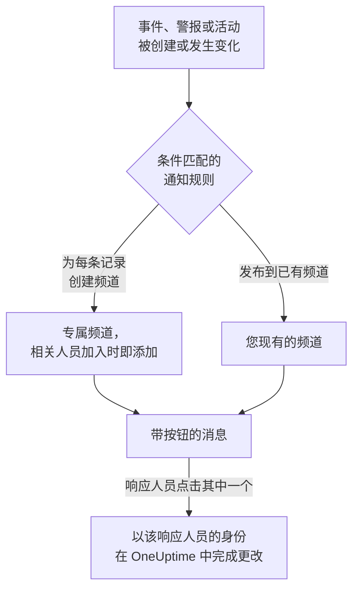

# Mattermost

将 OneUptime 连接到您的 Mattermost 服务器，即可把事件、警报、片段、计划维护、监视器和值班更新发布到您的频道，为每个事件提供专属频道，并让响应人员无需离开 Mattermost 即可确认、解决、添加备注和更改状态。

:::cards
- [连接 Mattermost](#连接-mattermost): 为 OneUptime 创建一个机器人账户，然后用它的令牌连接项目。
- [连接您自己的账户](#连接您自己的-mattermost-账户): 将您的 Mattermost 账户关联到您的 OneUptime 账户。
- [通知规则](#通知规则): 决定哪些事件发布到哪里，以及哪些事件拥有专属频道。
- [在 Mattermost 中操作](#从-mattermost-处理事件警报和活动): OneUptime 消息上的按钮。
- [网络与自托管](#网络与自托管): 每台服务器必须能够访问到什么。
:::

## 工作原理

这依靠两种连接：

- **项目的连接** 只需建立一次：您的 Mattermost 服务器上的一个机器人账户，位于 OneUptime 发布消息的团队中。它发布消息、创建频道并把人员添加到频道中。
- **每个人自己的连接**：此人的 Mattermost 账户关联到其 OneUptime 账户。按钮以此人的身份、按其在项目中的权限执行。

一个 Mattermost 团队可以连接到多个项目，例如生产环境和测试环境。按钮在其消息所涉及记录的项目中执行。

## 开始之前

- **可以连接项目的角色：** **项目所有者**、 **项目管理员** 或 **项目成员**。断开连接需要 **项目所有者** 或 **项目管理员**。
- 一台您可以在其中创建机器人账户的 **Mattermost 服务器**，或一位可以为您创建机器人账户的 Mattermost 管理员。Mattermost Cloud 和自托管的 Mattermost 都可以使用。
- 通知规则和摘要需要 **OneUptime Cloud 的 Growth 套餐**。

OneUptime 无需在自己的服务器上为 Mattermost 做任何设置：每个项目都自带 Mattermost 服务器和机器人账户。

## 连接 Mattermost

:::steps
### 在 Mattermost 中创建机器人账户

在 Mattermost 中，打开 **System Console** > **Integrations** > **Bot Accounts**，确认 **Enable Bot Account Creation** 已开启。然后前往 **Integrations** > **Bot Accounts** > **Add Bot Account**，将其命名为 `oneuptime` 并保存。Mattermost 只会显示一次机器人的访问令牌：请复制它。

### 将机器人添加到您的团队

像添加一个人那样，将机器人添加到 OneUptime 应在其中发布消息的团队： **Main Menu** > **Invite People**，然后邀请 `@oneuptime`。OneUptime 只在该团队中创建频道和发布消息。

### 连接项目

在 OneUptime 中，前往 **项目设置** > **工作区** > **Mattermost**，点击 **连接 Mattermost**。输入您服务器的地址（例如 `https://chat.example.com`）和机器人的访问令牌。OneUptime 会先向您的服务器验证令牌，然后才保存任何内容。如果机器人属于多个团队，OneUptime 会询问要在哪个团队中发布。在连接工作区之前，事件、警报、计划维护、监视器和值班菜单的 **工作区** 部分中有 **连接工作区**，它同样会带您来到这里。

### 添加通知规则

前往 **事件** > **工作区** > **Mattermost**，创建一条规则。例如，一条为每个新事件创建 Mattermost 频道、并让所有处理该事件的人加入的规则。请参阅 [通知规则](#通知规则)。
:::

机器人的访问令牌只保存在 OneUptime 服务器上，与项目的其他机密一起加密，并且不会再次显示。服务器地址、团队和机器人的用户名会在 Mattermost 设置页面上向项目中的所有人显示。

一个项目只连接到一个 Mattermost 团队。要将其移到另一个团队或另一台服务器，请先断开连接： **项目设置** > **工作区** > **Mattermost**，然后点击 **⋯** > **断开 Mattermost**。断开连接也会断开每个成员自己的 Mattermost 账户，并删除其 Mattermost 通知方式以及使用这些方式的值班规则。您的通知规则和摘要会被保留，以便您再次连接时使用。

## 连接您自己的 Mattermost 账户

Mattermost 没有可供 OneUptime 将您引导过去的登录页面，因此 OneUptime 的机器人会改为向您的 Mattermost 账户发送一条附带链接的私信：

:::steps
1. 前往 **用户设置** > **工作区** > **Mattermost**。OneUptime 会查找使用您电子邮件地址的 Mattermost 账户。如果找到，点击 **向 @your-username 发送链接**。如果没有找到，点击 **给我发送链接** 并输入您的 Mattermost 用户名。
2. 在 Mattermost 中打开 OneUptime 机器人发来的私信，然后点击 **Connect my account**。
3. 该链接会打开 OneUptime，由它连接您的账户。
:::

请在您请求链接的同一浏览器中打开它：它只在那里有效，只能使用一次，并且只在 15 分钟内有效。这证明请求链接的人同时持有这两个账户，因此任何人都无法连接他人的 Mattermost 账户。如果您没有请求过链接，请忽略它：在发出请求的浏览器中打开它之前，不会连接任何账户。

您账户的连接属于此项目。在连接到同一 Mattermost 团队的另一个项目中，也请在那里连接。

## 在 Mattermost 中接收呼叫

要在值班时通过私信接收呼叫，请将 Mattermost 添加为您的通知方式之一：

:::steps
1. 连接您自己的 Mattermost 账户（请参阅 [连接您自己的 Mattermost 账户](#连接您自己的-mattermost-账户) ）。
2. 前往 **用户设置** > **通知方式**，打开 **工作区应用** 标签页，然后点击 **添加 Mattermost 账户**。
3. 在其所在行点击 **Send Test Message**。消息会以来自项目机器人的私信形式送达。
:::

添加后，它会立即加入您的值班规则，因此从那时起呼叫会通过 Mattermost 送达您。在 **用户设置** > **值班规则** 中更改它接收哪些呼叫。每次呼叫都带有一个确认链接和一个升级链接。断开您的 Mattermost 账户会删除此方式以及使用它的值班规则。

## 通知规则

通知规则决定哪些事件发布到 Mattermost，以及发布到哪里。每个产品都有自己的规则，位于其菜单的 **工作区** > **Mattermost** 下： **事件** （带有 **事件 片段** 和 **摘要** 标签页）、 **警报** （带有 **警报 片段** 和 **摘要** ）、 **计划维护**、 **监视器**、 **值班** 和 **安全事件**。它们的工作方式与 Slack 的规则相同：有关条件、目标以及谁会加入频道，请参阅 [通知规则](/docs/workspace-connections/slack#通知规则)。

规则创建的频道以其记录命名：事件 INC-42 得到 `inc-42`。Mattermost 只接受小写字母、数字、`-` 和 `_`，最多 64 个字符，并且必须以字母或数字开头和结尾；规则表单会在您输入时显示名称。如果已有同名频道（例如已归档的频道），OneUptime 会加上 `-2`、`-3` 等。私密事件、警报或片段会获得私密频道。

要发布到现有频道，请输入其网址中显示的名称，例如 `chat.example.com/team/channels/incidents` 中的 `incidents`，或输入其显示名称。OneUptime 第一次在公开频道发布时会自行加入。在规则向私密频道发布之前，请先在 Mattermost 中将机器人添加到该频道。

人员通过其已连接的 Mattermost 账户加入规则的频道；否则，当您的服务器向机器人显示电子邮件地址时（ **System Console** > **Site Configuration** > **Users and Teams** > **Show Email Address** ），通过使用其电子邮件地址的 Mattermost 账户加入。OneUptime 会在频道中用一条消息列出它无法添加的所有人，并附上连接其账户的链接。

拥有专属频道的事件、警报、片段或计划维护事件，会在其 OneUptime 页面标题的状态按钮旁显示 **在 Mattermost 中打开**。它会在新标签页中打开您的 Mattermost 服务器上的该频道。拥有两个专属频道的记录会在按钮下列出这两个频道。同时在 Slack 或 Microsoft Teams 中有频道的记录，会改为只显示一个 **打开频道** 按钮，列出所有频道。不会提供您的规则所发布到的现有频道。

规则所在行的 **测试规则** 会将该规则的测试消息发布到它指定的频道，与 Slack 中一样。

OneUptime 的消息不会因其引用的内容而通知任何人：包含 `@channel`、`@here` 或 `@someone` 的名称或描述会按原样显示，不会提醒任何人。

## 从 Mattermost 处理事件、警报和活动

OneUptime 的消息带有按钮，以及一个 **More actions** 菜单，用于较少人需要的操作。每一项都以您的身份、按您在项目中的权限执行，并以只有您能看到的消息回复。

| 记录 | 按钮和菜单 |
| --- | --- |
| **事件** | **Acknowledge**、 **Resolve**、 **Add Note**，菜单中还有 **Change Severity** 和 **Change State** |
| **警报** | **Acknowledge**、 **Resolve**、 **Add Note**、 **Change State**、 **Execute On-Call Policy** |
| **事件片段、警报片段** | **Acknowledge**、 **Resolve**、 **Add Note**、 **Change State**、 **Execute On-Call Policy** |
| **计划维护** | **Mark as Ongoing**、 **Mark as Complete**、 **Add Note**、 **Change State** |

**Add Note**、 **Change State**、 **Change Severity** 和 **Execute On-Call Policy** 会在 Mattermost 中打开一个表单。事件或计划维护活动上的备注可以是公开的（显示在状态页上），也可以是私密的；私密事件上的备注始终是私密的，警报上的备注也始终是私密的。每条消息还有一个在 OneUptime 中打开其记录的链接，用于其他所有操作。

如果您的 Mattermost 账户尚未连接，按钮会告诉您这一点，并附上指向 **用户设置** > **工作区** > **Mattermost** 的链接。连接您的账户后，再按一次按钮。

每次按下都会记录在 **项目设置** > **通知** > **通知日志** 的 **工作区** 标签页中，并注明是谁按下的。

## 网络与自托管

两台服务器相互通信：

- **OneUptime 向您的 Mattermost 服务器发出请求**，以发布消息、创建频道和添加人员。在 OneUptime Cloud 上，您的 Mattermost 服务器必须能从互联网访问。自托管的 OneUptime 只有在其管理员通过 `ALLOW_PRIVATE_NETWORK_WEBHOOKS` 或 `PRIVATE_NETWORK_WEBHOOK_ALLOWLIST` 允许私有地址之后，才能访问私有网络上的 Mattermost 服务器。OneUptime 从不向其所在机器上的地址或云元数据地址发出请求，也从不跟随重定向。
- **您的 Mattermost 服务器向 OneUptime 发出请求**：在有人按下按钮或提交表单时，请求 `https://<your OneUptime>/api/mattermost/interactive` 和 `/api/mattermost/dialog`。如果 OneUptime 的地址是私有地址，请在 Mattermost 中将其主机添加到 **System Console** > **Environment** > **Developer** > **Allow untrusted internal connections to**，否则按钮将无法工作。

OneUptime 发布的每个按钮都带有一个签名，对应其发布所在的 Mattermost 团队，并在按下时进行检查：未经 OneUptime 签名的按钮操作，或从其他团队发来的按钮操作，都不会产生任何作用。

## 故障排除

| 您看到的内容 | 处理方法 |
| --- | --- |
| **Mattermost did not accept the access token** | 重新复制机器人的令牌。Mattermost 只显示一次令牌：如有需要，请在 **Integrations** > **Bot Accounts** 下新建一个。 |
| **The bot account is not a member of any team** | 在 Mattermost 中将机器人添加到您的团队，然后重新连接。 |
| **OneUptime could not reach the Mattermost server** | 检查地址，并确认 OneUptime 能够访问它。请参阅 [网络与自托管](#网络与自托管)。 |
| **The bot is not a member of the private Mattermost channel** | 在 Mattermost 中将机器人添加到该频道。 |
| 按钮没有反应，或 Mattermost 提示无法完成该操作 | Mattermost 无法访问 OneUptime。请参阅 [网络与自托管](#网络与自托管)。 |
| 没有收到附带您链接的私信 | 检查用户名，并确认机器人位于您所在的某个团队中。 |
