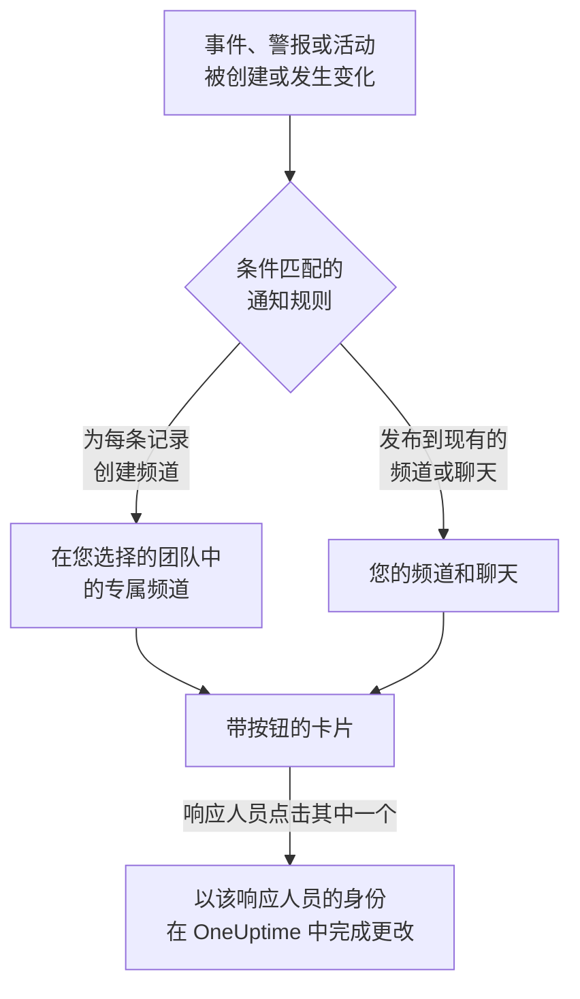

# Microsoft Teams

将 OneUptime 连接到 Microsoft Teams，即可把事件、警报、片段、计划维护、监视器和值班更新发布到您的频道和聊天，为每个事件提供专属频道，并让响应人员在 Teams 中操作：确认、解决、添加备注、呼叫值班人员、声明事件以及询问 OneUptime AI。

:::cards
- [连接 Microsoft Teams](#连接-microsoft-teams): 管理员同意、您的登录，以及每个团队中的应用。
- [请所有人连接账户](#请所有人连接账户): 一次性向每位尚未连接账户的成员发送消息。
- [通知规则](#通知规则): 决定哪些事件发布到哪里，以及哪些事件拥有专属频道。
- [与 OneUptime 机器人对话](#与-oneuptime-机器人对话): 在与机器人的聊天中使用命令、提问和表单。
- [值班标记](#值班标记): 让团队的标记与值班人员保持一致，并呼叫它。
- [从 Microsoft Teams 处理事件、警报和活动](#从-microsoft-teams-处理事件警报和活动): OneUptime 卡片上的按钮。
:::

## 工作原理

这依靠三样东西：

- **项目的连接** 只需建立一次：Microsoft 365 管理员为您的组织同意 OneUptime 应用。
- **每个团队中的 OneUptime 应用**，即您希望接收通知的每个团队。Microsoft 只允许机器人在已添加它的团队中发布消息。
- **每个人自己的连接**：此人的 Microsoft Teams 账户关联到其 OneUptime 账户。按钮、命令和回应都以此人的身份、按其在项目中的权限执行。

一个 Microsoft 365 组织可以连接到多个项目，例如生产环境和测试环境。卡片上的按钮在发送该卡片所针对的项目中执行，例如卡片所涉及事件的项目。发给机器人的消息在其发送所在频道（例如事件的频道）的项目中执行，否则在发送者的 Microsoft Teams 账户所连接的唯一项目中执行。如果无法据此判断，机器人会询问发送者指的是哪个项目，并为此人所在的每个项目显示一个按钮，此人选择后即在该项目中继续。在与 OneUptime AI 的对话中，这一选择对后续提问保持有效，直到一小时内没有新的提问为止。

## 开始之前

- **可以连接项目的角色：** **项目所有者**、 **项目管理员** 或 **项目成员**。卸载需要 **项目所有者** 或 **项目管理员**。
- 一位 **Microsoft 365 管理员**，为整个组织授予一次管理员同意。
- 通知规则和摘要需要 **OneUptime Cloud 的 Growth 套餐**。请参阅 [低于 Growth 套餐时的通知规则](#低于-growth-套餐时的通知规则)。
- **在自托管服务器上，** 需要先为其设置好 Teams 机器人。请参阅 [Microsoft Teams 集成](/docs/self-hosted/microsoft-teams-integration)。

## 连接 Microsoft Teams

:::steps
### 授予管理员同意

前往 **项目设置** > **工作区** > **Microsoft Teams**，点击 **授予管理员许可**。Microsoft 365 管理员登录，并为组织允许 OneUptime 应用。之后卡片会显示 **Admin Consent Completed**。在连接工作区之前，事件、警报、计划维护、监视器和值班菜单的 **工作区** 部分中有 **连接 Slack 或 Teams**，它同样会带您来到这里。

### 连接您的账户

点击 **Connect with Microsoft Teams**，并使用您的工作账户登录。OneUptime 会读取您组织的团队； **查看团队** 会列出它们。

### 将 OneUptime 应用添加到每个团队（必需）

仅连接您的账户还不够。Microsoft 只允许 OneUptime 机器人在已添加它的团队中发布消息，因此请对每个希望接收通知的团队执行以下操作：

- 在 Microsoft Teams 中，点击 **团队名称** （而不是频道名称）旁边的 "..."。
- 选择 **Manage team** > **Apps** > **More apps**，找到 **OneUptime**，然后点击 **Add**。

在 OneUptime Cloud 上， **打开 Teams 商店** 会在 Microsoft Teams 应用商店中打开该应用，在那里使用 **Add to a team** 也能完成同样的操作。在自托管服务器上，请改为安装 **下载应用清单 Zip** 中的软件包：只有它包含您服务器的机器人。如果测试通知报告 OneUptime 应用未安装在该团队中，说明遗漏的正是这一步。

### 连接其他所有人

每个人都在 **用户设置** > **工作区** > **Microsoft Teams** 中通过 **Connect my account with Microsoft Teams** 关联自己的 Microsoft Teams 账户，以便以本人身份处理事件并接收私信。项目连接到 Microsoft Teams 后，该部分就会出现。如需让整个团队一次性完成连接，请参阅 [请所有人连接账户](#请所有人连接账户)。

### 添加通知规则

前往 **事件** > **工作区** > **Microsoft Teams**。 **工作区** 部分只列出您的项目已连接的聊天工作区，因此 **Microsoft Teams** 会在连接后出现在那里。创建一条规则（例如在创建事件时发布到 Teams 频道的规则），然后在其所在行点击 **测试规则**。
:::

> [!NOTE]
> 为您自己安装 OneUptime，或将其添加到聊天中，是另一种安装，并不能让它向团队的频道发布消息。 **私密频道** 需要将应用添加到频道本身：打开频道 > "..." > **Manage channel** > **Apps** > **Add an app**。 **共享频道** 无法接收通知：Microsoft Teams 不支持在共享频道中使用机器人。

## 请所有人连接账户

任何人都无法替他人连接 Microsoft Teams 账户，管理员也不例外：每个人都要亲自登录自己的账户。要让整个团队完成连接，可由 **项目所有者** 或 **项目管理员** 在 **项目设置** > **工作区** > **Microsoft Teams** 中一次性请所有人连接。 **Members' Microsoft Teams accounts** 卡片会显示已有多少成员完成连接。 **Ask everyone to connect** 会让 OneUptime 机器人向每位尚未连接的成员发送一条消息，并附带一个 **Connect Microsoft Teams account** 按钮，只需点击一下即可连接其账户。

- **谁会收到消息。** 项目中每位尚未连接 Microsoft Teams 账户、且所在团队已添加 OneUptime 应用的成员，在该团队中通过其电子邮件地址或用户主体名称（UPN）找到。过去 24 小时内已请求过的人不会被再次请求，因此第二天再请一次时，只会提醒仍未连接的人。
- **卡片显示的内容。** 消息发送期间显示发送进度，之后显示是谁发起的请求，以及有多少成员收到了消息。OneUptime 找不到的成员会在卡片上列出姓名：请将应用添加到他们所在的团队，或让他们自行在 **用户设置** > **工作区** > **Microsoft Teams** 中连接。
- **按钮连接的账户。** 按下按钮并登录的人的 Microsoft Teams 账户，会连接到此人自己的 OneUptime 账户。转发给他人的消息，不会为原本收到消息的成员连接任何账户。

## 通知规则

通知规则决定哪些事件发布到 Microsoft Teams，以及发布到哪里。每个产品都有自己的规则，位于其菜单的 **工作区** > **Microsoft Teams** 下：

| 产品 | 其 **Microsoft Teams** 页面上的标签页 |
| --- | --- |
| **事件** | **事件**、 **事件 片段**、 **摘要** |
| **警报** | **警报**、 **警报 片段**、 **摘要** |
| **计划维护** | 一个规则列表 |
| **监视器** | 一个规则列表 |
| **值班** | 一个规则列表 |

创建规则分为四个步骤：

| 步骤 | 您设置的内容 |
| --- | --- |
| **基础** | **规则名称** 和 **规则描述**。 |
| **条件** | 规则适用于哪些事件，例如按严重程度、状态、标签、监视器或标题中的字词。条件会在事件创建时检查，并在 OneUptime 每次发布关于它的更新时再次检查，因此针对已确认事件的规则会在事件被确认时生效。新规则适用于所有事件，例如 **所有事件** 。要缩小范围，请选择 **仅符合条件的事件** 并添加条件。有两个或更多条件时， **匹配条件** 决定是必须全部匹配，还是匹配任意一个即可。 |
| **目标** | 发布到哪里：您选择的团队中的现有频道、您选择的聊天、在您选择的团队中为每个事件创建的频道（警报、片段、计划维护、监视器或值班策略同理），或其中几项的组合。步骤下方的 **此规则的作用** 会像规则卡片一样，用句子说明规则的作用。 |
| **Video Call** | 仅限事件和警报：为每一个开始一次通话。请参阅 [视频通话](/docs/workspace-connections/video-calls)。 |

规则创建的频道以其记录命名：事件 INC-42 得到 `inc-42`，警报 ALT-7 得到 `alt-7`；在没有编号前缀的项目中，事件 42 得到 `incident-42`。 **频道名称前缀** 中的文字放在名称前面，因此 `prod-` 会得到 `prod-inc-42`，表单会在您输入时显示名称。对于计划维护事件，前缀会取代其编号前缀：SM-5 得到 `sm-5`，`maint-` 会得到 `maint-5`。OneUptime 只保留字母、数字、空格、`-` 和 `_`，最多为 Microsoft Teams 接受的 50 个字符。如果团队中已有同名频道（例如其他项目的频道或最近 30 天内删除的频道），OneUptime 会加上 `-2`、`-3` 等。

规则的频道会在事件首次匹配该规则时创建：在事件创建时，或之后在事件仍未结束时，由某次更新使其匹配时。针对已确认事件的规则会在事件被确认时创建频道。Microsoft Teams 会向团队中的每个人显示团队的频道，因此 OneUptime 不会逐个把人加入频道：您选择的团队中的每个人都可以打开频道，正如规则表单在 **谁会加入频道** 下所说。私密事件、警报或片段会获得私密频道，只有其成员可见；请在 Microsoft Teams 中添加人员。

若要让值班人员参与进来，请在 **提及值班人员** 下选择他们的值班计划。创建频道时，OneUptime 会紧接在记录的第一条消息之后，在频道中发布一条消息，在其中 @提及这些值班计划中正在值班的人，因此 Microsoft Teams 会通知他们。不会呼叫任何人。OneUptime 会根据每个人连接到 OneUptime 的 Microsoft Teams 账户在团队中找到此人，否则根据其电子邮件地址查找。不在该团队中的人无法打开团队的频道，因此消息中会改为列出其姓名并说明原因。私密频道只有其成员才能打开，因此请在 Microsoft Teams 中将值班人员添加到该频道。

此后记录的每次更新（状态变化、备注、新所有者）都会发布到它的频道，并在规则的条件匹配期间发布到其规则指定的现有频道和聊天。OneUptime 无法归档 Microsoft Teams 频道，因此记录结束后，规则的频道会保留；请在 Microsoft Teams 中归档或删除它。

拥有专属频道的事件、警报、片段或计划维护事件，会在其 OneUptime 页面标题的状态按钮旁显示 **在 Microsoft Teams 中打开**。它会在新标签页中打开该频道，进入 Microsoft Teams 应用或浏览器。拥有两个专属频道的记录会在按钮下列出这两个频道。在 Slack 和 Microsoft Teams 中都有频道的记录，会改为只显示一个 **打开频道** 按钮，列出所有频道。不会提供您的规则所发布到的现有频道和聊天。

记录的页面上还有一张 **Microsoft Teams 频道** 卡片，说明谁可以打开该频道：团队中的所有人，或者对于私密频道，是其成员，由频道所有者在 Microsoft Teams 中添加。OneUptime 不会更改 Microsoft Teams 频道中的成员。对于 Slack 频道，卡片会列出频道中有谁，并可以添加成员：请参阅 [记录频道中的成员](/docs/workspace-connections/slack#记录频道中的成员)。

频道和聊天保持易读：每次更新只发布一次，记录的第一个状态写在宣布该记录的卡片里，而不是单独发一张卡片。值班策略的一次运行就是一张卡片，随着升级推进而被编辑：呼叫了谁、呼叫了几次以及通过什么方式、谁没有被呼叫以及原因、谁确认了。只有在需要有人采取行动时才会发布新卡片：某条升级规则没有呼叫到任何人，或者运行结束时仍没有人确认。记录的所有者或状态页订阅者已收到通知这件事，保留在 OneUptime 中该记录的信息流里。

**项目设置** > **工作区** > **Microsoft Teams** 列出 OneUptime 在您的团队中能看到的频道，以及已添加它的聊天，每一项旁边都有 **发送测试**。在 Microsoft Teams 中将 OneUptime 应用添加到聊天后，该聊天就会出现； **Refresh Chats** 会获取新的聊天及其当前名称。

## 测试规则

规则所在行的 **测试规则** 会将该规则的测试消息发布到它指定的频道，让您看到消息到达。如果规则为每个事件创建频道，测试也会创建一个频道并邀请规则的相关人员。

与 **项目设置** > **工作区** > **Microsoft Teams** 中频道旁的 **发送测试** 一样，它需要创建通知规则的权限： **项目所有者**、 **项目管理员**、 **项目成员**、 **设置管理员**、 **设置成员**，或自定义角色中的 **Create Workspace Notification Rule** 和 **Read Workspace Notification Rule**。对于只能查看规则的人（例如 **查看者** ）， **测试规则** 处于锁定状态，其工具提示会说明需要什么；API 会以 "You do not have permission to send test notifications in this project." 拒绝其测试。在 OneUptime Cloud 上，测试规则与添加规则一样需要 **Growth** 套餐。

在 OneUptime Cloud 上，频道或聊天旁的 **发送测试** 同样需要 **Growth** 套餐，因为向频道发布消息正是规则和摘要所做的事。摘要上的 **立即发送测试** 需要创建摘要的权限（自定义角色中的 **Create Workspace Notification Summary** 和 **Read Workspace Notification Summary** ），在 OneUptime Cloud 上还需要 **Growth** 套餐；对其他任何人它都处于锁定状态，其工具提示会说明需要什么。以只读权限连接的 MCP 客户端无法发送任何测试。

## 摘要

**事件** > **工作区** > **Microsoft Teams** （以及 **警报** ）的 **摘要** 标签页会向您指定的频道发布定期汇总：有多少事件或警报、它们被确认和解决的速度，以及一个带链接的列表。新的摘要每周发送一次，涵盖最近 7 天。将 **发送首份报告时间** 留空，第一份摘要会在下一周、下一天或下一月开始时的 09:00 发送；表单会显示具体时间。

摘要按其 **时区** 的时钟发送，时区的初始值为您的时区。它全年在该时区保持同一时刻：设置为柏林 09:00 的摘要，在夏令时调整时钟后仍会在柏林时间 09:00 发送，其消息中的日期也是柏林的日期。通过 API 时，请以 IANA 时区名称发送 `timezone`，例如 `Europe/Berlin`。未指定时区创建的摘要会使用创建者个人资料中的时区；由 API 密钥创建时使用 UTC。

摘要表单有四个步骤： **基本信息** （名称、频道及其 **团队名称** ）、 **计划**、 **内容** （ **包含内容** ）和 **过滤器** （统计哪些事件或警报）。

## 低于 Growth 套餐时的通知规则

在 OneUptime Cloud 上，通知规则和摘要属于 **Growth** 及以上套餐。低于该套餐的项目会保留已有的规则和摘要，它们会继续向 Microsoft Teams 发布。因此，每个产品（事件、警报、计划维护、值班、监视器）的 **Microsoft Teams** 页面都会显示套餐说明，并在下方列出它们（ **仍在配置的通知规则**、 **仍在配置的摘要** ）：删除规则，或关闭或删除摘要。添加或更改规则和摘要需要 **Growth**。

## 在 Microsoft Teams 中接收呼叫

要在值班时通过私信接收呼叫，请将 Microsoft Teams 添加为您的通知方式之一：

:::steps
1. 连接您自己的 Microsoft Teams 账户（请参阅 [连接 Microsoft Teams](#连接-microsoft-teams) ）。
2. 前往 **用户设置** > **通知方式**，打开 **Workspace Apps** 标签页，然后点击 **Add Microsoft Teams Account**。
3. 在其所在行点击 **Send Test Message**。消息会发送到您的 Microsoft Teams 聊天。
:::

添加后，它会立即加入您的值班规则，因此从那时起呼叫会通过 Microsoft Teams 送达您。在 **用户设置** > **值班规则** 中更改它接收哪些呼叫。

## 将消息保存为备注

在 OneUptime 为事件、警报、片段或计划维护活动创建的频道中，对一条消息或回复添加回应，OneUptime 就会将其保存为该记录的备注。它会在一分钟内检测到回应，并在消息串中回复确认：

| 回应 | 保存为 |
| --- | --- |
| 📌 或 📍 | 仅您的团队可见的私密备注 |
| 📣 或 📢 | 显示在状态页上的公开备注。仅限事件和计划维护活动。在私密事件上为私密备注，确认消息会说明原因。 |

备注会保留消息在 Microsoft Teams 中的样子：格式、链接和代码，以名字显示的被提及的人，以及指向其文件和图片的链接。公开备注会去掉文件和图片，因为它们只对您的团队开放。

备注是写这条消息的人的原话：如果此人的 Microsoft Teams 账户已连接，显示其 OneUptime 名称，否则显示 Teams 中的名字。私密备注无论多久之后才保存，都会排在时间线上消息发布的时间点。公开备注排在保存的时间点，状态页也从那时起显示它。时间线会显示是谁保存的。备注不会再发回频道，因为消息已经在那里了。

备注以您的身份、按您的权限保存，并且 OneUptime 应用必须在该团队中。如果您的 Microsoft Teams 账户尚未连接，OneUptime 会在一条提及您的回复中请您连接，并附上一个按钮，您一连接就会保存该消息。

## 与 OneUptime 机器人对话

在个人聊天中给机器人发消息，或在频道或群聊中 @提及 OneUptime：在频道和群聊中，它只在被提及时回复。

| 消息 | 机器人的操作 |
| --- | --- |
| `help` | 列出它能做的事。 |
| `incident [title or number]` | 打开已填好标题的事件表单。如果写的是事件编号，例如 `42` 或 `INC-42`，则改为显示该事件：请参阅 [从 Microsoft Teams 管理一个事件](#从-microsoft-teams-管理一个事件)。 |
| `maintenance [title]` | 打开已填好标题的计划维护表单。 |
| `oncall` | 列出您能看到的每个值班计划中当前由谁值班、值班到何时，以及下一位是谁。 |
| `page [who] [message]` | 就您的消息呼叫您 @提及的人，或发送一张卡片来选择要呼叫的人。请参阅 [从 Microsoft Teams 呼叫他人](#从-microsoft-teams-呼叫他人)。 |
| `ask [question]`，或任何日常语言的问题 | OneUptime AI 回答有关日志、追踪、指标、事件和监视器的问题，例如"现在有哪些监视器宕机了？"。回答只读取数据。 |
| `show active incidents`、 `show active alerts` | 列出当前未关闭的内容。 |
| `show scheduled maintenance`、 `show ongoing maintenance` | 列出即将进行或正在进行的维护活动。 |

除 `show` 列表外，这些就是 Slack 中 `/oneuptime` 后面的词；`create incident` 和 `create maintenance` 仍然可以使用。询问 OneUptime AI 需要连接您自己的 Microsoft Teams 账户，并为项目开启 AI。如果您的账户未连接，机器人会在每个话题或聊天中请您连接一次，并附带一个 **Connect Microsoft Teams account** 按钮。请参阅 [询问 AI](/docs/ai/ask-ai)。

## Microsoft Teams 中的您的主页

向 OneUptime 机器人输入 `home`，它会用您的主页回答：一张按您有权查看的范围显示项目中正在发生的事情的卡片。

- **您的值班。** 您当前正在值班的值班计划及其结束时间，否则是您的下一个班次。
- **未解决的内容。** 您有权读取的最新未解决事件和警报，每一项都链接到它在 OneUptime 中的页面。
- **按钮。** **Declare incident** 和 **Page someone** 的回答与 `incident` 和 `page` 相同， **Who's on call** 与 `oncall` 相同， **Refresh** 会在原处重新读取卡片。

当您为自己添加 OneUptime 应用时，机器人会立即发送您的主页。主页和 `show` 列表以您的身份读取，因此需要连接您自己的 Microsoft Teams 账户：在连接之前，机器人会用一个 **Connect Microsoft Teams account** 按钮回答。 **用户设置** > **工作区** > **Microsoft Teams** 中的 **在 Microsoft Teams 中打开 OneUptime** 会在 Teams 中打开该应用。

当应用被添加到团队时，机器人会在那里打招呼：如何向它提问，以及在哪里添加发布到该团队频道的通知规则。

## 从 Microsoft Teams 创建事件和维护

向 OneUptime 机器人输入 `incident` 或 `maintenance`，无论是在个人聊天、频道还是群聊中，都会为输入的人打开一个表单。表单以此人的身份填写：即以其 Microsoft Teams 账户所连接的 OneUptime 账户的身份（请参阅 [连接 Microsoft Teams](#连接-microsoft-teams) ），按该账户在项目中的权限提交。账户未连接的人，或 OneUptime 账户已不再是项目成员的人，会在提及其本人的回复中收到该怎么做的说明，而不是表单。

- **谁可以使用。** 能在 OneUptime 中声明事件或创建计划维护活动的人：对于事件，是 **项目所有者**、 **项目管理员**、 **项目成员**、 **事件管理员** 和 **事件成员** （自定义角色中的 **Create Incident** ）；对于活动，是 **计划维护管理员** 和 **计划维护成员** （ **Create Scheduled Maintenance** ）。其他任何人都会收到告知，并且得不到表单。
- **表单提供什么。** 每个列表（严重程度、监视器、监视器状态、值班策略和标签）都包含请求表单的人可以读取的内容，与 OneUptime 中的同一列表一致，卡片上的 "not shown" 说明也只统计这些：如果角色仅限于某些标签，则为带有这些标签的监视器和值班策略。此人完全无法读取的列表会被省略。已归档的值班策略永远不会提供。
- **表单可以指定什么。** 在频道或群聊中，任何在场的人都可以提交表单，并且以提交者的身份、按其自己的权限提交。事件或活动以这些权限创建，并记在此人名下。此人无法读取的监视器、值班策略、标签、严重程度或状态，或属于其他项目的，都会像项目中不存在一样被拒绝，并且不会创建任何内容：机器人会回复 "One of the values you picked ... is not available in this project any more. Please pick it again."

事件、警报或片段上的 **Execute On-Call Policy** 也以同样方式工作：它需要执行值班策略的权限（ **项目所有者**、 **项目管理员**、 **项目成员**、 **值班管理员** 和 **值班成员**，或自定义角色中的 **Create On-Call Duty Policy Execution Log** ）以及读取该事件、警报或片段的权限，并提供此人可以读取的有效值班策略。从卡片查看监视器或值班策略时，也会以点击按钮的人的身份读取。

## 从 Microsoft Teams 呼叫他人

在频道或群聊中，`@OneUptime page @Nawaz Dhandala The checkout API is throwing 500s` 会立即呼叫 Nawaz。他会按其本人的值班规则收到电话、短信、推送通知或电子邮件，每一条都会告诉他是谁通过哪个团队或值班计划呼叫了他，以及您的消息。这次呼叫是关于什么的，取决于您在哪里发送命令：

- **在事件或警报的专属频道中**（即 OneUptime 为它创建的频道），呼叫就是关于该事件或警报的，不会创建任何新内容。在那里消息是可选的：`@OneUptime page @Nawaz Dhandala` 就够了。您呼叫的人会一直被呼叫，直到其中有人回应，可以通过呼叫本身，也可以确认该事件或警报；别人确认它不会停止这次呼叫，而解决它会停止。
- **在其他任何地方**，例如另一个频道、群聊、与机器人的个人聊天，或已解决的事件或警报的频道中，OneUptime 会创建一条以您的消息为标题的警报，并一直呼叫，直到有人确认该警报。卡片会说明这一点，对话中显示的呼叫也会写明该警报。
- **立即被呼叫的人。** 您 @提及的人，以及您 @提及的标记所关联值班计划中正在值班的人，前提是其后跟有消息，或是在事件或警报的专属频道中没有消息（请参阅 [值班标记](#值班标记)）。OneUptime 通过此人的 Microsoft Teams 账户所连接的 OneUptime 账户识别此人，否则通过此人在 Microsoft Teams 中的电子邮件地址识别。项目之外的人不会被呼叫。
- **其他情况会收到卡片。** 如果没有 @提及任何人（例如在与机器人的个人聊天中）、在呼叫需要消息的地方没有消息、提及了未关联您可见值班计划的标记，或有 OneUptime 无法识别的人，机器人会以 **Page someone** 卡片回复，其中已填入您输入的内容，并说明哪些人无法选中。在事件或警报的专属频道中，卡片会带着该事件或警报打开。选择人员、团队、值班计划（呼叫此刻在该计划中值班的人）或值班策略（按其升级规则呼叫），然后提交。对话中的任何人都可以以自己的身份提交该卡片。呼叫完成后，卡片会被移除，以免有人用它重复呼叫。
- **显示位置。** 对话会以一张持续更新的卡片显示这次呼叫：呼叫了谁、如何呼叫，每个团队以其名称显示、后面跟着其成员，您的消息，以及谁已确认。机器人无法发布它时，它的回复会告诉您呼叫了谁，并附上事件或警报的链接。
- **谁可以呼叫。** 在事件或警报的专属频道中，能执行值班策略（ **项目所有者**、 **项目管理员**、 **项目成员**、 **值班管理员** 和 **值班成员**，或自定义角色中的 **Create On-Call Duty Policy Execution Log** ）并能读取该事件或警报的人。在其他任何地方，呼叫会创建一条警报，因此还需要创建警报的权限： **项目所有者**、 **项目管理员** 和 **项目成员**，或同时拥有 **值班成员** 和 **警报成员** 的人（自定义角色中的 **Create On-Call Duty Policy Execution Log** 和 **Create Alert** ）。不经值班策略直接呼叫人员、团队或值班计划，还需要访问项目中所有值班策略的权限。其他任何人都会在回复中收到告知，并且不会呼叫任何人。在 OneUptime Cloud 上，呼叫需要 Growth 套餐：低于该套餐时，OneUptime 会说明所需的套餐，并且不会呼叫任何人。

## 值班标记

让 Microsoft Teams 标记（例如 `@Payments on-call`）与一个或多个值班计划中当前正在值班的人保持一致，这样其团队中的任何人都可以 @提及它来联系值班人员。OneUptime 会在每次交接和覆盖时更改该标记的成员，并每 15 分钟检查一次。

:::steps
### 将标记连接到值班计划

在 **值班** > **值班计划** 中打开该计划。在其 **Microsoft Teams 标记** 卡片中，点击 **连接标记**，选择团队并输入标记名称：即该团队中使用此名称的标记，或由 OneUptime 新建的标记。标记中的成员会立即替换为正在值班的人。

### 同时将其连接到备用值班计划

若要让一个标记同时包含主值班和备用值班的人员，请在备用值班计划的页面上连接同一个标记。一个标记可以关联任意数量的值班计划。
:::

- **卡片显示的内容。** 每个标记当前的成员、它所在的团队、它关联的其他值班计划，以及它是否 **已是最新**。标记只能包含其团队的成员：不在该团队中的值班人员会连同原因一起列出。
- **无人值班时。** OneUptime 会把所有人移出该标记，直到有人值班。新建标记需要团队中有人正在值班，因为 Microsoft Teams 不能创建没有成员的标记。
- **呼叫该标记。** `@OneUptime page @Payments on-call The checkout API is down` 会呼叫该标记所关联值班计划中正在值班的人。请参阅 [从 Microsoft Teams 呼叫他人](#从-microsoft-teams-呼叫他人)。
- **Microsoft 365 的要求。** 更改标记需要应用的 `TeamworkTag.ReadWrite.All` 权限，由 Microsoft 365 管理员在 **项目设置** > **工作区** > **Microsoft Teams** 中通过 **授予管理员许可** 授予。如果您的组织在 OneUptime 能够维护标记之前就已授予许可，请再授予一次。
- **谁可以连接。** 可以编辑值班计划的角色： **项目所有者**、 **项目管理员**、 **项目成员**、 **值班管理员** 和 **值班成员**，或自定义角色中的 **Edit On-Call Duty Policy Schedule**。在 OneUptime Cloud 上，连接需要 **Growth** 套餐。
- **断开连接后。** OneUptime 不再更改该标记。该标记及其成员会按原样保留在 Microsoft Teams 中。

## 从 Microsoft Teams 管理一个事件

事件的卡片有四个按钮： **Acknowledge Incident**、 **Resolve Incident**、 **Add Note** 和 **View Incident**，其余操作在三点按钮菜单中：

| 菜单项 | 作用 |
| --- | --- |
| **Change Severity** | 设置事件的严重程度。 |
| **Change Incident State** | 将事件移到之后的状态。 |
| **Assign Role** | 为某人分配事件中的角色，例如 **Incident Commander**。只能由一人担任的角色会转给此人。 |
| **Page Someone** | 就该事件呼叫人员、团队、某个值班计划中当前值班的人或某个值班策略，可附带一条可选消息。人员会一直被呼叫，直到其中有人回应；策略会一直呼叫，直到有人确认该事件。 |
| **Edit Custom Fields** | 设置事件的自定义字段，每个字段都已填入事件的现有值。留空的字段会被清除。 |

向机器人输入的 `incident 42` 会用事件 42、这些按钮和它的菜单来回答。按 OneUptime 显示的样子输入编号： `42`、 `#42` 或 `INC-42`。在事件自己的频道中，只输入 `incident` 就会显示该事件。

- **谁可以使用。** 与 Slack 中相同，能在 OneUptime 中做同样更改的人：请参阅 [从 Slack 管理一个事件](/docs/workspace-connections/slack#从-slack-管理一个事件)。每个菜单项都会用一张卡片回答，卡片按按下它的人能看到的事件内容填写。对话中的任何人都可以以本人身份、用自己的权限提交该卡片。
- **之后会发生什么。** 更改会像在 OneUptime 中一样以提交卡片的人的身份进行，事件的动态会说明更改了什么。机器人会在提及此人的回复中说明，并移除该卡片，以免有人提交两次。 **Page Someone** 会说明呼叫了谁，或为什么没有呼叫任何人；已经解决的事件不会呼叫任何人。
- **Microsoft Teams 的不同之处。** 卡片无法在字段下方说明哪里有问题：不合适的值会在回复中说明，卡片会保留，以便修改后再次提交。日期和时间字段是您自己时区中的日期和时间。较旧的 Teams 客户端会把菜单显示为更多按钮。 `incident 42` 会在对话中回答，对话中的每个人都能看到该事件。
- **菜单出现之前发布的卡片。** 它们保留 **Execute On-Call Policy** 按钮，并且仍然有效： **Page Someone** 也能呼叫值班策略。警报和片段保留它们自己的按钮。

## 从 Microsoft Teams 处理事件、警报和活动

OneUptime 卡片上的按钮以点击者的身份执行，无论是在个人聊天、频道还是群聊中：即以其 Microsoft Teams 账户所连接的 OneUptime 账户的身份，按该账户在项目中的权限执行。事件、警报或片段上的 **Acknowledge**、 **Resolve**、 **Change State**、 **Add Note** 和 **Execute On-Call Policy**，以及计划维护活动上的 **Mark as Ongoing**、 **Mark as Complete**、 **Change State** 和 **Add Note**，各自会做出与 OneUptime 中相同操作一样的更改，并在那里记在此人名下：记录的状态时间线和动态会显示是谁更改了其状态，备注也归此人所有。通过回应从消息保存的备注也以同样方式发布。

- **谁可以使用。** 能在 OneUptime 中做出同样更改的人。确认、解决事件或更改其状态需要更改其状态的权限： **项目所有者**、 **项目管理员**、 **项目成员**、 **事件管理员** 和 **事件成员**，或自定义角色中的 **Create Incident State Timeline**。警报、片段或计划维护活动需要其自身类型的同等权限（例如 **Create Alert State Timeline** ），备注需要发布该类备注的权限。与 OneUptime 中的状态面板一样，它们不要求编辑事件或警报本身的权限。其他任何人都会收到告知，并且不会有任何更改。
- **哪些记录。** 与在 OneUptime 中一样，是此人可以读取的记录：如果角色仅限于某些标签，则为带有这些标签的事件、警报、片段和活动。任何其他记录上的按钮都会说明原因，并且不会有任何更改：对于此人的角色无法触及的事件，回复 "your access in this project does not include this incident. Ask a project admin for access to it."；对于此人不是负责人的私密事件，回复 "this incident is private, so only its owners and the project's owners and admins can see it. Ask one of them to add you as an owner."；对于此后已删除的事件，回复 "the incident was not found. It may have been deleted." 在 OneUptime Cloud 上，项目套餐不包含的更改会被拒绝，并说明所需的套餐。
- **Change State 提供什么。** 按项目的顺序，提供此人可以读取、记录接下来可以转入的状态：不会提供早于其当前状态的状态，片段与事件、警报或计划维护活动一样，因为状态更改永远不会让记录在其列表中回退（请参阅 [顺序是真正的约束，而不是显示偏好](/docs/incidents/states-and-severities#顺序是真正的约束而不是显示偏好) ）。如果此人一个都无法读取，机器人会说 "No incident states are available to you in this project. Ask a project admin for access to them."；如果记录处于它能达到的最后一个状态，则会说 "There is no later state to move this incident to."。这两种情况都不会显示空卡片。
- **私密事件上的 Add Note。** 私密事件不能添加公开备注，因此它的卡片不会询问备注类型，而是添加一条私密备注。在它设为私密之前发送的卡片也会添加私密备注，并说明这一点。参见[私密事件只能添加私密备注](/docs/incidents/notes-owners-and-feed#私密事件只能添加私密备注)。
- **Escalate.** 卡片上的 **Escalate** 会针对卡片所涉及的事件、警报或片段执行其值班策略，以点击者的身份，并使用与 **Execute On-Call Policy** 相同的权限。不涉及其中任何一种的卡片会得到 "This on-call policy can only be executed for an incident, an alert or an episode. Open the record you are paging about and use Execute On-Call Policy there." 的回复，并且不会呼叫任何人。
- **在哪里收到回复。** 在同一个对话中（在频道中即卡片的话题中）以提及此人的回复答复，因此 Microsoft Teams 会通知此人。按得太晚的按钮会说明谁先操作了、何时操作的，例如 "Incident INC-2 was already acknowledged by Simon Lee at 6:07 PM."
- **如果此人的账户未连接。** 回复会请此人连接，并附带一个 **Connect Microsoft Teams account** 按钮。该按钮会打开此人在 OneUptime 中自己的 Microsoft Teams 设置，并在按需登录 OneUptime 后一步连接账户。随后 OneUptime 会以此人的身份完成其按下的操作，并在同一个对话中回复；对于打开表单的按钮或命令，它会请此人再按一次或再输入一次。该按钮只能使用一次，有效 30 分钟，并且只对按下它的 Microsoft 账户有效。

## 断开连接

- **断开连接** 只解除您自己的 Microsoft Teams 账户的关联，并同时删除您的 Microsoft Teams 通知方式。
- **项目设置** > **工作区** > **Microsoft Teams** 上的 **Uninstall OneUptime from Microsoft Teams** 会断开项目的连接。OneUptime 停止向 Microsoft Teams 发布，并且 **工作区** 菜单不再列出它。通知规则和摘要会被保留，以便您再次连接时使用。

> [!WARNING]
> 卸载还会解除项目中每个成员自己的 Microsoft Teams 账户的关联，并删除 Microsoft Teams 通知方式以及使用它们的值班规则。一个项目只连接到一个 Microsoft 365 组织：要将其移到另一个组织，请先卸载。

## 故障排除

:::details 测试提示 OneUptime 应用未安装在该团队中
Microsoft 拒绝了发布，因为机器人不在该团队中。将应用添加到该团队（请参阅 [连接 Microsoft Teams](#连接-microsoft-teams) ），如果是私密频道，则添加到频道本身。添加到一个团队对其他团队没有任何作用。
:::

:::details Microsoft Teams 未连接
当 Microsoft 未完成连接就把您送回时，您开始的页面会显示 **Microsoft Teams 未连接**，并用一句话说明原因：您缺少权限、链接已被使用或已过期、您登录了另一个 Microsoft 365 组织，或您的组织还没有团队。每句话的含义和处理方法请参阅 [连接未完成](/docs/self-hosted/microsoft-teams-integration#连接未完成)。
:::

:::details 机器人提示我的账户未连接
在机器人的回复中按 **Connect Microsoft Teams account** 即可一步连接，或在 **用户设置** > **工作区** > **Microsoft Teams** 中通过 **Connect my account with Microsoft Teams** 关联它。无论哪种方式，您都会登录到项目所连接的组织；如果您是该组织的来宾，则以来宾身份登录。如果您是来宾，并且之前关联的是您自己组织的账户，请重新连接。
:::

:::details 在自托管服务器上所有通知都失败
安装在您团队中的 Teams 应用必须是您的服务器生成的软件包，并且 Microsoft 必须能够访问您服务器的机器人端点。请参阅 [Microsoft Teams 集成](/docs/self-hosted/microsoft-teams-integration#故障排除) 的故障排除。
:::

## 后续步骤

:::cards
- [Slack](/docs/workspace-connections/slack): 在 Slack 中使用相同的通知和操作。
- [视频通话](/docs/workspace-connections/video-calls): 为每个事件提供一次通话，并随其更新一起发布。
- [Microsoft Teams 集成](/docs/self-hosted/microsoft-teams-integration): 在自托管服务器上设置 Teams 机器人。
- [声明事件](/docs/incidents/declaring-incidents): 事件开始的所有方式，以及开始时会运行什么。
:::
