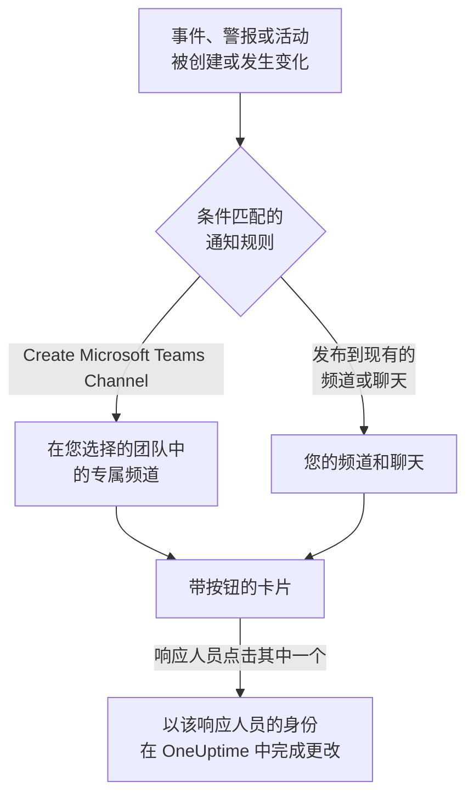

# Microsoft Teams

将 OneUptime 连接到 Microsoft Teams，即可把事件、警报、片段、计划维护、监视器和值班更新发布到您的频道和聊天，为每个事件提供专属频道，并让响应人员在 Teams 中操作：确认、解决、添加备注、呼叫值班人员、声明事件以及询问 OneUptime AI。

:::cards
- [连接 Microsoft Teams](#连接-microsoft-teams): 管理员同意、您的登录，以及每个团队中的应用。
- [通知规则](#通知规则): 决定哪些事件发布到哪里，以及哪些事件拥有专属频道。
- [与 OneUptime 机器人对话](#与-oneuptime-机器人对话): 在与机器人的聊天中使用命令、提问和表单。
- [从 Microsoft Teams 处理事件、警报和活动](#从-microsoft-teams-处理事件警报和活动): OneUptime 卡片上的按钮。
:::

## 工作原理

这依靠三样东西：

- **项目的连接** 只需建立一次：Microsoft 365 管理员为您的组织同意 OneUptime 应用。
- **每个团队中的 OneUptime 应用**，即您希望接收通知的每个团队。Microsoft 只允许机器人在已添加它的团队中发布消息。
- **每个人自己的连接**：此人的 Microsoft Teams 账户关联到其 OneUptime 账户。按钮、命令和回应都以此人的身份、按其在项目中的权限执行。

## 开始之前

- **可以连接项目的角色：** **Project Owner**、 **Project Admin** 或 **Project Member**。卸载需要 **Project Owner** 或 **Project Admin**。
- 一位 **Microsoft 365 管理员**，为整个组织授予一次管理员同意。
- 通知规则和摘要需要 **OneUptime Cloud 的 Growth 套餐**。请参阅 [低于 Growth 套餐时的通知规则](#低于-growth-套餐时的通知规则)。
- **在自托管服务器上，** 需要先为其设置好 Teams 机器人。请参阅 [Microsoft Teams 集成](/docs/self-hosted/microsoft-teams-integration)。

## 连接 Microsoft Teams

:::steps
### 授予管理员同意

前往 **项目设置** > **工作区** > **Microsoft Teams**，点击 **授予管理员许可**。Microsoft 365 管理员登录，并为组织允许 OneUptime 应用。之后卡片会显示 **Admin Consent Completed**。在连接工作区之前，事件、警报、计划维护、监视器和值班菜单的 **工作区** 部分中有 **连接 Slack 或 Teams**，它同样会带您来到这里。

### 连接您的账户

点击 **Connect with Microsoft Teams**，并使用您的工作账户登录。OneUptime 会读取您组织的团队； **查看团队** 会列出它们。

### 将 OneUptime 应用添加到每个团队（必需）

仅连接您的账户还不够。Microsoft 只允许 OneUptime 机器人在已添加它的团队中发布消息，因此请对每个希望接收通知的团队执行以下操作：

- 在 Microsoft Teams 中，点击 **团队名称** （而不是频道名称）旁边的 "..."。
- 选择 **Manage team** > **Apps** > **More apps**，找到 **OneUptime**，然后点击 **Add**。

在 OneUptime Cloud 上， **打开 Teams 商店** 会在 Microsoft Teams 应用商店中打开该应用，在那里使用 **Add to a team** 也能完成同样的操作。在自托管服务器上，请改为安装 **下载应用清单 Zip** 中的软件包：只有它包含您服务器的机器人。如果测试通知报告 OneUptime 应用未安装在该团队中，说明遗漏的正是这一步。

### 连接其他所有人

每个人都在 **用户设置** > **工作区** > **Microsoft Teams** 中通过 **Connect my account with Microsoft Teams** 关联自己的 Microsoft Teams 账户，以便以本人身份处理事件并接收私信。项目连接到 Microsoft Teams 后，该部分就会出现。

### 添加通知规则

前往 **事件** > **工作区** > **Microsoft Teams**。 **工作区** 部分只列出您的项目已连接的聊天工作区，因此 **Microsoft Teams** 会在连接后出现在那里。创建一条规则（例如在创建事件时发布到 Teams 频道的规则），然后在其所在行点击 **测试规则**。
:::

> [!NOTE]
> 为您自己安装 OneUptime，或将其添加到聊天中，是另一种安装，并不能让它向团队的频道发布消息。 **私密频道** 需要将应用添加到频道本身：打开频道 > "..." > **Manage channel** > **Apps** > **Add an app**。 **共享频道** 无法接收通知：Microsoft Teams 不支持在共享频道中使用机器人。

## 通知规则

通知规则决定哪些事件发布到 Microsoft Teams，以及发布到哪里。每个产品都有自己的规则，位于其菜单的 **工作区** > **Microsoft Teams** 下：

| 产品 | 其 **Microsoft Teams** 页面上的标签页 |
| --- | --- |
| **事件** | **事件**、 **事件 片段**、 **Summary** |
| **警报** | **警报**、 **警报 片段**、 **Summary** |
| **计划维护** | 一个规则列表 |
| **监视器** | 一个规则列表 |
| **值班** | 一个规则列表 |

创建规则分为四个步骤：

| 步骤 | 您设置的内容 |
| --- | --- |
| **基础** | **规则名称** 和 **规则描述**。 |
| **条件** | 规则针对哪些事件触发，例如按严重程度、状态、标签、监视器或标题中的字词。没有条件时，规则对每个事件都会触发。有两个或更多条件时， **匹配条件** 决定是必须全部匹配，还是匹配任意一个即可。 |
| **目标** | 发布到哪里：您选择的团队中的现有频道、您选择的聊天、在您选择的团队中新建的频道，或其中几项的组合。 |
| **Video Call** | 仅限事件和警报：为每一个开始一次通话。请参阅 [视频通话](/docs/workspace-connections/video-calls)。 |

规则创建的频道以 **New Microsoft Teams Channel Name** 加上记录编号命名，例如 `oneuptime-incident-42`。只有创建的频道才会接收规则邀请的人员。私密事件、警报或片段会获得私密频道。此后记录的每次更新（状态变化、备注、新所有者）都会发布到它的频道和聊天。

**项目设置** > **工作区** > **Microsoft Teams** 列出 OneUptime 在您的团队中能看到的频道，以及已添加它的聊天，每一项旁边都有 **发送测试**。在 Microsoft Teams 中将 OneUptime 应用添加到聊天后，该聊天就会出现； **Refresh Chats** 会获取新的聊天及其当前名称。

## 测试规则

规则所在行的 **测试规则** 会将该规则的测试消息发布到它指定的频道，让您看到消息到达。如果规则为每个事件创建频道，测试也会创建一个频道并邀请规则的相关人员。

与 **项目设置** > **工作区** > **Microsoft Teams** 中频道旁的 **发送测试** 一样，它需要创建通知规则的权限： **Project Owner**、 **Project Admin**、 **Project Member**、 **Settings Admin**、 **Settings Member**，或自定义角色中的 **Create Workspace Notification Rule** 和 **Read Workspace Notification Rule**。对于只能查看规则的人（例如 **Viewer** ）， **测试规则** 处于锁定状态，其工具提示会说明需要什么；API 会以 "You do not have permission to send test notifications in this project." 拒绝其测试。在 OneUptime Cloud 上，测试规则与添加规则一样需要 **Growth** 套餐。

在 OneUptime Cloud 上，频道或聊天旁的 **发送测试** 同样需要 **Growth** 套餐，因为向频道发布消息正是规则和摘要所做的事。摘要上的 **立即发送测试** 需要创建摘要的权限（自定义角色中的 **Create Workspace Notification Summary** 和 **Read Workspace Notification Summary** ），在 OneUptime Cloud 上还需要 **Growth** 套餐；对其他任何人它都处于锁定状态，其工具提示会说明需要什么。以只读权限连接的 MCP 客户端无法发送任何测试。

## 摘要

**事件** > **工作区** > **Microsoft Teams** （以及 **警报** ）的 **Summary** 标签页会向您指定的频道发布定期汇总：有多少事件或警报、它们被确认和解决的速度，以及一个带链接的列表。新的摘要每周发送一次，涵盖最近 7 天。将 **发送首份报告时间** 留空，第一份摘要会在下一周、下一天或下一月开始时的 09:00 发送；表单会显示具体时间。

摘要按其 **时区** 的时钟发送，时区的初始值为您的时区。它全年在该时区保持同一时刻：设置为柏林 09:00 的摘要，在夏令时调整时钟后仍会在柏林时间 09:00 发送，其消息中的日期也是柏林的日期。通过 API 时，请以 IANA 时区名称发送 `timezone`，例如 `Europe/Berlin`。未指定时区创建的摘要会使用创建者个人资料中的时区；由 API 密钥创建时使用 UTC。

摘要表单有四个步骤： **基本信息** （名称、频道及其 **团队名称** ）、 **计划**、 **内容** （ **包含内容** ）和 **过滤器** （统计哪些事件或警报）。

## 低于 Growth 套餐时的通知规则

在 OneUptime Cloud 上，通知规则和摘要属于 **Growth** 及以上套餐。低于该套餐的项目会保留已有的规则和摘要，它们会继续向 Microsoft Teams 发布。因此，每个产品（事件、警报、计划维护、值班、监视器）的 **Microsoft Teams** 页面都会显示套餐说明，并在下方列出它们（ **仍在配置的通知规则**、 **仍在配置的摘要** ）：删除规则，或关闭或删除摘要。添加或更改规则和摘要需要 **Growth**。

## 在 Microsoft Teams 中接收呼叫

要在值班时通过私信接收呼叫，请将 Microsoft Teams 添加为您的通知方式之一：

:::steps
1. 连接您自己的 Microsoft Teams 账户（请参阅 [连接 Microsoft Teams](#连接-microsoft-teams) ）。
2. 前往 **用户设置** > **通知方式**，打开 **Workspace Apps** 标签页，然后点击 **Add Microsoft Teams Account**。
3. 在其所在行点击 **Send Test Message**。消息会发送到您的 Microsoft Teams 聊天。
:::

添加后，它会立即加入您的值班规则，因此从那时起呼叫会通过 Microsoft Teams 送达您。在 **用户设置** > **值班规则** 中更改它接收哪些呼叫。

## 将消息保存为备注

在 OneUptime 为事件、警报、片段或计划维护活动创建的频道中，对一条消息或回复添加回应，OneUptime 就会将其保存为该记录的备注。它会在一分钟内检测到回应，并在消息串中回复确认：

| 回应 | 保存为 |
| --- | --- |
| 📌 或 📍 | 仅您的团队可见的私密备注 |
| 📣 或 📢 | 显示在状态页上的公开备注。仅限事件和计划维护活动。 |

备注以您的身份、按您的权限保存，因此您自己的 Microsoft Teams 账户必须已连接，并且 OneUptime 应用必须在该团队中。

## 与 OneUptime 机器人对话

在个人聊天中给机器人发消息，或在频道或群聊中 @提及 OneUptime：在频道和群聊中，它只在被提及时回复。

| 消息 | 机器人的操作 |
| --- | --- |
| `help` | 列出它能做的事。 |
| `ask <question>`，或任何日常语言的问题 | OneUptime AI 回答有关日志、追踪、指标、事件和监视器的问题，例如"现在有哪些监视器宕机了？"。回答只读取数据。 |
| `create incident [title]` | 打开已填好标题的事件表单。 |
| `create maintenance [title]` | 打开已填好标题的计划维护表单。 |
| `show active incidents`、 `show active alerts` | 列出当前未关闭的内容。 |
| `show scheduled maintenance`、 `show ongoing maintenance` | 列出即将进行或正在进行的维护活动。 |

询问 OneUptime AI 需要为项目开启 AI。请参阅 [询问 AI](/docs/ai/ask-ai)。

## 从 Microsoft Teams 创建事件和维护

向 OneUptime 机器人输入 `create incident` 或 `create maintenance`，无论是在个人聊天、频道还是群聊中，都会为输入的人打开一个表单。表单以此人的身份填写：即以其 Microsoft Teams 账户所连接的 OneUptime 账户的身份（请参阅 [连接 Microsoft Teams](#连接-microsoft-teams) ），按该账户在项目中的权限提交。账户未连接的人，或 OneUptime 账户已不再是项目成员的人，会收到该怎么做的说明，而不是表单。

- **谁可以使用。** 能在 OneUptime 中声明事件或创建计划维护活动的人：对于事件，是 **Project Owner**、 **Project Admin**、 **Project Member**、 **Incident Admin** 和 **Incident Member** （自定义角色中的 **Create Incident** ）；对于活动，是 **Scheduled Maintenance Admin** 和 **Scheduled Maintenance Member** （ **Create Scheduled Maintenance** ）。其他任何人都会收到告知，并且得不到表单。
- **表单提供什么。** 每个列表（严重程度、监视器、监视器状态、值班策略和标签）都包含请求表单的人可以读取的内容，与 OneUptime 中的同一列表一致，卡片上的 "not shown" 说明也只统计这些：如果角色仅限于某些标签，则为带有这些标签的监视器和值班策略。此人完全无法读取的列表会被省略。已归档的值班策略永远不会提供。
- **表单可以指定什么。** 在频道或群聊中，任何在场的人都可以提交表单，并且以提交者的身份、按其自己的权限提交。事件或活动以这些权限创建，并记在此人名下。此人无法读取的监视器、值班策略、标签、严重程度或状态，或属于其他项目的，都会像项目中不存在一样被拒绝，并且不会创建任何内容：机器人会回复 "One of the values you picked ... is not available in this project any more. Please pick it again."

事件、警报或片段上的 **Execute On-Call Policy** 也以同样方式工作：它需要执行值班策略的权限（ **Project Owner**、 **Project Admin**、 **Project Member**、 **On-Call Admin** 和 **On-Call Member**，或自定义角色中的 **Create On-Call Duty Policy Execution Log** ）以及读取该事件、警报或片段的权限，并提供此人可以读取的有效值班策略。从卡片查看监视器或值班策略时，也会以点击按钮的人的身份读取。

## 从 Microsoft Teams 处理事件、警报和活动

OneUptime 卡片上的按钮以点击者的身份执行，无论是在个人聊天、频道还是群聊中：即以其 Microsoft Teams 账户所连接的 OneUptime 账户的身份，按该账户在项目中的权限执行。事件、警报或片段上的 **Acknowledge**、 **Resolve**、 **Change State**、 **Add Note** 和 **Execute On-Call Policy**，以及计划维护活动上的 **Mark as Ongoing**、 **Mark as Complete**、 **Change State** 和 **Add Note**，各自会做出与 OneUptime 中相同操作一样的更改，并在那里记在此人名下：记录的状态时间线和动态会显示是谁更改了其状态，备注也归此人所有。通过回应从消息保存的备注也以同样方式发布。

- **谁可以使用。** 能在 OneUptime 中做出同样更改的人。确认、解决事件或更改其状态需要更改其状态的权限： **Project Owner**、 **Project Admin**、 **Project Member**、 **Incident Admin** 和 **Incident Member**，或自定义角色中的 **Create Incident State Timeline**。警报、片段或计划维护活动需要其自身类型的同等权限（例如 **Create Alert State Timeline** ），备注需要发布该类备注的权限。与 OneUptime 中的状态面板一样，它们不要求编辑事件或警报本身的权限。其他任何人都会收到告知，并且不会有任何更改。
- **哪些记录。** 与在 OneUptime 中一样，是此人可以读取的记录：如果角色仅限于某些标签，则为带有这些标签的事件、警报、片段和活动。任何其他记录或其他项目的记录上的按钮，都会得到该记录 "was not found in this project, or you do not have access to it." 的回复，并且不会有任何更改。在 OneUptime Cloud 上，项目套餐不包含的更改会被拒绝，并说明所需的套餐。
- **Change State 提供什么。** 按项目的顺序，提供此人可以读取、记录接下来可以转入的状态：不会提供早于其当前状态的状态，片段与事件、警报或计划维护活动一样，因为状态更改永远不会让记录在其列表中回退（请参阅 [顺序是真正的约束，而不是显示偏好](/docs/incidents/states-and-severities#顺序是真正的约束而不是显示偏好) ）。如果此人一个都无法读取，机器人会说 "No incident states are available to you in this project. Ask a project admin for access to them."；如果记录处于它能达到的最后一个状态，则会说 "There is no later state to move this incident to."。这两种情况都不会显示空卡片。
- **Escalate.** 卡片上的 **Escalate** 会针对卡片所涉及的事件、警报或片段执行其值班策略，以点击者的身份，并使用与 **Execute On-Call Policy** 相同的权限。不涉及其中任何一种的卡片会得到 "This on-call policy can only be executed for an incident, an alert or an episode. Open the record you are paging about and use Execute On-Call Policy there." 的回复，并且不会呼叫任何人。

## 断开连接

- **Disconnect** 只解除您自己的 Microsoft Teams 账户的关联，并同时删除您的 Microsoft Teams 通知方式。
- **项目设置** > **工作区** > **Microsoft Teams** 上的 **Uninstall OneUptime from Microsoft Teams** 会断开项目的连接。OneUptime 停止向 Microsoft Teams 发布，并且 **工作区** 菜单不再列出它。通知规则和摘要会被保留，以便您再次连接时使用。

> [!WARNING]
> 卸载还会解除项目中每个成员自己的 Microsoft Teams 账户的关联，并删除 Microsoft Teams 通知方式以及使用它们的值班规则。一个项目只连接到一个 Microsoft 365 组织：要将其移到另一个组织，请先卸载。

## 故障排除

:::details 测试提示 OneUptime 应用未安装在该团队中
Microsoft 拒绝了发布，因为机器人不在该团队中。将应用添加到该团队（请参阅 [连接 Microsoft Teams](#连接-microsoft-teams) ），如果是私密频道，则添加到频道本身。添加到一个团队对其他团队没有任何作用。
:::

:::details Microsoft Teams 未连接
当 Microsoft 未完成连接就把您送回时，您开始的页面会显示 **Microsoft Teams 未连接**，并用一句话说明原因：您缺少权限、链接已被使用或已过期、您登录了另一个 Microsoft 365 组织，或您的组织还没有团队。每句话的含义和处理方法请参阅 [连接未完成](/docs/self-hosted/microsoft-teams-integration#连接未完成)。
:::

:::details 机器人提示我的账户未连接
在登录到项目所连接的组织的情况下，在 **用户设置** > **工作区** > **Microsoft Teams** 中通过 **Connect my account with Microsoft Teams** 关联它。来自其他组织的来宾账户不是同一个账户。
:::

:::details 在自托管服务器上所有通知都失败
安装在您团队中的 Teams 应用必须是您的服务器生成的软件包，并且 Microsoft 必须能够访问您服务器的机器人端点。请参阅 [Microsoft Teams 集成](/docs/self-hosted/microsoft-teams-integration#故障排除) 的故障排除。
:::

## 后续步骤

:::cards
- [Slack](/docs/workspace-connections/slack): 在 Slack 中使用相同的通知和操作。
- [视频通话](/docs/workspace-connections/video-calls): 为每个事件提供一次通话，并随其更新一起发布。
- [Microsoft Teams 集成](/docs/self-hosted/microsoft-teams-integration): 在自托管服务器上设置 Teams 机器人。
- [声明事件](/docs/incidents/declaring-incidents): 事件开始的所有方式，以及开始时会运行什么。
:::
