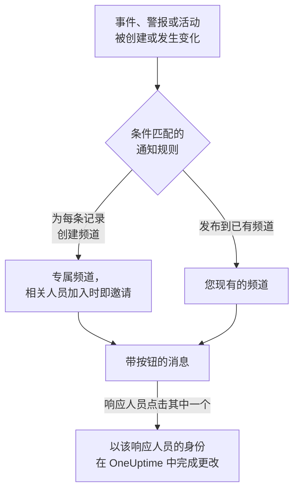

# Slack

将 OneUptime 连接到 Slack，即可把事件、警报、片段、计划维护、监视器和值班更新发布到您的频道，为每个事件提供专属频道，并让响应人员无需离开 Slack 即可操作：确认、解决、添加备注、呼叫值班人员以及声明事件。

:::cards
- [连接 Slack](#连接-slack): 在您的工作区中安装 OneUptime，然后关联您自己的账户。
- [请所有人连接账户](#请所有人连接账户): 一次性向每位尚未连接账户的成员发送消息。
- [通知规则](#通知规则): 决定哪些事件发布到哪里，以及哪些事件拥有专属频道。
- [记录频道中的成员](#记录频道中的成员): 在记录的页面上查看频道中有谁、加入频道并添加成员。
- [/oneuptime 命令](#oneuptime-命令): 声明事件、安排维护、查看谁在值班，以及询问 AI。
- [值班用户组](#值班用户组): 让用户组与值班人员保持一致，并呼叫它。
- [从 Slack 处理事件、警报和活动](#从-slack-处理事件警报和活动): OneUptime 消息上的按钮。
:::

## 工作原理

这依靠两种连接：

- **项目的连接** 只需建立一次：安装在您的 Slack 工作区中的 OneUptime 应用。它发布消息、创建频道并邀请人员。
- **每个人自己的连接**：此人的 Slack 账户关联到其 OneUptime 账户。按钮、命令和表情回应都以此人的身份、按其在项目中的权限执行。

一个 Slack 工作区可以连接到多个项目，例如生产环境和测试环境。按钮或表单在其所涉及记录的项目中执行。命令或发给 OneUptime 的消息在其所在频道（例如事件的频道）的项目中执行，否则在您的 Slack 账户所连接的唯一项目中执行。如果无法据此判断，OneUptime 会列出您所在的项目，并请您从目标项目的频道中重试。

## 开始之前

- **可以连接项目的角色：** **项目所有者**、 **项目管理员** 或 **项目成员**。卸载应用需要 **项目所有者** 或 **项目管理员**。
- 一个您可以安装应用的 **Slack 工作区**。
- 通知规则和摘要需要 **OneUptime Cloud 的 Growth 套餐**。请参阅 [低于 Growth 套餐时的通知规则](#低于-growth-套餐时的通知规则)。
- **在自托管服务器上，** 需要先为其设置好 Slack 应用。请参阅 [Slack 集成](/docs/self-hosted/slack-integration)。

## 连接 Slack

:::steps
### 在您的 Slack 工作区中安装 OneUptime

前往 **项目设置** > **工作区** > **Slack**，点击 **Connect with Slack**。选择工作区并授权 OneUptime。Slack 会将您送回同一页面，页面上现在会显示项目所连接的工作区。在连接工作区之前，事件、警报、计划维护、监视器和值班菜单的 **工作区** 部分中有 **连接 Slack 或 Teams**，它同样会带您来到这里。

### 连接您自己的 Slack 账户

安装应用会关联安装者的账户。其他所有人都在 **用户设置** > **工作区** > **Slack** 中通过 **Connect my account with Slack** 关联自己的 Slack 账户，以便以本人身份处理事件并接收私信。项目连接到 Slack 后，该部分就会出现。如需让整个团队一次性完成连接，请参阅 [请所有人连接账户](#请所有人连接账户)。

### 添加通知规则

前往 **事件** > **工作区** > **Slack**。 **工作区** 部分只列出您的项目已连接的聊天工作区，因此 **Slack** 会在连接后出现在那里。创建一条规则，例如为每个新事件创建一个 Slack 频道，并让所有处理它的人加入：被呼叫的人员、事件指挥官和所有者。请参阅 [通知规则](#通知规则)。

### 测试这条规则

在规则所在行点击 **测试规则**。测试消息会发送到规则指定的频道。请参阅 [测试规则](#测试规则)。
:::

## 请所有人连接账户

任何人都无法替他人连接 Slack 账户，管理员也不例外：每个人都要亲自登录自己的账户。要让整个团队完成连接，可由 **项目所有者** 或 **项目管理员** 在 **项目设置** > **工作区** > **Slack** 中一次性请所有人连接。 **Members' Slack accounts** 卡片会显示已有多少成员完成连接。 **Ask everyone to connect** 会由 OneUptime 在 Slack 中向每位尚未连接的成员发送一条私信，并附带一个 **Connect Slack account** 按钮，只需点击一下即可连接其账户。

- **谁会收到消息。** 项目中每位尚未连接 Slack 账户的成员，通过其电子邮件地址在 Slack 中找到。过去 24 小时内已请求过的人不会被再次请求，因此第二天再请一次时，只会提醒仍未连接的人。
- **卡片显示的内容。** 消息发送期间显示发送进度，之后显示是谁发起的请求，以及有多少成员收到了消息。OneUptime 无法通过电子邮件地址在 Slack 中找到的成员，会在卡片上列出姓名：他们需要自行在 **用户设置** > **工作区** > **Slack** 中连接。
- **按钮连接的账户。** 按下按钮并登录的人的 Slack 账户，会连接到此人自己的 OneUptime 账户。转发给他人的消息，不会为原本收到消息的成员连接任何账户。

## 通知规则

通知规则决定哪些事件发布到 Slack，以及发布到哪里。每个产品都有自己的规则，位于其菜单的 **工作区** > **Slack** 下：

| 产品 | 其 **Slack** 页面上的标签页 |
| --- | --- |
| **事件** | **事件**、 **事件 片段**、 **摘要** |
| **警报** | **警报**、 **警报 片段**、 **摘要** |
| **计划维护** | 一个规则列表 |
| **监视器** | 一个规则列表 |
| **值班** | 一个规则列表 |

创建规则分为四个步骤：

| 步骤 | 您设置的内容 |
| --- | --- |
| **基础** | **规则名称** 和 **规则描述**。 |
| **条件** | 规则适用于哪些事件，例如按严重程度、状态、标签、监视器或标题中的字词。条件会在事件创建时检查，并在 OneUptime 每次发布关于它的更新时再次检查，因此针对已确认事件的规则会在事件被确认时生效。新规则适用于所有事件，例如 **所有事件** 。要缩小范围，请选择 **仅符合条件的事件** 并添加条件。有两个或更多条件时， **匹配条件** 决定是必须全部匹配，还是匹配任意一个即可。 |
| **目标** | 发布到哪里：带频道名称的 **发布到已有频道** 、带加入人员的 **为每个事件创建频道** （警报、片段、计划维护、监视器或值班策略同理），或两者兼有。步骤下方的 **此规则的作用** 会像规则卡片一样，用句子说明规则的作用。 |
| **Video Call** | 仅限事件和警报：为每一个开始一次通话。请参阅 [视频通话](/docs/workspace-connections/video-calls)。 |

规则创建的频道以其记录命名：事件 INC-42 得到 `inc-42`，警报 ALT-7 得到 `alt-7`；在没有编号前缀的项目中，事件 42 得到 `incident-42`。 **频道名称前缀** 中的文字放在名称前面，因此 `prod-` 会得到 `prod-inc-42`，表单会在您输入时显示名称。对于计划维护事件，前缀会取代其编号前缀：SM-5 得到 `sm-5`，`maint-` 会得到 `maint-5`。Slack 只接受小写字母、数字、`-` 和 `_`，最多 80 个字符。如果已有同名频道（例如其他项目的频道或已归档的频道），OneUptime 会加上 `-2`、`-3` 等。

规则的频道会在事件首次匹配该规则时创建：在事件创建时，或之后在事件仍未结束时，由某次更新使其匹配时。针对已确认事件的规则会在事件被确认时创建频道。私密事件、警报或片段会获得私密频道。

**谁会加入频道** 列出规则会把哪些人加入其频道，每个人在加入记录时就会被加入，而不只是在创建频道时： **值班响应人员（被呼叫时）** 、 **事件指挥官及其他事件角色（被分配时）** （事件和事件片段）和 **所有者（被添加时）** ，新规则中默认全部勾选；另外， **另外邀请** 中的人员、团队和值班计划会在创建频道时加入。事件指挥官通常在有人首次确认事件时被分配，并在那时加入其频道。在事件角色有自己的复选框之前保存的规则，会在添加所有者或值班响应人员时一并添加事件角色，其复选框显示为已勾选。规则发布到的现有频道不会加入任何人。

对于 **另外邀请** 中的值班计划，创建频道时该计划中正在值班的人会加入频道（以该值班计划页面上显示的为准），且不会被呼叫。如果只想把某些人加入部分事件的频道，请为第二条规则设置这些条件和这些人员，并使用与第一条规则相同的 **频道名称前缀**：在事件的频道创建时与该事件匹配的规则会共用该频道，并各自加入自己的人员。

此后记录的每次更新（状态变化、备注、新所有者）都会发布到它的频道，并在规则的条件匹配期间发布到其规则指定的现有频道。开启 **事件解决后归档频道** （或警报、片段、计划维护、监视器和值班策略的同类开关）后，创建频道的规则会在记录解决、完成或删除时归档该频道，无论届时其条件如何。创建时即已解决的事件、警报或片段不会获得专属频道；其创建消息仍会发送到您的规则指定的频道。请参阅 [声明时即已确认或已解决](/docs/incidents/declaring-incidents#声明时即已确认或已解决)。

拥有专属频道的事件、警报、片段或计划维护事件，会在其 OneUptime 页面标题的状态按钮旁显示 **在 Slack 中打开**。它会在新标签页中打开该频道，进入 Slack 应用或浏览器。拥有两个专属频道的记录会在按钮下列出这两个频道。在 Slack 和 Microsoft Teams 中都有频道的记录，会改为只显示一个 **打开频道** 按钮，列出所有频道。不会提供您的规则所发布到的现有频道。

频道保持易读：每次更新只发布一次，记录的第一个状态写在宣布该记录的消息里，而不是单独发一条消息。值班策略的一次运行就是一条消息，随着升级推进而被编辑：呼叫了谁、呼叫了几次以及通过什么方式、谁没有被呼叫以及原因、谁确认了。只有在需要有人采取行动时才会发布新消息：某条升级规则没有呼叫到任何人，或者运行结束时仍没有人确认。Slack 账户未连接到 OneUptime 的人，OneUptime 会添加使用其电子邮件地址的那个 Slack 账户。OneUptime 用这两种方式都找不到的人，或在 Slack 中是访客的人，无法被添加到频道；OneUptime 在每个频道中只说一次，用一条列出所有这些人的消息，名单变长时编辑这条消息。把该消息中的 **Connect Slack account** 链接发给他们，即可一步连接账户。记录的所有者或状态页订阅者已收到通知这件事，保留在 OneUptime 中该记录的信息流里。

**项目设置** > **工作区** > **Slack** 列出 OneUptime 能看到的频道，每个频道旁边都有 **发送测试**。OneUptime 第一次在公开频道发布时会自行加入。私密频道只有在 Slack 中邀请 OneUptime 应用加入后，才会被列出并可以发布消息。

## 记录频道中的成员

拥有专属 Slack 频道的事件、警报、片段或计划维护事件，在其 OneUptime 页面上有一张 **Slack 频道** 卡片。卡片显示该频道（一个在 Slack 中打开它的链接）、它是否为私密频道，以及频道中有谁，您排在最前面。无需 Slack 管理员，即可在卡片上：

- **加入频道** 会在您不在频道中时把您加入频道。
- **添加成员** 会打开项目的人员和团队列表：选择一个人即添加此人，选择一个团队即添加其中的所有人。

由 OneUptime 应用添加他们，就像它为规则的频道添加人员一样。应用会一直留在它创建的频道中，所以即使所有人都已离开私密频道，也能这样重新进入。

- **谁可以添加成员。** 可以编辑该记录的人：对于事件，是 **项目所有者**、 **项目管理员**、 **项目成员**、 **事件管理员** 和 **事件成员**，或自定义角色中的 **Edit Incident**；对于警报、片段或计划维护事件，则是其各自类型的相同权限（例如 **Edit Alert**）。其他人可以看到频道中有谁，以及如何进入。
- **可以添加谁。** OneUptime 能在 Slack 中找到的人：通过此人已连接的 Slack 账户，否则通过 Slack 中此人的电子邮件地址。卡片会列出无法添加的人及原因，例如被 Slack 挡在频道之外的访客。
- **会记录什么。** 谁被添加、由谁添加，都记录在该记录的信息流中（ **已添加频道成员** ），以及 **项目设置** > **通知** > **通知日志** 的 **工作区** 标签页中。
- **移出某人。** OneUptime 只添加成员：请在 Slack 中将某人移出频道。

## 测试规则

规则所在行的 **测试规则** 会将该规则的测试消息发布到它指定的频道，让您看到消息到达。如果规则为每个事件创建频道，测试也会创建一个频道并邀请规则的相关人员。

与 **项目设置** > **工作区** > **Slack** 中频道旁的 **发送测试** 一样，它需要创建通知规则的权限： **项目所有者**、 **项目管理员**、 **项目成员**、 **设置管理员**、 **设置成员**，或自定义角色中的 **Create Workspace Notification Rule** 和 **Read Workspace Notification Rule**。对于只能查看规则的人（例如 **查看者** ）， **测试规则** 处于锁定状态，其工具提示会说明需要什么；API 会以 "You do not have permission to send test notifications in this project." 拒绝其测试。在 OneUptime Cloud 上，测试规则与添加规则一样需要 **Growth** 套餐。

在 OneUptime Cloud 上，频道旁的 **发送测试** 同样需要 **Growth** 套餐，因为向频道发布消息正是规则和摘要所做的事。摘要上的 **立即发送测试** 需要创建摘要的权限（自定义角色中的 **Create Workspace Notification Summary** 和 **Read Workspace Notification Summary** ），在 OneUptime Cloud 上还需要 **Growth** 套餐；对其他任何人它都处于锁定状态，其工具提示会说明需要什么。以只读权限连接的 MCP 客户端无法发送任何测试。

## 摘要

**事件** > **工作区** > **Slack** （以及 **警报** ）的 **摘要** 标签页会向您指定的频道发布定期汇总：有多少事件或警报、它们被确认和解决的速度，以及一个带链接的列表。新的摘要每周发送一次，涵盖最近 7 天。将 **发送首份报告时间** 留空，第一份摘要会在下一周、下一天或下一月开始时的 09:00 发送；表单会显示具体时间。

摘要按其 **时区** 的时钟发送，时区的初始值为您的时区。它全年在该时区保持同一时刻：设置为柏林 09:00 的摘要，在夏令时调整时钟后仍会在柏林时间 09:00 发送，其消息中的日期也是柏林的日期。通过 API 时，请以 IANA 时区名称发送 `timezone`，例如 `Europe/Berlin`。未指定时区创建的摘要会使用创建者个人资料中的时区；由 API 密钥创建时使用 UTC。

摘要表单有四个步骤： **基本信息** （名称和频道）、 **计划**、 **内容** （ **包含内容** ）和 **过滤器** （统计哪些事件或警报）。

## 低于 Growth 套餐时的通知规则

在 OneUptime Cloud 上，通知规则和摘要属于 **Growth** 及以上套餐。低于该套餐的项目会保留已有的规则和摘要，它们会继续向 Slack 发布。因此，每个产品（事件、警报、计划维护、值班、监视器）的 **Slack** 页面都会显示套餐说明，并在下方列出它们（ **仍在配置的通知规则**、 **仍在配置的摘要** ）：删除规则，或关闭或删除摘要。添加或更改规则和摘要需要 **Growth**。

## 在 Slack 中接收呼叫

要在值班时通过私信接收呼叫，请将 Slack 添加为您的通知方式之一：

:::steps
1. 连接您自己的 Slack 账户（请参阅 [连接 Slack](#连接-slack) ）。
2. 前往 **用户设置** > **通知方式**，打开 **Workspace Apps** 标签页，然后点击 **Add Slack Account**。
3. 在其所在行点击 **Send Test Message**。消息会发送到您的 Slack 私信。
:::

添加后，它会立即加入您的值班规则，因此从那时起呼叫会通过 Slack 送达您。在 **用户设置** > **值班规则** 中更改它接收哪些呼叫。

## 将消息保存为备注

在事件、警报、片段或计划维护活动的频道中对一条消息添加表情回应，OneUptime 就会将该消息保存为该记录的备注，然后在消息串中回复确认：

| 表情回应 | 保存为 |
| --- | --- |
| 📌 图钉表情，或 Slack 自带的 **Pin to channel** | 仅您的团队可见的私密备注 |
| 📢 扩音器或喇叭表情 | 显示在状态页上的公开备注。仅限事件和计划维护活动。在私密事件上为私密备注，确认消息会说明原因。 |

备注会保留消息在 Slack 中的样子：格式、链接和代码，以名字显示的被提及的人和频道，以及指向其文件和图片的链接。公开备注会去掉文件和图片，因为它们只对您的团队开放。

备注是写这条消息的人的原话：如果此人的 Slack 账户已连接，显示其 OneUptime 名称，否则显示 Slack 中的名字。私密备注无论多久之后才保存，都会排在时间线上消息发布的时间点。公开备注排在保存的时间点，状态页也从那时起显示它。时间线会显示是谁保存的。备注不会再发回频道，因为消息已经在那里了。

备注以您的身份、按您的权限保存。如果您的 Slack 账户尚未连接，OneUptime 会在一条只有您能看到的消息中请您连接，并附上一个按钮，您一连接就会保存该消息。无论多少人回应，一条消息只会保存一次。

## /oneuptime 命令

OneUptime 在 Slack 中只有一个命令：`/oneuptime`。在它后面输入的词决定要做什么；后面的其他任何内容都是向 OneUptime AI 提出的问题。

| 命令 | 作用 |
| --- | --- |
| `/oneuptime help` | 列出所有命令，并附示例。 |
| `/oneuptime incident [title or number]` | 打开已填好标题的事件表单。如果写的是事件编号，例如 `42` 或 `INC-42`，则改为显示该事件：请参阅 [从 Slack 管理一个事件](#从-slack-管理一个事件)。 |
| `/oneuptime maintenance [title]` | 打开已填好标题的计划维护表单。 |
| `/oneuptime oncall` | 列出您能看到的每个值班计划中当前由谁值班、值班到何时，以及下一位是谁。 |
| `/oneuptime page [who] [message]` | 就您的消息呼叫您 @提及的人，或打开一个表单来选择要呼叫的人。请参阅 [从 Slack 呼叫他人](#从-slack-呼叫他人)。 |
| `/oneuptime ask [question]`，或任何问题 | OneUptime AI 回答有关日志、追踪、指标、事件和监视器的问题。 |

对 `help` 和 `oncall` 的回答是只有您能看到的消息，显示在命令下方。如果第一个词看起来像拼错的命令，例如 `incidnet`，您会收到与它相似的命令，而不是 OneUptime AI 的回答。事件和维护表单以您本人的身份操作：请参阅 [从 Slack 创建事件和维护](#从-slack-创建事件和维护)。

> [!NOTE]
> `/oneuptime incident` 和 `/oneuptime maintenance` 取代了 `/incident` 和 `/maintenance`，后两者可能与其他 Slack 应用的同名命令冲突。用较早的清单创建的 Slack 应用会保留它们，在应用更新之前，它们会打开相同的表单：请参阅 [用较旧清单创建的应用](/docs/self-hosted/slack-integration#用较旧清单创建的应用)。

## Slack 中的 OneUptime 主页

在 Slack 侧边栏的 **Apps** 下打开 OneUptime，它的 **Home** 标签页会按您有权查看的范围显示项目中正在发生的事情，每次打开时都会重新读取。

- **您的值班。** 您当前正在值班的值班计划及其结束时间，否则是您的下一个班次。
- **未解决的内容。** 您有权读取的最新未解决事件和警报，每一项都链接到它在 OneUptime 中的页面。
- **按钮。** **Declare incident** 、 **Schedule maintenance** 和 **Page someone** 打开的表单与 `/oneuptime incident` 、 `/oneuptime maintenance` 和 `/oneuptime page` 相同， **Who's on call** 的回答与 `/oneuptime oncall` 相同。

主页以您的身份读取，因此需要连接您自己的 Slack 账户。在连接之前，主页上会有一个 **Connect Slack account** 按钮，连接后会立即显示您的主页。

当有人把 OneUptime 添加到频道时，它会在那里发布一条问候：如何向它提问，以及在哪里添加发布到该频道的通知规则。首次打开它的 **Messages** 标签页时，它会在那里欢迎您：说明它在 Slack 中做什么，以及如何开始。

## 从 Slack 询问 OneUptime AI

用日常语言询问有关日志、追踪、指标、事件和监视器的问题。在频道中 @提及 OneUptime，或向它发送私信，它会在消息串中回答。 `/oneuptime ask which monitors are down?` 会将答案发布到频道中。两种方式都需要连接您自己的 Slack 账户，并为项目开启 AI。Slack 中的回答只读取数据：要更改内容，请使用按钮。请参阅 [询问 AI](/docs/ai/ask-ai)。

OneUptime 只回答发给它的内容。

- **在您自己的对话中，直接回复即可。** 在频道中（而不是在消息串中）提出的问题，会在其下方的消息串中开始一段对话：在那里回复即可继续提问，无需再次提及 OneUptime；其他人提及它即可加入对话。
- **在其他任何消息串中，请提及 OneUptime。** 例如在事件消息下方的消息串中，请每次都提及它：人们在那里互相发送的内容不会得到回答。
- **如果您的 Slack 账户未连接。** OneUptime 会在每段对话中请您连接一次，以只有您能看到的消息，并附带一个 **Connect Slack account** 按钮。

## 从 Slack 创建事件和维护

`/oneuptime incident` 和 `/oneuptime maintenance` 会打开一个表单，由您以本人身份填写并提交：即以您的 Slack 账户所连接的 OneUptime 账户的身份（请参阅 [连接 Slack](#连接-slack) ），按该账户在项目中的权限提交。如果您的 Slack 账户未连接，或您的 OneUptime 账户已不再是项目成员，OneUptime 会在您运行命令的地方，以只有您能看到的消息告诉您该怎么做，并且不会打开表单。 **Create New Incident** 和 **Create Scheduled Event** 快捷方式会打开相同的表单。

- **谁可以使用。** 能在 OneUptime 中声明事件或创建计划维护活动的人：对于事件，是 **项目所有者**、 **项目管理员**、 **项目成员**、 **事件管理员** 和 **事件成员** （自定义角色中的 **Create Incident** ）；对于活动，是 **计划维护管理员** 和 **计划维护成员** （ **Create Scheduled Maintenance** ）。其他任何人都会在运行命令的地方收到告知，并且不会打开表单。
- **表单提供什么。** 每个列表（严重程度、监视器、监视器状态、值班策略和标签）都包含您可以读取的内容，与 OneUptime 中的同一列表一致：如果角色仅限于某些标签，则为带有这些标签的监视器和值班策略。您完全无法读取的列表不会出现在表单中。已归档的值班策略永远不会提供。
- **表单可以指定什么。** 事件或活动以您自己的权限创建，并记在您名下。您无法读取的监视器、值班策略、标签、严重程度或状态，或属于其他项目的，都会像项目中不存在一样被拒绝，即使表单是在您的权限变化之前打开的，也不会创建任何内容。OneUptime 会在频道中，以只有您能看到的消息告诉您原因。

事件、警报或片段上的 **Execute On-Call Policy** 也以同样方式工作：它需要执行值班策略的权限（ **项目所有者**、 **项目管理员**、 **项目成员**、 **值班管理员** 和 **值班成员**，或自定义角色中的 **Create On-Call Duty Policy Execution Log** ）以及读取该事件、警报或片段的权限，并提供您可以读取的有效值班策略。

## 从 Slack 呼叫他人

`/oneuptime page @nawaz The checkout API is throwing 500s` 会立即呼叫 Nawaz。OneUptime 会创建一条以您的消息为标题的警报，您 @提及的每个人都会按其本人的值班规则收到电话、短信、推送通知或电子邮件，直到有人确认该警报。

- **立即被呼叫的人。** 您 @提及的人，以及您 @提及的用户组所关联值班计划中正在值班的人，前提是其后跟有消息（请参阅 [值班用户组](#值班用户组)）。OneUptime 通过此人的 Slack 账户所连接的 OneUptime 账户识别此人，否则通过 Slack 中此人的电子邮件地址识别。项目之外的人不会被呼叫。
- **其他情况会打开表单。** 如果没有 @提及任何人、没有消息、提及了 `@here` 或未关联您可见值班计划的用户组，或有 OneUptime 无法识别的人，就会打开 **Page someone** 表单，其中已填入您输入的内容，并说明哪些人无法选中。选择人员、团队、值班计划（呼叫此刻在该计划中值班的人）或值班策略（按其升级规则呼叫），然后提交。最先输入的名称，例如 `/oneuptime page Primary The disk is full` 中的名称，会选中同名的值班计划、团队或策略。
- **显示位置。** 频道会以一条持续更新的消息显示这次呼叫：呼叫了谁、如何呼叫，以及谁已确认。在 OneUptime 无法发帖的地方，例如未邀请它加入的私有频道，一条只有您能看到的消息会告诉您呼叫了谁，并附上警报的链接。
- **谁可以呼叫。** 既能执行值班策略又能创建警报的人： **项目所有者**、 **项目管理员** 和 **项目成员**，或同时拥有 **值班成员** 和 **警报成员** 的人（自定义角色中的 **Create On-Call Duty Policy Execution Log** 和 **Create Alert** ）。不经值班策略直接呼叫人员、团队或值班计划，还需要访问项目中所有值班策略的权限。其他任何人都会在运行命令的地方收到告知，并且不会呼叫任何人。在 OneUptime Cloud 上，呼叫需要 Growth 套餐：低于该套餐时，OneUptime 会说明所需的套餐，并且不会呼叫任何人。

## 值班用户组

让 Slack 用户组（例如 `@payments-oncall`）与一个或多个值班计划中当前正在值班的人保持一致，这样任何人都可以 @提及它来联系值班人员。OneUptime 会在每次交接和覆盖时更改该组的成员，并每 15 分钟检查一次。

:::steps
### 将用户组连接到值班计划

在 **值班** > **值班计划** 中打开该计划。在其 **Slack 用户组** 卡片中，点击 **连接用户组**，然后选择工作区中的某个用户组，或用名称和标识 **新建用户组**。组中的成员会立即替换为正在值班的人。

### 同时将其连接到备用值班计划

若要让一个组同时包含主值班和备用值班的人员，请在备用值班计划的页面上连接同一个组。一个组可以关联任意数量的值班计划。
:::

- **卡片显示的内容。** 每个组当前的成员、它关联的其他值班计划，以及它是否 **已是最新**。无法加入该组的值班人员会连同原因一起列出：OneUptime 通过已连接的 Slack 账户查找人员，否则通过 Slack 中此人的电子邮件地址查找，而 Slack 不允许访客加入用户组。
- **无人值班时。** Slack 无法保留没有成员的用户组，因此 OneUptime 会停用该组，直到有人值班后再重新启用。
- **呼叫该组。** `/oneuptime page @payments-oncall The checkout API is down` 会呼叫该组所关联值班计划中正在值班的人。请参阅 [从 Slack 呼叫他人](#从-slack-呼叫他人)。
- **Slack 的要求。** 用户组属于 Slack 付费套餐的功能，而且工作区可能只允许所有者和管理员更改用户组：卡片会说明属于哪种情况以及该怎么做。如果在 OneUptime 能够维护用户组之前就已连接 Slack，请在 **项目设置** > **工作区** > **Slack** 中重新连接一次。
- **谁可以连接。** 可以编辑值班计划的角色： **项目所有者**、 **项目管理员**、 **项目成员**、 **值班管理员** 和 **值班成员**，或自定义角色中的 **Edit On-Call Duty Policy Schedule**。在 OneUptime Cloud 上，连接需要 **Growth** 套餐。
- **断开连接后。** OneUptime 不再更改该组。该组及其成员会按原样保留在 Slack 中。

## 从 Slack 管理一个事件

事件的消息有四个按钮： **Acknowledge Incident**、 **Resolve Incident**、 **Add Note** 和 **View Incident**，其余操作在它们后面的三点按钮菜单中：

| 菜单项 | 作用 |
| --- | --- |
| **Change Severity** | 设置事件的严重程度。 |
| **Change Incident State** | 将事件移到之后的状态。 |
| **Assign Role** | 为某人分配事件中的角色，例如 **Incident Commander**。只能由一人担任的角色会转给此人。 |
| **Page Someone** | 就该事件呼叫人员、团队、某个值班计划中当前值班的人或某个值班策略，直到有人确认。 |
| **Edit Custom Fields** | 设置事件的自定义字段，每个字段都已填入事件的现有值。留空的字段会被清除。 |

`/oneuptime incident 42` 会在只有您能看到的消息中显示事件 42，以及这些按钮和它的菜单。按 OneUptime 显示的样子输入编号： `42`、 `#42` 或 `INC-42`。在事件自己的频道中，只输入 `/oneuptime incident` 就会显示该事件。

- **谁可以使用。** 能在 OneUptime 中做同样更改的人。 **Change Severity** 和 **Edit Custom Fields** 需要编辑事件的权限： **项目所有者**、 **项目管理员**、 **项目成员**、 **事件管理员** 和 **事件成员**，或自定义角色中的 **Edit Incident**。 **Assign Role** 需要 **Create Incident Member**，转移只能由一人担任的角色还需要 **Delete Incident Member**。 **Page Someone** 需要的权限与 **Execute On-Call Policy** 相同。其他任何人都会被告知原因，并且不会打开表单。
- **表单提供的内容。** 您在项目中可以读取的内容。从事件的监视器复制的自定义字段不会出现在表单中，因为它会被再次复制；一个表单最多容纳 40 个字段，其余字段请在 OneUptime 中编辑。
- **之后会发生什么。** 表单会关闭，更改会像在 OneUptime 中一样以您本人的身份进行：事件的动态，以及随之而来的事件频道，会说明更改了什么，每个自定义字段都会附上新值。不适合其字段的值，例如数字字段中的文本，会在该字段下方说明，表单保持打开。 **Page Someone** 会说明呼叫了谁，或为什么没有呼叫任何人；已经解决的事件不会呼叫任何人。
- **菜单出现之前发布的消息。** 它们保留 **Execute On-Call Policy** 按钮，并且仍然有效： **Page Someone** 也能呼叫值班策略。警报和片段保留它们自己的按钮。

## 从 Slack 处理事件、警报和活动

OneUptime 的 Slack 消息上的按钮同样以您的身份执行：即以您的 Slack 账户所连接的 OneUptime 账户的身份，按该账户在项目中的权限执行。事件、警报或片段上的 **Acknowledge**、 **Resolve**、 **Change State**、 **Add Note** 和 **Execute On-Call Policy**，以及计划维护活动上的 **Mark as Ongoing**、 **Mark as Complete**、 **Change State** 和 **Add Note**，各自会做出与 OneUptime 中相同操作一样的更改，并在那里记在您名下：记录的状态时间线和动态会显示是您更改了其状态，备注也归您所有。通过表情回应从消息保存的备注也以同样方式发布。

- **谁可以使用。** 能在 OneUptime 中做出同样更改的人。确认、解决事件或更改其状态需要更改其状态的权限： **项目所有者**、 **项目管理员**、 **项目成员**、 **事件管理员** 和 **事件成员**，或自定义角色中的 **Create Incident State Timeline**。警报、片段或计划维护活动需要其自身类型的同等权限（例如 **Create Alert State Timeline** ），备注需要发布该类备注的权限。其他任何人都会收到告知，并且不会有任何更改。
- **哪些记录。** 与在 OneUptime 中一样，是您可以读取的记录：如果角色仅限于某些标签，则为带有这些标签的事件、警报、片段和活动。任何其他记录上的按钮都会说明原因，并且不会有任何更改：对于您的角色无法触及的事件，回复 "your access in this project does not include this incident. Ask a project admin for access to it."；对于您不是负责人的私密事件，回复 "this incident is private, so only its owners and the project's owners and admins can see it. Ask one of them to add you as an owner."；对于此后已删除的事件，回复 "the incident was not found. It may have been deleted." 在 OneUptime Cloud 上，项目套餐不包含的更改会被拒绝，并说明所需的套餐。
- **Change State 提供什么。** 按项目的顺序，提供您可以读取、记录接下来可以转入的状态：不会提供早于其当前状态的状态，片段与事件、警报或计划维护活动一样，因为状态更改永远不会让记录在其列表中回退（请参阅 [顺序是真正的约束，而不是显示偏好](/docs/incidents/states-and-severities#顺序是真正的约束而不是显示偏好) ）。如果您一个都无法读取，会收到 "No incident states are available to you in this project. Ask a project admin for access to them."；如果记录处于它能达到的最后一个状态，会收到 "There is no later state to move this incident to."。这两种情况都不会打开空表单。
- **私密事件或片段上的 Add Note。** 私密事件或片段不能添加公开备注，因此它的表单不会询问备注类型，而是添加一条私密备注。在它设为私密之前打开的表单也会添加私密备注，并说明这一点。参见[私密事件只能添加私密备注](/docs/incidents/notes-owners-and-feed#私密事件只能添加私密备注)。
- **在哪里收到回复。** 在带有按钮的消息下方，以只有您能看到的消息回复；只有当 Slack 拒绝时，才会改用私信。按得太晚的按钮会说明谁先操作了、何时操作的，例如 "Incident INC-2 was already acknowledged by Simon Lee at 6:07 PM."
- **如果您的 Slack 账户未连接。** 回复会请您连接它，并附带一个 **Connect Slack account** 按钮。该按钮会打开您在 OneUptime 中自己的 Slack 设置，并在您按需登录 OneUptime 后一步连接您的账户。随后 OneUptime 会以您的身份完成您按下的操作，并在同一条消息下方回复；对于打开表单的按钮或命令，它会请您再按一次或再运行一次。该按钮只能使用一次，有效 30 分钟，并且只对按下它的 Slack 账户有效：以其他人的身份登录 Slack 时，它不会连接任何账户。

## 断开连接

- **断开连接** 只解除您自己的 Slack 账户的关联，并同时删除您的 Slack 通知方式。
- **项目设置** > **工作区** > **Slack** 上的 **Uninstall OneUptime from Slack** 会断开项目的连接。OneUptime 停止向 Slack 发布，并且 **工作区** 菜单不再列出它。通知规则和摘要会被保留，以便您再次连接时使用。

> [!WARNING]
> 卸载还会解除项目中每个成员自己的 Slack 账户的关联，并删除 Slack 通知方式以及使用它们的值班规则。原本通过 Slack 接收呼叫的人，在重新添加 Slack 之前，会通过其他通知方式接收呼叫。

## 您的 Slack 数据

OneUptime 只从 Slack 读取这些功能所需的内容，并且仅限于您安装它时授予的权限：

- **发给 OneUptime 的消息。** @提及它的消息、您通过私信发给它的消息，以及您在与它的对话中的回复，连同该消息串或私信中之前的消息，以便 OneUptime AI 作答。Slack 也会把它所在频道和群组私信中的其他消息发给它；OneUptime 既不回复这些消息，也不保留它们。
- **您保存为备注的消息。** 在事件、警报、片段或计划维护活动的频道中，您用 📌 或 📢 回应或置顶的消息，会连同作者的名字保存为该记录的备注。
- **频道和人员的名称。** 它可以发布到的频道，以便您选择；人员的名字，用于显示谁写了或做了什么；以及记录的专属频道中有谁，在记录的页面显示时读取。
- **电子邮件地址。** Slack 中某人的电子邮件地址，用于在此人尚未连接 Slack 账户时，将其 Slack 账户与 OneUptime 账户对应起来：以便呼叫此人、将此人加入值班用户组、将此人添加到记录的频道，或请此人连接其账户。
- **用户组。** 您工作区的用户组，以便为值班计划选择一个；以及您连接的用户组中的人员，以便使其与正在值班的人保持一致。

OneUptime 保留的内容（工作区名称、其频道、人员连接的 Slack 账户、备注和用户组）与您的项目一起存储。[隐私政策](https://oneuptime.com/legal/privacy) 说明了 OneUptime 如何处理您的数据。

## 故障排除

:::details 规则没有发布任何内容
用 **测试规则** 检查规则的条件：如果测试消息到达，说明规则的条件与该事件不匹配。如果没有到达，Slack 页面会显示原因。对于私密频道，请先在 Slack 中邀请 OneUptime 应用加入该频道。OneUptime 发布的每条消息，以及 Slack 拒绝的每条消息，都列在 **项目设置** > **通知** > **通知日志** 的 **工作区** 标签页中。
:::

:::details 规则的频道里缺少某人
规则卡片的 **然后** 下方说明规则会邀请谁。每类人员在加入记录时加入频道：被呼叫的人员在被呼叫时，事件指挥官在被分配时，所有者在被添加时，而创建频道时已在记录中的人员在创建时加入。如果 OneUptime 既无法通过此人已连接的账户、也无法通过其电子邮件地址在 Slack 中找到此人，就无法将其加入；OneUptime 会在频道中提及其姓名，并附上关联账户的链接。如需立即添加某人，请在记录的 **Slack 频道** 卡片上点击 **添加成员**。
:::

:::details 所有人都离开了私密频道
在 OneUptime 中打开该事件、警报、片段或计划维护事件，在其 **Slack 频道** 卡片上点击 **加入频道**，然后点击 **添加成员** 把其他人重新加入。这需要编辑该记录的权限，而不需要 Slack 管理员：OneUptime 应用仍在频道中，由它来添加。如果卡片显示 OneUptime 无法看到该频道，说明频道已被删除，或应用已被移出频道：频道中的人可以输入 `/invite @OneUptime` 重新添加应用。
:::

:::details Slack 未连接
当 Slack 未完成连接就把您送回时，您开始的页面会显示 **Slack 未连接**，并用一句话说明原因：您缺少权限、链接已被使用或已过期、您登录了另一个工作区，或服务器未为 Slack 设置好。每句话的含义和处理方法请参阅 [连接没有完成](/docs/self-hosted/slack-integration#连接没有完成)。
:::

:::details 按钮或命令提示我的 Slack 账户未连接
在该回复中按 **Connect Slack account** 即可一步连接，或在 **用户设置** > **工作区** > **Slack** 中通过 **Connect my account with Slack** 关联它。如果您已不再是项目成员，OneUptime 会改为告知这一点，并且不会替您执行任何操作。
:::

:::details OneUptime 不回答消息串中的回复
没有提及的回复，只有在您自己与 OneUptime AI 的对话中才会得到回答：也就是您在频道中向它提出的问题下方的消息串。在其他任何消息串中，例如事件消息下方的消息串，请 @提及 OneUptime。如果您的 Slack 账户未连接，OneUptime 只会在每段对话中请您连接一次，而不是每条消息都提示：在该消息中按 **Connect Slack account**，或在 **用户设置** > **工作区** > **Slack** 中关联它。请参阅 [从 Slack 询问 OneUptime AI](#从-slack-询问-oneuptime-ai)。
:::

:::details 通知能到达，但按钮和命令没有反应
在自托管服务器上，Slack 必须能够访问 OneUptime，按钮、表单和命令才能工作；通知只需要出站访问。请参阅 [自托管部署的网络访问](/docs/self-hosted/slack-integration#自托管部署的网络访问)。
:::

## 后续步骤

:::cards
- [Microsoft Teams](/docs/workspace-connections/microsoft-teams): 在 Microsoft Teams 中使用相同的通知和操作。
- [视频通话](/docs/workspace-connections/video-calls): 为每个事件提供一次通话，并随其更新一起发布。
- [Slack 集成](/docs/self-hosted/slack-integration): 在自托管服务器上设置 Slack 应用。
- [声明事件](/docs/incidents/declaring-incidents): 事件开始的所有方式，以及开始时会运行什么。
:::
