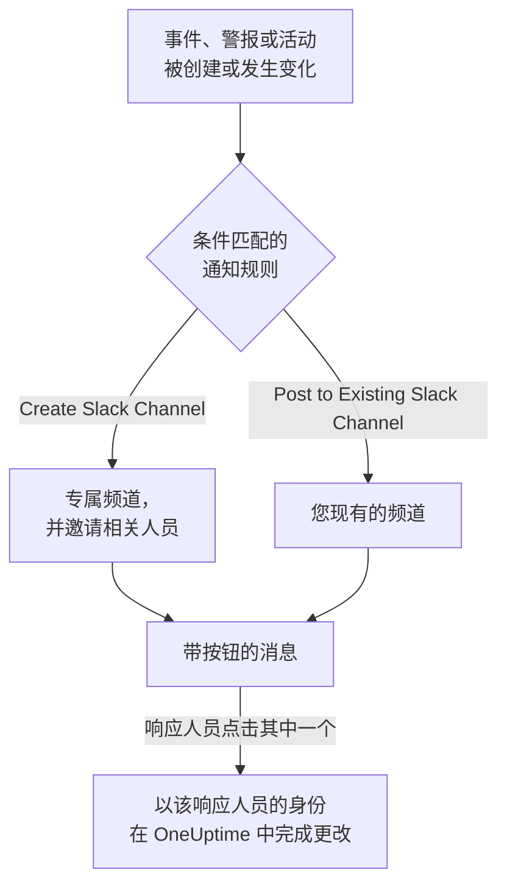

# Slack

将 OneUptime 连接到 Slack，即可把事件、警报、片段、计划维护、监视器和值班更新发布到您的频道，为每个事件提供专属频道，并让响应人员无需离开 Slack 即可操作：确认、解决、添加备注、呼叫值班人员以及声明事件。

:::cards
- [连接 Slack](#连接-slack): 在您的工作区中安装 OneUptime，然后关联您自己的账户。
- [通知规则](#通知规则): 决定哪些事件发布到哪里，以及哪些事件拥有专属频道。
- [从 Slack 创建事件和维护](#从-slack-创建事件和维护): 以您本人的身份使用 `/incident` 和 `/maintenance`。
- [从 Slack 处理事件、警报和活动](#从-slack-处理事件警报和活动): OneUptime 消息上的按钮。
:::

## 工作原理

这依靠两种连接：

- **项目的连接** 只需建立一次：安装在您的 Slack 工作区中的 OneUptime 应用。它发布消息、创建频道并邀请人员。
- **每个人自己的连接**：此人的 Slack 账户关联到其 OneUptime 账户。按钮、命令和表情回应都以此人的身份、按其在项目中的权限执行。

## 开始之前

- **可以连接项目的角色：** **Project Owner**、 **Project Admin** 或 **Project Member**。卸载应用需要 **Project Owner** 或 **Project Admin**。
- 一个您可以安装应用的 **Slack 工作区**。
- 通知规则和摘要需要 **OneUptime Cloud 的 Growth 套餐**。请参阅 [低于 Growth 套餐时的通知规则](#低于-growth-套餐时的通知规则)。
- **在自托管服务器上，** 需要先为其设置好 Slack 应用。请参阅 [Slack 集成](/docs/self-hosted/slack-integration)。

## 连接 Slack

:::steps
### 在您的 Slack 工作区中安装 OneUptime

前往 **项目设置** > **工作区** > **Slack**，点击 **Connect with Slack**。选择工作区并授权 OneUptime。Slack 会将您送回同一页面，页面上现在会显示项目所连接的工作区。在连接工作区之前，事件、警报、计划维护、监视器和值班菜单的 **工作区** 部分中有 **连接 Slack 或 Teams**，它同样会带您来到这里。

### 连接您自己的 Slack 账户

安装应用会关联安装者的账户。其他所有人都在 **用户设置** > **工作区** > **Slack** 中通过 **Connect my account with Slack** 关联自己的 Slack 账户，以便以本人身份处理事件并接收私信。项目连接到 Slack 后，该部分就会出现。

### 添加通知规则

前往 **事件** > **工作区** > **Slack**。 **工作区** 部分只列出您的项目已连接的聊天工作区，因此 **Slack** 会在连接后出现在那里。创建一条规则，例如为每个新事件创建一个 Slack 频道并邀请事件所有者的规则。请参阅 [通知规则](#通知规则)。

### 测试这条规则

在规则所在行点击 **测试规则**。测试消息会发送到规则指定的频道。请参阅 [测试规则](#测试规则)。
:::

## 通知规则

通知规则决定哪些事件发布到 Slack，以及发布到哪里。每个产品都有自己的规则，位于其菜单的 **工作区** > **Slack** 下：

| 产品 | 其 **Slack** 页面上的标签页 |
| --- | --- |
| **事件** | **事件**、 **事件 片段**、 **Summary** |
| **警报** | **警报**、 **警报 片段**、 **Summary** |
| **计划维护** | 一个规则列表 |
| **监视器** | 一个规则列表 |
| **值班** | 一个规则列表 |

创建规则分为四个步骤：

| 步骤 | 您设置的内容 |
| --- | --- |
| **基础** | **规则名称** 和 **规则描述**。 |
| **条件** | 规则针对哪些事件触发，例如按严重程度、状态、标签、监视器或标题中的字词。没有条件时，规则对每个事件都会触发。有两个或更多条件时， **匹配条件** 决定是必须全部匹配，还是匹配任意一个即可。 |
| **目标** | 发布到哪里：带频道名称的 **Post to Existing Slack Channel**、带新频道名称和受邀人员的 **Create Slack Channel**，或两者兼有。 |
| **Video Call** | 仅限事件和警报：为每一个开始一次通话。请参阅 [视频通话](/docs/workspace-connections/video-calls)。 |

规则创建的频道以 **New Slack Channel Name** 加上记录编号命名，例如 `oneuptime-incident-42`。只有创建的频道才会接收规则邀请的人员：记录的所有者、所选的团队和用户，以及对于事件和警报，在被呼叫时加入的值班人员。私密事件、警报或片段会获得私密频道。此后记录的每次更新（状态变化、备注、新所有者）都会发布到它的频道，以及其规则指定的现有频道。创建时即已解决的事件、警报或片段不会获得专属频道；其创建消息仍会发送到您的规则指定的频道。请参阅 [声明时即已确认或已解决](/docs/incidents/declaring-incidents#声明时即已确认或已解决)。

**项目设置** > **工作区** > **Slack** 列出 OneUptime 能看到的频道，每个频道旁边都有 **发送测试**。OneUptime 第一次在公开频道发布时会自行加入。私密频道只有在 Slack 中邀请 OneUptime 应用加入后，才会被列出并可以发布消息。

## 测试规则

规则所在行的 **测试规则** 会将该规则的测试消息发布到它指定的频道，让您看到消息到达。如果规则为每个事件创建频道，测试也会创建一个频道并邀请规则的相关人员。

与 **项目设置** > **工作区** > **Slack** 中频道旁的 **发送测试** 一样，它需要创建通知规则的权限： **Project Owner**、 **Project Admin**、 **Project Member**、 **Settings Admin**、 **Settings Member**，或自定义角色中的 **Create Workspace Notification Rule** 和 **Read Workspace Notification Rule**。对于只能查看规则的人（例如 **Viewer** ）， **测试规则** 处于锁定状态，其工具提示会说明需要什么；API 会以 "You do not have permission to send test notifications in this project." 拒绝其测试。在 OneUptime Cloud 上，测试规则与添加规则一样需要 **Growth** 套餐。

在 OneUptime Cloud 上，频道旁的 **发送测试** 同样需要 **Growth** 套餐，因为向频道发布消息正是规则和摘要所做的事。摘要上的 **立即发送测试** 需要创建摘要的权限（自定义角色中的 **Create Workspace Notification Summary** 和 **Read Workspace Notification Summary** ），在 OneUptime Cloud 上还需要 **Growth** 套餐；对其他任何人它都处于锁定状态，其工具提示会说明需要什么。以只读权限连接的 MCP 客户端无法发送任何测试。

## 摘要

**事件** > **工作区** > **Slack** （以及 **警报** ）的 **Summary** 标签页会向您指定的频道发布定期汇总：有多少事件或警报、它们被确认和解决的速度，以及一个带链接的列表。新的摘要每周发送一次，涵盖最近 7 天。将 **发送首份报告时间** 留空，第一份摘要会在下一周、下一天或下一月开始时的 09:00 发送；表单会显示具体时间。

摘要按其 **时区** 的时钟发送，时区的初始值为您的时区。它全年在该时区保持同一时刻：设置为柏林 09:00 的摘要，在夏令时调整时钟后仍会在柏林时间 09:00 发送，其消息中的日期也是柏林的日期。通过 API 时，请以 IANA 时区名称发送 `timezone`，例如 `Europe/Berlin`。未指定时区创建的摘要会使用创建者个人资料中的时区；由 API 密钥创建时使用 UTC。

摘要表单有四个步骤： **基本信息** （名称和频道）、 **计划**、 **内容** （ **包含内容** ）和 **过滤器** （统计哪些事件或警报）。

## 低于 Growth 套餐时的通知规则

在 OneUptime Cloud 上，通知规则和摘要属于 **Growth** 及以上套餐。低于该套餐的项目会保留已有的规则和摘要，它们会继续向 Slack 发布。因此，每个产品（事件、警报、计划维护、值班、监视器）的 **Slack** 页面都会显示套餐说明，并在下方列出它们（ **仍在配置的通知规则**、 **仍在配置的摘要** ）：删除规则，或关闭或删除摘要。添加或更改规则和摘要需要 **Growth**。

## 在 Slack 中接收呼叫

要在值班时通过私信接收呼叫，请将 Slack 添加为您的通知方式之一：

:::steps
1. 连接您自己的 Slack 账户（请参阅 [连接 Slack](#连接-slack) ）。
2. 前往 **用户设置** > **通知方式**，打开 **Workspace Apps** 标签页，然后点击 **Add Slack Account**。
3. 在其所在行点击 **Send Test Message**。消息会发送到您的 Slack 私信。
:::

添加后，它会立即加入您的值班规则，因此从那时起呼叫会通过 Slack 送达您。在 **用户设置** > **值班规则** 中更改它接收哪些呼叫。

## 将消息保存为备注

在事件、警报、片段或计划维护活动的频道中对一条消息添加表情回应，OneUptime 就会将该消息保存为该记录的备注，然后在消息串中回复确认：

| 表情回应 | 保存为 |
| --- | --- |
| 📌 图钉表情，或 Slack 自带的 **Pin to channel** | 仅您的团队可见的私密备注 |
| 📢 扩音器或喇叭表情 | 显示在状态页上的公开备注。仅限事件和计划维护活动。 |

备注以您的身份、按您的权限保存，因此您自己的 Slack 账户必须已连接。无论多少人回应，一条消息只会保存一次。

## 从 Slack 询问 OneUptime AI

用日常语言询问有关日志、追踪、指标、事件和监视器的问题。在频道中 @提及 OneUptime，或向它发送私信，它会在消息串中回答；在那里回复即可继续提问。 `/oneuptime ask which monitors are down?` 会将答案发布到频道中。两种方式都需要连接您自己的 Slack 账户，并为项目开启 AI。Slack 中的回答只读取数据：要更改内容，请使用按钮。请参阅 [询问 AI](/docs/ai/ask-ai)。

## 从 Slack 创建事件和维护

`/incident` 和 `/maintenance` 会打开一个表单，由您以本人身份填写并提交：即以您的 Slack 账户所连接的 OneUptime 账户的身份（请参阅 [连接 Slack](#连接-slack) ），按该账户在项目中的权限提交。如果您的 Slack 账户未连接，或您的 OneUptime 账户已不再是项目成员，OneUptime 会通过私信告诉您该怎么做，并且不会打开表单。 **Create New Incident** 和 **Create Scheduled Event** 快捷方式会打开相同的表单。

- **谁可以使用。** 能在 OneUptime 中声明事件或创建计划维护活动的人：对于事件，是 **Project Owner**、 **Project Admin**、 **Project Member**、 **Incident Admin** 和 **Incident Member** （自定义角色中的 **Create Incident** ）；对于活动，是 **Scheduled Maintenance Admin** 和 **Scheduled Maintenance Member** （ **Create Scheduled Maintenance** ）。其他任何人都会收到私信告知，并且不会打开表单。
- **表单提供什么。** 每个列表（严重程度、监视器、监视器状态、值班策略和标签）都包含您可以读取的内容，与 OneUptime 中的同一列表一致：如果角色仅限于某些标签，则为带有这些标签的监视器和值班策略。您完全无法读取的列表不会出现在表单中。已归档的值班策略永远不会提供。
- **表单可以指定什么。** 事件或活动以您自己的权限创建，并记在您名下。您无法读取的监视器、值班策略、标签、严重程度或状态，或属于其他项目的，都会像项目中不存在一样被拒绝，即使表单是在您的权限变化之前打开的，也不会创建任何内容。OneUptime 会通过私信告诉您原因。

事件、警报或片段上的 **Execute On-Call Policy** 也以同样方式工作：它需要执行值班策略的权限（ **Project Owner**、 **Project Admin**、 **Project Member**、 **On-Call Admin** 和 **On-Call Member**，或自定义角色中的 **Create On-Call Duty Policy Execution Log** ）以及读取该事件、警报或片段的权限，并提供您可以读取的有效值班策略。

## 从 Slack 处理事件、警报和活动

OneUptime 的 Slack 消息上的按钮同样以您的身份执行：即以您的 Slack 账户所连接的 OneUptime 账户的身份，按该账户在项目中的权限执行。事件、警报或片段上的 **Acknowledge**、 **Resolve**、 **Change State**、 **Add Note** 和 **Execute On-Call Policy**，以及计划维护活动上的 **Mark as Ongoing**、 **Mark as Complete**、 **Change State** 和 **Add Note**，各自会做出与 OneUptime 中相同操作一样的更改，并在那里记在您名下：记录的状态时间线和动态会显示是您更改了其状态，备注也归您所有。通过表情回应从消息保存的备注也以同样方式发布。

- **谁可以使用。** 能在 OneUptime 中做出同样更改的人。确认、解决事件或更改其状态需要更改其状态的权限： **Project Owner**、 **Project Admin**、 **Project Member**、 **Incident Admin** 和 **Incident Member**，或自定义角色中的 **Create Incident State Timeline**。警报、片段或计划维护活动需要其自身类型的同等权限（例如 **Create Alert State Timeline** ），备注需要发布该类备注的权限。其他任何人都会收到私信告知，并且不会有任何更改。
- **哪些记录。** 与在 OneUptime 中一样，是您可以读取的记录：如果角色仅限于某些标签，则为带有这些标签的事件、警报、片段和活动。任何其他记录或其他项目的记录上的按钮，都会得到该记录 "was not found in this project, or you do not have access to it." 的回复，并且不会有任何更改。在 OneUptime Cloud 上，项目套餐不包含的更改会被拒绝，并说明所需的套餐。
- **Change State 提供什么。** 按项目的顺序，提供您可以读取、记录接下来可以转入的状态：不会提供早于其当前状态的状态，片段与事件、警报或计划维护活动一样，因为状态更改永远不会让记录在其列表中回退（请参阅 [顺序是真正的约束，而不是显示偏好](/docs/incidents/states-and-severities#顺序是真正的约束而不是显示偏好) ）。如果您一个都无法读取，会收到 "No incident states are available to you in this project. Ask a project admin for access to them."；如果记录处于它能达到的最后一个状态，会收到 "There is no later state to move this incident to."。这两种情况都不会打开空表单。

## 断开连接

- **Disconnect** 只解除您自己的 Slack 账户的关联，并同时删除您的 Slack 通知方式。
- **项目设置** > **工作区** > **Slack** 上的 **Uninstall OneUptime from Slack** 会断开项目的连接。OneUptime 停止向 Slack 发布，并且 **工作区** 菜单不再列出它。通知规则和摘要会被保留，以便您再次连接时使用。

> [!WARNING]
> 卸载还会解除项目中每个成员自己的 Slack 账户的关联，并删除 Slack 通知方式以及使用它们的值班规则。原本通过 Slack 接收呼叫的人，在重新添加 Slack 之前，会通过其他通知方式接收呼叫。

## 故障排除

:::details 规则没有发布任何内容
用 **测试规则** 检查规则的条件：如果测试消息到达，说明规则的条件与该事件不匹配。如果没有到达，Slack 页面会显示原因。对于私密频道，请先在 Slack 中邀请 OneUptime 应用加入该频道。OneUptime 发布的每条消息，以及 Slack 拒绝的每条消息，都列在 **项目设置** > **通知** > **通知日志** 的 **工作区** 标签页中。
:::

:::details Slack 未连接
当 Slack 未完成连接就把您送回时，您开始的页面会显示 **Slack 未连接**，并用一句话说明原因：您缺少权限、链接已被使用或已过期、您登录了另一个工作区，或服务器未为 Slack 设置好。每句话的含义和处理方法请参阅 [连接没有完成](/docs/self-hosted/slack-integration#连接没有完成)。
:::

:::details 按钮或命令提示我的 Slack 账户未连接
在 **用户设置** > **工作区** > **Slack** 中通过 **Connect my account with Slack** 关联它。如果您已不再是项目成员，OneUptime 会改为告知这一点，并且不会替您执行任何操作。
:::

:::details 通知能到达，但按钮和命令没有反应
在自托管服务器上，Slack 必须能够访问 OneUptime，按钮、表单和命令才能工作；通知只需要出站访问。请参阅 [自托管部署的网络访问](/docs/self-hosted/slack-integration#自托管部署的网络访问)。
:::

## 后续步骤

:::cards
- [Microsoft Teams](/docs/workspace-connections/microsoft-teams): 在 Microsoft Teams 中使用相同的通知和操作。
- [视频通话](/docs/workspace-connections/video-calls): 为每个事件提供一次通话，并随其更新一起发布。
- [Slack 集成](/docs/self-hosted/slack-integration): 在自托管服务器上设置 Slack 应用。
- [声明事件](/docs/incidents/declaring-incidents): 事件开始的所有方式，以及开始时会运行什么。
:::
