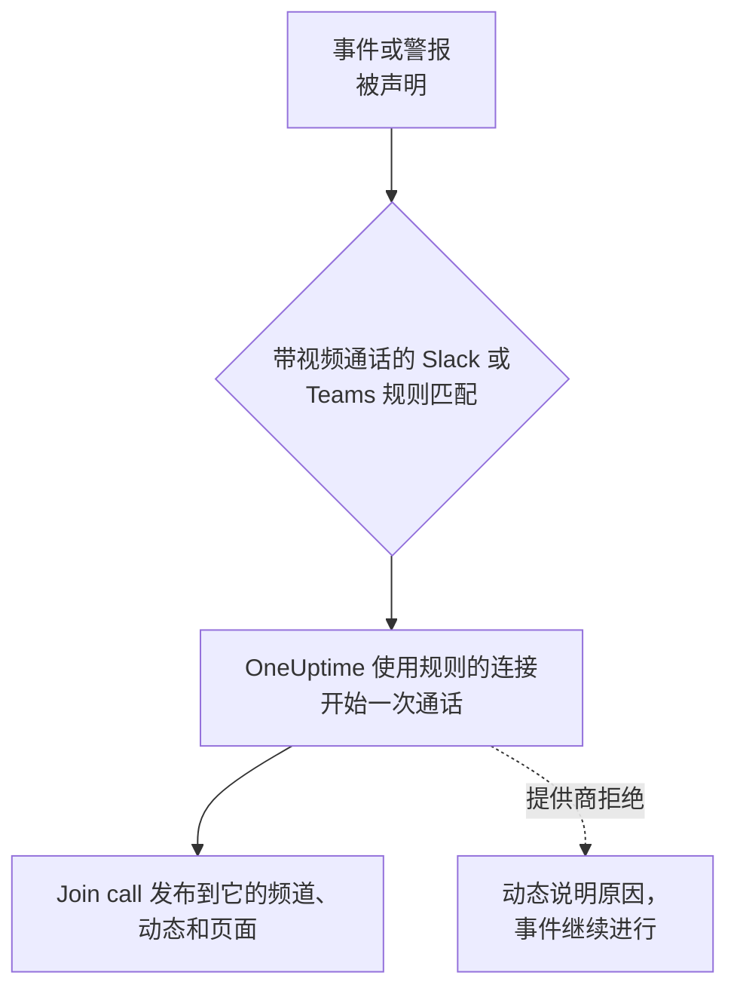

# 视频通话

为每个事件和警报提供专属通话。当 Slack 或 Microsoft Teams 通知规则针对新事件或警报触发时，OneUptime 会开始一个专属会议（Zoom 会议、Google Meet、Microsoft Teams 会议，或事件 Slack 频道的 huddle），并在事件更新所到之处发布一个 **Join call** 按钮。响应人员一键即可加入，没有人需要在凌晨 3 点创建会议并四处转发链接。

:::cards
- [工作原理](#工作原理): 规则开始通话，响应人员在任何地方都能加入。
- [一键连接](#一键连接): 只需登录即可连接 Zoom、Google Meet 或 Microsoft Teams。
- [提供商](#提供商): 您自己应用的服务身份、固定的会议链接或 Slack huddle。
- [手动开始通话](#手动开始通话): 从事件或警报的页面开始。
:::

## 工作原理



:::steps
### 连接提供商

前往 **项目设置** > **工作区** > **Video Calls**，连接 Zoom、Google Meet 或 Microsoft Teams，或添加一个固定的会议链接。在 OneUptime Cloud 上，连接 Zoom、Google Meet 或 Microsoft Teams 只需一键：登录并允许 OneUptime 创建会议（请参阅 [一键连接](#一键连接) ）。Slack huddle 只需要项目的 Slack 连接，无需其他任何东西。

### 在规则中开启

打开一条针对事件或警报的 Slack 或 Microsoft Teams 通知规则（例如 **事件** > **工作区** > **Slack** ）。在规则的 **Video Call** 步骤中，开启 **Start a video call for the incident**，并选择通话在哪里进行。

### 一键加入

规则触发时，OneUptime 会为事件开始一次通话，并带着 **Join call** 按钮将其发布到事件更新所发往的频道以及事件的动态中。事件页面会在其 **Video Call** 卡片中显示该通话，并在页眉显示 **Join call** 按钮。
:::

规则的条件决定哪些事件会获得通话。若只想为 Sev1 事件开启电话会议，请为规则设置 **严重程度** 条件。通话会为声明为进行中的事件和警报开始。创建时即已解决的事件不会获得通话。

### 每个事件一次通话

对于每个进行通话的地点，每个事件只会开始一次通话。选择同一连接的规则共享一次通话，并且对于已经有该连接通话的事件，规则永远不会再开始第二次通话。选择不同地点的规则会各自开始自己的通话，例如为响应人员开设的 Zoom 会议，以及事件 Slack 频道的 huddle。

### 通话无法开始时

声明事件从不等待视频通话提供商。通话在事件创建之后才开始，因此缓慢或出错的提供商永远不会延误事件或其值班呼叫。

如果提供商拒绝（密钥过期、缺少权限、主持人已被删除），事件的动态会说明规则的通话无法开始，并附上提供商给出的原因，让响应人员知道需要从事件页面开始一次通话。规则的运行会以 **开始视频通话** 记录在工作区通知日志中，并且 **项目设置** > **工作区** > **Video Calls** 中该连接的行会一直显示错误，直到再次成功开始通话。

### 私密事件

会议以其所属事件的编号和标题命名，其描述会链接回该事件。对于私密事件，会省略标题，因为所有受邀参加会议的人都能看到会议名称。

## 一键连接

在 OneUptime Cloud 上，连接 Zoom、Google Meet 或 Microsoft Teams 只需一键，无需在提供商处进行任何设置：

:::steps
1. 前往 **项目设置** > **工作区** > **Video Calls**，在 Zoom、Google Meet 或 Microsoft Teams 上点击 **连接**。
2. 点击 **Continue to Zoom** （或 Google、Microsoft），登录并允许 OneUptime 创建会议。
3. 您会回到视频通话页面，连接已建立。用 **Start a test meeting** 进行端到端检查，然后在 Slack 或 Microsoft Teams 通知规则中选择该连接。
:::

每个会议都以您登录所用的账户创建，并由该账户主持。请使用共享账户（例如 incidents@example.com）而不是您自己的账户登录，这样有人离职后通话仍能照常开始。连接的行会显示它以哪个账户登录。

| 提供商 | 用于登录的账户 | OneUptime 可以做什么 |
| --- | --- | --- |
| Zoom | 一个 Zoom 用户。由 Basic（免费）用户主持的会议会在 40 分钟后结束。 | 为该用户创建会议（ `meeting:write:meeting` ）并读取其身份（ `user:read:user` ）。 |
| Google Meet | 一个可以使用 Google Meet 的 Google 账户。 | 以该账户创建 Meet 空间（ `meetings.space.created` ）并读取其电子邮件地址。 |
| Microsoft Teams | 一个拥有 Microsoft Teams 的工作或学校账户。个人 Microsoft 账户无法创建 Teams 会议。 | 以该账户创建在线会议（委托权限 `OnlineMeetings.ReadWrite` ）并保持登录（ `offline_access` ）。 |

通过登录建立的连接仍然有决定谁需要等待的设置：Google Meet 的 **Who can join** 和 Microsoft Teams 的 **Who skips the lobby**。在连接所在行使用 **编辑** 更改它们。

### 保持登录

OneUptime 会加密保存登录的刷新令牌，并至少每周刷新一次，因此无论项目多久没有发生事件，令牌都不会因闲置而过期。如果登录失效（账户移除了 OneUptime、账户被删除或停用，或您组织的策略要求重新登录），连接的行会在 OneUptime 发现的当天显示 **Not working** 及原因，而不是等到下一个事件。行上的 **Reconnect** 会重新登录。

以同一账户登录的连接在所有项目中共享一次登录：Zoom 每个账户只保留一次登录，因此再次连接同一个 Zoom 用户会替换所有这些连接的登录。

### 重新连接和删除

连接所在行的 **Reconnect** 会以同一账户或其他账户重新登录。在账户移除 OneUptime 之后，或要把事件会议转到其他账户时使用它。

删除连接后，一旦没有其他连接使用该登录，OneUptime 在 Zoom 和 Google 的访问权限就会被撤销。对于 Microsoft，请在该账户的 **My Apps** （myapps.microsoft.com）中移除 OneUptime。在 Zoom App Marketplace 中从您的 Zoom 账户移除 OneUptime，会从所有以该账户登录的连接中删除其登录，这些连接在重新连接之前都会显示 **Not working**。

### 如果 Microsoft 要求管理员

有些 Microsoft 365 组织只允许管理员批准应用。如果 Microsoft 提示您需要管理员批准，请让 Microsoft 365 管理员连接 Microsoft Teams，或在 [Microsoft Entra 管理中心](https://entra.microsoft.com/) 的 **Enterprise applications** > **Admin consent requests** 中批准 OneUptime。

### 改用您自己的应用

要使用服务身份而不是个人的登录进行连接（Zoom 的 Server-to-Server OAuth 应用、具有全网域委派的 Google 服务账号，或 Microsoft Entra 应用注册），请在连接对话框中点击 **Use your own Zoom app** （或 Google、Microsoft）。[提供商](#提供商) 会逐一说明。在没有设置一键应用的自托管服务器上， **连接** 会直接打开此表单；设置方法请参阅 [在自托管服务器上一键连接](#在自托管服务器上一键连接)。

## 手动开始通话

事件或警报页面上的 **Video Call** 卡片有 **Start call** （已有通话时为 **Start another** ）。选择项目的某个连接、事件 Slack 频道的 huddle，或粘贴您自己的会议链接。该通话会像规则开始的通话一样发布到事件的频道和动态中。

卡片上的 **移除** 会把通话从事件页面上移除。会议本身不会被删除，拥有链接的任何人仍然可以加入。

开始和移除通话需要处理事件（或警报）的权限： **Project Owner**、 **Project Admin**、 **Project Member**、 **Incident Admin** 或 **Incident Member**，或自定义角色中的 **Create Incident Video Call** 和 **Delete Incident Video Call**。能读取该事件的每个人都能看到它的通话。

## 提供商

本节介绍如何使用您自己应用的服务身份连接提供商：Zoom 的 Server-to-Server OAuth 应用、Google 服务账号、Microsoft Entra 应用注册。服务身份从不依赖于某个人，因此无论谁离职都能继续工作。若要改为通过登录连接，请参阅 [一键连接](#一键连接)。

凭据在存储时加密，并且 API 从不返回它们。编辑连接时，留空的凭据会保留已存储的值。

连接表单中的 **Start test meeting** 和连接所在行的 **测试** 会使用连接的设置创建一个真实的会议并显示其链接。这是唯一能证明凭据、提供商端的权限以及主持人可以协同工作的检查。不会向任何地方发布任何内容。

连接提供商需要 **Project Owner**、 **Project Admin** 或 **Settings Admin**，或自定义角色中的 **Create Video Call Connection** 和 **Edit Video Call Connection**。

### Zoom

OneUptime 通过 Zoom **Server-to-Server OAuth** 应用为每个事件创建 Zoom 会议，由您选择的已授权 Zoom 用户主持。

:::steps
1. 在 [Zoom App Marketplace](https://marketplace.zoom.us/) 中，选择 **Develop** > **Build App**，创建一个 **Server-to-Server OAuth** 应用。创建它需要 Zoom 账户管理员，或允许 Server-to-Server OAuth 应用的角色。
2. 在应用的 **Scopes** 页面，添加 **meeting:write:meeting:admin** （为用户创建会议）。在细粒度权限范围出现之前创建的应用可以改用 **meeting:write:admin**。
3. 点击 **Activate** 激活应用，然后将其 **App Credentials** 页面上的 **Account ID**、 **Client ID** 和 **Client secret** 复制到连接表单中。
4. 填写 **Meeting host**：一个已授权 Zoom 用户的电子邮件，最好是 incidents@example.com 之类的服务账户，这样有人离职后会议仍能正常进行。由 Basic（免费）用户主持的会议会在 40 分钟后结束。
5. 由于主持人是一个永远不会加入的服务账户，响应人员无需等待主持人即可加入。请确保您 Zoom 账户的 **Waiting room** 设置没有被锁定为开启，否则谁都无法进入。
:::

| 字段 | 在哪里找到 |
| --- | --- |
| Account ID | 应用的 **App Credentials** 页面 |
| Client ID | 应用的 **App Credentials** 页面 |
| Client secret | 应用的 **App Credentials** 页面 |
| Meeting host | 主持每个会议的已授权 Zoom 用户的电子邮件 |

### Google Meet

OneUptime 通过一个借助全网域委派以 Google Workspace 用户身份操作的 Google Cloud 服务账号，使用 Google Meet REST API 为每个事件创建 Google Meet。

:::steps
1. 在 [Google Cloud 控制台](https://console.cloud.google.com/) 中，选择或创建一个项目，并为其启用 **Google Meet REST API**。
2. 在 **IAM & Admin** > **Service accounts** 下创建一个服务账号。打开它，前往 **Keys** > **Add key** > **Create new key**，选择 **JSON**，并将下载的文件粘贴到连接表单的 **Service account JSON key** 中。
3. 在 [Google 管理控制台](https://admin.google.com/) 中，打开 **Security** > **Access and data control** > **API controls** > **Manage Domain Wide Delegation** 并点击 **Add new**。输入服务账号的数字 **Client ID** 以及权限范围 `https://www.googleapis.com/auth/meetings.space.created`。
4. 在 **Create meetings as** 中填写服务账号所代表的 Google Workspace 用户：一个专用账户，例如 incidents@example.com。每个会议都归此用户所有。
:::

**Who can join** 决定谁无需请求即可加入：选择 **People in your organization join directly, others ask to join** （默认）时，您的 Google Workspace 之外的人需要请求加入，由通话中的某个人准许他们。选择 **Anyone with the link joins directly** 时，任何人都无需等待。

全网域委派可能需要几分钟才能开始生效。如果刚添加委派后测试就报告 Google 不允许服务账号以该用户身份操作，请等待几分钟后再测试。

### Microsoft Teams

OneUptime 通过一个代表已授权 Teams 用户组织会议的 Microsoft Entra 应用注册，使用 Microsoft Graph 为每个事件创建 Microsoft Teams 会议。

:::steps
1. 在 [Microsoft Entra 管理中心](https://entra.microsoft.com/) 中，打开 **App registrations** > **New registration**，注册一个单租户应用。复制其 **Directory (tenant) ID** 和 **Application (client) ID**。
2. 在 **API permissions** 下，添加 Microsoft Graph 的 **application** 权限 **OnlineMeetings.ReadWrite.All**，然后点击 **Grant admin consent**。
3. 在 **Certificates & secrets** 下创建一个客户端密码，并将其 **Value** （不是 Secret ID）粘贴到连接表单的 **Client secret** 中。
4. 选择组织者：一个已授权的 Teams 用户，最好是服务账户。从 Entra 管理中心的 **Users** 中复制其 **Object ID** 到 **Organizer object ID**。
5. 使用应用程序访问策略允许该应用为组织者创建会议。在 Teams PowerShell 中，执行 `Connect-MicrosoftTeams` 之后，运行下面两条命令。
:::

```powershell
New-CsApplicationAccessPolicy -Identity OneUptime-Meetings -AppIds "<application-client-id>"
Grant-CsApplicationAccessPolicy -PolicyName OneUptime-Meetings -Identity "<organizer-object-id>"
```

该策略最多可能需要 30 分钟才能生效。在此之前，测试会报告该应用不允许为组织者创建会议。

**Who skips the lobby** 决定谁无需等待即可加入：选择 **People in your organization skip the lobby** （默认）时，其他所有人都要在大厅中等待，直到会议中的某个人准许他们。选择 **Everyone skips the lobby** 时，任何人都无需等待。

### 会议链接

固定的会议链接对每个事件都是同一个房间：Zoom 个人会议室、定期的 Microsoft Teams 或 Google Meet 会议、Webex 个人会议室或 Jitsi 房间。不会为每个事件创建任何内容，因此没有需要授权的东西。

:::steps
1. 在您的团队已经在使用的工具中创建一个永不过期的会议。
2. 将其 https 加入链接粘贴到连接表单的 **Meeting link** 中。
:::

使用此连接开始的每个事件和警报都共用这个房间，因此同时发生的两个事件也会共用它。请确保会议允许在主持人不在时加入。

### Slack huddle

Slack 规则可以改为开始事件 Slack 频道的 huddle。没有需要连接的东西：在规则的 **Video Call** 步骤中选择 **Slack huddle** 即可。

huddle 在规则为事件创建的频道中进行；如果规则改为发布到现有频道，则在其中第一个频道中进行。因此，规则必须创建频道或发布到现有频道。 **Join huddle** 按钮会在 Slack 中打开频道的 huddle。第一个打开它的响应人员开始 huddle，之后的每个人都加入其中。Slack 没有提供让应用开始 huddle 的方式，因此在有人打开之前，huddle 中没有任何人。

Slack huddle 仅适用于 Slack 规则。Microsoft Teams 规则使用项目的某个视频通话连接开始其通话。

## 使用 API

通话是事件（ `IncidentVideoCall` ）或警报（ `AlertVideoCall` ）上的一条记录。使用事件的 `_id` 以及以下之一来创建：

- `videoCallConnectionId`：使用该连接开始新的会议。
- 设置为 `SlackHuddle` 的 `provider`：事件 Slack 频道的 huddle。
- `joinUrl` （以及可选的 `title` ）：您自己的会议链接。

```json
{
  "data": {
    "projectId": "<project-id>",
    "incidentId": "<incident-id>",
    "videoCallConnectionId": "<connection-id>"
  }
}
```

`POST /api/video-call-connection/test` 会使用已保存的连接（ `{ "connectionId": "..." }` ）或尚未保存的设置（ `{ "provider": "Zoom", "config": { ... }, "secrets": { ... } }` ）开始一个测试会议，并返回其 `joinUrl`。

连接的 `authMethod` 说明它的登录方式：通过登录建立的连接为 `OAuth`，使用您自己应用凭据的连接为 `AppCredentials`，会议链接则没有值。通过登录建立的连接只能在仪表板中通过登录创建。通过 API，您可以重命名它并更改其 `config`，而其 `connectedAccount` 说明它以哪个账户登录。

## 在自托管服务器上一键连接

OneUptime Cloud 拥有自己的 Zoom、Google 和 Microsoft 应用，用于一键连接。自托管服务器会为您设置了应用的每个提供商提供一键连接。没有设置时， **连接** 会打开用于您自己应用的表单。

为每个提供商创建一个 OAuth 应用，并使用您服务器的主机在其上注册以下重定向 URI：

| 提供商 | 重定向 URI | 环境变量 | Helm 值 |
| --- | --- | --- | --- |
| Zoom | `https://<host>/api/video-call-oauth/zoom/callback` | `ZOOM_APP_CLIENT_ID`, `ZOOM_APP_CLIENT_SECRET`, `ZOOM_APP_WEBHOOK_SECRET_TOKEN` | `zoomApp.clientId`, `zoomApp.clientSecret`, `zoomApp.webhookSecretToken` |
| Google Meet | `https://<host>/api/video-call-oauth/google-meet/callback` | `GOOGLE_MEET_APP_CLIENT_ID`, `GOOGLE_MEET_APP_CLIENT_SECRET` | `googleMeetApp.clientId`, `googleMeetApp.clientSecret` |
| Microsoft Teams | `https://<host>/api/video-call-oauth/microsoft-teams/callback` | `MICROSOFT_TEAMS_MEETINGS_APP_CLIENT_ID`, `MICROSOFT_TEAMS_MEETINGS_APP_CLIENT_SECRET` | `microsoftTeamsMeetingsApp.clientId`, `microsoftTeamsMeetingsApp.clientSecret` |

- **Zoom**：在 [Zoom App Marketplace](https://marketplace.zoom.us/) 中，选择 **Develop** > **Build App**，创建一个由用户管理的 **General App**。在 **Basic Information** 下，将重定向 URI 作为 OAuth Redirect URL 添加到 **Development** 和 **Production** 两个标签页以及 OAuth 允许列表中，并在 **Production** 标签页上将 **Deauthorization Notification** 端点 URL 设置为 `https://<host>/api/video-call-oauth/zoom/events`。在 **Scopes** 下添加 `meeting:write:meeting` 和 `user:read:user`。 **Features** > **Access** 下的 **Secret Token** 就是 `ZOOM_APP_WEBHOOK_SECRET_TOKEN`。 **Development** 凭据仅适用于您自己 Zoom 账户中的用户； **Production** 凭据在 Zoom 审核并发布应用后对所有人有效。
- **Google Meet**：在 [Google Cloud 控制台](https://console.cloud.google.com/) 中启用 **Google Meet REST API**，使用权限范围 `openid`、 `email` 和 `https://www.googleapis.com/auth/meetings.space.created` 配置 OAuth 同意屏幕（ **Google Auth Platform** ），并使用重定向 URI 创建一个 **Web application** 类型的 OAuth 客户端。将应用发布到生产环境：停留在测试状态的应用会在七天后失去其登录。Google 会审核请求 Meet 权限范围的应用；在审核完成之前，用户在登录前会看到一条警告。
- **Microsoft Teams**：在 [Microsoft Entra 管理中心](https://entra.microsoft.com/) 中，为 **Accounts in any organizational directory** 注册一个应用，将重定向 URI 添加为 **Web** 重定向 URI，添加 Microsoft Graph 委托权限 `openid`、 `profile`、 `email`、 `offline_access` 和 `OnlineMeetings.ReadWrite`，并创建一个客户端密码。请使用单独的注册，而不是 Microsoft Teams 机器人的注册（ `MICROSOFT_TEAMS_APP_CLIENT_ID` ）。在应用拥有经过验证的发布者之前，大多数组织都需要管理员对其表示同意。

客户端 ID 是公开的：它们会被发送到仪表板，以便仪表板知道哪些提供商可以一键连接。请对密码和 webhook 密钥令牌保密。worker 每天刷新每个登录，因此它需要与应用相同的值。

## 故障排除

:::details 没有为事件开始通话
检查规则是否与事件匹配（ **测试规则** ）、其 **Video Call** 步骤是否已开启，以及事件是否被声明为进行中：创建时即已解决的事件不会获得通话。已经用该连接为事件开始过通话的规则不会再开始另一次通话。
:::

:::details 动态显示无法开始通话
提供商拒绝了，动态给出了原因。在此期间，请从事件页面开始通话。然后在连接所在行运行 **测试**：在您修正提供商处的设置（例如过期的客户端密码或缺少的权限）时，它会显示同样的原因。
:::

:::details 连接显示 Not working
它的登录已失效：账户移除了 OneUptime、账户被删除或停用，或需要重新登录。在其所在行点击 **Reconnect**。在此之前，它本应开始的通话都无法开始。
:::

:::details 有人在大厅或等候室中等待
在连接所在行使用 **编辑** 更改 **Who can join** （Google Meet）或 **Who skips the lobby** （Microsoft Teams）。对于 Zoom，请确保账户的 **Waiting room** 设置没有被锁定为开启。
:::

## 后续步骤

:::cards
- [Slack](/docs/workspace-connections/slack): 开始通话的规则，以及它们发布到的频道。
- [Microsoft Teams](/docs/workspace-connections/microsoft-teams): 在 Microsoft Teams 中使用相同的规则和通话。
- [Microsoft Teams 集成](/docs/self-hosted/microsoft-teams-integration): 在自托管服务器上设置 Teams 机器人。
- [声明事件](/docs/incidents/declaring-incidents): 事件开始时会发生什么。
:::
