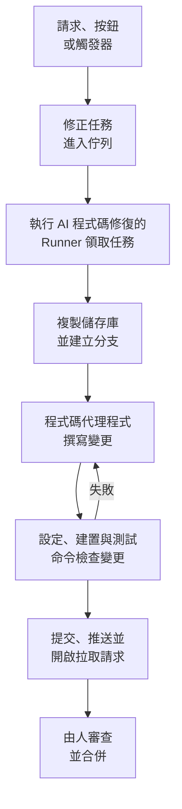

# 程式碼

程式碼是你請 OneUptime AI 在你的儲存庫中工作的地方，就像你請一個程式設計代理程式那樣：修正 bug、撰寫測試、解釋程式碼、做一項變更。它開啟時會顯示你提出請求的輸入框，在框中選擇儲存庫和分支，下面是所有任務；任務的頁面是一段你可以回覆的對話。OneUptime 也會自行啟動任務，來源包括例外、追蹤和調查。[Runner](/docs/runbooks/agents) 會複製儲存庫，在新分支上撰寫變更，建置並測試它，然後開啟拉取請求。每個拉取請求都由人來審查和合併：Runner 只能推送分支和開啟拉取請求，僅此而已。

:::cards
- [在儲存庫中請 AI 工作](#在儲存庫中請-ai-工作): 用你自己的話提出請求，並附上它需要的脈絡。
- [任務的對話](#任務的對話): AI 做了什麼、改了什麼，以及你的回覆。
- [修正執行的過程](#修正執行的過程): 從一次點選到一個拉取請求，逐步說明。
- [修正任務從哪裡啟動](#修正任務從哪裡啟動): OneUptime 啟動的任務，以及每個拉取請求做什麼。
- [修正中的正式環境遙測](#修正中的正式環境遙測): 修正在撰寫變更時會讀取正式環境中的哪些內容。
- [拉取請求的正式環境審查](#拉取請求的正式環境審查): 正式環境對每個拉取請求所改程式碼的說明。
- [開始之前](#開始之前): 一個模型、一個已連線的儲存庫和一個 Runner。
- [修正失敗時](#修正失敗時): 出錯、停滯或等待的執行會怎樣。
:::

> [!TIP]
> 你也可以從 GitHub 啟動。在 issue 或拉取請求中提及 OneUptime GitHub App，它就會在原處實作、修訂或審查：請參閱 [GitHub App](/docs/ai/github-app)。這是同一個代理程式、同一個 Runner 和同樣的預算，只有觸發方式不同。

## 在儲存庫中請 AI 工作

:::steps
### 開啟程式碼

開啟 **產品 → 程式碼**。頁面以 **要請 AI 做什麼？** 開頭，下面是你提出請求的輸入框，再下面是所有任務，最新的在前。還沒有儲存庫時，會改為提供 **連接 GitHub**（請參閱 [開始之前](#開始之前)）。側邊選單中的 **儲存庫** 列出 AI 可以在其中工作的儲存庫，GitHub App 已無法存取的儲存庫則收在 **未連線** 下。每個儲存庫的頁面也有同樣的輸入框，用於該儲存庫。

### 選擇儲存庫和分支

輸入框從你上次選擇的儲存庫開始。在它底部一列選擇另一個儲存庫，並在旁邊選擇任務的起點分支：在你選擇其他分支之前，是標有 **預設** 的儲存庫主分支。AI 從你選擇的分支建立自己的分支，並向它開啟拉取請求。

### 說出你想要什麼

用你自己的話寫下變更、bug 或問題。在還沒有提出任何請求時，程式碼會在 **試著這樣問** 下提供幾個範例。

### 新增脈絡

點選 **新增脈絡**，把 AI 需要的東西交給它：儲存庫中的檔案或資料夾、一則備註、一個連結，或專案中的一筆記錄。OneUptime 會在你送出請求時以你的權限讀取每筆記錄，並保留交給 AI 的內容。

### 開始任務

點選 **開始任務**，或按 Enter。任務的頁面會開啟，AI 的工作會在進行時顯示在那裡。
:::

| 脈絡 | AI 得到什麼 |
| --- | --- |
| **檔案或資料夾** | 儲存庫中的一個路徑，AI 會先讀取它。 |
| **備註** | 你貼上的文字：錯誤、規格、某行日誌。 |
| **連結** | 一個網址，作為參考。 |
| **事件** 或 **警示** | 它的狀態、描述和根本原因，以你送出請求時為準。 |
| **例外** | 它的訊息和堆疊追蹤。 |
| **監測器** | 它的類型、狀態和描述。 |
| **追蹤** | 它的 span：名稱、耗時和錯誤。 |
| **日誌** | 包含你搜尋內容的最新 20 行日誌，時間範圍可選最近一小時、一天或一週。 |
| **效能剖析** | 函式的時間在其服務的效能剖析中花在哪裡：誰呼叫它、它呼叫什麼，以及它最熱的程式碼行。 |

一個請求最多帶 10 項脈絡。OneUptime 讀取的內容中的權杖、金鑰、密碼和電子郵件地址，會在 AI 看到之前遮蔽，和 OneUptime AI 讀取你的資料的其他所有地方一樣。

## 任務的對話

任務的頁面是一段對話：先是請求的內容和新增的脈絡，然後是 AI 的回合——它邊做邊顯示的步驟（讀取和編輯的檔案、搜尋的內容、執行的命令）、它的回覆、它變更的檔案及其 diff，以及拉取請求。頁面頂端顯示任務在哪裡工作（它的儲存庫和起點分支）、變更了多少行、一個指向其拉取請求的按鈕，以及任務的狀態：

| 狀態 | 含義 |
| --- | --- |
| **排隊中** | 正在等待 Runner 領取。 |
| **處理中…** | AI 正在處理。**停止** 會停止它；它已推送的內容會留在分支上。 |
| **等待您處理** | AI 提了一個問題。請在下方的輸入框中回答。 |
| **完成** | AI 已完成：它的回覆，以及變更了程式碼時的拉取請求。 |
| **失敗** | 這一回合無法完成，並說明了原因。**再試一次** 會再次提出同樣的請求。 |
| **已停止** | 有人停止了它。**再試一次** 會再次提出同樣的請求。 |

要繼續，請在底部的輸入框中書寫，它會在對話捲動時保持可見：回答 AI、新增脈絡或要求變更。每則回覆都是同一任務的下一個回合：在拉取請求仍開啟時，它在同一分支上工作，並推送到同一個拉取請求。一個任務一次只進行一個回合，所以 AI 工作時輸入框會等待。每個回合的 **日誌** 是它所做之事的逐字記錄。

能讀取儲存庫的人就能讀取它的任務。請 AI 工作、回覆和停止任務需要編輯該儲存庫的權限，查看變更的 diff 也一樣：其他人只能看到哪些檔案有變更。OneUptime 自行啟動的任務（見下文）也在它們的儲存庫中，同樣是你可以回覆的對話。

## 修正執行的過程



1. 你在程式碼中點選 **開始任務**，或在未解決的例外上點選 **用 AI 修正**，或者由其他按鈕或觸發器啟動任務（請參閱 [修正任務從哪裡啟動](#修正任務從哪裡啟動)）。
2. 任務在其儲存庫的佇列中排隊，由儲存庫選擇的 Runner 領取：你的某個 Runner，或者在儲存庫沒有選擇時，由全域 Runner 領取（參見 [選擇儲存庫的 Runner](#選擇儲存庫的-runner)）。
3. Runner 取得任務的脈絡。對於請求，就是它的內容、新增的脈絡和到目前為止的對話；對於例外，就是它的類型、訊息和堆疊追蹤。
4. 它把儲存庫複製到自己的工作區並建立分支。例外修正的分支名稱為 `oneuptime-fix-exception-` 加上執行 id 的前幾個字元。請求從提出時選擇的分支開始，其拉取請求也向該分支開啟。回覆則改為在任務開啟中的拉取請求的分支上工作。
5. 由專案的 LLM 提供商驅動的程式碼代理程式讀取程式碼並撰寫變更。LLM 呼叫由 OneUptime 伺服器發出，因此 Runner 從不持有你的提供商的 API 金鑰，而且每次呼叫都會被計量並列在 AI 日誌中。例外、緩慢追蹤或事件的修正在工作時還會讀取正式環境：儲存庫對應服務的例外、追蹤、日誌和指標（請參閱 [修正中的正式環境遙測](#修正中的正式環境遙測)）。
6. 在你自己的 Runner 上，程式碼代理程式會在提交任何內容之前，依儲存庫的 `AGENTS.md` 所說的方式建置並測試它的變更，並修正失敗的部分（請參閱 [拉取請求之前的驗證](#拉取請求之前的驗證)）。
7. Runner 提交、推送分支、開啟拉取請求（對於請求，只在變更了程式碼時），然後刪除工作區。

啟動任務的頁面會即時顯示其狀態。每個任務都列在 **產品 → 程式碼** 中它所在的儲存庫下：任務的頁面就是它的對話，每個回合的 **日誌** 中，Runner 讀取或寫入的每個檔案和執行的每條命令各占一行。

每次執行都受伺服器強制執行的預算約束：最多 **40 次 LLM 呼叫** 和 **100,000 個輸出權杖**。執行中對正式環境遙測的查詢也計入這 40 次呼叫。達到其中之一的執行會以到目前為止工作的摘要結束，而不是陷入迴圈。當專案設定了每日 AI 限制時，修正執行也計入這些限制。

## 修正任務從哪裡啟動

| 位置 | 點選 | 拉取請求的作用 |
| --- | --- | --- |
| 例外的 **AI Assistance** 頁面 | **用 AI 修正** | 修正例外背後的缺陷。 |
| 例外的 **AI Assistance** 頁面 | **Generate Regression Test** | 新增一個測試，它會重現該例外，並在缺陷修正之前一直失敗。 |
| 例外的 **AI Assistance** 頁面 | **改善錯誤處理** | 針對預期內的錯誤，例如無效輸入：從訊息中移除使用者資料，更早地驗證輸入，並把錯誤標記為已處理，不改變行為。 |
| 事件或警示的 **AI Investigation** 卡片 | **Open Fix PR from this analysis** | 修正調查發布的根本原因（請參閱 [來自調查的自動程式碼修正](#來自調查的自動程式碼修正)）。 |
| 值得修正的追蹤 | **使用 AI 修正效能問題** | 修正按鈕指出的緩慢模式，例如 N+1 查詢或本可以平行執行的呼叫。 |
| 服務的 **日誌** 頁面 | **改善日誌** | 在不改變行為的前提下，讓服務的日誌結構化、使用正確的嚴重程度，並與它的追蹤關聯。 |
| 服務的 **追蹤** 頁面 | **改善追蹤** | 在不改變行為的前提下，在服務缺少追蹤的地方新增 span 和屬性。 |
| **效能設定檔** 中的某個函式 | **用 AI 修正** | 以其效能剖析為依據，讓函式用更少的時間或記憶體完成同樣的工作。 |

這些按鈕只會出現在能夠啟動任務的地方。專案關閉 AI 時，它們都不會出現，例外的側邊選單中也沒有 **AI Assistance**。**改善日誌** 和 **改善追蹤** 在連接程式碼儲存庫後出現，**使用 AI 修正效能問題** 只會出現在值得修正的追蹤上（請參閱 [追蹤瀏覽器](/docs/telemetry/traces-explorer)）。函式的 **用 AI 修正** 只會出現在應用程式自身的程式碼上：它佔效能剖析時間或記憶體的 5% 以上，或者與對比的時間範圍相比佔比增長了 3 個百分點以上（參見 [持續效能剖析](/docs/telemetry/profiles)）。

要開啟例外的 **AI Assistance** 頁面，請在 **產品 → 可觀測性 → 例外** 下開啟該例外，然後在側邊選單中選擇 **AI Assistance**。已解決或已封存的例外需要先標記為未解決。

OneUptime AI 也會自行啟動修正任務：來自發現程式碼變更的調查，來自因缺少遙測而沒有結論的調查，以及來自關於例外和緩慢追蹤的 AI Insights。每種都有自己的開關；請參閱 [自動程式碼修正](/docs/ai/ai-sre#自動程式碼修正)。

## 修正中的正式環境遙測

OneUptime 掌握著你的程式碼在正式環境中的實際表現，因此修正不必只憑一段堆疊追蹤來工作。程式碼代理程式在工作時，可以查詢該儲存庫對應的服務的正式環境遙測：

| 讀取的內容 | 用途 |
| --- | --- |
| **例外** | 在指定檔案或某個函式中擲出的例外群組：最近幾天出現的頻率、從哪個版本開始出現，以及最近一次出現的追蹤。 |
| **追蹤** | 某個端點或操作的延遲和錯誤概況，以及單一追蹤的 span。 |
| **日誌** | 服務的日誌行，可依時間、嚴重程度、文字或追蹤查詢。 |
| **指標** | 服務回報的某個指標隨時間的變化；未指定名稱時，列出它回報的指標。 |
| **事件** | 影響過這些服務的事件，或者此儲存庫中某個 OneUptime 修正因之而開啟的事件，附帶它們的根本原因和事後分析。 |
| **部署** | 這些服務最近的部署和其他變更，每一項都附有 OneUptime 對它是否損害了所屬服務的判定。 |

| 任務 | 它檢查什麼 |
| --- | --- |
| 例外上的 **用 AI 修正** | 它現在被擲出的頻率、從哪個版本開始，相關日誌，以及其中一次出現的追蹤。 |
| **使用 AI 修正效能問題** | 該操作在其所有追蹤中有多繁忙、有多慢，而不只是被分析的那一條追蹤。當該操作已不再緩慢時，它不做任何變更。 |
| **Open Fix PR from this analysis**，以及從調查自動開啟的修正 | 事件之前的部署、事件的錯誤、日誌和緩慢操作，以及這個原因以前是否出現過。 |
| 來自 GitHub 的 `@oneuptime review` | 正式環境對變更的程式碼說明了什麼（請參閱 [帶有正式環境脈絡的審查](/docs/ai/github-app#帶有正式環境脈絡的審查)）。 |

拉取請求的描述會寫明代理程式查詢了什麼，以及查詢結果顯示了什麼。其他任務，例如回歸測試以及日誌或追蹤的改善，不會查詢正式環境。

代理程式能讀取什麼，由 OneUptime 伺服器根據任務本身決定：

- **唯讀。** 查詢在 OneUptime 伺服器上執行，從不在 Runner 上執行，Runner 不持有任何能讀取遙測的憑證。查詢所做的任何事都無法變更你的專案。
- **僅限本專案，且僅限此儲存庫對應的服務。** 你不需要對應它們：它們是 OneUptime 認定與此儲存庫對應的服務，認定方式與它為修正尋找儲存庫的方式相同——這些服務的例外堆疊追蹤經過該儲存庫的檔案、服務與儲存庫同名，或者該儲存庫是專案中唯一的儲存庫。其他服務的遙測無法讀取。
- **不讀取私人事件**，而且權杖、金鑰、密碼和電子郵件地址會在代理程式看到結果之前遮蔽，和 OneUptime AI 讀取你的資料的其他所有地方一樣。
- **有上限。** 每次執行最多 **12** 次查詢，每次查詢都計入執行的 40 次呼叫。

當沒有服務對應到該儲存庫時，任務會像以前一樣在沒有正式環境遙測的情況下執行。

## 拉取請求的正式環境審查

OneUptime 知道你的程式碼在正式環境中做了什麼，因此它能用閱讀 diff 的人看不到的資訊來審查拉取請求。在程式碼中開啟儲存庫的 **設定** 頁面，在 **更多設定** 下開啟 **根據正式環境審查拉取請求** 後，擁有寫入權限的人每開啟或推送一個拉取請求，都會收到一則留言，說明正式環境對其所改程式碼的顯示。每次推送時，這則留言都會原地更新，程式碼中儲存庫的 **正式環境審查** 頁面會保存每次審查，並提供 **重新審查**。

| 讀取的內容 | 關於拉取請求所改的程式碼 |
| --- | --- |
| **例外** | 過去 7 天在已變更的行、函式和檔案中擲出的例外，新的和未處理的會被標出。 |
| **操作** | 過去一小時執行已變更程式碼的已追蹤操作：它們的 span、錯誤和 p95。 |
| **熱點函式** | 過去一小時在服務效能分析中佔一定比例的已變更程式碼中的函式。 |
| **事件** | 過去 30 天服務中仍未解決的事件，或根本原因、事後分析提到已變更程式碼的事件。從不包含私人事件。 |
| **部署** | 過去 7 天服務中被 OneUptime 懷疑造成效能退化的部署。 |

當正式環境顯示出問題時，OneUptime AI 會把它與 diff 一起閱讀，並加上 **需要留意的問題**：幾條簡短要點，每條都以事實為依據。它只在專案開啟 AI 時執行，每個拉取請求每天最多 10 次，每個儲存庫每天最多 100 次，並像所有 AI 呼叫一樣計量；事實每次都會在不使用 AI 的情況下讀取。當正式環境對變更沒有任何顯示時，OneUptime 不會發布任何內容。

- **只有彙總資料。** 留言只包含次數、耗時和程式碼名稱：絕不包含例外訊息、日誌行、事件標題或個人資料。
- **公開儲存庫只得到連結。** 任何人都能閱讀公開儲存庫的拉取請求，因此在那裡留言只連結到 OneUptime 中的審查，只有專案成員才能開啟。儲存庫 **設定** 頁面中 **更多設定** 下的 **正式環境審查留言** 可以在所有儲存庫發布 **僅審查連結**，或選擇 **即使是公開儲存庫也顯示審查**。
- **外部貢獻者無法發起審查。** 只有當拉取請求的作者以及向其推送的人都能寫入儲存庫時，它才會被自動審查。其他人的拉取請求 - 外部貢獻者、fork、機器人 - 會在擁有寫入權限的人留言 `@oneuptime production review`，或在程式碼中點選 **重新審查** 時被審查。
- **唯讀。** 審查不複製任何內容，也不執行拉取請求中的任何內容。它的 diff 和標題對 OneUptime AI 來說是資料，絕不是指令：AI 沒有任何工具，它寫的內容會以文字形式放進留言。

對於 GitHub App 從現在起連線的儲存庫，此開關預設開啟。在它出現之前連線的儲存庫會保持關閉，直到你開啟它。

## 拉取請求之前的驗證

儲存庫在根目錄的 `AGENTS.md`（程式設計代理程式讀取的檔案）中說明如何建置和測試它。程式碼代理程式在變更任何內容之前，會從任務起始的分支讀取儲存庫的 `AGENTS.md`（沒有 `AGENTS.md` 時讀取它的 `CLAUDE.md`），並依其中所說的方式工作。兩者都沒有時，它會從儲存庫的 `CONTRIBUTING.md`、README、套件腳本、`Makefile` 或 CI 工作流程中了解做法。無需在 OneUptime 中進行任何設定。

| AI 在哪裡工作 | 它如何處理儲存庫的建置和測試 |
| --- | --- |
| 你的某個 Runner | 在拉取請求開啟之前建置並測試它的變更，修正失敗的部分後再次檢查，並在摘要中說明執行了哪些檢查。它執行的每條命令最多 2 分鐘，環境中不含 Runner 自己的憑證。 |
| **全域 Runner** | 不執行任何命令：撰寫變更並開啟拉取請求，由你的儲存庫自己的 CI 檢查。 |

來自 fork 的拉取請求中的任何內容都不會被當作儲存庫的指示讀取：修訂會拒絕這樣的拉取請求，審查則讀取基礎分支。

### 儲存庫上設定的命令

程式碼不再要求填寫安裝、建置和測試命令，但已有這些命令的儲存庫（之前設定的，或透過 API 或 Terraform 設定的）會保留它們。它們以唯讀方式顯示在儲存庫 **設定** 頁面 **更多設定** 下的 **建置和測試命令** 卡片上，**移除命令** 會移除全部三條。只要設定了其中任何一條，你自己的 Runner 上的每次修正執行都會在開啟拉取請求之前也用它們檢查自己的變更：

1. 程式碼代理程式完成後，這些命令會在 Runner 上複製的工作區中、儲存庫的根目錄下依序執行。每條命令最多執行 15 分鐘，並帶有 `CI=true`，因此不會有任何東西等待輸入；第一次失敗就會停止這一輪。
2. 失敗時，失敗命令輸出的末尾會作為修復任務交回同一個程式碼代理程式，並指示它修正自己的變更，而不是削弱或略過測試，然後再次執行這些命令。它最多進行 **2** 次修復嘗試。這些嘗試共用執行的 LLM 預算，它們的改動與修正進入同一個提交。
3. 結果（通過、失敗或略過，略過表示未設定命令或使用全域 Runner）會寫入拉取請求描述中的 Verification 區段，並記錄在任務的拉取請求上。

仍未通過驗證的變更不會被丟棄：拉取請求照樣開啟，並帶有一個醒目的 "Verification failed" 區段，寫明失敗的命令，並以它的輸出結尾。工作得以保留，由審查者決定。沒有設定命令的儲存庫會被回報為已略過，而不是暗示建置通過。

這些命令是你的團隊撰寫的儲存庫設定，在你自己的 Runner 上執行：與運行手冊的 Bash 步驟相同的信任模型。AI 從不撰寫或變更它們。OneUptime 為所有專案執行的全域 Runner 從不執行它們：在全域 Runner 上，修正會被寫好並開啟以供審查，驗證回報為略過，由你的儲存庫自己的 CI 檢查這次變更。若要在拉取請求開啟之前建置並測試修正，請執行 [你自己的 Runner](#執行你自己的-runner)。

## 修正合併之後

合併修正並不能修正任何問題，只有執行起來才算數。修正拉取請求合併後，OneUptime 會等待包含它的已記錄部署（請參閱 [部署與變更](/docs/telemetry/change-events)），並在那次部署中觀察修正的目標。Code 中任務的拉取請求會說明結果，例外的 **AI Assistance** 頁面、事件的 AI 日誌以及修正來源的 AI 洞察也會說明：

| 修正的對象 | 觀察的內容 | 有效 | 無效 |
| --- | --- | --- | --- |
| 例外 | 例外是否再次發生 | **已在正式環境中修正** | **修正後仍在發生** |
| 慢追蹤或延遲洞察 | 修正所指操作的 p99 | **在正式環境中變快** | **修正後仍然緩慢** |
| 事件或警示的根本原因 | 它的監控器是否再次觸發 | **已在正式環境中修正** | **修正後再次發生** |
| 缺少的遙測、日誌或追蹤 | 修正新增的內容，以及服務的其餘遙測 | **已在正式環境中回報** | **修正後遙測中斷** |

在部署交付修正之前，修正顯示為 **已合併，等待部署**，觀察期間顯示為 **已部署，正在正式環境中觀察**。14 天內沒有任何已記錄部署包含的修正，或正式環境無法判斷的修正，顯示為 **未在正式環境中驗證**。規則請見 [自動程式碼修正](/docs/ai/ai-sre#自動程式碼修正)。回歸測試、更好的錯誤處理、審查以及 Code 中的請求不會被觀察：正式環境無法顯示它們改變了什麼。

## 開始之前

任務需要三樣東西。程式碼的請求輸入框和例外的 **AI Assistance** 頁面會在提供啟動之前檢查這三樣，並說明缺少什麼。

| 內容 | OneUptime Cloud | 自行託管 |
| --- | --- | --- |
| LLM 提供商 | 無需設定：沒有自己提供商的專案使用全域提供商，費用從專案的 AI 額度中支付。在 **專案設定 → 人工智慧 → LLM 提供商** 下新增的自有提供商優先。 | 在伺服器上一次性設定 `GLOBAL_LLM_PROVIDER_*` 環境變數，或者為專案新增一個提供商。 |
| 透過 GitHub App 連線的儲存庫 | **產品 → 程式碼**，然後是 **連接 GitHub**。如果該應用程式已安裝在 GitHub 帳號上，請改為點選 **連接現有安裝**：再次安裝並不會連線它。需要 Growth 方案。 | 相同，只要你的執行個體有 GitHub App（請參閱 [GitHub 整合](/docs/self-hosted/github-integration)）。 |
| 執行 AI 程式碼修復的 Runner | 無需執行任何東西：沒有選擇 Runner 的儲存庫在 OneUptime 的全域 Runner 上工作。 | Docker Compose 的 `runner` 服務，或 Helm chart 的 Runner（`runner.enabled`，預設開啟），會自行註冊，並在每個沒有選擇 Runner 的儲存庫中執行 AI 程式碼修復。 |

在自行託管的執行個體上，全域提供商是 `config.env`（Docker Compose）或你的 Helm values 中的一個設定區塊。對於自行託管的 Ollama：

```bash
GLOBAL_LLM_PROVIDER_TYPE=Ollama
# An address the OneUptime server can reach, never localhost.
GLOBAL_LLM_PROVIDER_BASE_URL=http://ollama:11434
GLOBAL_LLM_PROVIDER_MODEL_NAME=llama3.1
# No GLOBAL_LLM_PROVIDER_API_KEY needed — Ollama is keyless.
```

任何受支援的提供商都可以使用：所有提供商和每個環境變數請參閱 [LLM 提供商](/docs/ai/llm-provider)。

你不需要把儲存庫對應到服務。任務啟動時，OneUptime 會把例外堆疊追蹤中的檔案路徑與你已連線的儲存庫進行比對，從而找到儲存庫。如果沒有相符的，它會改用與服務同名的儲存庫，再改用專案中唯一的儲存庫（當只有一個時）。**AI Assistance** 頁面會顯示它找到的儲存庫。

### 選擇儲存庫的 Runner

每個儲存庫都會選擇 AI 在其中工作所用的 Runner：在程式碼中它的 **設定** 頁面上，展開 **更多設定**，點選 **Runner** 卡片上的 **編輯** 並選擇一個。GitHub App 匯入的儲存庫在專案有 [預設 Runner](/docs/runbooks/agents#專案預設-runner) 時從它開始。沒有選擇的儲存庫在 **全域 Runner** 上工作，它由 OneUptime 為所有專案執行。

| Runner | 它如何處理任務 |
| --- | --- |
| **全域 Runner** | 撰寫變更並開啟拉取請求，但不建置也不測試它：由你的儲存庫自己的 CI 檢查這次變更。 |
| 你的某個 Runner | 還會在你掌控的主機上，依儲存庫的 `AGENTS.md` 所說的方式建置並測試這次變更。 |

只有儲存庫選擇的 Runner 才會收到它的任務和它的權杖。在 **運行手冊 → Runbook 代理程式** 下關閉 **使用全域 Runner** 的專案中，每個儲存庫都需要專案自己的某個 Runner。Runner 的頁面會列出選擇了它的儲存庫。

### 執行你自己的 Runner

要在其他地方執行 Runner，例如在靠近你的儲存庫的機器上：

:::steps
### 建立 Runner

在 **運行手冊 → Runbook 代理程式** 下建立一個 Runner，然後點選它所在列的 **顯示設定說明**。該命令中嵌有 Runner 的秘密金鑰，只有 Project Owner、Project Admin 或 Runbook Admin 可以讀取。它看起來像這樣：

```bash
docker run --name oneuptime-runner --restart unless-stopped \
  -e ONEUPTIME_RUNNER_ID=<runner-id> \
  -e ONEUPTIME_RUNNER_KEY=<runner-key> \
  -e ONEUPTIME_URL=<your-oneuptime-url> \
  -d oneuptime/runner:release
```

### 為儲存庫選擇它

在程式碼中儲存庫的 **設定** 頁面上，展開 **更多設定**，點選 **Runner** 卡片上的 **編輯** 並選擇該 Runner。Runner 會在下一次 heartbeat 時取得這項變更，大約一分鐘之內；無需重新啟動任何東西。

### 檢查它是否已連線

一兩分鐘內，Runner 會在 **運行手冊 → Runbook 代理程式** 頁面上顯示為已連線。如果沒有，請查看容器的日誌（`docker logs oneuptime-runner`），找出憑證或網路錯誤。
:::

任何執行容器的方式都可以（Docker Compose、Kubernetes 等），只要它有這些變數，並且能透過 HTTPS 連到你的 OneUptime 執行個體：

| 變數 | 含義 |
| --- | --- |
| `ONEUPTIME_RUNNER_ID` | Runner 的 id，來自儀表板。 |
| `ONEUPTIME_RUNNER_KEY` | Runner 的秘密金鑰。 |
| `ONEUPTIME_URL` | 你的 OneUptime 執行個體的位址（在 OneUptime Cloud 上為 `https://oneuptime.com`）。 |

> [!NOTE]
> 在 OneUptime 12 之前，AI 程式碼修復執行在獨立的 AI Agent 元件上（`oneuptime/ai-agent` 映像檔，使用 `AI_AGENT_*` 變數）。它已併入 Runner：如果你仍在執行它，[從 v11 升級到 v12 的指南](/docs/installation/upgrading) 說明了如何替換它。

## 來自調查的自動程式碼修正

當 [AI 調查](/docs/ai/ai-sre) 在事件或警示上發布根本原因分析，並且它審慎的分類建議修改程式碼時，調查卡片會提供 **Open Fix PR from this analysis**：一個以發布的分析為全部脈絡的修正任務。當補救措施屬於維運、僅涉及基礎架構、來自外部、屬於預期的拒絕、使用者錯誤或沒有結論時，該按鈕會隱藏。只要 **事件 → 人工智慧 → 設定** 的 **自動修正新事件** （以及 **警示 → 人工智慧 → 設定** 的 **自動修正新警示**）處於開啟狀態，符合條件的修正就無需點選即可進行。修正初始是關閉的，新專案也是如此。沒有自動補救規則時，每個符合條件的修正都會開啟；有規則時，只為規則符合的對象開啟，前提是該規則開啟了 **修正 Pull Request** （新規則預設開啟），並且只在它指定的程式碼儲存庫中開啟。

修正開啟時，以一個可信、有證據、可由程式碼變更修正的根本原因結束的調查，會把按鈕建立的同一個修正任務放入佇列。這項決定是伺服器檢查的受約束分類，絕不是對分析文字的模式比對：只有對程式碼修正的肯定判定才會開啟拉取請求。缺少證據、補救措施在程式碼之外以及分類失敗，最終都不會做任何事。

其他一切都與按鈕相同：

- 拉取請求以可供審查的狀態開啟，根據發布的分析撰寫，並且需要一個透過 GitHub App 連線的儲存庫（符合的規則指定了儲存庫時，須是其中之一），以及一個在線、能在其中工作的 Runner：儲存庫選擇的那個，或全域 Runner。
- 它計入該訊號的每日修正任務限制（**Daily Incident AI Fix Task Limit** 或 **Daily Alert AI Fix Task Limit**，位於其 AI 設定頁面的 **更多設定** 下）以及儲存庫的未關閉拉取請求上限，前提是其中之一已設定。未設定時，兩者都不會限制任何東西。
- 每個觸發器都會先尋找同一事件或警示已在佇列中或正在執行的修正任務，因此一個自動觸發器和一次點選通常只會變成一個任務，而不是兩個拉取請求。這項檢查是寫入前的讀取，而不是鎖定，所以恰好在同一時刻的兩個觸發器仍可能都通過。
- 執行由系統寫入，不記在任何人名下，也不會自行合併任何內容。

## 修正失敗時

:::details 執行出錯
修正無法套用、無法連到儲存庫或請求的起點分支，或 LLM 呼叫失敗。任務的對話和啟動任務的頁面會顯示原因並提供重試。該回合的 **日誌** 有完整的執行日誌。
:::

:::details Runner 在執行中途停止
heartbeat 沉默超過 12 分鐘的執行會以錯誤結束。它永遠不會自行重新進入佇列，因為 Runner 可能已經推送了修正分支的一部分；請從你啟動它的地方重新啟動。
:::

:::details 沒有 Runner 領取任務
如果應領取任務的 Runner 沒有連線（即儲存庫選擇的 Runner，或者對沒有選擇的儲存庫而言是全域 Runner），等待超過 30 分鐘的任務會失敗，並提示是哪一個，因此它永遠不會一直顯示為進行中。當 Runner 在線上但忙碌時，佇列中的任務會排隊等待。早於程式碼的 Runner 永遠不會領取來自程式碼的請求：請把你自己執行的 Runner 與伺服器一起更新。
:::

## 隱私

你的儲存庫的複本位於 Runner 容器內的工作區中，執行結束時無論成功與否都會被刪除。Runner 從不持有你的 LLM 提供商的 API 金鑰：OneUptime 伺服器代它發出 LLM 呼叫，正式環境遙測查詢也由伺服器執行。OneUptime 不保留你的儲存庫，也不會用你的程式碼進行訓練。任務的日誌會保留每個步驟輸出的前 300 個字元，方便你檢查 Runner 做了什麼，其中可能包含程式碼片段。用你自己的 LLM 提供商（包括本機 Ollama）執行自行託管的 Runner，你的程式碼就永遠不會離開你的基礎架構。

## 路線圖

已規劃，**目前尚不可用**：

- **GitLab 支援。** 儲存庫只能透過 GitHub App 連線。

## 後續步驟

:::cards
- [GitHub App](/docs/ai/github-app): 直接在 GitHub 中請求變更、修訂或審查。
- [AI SRE](/docs/ai/ai-sre): 修正任務可以把其分析變成拉取請求的調查。
- [Runbook 代理程式](/docs/runbooks/agents): 執行每次修正執行的 worker。
:::
