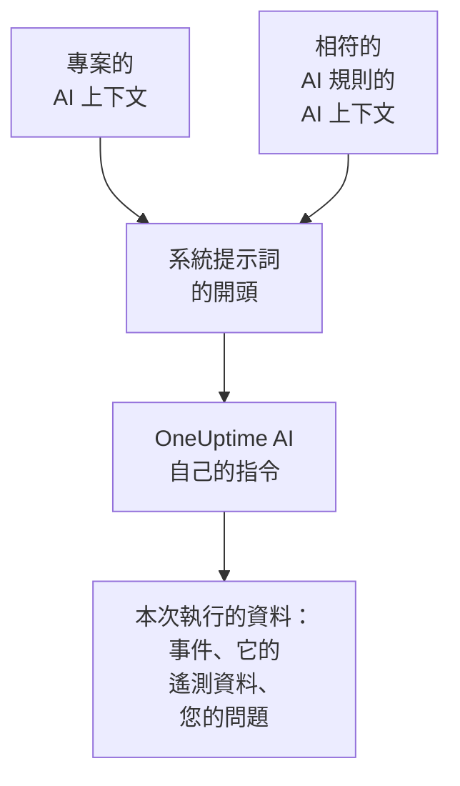

# AI 上下文

AI 上下文是您的團隊為 OneUptime AI 寫下的、關於您自己系統的說明：系統之間如何關聯、每種症狀歸誰負責、日誌在哪裡，以及團隊使用的術語。OneUptime AI 在每次調查、每次修復、每份事後分析草稿和每次詢問 AI 對話中都會最先讀取它，因此會從團隊已經知道的內容出發。

:::cards
- [撰寫 AI 上下文](#撰寫-ai-上下文): 專案 AI 設定中的一張卡片。
- [AI 規則自己的說明](#ai-規則自己的說明): 關於一條規則所比對內容的說明。
- [哪些功能讀取它](#哪些功能讀取它): 讀取它的功能，以及不讀取它的功能。
- [一次執行讀取了什麼](#一次執行讀取了什麼): 每次執行都會顯示它收到的說明。
:::

## 運作方式

OneUptime AI 把 AI 上下文放在系統提示詞的最開頭，排在它自己的指令和本次執行的資料之前：先是專案的說明，然後是相符的 AI 規則的說明。它把這些說明當作團隊提供的背景知識來讀。它們不是目前正在發生什麼的證據，也絕不會改變 OneUptime AI 自己的規則。

由於這些說明排在最前面，而且每次執行都相同，它們屬於提供者會快取的提示詞開頭部分。對於 Anthropic，OneUptime 會把系統提示詞標記為可快取；OpenAI、Azure OpenAI 以及其他會快取重複提示詞開頭的提供者會自動快取。沒有變更的說明再次讀取時成本更低。

## 撰寫 AI 上下文

:::steps
### 開啟 AI Features
開啟 **專案設定 → 人工智慧 → AI Features**。**AI 上下文** 卡片位於 **啟用 AI** 下方。

### 撰寫說明
點擊 **新增 AI 上下文**，已有說明時點擊 **編輯**。用 Markdown 撰寫，或點擊 **從大綱開始**，為每類說明各加一個標題。

### 儲存
點擊 **儲存變更**。卡片會顯示這些說明、它們的長度，以及模型大約會把它們讀作多少個 token。
:::

寫下您會告訴團隊新成員的內容：

| 說明類型 | 範例 |
| --- | --- |
| 系統之間如何關聯 | `checkout-api` 提供結帳頁面，並依賴 `payments-db`。 |
| 每種症狀歸誰負責 | 結帳頁面上的 502 歸支付團隊負責：先檢查 `payments-db`。 |
| 日誌在哪裡 | 結帳的日誌在 Loki 中，位於 `app=checkout` 下。 |
| 團隊使用的術語 | PSP 指我們的支付服務提供商。 |

> [!WARNING]
> 不要寫入機密：任何能看到某次 AI 執行做了什麼的人，都能讀到這次執行收到的說明。

## AI 規則自己的說明

AI 規則可以有自己的說明，內容關於它所比對的事件或警示：某個產品的服務、負責人、日誌位置。把它們寫在規則的 **更多欄位** 中、**LLM 提供商** 之後的 **AI 上下文** 裡。每次只執行其執行手冊的規則不會向 OneUptime AI 提任何問題，因此沒有需要撰寫的 AI 上下文。

- 調查會先讀取專案的說明，再依規則名稱的順序，讀取每條已啟用、負責調查並與該事件或警示相符的 AI 規則的說明。
- 修復會先讀取專案的說明，再讀取它自己所屬規則的說明。
- 關於某個事件或警示的對話，讀取的說明與它的調查相同。

## 哪些功能讀取它

| 功能 | 讀取的內容 |
| --- | --- |
| AI SRE 調查，以及新警示出現時的再次檢查 | 專案的說明，以及相符的 AI 規則的說明 |
| AI 規則啟動的修復：其計畫、命令和 MCP 伺服器 | 專案的說明，以及該規則的說明 |
| 詢問 AI，以及關於事件或警示的對話 | 專案的說明；對於事件或警示，還有相符的 AI 規則的說明 |
| Slack 和 Microsoft Teams 中的回答 | 專案的說明 |
| 事件和事件集的事後分析草稿 | 專案的說明 |
| AI Insights 的分流和安全案例的分流 | 專案的說明 |

只是改寫或評判所收到內容的呼叫不會讀取它：備註和公開備註的草稿、通話摘要、調查的摘要、信心度和評分，以及對話的標題。人們自己撰寫的提示詞也不會讀取它，例如工作流程或執行手冊中的 AI 步驟。

## 限制

| 對象 | 上限 |
| --- | --- |
| 專案的 AI 上下文 | 20,000 個字元 |
| 一條 AI 規則的 AI 上下文 | 5,000 個字元 |
| 一次執行讀取的全部 AI 上下文 | 30,000 個字元 |

表單會在您輸入時統計字元數，超過上限時拒絕儲存，API 也是如此。一次執行先讀取專案的說明，再依名稱順序讀取每條相符規則的說明。如果某條規則的說明會讓這次執行超過 30,000 個字元，就會整條略過，執行的活動紀錄會說明這一點。

token 數是估算值：說明的 UTF-8 位元組數除以 4，無條件進位。每個模型計算 token 的方式不同，因此提供者的計數可能不同，非英文文字差別最大。

## 一次執行讀取了什麼

每次執行都會逐字記錄它讀取的說明。執行的活動紀錄會顯示 **已讀取專案的 AI 上下文**，或者它另外讀取了多少條 AI 規則的說明，並附上大約的 token 數。**檢視** 會依執行讀取時的原樣開啟這些說明：先是專案的說明，再是每條規則名稱下的說明，即使之後說明已被修改也是如此。如果某條規則的說明因執行的上限而被略過，會有一則警告說明這一點。

## 誰可以修改它

- **專案擁有者** 和 **專案管理員** 可以修改專案的 AI 上下文。**專案成員**、**檢視者** 和 **Read Project** 可以讀取它。
- AI 規則的說明是規則的一部分：能修改該規則的人，也能修改這些說明。
- 說明只會在它所屬的專案中被讀取：任何執行都不會讀取其他專案的 AI 上下文。

透過 API 或 Terraform，專案的說明是專案的 `aiContext`，AI 規則的說明是該規則自己的 `aiContext`。

## 後續步驟

:::cards
- [AI SRE](/docs/ai/ai-sre): 讓 OneUptime AI 調查每個新的事件與警示。
- [詢問 AI](/docs/ai/ask-ai): 在對話中詢問專案的資料。
- [LLM 提供者](/docs/ai/llm-provider): 選擇讀取這些說明的模型。
:::
