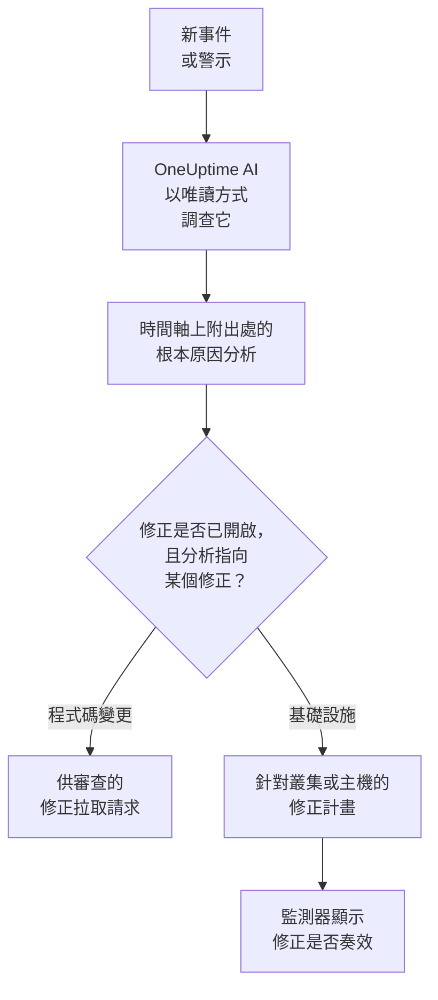
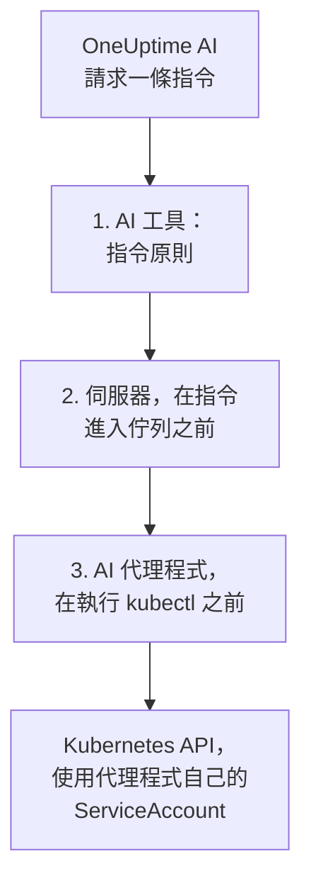

# AI SRE

OneUptime AI 是您的 AI 網站可靠性工程師。新事件或警示一經宣告，它就會立即開始工作，利用您自己的遙測資料（日誌、指標、追蹤、例外、監測器和最近的變更）進行調查，並在事件或警示的時間軸上發布附有出處的根本原因分析，通常在待命工程師讀完呼叫之前就已完成。

分析中的每一項主張都附有出處，直接連結到支持它的確切資料，而調查本身是 **嚴格唯讀** 的：調查期間，OneUptime AI 永遠無法變更您專案中的任何內容。

:::cards
- [運作方式](#運作方式): 從新事件到附有出處的分析，在您允許時再到修正。
- [啟用 AI 調查](#啟用-ai-調查): 各個開關，以及它們需要什麼。
- [叢集存取——讓 OneUptime AI 執行 kubectl](#叢集存取讓-oneuptime-ai-執行-kubectl): 在 Kubernetes 內部調查並修正。
- [成本控制](#成本控制): 針對事件、警示和整個專案的限制。
:::

## 運作方式

對於新事件或警示，OneUptime AI 會做三件事，每件事都有自己的開關：

- **調查** （預設開啟）。它會讀取您的遙測資料，以及執行 AI 代理程式的叢集和主機，並發布附有出處的根本原因分析。調查不會變更任何內容。
- **修正** （預設關閉）。修正開啟時，有把握的分析會變成修正：針對程式碼變更的拉取請求，或針對叢集或主機的指令計畫，並依該叢集或主機的 AI 代理程式所允許的方式執行。
- **學習。** AI Insights 頁面會根據記錄下來的一切，告訴您哪些問題反覆出現。



找不到原因的分析會被安靜地發布，不會呼叫任何人（請參閱 [靜默模式](#靜默模式)），沒有原因就不會修正任何內容。

## 調查會發布什麼

調查完成後，OneUptime AI 會發布包含以下部分的根本原因分析：

- **Summary** ——被呼叫的工程師能在五秒內讀完的一兩句話。
- **Most likely root cause** ——假設，只帶有證據所支持的把握程度，每一項事實主張都附有出處。如果遙測資料不足，AI 會直接說明，並列出它檢查過的內容，而不是猜測。
- **Evidence** ——支持或排除該假設的關鍵發現，每一項都附有出處。
- **Suggested next steps** ——給待命工程師的具體動作。

對於事件，分析會發布到事件動態 **和** 事件的內部備註（應變人員協作的地方）。對於警示，分析會發布到警示動態。

調查執行期間，事件或警示頁面會顯示一個即時的 **AI Investigation** 面板，說明每一步——執行了哪些工具、發現了什麼、花了多久——讓您可以看著它思考。如果調查失敗，面板會顯示失敗原因，而不是一片空白。

調查會一直執行到完成為止：它 **沒有時間限制**，也沒有很小的查詢預算，因此可以執行所需的每一條查詢以及 kubectl 或基礎設施指令。很長的指令輸出（繁忙節點的 `kubectl describe node`、Pod 的日誌）永遠不會被截斷——OneUptime AI 會一次讀取一頁。如果您想要硬性停止，請為每種訊號類型設定 **調查時間限制** （請參閱下文的 **成本控制**）。

## 調查會讀取哪些內容

調查從事件或警示本身，以及它所連結的基礎設施開始：它的監測器所監測的主機、Docker 和 Podman 主機、Kubernetes 叢集、資料庫和服務。網站、API 或合成監測器監測的是您在 **監測器 → 概覽 → 已連結的資源** 中為它連結的對象，所以請把它連結到為其檢查對象提供服務的主機，這樣它的每個事件的調查都會從那裡開始。在這一切之前，調查會先讀取專案的 [AI 上下文](/docs/ai/ai-context)：您的團隊為 OneUptime AI 寫下的關於您自己系統的說明，以及相符的 AI 規則的說明。

- 該基礎設施上在事件發生前 30 分鐘內觸發的警示，或仍未解決的警示，依從新到舊排列，例如慢速網站背後那台主機的 CPU 過高警示。私人警示不會列出。
- 基礎設施本身的指標，依照人們閱讀它們的方式讀取。`system.cpu.utilization` 和 `system.memory.utilization` 等主機指標依每個狀態各回報一次，各狀態加起來是 100%，因此對它們整體取一個平均值沒有任何意義。OneUptime AI 逐一讀取每個狀態（忙碌的 CPU 是 user 加 system），並可依容器、依掛載點或依任何其他屬性讀取任何指標。
- Docker 或 Podman 主機的容器：依 CPU、記憶體或重新啟動次數排在最前的容器，以及已停止回報資料的容器。已停止的容器不會傳送零，而是什麼都不傳送，因此整台主機的數字會把它掩蓋。
- 事件或警示發生前 2 小時內記錄的變更（部署、Kubernetes 滾動更新、設定變更以及 OneUptime 執行的修正），以及其中哪些因其服務的遙測資料而成為可疑變更：即某個服務在變更之後立即明顯變差。請參閱 [部署與變更](/docs/telemetry/change-events)。

**AI Investigation** 卡片上的調查活動會說明它讀取了多少則未解決或最近的警示，以及是在哪些資源上。

### 新警示觸發時再次檢查

調查在事件宣告的那一刻開始，而需要幾分鐘指標的主機警示可能在那之後才觸發。當事件發生後 30 分鐘內、在調查讀取之後，事件所連結的基礎設施上觸發了一則警示，且事件仍未解決時，OneUptime AI 會帶著這則警示再檢查一次該事件。新的分析以 **Checked again** 和引發此次檢查的警示開頭，它的活動也會這樣說明。如果 AI 規則讓 OneUptime AI 在調查該事件之前等待，這段時間改為從其調查結束時算起（請參閱 [調查前等待](#調查前等待)）。

每個事件最多發生一次，並遵循與新調查相同的開關和限制：**啟用 AI**、_調查新事件_、AI 額度，以及每日限制和並行限制。無需開啟任何設定。後續檢查不會再次執行自動修復，本身也不會再被追蹤，警示的調查也不會被再次檢查。

## 與 OneUptime AI 討論事件

**AI Investigation** 卡片以一段對話結尾——**Ask OneUptime AI**——能看到該事件或警示的所有人都共用這段對話。無論上方發生了什麼，它都是同一張卡片：在報告下方您可以追問，而當沒有執行自動調查（或調查在報告前停止）時，第一個建議是 **What is the root cause?** ，它會讓 OneUptime AI 依需求進行調查。

- **追問** ——「哪些 Pod 使用最多記憶體？」、「這開始之前剛剛改了什麼？」、「還有別的受影響嗎？」。OneUptime AI 會在其報告的基礎上查詢新資料（並在有存取權的地方，對您有權檢視的叢集和資源執行唯讀的 kubectl 或基礎設施指令），並為每一項主張註明出處。
- **讓它執行動作** ——「確認此事件」、「發布一則狀態更新，說明我們正在調查」、「呼叫資料庫待命人員」、「提高嚴重程度」。它使用與詢問 AI 相同的動作，並且一律 **以您自己的權限** 執行，因此它永遠無法做到超出您能做的事。
- **選擇它的執行方式** ——使用訊息方塊中的開關，開關旁會說明所選模式的意義：_Auto-run_ （預設——對明確的請求立即執行）、_Ask to act_ （先顯示一張核准卡片，事件中的任何人都可以核准或拒絕）或 _唯讀_。
- **一個共用的對話串。** 每個問題都會顯示提問者，所有人即時看到同一段對話，任何人都可以停止正在產生的回答。回答中的圖表和表格會顯示給提問的人；其他人看到的是附有出處的回答。每個回答都會列出其 **來源** ，有自己頁面的來源（日誌、指標、監測器）會開啟該頁面。較長的對話串會在最新訊息處開啟，上方有一個按鈕（例如 **Show 6 earlier messages**）用於載入其餘內容。

如果 OneUptime AI 因為 AI 對某個事件或警示處於關閉狀態而既沒有調查也沒有修正它，卡片就會變成一行：**AI 調查已關閉** （在專案的 AI 仍關閉期間為 **此專案的 AI 已關閉** ，重新開啟後為 **AI 調查當時已關閉** ）以及原因。原因可能是：專案的 AI 已關閉、建立時 _調查新事件_ （或警示對應的開關）已關閉、沒有相符的進行調查的 AI 規則，或其嚴重程度低於最低要求。它的箭頭 **您可以做什麼** 會展開需要開啟的內容：可以變更的人會看到指向變更位置的連結，其他人會看到誰可以變更；變更只適用於新的事件和警示，不適用於此事件。在 AI 開啟期間，這一行上的 **Ask OneUptime AI** 會開啟對話，而已經有人開始的對話會自動顯示在這一行下方。此時不會顯示 **補救** 卡片：這一行會說明為什麼沒有修正任何內容。

## 啟用 AI 調查

自主調查 **對新專案預設開啟**。事後分析草稿和 AI Insights 也是如此。修正預設關閉，其中包含的拉取請求只在修正開啟期間才會開啟（請參閱 [自動程式碼修正](#自動程式碼修正)）。在此預設值之前建立的專案會保留其設定；請依第 3 步開啟調查，或在任一 Kubernetes 叢集的 **AI 代理程式** 頁面上使用 **開啟** （Project Owner 或 Project Admin）。若要檢查或變更它們：

:::steps
1. **設定 LLM 提供商。** 自行託管的安裝使用自己的金鑰（或使用本機 Ollama 完全離線執行）——請參閱 [LLM 提供者](/docs/ai/llm-provider)。OneUptime Cloud 使用者可以使用預先設定的全域提供商，依計量的 AI token 計費，因此專案需要 AI 點數：專案擁有者或具有 **Manage Billing** 權限的人在 **專案設定 → 人工智慧 → AI 點數** 中新增點數，在那裡 **自動儲值** 可以避免點數用完。
2. **確認專案已啟用 AI** （預設已啟用）：**專案設定 → 人工智慧 → AI Features** 中的 **啟用 AI**。
3. **依訊號類型選擇** （新專案中兩者都開啟）：
   - 事件：**事件 → 人工智慧 → 設定** ——開啟 _調查新事件_。
   - 警示：**警示 → 人工智慧 → 設定** ——開啟 _調查新警示_。
:::

這些頁面上的每種 AI 行為都是一個開關，一經切換就會儲存；沒有儲存按鈕。事件頁面在 **OneUptime AI 會做什麼** 下有三個：_調查新事件_、_自動修正新事件_ 和 _事件解決後起草事後分析_。警示頁面有同樣的開關，只是沒有事後分析。_自動修正新事件_ （以及 _自動修正新警示_）在新專案中也以 **關閉** 狀態開始：它會讓 OneUptime AI 變更您的基礎設施，因此由專案自己開啟——請參閱 [哪些事件會被調查和修正](#哪些事件會被調查和修正)。它開啟的拉取請求（對您程式碼的修正，以及調查所缺的遙測）屬於它，由每條 AI 規則設定：沒有規則時兩者都會開啟，規則可以在 **更多欄位** 中關閉其中任一個（請參閱 [自動程式碼修正](#自動程式碼修正)）。Project Owners 和 Project Admins 可以變更它們；對其他所有人，每個開關都處於鎖定狀態，並說明它需要什麼權限。

這些頁面只在兩件事屬實時才會說明。如果 **啟用 AI** 已關閉，頁面上的任何內容都不會執行，頁面會在頂端說明這一點，並向可以變更它的人（Project Owners 以及擁有 Manage Billing 的任何人）顯示啟用 AI 開關本身；其他人會被告知誰可以變更。如果專案沒有 OneUptime AI 可以使用的 LLM 提供商——完全沒有，或者有提供商但沒有設為預設——頁面也會說明這一點，並附上指向 **專案設定 → 人工智慧 → LLM 提供商** 的連結。在 OneUptime Cloud 上全域提供商也算數，因此那裡不會顯示任何內容。

事件和警示是分別設定的，因此您可以為每種訊號類型設定各自的並行上限、每日 token 預算、修正任務預算和各自的規則。這些限制在您設定之前都不會生效——它們摺疊在每個頁面底部的 **更多設定** 下；請參閱下文的 **成本控制**。變更警示的 AI 設定不會變更對應的事件設定，反之亦然。

修正建立在調查之上：只要 **自動修正新事件** （或警示對應的開關）開啟，有把握地識別出儲存庫程式碼變更的調查就會自動開啟修正拉取請求——請參閱下文的 **自動程式碼修正**。

## 叢集存取——讓 OneUptime AI 執行 kubectl

預設情況下，調查只能使用您的代理程式傳送的遙測資料。對於 Kubernetes 訊號，這往往不夠：「Pod 卡在 Pending」是一個排程問題，需要透過 describe Pod 並讀取其事件來診斷，而不是看某個指標。**Kubernetes AI 代理程式** 讓 OneUptime AI 正好可以這樣做——如果您允許，還可以修正它發現的問題。

每個叢集頁面的側邊選單中都有一個 **人工智慧** 區段：

- **代理程式** ——叢集的 **AI 代理程式** 頁面：代理程式是否已連線、AI 可以在叢集上做什麼，以及所有需要注意的事項，每一項都附有解決它的步驟。當 AI 只能使用 OneUptime 的資料進行調查時，事件的調查面板上也會出現相同的說明。
- **洞察** ——叢集的 **AI 洞察** 頁面：OneUptime AI 對叢集的了解——什麼反覆出錯、為什麼，以及該怎麼辦（請參閱 [AI 在叢集上了解到的情況](#ai-在叢集上了解到的情況)）。
- **日誌** ——叢集的 **AI 日誌** 頁面：OneUptime AI 在叢集上所做的一切，依時間由新到舊（請參閱 [AI 在叢集上做過的一切](#ai-在叢集上做過的一切)）。

叢集的 **概覽** 以一張摘要 AI 代理程式頁面的 **AI 代理程式** 卡片結尾：代理程式是否已連線、**使用 kubectl 調查** 是否開啟、修正如何執行（**關閉**、**請求核准**、**自動** 或 **略過核准**）以及需要注意什麼，並附有指向 AI 代理程式頁面的連結，可以在那裡變更這些設定。

### Kubernetes AI 代理程式——預設開啟，唯讀

[OneUptime Kubernetes 代理程式](/docs/telemetry/kubernetes-agent) 的 chart 預設執行 Kubernetes AI 代理程式：一個小 Pod（`component=ai-agent`，映像檔 `oneuptime/kubernetes-ai-agent`），帶有一個 **唯讀** 的 ServiceAccount。它使用 chart 已在使用的 API 金鑰連線，因此無需在儀表板中進行任何設定：一分鐘內，叢集的 AI 代理程式頁面就會將其顯示為 **已連線**，並且 **使用 kubectl 調查** 處於開啟狀態——除非有人已經在那裡為叢集選擇了 AI 設定，這些設定會保持不變。

對於在 Kubernetes AI 代理程式出現之前安裝的代理程式，請先重新整理 chart 索引，然後再升級：

```bash
helm repo update
helm upgrade kubernetes-agent oneuptime/kubernetes-agent \
  --namespace oneuptime-agent --reset-then-reuse-values \
  --set aiAgent.enabled=true
```

`kubernetes-agent` 和 `oneuptime-agent` 是儀表板安裝說明所使用的發行名稱和命名空間；如果您用其他名稱安裝了代理程式，請使用您的名稱（`helm list -A | grep kubernetes-agent` 會顯示它們）。如果不執行 `helm repo update`，Helm 可能會解析到您安裝時使用的 chart，該 chart 不認識 `aiAgent`，並以 `Additional property aiAgent is not allowed` 失敗。在自行託管的 OneUptime 上，請先升級 OneUptime，再升級 chart——請參閱 [升級代理程式](/docs/telemetry/kubernetes-agent#升級代理程式)。若要在不執行 AI 代理程式的情況下執行 chart，請傳入 `--set aiAgent.enabled=false`。

AI 代理程式頁面上代理程式狀態旁的 **⋯** 選單中的 **測試連線** 會透過代理程式執行 `kubectl version` 和 `kubectl auth can-i --list` 並顯示結果：它能存取什麼，以及它被允許做什麼。如果頁面顯示代理程式未連線，請使用 `kubectl logs -n oneuptime-agent -l component=ai-agent --tail=100` 讀取它的日誌。設定了 **固定的服務名稱** 的金鑰無法註冊代理程式——請給 chart 一個沒有該設定的金鑰。當伺服器拒絕註冊時，日誌會說明這一拒絕是否會自行解除（先前的代理程式 Pod 仍在回報，或舊的叢集內 Runner 在升級期間仍在關閉），或者需要變更什麼。同一選單中的 **重設代理程式** 會在您確認後讓伺服器忘記代理程式的金鑰；Pod 會在幾分鐘內自動重新連線。

Kubernetes AI 代理程式不是 Runner，也永遠不會出現在 運行手冊 → Runbook 代理程式 下。它只使用自己的 ServiceAccount，因此 OneUptime 永遠不會提供它任何憑證，它永遠不會被用作運行手冊的 Bash/SSH 主機，也永遠不會被接受為 AI 規則的指令 Runner。

### AI 可以執行的操作——由代理程式設定

OneUptime AI 可以在叢集上做什麼，是在代理程式執行的地方——chart 中——用兩個值設定的：

- `aiAgent.investigation` ——`true`：AI 在調查時可以在叢集上執行唯讀 kubectl。`false`：它仍會調查，但使用 OneUptime 已有的資料。
- `aiAgent.fixes` ——AI 如何套用修正：`off`、`ask-for-approval`、`automatic` 或 `bypass-approval`（請參閱 [修正如何運作](#修正如何運作)）。除 `off` 之外的每個層級都會授予 AI 代理程式寫入權限；使用 `off` 時它沒有寫入權限，並會自行拒絕每一次寫入。

AI 代理程式在每次心跳時都會向 OneUptime 回報這兩個值，OneUptime 會將它們套用到叢集。叢集 AI 代理程式頁面上的 **AI 可以執行的操作** 會顯示它們——**開啟** 和修正層級，開啟時顯示為綠色——但無法在那裡變更；**變更** 會顯示每個選項以及設定它的確切 `helm upgrade`。代理程式設定這些值期間，在其他任何地方所做的變更——AI 代理程式頁面、API 或 Terraform——都會被拒絕。

兩個值都沒有設定的發行會讓代理程式使用其預設值（調查開啟；修正關閉，或在使用舊的 `aiAgent.remediation.enabled=true` 時為 ask-for-approval）。OneUptime 只會將這些預設值套用到沒有人在其 AI 代理程式頁面上選擇過 AI 設定的叢集：在那裡選擇的設定會保持不變，頁面會顯示將它們移轉到 chart 的指令。AI 代理程式過舊、無法回報這些值的叢集也是如此——用這兩個值升級 chart 就會移轉它們。

### 讓 AI 修正它發現的問題

在您用 `aiAgent.fixes` 開啟之前，修正一直處於關閉狀態，開啟修正也會授予 AI 代理程式寫入權限——最好只限於 AI 可以修正的命名空間，並關閉節點操作：

```bash
helm repo update
helm upgrade kubernetes-agent oneuptime/kubernetes-agent \
  --namespace oneuptime-agent --reset-then-reuse-values \
  --set aiAgent.enabled=true \
  --set aiAgent.investigation=true \
  --set aiAgent.fixes=ask-for-approval \
  --set "aiAgent.remediation.namespaces={web,api}" \
  --set aiAgent.remediation.nodeOperations=false
```

或者針對整個叢集：

```bash
helm repo update
helm upgrade kubernetes-agent oneuptime/kubernetes-agent \
  --namespace oneuptime-agent --reset-then-reuse-values \
  --set aiAgent.enabled=true \
  --set aiAgent.investigation=true \
  --set aiAgent.fixes=ask-for-approval \
  --set-json 'aiAgent.remediation.namespaces=[]'
```

將 `{web,api}` 替換為 AI 可以修正的命名空間。列出的每個命名空間都必須已經存在：chart 會在每個命名空間中建立一個 RoleBinding，但從不建立命名空間，因此缺少一個就會讓整個安裝或升級（包括收集器）以 `namespaces "api" not found` 失敗。請先建立它，或將其從清單中移除；刪除命名空間之前，先將其從清單中移除。升級時省略該旗標會保留發行中儲存的清單，因此若要回到整個叢集，請像第二條指令那樣傳入 `--set-json 'aiAgent.remediation.namespaces=[]'` （Helm 3.10+）——而不是 `={}`，Helm 會把它讀成一個空名稱，chart 會拒絕。在 `--reuse-values` 下，`--set aiAgent.remediation.namespaces=null` 不會重設已儲存的清單：Helm 會保留已儲存的清單。`aiAgent.remediation.nodeOperations=false` 讓修正遠離節點；將其設為 `true` 可允許 AI 對節點執行 cordon、uncordon、drain 和 taint（對節點的 drain、taint 或 patch 仍需等待人工）。

如需更多自主性，請使用 `automatic` 或 `bypass-approval` 取代 `ask-for-approval`，使用 `--set aiAgent.fixes=off` 可再次關閉修正，這也會移除寫入權限。修正還需要兩個專案開關。**自動修正新事件** （在 **事件 → 人工智慧 → 設定** 上）和 **自動修正新警示** （在 **警示 → 人工智慧 → 設定** 上）預設關閉：在其中一個開啟之前，不會修正該類別的任何新內容。**啟用 AI** （**專案設定 → 人工智慧 → AI Features**）除非有人關閉，否則處於開啟狀態；它會關閉專案的全部 AI，無論代理程式的設定為何。

### 叢集的修正作用於哪些事件

只要 **自動修正新事件** 處於開啟狀態且沒有設定任何 AI 規則，OneUptime AI 就會以叢集 AI 代理程式頁面設定的模式，修正與該叢集關聯的每個新事件——警示也同樣適用 **自動修正新警示**。有規則時，它只修正與某條使用 OneUptime AI 修正的規則相符的事件（請參閱 [哪些事件會被調查和修正](#哪些事件會被調查和修正)）。與它沒有關聯的內容，它不會觸碰——無論原因多麼明顯地出在叢集中。事件或警示在以下情況下與叢集關聯：

- 引發它的遙測資料指明了該叢集（針對叢集資料的指標、日誌或追蹤監測器）；
- 它的監測器是該叢集的 Kubernetes 監測器；
- 它的監測器在 **監測器 → 概覽 → 已連結的資源** 下與該叢集連結——這是將網站、API 或綜合監測器連結到為其檢查對象提供服務的叢集的方法；
- 詢問 AI 在該叢集的頁面上宣告了它，或在被要求時將它連結到該叢集；
- 有人在宣告時於 **其他受影響的資源** 下選擇了該叢集（選擇一個已連結的監測器會自動把它加到那裡）。

每個事件和警示都會在其 **補救** 卡片上說明它是否關聯到某個叢集，以及叢集的修正做了什麼；請參閱 [自動補救做了什麼](#自動補救做了什麼)。基礎設施資源及其 AI 代理程式也是如此。

### 誰可以變更

當 Kubernetes AI 代理程式設定調查和修正時，由能夠變更叢集上 chart 值的人來變更它們；OneUptime 會拒絕在其他地方所做的變更。下面的規則適用於留在 OneUptime 中的內容——kubectl 允許清單以及與叢集先前的叢集內 Runner 的繫結——以及設定仍在 OneUptime 中的叢集的調查和修正（請參閱 [AI 可以執行的操作——由代理程式設定](#ai-可以執行的操作由代理程式設定)）。

開啟修正——從 **關閉** 切換到任何其他模式——以及放寬修正——切換到 **自動** 或 **略過核准**、撰寫 kubectl 允許清單或繫結 Runner——需要 Project Owner、Project Admin 或 **Edit AI Rule** 權限，也就是可以建立無需詢問直接修正的 AI 規則的那些人。**重設代理程式** 需要與開啟修正相同的人員。收緊修正——**關閉**、改回 **請求核准**、清空允許清單或 Runner 繫結——任何可以編輯該叢集的人都能執行，**測試連線** 以及核准 OneUptime AI 為該叢集提出的修正也是如此。所有這些都需要編輯該叢集本身的權限：限制於某些標籤、或限制於您或您的團隊擁有的叢集的權限，只能作用於這些叢集，而帶標籤的封鎖項目會取消對帶有這些標籤的叢集的操作。

### 調查可以執行什麼

有存取權時，調查會透過 AI 代理程式執行 **唯讀** 的 kubectl——`get`、`describe`、`logs`、`events`、`top`、`rollout status/history`、`auth can-i`——需要多少條指令就執行多少條，並像引用其他證據一樣為每條指令註明出處。輸出永遠不會被截斷：代理程式最多保留 1 MB，OneUptime AI 會一次一頁地讀取較長的輸出。三項獨立檢查使其保持唯讀：為每條指令分級的原則、拒絕為調查將其他任何內容加入佇列的伺服器，以及在啟動 kubectl 之前再次檢查同一原則的 AI 代理程式。「唯讀——您的系統中沒有任何內容被變更」始終名副其實。



### 修正如何運作

AI 代理程式頁面上的 **修正** 有四種設定（chart 的 `aiAgent.fixes`：`off`、`ask-for-approval`、`automatic`、`bypass-approval`）：

- **關閉** ——AI 只進行調查。
- **請求核准** ——在根本原因分析之後，OneUptime AI 會用 kubectl 進行診斷，並擬定能解決該原因的最小 kubectl 計畫，例如 `kubectl rollout restart deployment/web -n web`。計畫會連同其理由、預期效果和回復方案一起顯示在事件上；由人一鍵核准後，OneUptime 會嚴格執行這些指令。如果監測器沒有恢復，就會執行回復，OneUptime AI 會參考這次失敗的嘗試再擬定一個計畫——同樣需要核准——從而換一種方法，或說明人工應該查看什麼。
- **自動** ——安全的變更會自動執行；風險較高的變更則從不自動執行。如果這一輪只找到了風險較高的修正，它會以提出這些修正供一鍵核准而結束。如果它還執行了安全的修正，風險較高的修正會保留在分析中，只有在驗證顯示安全修正沒有讓監測器恢復時，才會由後續一輪提出並請求核准。在 AI 代理程式頁面上把某條風險較高的指令的形式加入允許清單，它也會自動執行。驗證確認監測器已恢復後，自動模式還會解決該訊號；它還有一個熔斷器，限制每個叢集每小時最多三次無人值守的修正：超過此數，或者在另一輪無人值守的 OneUptime AI 仍在變更或驗證同一叢集期間，這一輪會提出計畫供核准，而不是直接執行。
- **略過核准** ——AI 不會詢問。原則允許的每一項變更，包括風險較高的變更，都會自動執行，驗證失敗後的後續一輪也是如此；驗證確認恢復後，訊號會自行解決。在任何模式下都需要人工的操作（見下文）仍然會等待人工。在以下情況下，一輪也會提出計畫供核准，而不是執行它，並在事件上說明原因：
  - 每小時熔斷器（每個叢集每小時三次無人值守的修正）已觸發，或無法檢查；
  - 另一輪無人值守的 OneUptime AI 仍在變更同一叢集，或仍在驗證該叢集上的某個修正——同一個監測器的警示和事件是常見情況——或者無法檢查這一點；
  - 這是在某個回復未完成的修正之後的後續一輪。

**先回復。** 當 OneUptime 將叢集上的某次 Kubernetes 滾動更新標記為該事件的可疑變更時（請參閱 [部署與變更](/docs/telemetry/change-events)），OneUptime AI 會在任何其他修正之前先嘗試回復它。OneUptime 根據記錄下來的變更建構 `kubectl rollout undo`，絕不依據模型寫出的內容；它會像叢集所處模式下的任何安全變更一樣，直接執行或等待核准。如果該 Deployment 在那次滾動更新之後又有了變更，就不會提供這項回復，因為那樣撤銷的將是後來的那次變更。

**由 Argo CD、Flux 或 Helm 宣告的工作負載。** 許多叢集在 git 中宣告工作負載，並讓 Argo CD 或 Flux 套用它，或者用 Helm 安裝它們；對其中已宣告內容所做的 kubectl 變更不會持久：當 Application 開啟了 self-heal 時，Argo CD 會在幾秒內將其改回（否則在下一次同步時），Flux 在下一次協調（reconciliation）時改回，Helm 發行版則在下一次升級時改回。因此，在 OneUptime AI 執行或提議某項 kubectl 變更之前，OneUptime 會透過叢集的 AI 代理程式，以唯讀 kubectl 讀取該變更所針對的物件（若是 ReplicaSet，則讀取其 Deployment）以及宣告它的一方：Argo CD（`argocd.argoproj.io/tracking-id` 註解、`argocd.argoproj.io/instance` 標籤或其欄位管理員）、Flux（`kustomize.toolkit.fluxcd.io/*` 或 `helm.toolkit.fluxcd.io/*` 標籤）或 Helm 發行版（`meta.helm.sh/release-name` 註解或 `app.kubernetes.io/managed-by: Helm` 標籤）。Argo CD 或 Flux 會改回的變更 —— `rollout undo`（包括先回復）、`scale`（當 git 設定了副本數時）、`set image/env/resources`、`patch`、刪除工作負載 —— 在任何模式下都不會自動執行，略過核准和允許清單也不例外：它會作為**暫時修復**被提議供一鍵核准，並且計畫會指出持久的修復，即在 git 中做同樣的變更（工作負載所依據的資訊清單、Helm values 或 Kustomize overlay）。對於 git 沒有宣告的內容，例如 `rollout restart`、`rollout pause` 或新加的註解，Argo CD 和 Helm 不會去動，因此這類變更依叢集的模式執行。Flux 的 Kustomization 會在下一次協調時連這些也移除，因此在那裡暫停、標籤或註解同樣是暫時修復。在 Flux 上，重新啟動仍依模式執行：Flux 移除其註解時，Pod 會再重新啟動一次，而不是撤銷這次重新啟動。刪除一個出故障的 Pod 依模式執行，無論工作負載由誰宣告：git 從不宣告 Pod，它的 ReplicaSet 會取代它。Helm 發行版只會在下一次升級時改回變更，因此在那裡變更同樣依叢集的模式執行，而計畫會說明它是暫時的。

**驗證會發現被改回的修復。** OneUptime 會在 kubectl 修復執行之前和之後立即讀取它所變更的物件，並在驗證時段開啟期間每隔幾分鐘再次讀取。一項被發現回到舊值的修復（被 Argo CD、Flux、Helm 升級、某個 operator 或自動擴縮器改回）會立即導致驗證失敗，說明會指出是誰改回的，以及持久的變更應該在哪裡做。它的回復不會執行：叢集已經撤銷了它，再撤銷可能會重新套用該修復。Argo CD 或 Flux 會改回的變更，會在其時段結束時評判，而不是在監測器一恢復時就評判。重新啟動不會留下需要監看的內容：它的 Pod 已被取代，之後它的註解無論發生什麼都一樣。

**安全的** 變更只涉及恰好一個具名物件：`rollout restart/undo/pause/resume`、`scale` （縮放到 0 以外的任何值）、刪除一個具名 Pod、`cordon`/`uncordon`，以及對一個具名的 Pod、Deployment、StatefulSet、DaemonSet、ReplicaSet、Job 或 CronJob 使用一般鍵（不是 `*.kubernetes.io/…` 或 `*.k8s.io/…` 這樣的保留鍵）執行 `label`/`annotate`。原則允許的其他一切都 **風險較高**：對不帶名稱的類型使用相同的動詞（`rollout restart deployment`）、作用於多個物件、帶選擇器或帶 `--all`；`scale` 到 0；刪除 Job；`taint`；`drain`；`patch`；`set image/env/resources`；`create`；帶 `--force` 刪除；以及對任何其他類型或使用保留鍵新增標籤或註解。

有些界限在 **每種** 模式下都成立，包括略過核准，任何允許清單項目都無法改變它們：

- 在 **kube-system**、**kube-public** 或 **kube-node-lease** 中寫入一律需要人工。自訂資源依其寫入的命名空間來判斷，即使其名稱看起來像內建的叢集層級類型（`nodes.example.com`、`namespaces.example.com`）。
- 對節點執行 `drain`、`taint` 或 `patch` 一律需要人工。清空節點會驅逐每個命名空間中的 Pod——包括上述三個以及代理程式自己的命名空間——而 `NoExecute` 污點同樣會驅逐它們，無論是由 `kubectl taint` 設定還是由對節點的 `patch` 設定。
- AI 代理程式從不變更其自身命名空間中的任何內容——在那裡修正可能會把 Kubernetes 代理程式或 AI 代理程式本身縮減掉——也不會變更其 chart 允許寫入的命名空間（`aiAgent.remediation.namespaces`）之外的任何內容，在其 chart 關閉了節點操作（`aiAgent.remediation.nodeOperations=false`）時也不會變更節點。OneUptime 從 AI 代理程式回報的資訊中讀取該範圍，並在 OneUptime AI 提出此類修正時拒絕它，在有人核准時再次拒絕，因此它永遠不會作為失敗的修正到達 AI 代理程式；AI 代理程式也會在啟動 `kubectl` 之前拒絕它。
- 破壞性指令（見下文）永遠不會執行，即使有人核准也不會。

自動模式的允許清單是逐詞與剖析後的指令進行比對的，而不是作為自由文字：`*` 只代表恰好一個詞（一個映像檔、一個名稱），絕不代表額外的物件、旗標或第二個 `-n`，並且指令使用的每個旗標都必須在項目中寫出。`kubectl set image deployment/web * -n web` 允許在 `web` 中為 `web` 使用新映像檔，僅此而已。項目必須寫出其動詞——以及 `rollout`、`set` 或 `create` 的子指令——而不能用 `*` 代替，並且在選用的開頭 `kubectl` 之後必須多於一個詞；違反這些規則的項目，例如 `scale` 或 `kubectl *`，永遠無法預先核准任何變更，儲存時會被拒絕。

:::details 永遠不會執行的指令，以及指令如何被解讀
有些指令 **永遠** 不會執行，無論處於何種模式，即使有人核准也不會。指令原則會拒絕它們，並且會執行三次——由伺服器的工具、由伺服器加入佇列的關卡，以及由 AI 代理程式在啟動 `kubectl` 之前：`exec`、`attach`、`cp`、`port-forward`、`proxy`、`debug`、`run`、`edit`、`apply`、`replace`、`diff`、kubectl 外掛程式以及不在其清單中的任何其他動詞，任何檔案輸入（`-f`、`-k`）或讀取檔案的輸出格式（`-o jsonpath-file=`、`-o go-template-file=`、`-o custom-columns-file=`、`--template`，以及沒有內嵌範本的單獨 `-o jsonpath`/`go-template`/`custom-columns`），憑證、模擬身分（`--as`、`--as-group`、`--as-uid`、`--as-user-extra`）、叢集選擇、`--kuberc`、原始 API 和詳細記錄的旗標，使用 **任何** 動詞操作的 Secret 物件——OneUptime AI 從不讀取、變更、刪除或建立 Secret，`create secret`、`create token` 和 `set env --resolve` 也隨之被拒絕——任何授予 RBAC 的操作（`create role`、`create clusterrole`、`create rolebinding`、`create clusterrolebinding`、`set subject`），`certificate approve`，`set serviceaccount`，帶 `--image` 的 `create deployment`、`create cronjob` 或 `create job`（`create job --from=cronjob/…` 仍屬於風險較高的變更），`expose --overrides` 或 `--override-type`（覆寫可以讓 kubectl 建立 Job、ClusterRoleBinding 或其他任何類型的物件，而不是 Service），不是 JSON 的 `patch` 本文（kubectl 會把它當作 YAML 讀取，而 YAML 的標籤可以寫出任何檢查都看不到的欄位），變更 Pod 範本的 ServiceAccount、磁碟區或安全性設定的修補（包括主機連接埠、使用者命名空間退出選項 `hostUsers` 和執行階段類別 `runtimeClassName`），取代 Pod 範本的整個部分而不是在其中設定欄位的修補（strategic-merge 的 `$patch: replace`、設定整個 `containers` 清單的 merge patch，或取代或移除 Pod 規格的 JSON patch）——這會在不提及的情況下丟棄那些設定——透過 `--all` 或選擇器而非名稱選中的 Namespace 物件上的標籤或註解，對 RBAC 物件、CustomResourceDefinitions、APIServices、准入 webhook 設定或准入原則的任何寫入——`patch`、`label`、`annotate`、`set`——帶 `--all-namespaces` 的寫入、`delete --all`，以及刪除命名空間、節點、磁碟區、CRD 或叢集角色。旗標的剖析方式與 kubectl 相同，因此被禁止的旗標或類型無法躲在另一個後面：組合的短旗標會逐個字母拆開（`-As` 會被識別），值為選用的旗標（`--cascade`、`--dry-run`、`--validate`）永遠不會吞掉下一個詞，並且除 `-n`/`--namespace`、`--request-timeout` 和 `--match-server-version` 之外的每個旗標都必須位於動詞之後（以及 `rollout`、`set`、`create`、`auth`、`cluster-info` 和 `top` 的子指令之後），因為 kubectl 會先選定指令再剖析旗標。AI 代理程式自帶固定版本的 kubectl（v1.36.5）並關閉 kuberc，因此在原則檢查之後，kuberc 檔案無法再為指令新增預設值或別名。它為每條指令提供一個指向已掛載權杖檔案的、用於其自身 ServiceAccount 的私人 kubeconfig，絕不提供權杖的副本。
:::

### AI 代理程式的 RBAC 限制什麼、不限制什麼

:::details chart 的 RBAC 授予了什麼
chart 的 RBAC 是獨立於原則的另一層，它限制的是 AI 代理程式可以 **在哪裡** 寫入，而不是寫入可以做什麼。唯讀存取（get/list/watch、Pod 日誌）在整個叢集範圍內授予。`aiAgent.remediation.enabled` 會新增對 Deployments、StatefulSets、DaemonSets、ReplicaSets 及其 scale 子資源、Jobs、CronJobs、Pods 和 HPA 的 patch/update；對 Jobs 和 HPA 的 create；以及僅對 Pods 和 Jobs 的 delete。`aiAgent.remediation.nodeOperations`（預設開啟）會在整個叢集範圍內新增對節點的 cordon、uncordon、taint 和 drain；將其設為 `false`，chart 就不會授予任何節點 RBAC，並告知 AI 代理程式（`ONEUPTIME_KUBECTL_ALLOW_NODE_OPERATIONS=false`），後者隨後會在啟動 kubectl 之前拒絕對節點的 cordon、uncordon、drain、taint 和 label/annotate/patch——並且由於 AI 代理程式會回報這個開關，OneUptime 在此類修正被提出或核准時就會拒絕它。它從不授予 Secrets、`exec`、`attach`、`port-forward`、ServiceAccount 權杖、模擬身分、CRD 或 RBAC 寫入權限，因此刪除任何其他類型，或為 Service、ConfigMap、Ingress、Namespace 或 PVC 新增標籤，都會在 API 伺服器上以 `Forbidden` 失敗，即使有人核准了也是如此。這兩層並不是彼此的副本：對 RBAC 來說，`apply`、`edit`、`replace`、帶 `--all-namespaces` 的寫入和 `delete --all` 都是一般的 patch、update 和 delete 呼叫，只有原則能阻止它們。
:::

:::warning 寫入權限意味著什麼
不過，請清楚這一寫入權限意味著什麼：**在一個命名空間中對工作負載、Pod 和 CronJobs 的 patch/update，以及對 Jobs 的 create，等同於以該命名空間中的任何 ServiceAccount 執行任何映像檔並讀取其 Secrets。** Pod 範本可以指定任何映像檔、ServiceAccount 和 Secret 磁碟區，而 RBAC 沒有「可以 patch 但不能改 Pod 範本」這樣的動詞——沒有規則提及 `exec` 或 Secrets 並不能改變這一點。這就是為什麼原則拒絕變更 Pod 執行時使用的 ServiceAccount、安全性設定、磁碟區、指令或 Secret 連接方式（Pod 範本安全性修補、取代 Pod 規格或整個 `containers` 清單的修補、`set serviceaccount`、`create … --image`、`expose --overrides`、非 JSON 的修補本文），為什麼受保護的命名空間一律需要人工，以及為什麼會有 `aiAgent.remediation.namespaces`。原則 **不會** 拒絕變更映像檔：`set image` 或對映像檔欄位的修補是風險較高的變更——新映像檔以工作負載自己的 ServiceAccount 執行，並帶有其 Secrets——需要人工核准，除非叢集略過核准，或其允許清單指定了該指令。沒有 `aiAgent.remediation.namespaces` 時，寫入角色會繫結到整個叢集——包括 kube-system、kube-public、kube-node-lease 和代理程式自己的命名空間，因為 RBAC 無法把命名空間排除在叢集範圍的繫結之外——在那裡守住底線的是原則和 AI 代理程式，而不是 RBAC。有了它，chart 只會在您列出的命名空間中繫結該角色，OneUptime 會在提出或核准時拒絕其他任何地方的寫入，AI 代理程式會在啟動 kubectl 之前再次拒絕。
:::

### AI 在叢集上了解到的情況

叢集的 **AI 洞察** 頁面（人工智慧 → 洞察）會根據最近 30 天告訴您叢集中值得了解的內容——不是 AI 做了什麼的記錄，而是它發現了什麼：

- **OneUptime AI 的發現** ——最重要的幾件事，最重要的排在最前，每件都附有其背後的事件和警示以及一個下一步：
  - 反覆出現的問題：出現頻率（它引發的每個事件和警示都計入，無論是否經過調查）以及在全部問題中所佔的比例，是本週新出現的還是正在惡化，它通常開始的時段（依您自己的時區），它影響的叢集部分，最新調查發現了什麼，以及其報告建議的第一步；
  - 沒有解決其問題的修正，以及等待您核准的修正；
  - 在通知任何人之前發現的風險：關於叢集自身遙測資料的、嚴重程度為 High 或 Medium 的未關閉 [洞察](#洞察主動偵測)；
  - 多個不同問題背後的節點、Pod、命名空間或工作負載，連結到它在叢集中的頁面；
  - AI 自行修正了什麼以及修正是否持續有效，並且——當您的團隊核准了 AI 提出的每一項修正時——AI 可以自行套用此類修正；
  - 一個曾反覆出現、在某次修正後停止的問題。

  如果沒有值得注意的內容，頁面會如實說明。
- **其他問題** ——AI 查看過的其他所有內容，依引發它們的來源分組（一個監測器就是一個問題，無論它為多少個 Pod 或節點觸發），最頻繁的排在最前：出現頻率、影響了哪些命名空間、工作負載、Pod 或節點、最新調查的發現和建議、AI 提出的修正結果如何，以及您的團隊和評分對這些發現的評價。出現不只一次的問題會被標記為 **週期性**、**本週新增** 或 **正在惡化**。
- **問題發生的位置** ——出現最多的叢集部分，以及涉及了多少個不同的問題。
- **在通知任何人之前發現** ——偵測器針對叢集自身遙測資料記錄的其他未關閉洞察。
- **OneUptime AI 在此做了什麼** ——註腳：有多少次調查、修正和指令，其中有多少失敗，每天的調查次數，AI 提出的修正最終如何，已套用的修正是否解決了問題，以及 AI 自身工作中出了什麼問題（失敗的調查、代理程式從未領取的指令、被您的團隊駁回的發現），每一項都附有查看位置。

如果專案的 **啟用 AI** 已關閉，或沒有 OneUptime AI 可以使用的 LLM 提供商，頁面會在頂端說明這一點：不會調查任何新內容，因此也不會出現任何新內容。

頁面上的一切都來自 OneUptime 已經記錄的內容——事件和警示、對它們的調查及結論、對這些結論的評判、修正和指令——建構頁面時不會呼叫任何模型：屬於 AI 自己的話（某個發現、某個建議的步驟）是由發現它們的調查寫下的，並作為該調查的話顯示。任何能看到叢集的人都能看到該頁面，頁面只會列出此人有權閱讀的事件和警示。

### AI 在叢集上做過的一切

叢集的 **AI 日誌** 頁面（人工智慧 → 日誌）記錄了 OneUptime AI 在那裡做過的一切，依時間由新到舊：每次調查及其事件或警示和摘要，它提出或執行的每項修正及其狀態，以及每條 kubectl 指令——無論是調查還是修正——及其指令內容、狀態和執行時間。調查的摘要是其 TL;DR，如果無法寫出 TL;DR，則是其報告開頭的摘要。此頁面過去叫作 AI Insights；其舊網址的書籤現在會開啟 AI Insights 頁面，該頁面會連結到這裡。

### 透過先前的叢集內 Runner

使用較早的 chart（`aiAccess.enabled=true`）設定的叢集，在 chart 升級之前會透過先前的叢集內 Runner 存取 OneUptime AI。升級會用 Kubernetes AI 代理程式取代該 Runner 並沿用其設定——請參閱 [升級代理程式](/docs/telemetry/kubernetes-agent#升級代理程式)。

叢集外的 Runner 不再能存取該叢集：它過去是憑藉 Kubernetes Runbook 憑證存取的，而 Runbook 憑證已被移除。未執行 Kubernetes 代理程式 chart 的叢集，安裝該 chart 即可讓 OneUptime AI 執行 kubectl：chart 中的 Kubernetes AI 代理程式就是入口。

## 基礎設施存取——Docker、Podman、Swarm、Proxmox、VMware、Ceph、資料庫和主機

您的其他基礎設施也有同樣的存取方式。資源 AI 代理程式（映像檔 `oneuptime/resource-ai-agent`）執行在 Docker 或 Podman 主機、Docker Swarm 叢集、Proxmox 叢集、VMware vCenter、Ceph 叢集或資料庫伺服器的收集器旁邊——或單獨執行在 Linux 主機上——讓 OneUptime AI 在調查時於那裡執行唯讀指令（`docker logs`、`pvesh get`、`govc vm.info`、`ceph health detail`、一組固定的資料庫診斷、`systemctl status`、`journalctl` 等），並且只有在您使用 `ONEUPTIME_AI_ALLOW_WRITES=true` 和一個修正層級（`ONEUPTIME_AI_FIXES`）啟動代理程式時，才會以與 Kubernetes 叢集相同的四種模式和相同的三項檢查套用修正。與叢集一樣，AI 在此類資源上可以做什麼是在其代理程式執行的地方設定的（`ONEUPTIME_AI_INVESTIGATION`、`ONEUPTIME_AI_FIXES`），並在其 AI 代理程式頁面上以唯讀方式顯示。每個此類資源都有相同的 **AI 代理程式**、**洞察** 和 **日誌** 頁面。有關如何安裝它們、每種代理程式可以執行什麼以及其安全性模型，請參閱 [基礎設施 AI 代理程式](/docs/ai/infrastructure-ai-agents)。

## 靜默模式

無法確定原因的調查會在時間軸上發布其分析，**而不** 通知您的 Slack/Teams 工作區或待命人員。沒有答案的結果永遠不應該呼叫任何人——有人查看時分析就在那裡，但沒有人會因為「無定論」而被叫醒。有把握的分析會照常通知工作區。

分析是否算作有把握，由經伺服器驗證的訊號決定，而不是由分析文字的內容決定：沒有收集到任何證據（沒有成功的遙測查詢，也沒有出處）的調查一律被視為無定論，否則會由另一項受約束的檢查對分析進行分類。如果這項檢查本身失敗，OneUptime AI 會傾向於發出通知——靜默模式在失敗時會變得更響亮，而絕不會沉默。

## 自動程式碼修正

建議變更儲存庫程式碼的有把握的分析可以比發出通知更進一步：它會開啟修正。修正拉取請求是修正的一部分：它們只在 **自動修正新事件** （位於 **事件 → 人工智慧 → 設定**）或 **自動修正新警示** （位於 **警示 → 人工智慧 → 設定**）開啟期間才會開啟，而修正以 **關閉** 狀態開始，新專案也是如此。沒有 AI 規則時，每個符合條件的調查都會開啟它們；有規則時，每條規則為其符合的對象決定，依據的是 **更多欄位** 中的 **修正 Pull Request**，新規則預設開啟。在專案擁有已連接的儲存庫和具備程式碼修正能力的 Runner 之前，不會開啟任何內容。符合條件的調查會自動將與調查面板上 **Open Fix PR from this analysis** 按鈕相同的修正任務加入佇列：一個 AI 代理程式任務，把發布的分析變成可供審查的拉取請求。該按鈕使用相同的建議，對於補救措施屬於維運操作、僅涉及基礎設施、外部問題、預期的拒絕、使用者錯誤或無定論的分析，該按鈕會隱藏。

規則 **更多欄位** 中緊鄰的 **遙測 Pull Request**，新規則也預設開啟，適用於因所需的日誌、追蹤或指標缺失而以無定論結束的調查：OneUptime AI 會開啟一個拉取請求，在相關程式碼路徑中加入這些檢測，供您的團隊審查。它們需要已連接的儲存庫（請參閱 [連接儲存庫](/docs/ai/ai-agent#連接儲存庫)），同樣只在修正開啟期間才會開啟。

在您的團隊合併之前，拉取請求不會改變任何東西，但修正所做的不只是開啟拉取請求。若要在 OneUptime AI 不變更您的叢集或主機的情況下取得拉取請求，請開啟修正，在每個 Kubernetes 叢集和主機的 **AI 代理程式** 頁面上保持 **修正** 關閉（關閉是它們的預設值），並且不要新增任何 AI 規則：修正開啟且沒有規則時，OneUptime AI 只在 AI 代理程式頁面允許的地方進行修正。設定了規則後，拉取請求只會為規則符合的事件（或警示）開啟，前提是符合的規則開啟了該拉取請求，並且只在符合的規則所指定的程式碼儲存庫中開啟；未指定任何儲存庫的符合規則允許所有已連線的儲存庫。

透過 API 或 Terraform，修正是專案的 `enableAutomaticIncidentRemediation`（警示對應 `enableAutomaticAlertRemediation`），每條 AI 規則都有 `openCodeFixPullRequests` 和 `openTelemetryPullRequests`（除非您設定，否則都為 `true`）以及 `codeRepositories`（為空表示所有已連線的儲存庫）。以前保存這兩種拉取請求的專案欄位已經不存在；請參閱 [升級說明](/docs/installation/upgrading#拉取請求開關已移到自動補救規則中)。

決定把握程度的同一種受約束、經伺服器驗證的分類，也決定儲存庫變更是否合適。只有被肯定地歸類為程式碼修正時，才會提供或自動開啟拉取請求。沒有收集到經伺服器驗證的證據、建議非程式碼補救措施或分類失敗的調查，永遠不會開啟拉取請求——建立 PR 的失敗方向一律是什麼也不做。其他一切都與手動按鈕相同：拉取請求以可供審查的狀態開啟，需要已連接的儲存庫和具備程式碼修正能力的 Runner，在設定了相應限制時計入該訊號類型的每日修正任務限制和儲存庫的未關閉 PR 上限，並且每個事件或警示同時最多只能有一個作用中的修正任務。調查本身保持唯讀——修正作為一個單獨的、完整記錄日誌的代理程式任務執行。有關修正拉取請求的運作方式，包括每個拉取請求開啟之前執行的建置和測試驗證，請參閱 [程式碼](/docs/ai/ai-agent)。

**已在正式環境中驗證。** 合併修正並不能修正例外，執行修正才能。某個例外的 AI 修正合併後，OneUptime 會等待該例外所屬服務的一次包含該修正提交的已記錄部署（請參閱 [部署與變更](/docs/telemetry/change-events)），然後在這次部署中觀察該例外。如果例外再次發生，該修正會被標記為 **修正後仍在發生**，例外也會重新開啟。如果例外至少一天沒有再出現，而且這段時間夠長，依修正前一週的發生頻率它本應至少發生 3 次，該修正就會被標記為 **已在正式環境中修正**，例外也會被解決。14 天內沒有任何已記錄部署包含的修正，或者罕見到連 7 天不出現也說明不了什麼的例外，會被標記為 **未在正式環境中驗證**。該例外的修正任務會顯示屬於哪一種。

**其他修正依它們修正的內容來判定。** 慢追蹤或延遲洞察的修正、調查找到的根本原因的修正，以及遙測改進，都會等待同一次部署，然後依它們的用途來判定：

- **慢操作** —— 在修正以至少 100 個 span 執行一天後，把已部署修正中的 p99 與合併前一週相比；服務的遙測回報了部署版本時，就依該版本讀取。至少快五分之一即為 **在正式環境中變快**，要求修正的延遲洞察隨之解決；完全沒有變快即為 **修正後仍然緩慢**，該洞察會再次需要關注。
- **事件或警示的根本原因** —— 觸發它的監控器。部署後該監控器觸發的任何事件或警示都是 **修正後再次發生**，並記在兩者的動態中；安靜一天，且時間長到依修正前 30 天的頻率本應觸發 3 次，即為 **已在正式環境中修正**，並記在被調查事件的動態中。只要它的某個事件仍未關閉，監控器就不會觸發新的事件，所以這段時間不計入。
- **缺少的遙測、日誌或追蹤** —— 修正的變更新增、而合併前一週沒有的內容：span 的名稱、屬性的鍵、日誌的訊息。只要其中任何一項從已部署的修正抵達，或者原本不傳送 span 或日誌的服務開始傳送，且修正已執行一天，即為 **已在正式環境中回報**；原本穩定傳送 span 或日誌的服務在部署後一筆也不再傳送，即為 **修正後遙測中斷**。

在部署後 7 天內（事件根本原因為 14 天內）無法判斷的修正即為 **未在正式環境中驗證**。Code 會顯示每個修正拉取請求的結論，事件的 AI 日誌和要求修正的洞察也會顯示。

## 哪些事件會被調查和修正

每種訊號類型的 AI 設定頁面上有兩個開關，決定 OneUptime AI 會自行如何處理新事件：_調查新事件_ （預設開啟）和 _自動修正新事件_ （預設關閉）；警示有自己的一對開關。摺疊在同一頁面 **更多設定** 下的 **AI 規則** 會同時縮小這兩者的範圍：OneUptime AI 處理哪些新事件，以及對每個事件做什麼。大多數專案都不需要規則。

- 沒有規則時，OneUptime AI 會立即調查每個新事件，並在 _自動修正新事件_ 開啟期間，以每個叢集或主機的 AI 代理程式頁面所設定的模式，修正與其關聯的 Kubernetes 叢集和主機上的每個新事件，並可以挑選專案中合適的運行手冊，提交給您核准。
- 有規則時，OneUptime AI 只調查至少與一條已啟用規則相符的事件，並且只修正與某條會修正的規則相符的事件，每個都依其相符規則的要求處理。其他事件會說明這一點：規則之外的事件在其 **AI Investigation** 卡片上說明（**This incident was outside the AI rules that investigate at creation**），您仍然可以向 OneUptime AI 詢問它；只與不修正的規則相符的事件在其 **補救** 卡片上說明。無法讀取的規則永遠不會阻止調查：事件會像沒有規則一樣被調查。當所有已啟用的規則都設為 **不修正** 時，不會修正任何問題，_自動修正新事件_ 的開關下方會說明這一點。

一條 AI 規則提出三個問題，每一步一個：

1. **比對** ——它相符哪些事件：新規則預設的 **所有事件**，或依監測器、嚴重程度、標籤、監測器標籤、標題和描述篩選的 **僅符合條件的事件**，與專案中其他事件和警示規則的條件相同。
2. **調查** ——OneUptime AI 何時調查與規則相符的對象：**立即**，或 **僅在等待後仍未解決時**（請參閱 [調查前等待](#調查前等待)）。
3. **修正** ——調查之後 OneUptime AI 做什麼。**不修正**：它發布所發現的內容，不做任何變更。**修正前先詢問**：在有人一鍵核准修正之前，什麼都不會執行。**無需詢問直接修正**：只要 AI 代理程式的設定允許，OneUptime AI 就會立即修正——設為請求核准的叢集或主機仍然會詢問——並啟動您選擇的運行手冊。新規則會在修正前先詢問。

沒有調查就沒有修正，因此在儀表板中建立的每條規則都會調查。在兩種規則合而為一之前是自動補救規則的規則，或 API 或 Terraform 用戶端在未說明的情況下建立的規則，可能只修正：它的 **調查與修正** 欄顯示 **不調查**，它的 **調查** 步驟也會說明，而 **也進行調查** 會讓它成為與其他規則一樣的規則。這樣的規則從不決定調查哪些事件：當另一條規則調查時，或當沒有任何已啟用的規則進行調查時，OneUptime AI 會調查它相符的對象。既不調查也不修正的規則會被拒絕。

OneUptime AI 透過事件所影響的叢集或主機上的 AI 代理程式進行修正，如果有合適的運行手冊，也會使用專案中的該運行手冊，修正是對您程式碼的變更時還會使用拉取請求。大多數規則從不變更的設定摺疊在 **更多欄位** 下，位於規則最後一步的末尾；運行手冊、Runner 和兩種拉取請求只適用於會修正的規則：

- **程式碼儲存庫** ——OneUptime AI 調查和修正時可以讀取、並可在其中開啟拉取請求的儲存庫。如果不選（**所有已連線的儲存庫**），它可以使用連線到專案的所有儲存庫。
- **MCP 伺服器** ——OneUptime AI 可以為該規則使用的[外部 MCP 伺服器](/docs/ai/external-mcp-servers)：調查時只用它們的唯讀工具，修正時也用其他工具。如果不選（**所有 MCP 伺服器**），它可以使用專案中所有已開啟的伺服器，透過它們做出的每項變更都要等待核准；選擇其中一些，可讓它只使用這些伺服器，並讓無需詢問直接修正的規則自行做出它們的變更。
- **LLM 提供商** ——OneUptime AI 為該規則使用的 LLM 提供商：調查，以及它挑選的運行手冊、它編寫的指令、它透過 MCP 伺服器進行的修正、它的拉取請求，以及 AI 代理程式在叢集或主機上的工作。不選擇時，使用專案的預設提供商，否則使用全域提供商（請參閱 [規則使用哪個 LLM 提供商](#規則使用哪個-llm-提供商)）。只修正且設定為 **每次都執行** 的規則不使用 AI，因此沒有提供商。
- **運行手冊** ——OneUptime AI 可以為該規則執行的運行手冊。如果一個都不選（**任何運行手冊**），它可以挑選專案中任何已啟用的運行手冊；選擇一些後，它只會執行這些。從全部運行手冊中挑選的運行手冊一律會提交核准。從規則自己的運行手冊中挑選的運行手冊，對於無需詢問直接修正的規則會立即啟動——除非另一條相符的規則先詢問、AI 代理程式已經在叢集或主機上修正該事件，或者該規則已經啟動了一小時內可啟動的最多運行手冊。
- **每次都執行** ——規則會為其相符的每個事件啟動它指定的每個運行手冊，每次都以相同方式執行，而不是由 OneUptime AI 決定。規則指定運行手冊後才會顯示。
- **Runner** ——OneUptime AI 為該規則執行 Bash 指令的位置。清單顯示您自己的 Runner 和 **全域 Runner**：新規則以排在最前的專案預設 Runner 開始，專案沒有預設 Runner 時以 **全域 Runner** 開始。全域 Runner 由所有專案共用，從不執行 shell，因此在 **全域 Runner** 上，OneUptime AI 不會為該規則執行自有的 Bash 指令；請選擇您的某個 Runner，讓它在您的網路內執行這些指令。在不使用全域 Runner 的專案中，或在不執行全域 Runner 的伺服器上，該欄位改為顯示 **無 Runner**。受影響的 Kubernetes 叢集或主機上的指令無論規則選擇什麼，一律透過其 AI 代理程式執行。選擇您的某個 Runner，才能讓 OneUptime AI 在其上執行指令：Runner 本身沒有為此設定的開關。
- **修正 Pull Request** 和 **遙測 Pull Request** ——OneUptime AI 是否為規則符合的事件開啟修正拉取請求，或補上缺少遙測的拉取請求（請參閱 [自動程式碼修正](#自動程式碼修正)）。新規則中兩者都預設開啟。

當多條規則相符時，每條都會執行：OneUptime AI 在它們最短的等待之後調查事件一次，並修正一次，每條每次都執行其運行手冊的規則會執行這些運行手冊。如果任何使用 OneUptime AI 修正的相符規則要求修正前先詢問，該事件的每個 OneUptime AI 修正都會先詢問，其在 **補救** 卡片上的那一行會寫明該規則。不修正的相符規則不會為修正增加任何內容。

在規則簡化之前儲存的規則會繼續做它原來做的事。讓 AI 在 Runner 上撰寫指令或選擇專案某個運行手冊的規則，會顯示為 **OneUptime AI：Runner 上的命令** 或 **OneUptime AI：選擇運行手冊**，並繼續這樣做；它不會開啟叢集和主機的修正，也不會讓它們詢問。它的其他設定（指令允許清單、指令 Runner、驗證時間範圍）會保留，並透過 API 或 Terraform 設定。 編輯時會顯示它的作用，**像新規則一樣修正** 會讓它像新規則一樣修正，在您另行選擇之前會先詢問。

透過 API，AI 規則是位於 `/api/auto-remediation-rule` 的 `AutoRemediationRule`：沿用自動補救規則原有的路由、權限和 ID。`investigates` 和 `fixes` 表示它做什麼（不設定時為 `false` 和 `true`，因此舊用戶端仍會建立只修正的規則），`onlyIfOpenAfterMinutes` 是它的等待時間。在 Terraform 中它是 `oneuptime_ai_rule`；`oneuptime_auto_remediation_rule` 仍然可用，但已棄用。調查規則自己的路由和 Terraform 資源已不復存在：請參閱 [升級說明](/docs/installation/upgrading#調查規則和自動補救規則現在是-ai-規則)。

**Runner 上的指令。** OneUptime AI 為選擇了 **Runner** 的規則、或為儲存為在 Runner 上撰寫指令的規則所撰寫的指令，是在該 Runner 自身主機上執行的 Bash 指令，可以存取該主機能存取的內容。OneUptime AI 不再撰寫 SSH 指令：這類指令過去憑藉 Runbook 憑證存取其他主機，而 Runbook 憑證已被移除，因此仍包含此類指令的已儲存計畫不會被核准，也永遠不會執行。kubectl 指令透過叢集的 Kubernetes AI 代理程式或其先前的叢集內 Runner，以其自身的 ServiceAccount 執行（請參閱 [叢集存取](#叢集存取讓-oneuptime-ai-執行-kubectl)）。

### 規則使用哪個 LLM 提供商

每條 OneUptime AI 規則——AI 規則和事後分析規則——都可以在規則的 **更多欄位** 中選擇 OneUptime AI 為該規則所啟動的工作使用的 **LLM 提供商**：專案自己的某個提供商，或某個全域提供商。大多數規則都不選擇。規則啟動的工作依以下順序使用提供商：

1. 規則選擇的提供商；
2. 沒有時，使用專案的預設提供商，即在 **專案設定 → 人工智慧 → LLM 提供商** 中設為預設的提供商；
3. 也沒有預設提供商時，使用全域提供商。

空欄位會顯示它所代表的提供商名稱；有多個提供商可選時，規則摺疊起來的 **更多欄位** 列也會顯示。

- **規則啟動的一切。** AI 規則的提供商負責撰寫調查、新警示開啟時的再次檢查，以及事件解決時的評分；**立即調查**，以及請 OneUptime AI 開始調查，也使用它。對於會修正的規則，它還負責制定規則的修正並開啟其拉取請求，修正的後續一輪使用前一輪的提供商。事後分析規則的提供商負責撰寫草稿並挑選其範本。
- **多條規則。** 多條會調查的規則相符時，由依名稱排序後第一條選擇了提供商的規則決定。多條會修正的規則相符時，每條規則用自己的提供商制定自己的修正，而它們共用的部分——AI 代理程式在叢集或主機上的工作，以及拉取請求——使用依名稱排序後第一條選擇了提供商的規則的提供商。未選擇提供商的相符規則永遠不會掩蓋其他規則的選擇。對於事後分析，決定範本的規則也決定提供商。
- **不再能使用的提供商。** 刪除提供商會將其從所有選擇了它的規則中移除。在此之前排入佇列的工作，以及專案不再能使用的提供商，會退回到專案的預設提供商，否則退回到全域提供商。用 AI 額度付費的全域提供商，在額度用完或被專案的每日 AI 支出限額阻止時，只會退回到專案自己的預設提供商；專案沒有自己的預設提供商時，工作會停止。
- **執行會說明使用了哪個。** 規則選擇了提供商的執行，會在其活動中說明使用了哪個提供商，或改用了哪個提供商以及原因。事後分析草稿會在事件的動態中說明。
- **誰可以選擇。** 選擇提供商需要讀取專案 LLM 提供商的權限。能編輯規則但不能讀取任何提供商的自訂角色無法選擇提供商，它所做的編輯會保留規則已選擇的提供商。

透過 API 或 Terraform，每條規則的提供商是其 `llmProviderId`，不選擇時為空；AI 執行會把其規則選擇的提供商記錄在自己的 `llmProviderId` 中。

### 調查前等待

許多事件幾分鐘內就結束了：一個時好時壞的檢查，一次自行恢復的部署。AI 規則可以讓 OneUptime AI 在調查與其相符的事件之前先等待，並且只調查等待結束時仍未解決的事件。在 **何時調查** 下，每條規則從兩項中選一項：

- **立即** ——事件一經宣告，OneUptime AI 就開始調查。新規則從這一項開始，規則能夠等待之前儲存的每條規則也保持這一項。
- **僅在等待後仍未解決時** ——OneUptime AI 等待規則的 **等待時間（分鐘）**，從 1 到 1440（一天），從事件宣告時算起。在等待期間解決的事件不會被調查，其 **AI Investigation** 卡片會說明原因：**Resolved before the investigation started**。在 API 和 Terraform 中，等待時間是規則的 `onlyIfOpenAfterMinutes` 欄位；留空表示不等待。

事件等待期間，其 **AI Investigation** 卡片會顯示 **等待中**，以及事件仍未解決時 OneUptime AI 調查它的時間；規則表的 **調查與修正** 欄會說明每條規則何時調查。可以編輯該事件的人可以用卡片上的 **立即調查** 提前開始調查，或者請 OneUptime AI 開始調查。只要 AI 已開啟、有 LLM 提供商和 AI 點數，並且沒有達到任何限制，無論規則、嚴重程度下限或冷卻時間如何，調查都會立即開始。

- **多條規則。** 多條已啟用的規則相符時，由最短的等待時間決定；如果相符的規則中有立即調查的，就立即調查。
- **等待期間的變更。** 事件在等待期間，如果其嚴重程度、標籤、監測器、標題或描述發生變化，等待時間會隨之按當時相符的規則調整：如果新的嚴重程度所對應的規則等待更短或不等待，等待會提前結束。
- **等待結束時。** 事件會像新事件一樣接受檢查：各個開關、規則、嚴重程度下限、冷卻時間和各項限制。如果它現在相符的規則等待更久，它會繼續等到那時。如果它不再符合任何規則，或者被其他原因攔下，就不會被調查，其卡片會說明原因，並標註 **等待結束時記錄的決定**。
- **修正不會等待。** 自動補救在事件宣告時就開始，與沒有調查加入佇列時一樣；等待之後的調查也絕不會再次啟動它（請參閱 [自動補救會等待分析](#自動補救會等待分析)）。
- **之後的新警示。** 後續檢查從調查結束時起算 30 分鐘，而不是從事件宣告時起算（請參閱 [新警示觸發時再次檢查](#新警示觸發時再次檢查)）。

警示的運作方式相同，在 **警示 → 人工智慧 → 設定** 中設定，從警示建立時算起。

## 自動補救會等待分析

當專案自動修正新事件或警示時（**自動修正新事件** 和 **自動修正新警示**，以及 **事件 → 人工智慧 → 設定** 和 **警示 → 人工智慧 → 設定** 上 **更多設定** 下的 AI 規則），修正會等待調查——**先做根本原因分析**：

- 當新事件或警示 **將 AI 調查加入佇列** 時，該事件或警示的自動補救會延後到調查 **結束** 為止——任何最終結果都算：分析已發布、執行在重試後出錯、在佇列中過期，或變得過時。只有這時AI 規則才會執行，因此補救規劃器一律以已發布的根本原因分析作為輸入，而不是與它賽跑。
- 當 **沒有調查加入佇列** 時（調查已關閉，或者您設定的嚴重程度下限、冷卻時間或預算略過了它），補救會在事件或警示建立時立即觸發，與以前完全相同。自動補救從不依賴 AI 調查通道是否啟用。
- 當 AI 規則讓 OneUptime AI **在調查前等待** 時（請參閱 [調查前等待](#調查前等待)），補救不會跟著等待：它在事件或警示建立時觸發，與沒有調查加入佇列時一樣。
- **建立時就已解決** 的事件或警示既不會被調查，也不會被補救：它在被記錄之前就已經結束了。它的 **AI Investigation** 卡片會說明這一點，您仍然可以向 OneUptime AI 詢問它。請參閱 [以已確認或已解決狀態宣告](/docs/incidents/declaring-incidents#宣告時即已確認或已解決)。

失敗、過期或變得過時的調查仍會放行補救——延後只是讓補救等到結果明確為止；它從不取消補救。

補救等待期間，事件或警示的 **補救** 卡片會說明這一點，並在調查結束後顯示發生了什麼。

自動補救依賴兩個開關。**自動修正新事件** （或警示對應的開關）在專案開啟之前處於關閉狀態：關閉時，不會修正任何新事件（或警示）。還有 **啟用 AI** （**專案設定 → 人工智慧 → AI Features**），專案的 AI 總開關：關閉時，不會執行任何 AI 規則——即使是不借助 AI 啟動運行手冊的規則也不會——也不會修正任何叢集或資源。

## 自動補救做了什麼

每個事件和警示都有一張 **補救** 卡片，說明自動補救對它做了什麼——包括什麼都沒做的情況。每次引擎評估事件或警示時，都會為每種可能的修正方式記錄一行：

- **與其關聯的每個 Kubernetes 叢集** ——OneUptime AI 啟動了修正（以及它是請求核准還是自動執行）；叢集上的修正已關閉；修正已開啟但被封鎖，附有原因以及叢集 AI 代理程式頁面給出的下一步；叢集已有針對它的修正；或者修正無法啟動。
- **與其關聯的每個基礎設施資源** ——同上，以及事件能獲得的唯一一次 AI 修正給了另一個關聯資源。
- **AI 規則** ——設定了規則時，沒有一條相符（以及檢查了多少條），或只有不修正的規則相符，因此沒有修正任何內容；或者每條相符規則做了什麼：讓 OneUptime AI 修正事件（是否先詢問）、提出或啟動了運行手冊、讓 AI 撰寫指令或選擇運行手冊，或者沒能做到以及原因。
- **專案** ——**自動修正新事件** （或警示對應的開關）已關閉；**啟用 AI** 已關閉，因此什麼都不會執行；事件已獲得它所能獲得的最多修正；或者評估因錯誤而停止。

當事件根本沒有關聯到任何叢集或基礎設施資源時，卡片會用一行說明這一點——這是沒有修正任何內容的最常見原因——並說明該怎麼做：在 **受影響的資源** 中加入它所涉及的主機、叢集或資料庫，只要事件仍未關閉，OneUptime AI 就會像對待新事件一樣再試一次。有監測器的事件還會附有指向其每個監測器的連結，您可以在那裡把監測器連結到它們所監視的對象，這樣它們引發的下一個事件就會被關聯。每一行都連結到可以變更它的地方：叢集或資源的 AI 代理程式頁面、事件（或警示）的 AI 設定（其修正開關和規則所在之處）、**啟用 AI** 或 LLM 提供商。在開始記錄這些內容之前建立的事件和警示，只有在有內容被提出時才會顯示該卡片。當某個事件的 AI 完全關閉時，**AI Investigation** 卡片的那一行會說明為什麼沒有修正任何內容，並且不會顯示 **補救** 卡片。

## OneUptime AI 了解到什麼，以及它做過的一切

事件和警示側邊選單的 **人工智慧** 區段會開啟兩個頁面，回顧 OneUptime AI 為該訊號類型做了什麼。兩者都不會變更任何內容：都只顯示已記錄的內容，並且只針對您有權查看的事件（或警示）。

- **洞察** （**事件 → 人工智慧 → 洞察**、**警示 → 人工智慧 → 洞察**）——與叢集相同的 AI Insights 頁面（請參閱 [AI 在叢集上了解到的情況](#ai-在叢集上了解到的情況)），涵蓋最近 30 天的事件（或警示），在伺服器上根據已記錄的內容得出：
  - **OneUptime AI 的發現** ——最重要的幾件事，每件都附有其背後的事件和一個下一步：反覆出現的事件（出現頻率及其在全部中所佔的比例、是本週新出現的還是正在惡化、通常何時開始、引發它的監測器、AI 發現了什麼以及它建議的步驟）、沒有幫助或正在等待核准的修正、AI 沒有查看的事件及其原因（為有權變更的人附上通往決定此事的設定的路徑）、多個不同問題背後的服務或監測器、AI 自行修正了什麼，以及——當您的團隊核准了 AI 提出的每一項修正時——讓 AI 自行套用此類修正的方法。
  - **其他問題** ——AI 查看過的其餘內容，依引發它們的監測器分組（沒有監測器時依標題），最頻繁的排在最前：出現頻率、背後的監測器、影響了哪些主機、Pod 或其他部分、最新調查的發現和建議、AI 提出的修正結果如何，以及您的團隊和自動評分對這些發現的看法。
  - **反覆失敗的監測器** 和 **反覆失敗的服務** ——30 天內引發事件最多的監測器，以及受事件影響最多的服務，無論是否經過調查。
  - **OneUptime AI 在此做了什麼** ——註腳：有多少次調查，以及 30 天內建立的事件中 AI 調查了多少，修正和指令及其中失敗的數量，每天的調查次數，修正和修正拉取請求的最終結果，以及 AI 為什麼沒有調查其他事件，並附有通往決定此事的 AI 設定的路徑。

  查看修正數量需要讀取自動補救建議的權限；沒有該權限時，這些數字會被省略，而不是顯示為零。
- **日誌** （**事件 → 人工智慧 → 日誌**、**警示 → 人工智慧 → 日誌**）——每次調查、修正、修正拉取請求和指令，依時間由新到舊，每項都連結到其事件或警示。調查的摘要是其 TL;DR，如果無法寫出 TL;DR，則是其報告開頭的摘要。可以依某一類篩選，並使用 **載入較舊的項目** 往前翻頁。查看指令需要讀取 Runner 工作的權限，查看修正需要讀取自動補救建議的權限；頁面會說明它為您的角色省略了哪些類別。

AI 設定和 AI 規則以前位於 `…/settings/ai` 和 `…/settings/auto-remediation-rules`，之後規則位於 `…/ai/auto-remediation-rules`；這些網址仍然可用，會開啟 **人工智慧 → 設定**，規則現在位於其中的 **更多設定** 下。

## 成本控制

下面的每項限制都是選用的，在您設定之前都不會生效：開啟自動調查時，每個新事件和警示都會被調查，無論其嚴重程度如何，並且沒有任何東西限制執行的調查或修正任務的數量。警示的數量可能遠多於事件，因此當您需要一個上限時，就應該使用這些控制項。

它們摺疊在每種訊號類型 AI 設定頁面底部的 **更多設定** 下，與 AI 規則放在一起（請參閱 [哪些事件會被調查和修正](#哪些事件會被調查和修正)），事件頁面上還有事後分析規則（請參閱 [自動事後分析](#自動事後分析)），位於 **事件 → 人工智慧 → 設定** 和 **警示 → 人工智慧 → 設定**，分為三個各自在一個頁面上編輯的區段：**調查哪些事件** （或警示：嚴重程度下限和冷卻時間）、**調查限制** （並行上限和時間限制）以及 **每日限制** （token 和修正任務限制）。摺疊時，**更多設定** 會列出其規則表和三個區段，並說明預設值的作用——每個事件（或警示）都會被調查，無論其嚴重程度如何，修正開啟期間每個都會被修正，每個已解決的事件都會獲得一份事後分析草稿，沒有任何東西限制 OneUptime AI 的工作量——一旦設定了某條規則或某項限制，就會顯示包含它的表格或區段。展開後它是一張卡片：每個表格和每組限制都是其中的一個區段，各有自己的標題和 **編輯** 或 **建立** 按鈕，並用分隔線與下一區段隔開。

| 控制項 | 行為 |
| --- | --- |
| 嚴重程度下限 | 只調查達到或高於最低嚴重程度的事件或警示。未設定（預設）表示 **所有嚴重程度**。 |
| 重新調查冷卻時間 | 來自某個在冷卻時間內已被調查過的監測器的重複事件或警示不會再次被調查——沿用第一次的分析。未設定（預設）或 0 表示 **沒有冷卻時間**：每個事件和警示都會被調查。最長 1440 分鐘（一天）。 |
| 並行上限 | 此訊號類型同時執行的調查數量。事件和警示有各自獨立的集區。未設定（預設）表示 **沒有限制**：每個調查都會立即開始。您設定的上限至少為 1，沒有最大值；只有這時排隊的調查才會等待空位，並在 30 分鐘後過期。 |
| 調查時間限制 | 選用。調查在這麼多分鐘後停止，並回報它發現的內容。未設定（預設）表示 **沒有時間限制** ——調查會一直執行到完成，只有 100 次 LLM 呼叫和 300 次工具呼叫的失控保護。完成的調查還會額外花費一次很小的把握程度分類呼叫（最多 20 個輸出 token），該呼叫會被計量並計入每日 token 限制。 |
| 每日 token 限制 | 與此訊號類型關聯的自主 AI 工作（包括調查、補救和後續修正任務）每個 UTC 日的選用最大 token 數。事件和警示的用量分別計算。達到某項限制時，只有該訊號類型的 AI 工作會暫停到隔天——互動式 AI 聊天永遠不會被封鎖。未設定（預設）表示 **沒有限制**；設定 **0** 可暫停該通道。 |
| 每日修正任務限制 | 每個 UTC 日建立的、與事件或警示關聯的修正任務的最大數量。每種訊號類型都有自己的限制。未設定（預設）表示 **沒有限制**；設定 0 可暫停該通道的修正任務。 |

事件和警示之外的 AI 工作——洞察分流，以及針對例外、洞察和效能退化的修正任務——沒有自己的設定，表中的任何限制也都不適用；只有專案自身的每日限制（見下文）適用於它。它的拉取請求會計入儲存庫的 **開啟中修正 Pull Request 的上限**（儲存庫 **設定** 頁面 **更多設定** 下）：在你選擇 **設定上限** 之前，**AI 修正提取要求** 為 **無限制**；選擇 **無** 會阻止該儲存庫上的 AI 修正拉取請求。

### 如何計算 token

本頁上的每個 token 限制都按呼叫的 token 所花的成本計算，AI 日誌以及 OneUptime Cloud 上的 AI 點數也是如此。模型新讀取的 token，以及它寫出的每個 token，都按一個計算。一次調查或一個詢問 AI 的回答由多次呼叫組成，每次呼叫都會重新傳送整段對話：提供者會從它的提示快取中提供它已經看過的部分，價格只是原價的一小部分。從該快取讀取的 token 按十分之一個 token 計算，寫入快取的 token 按 1.25 個計算。

AI 日誌（**專案設定 → 人工智慧 → AI 日誌**）列出每次呼叫及其計入的 token，並在下方顯示它總共使用了多少 token，以及其中有多少來自快取或寫入了快取。對於 Anthropic（包括 Microsoft Foundry 中的 Claude），OneUptime 會將系統提示、工具和對話標記為可快取，因此調查的每次呼叫都會從快取中讀取最新工具結果之前的全部內容。OpenAI 和 Azure OpenAI 會自行快取重複的提示。

### 專案自身的每日限制

在表中所有限制之上，專案可以限制 OneUptime AI 一天的用量，無論它在做什麼：詢問 AI、調查、事後分析草稿、修正拉取請求、洞察分流、工作流程、運行手冊，以及 Slack 或 Microsoft Teams 中的提問都一樣。這些限制位於 **專案設定 → 人工智慧 → AI Features**，摺疊在 **更多設定** 下的 **每日限制** 區段：

- **每日 AI Token 限制**：專案的 AI 每天透過任何 LLM 提供商可以使用的最多 token 數。
- **每日 AI 支出限制 (USD)** ，在 OneUptime Cloud 上：專案的 AI 每天可以花費的最多 AI 點數，以整數美元計。只有計入專案 AI 點數的 AI 才算數，因此它永遠不會停止在專案自己的 LLM 提供商上執行的 AI。自行託管的安裝不對 AI 計費，因此不提供此項。

未設定（預設）表示 **沒有限制**。限制是至少為 1 的整數；若要關閉 AI，請使用 **啟用 AI**。一天指一個 UTC 日，與事件和警示的限制相同：用量從 UTC 午夜開始計算，並在下一個 UTC 午夜重新計數。摺疊時，該區段會說明適用的限制以及 AI 今天的用量，例如「每天最多 200,000 個 token。今天已用：45,210 個 token。」只有專案擁有者或擁有 **Manage Billing** 的人可以變更這些限制：也就是可以關閉 AI 的那些人。

一旦達到限制，新的 AI 工作會停止到 UTC 午夜。已在執行的呼叫會完成，之後的每次呼叫都會被拒絕，並附上一句話，說明達到了哪項限制、用了多少，以及誰可以在哪裡變更：「A project owner or someone with Manage Billing can raise or remove the limit in Project Settings → AI → AI Features → More settings.」詢問 AI、**Generate with AI** 按鈕、工作流程、運行手冊步驟，以及 Slack 和 Microsoft Teams 都會用這句話回答，每次被拒絕的呼叫都會以 **Budget Exceeded** 狀態列在 AI 日誌（**專案設定 → 人工智慧 → AI 日誌**）中。自動調查、事後分析草稿和洞察分流根本不會啟動。在此期間建立的事件或警示會在其 AI 調查卡片中說明這一點，並為可以變更限制的人附上指向限制的連結。事件和警示的每日 token 限制在專案自身的限制之下仍然適用：AI 會在先達到的那一項限制處停止。

#### 達到限制時

**專案擁有者會收到電子郵件。** 在一個 UTC 日內某項限制第一次讓 OneUptime AI 停止時，每位專案擁有者都會收到一封電子郵件：哪項限制、專案今天用了多少、何時重設，以及指向 **專案設定 → 人工智慧 → AI Features** 的連結，他們可以在那裡提高或移除該限制。每項限制每天只寄一次：token 限制和支出限制各自寄送，當天不會再寄送更多，無論有多少呼叫被拒絕。這與擁有者收到的帳單郵件是同一種郵件，也會像那些郵件一樣顯示在專案的電子郵件日誌中。

**被略過的事件和警示會在重設後被調查。** 因為達到限制而沒有被調查的事件或警示，會在限制不再阻止 AI 時被調查：UTC 午夜之後，或者擁有者提高或移除限制後立即進行。前提是它仍處於未解決狀態且建立不到一天，並且只調查一次。適用當時的設定，就像對待新事件或警示一樣：在啟用 AI 或自動調查關閉、沒有 LLM 提供商或 AI 點數，或者達到事件或警示的每日 token 限制期間，它會繼續等待；嚴重程度下限和冷卻時間仍可能略過它，此時它的卡片會說明原因。在此期間已解決的記錄，或在此期間有人請 OneUptime AI 調查過的記錄，不會再次被調查。每五分鐘會取出幾筆，最新的優先，並且只在專案的調查佇列中沒有其他內容等待時進行，因此新的事件和警示優先；如果再次達到限制，其餘的會等待下一次重設。

### AI 點數用完時

在 OneUptime Cloud 上，使用全域提供商的 OneUptime AI 由專案的 AI 點數支付，位於 **專案設定 → 人工智慧 → AI 點數**。點數用完時會發生什麼，取決於同一頁面上的 **自動儲值**：

- **自動儲值開啟**：第一個發現點數已用完的 AI 呼叫會新增自動儲值所設定的金額，從專案的卡片扣款，然後執行。在同一時刻到達的呼叫只會扣款一次。在點數低於其門檻時開啟自動儲值，會立即新增點數，就像簡訊和通話餘額的自動儲值那樣。
- **自動儲值關閉**：OneUptime AI 停止。每次 AI 呼叫都會被拒絕，並說明誰可以在哪裡新增點數：「A project owner or someone with Manage Billing can add AI credits in Project Settings → AI → AI Credits.」每次被拒絕的呼叫都會以 **Insufficient Balance** 狀態列在 AI 日誌（**專案設定 → 人工智慧 → AI 日誌**）中。自動調查和事後分析草稿不會啟動，AI 代理程式頁面和程式碼會顯示專案的 AI 點數已用完。
- **自動儲值無法從卡片扣款** （沒有付款方式，或卡片被拒絕）：OneUptime AI 以同樣的方式停止，擁有者會收到說明儲值失敗的電子郵件。自動儲值會在一小時後再次嘗試扣款。手動新增點數或再次儲存自動儲值會立即重試。在此之前，**AI 點數** 會在頂端向開啟它的每個人說明這一點：會請專案擁有者或擁有 **Manage Billing** 的人檢查付款方式或新增點數，其他人則會被告知誰可以處理。

**專案擁有者會收到電子郵件** ，在 OneUptime AI 第一次因點數不足而停止時：當花掉最後點數的呼叫完成時，或者當某次 AI 呼叫被拒絕或某次調查被略過時。郵件會說明該怎麼做，並連結到 **AI 點數**。每次點數用完時寄送一次；新增點數後，下一次用完時會再寄送一封。

## 信任與安全

- **一律唯讀。** 自主調查使用一組精選的唯讀工具執行（指標、日誌、追蹤、例外和變更查詢——包括 `baseline_anomaly`，它會根據學習到的每週各時段正常範圍來判斷指標）。AI 無法在調查中確認、解決、呼叫或修改任何內容。
- **出處在伺服器端產生** ，來源於實際執行過的工具呼叫——模型無法為它從未讀取過的資料捏造出處。
- **完整的稽核軌跡。** 每次調查都會作為一次 AI 執行記錄下來，並帶有有序的事件軌跡（每次 LLM 呼叫和工具呼叫），每次 LLM 呼叫都會在 AI 日誌頁面（**專案設定 → 人工智慧 → AI 日誌**）中連同 token 數和成本一起計量。
- **機密會被遮蔽** ，在向 LLM 傳送任何內容之前從工具結果中移除（權杖、憑證、金鑰模式）。
- **圖片不在模型讀取的內容之內。** 嵌入在事件或警示文字中的圖片——描述中綜合監測器的螢幕擷取畫面、貼到備註中的圖片——是數百 KB 的 base64，模型無法讀取，而且每次呼叫都會為其計費。它會被替換為一則簡短的說明，例如 `[image omitted: JPEG, 340 KB]`，調查的活動記錄會說明省略了什麼。超過 4,000 個字元的描述、根本原因或備註也會以同樣的方式截斷，並以一則說明缺少多少內容的備註結尾（起草的事後分析或備註中為 16,000 個字元）。人們仍然能看到每張圖片：改變的只是模型讀取的內容。
- **自行託管 = 零第三方資料外流。** 使用您自己的 LLM 提供商（包括本機 Ollama），遙測資料永遠不會離開您的基礎設施。
- **它寫的內容不會觸發任何操作。** OneUptime AI 根據您的遙測資料撰寫內容，而遙測資料中可能帶有試圖操控它的文字。無論它的 Markdown 去往何處——動態中的報告和內部備註、起草的事後分析、它撰寫的備註、狀態更新和事件描述，以及它在 Slack 和 Microsoft Teams 中的回答——都會保留標題、清單、表格和程式碼，但其中像 `<!channel>` 這樣的 Slack 提及不會通知任何人，圖片會顯示為連結，連結會按原樣顯示其文字和網址（單純的網址仍是一個顯示其去向的連結），HTML 標籤會顯示為文字。

## 自動事後分析

除調查之外，OneUptime AI 還可以在事件解決時自動起草事後分析。它有自己的開關——事件 AI 設定頁面（**事件 → 人工智慧 → 設定**）上的 **事件解決後起草事後分析** ——因此您可以只調查不起草，或只起草不調查。它 **對新專案預設開啟**；在此預設值之前建立的專案會保留其設定。草稿永遠不會覆寫現有的事後分析備註，也不會寫入已開啟 **在狀態頁面上發布** 的事後分析：在那裡它會未經審查就出現在狀態頁面上，訂閱者也會收到通知。它使用專案的 LLM 提供商撰寫，或使用相符的事後分析規則所選擇的提供商撰寫（請參閱 [規則使用哪個 LLM 提供商](#規則使用哪個-llm-提供商)），並顯示在事件的事後分析分頁中供人工審查。

同一頁面 **更多設定** 之下摺疊的 **事後分析規則** 決定哪些已解決的事件獲得草稿，以及草稿可以遵循哪些事後分析範本。沒有規則時，每個已解決的事件都會獲得一份依 OneUptime AI 標準大綱起草的草稿。有規則時，從清單頂端開始，第一條與事件相符的已啟用規則做出決定；沒有任何規則相符的事件不會獲得草稿，在規則無法讀取期間，任何事件都不會獲得草稿。請參閱 [選擇哪些事件獲得草稿及其範本](/docs/incidents/postmortems#選擇哪些事件獲得草稿及其範本)。

## 洞察——主動偵測

調查是對事件和警示的回應。**AI 洞察** 會在任何人被呼叫之前留意問題：每 15 分鐘，確定性偵測器會掃描您的遙測資料，尋找（尚未）觸發監測器的問題。**監視迴圈中沒有 AI** ——偵測器是帶固定門檻的統計檢查，因此該功能始終執行的部分不消耗任何 token，也不會憑空捏造發現。門檻刻意設得保守：一則洞察意味著確實有東西發生了變化，而不是某個數字抖了一下。

偵測器關注的內容：

| 偵測器 | 觸發條件 | 嚴重程度 |
| ------------------------- | ------------------------------------------------------------------------------------------------------------------------------------------------------------------------------------------------------------------------------------------------------------------------------------------ | ------------------------------------------------------------------------------------------------------- |
| 新例外 | 過去 24 小時內首次出現的例外已經發生了 3+ 次 | Medium；達到 50+ 次時為 High |
| 例外激增 | 一個已知例外在過去一小時內躍升到 10+ 次，達到其正常每小時速率的 5×+——包括長期沉寂後再次出現的例外 | Medium；達到 10× 時為 High |
| 錯誤日誌激增 | 整個專案的 Error/Fatal 日誌量在過去一小時內達到 100+，為前一天每小時平均值的 3×+；洞察會指出貢獻最多的服務 | Medium；達到 10× 時為 High |
| 追蹤延遲退化 | 某個服務過去一小時的 p99 延遲至少為 1 秒，且為其前 24 小時 p99 的 2×+，並且流量足以說明問題。偵測器會深入分析一個有代表性的慢追蹤，並把發現的內容——N+1 查詢模式、佔主導的慢 span——作為證據記錄在洞察上 | Medium；達到 4× 時為 High |
| 指標漂移 | 某個指標本週的平均值與上週同一指標相比變動了 50%+ | 一律為 Low——漂移的方向無法說明變化是好是壞，因此漂移永遠不會被自動修正 |
| 部署退化 | 某個服務在一次已記錄的部署之後 30 分鐘內的表現，比部署之前 30 分鐘明顯變差，所依據的門檻與調查把變更認定為可疑變更時所用的門檻相同（請參閱 [部署與變更](/docs/telemetry/change-events)）。洞察會指出這次部署：它的版本、它的提交，以及發生了變化的訊號 | Medium；有兩個訊號發生變化或十分之一的 span 失敗時為 High |

每個發現都會成為一個安靜收件匣中的 **洞察** ——儀表板中的 **產品 → AI → Insights**。收件匣首先顯示最該先看的內容：最重要的未關閉發現（最嚴重、最近出現的）及其分流結論，在某個服務特別突出時，顯示大多數未關閉發現背後的服務，以及本週新增了多少。洞察 **從不呼叫任何人，也從不開啟事件**；它們會一直等到有人查看。反覆出現的發現會重新整理其現有洞察（最後出現時間、出現次數），而不是堆積重複項，您關閉的發現會在 7 天內不出現在您的收件匣中，每次掃描每個專案最多記錄 10 則新洞察。

設定了 LLM 提供商時，每則新洞察還會得到一次 **分流分析** ：一次唯讀、附出處的 AI 調查——與自主調查相同的引擎、相同的稽核軌跡和相同的單次執行預算——評估可能的根本原因、影響範圍，以及值得採取的那一個下一步行動。洞察分流不附屬於任何事件或警示，因此它永遠不會消耗事件或警示的 token 預算。結果會儲存在洞察頁面上。沒有提供商時，您仍然會得到洞察；只是略過了 AI 分流。

此外，OneUptime AI 還可以為證據最充分的洞察類型開啟 **修正拉取請求** ：新出現和激增的例外（透過現有的例外修正管線）以及追蹤延遲退化（基於記錄在洞察上的 span 證據）。錯誤日誌激增、指標漂移和部署退化永遠不會被自動修正。每個自動修正 PR 都以可供審查的狀態開啟，並且需要人工審查——不存在自動合併。事件和警示之外的 AI 工作沒有每日修正任務限制，因此這些拉取請求遇到的唯一上限是儲存庫的未關閉 PR 上限（如果您設定了的話）。當「例外」自己的 AI 區段開啟時，新出現和激增的例外改由那裡依其 AI 規則調查和修正：請參閱 [例外狀況追蹤](/docs/telemetry/exceptions#用-ai-尋找並修正新出現和激增的例外)。

這三項設定都 **對新專案預設開啟** （在此預設值之前建立的專案會保留其設定），位於 **產品 → AI → Insights → 設定**。每一項都是一個開關，一經切換就會儲存：

1. **監視遙測中的問題** ——開啟監視迴圈、收件匣和分流。
2. **當洞察指向你的程式碼時開啟修正拉取請求** ——為符合條件的洞察開啟修正任務的建立。這需要與手動「Fix with AI」流程相同的設定：已連接的儲存庫和一個 LLM 提供商。
3. **封存預期內的例外** ——被分流歸類為預期拒絕的例外群組（被拒絕的登入、方案限制、觸發刻意設定的驗證的掃描器）會被封存，因此它們不再顯示為未解決。使用者錯誤和基礎設施狀況永遠不會被封存，您可以從 **已封存** 分頁中還原已封存的群組。

**啟用 AI** 關閉時，洞察仍會被發現（偵測器不使用 AI），但不會進行分流、封存或修正；設定頁面會在頂端說明這一點。沒有 OneUptime AI 可以使用的 LLM 提供商時，它會說明洞察不會被分流。

每則洞察都有 **確認** 和 **關閉** 按鈕——即使您不對該發現採取行動，也請使用它們。您的確認/關閉投票用於衡量每個偵測器的精確度，而這一衡量出的精確度決定了隨著時間推移哪些洞察類型值得更多的自動化。關閉還會讓同一發現在接下來的 7 天內不出現在您的收件匣中。

## 需求與限制

- 必須設定 LLM 提供商（專案專用的，或雲端的全域提供商）。
- 調查只會在 **新建立的** 事件和警示上觸發——開啟開關不會調查歷史訊號。
- `baseline_anomaly` 檢查需要大約兩週的指標歷史，其每週各時段基準才會可靠；在此之前，它會回報「insufficient baseline data」，而不是猜測。
- 在使用全域提供商的 OneUptime Cloud 上，調查會消耗計量的 AI token（請參閱 **專案設定 → 人工智慧 → AI 點數**）。如需不計量的用量，請使用您自己的提供商金鑰，或者用每日 AI 支出限制（專案設定 → 人工智慧 → AI Features → 更多設定）限制 AI 每天可以花費的金額。

## 疑難排解

:::details 某個事件沒有被調查
它的 **AI Investigation** 卡片會說明原因：專案的 AI 已關閉、沒有 LLM 提供商或 AI 點數、達到了某項限制、事件不在 AI 規則範圍內或低於嚴重程度下限、其監測器在冷卻時間內已被調查過、它建立時就已解決，或者它在 AI 規則的等待期間已解決。在規則讓 OneUptime AI 等待期間，卡片會改為說明它何時調查。請在卡片上讓 OneUptime AI 立即調查它。如果該事件的 AI 已關閉且也沒有修正任何內容，卡片就只有一行：在上面開啟 **您可以做什麼** 即可看到需要開啟的內容。
:::

:::details 分析說它找不到原因
調查找到的證據太少：它會說明自己檢查了什麼。請確保服務傳送了原因會體現在其中的日誌、追蹤或指標，並為叢集或主機設定一個 AI 代理程式，讓 OneUptime AI 能夠查看其內部。修正開啟期間，OneUptime AI 會開啟一個補上所缺內容的拉取請求，除非符合的 AI 規則關閉了 **遙測 Pull Request**。
:::

:::details 沒有修正任何內容
事件的 **補救** 卡片為每種本可以修正它的方式都列有一行，並附有未修正的原因以及指向可以變更此項的位置的連結：修正已關閉、沒有叢集或主機關聯到該事件、AI 代理程式頁面上的修正已關閉，或者沒有相符的 AI 規則。當該事件的 AI 完全關閉時，會改由 **AI Investigation** 卡片的那一行說明。
:::

:::details OneUptime AI 今天停止了工作
某項每日限制或 AI 點數已用完。拒絕訊息會說明是哪一項以及誰可以變更；請參閱 [成本控制](#成本控制)。
:::

## 後續步驟

:::cards
- [基礎設施 AI 代理程式](/docs/ai/infrastructure-ai-agents): 讓 OneUptime AI 查看 Docker、Proxmox、VMware、Ceph、資料庫和主機的內部。
- [程式碼](/docs/ai/ai-agent): 修正拉取請求是如何撰寫和檢查的。
- [詢問 AI](/docs/ai/ask-ai): 在任何頁面詢問專案中的任何內容。
:::
