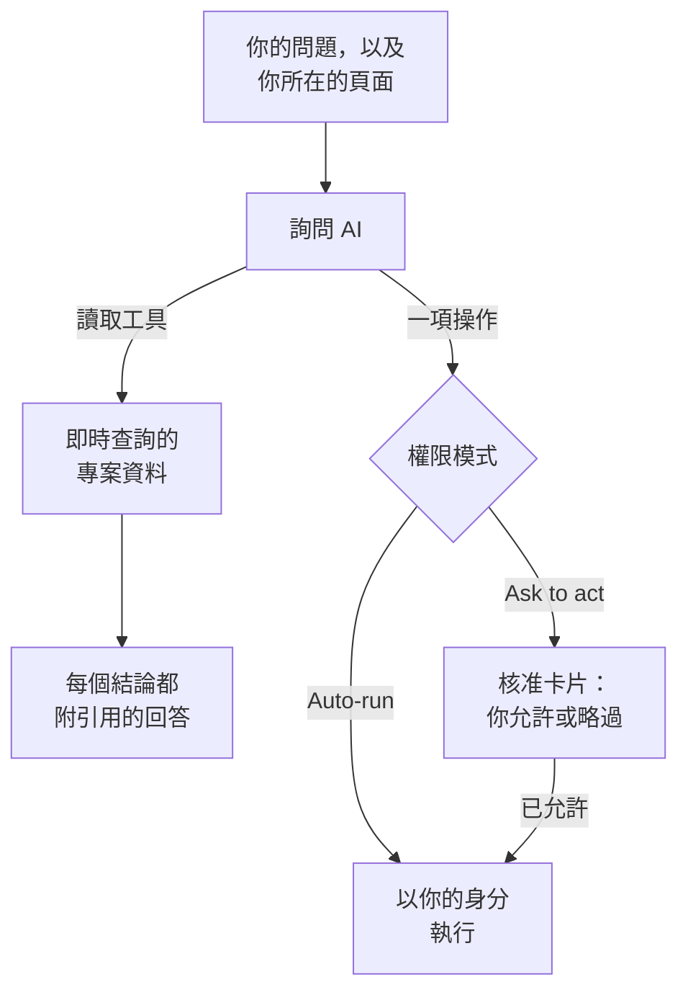

# 詢問 AI

詢問 AI 是 OneUptime 針對你專案資料的聊天。你可以問它日誌、追蹤、指標、例外、事件、警示、監測器、待命、狀態頁面、SLO、運行手冊或工作流程：它會即時查詢你的專案，為每個結論附上引用，並在你允許時代你操作。

:::cards
- [開啟詢問 AI](#開啟詢問-ai): 從頁首、鍵盤、圖表或產品選單開啟。
- [它能看到什麼](#它能看到什麼): 它為了回答你而讀取的資料。
- [操作與權限模式](#操作與權限模式): 決定它能否操作，以及何時先詢問。
- [操作以你的身分執行](#操作以你的身分執行): 用你的權限，每項變更都記在你名下。
:::

## 詢問 AI 如何回答

詢問 AI 只根據其工具傳回的結果回答：它對你的專案執行查詢，而不是憑記憶回答。回答中的每個事實都附有引用標籤，顯示背後的查詢並開啟它讀取的資料。當你請它變更某些內容時，由對話的權限模式決定它是否先詢問你。在你提問之前，它會先讀取專案的 [AI 上下文](/docs/ai/ai-context)：你的團隊為 OneUptime AI 寫下的關於你們自己系統的說明。

在 **唯讀** 模式下，模型永遠不會得到任何操作，因此對話只會讀取。

## 開啟詢問 AI

| 位置 | 方法 |
| --- | --- |
| 任何頁面 | 點選頁首的 **詢問 AI**，或按 `Ctrl` + `I`（Mac 上為 `Cmd` + `I`）。當你在文字方塊或編輯器中輸入時，這組按鍵仍是編輯器的斜體快速鍵。 |
| 命令面板 | 按 `Ctrl` + `K`（Mac 上為 `Cmd` + `K`），然後選擇 **詢問 AI**。 |
| 日誌中的錯誤模式，或圖表的發現 | 點選 **用 AI 說明**：詢問 AI 會開啟，並把證據填成一個你可以在送出前編輯的問題。 |
| 產品選單 | 開啟 **產品 → AI → Chat**。詢問 AI 會在你所在的頁面上方開啟。每個對話都有自己的網址，你可以把它加入書籤，之後再回來。 |

詢問 AI 會在螢幕中央、你所在的頁面上方開啟，在手機上則佔滿整個螢幕。按 `Esc` 或點選旁邊，即可回到頁面。對話會停留在你離開時的樣子：再次開啟詢問 AI 即可繼續。如果你在它還在回答時關閉它，角落的提醒會告訴你回答何時完成，點選即可開啟。

在事件或警示上，**AI Investigation** 卡片有自己的對話 **Ask OneUptime AI**，所有能看到該事件或警示的人共用這個對話：請參閱 [就事件與 OneUptime AI 對話](/docs/ai/ai-sre#與-oneuptime-ai-討論事件)。

## 它能看到什麼

詢問 AI 以你自己的權限讀取你的專案，所以它只能看到你有權看到的內容，不會更多。

| 領域 | 詢問 AI 讀取的內容 |
| --- | --- |
| 遙測 | 日誌搜尋與直方圖、追蹤彙總與 Span 樹、指標、例外、安全事件、真實使用者監測與 Web Vitals、近期變更，以及依據已學習基準的異常檢查。 |
| 基礎設施 | 主機、Docker、Podman、Kubernetes、Docker Swarm、Proxmox、VMware vCenter、Ceph、儲存陣列、無伺服器函式、雲端環境、IoT 裝置群與網路裝置：清單中有什麼、它們回報的連線狀態、指標趨勢、依嚴重程度統計的日誌數量，以及追蹤作業的摘要。一次查詢同時涵蓋指名某個服務的遙測，以及指名某個基礎設施資源的遙測。 |
| 事件回應 | 事件與警示，可依狀態篩選（「現在有什麼正在進行？」），它們的活動時間軸（狀態變更、內部與公開備註、動態）與擁有者，以及搜尋過往事件，以重複利用當時的解決方式。 |
| 待命 | 現在誰在待命、政策與升級鏈，以及最近的呼叫是否已送達並被確認。 |
| AI 自己的工作 | AI SRE 調查與 AI Insights 的結果，讓「AI 發現了什麼？」根據已發布的分析回答，而不是重新推導。 |
| 平台 | 監測器（可依狀態篩選）、排定維護、狀態頁面及其公告、SLO、運行手冊、工作流程執行、探針健康狀況、團隊，以及已連線存放庫中的程式碼。 |

## 頁面情境

詢問 AI 知道你是從哪個頁面開啟它的。在事件頁面上，「為什麼會發生這件事？」指的就是這個事件：輸入區會顯示帶有頁面主題的標籤，它建議的問題也是這個頁面的。移除標籤即可詢問整個專案，也可以用同樣的方式把它加回來。在其他頁面開啟詢問 AI，情境會跟著你。對話也會在伺服器上記住它最初的主題，因此幾天後的追問仍能正確理解「這個事件」。

在事件、警示、監測器或排定維護事件上，建議的問題也會依該記錄目前的狀態而定，每次開啟詢問 AI 時都會讀取。已解決的事件會問回應過程如何以及怎樣防止再次發生，已解決的警示會問它是否是真正的問題以及類似警示觸發得有多頻繁，未正常運作的監測器會問原因。尚未開始的維護事件會問它的監測器在開始前是否正常，已結束的會問它們是否已恢復正常。

基礎設施清單和資源頁面會為你正在檢視的資源類型建議問題。開啟一個 Kubernetes 叢集並問「過去 24 小時有哪些指標改變了？」，或開啟一台 Docker 主機並問「總結過去六小時的日誌嚴重程度與追蹤錯誤。」證據連結會帶你回到資源頁面。讀取會遵守你對專案、資源與遙測的權限，包括擁有者與標籤方面的限制。

在子項目頁面上，情境也會記錄你選取的 Pod、容器、VM、程序或其他子項目。基礎設施工具讀取的是父資源的遙測；它們無法只憑名稱量測某個子項目。詢問 AI 會說明這一點，也不會猜測頁面沒有提供的 Kubernetes 命名空間。連線狀態不等於工作負載的健康狀況，缺少遙測也不代表資源是健康的。

## 在你的基礎設施上執行指令

在 AI 代理程式已連線的資源頁面上開啟時（主機、Docker 或 Podman 主機、Docker Swarm 叢集、Proxmox 叢集、VMware vCenter、Ceph 叢集、資料庫伺服器或 Kubernetes 叢集），詢問 AI 會在你提出要求時透過該代理程式在資源上執行指令，例如「在這台主機上執行 `uptime`」或「顯示 `journalctl -u nginx` 的最後 100 行」。它以傳回的內容作答，並像其他證據一樣附上引用。在事件或警示上開啟時，它可以觸及與之關聯的資源。

- 它只執行 AI 調查在該類資源上可以執行的唯讀指令（請參閱[基礎設施 AI 代理程式](/docs/ai/infrastructure-ai-agents)），每次回答透過每類代理程式最多 30 條，在任何權限模式下都先由 OneUptime 檢查，再由代理程式檢查一次。透過代理程式進行的變更（例如重新啟動服務）絕不會從詢問 AI 執行：它會改為提供確切的指令；代理程式只在 OneUptime AI 處理事件或警示時進行變更，並遵循該資源自己的修正設定。詢問 AI 自己的操作（例如執行某個運行手冊）遵循下文所述的對話權限模式。
- 它只觸及你有權檢視的資源，而且只在該資源的 AI 調查處於開啟狀態時。
- 當它無法在那裡執行指令時（沒有已連線的代理程式、代理程式離線，或該資源的 AI 調查已關閉），它會說明這一點以及需要變更什麼，並改為根據你的專案資料作答。

## 操作與權限模式

每個對話都有一個權限模式，你可以在輸入區、輸入框旁邊選擇：

| 模式 | 會發生什麼 |
| --- | --- |
| **執行前詢問** | 預設模式。詢問 AI 會在核准卡片上提出每項操作，在你為其選擇 **允許** 或 **略過**，或者選擇 **全部拒絕** 之前，什麼都不會執行。 |
| **自動執行** | 模型一提出操作就會執行，但仍限於你的角色允許的範圍。請謹慎使用。 |
| **唯讀** | 模型完全得不到任何操作：詢問 AI 只能讀取。 |

當模式允許時，詢問 AI 可以做的事：

- 建立事件或警示、確認或解決事件與警示，以及變更事件的嚴重程度。
- 將事件或警示連結到它所涉及的基礎設施與服務。在資源頁面（例如主機頁面）上建立的事件或警示會連結到該資源，審核卡片會列出每個動作連結的對象。OneUptime AI 會調查並修復事件或警示所連結的對象。
- 在事件或警示上張貼內部備註。內部備註永遠不會出現在狀態頁面上。
- 在事件上發布公開的狀態更新。這是一項獨立的操作，因為它會通知狀態頁面的訂閱者。
- 呼叫某個待命政策、執行某個運行手冊，或為事件或警示啟動 AI 調查。
- 提議程式碼變更：在 GitHub、GitLab、Forgejo 或 Gitea 上存放庫的新分支上提交，並開啟一個 pull request（在 GitLab 上是合併請求）。它從不寫入預設分支或受保護的分支，因此變更仍由人來合併。

當使用者受到影響時，請讓它建立事件；當某件事需要團隊先關注時，例如主機記憶體持續升高，請讓它建立警示。兩者都只建立一次，不會監視任何內容：若要在每次主機記憶體超過 75% 時收到警示，請從記憶體範本建立一個[主機監控](/docs/monitor/host-monitor#現成的警示範本)，並將閾值設為 75%。詢問 AI 無法建立監測器。被要求建立時，它會如實說明，檢查目前的值，並在已經超過時提議建立一個警示。

## 操作以你的身分執行

詢問 AI 執行的每項操作都以你的身分進行：它做出與儀表板對同一操作相同的變更，使用你在專案中的權限，並且變更記在你名下。在聊天中確認一個事件，會產生與事件狀態面板相同的狀態變更，因此事件的時間軸與動態會顯示是你變更了它的狀態。從聊天送出的呼叫會顯示你是觸發者。

- **每項操作需要什麼。** 即儀表板對同一變更要求的權限。建立事件或警示需要建立它們的權限：可以建立它們的角色，或自訂角色中的 **Create Incident** 或 **Create Alert**。確認或解決事件需要變更其狀態的權限：**專案擁有者**、**專案管理員**、**專案成員**、**事件管理員** 與 **事件成員**，或自訂角色中的 **Create Incident State Timeline**；警示需要針對警示的相同權限（**Create Alert State Timeline**）。呼叫待命政策需要執行它的權限（**Create On-Call Duty Policy Execution Log**），執行運行手冊需要啟動運行手冊執行的權限：可執行運行手冊的角色（僅限其標籤涵蓋的運行手冊），或自訂角色中的 **Create Runbook Execution**，它涵蓋專案中的所有運行手冊。變更事件的嚴重程度、為事件或警示啟動 AI 調查，以及在已連線存放庫中寫入程式碼，需要變更該事件、警示或存放庫的權限。你無權執行的操作會被拒絕，AI 會告訴你需要哪項權限。如果你擁有該權限，但你所屬的某個團隊封鎖了它，AI 會告訴你這一點：對某些標籤的封鎖會讓詢問 AI 對所有記錄拒絕該操作，而不僅是帶有這些標籤的記錄。
- **哪些記錄。** 即你有權變更的記錄，與 OneUptime 其他地方一致：如果你的角色只限於某些標籤或你擁有的記錄，對任何其他記錄的操作都不會產生變更。只有當你啟動運行手冊執行的權限涵蓋某個運行手冊時，它才會執行。在 OneUptime Cloud 上，專案方案未包含的操作會被拒絕，並說明所需的方案。
- **當操作被拒絕時。** 不會有任何變更，AI 會明確告訴你操作沒有執行以及原因，而不是再試一次。
- **Slack、Microsoft Teams 與 AI 調查。** AI 在 Slack 與 Microsoft Teams 中的回答，以及自主 AI 調查，都只會讀取：它們不執行上述任何操作。要從 Slack 或 Microsoft Teams 操作，請使用 OneUptime 訊息上的按鈕，它們同樣以你的身分執行（請參閱 [Slack](/docs/workspace-connections/slack#從-slack-處理事件警示和活動) 與 [Microsoft Teams](/docs/workspace-connections/microsoft-teams#從-microsoft-teams-處理事件警示和活動)）。

## 引導對話

- **停止它。** 詢問 AI 運作時，送出按鈕會變成停止按鈕。你可以隨時停止執行，並立即改問其他問題。
- **追蹤它的工作。** 回答時，一行文字會說明它目前在做什麼，例如搜尋日誌。點選旁邊的步驟數即可查看每個步驟。
- **選擇模型。** 當你的專案可以使用多個 LLM 提供者時，輸入區的提供者選擇器會列出你專案的 LLM 提供者與全域提供者，並標出預設的那一個。新對話使用預設提供者。
- **為回答評分。** **回答很好** 與 **回答不佳** 會與訊息一起儲存，以便長期衡量回答品質。
- **查看費用。** 每個回答下方的來源可以展開為它執行的查詢，最新回答的來源還會顯示它執行的查詢數量、token 數與費用。回答中的每個引用標籤都可開啟其背後的資料。
- **保留副本。** **下載對話** 可透過 **下載為 Markdown** 儲存對話（方便閱讀或貼到工單），或透過 **下載為 PDF** 儲存（方便交給他人）。
- **從上次停下的地方繼續。** 詢問 AI 頁首中的 **所有對話** 依新到舊列出你的對話，可以再次開啟或刪除。新對話的開始畫面會顯示最近的三個。

## 需求

- **一個 LLM 提供者。** 詢問 AI 使用專案的預設 LLM 提供者（請參閱 [LLM 提供者](/docs/ai/llm-provider)）。在 OneUptime Cloud 上，它開箱即可使用全域提供者，費用從專案的 AI 點數支付；自行託管的安裝需要設定一個提供者，或設定全域提供者的環境變數。回答的品質取決於模型：沒有可靠工具呼叫能力的小型自行託管模型回答得很差。
- **OneUptime Cloud 上的 Growth 方案。** 方案較低的專案會看到 AI 不包含在其方案中的提示，並附有指向 **專案設定 → 帳單與發票 → 帳單** 的連結。
- **為專案開啟 AI。** **專案設定 → 人工智慧 → AI Features** 上的 **啟用 AI** 會關閉專案的所有 AI 功能，包括詢問 AI。除非有人關閉，否則它保持開啟。

當專案設定了自己的每日 AI 限額時，詢問 AI 也會計入其中（專案設定 → 人工智慧 → AI Features → 更多設定）：一旦達到某個限額，詢問 AI 會顯示一句話，說明達到了哪個限額、OneUptime AI 將在 UTC 午夜重新開始，以及誰可以提高或移除該限額。每天第一次達到限額時，專案擁有者會收到一封電子郵件。事件與警示的每日限額從不會讓詢問 AI 停止。請參閱 [專案自己的每日限額](/docs/ai/ai-sre#專案自身的每日限制)。

## 疑難排解

:::details 詢問 AI 顯示 AI 無法使用
詢問 AI 會在你輸入前說明原因：專案方案不包含 AI、**啟用 AI** 已關閉，或專案沒有 LLM 提供者。每則提示都會連結到可以變更它的頁面。
:::

:::details 某項操作被拒絕
詢問 AI 會說明該操作需要哪項權限，或是哪個團隊封鎖了它。請有權進行變更的人來處理，或請專案擁有者為你的角色授予該權限。沒有任何變更。
:::

:::details 回答含糊，或從不使用資料
檢查提供者背後的模型。詢問 AI 需要能可靠呼叫工具的模型；小型本機模型常常一個查詢都不執行就回答。請參閱 [LLM 提供者](/docs/ai/llm-provider)。
:::

## 後續步驟

:::cards
- [AI SRE](/docs/ai/ai-sre): 讓 OneUptime AI 調查每個新的事件與警示。
- [LLM 提供者](/docs/ai/llm-provider): 選擇詢問 AI 與其他 AI 功能使用的模型。
- [MCP 伺服器](/docs/ai/mcp-server): 改從 Claude、Cursor 或 VS Code 詢問 OneUptime。
:::
