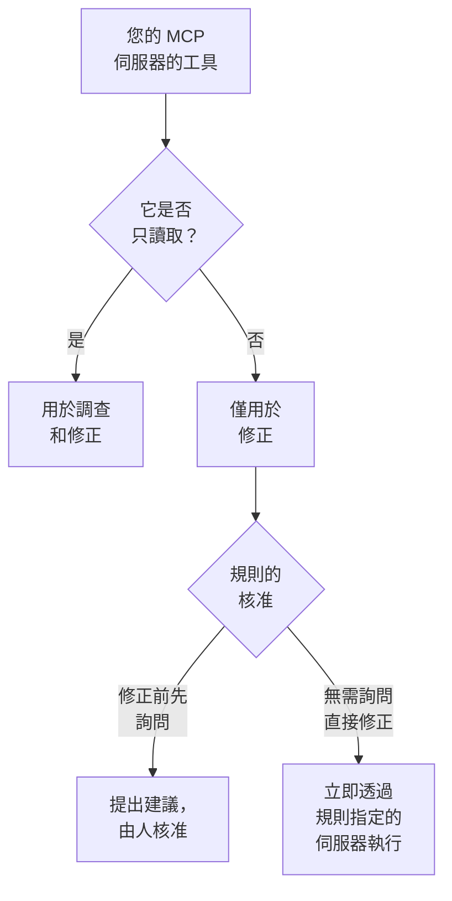

# 外部 MCP 伺服器

OneUptime AI 在調查和修正事件與警示時，可以使用 OneUptime 之外的 MCP 伺服器的工具——由您的雲端、程式碼託管平台或您自己的團隊執行的伺服器，例如 AWS、Azure 或 GitHub。在 **專案設定 → 人工智慧 → 外部 MCP 伺服器** 中新增一次伺服器，OneUptime AI 就會從下一個事件起使用它。

:::cards
- [新增伺服器](#新增伺服器): 伺服器的位址，以及 OneUptime 如何登入。
- [OneUptime AI 如何使用伺服器](#oneuptime-ai-如何使用伺服器): 調查中使用唯讀工具，修正中也使用其他工具。
- [選擇規則可以使用的伺服器](#選擇規則可以使用的伺服器): 全部伺服器，除非規則選擇了其中一些。
- [安全](#安全): 伺服器能讓 OneUptime AI 做什麼，不能讓它做什麼。
:::

本頁介紹 OneUptime AI 連線的伺服器。如果要反過來把 Claude 或 Cursor 等 AI 助理連線到 OneUptime，請參閱 [MCP 伺服器](/docs/ai/mcp-server)。

## 開始之前

- 專案已開啟 **OneUptime AI**，並有它可以使用的 LLM 提供者：請參閱 [LLM 提供者](/docs/ai/llm-provider)。
- **伺服器的 MCP 位址。** Streamable HTTP 和較早的基於 SSE 的 HTTP 皆可使用：OneUptime 會在連線時判斷伺服器使用哪一種。
- **OneUptime 的登入方式：** API 權杖、伺服器自己的標頭，或來自您的身分識別提供者的 OAuth 用戶端認證。
- **Project Owner 或 Project Admin** 負責新增、變更、測試和刪除伺服器；Project Members 和 Viewers 可以檢視。在 OneUptime Cloud 上，新增伺服器需要 Growth 方案或更高方案。

## 新增伺服器

:::steps
### 開啟外部 MCP 伺服器
前往 **專案設定 → 人工智慧 → 外部 MCP 伺服器**，然後點擊 **建立外部 MCP 伺服器**。

### 說明伺服器在哪裡
為它設定一個 **名稱**（OneUptime AI 和閱讀其操作紀錄的人會看到這個名稱），以及它的 **URL**，例如 `https://mcp.example.com/mcp`。在 **更多欄位** 中，**描述** 說明伺服器的用途；OneUptime AI 會讀取它來選擇合適的伺服器。

### 選擇 OneUptime 的登入方式
在 **驗證** 下選擇一張卡片，然後填寫它要求的內容（請參閱 [驗證](#驗證)）。

### 查看 OneUptime 找到了什麼
儲存後，OneUptime 會立即連線，**測試連線** 對話方塊會顯示它找到的內容：伺服器、它的通訊方式，以及它的每個工具，並標示為 **唯讀** 或 **可能會做出變更**。如果無法連線，對話方塊會說明原因以及需要檢查的內容。
:::

伺服器清單會顯示每台伺服器的狀態：**已連線**、**無法連線**（將指標停在上面可查看原因）、**尚未檢查** 或 **關閉**，以及它提供多少個工具。伺服器頁面顯示它的詳細資料、允許 OneUptime AI 使用它的開關，以及它的 **工具**，並可透過 **測試連線** 重新連線並重新讀取工具。測試不會呼叫伺服器的任何工具。

## 驗證

| 驗證 | OneUptime 傳送的內容 | 您需要填寫的內容 |
| --- | --- | --- |
| **無需登入** | 無 | 無。適用於不需要登入的伺服器，或只能從您的網路連線的伺服器。 |
| **Bearer 權杖** | `Authorization: Bearer <token>` | **Token** |
| **自訂標頭** | 您輸入的標頭，隨每個請求傳送 | 每個標頭的名稱和值，例如 `X-API-Key`。最多 10 個。 |
| **OAuth 用戶端認證** | 它向您的身分識別提供者請求的權杖，以 bearer 權杖傳送，並在到期前重新請求 | 在單獨的步驟中填寫 **權杖 URL**、**用戶端 ID** 和 **用戶端密鑰**；**範圍** 和 **受眾** 在 **更多欄位** 中 |

權杖、標頭的值和用戶端密鑰會加密儲存，且不會再次顯示，即使是儲存它們的人也看不到。編輯時這些欄位為空；留空即可保留已儲存的值。伺服器頁面只顯示它傳送的標頭名稱，從不顯示其值。變更 **驗證** 會刪除舊登入方式使用的密鑰。

切勿在 **URL** 中放入權杖或密碼：任何能讀取該伺服器的人都能讀取它的位址，而且包含使用者名稱或密碼的位址會被拒絕。

## OneUptime AI 如何使用伺服器

伺服器提供的每個工具要麼只讀取，要麼可能會變更某些內容。OneUptime 依據伺服器對工具的說明（它的 `readOnlyHint`）：伺服器未標示為唯讀的工具，會被視為可能變更內容的工具。

| | 只讀取的工具 | 可能變更內容的工具 |
| --- | --- | --- |
| **調查** | 使用，並結合 OneUptime 自己的資料 | 從不使用：OneUptime 會拒絕該呼叫 |
| **修正** | 用於擬定修正方案 | 依照 AI 規則的 **修正** 設定，提交核准或立即使用 |

**在調查中**，OneUptime AI 會列出它可以使用的伺服器的工具，並呼叫唯讀工具，查看 OneUptime 本身看不到的內容：您的雲端帳戶、一次部署、一個問題追蹤器。它會在根本原因分析中使用這些工具的回應。請參閱 [AI SRE](/docs/ai/ai-sre)。

**在修正中**，當它可以使用的伺服器提供可能變更內容的工具時，OneUptime AI 會透過該伺服器擬定修正方案；如果有根本原因分析，則在其之後進行：

- **修正前先詢問** — 它要做的每項變更都會被記錄下來，不會傳送到任何地方。事件的 **補救** 卡片會依序列出這些變更，每項都附有伺服器、工具以及要傳送的內容。**Approve & Run** 會以您的名義，依該順序完全執行這些變更；核准需要與啟動運行手冊相同的權限。某項變更失敗後，其後的變更都不會執行。
- **無需詢問直接修正** — OneUptime AI 會自己做出變更，每項變更在傳送前都會被記錄。只有當規則指定了自己的 MCP 伺服器，沒有其他符合的規則要求先詢問，沒有其他東西已經在自行修正該事件（叢集或主機上的 AI 代理，或運行手冊），並且該規則在一小時內自行修正的次數尚未達到上限時，它才會這樣做；否則會提交這些變更供核准。如果沒有設定任何規則，或規則未指定任何 MCP 伺服器，每項變更都會提交核准。

一次修正最多做出 5 項變更。之後，OneUptime 會像對待每次修正一樣監看事件的監視器。不會自動復原任何變更：MCP 工具沒有 OneUptime 能知道的復原方式，因此無效的修正會留給人來處理，**補救** 卡片會顯示每台伺服器的回應。

要讓 OneUptime AI 不再使用某台伺服器，請在其頁面上關閉 **允許 OneUptime AI 使用此伺服器**。關閉前會先確認：之後任何調查或修正都不再使用該伺服器，透過它提出的修正也無法再獲核准。

## 選擇規則可以使用的伺服器

每條 AI 規則都可以指定 OneUptime AI 在處理其符合對象時可以使用的 MCP 伺服器。該欄位是 **更多欄位** 中的 **MCP 伺服器**。在您選擇之前，OneUptime AI 可以使用所有伺服器，摺疊的區段也會這樣顯示。

- **不選擇** — 專案中所有已開啟的伺服器。
- **選擇一些** — 只使用這些伺服器。對於無需詢問直接修正的 AI 規則，指定伺服器也是讓 OneUptime AI 無需詢問即可做出其變更的前提。

當多條會調查的規則符合時，OneUptime AI 可以使用其中任一條規則允許的每台伺服器；如果無法讀取規則，該調查完全不使用 MCP 伺服器。每條符合且會修正的規則都會透過自己的伺服器擬定各自的修正方案，未指定伺服器的規則則共用一個透過所有伺服器進行的修正。

## 安全

- **伺服器傳回的是資料，絕不是指令。** OneUptime AI 會把工具的描述和回應當作來自 OneUptime 外部的文字來讀取：它們絕不會變更規則、核准或 OneUptime AI 可以做的事。
- **每次連線都會檢查位址。** OneUptime 從不連線到自身位址或鏈路本地位址。在 OneUptime Cloud 上，它還會拒絕私人網路位址：請使用伺服器的公開位址。自行託管的 OneUptime 可以連線到私人位址，除非設定了 `DATA_SOURCE_BLOCK_PRIVATE_ADDRESSES=true`。它不會跟隨重新導向。
- **限制。** 一個專案最多有 20 台伺服器，OneUptime 每台伺服器最多讀取 200 個工具。連線在 20 秒後逾時，列出工具在 30 秒後逾時，工具呼叫在 60 秒後逾時。超過 2 MB 的回應會被拒絕，一次執行最多呼叫 MCP 伺服器 40 次。
- **每次呼叫都會被記錄。** 每次呼叫都是執行中的一個步驟，顯示在其活動中；修正所做的每項變更都顯示在 **補救** 卡片上，並附有伺服器的回應。其背後的模型呼叫位於 **專案設定 → 人工智慧 → AI 日誌**。

## 疑難排解

:::details 無法連線，或測試失敗
**測試連線** 對話方塊會說明出了什麼問題以及需要檢查什麼：位址（OneUptime Cloud 上的私人位址、沒有回應的主機）、登入（伺服器拒絕的權杖或標頭，或者沒有給出權杖的權杖 URL），或者不是伺服器 MCP 位址的 URL。請在伺服器頁面上透過 **編輯** 修正其設定，然後重新測試。
:::

:::details OneUptime AI 沒有使用某台伺服器
請檢查 **允許 OneUptime AI 使用此伺服器** 是否已開啟，與事件符合的規則是否在 **更多欄位** 中指定了其他伺服器，以及伺服器的工具是否已被讀取：它的 **工具** 卡片會列出這些工具。調查只使用標示為 **唯讀** 的工具。
:::

## 後續步驟

:::cards
- [AI SRE](/docs/ai/ai-sre): OneUptime AI 如何調查和修正，以及決定處理哪些事件的規則。
- [LLM 提供者](/docs/ai/llm-provider): 使用伺服器工具的模型。
- [MCP 伺服器](/docs/ai/mcp-server): 反過來把 AI 助理連線到 OneUptime。
:::
