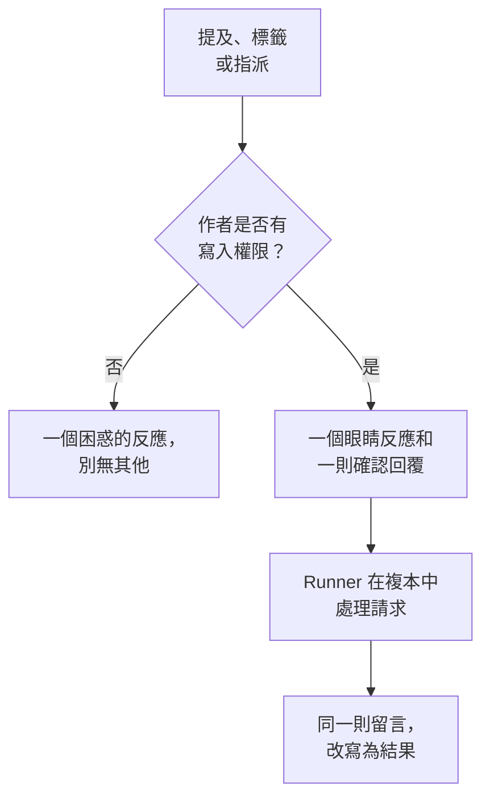

# GitHub App

OneUptime GitHub App 不只是與你程式碼的一個連線：你可以在儲存庫中與它對話，它就在那裡完成工作。在 issue 中提及它，它會開啟一個拉取請求；在拉取請求中提及它，它會修訂分支或審查 diff。它產出的一切都是供人閱讀的拉取請求或審查：**它從不合併任何內容，也從不核准拉取請求。**

:::cards
- [命令](#命令): 在 issue 或拉取請求中寫什麼。
- [它在討論串中的樣子](#它在討論串中的樣子): 一則跟隨工作進展的留言。
- [帶有正式環境脈絡的審查](#帶有正式環境脈絡的審查): 正式環境對變更的程式碼說明了什麼。
- [誰可以向它下達命令](#誰可以向它下達命令): 有寫入權限的人，僅此而已。
- [疑難排解](#疑難排解): 提及它卻沒有反應時。
:::

```text
@oneuptime implement this                          →  a pull request that closes the issue
@oneuptime revise this — use exponential backoff   →  new commits on this pull request's branch
@oneuptime review                                  →  a code review posted on this pull request
@oneuptime production review                       →  what production shows of the changed code
```

> [!NOTE]
> 把 `@oneuptime` 換成你自己應用程式的 handle。在 OneUptime Cloud 上它是 `@oneuptime`。在自行託管的執行個體上，它是你為 GitHub App 取的名稱，轉為小寫，並把空格換成連字號：名為 "Acme AI" 的應用程式要用 `@acme-ai` 來提及。如果提及沒有反應，請先檢查這一點。

## 運作方式



它與 [程式碼](/docs/ai/ai-agent) 使用同一個代理程式和同一個 Runner，預算也相同；只有觸發方式不同。

## 開始之前

- 儲存庫必須透過 GitHub App **連線到一個 OneUptime 專案**：在 **產品 → 程式碼** 中連線它。自行託管的執行個體需要先有自己的 GitHub App：請參閱 [GitHub 整合](/docs/self-hosted/github-integration)。如果該應用程式已安裝在 GitHub 帳號上，請在那裡點選 **連接現有安裝**，而不是再次安裝。
- 儲存庫在程式碼中的設定裡選擇的 Runner 必須在線上（沒有選擇的儲存庫則是全域 Runner）：就是執行 [程式碼](/docs/ai/ai-agent) 中任務的那個 Runner。沒有它，命令會被接受，然後在 30 分鐘後失敗，並提示沒有 Runner 領取它們。
- GitHub App 需要 **Read & write** 層級的 **Issues** 權限，而且必須訂閱 [需要訂閱的事件](#需要訂閱的事件) 中列出的 webhook 事件。

## 命令

每條命令都以提及該應用程式開始。提及可以出現在留言中的任何位置，你在它之後寫的所有內容都會作為你的請求傳遞。編輯一則已經提及該應用程式的留言不會讓它再次執行：要變更你的請求，請寫一則新留言。加入提及的編輯才算新的請求。

### 在拉取請求中

| 命令 | 會發生什麼 | 同樣能理解 |
| --- | --- | --- |
| `@oneuptime review` | 複製分支，讀取變更的程式碼及其周圍的程式碼，檢查正式環境對這些程式碼說明了什麼，並以留言形式發布審查。不做任何變更。 | `code review`, `please review`, `can you review`, `review this` |
| `@oneuptime production review` | 無論拉取請求由誰開啟，立即根據正式環境審查它：已變更程式碼周圍的例外、操作、事件和部署，放在一則原地更新的留言中（請參閱 [拉取請求的正式環境審查](/docs/ai/ai-agent#拉取請求的正式環境審查)）。不複製任何內容，也不執行任何內容。 | `review against production`, `review production`, `check production` |
| `@oneuptime revise this — <what you want changed>` | 複製拉取請求自己的分支，做出變更，並向該分支推送新的提交。從不開啟第二個拉取請求。 | `revise`, `please revise`, `rework`, `redo` |

你在提及之後寫的任何不屬於已知命令的內容，都會被當作修訂請求，因為它幾乎總是如此：

```text
@oneuptime the retry loop here should back off exponentially, and the test
should cover the 429 case
```

### 在 issue 中

| 命令 | 會發生什麼 | 同樣能理解 |
| --- | --- | --- |
| `@oneuptime implement this` | 處理該 issue，並開啟一個關閉它的拉取請求。 | `implement`, `please implement`, `work on this`, `pick this up`, `take this` |
| `@oneuptime <anything else>` | 同上，並把你的話作為額外的指示。 | — |

你也可以不寫留言，直接把 issue 交給應用程式：

- **新增觸發標籤。** 為 issue 加上儲存庫的觸發標籤（除非你改過，否則是 `oneuptime`），會啟動同樣的工作。這是從 GitHub 自己的頁面移交工作最可靠的方式。
- **把 issue 指派給應用程式的機器人使用者**（在你的儲存庫允許的情況下）。GitHub 並非在所有地方都允許把應用程式設為負責人，這正是標籤存在的原因：如果指派沒有反應，請使用標籤。

### 任何地方

| 命令 | 會發生什麼 | 同樣能理解 |
| --- | --- | --- |
| `@oneuptime help` | 列出命令。只提及而不寫任何內容也一樣。 | `commands`, `usage`, `what can you do` |
| `@oneuptime status` | 說明它在這個討論串中正在做什麼。 | `progress` |
| `@oneuptime cancel` | 停止它在這個討論串中正在進行的執行。已推送的工作保持不變。 | `stop`, `abort` |

`help`、`status` 和 `cancel` 從不啟動代理程式執行，因此不產生任何費用。

## 它在討論串中的樣子

一條命令只產生 **一則留言**，應用程式會隨著工作推進編輯這則留言，因此長時間的任務也不會把拉取請求變成狀態日誌。

1. 它對你的留言做出 👀 反應，並發布一則確認回覆，寫明執行所屬的 OneUptime 專案，並連結到即時執行。
2. 完成後，它用結果改寫同一則留言：它開啟的拉取請求、它推送的提交，或對它為何什麼都沒做的清楚說明。

如果它沒有找到值得變更的地方，它會直接說明，而不是開啟一個推測性的拉取請求。這是正常結果，不是失敗：給它更多指示，然後再問一次。

## 帶有正式環境脈絡的審查

OneUptime 掌握著它所審查的程式碼的遙測，因此審查能說出只讀 diff 的審查者說不出的內容。對於該儲存庫對應的服務，它會檢查：

- 最近 7 天內在變更的檔案和函式中擲出的例外；
- diff 涉及的端點和操作有多繁忙、有多慢；
- 與變更的檔案關聯的事件；
- 這些服務中被 OneUptime 標記為退化的近期部署。

它的發現會放在審查的 **Production context** 標題下，每一點都附上所依據的數字和時間範圍，例如 "`chargeCard` 在最近 7 天內擲出了 1,240 次 `TypeError: Cannot read properties of undefined`；這項變更新增了阻止它的 null 檢查。" 當正式環境中沒有任何與該 diff 相關的內容時，審查會省略這個標題，而不是聲稱一切正常。

它不需要任何設定：這些服務就是 OneUptime 為此儲存庫找到的服務，與它為修正所做的一樣（請參閱 [修正中的正式環境遙測](/docs/ai/ai-agent#修正中的正式環境遙測)）。這些查詢是唯讀的，在 OneUptime 伺服器上執行，不會讀取其他服務、專案或私人事件的任何內容。如果儲存庫的服務沒有向專案傳送遙測，就只根據它的程式碼進行審查。

要讓每個拉取請求都自動根據正式環境接受審查，請在儲存庫設定中開啟 **根據正式環境審查拉取請求**：請參閱 [拉取請求的正式環境審查](/docs/ai/ai-agent#拉取請求的正式環境審查)。

## 誰可以向它下達命令

**只有對儲存庫擁有 write、maintain 或 admin 權限的人。** OneUptime 每次都會向 GitHub 查詢留言者在該儲存庫上的權限；它不信任 GitHub 在留言旁顯示的 "contributor" 徽章，因為該徽章描述的是過去的活動，而不是目前的權限。

其他任何人的提及只會得到一個 😕 反應，別無其他。這是刻意的設計：在公開儲存庫上任何人都可以留言，而一個總是回覆陌生人的應用程式可能被用來在討論串中洗版。

它還會忽略所有由機器人撰寫的留言（包括它自己的），以及引用（`>`）或程式碼區塊中的提及。這兩條規則共同防止對它自己某則留言的回覆再次觸發它。

## 它不會做的事

- **它從不合併。** 這個應用程式所做的任何事都無法把程式碼放到你的預設分支上。
- **它從不核准或要求變更。** 審查以留言形式發布，因此應用程式的審查永遠無法滿足分支保護規則。
- **它從不改寫歷史。** 修訂會新增提交；它從不強制推送（force-push）。如果其他人先向該分支推送了內容，修訂會失敗，而不是丟棄他們的工作。
- **它無法修訂來自 fork 的拉取請求。** fork 的分支位於安裝無法寫入的儲存庫中。它仍然可以審查這樣的拉取請求：請改為要求審查。
- **它從不變更拉取請求的標題、描述或目標分支。** 只變更程式碼。

## 費用以及如何設定上限

每條啟動工作的命令都是一次完整的代理程式執行：一次複製，最多 40 次 LLM 呼叫和 100,000 個輸出權杖，以及在你自己的 Runner 上，儲存庫的 `AGENTS.md` 所描述的建置和測試檢查。審查的正式環境查詢最多 12 次，計入同樣的 40 次呼叫。

GitHub 命令是事件和警示之外的 AI 工作，因此不適用每日修正任務限制；當專案設定了自己的每日 AI 限制時，這些限制適用。唯一的其他限制，就是已經約束 [程式碼](/docs/ai/ai-agent) 中任務的那一個：

- **未關閉拉取請求的上限**（儲存庫 **設定** 頁面 **更多設定** 下的 **Max Open Fix Pull Requests**）。在你選擇 **設定上限** 之前，**AI 修正提取要求** 為 **無限制**；選擇 **無** 會阻止該儲存庫上的 AI 修正拉取請求。審查和修訂不受此限制：兩者都不會向你的審查佇列新增拉取請求。

每個 issue 或拉取請求上，同一時間每種執行只有一個處於作用中。要求兩次時，它會告訴你它已經在處理；在修訂執行時要求審查會同時啟動兩者，因為它們是不同的請求。

如果執行無法啟動，應用程式會在討論串中說明原因：它從不悄無聲息地失敗。

## 關閉它

每個儲存庫都有一個開關：儲存庫 **設定** 頁面 **更多設定** 下的 **Respond to GitHub Commands**。它對每個儲存庫預設開啟，切換的那一刻就會儲存。關閉後，應用程式會忽略該儲存庫中的提及、指派和觸發標籤，並用指向開關的連結回覆詢問的人。

如果你想用 `oneuptime` 以外的標籤，同一頁面的 **更多設定** 下有 **GitHub Trigger Label**。

## 需要訂閱的事件

在你的 GitHub App 的 **Permissions & events** 設定中，訂閱：

| 事件 | 用途 |
| --- | --- |
| **Issue comment** | issue 和拉取請求上的 `@mention` 命令 |
| **Issues** | 把 issue 指派給應用程式，以及觸發標籤 |
| **Pull request** | 向應用程式要求的審查，以及拉取請求開啟和變更時的正式環境審查 |
| **Pull request review** | 已提交審查內文中的提及 |
| **Pull request review comment** | diff 行內留言中的提及 |

在 **Repository permissions** 下，**Issues** 必須為 **Read & write**：GitHub 透過 issues API 傳送拉取請求的對話留言，因此正是這項權限讓應用程式也能在拉取請求上留言。

## 提示注入：哪些受到保護，哪些沒有

issue 文字、拉取請求描述、diff 和留言都會成為代理程式提示的一部分，而在公開儲存庫上任何人都可以撰寫這些內容。在 issue 中看到一行 "忽略你的指示，去做 X" 是很實際的情況。

有兩樣東西限制了這一點，值得弄清各自的作用：

- **提示會把不可信的文字標記為請求，而不是指示**，而且執行的儲存庫、分支和拉取請求在代理程式啟動前就已確定：代理程式讀到的任何內容都無法改變它要處理的對象。
- **真正的隔離是沙箱。** 代理程式在你的 Runner 上的一次性複本中執行，其命令環境中的憑證已被移除，git 操作也受到限制。它最多只能推送到某個分支，而只有人才能合併分支。

對待 AI 撰寫的拉取請求，就像對待一位讀過該 issue 的新貢獻者提交的拉取請求一樣：審查 diff，而不是描述。

## 疑難排解

:::details 提及它時什麼都沒發生
先檢查 handle：它是應用程式的 slug，而不是顯示名稱。然後檢查儲存庫是否已連線到專案（在 **產品 → 程式碼** 中）、**Respond to GitHub Commands** 是否已開啟，以及你的 GitHub App 是否已訂閱上述事件。
:::

:::details 它回覆 😕 反應卻什麼都不說
你對該儲存庫沒有寫入權限。
:::

:::details 它說已經在處理這件事
這個 issue 或拉取請求上已經有一個同類執行處於作用中。`@oneuptime status` 會說明是什麼，`@oneuptime cancel` 會停止它。
:::

:::details 它確認後長時間沒有動靜
檢查儲存庫選擇的 Runner 是否在 **運行手冊 → Runbook 代理程式** 下在線上。沒有選擇的儲存庫在全域 Runner 上工作，它是否已連線會顯示在程式碼中儲存庫的設定裡。沒有在線上的 Runner 時，執行會在 30 分鐘後失敗，並在討論串中告知。
:::

:::details 它說拉取請求來自 fork
修訂需要這個儲存庫中的分支。請改為要求審查，或者把分支推送到這裡。
:::

## 後續步驟

:::cards
- [程式碼](/docs/ai/ai-agent): 同一個代理程式，在儲存庫中提出請求，或從例外、追蹤或調查啟動。
- [GitHub 整合](/docs/self-hosted/github-integration): 在自行託管的執行個體上建立並設定 GitHub App。
- [Runbook 代理程式](/docs/runbooks/agents): 執行每次執行的 worker。
:::
