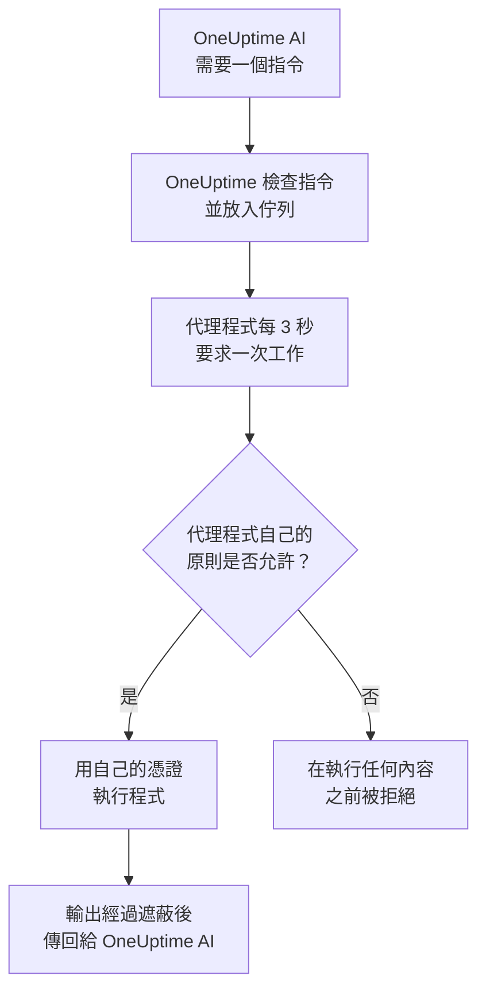

# 基礎設施 AI 代理程式

OneUptime AI 在調查事件或警示時，能看到的不只是您的遙測資料。安裝在您某個資源旁邊的小型代理程式——Docker 或 Podman 主機、Docker Swarm 叢集、Proxmox 叢集、VMware vCenter、Ceph 叢集、資料庫伺服器或 Linux 主機——會執行 OneUptime AI 要求的唯讀指令，例如 `docker logs --tail 200 web`、`pvesh get /cluster/status`、`ceph health detail`、`db long-queries --min-seconds 30` 或 `journalctl -u nginx -n 200 --no-pager`，並把輸出傳回，因此根本原因分析會引用資源本身提供的資訊。如果您允許，同一個代理程式也會套用修正——重新啟動容器、啟動虛擬機器、將 OSD 重新標記為 in——每項修正都由指令原則歸入某個層級，而且除非您另作選擇，都要先由人核准。在資源頁面上開啟的詢問 AI，也會在您提出要求時執行同樣的唯讀指令（請參閱[詢問 AI](/docs/ai/ask-ai)）。

AWS 帳戶、Azure 訂用帳戶或 Google Cloud 專案不需要代理程式即可接受調查：OneUptime 會透過連線時所用的唯讀連線即時讀取它。只有它的修正才需要代理程式，也就是雲端 AI 代理程式，它在該帳戶本身中執行，只需在帳戶頁面上執行一個指令即可完成設定（請參閱 [在雲端帳戶中](#在雲端帳戶中)）。

這些代理程式就是 **資源 AI 代理程式**。每個資源的儀表板頁面都有一個 **人工智慧** 區段，包含三個頁面：

- **洞察** ——OneUptime AI 在過去 30 天內對該資源的了解：反覆出現的問題及其原因（附上 AI 的發現和建議的步驟）、造成其中大部分問題的資源部分、沒有效果或正在等待核准的修正、AI 自行修正的內容，以及在任何人被呼叫之前發現的風險，並以註腳說明 AI 自己在那裡做了什麼。它的運作方式與叢集的頁面相同，請參閱 [AI 在叢集上了解到的情況](/docs/ai/ai-sre#ai-在叢集上了解到的情況)。
- **日誌** ——OneUptime AI 在該資源上做過的所有事情，依從新到舊排列：每次調查及其事件或警示和摘要、它提出或執行的每項修正，以及它透過代理程式傳送的每個指令。（此頁面以前叫作「洞察」。）
- **AI 代理程式** ——代理程式是否已連線、AI 可以在該資源上做什麼（調查，以及修正的執行方式）、需要注意的任何事項及其解決步驟，以及代理程式狀態旁 **⋯** 選單中的 **測試連線** 和 **重設代理程式**。

資源的 **概覽** 最後有一張 **AI 代理程式** 卡片，彙整 AI 代理程式頁面的內容：代理程式是否已連線、調查是否開啟、修正如何執行（**關閉**、**請求核准**、**自動** 或 **略過核准**）以及需要注意的事項，並附有連到 AI 代理程式頁面的連結，可在那裡變更這些設定。

:::cards
- [支援的資源](#支援的資源): 十一種資源，一個映像檔。
- [安裝 AI 代理程式](#安裝-ai-代理程式): 在您已在執行的收集器旁邊、在 Linux 主機上，或透過一個指令在雲端帳戶中。
- [修正的運作方式](#修正的運作方式): 什麼可以自行執行，什麼需要等待人，什麼永遠不會執行。
- [安全性模型](#安全性模型): 每個指令都有三重檢查，而且不會從 OneUptime 取得任何憑證。
:::

## 運作方式

代理程式從不等待來自 OneUptime 的連線：它主動連線到 OneUptime、要求工作，並且只用自己已有的憑證執行它自己那份指令原則副本所允許的內容。



## 與 Kubernetes AI 代理程式的關係

Kubernetes 叢集有自己的代理程式，也就是 Kubernetes AI 代理程式，由 Kubernetes 代理程式的 Helm chart 安裝，請參閱 [叢集存取——讓 OneUptime AI 執行 kubectl](/docs/ai/ai-sre#叢集存取讓-oneuptime-ai-執行-kubectl)。本頁的任何內容都不會改變它。資源 AI 代理程式遵循相同的設計：

- **相同的層級與模式。** 每個指令都是 **Read**、**SafeWrite**、**RiskyWrite** 或 **Denied**，修正則是 **關閉**、**請求核准**、**自動** 或 **略過核准**，含義與叢集上相同。
- **相同的三重檢查。** 同一份指令原則由 OneUptime 的 AI 工具執行，在 OneUptime 將指令放入佇列時再執行一次，並在代理程式執行任何內容之前再由代理程式執行一次。
- **相同的憑證規則。** 代理程式只使用其自身環境和掛載提供給它的內容。OneUptime 從不傳送憑證給它。
- **相同的預設值。** AI 調查預設為開啟：資源與叢集一樣，以調查開啟、修正關閉的狀態開始，因此代理程式一連線，OneUptime AI 就會透過它進行調查，而且在有人允許修正之前不會變更任何內容（請參閱 [連線到 OneUptime](#連線到-oneuptime)）。

不同之處：

- **所有資源共用一個映像檔。** `oneuptime/resource-ai-agent` 服務全部十一種資源，`ONEUPTIME_AI_AGENT_RESOURCE_TYPE` 指明代理程式服務的是哪一種。它以資源收集器旁的另一個容器執行，或在它所服務的雲端帳戶中執行，而不是來自 Helm chart。
- **寫入權限是一個環境變數。** 只有代理程式上設定了 `ONEUPTIME_AI_ALLOW_WRITES=true`，它才能套用修正，而 `ONEUPTIME_AI_WRITE_TARGETS` 限制修正可以碰觸哪些容器、服務、虛擬機器、OSD、工作階段或單元。在叢集上，這由 chart 的 RBAC 和 `aiAgent.remediation.namespaces` 負責。

與 Kubernetes AI 代理程式一樣，資源 AI 代理程式不是 Runner。它從不出現在 運行手冊 → Runbook 代理程式 下，也從不被當作運行手冊的 Bash 或 SSH 主機使用。

## 支援的資源

| 資源 | `ONEUPTIME_AI_AGENT_RESOURCE_TYPE` | 代理程式 | 註冊時使用的名稱（收集器的變數） | 執行的程式 | 存取資源的方式 |
| -------------------- | ---------------------------------- | --------------------- | ----------------------------------------------------------------------------------------------- | -------------------------------------------------------------------------------------------------------------------------------------------------- | -------------------------------------------------------------------------- |
| Docker 主機 | `docker` | Docker AI 代理程式 | `DOCKER_HOST_NAME` | `docker` | Docker 通訊端，`/var/run/docker.sock` |
| Podman 主機 | `podman` | Podman AI 代理程式 | `PODMAN_HOST_NAME` | `docker`，透過 Podman 的 Docker 相容 API | Podman 通訊端，`/run/podman/podman.sock` |
| Docker Swarm 叢集 | `docker-swarm`（或 `swarm`） | Docker Swarm AI 代理程式 | `DOCKER_SWARM_CLUSTER_NAME` | `docker` | 管理節點的 Docker 通訊端 |
| Proxmox 叢集 | `proxmox` | Proxmox AI 代理程式 | `PROXMOX_CLUSTER_NAME` | 傳送到 Proxmox VE API 的 `pvesh` 指令（代理程式中沒有 `pvesh` 二進位檔） | `https://PVE_HOST:8006/api2/json`，使用 Proxmox API 權杖 |
| VMware vCenter | `vmware`（或 `vcenter`） | VMware AI 代理程式 | `VMWARE_VCENTER_NAME` | `govc` | vCenter 的 API，使用 vSphere 使用者 |
| Ceph 叢集 | `ceph` | Ceph AI 代理程式 | `CEPH_CLUSTER_NAME` | `ceph` | 監視器，使用 `ceph.conf` 和代理程式專用用戶端的金鑰圈 |
| 資料庫伺服器 | `database`（或 `db`） | 資料庫 AI 代理程式 | `DATABASE_SERVER_ID`，或 `DATABASE_SYSTEM` + `DATABASE_SERVER_ADDRESS` + `DATABASE_SERVER_PORT` | `db`——固定診斷目錄中的一項作業，從不執行 SQL | 資料庫自己的驅動程式，使用資料庫登入 |
| 主機 | `host` | 主機 AI 代理程式 | `HOST_NAME`（空白時使用主機自己的主機名稱） | `systemctl`、`journalctl`、`df`、`free`、`uptime`、`ps`、`ss`、`ip`、`dmesg`、`lsblk`、`cat`、`top`、`uname`、`hostnamectl`、`timedatectl`、`kill` | 從特權容器透過 `nsenter` 進入主機的命名空間 |
| AWS 帳戶 | `aws` | 雲端 AI 代理程式 | `AWS_ACCOUNT_ID`（空白時使用它所執行的帳戶） | `cloud`——固定目錄中的一項操作，從不執行 `aws` 指令 | AWS API，使用它自己的 IAM 角色 |
| Azure 訂用帳戶 | `azure` | 雲端 AI 代理程式 | `AZURE_SUBSCRIPTION_ID`（由其設定指令設定） | `cloud`——固定目錄中的一項操作，從不執行 `az` 指令 | Azure Resource Manager，以其 Container App 的受控識別存取 |
| Google Cloud 專案 | `gcp`（或 `google-cloud`） | 雲端 AI 代理程式 | `GOOGLE_CLOUD_PROJECT`（空白時使用它所執行的專案） | `cloud`——固定目錄中的一項操作，從不執行 `gcloud` 指令 | Google Cloud API，以它自己的服務帳戶存取 |

資料庫伺服器：資料庫 AI 代理程式提供 PostgreSQL、MySQL（以及 MariaDB 和 Percona Server）、Redis（以及 Valkey、KeyDB 和 Dragonfly）和 MongoDB 的診斷。對於任何其他引擎，它不會執行任何內容，並在資料庫的 AI 代理程式頁面上說明這一點。

AI 代理程式頁面上代理程式狀態旁 **⋯** 選單中的 **測試連線** 會透過代理程式執行以下唯讀指令，並在代理程式的卡片中顯示其輸出：

| 資源 | 測試連線執行的指令 |
| -------------------- | ---------------------------------------------------- |
| Docker 主機 | `docker version`、`docker info` |
| Podman 主機 | `docker version`、`docker info` |
| Docker Swarm 叢集 | `docker version`、`docker node ls` |
| Proxmox 叢集 | `pvesh get /version`、`pvesh get /cluster/status` |
| VMware vCenter | `govc about` |
| Ceph 叢集 | `ceph health`、`ceph versions` |
| 資料庫伺服器 | `db ping`、`db version` |
| 主機 | `uptime`、`systemctl list-units --failed --no-pager` |
| AWS 帳戶 | `cloud whoami` |
| Azure 訂用帳戶 | `cloud whoami` |
| Google Cloud 專案 | `cloud whoami` |

在 Docker Swarm 的工作節點上，`docker node ls` 會失敗：Docker Swarm AI 代理程式必須在管理節點上執行。在工作節點上啟動的代理程式，在其節點成為管理節點之前不會向叢集註冊，而 Docker Swarm 安裝程式會在不是管理節點的節點上略過它。

在雲端帳戶上，`cloud whoami` 會顯示雲端 AI 代理程式所操作的帳戶和它登入所用的身分、它是否可以變更任何內容、它可以進行的變更，以及它要求的標籤（如果有）。

## 安裝 AI 代理程式

所有資源 AI 代理程式都是同一個映像檔 `oneuptime/resource-ai-agent:release`。在收集器旁邊或主機上執行時，它不需要在儀表板中做任何設定：一旦執行，它就會向 OneUptime 註冊，並在一分鐘內出現在資源的 AI 代理程式頁面上。雲端帳戶的代理程式在該帳戶中執行，由帳戶頁面為它寫出的一個指令啟動（請參閱 [在雲端帳戶中](#在雲端帳戶中)）。

### 在收集器旁邊

對於 Docker、Podman、Docker Swarm、Proxmox、VMware、Ceph 和資料庫伺服器，代理程式會在您已用於該資源的收集器旁邊執行，並共用其 `.env`：它已經有 `ONEUPTIME_URL`、擷取金鑰和資源名稱。每個收集器的 `docker-compose.yml` 都把代理程式作為另一個服務一併提供，其 `install.sh` 會啟動它。

| 資源 | 收集器 | AI 代理程式服務（及容器） | 設定位置 |
| -------------------- | ----------------------------------------------------------- | --------------------------------- | ------------------------------------------------------------------------------------- |
| Docker 主機 | [Docker 代理程式](/docs/telemetry/docker-host#ai-代理程式) | `oneuptime-docker-ai-agent` | `agents/DockerAgent/docker-compose.yml`；`install.sh` 將其作為第二個容器啟動 |
| Podman 主機 | [Podman 代理程式](/docs/telemetry/podman-host#ai-代理程式) | `oneuptime-podman-ai-agent` | `agents/PodmanAgent/docker-compose.yml`；`install.sh` 將其作為第二個容器啟動 |
| Docker Swarm 叢集 | [Docker Swarm 代理程式](/docs/telemetry/docker-swarm#ai-代理程式) | `oneuptime-docker-swarm-ai-agent` | `agents/DockerSwarmAgent/docker-compose.yml`，在管理節點上 |
| Proxmox 叢集 | [Proxmox 代理程式](/docs/telemetry/proxmox#ai-代理程式) | `oneuptime-proxmox-ai-agent` | `agents/ProxmoxAgent/docker-compose.yml` |
| VMware vCenter | [VMware 代理程式](/docs/telemetry/vmware#ai-代理程式) | `oneuptime-vmware-ai-agent` | `agents/VMwareAgent/docker-compose.yml` |
| Ceph 叢集 | [Ceph 代理程式](/docs/telemetry/ceph#ai-代理程式) | `oneuptime-ceph-ai-agent` | `agents/CephAgent/docker-compose.yml`，代理程式專用的 Ceph 用戶端位於 `./ceph` |
| 資料庫伺服器 | [資料庫代理程式](/docs/telemetry/databases#ai-代理程式) | `oneuptime-database-ai-agent` | `agents/DatabaseAgent/docker-compose.yml` |

在 AI 代理程式出現之前安裝的收集器還不會執行它。重新執行其 `install.sh`：現在它也會啟動 AI 代理程式（Proxmox、VMware、Ceph、資料庫和 Docker Swarm 的安裝程式會下載目前的 `docker-compose.yml`，其中包含 AI 代理程式服務）。如果您自行管理這些檔案，請把收集器 `docker-compose.yml` 中的該服務加入您自己的檔案，然後執行 `docker compose up -d`。資源的 AI 代理程式頁面會顯示該資源對應的確切服務，並已填好其名稱。

不使用安裝程式時，Docker AI 代理程式只需一個 `docker run`：

```bash
docker run -d \
  --name oneuptime-docker-ai-agent \
  --user 0:0 \
  --restart unless-stopped \
  --read-only --tmpfs /tmp \
  -v /var/run/docker.sock:/var/run/docker.sock:ro \
  -e ONEUPTIME_URL="https://oneuptime.com" \
  -e ONEUPTIME_SERVICE_TOKEN="YOUR_TELEMETRY_INGESTION_TOKEN" \
  -e ONEUPTIME_AI_AGENT_RESOURCE_TYPE=docker \
  -e DOCKER_HOST_NAME="my-docker-host" \
  oneuptime/resource-ai-agent:release
```

`DOCKER_HOST_NAME` 必須是 Docker 代理程式回報的名稱。Docker 和 Podman 安裝程式接受 `--no-ai-agent`（或 `ONEUPTIME_INSTALL_AI_AGENT=false`）來略過 AI 代理程式，Docker Swarm 安裝程式也一樣。之後若要在不執行它的情況下執行收集器，請從 `docker-compose.yml` 中刪除其 AI 代理程式服務，或用 `docker rm -f` 移除其容器。

### 主機 AI 代理程式

透過 [主機 OpenTelemetry Collector](/docs/telemetry/host-otel-collector) 回報的 Linux 主機旁邊沒有可以依附的 OneUptime 容器，因此主機 AI 代理程式自帶安裝程式（`agents/HostAIAgent`）：

```bash
curl -fsSL https://raw.githubusercontent.com/OneUptime/oneuptime/master/agents/HostAIAgent/install.sh -o install.sh
sudo bash install.sh
```

它會詢問您的 OneUptime URL、專案的遙測擷取金鑰和主機名稱，寫入 `/opt/oneuptime-host-ai-agent/.env` 和 `docker-compose.yml`，並啟動容器 `oneuptime-host-ai-agent`。若要改為在 systemd 單元 `oneuptime-host-ai-agent` 下執行，請加上 `--systemd`。它需要附有 Compose 外掛程式的 Docker（系統引擎，而不是 rootless Docker）；rootful Podman 也可以執行同一個容器。

主機 AI 代理程式執行的是 **主機自己的** 程式：每個指令都以 `nsenter --target 1 --mount --uts --ipc --net --pid -- PROGRAM ARGS` 的形式執行，進入主機 init 處理程序的命名空間。這需要 `pid: host`、`privileged: true` 和 root，請參閱 [Docker 通訊端與主機 AI 代理程式等同於主機上的 root](#docker-通訊端與主機-ai-代理程式等同於主機上的-root)。將 `HOST_NAME` 留空即可使用機器的主機名稱，除非您變更過，否則這就是收集器回報的 `host.name`；否則請將其設定為 **主機** 下顯示的名稱。

### 在雲端帳戶中

AWS 帳戶、Azure 訂用帳戶或 Google Cloud 專案旁邊沒有可供代理程式依附的收集器，而 OneUptime 不需要代理程式也能讀取它（請參閱 [雲端帳戶](#雲端帳戶)）。負責修正的雲端 AI 代理程式在該帳戶本身中執行，只需在帳戶頁面上執行一個指令即可設定，不需要 compose 檔案，也不需要 `.env`：

1. 在「雲端 → 帳戶」下開啟該帳戶，然後在其 **概覽** 的 **AI 代理程式** 卡片中選擇 **讓 AI 修正問題**。
2. 回答唯一的問題——**AI 可以做到哪一步？** 選擇預設的 **先詢問我** 會將 **修正** 設為 **請求核准**，選擇 **自行修正低風險問題** 則會將其設為 **自動**。**更多欄位** 中包含其餘設定：AI 可以進行哪些變更、AI 絕不能變更的資源、僅變更帶有 `oneuptime-ai=allow` 標籤的資源、**略過核准**、讀取帳戶的日誌，以及在其他地方執行代理程式所需的變數。
3. 在雲端平台內建的 Shell 中登入該帳戶，然後執行它顯示的指令。該指令會依已開啟的變更寫出代理程式的角色並啟動代理程式，代理程式會在幾分鐘內自行連線：不需要貼回任何內容。如果它沒有連線，其日誌會說明原因（請參閱 [日誌與狀態](#日誌與狀態)）。

| 雲端 | 在何處執行 | 指令建立的內容 |
| -------------------- | ------------------ | ------------------------------------------------------------------------------------------------------------------------------------------------------------------------------------------------------------------ |
| AWS 帳戶 | AWS CloudShell | 一個 CloudFormation 堆疊 `oneuptime-ai-agent`，它執行一個 ECS Fargate 任務。其任務角色只能擔任寫入角色 `OneUptimeAiAgentWrite`，該角色具有已開啟變更的權限。 |
| Azure 訂用帳戶 | Azure Cloud Shell | 資源群組 `oneuptime-ai-agent` 中的一個 Container App `oneuptime-ai-agent`。其受控識別在訂用帳戶上具有一個自訂角色，含已開啟變更的權限。 |
| Google Cloud 專案 | Google Cloud Shell | 一個一律分配 CPU 的 Cloud Run 服務 `oneuptime-ai-agent`，以服務帳戶 `oneuptime-ai-agent` 的身分執行，該服務帳戶在專案上具有一個自訂角色，含已開啟變更的權限。 |

該指令只在為其撰寫的帳戶中有效：在 AWS 上，如果 Shell 登入的是另一個帳戶，它不會建立任何內容；Azure 和 Google Cloud 的指令則會在每次呼叫時指明其訂用帳戶或專案。它會設定 `ONEUPTIME_AI_INVESTIGATION=true`、依您的回答設定 `ONEUPTIME_AI_FIXES`、設定 `ONEUPTIME_AI_ALLOW_WRITES=true`，並將 `ONEUPTIME_AI_CLOUD_ACCOUNT_ID` 設為為其撰寫指令的帳戶。代理程式依其雲端所回報的所在帳戶註冊，從不向 OneUptime 新增帳戶：如果在與其指令不同的帳戶中啟動，它會被拒絕，為其撰寫指令的帳戶會在其頁面上說明原因；如果在專案的任何連線都不讀取的帳戶中啟動，它同樣會被拒絕，其日誌會說明這一點。

要變更任何內容，請再次執行該指令：再次開啟 **讓 AI 修正問題**，或在帳戶的 **AI 代理程式** 頁面上選擇 **變更**，然後執行它寫出的指令。角色一律只具有已開啟的變更。雲端帳戶的 **人工智慧** 區段有兩個頁面：**AI 代理程式** 和 **日誌**；代理程式的費用請見 [連線雲端帳戶](/docs/telemetry/cloud-accounts#讓-ai-修正問題)。

### 連線到 OneUptime

代理程式使用 **與收集器回報的相同識別** 進行註冊——`DOCKER_HOST_NAME`、`PROXMOX_CLUSTER_NAME`、`CEPH_CLUSTER_NAME`……（可用 `ONEUPTIME_AI_AGENT_RESOURCE_NAME` 覆寫）——因此它服務的正是收集器遙測資料所建立的資源。如果 OneUptime 中還沒有該名稱的資源，註冊時會建立它，所以與收集器不同的名稱會讓您得到第二個空資源，而不是錯誤。資料庫在設定了 `DATABASE_SERVER_ID` 時依它註冊，否則依其引擎、位址和連接埠註冊；不是本專案資料庫的 `DATABASE_SERVER_ID` 會被拒絕。

如果收集器仍在使用預設名稱（`docker-host`、`podman-host`、`docker-swarm`、`proxmox-cluster`、`vmware-vcenter`、`ceph`），那麼以該預設值安裝的每個資源都會回報到 OneUptime 中的同一個資源，而給它的指令可能會抵達其中任何一個。代理程式會在日誌中對此發出警告；請在收集器和代理程式上為每個資源設定唯一的名稱。

它使用專案的遙測擷取金鑰進行驗證——`ONEUPTIME_API_KEY`、`ONEUPTIME_TELEMETRY_INGESTION_KEY` 和 `ONEUPTIME_SERVICE_TOKEN` 中第一個已設定的值，收集器已經設定了它們——並取得自己的金鑰。它的所有呼叫都是傳送到 `<ONEUPTIME_URL>/resource-ai-agent-ingest/…` 的 HTTPS `POST`：它在啟動時註冊一次，每 30 秒傳送一次心跳（在最後一次心跳後的 5 分鐘內都算在線上），每 3 秒要求一次工作，並在停止時登出。當第一個代理程式在線上時，具有相同識別的第二個代理程式會被拒絕：正常停止的容器會登出，因此取代它的代理程式會立即被接受，而在當機或被 kill 之後，從第一次被拒絕起，舊代理程式只要 40 秒內沒有傳送任何請求，取代者就會接替它。如果 10 分鐘後仍被拒絕，表示另一個正在執行的代理程式在使用相同的識別：代理程式會記錄一則說明此情況的錯誤，並改為每 5 分鐘才要求一次，直到您為每個資源設定各自的名稱或停止另一個代理程式。一個專案最多容納 250 個資源 AI 代理程式，每小時最多註冊 30 個新代理程式。達到 250 個後，7 天內沒有消息的代理程式會被移除，為新代理程式騰出空間（資源會保留其 AI 設定，這樣的代理程式回來後只需重新註冊）。

**調查** 對每個資源從一開始就是開啟的，因此代理程式一連線，OneUptime AI 就會透過它進行調查。除此之外，AI 可以在資源上做什麼由代理程式自己的設定決定（請參閱 [AI 可以做什麼，由代理程式設定](#ai-可以做什麼由代理程式設定)）。兩個設定都沒有指定的代理程式會使用其預設值：它為自己的資源開啟 **調查**，如果允許寫入（`ONEUPTIME_AI_ALLOW_WRITES=true`），就將 **修正** 設為 **請求核准**，否則設為 **關閉**。這些預設值只適用於沒有人在 AI 代理程式頁面上選擇過 AI 設定的資源：有人在那裡儲存的設定會維持不變，直到代理程式的組態指定它們，所以有人關閉了 **調查** 開關的資源會保持關閉。早於這些設定的代理程式不會回報其中任何一個，而是像以前一樣由 AI 代理程式頁面設定。

AI 代理程式頁面同一個 **⋯** 選單中的 **重設代理程式** 會在您確認後讓 OneUptime 忘記代理程式的金鑰；持有該金鑰的任何對象都會被拒於門外，真正的代理程式會在幾分鐘內重新註冊。代理程式需要與其映像檔版本相同或更新的 OneUptime 伺服器。

### AI 可以做什麼，由代理程式設定

調查和修正在代理程式執行的地方設定——在它與收集器共用的 `.env` 中，或在其容器的環境中——OneUptime 會遵循這些設定：

| 變數 | 預設值 | 作用 |
| ---------------------------- | ------- | ----------------------------------------------------------------------------------------------------------------------------------------------------------------------------------------------------------------------------------------------------- |
| `ONEUPTIME_AI_INVESTIGATION` | 空白 | `true` 讓 AI 在調查時執行下方的唯讀指令；`false` 讓它只使用 OneUptime 已有的資料。空白：開啟。 |
| `ONEUPTIME_AI_FIXES` | 空白 | AI 套用修正的方式：`off`、`ask-for-approval`、`automatic` 或 `bypass-approval`（請參閱 [修正模式](#修正模式)）。除 `off` 以外的任何模式還需要 `ONEUPTIME_AI_ALLOW_WRITES=true`，而 `off` 即使設定了它也會讓代理程式保持唯讀。空白：代理程式允許寫入時為 `ask-for-approval`，否則為 `off`。 |

例如，若要讓 AI 套用修正並由人核准每一項：

```bash
ONEUPTIME_AI_INVESTIGATION=true
ONEUPTIME_AI_FIXES=ask-for-approval
ONEUPTIME_AI_ALLOW_WRITES=true
```

接著重新啟動代理程式（`docker compose up -d`，或者對於 Docker 或 Podman 主機，在設定好這些值後重新執行收集器的 `install.sh`）。代理程式在註冊時和每次心跳時都會回報這兩個設定，OneUptime 會立即將它們套用到資源上。隨後，資源的 AI 代理程式頁面會以唯讀方式顯示它們：**變更** 不會儲存任何內容，而是顯示您所選選項對應的這些行；在代理程式設定它們期間，OneUptime 會拒絕在其他任何地方——API、Terraform、主要管理員——所做的變更。指令允許清單仍保留在頁面上。代理程式無法讀取的值會讓該設定保持關閉，代理程式會在日誌中記錄是哪一個。

## 調查可以執行什麼

調查只會執行 **Read** 指令：它們只查看資源，不做任何變更。OneUptime AI 會看到與事件或警示連結（透過其監視器和遙測，每個訊號最多 10 個）、AI 代理程式已連線（雲端帳戶不需要代理程式）且 **調查** 開關已開啟的資源，並執行調查所需的任意數量指令（每次調查最多 200 個，以防失控迴圈），每個指令都像其他證據一樣被引用。每個指令都是附帶引數的一個程式——從不透過 shell，因此管線、重新導向、`;`、`&&`、`$(…)` 和 `sudo` 都會被拒絕，並附上說明原因的訊息。一個指令預設有 30 秒，最多 2 分鐘，其輸出在代理程式上限制為 1024 KB。這些輸出在交給 OneUptime AI 之前不會被截斷：較長的輸出會逐頁顯示——先顯示前 40,000 個字元，其餘的依需求顯示。如果代理程式沒有領取某個指令，OneUptime AI 會在本次調查的剩餘時間內停止向該資源傳送指令。

每種資源可以讀取的內容如下。這與 AI 自己取得的清單相同；不在清單上的一切都會被拒絕。

### Docker 與 Podman 主機

- 容器：`docker ps -a`（也可用 `-q`、`-n`、`-l`、`-s`、`--no-trunc`、`--filter`、`--format json`）、`docker container inspect web`、`docker inspect --type container web`、`docker top web`、`docker port web`、`docker diff web`。inspect 輸出中的環境變數值會被遮蔽後傳回。
- 日誌與活動：`docker logs --tail 200 web` 或 `docker logs --since 30m web`——必須提供最多 2000 的 `--tail` 或一個 `--since`（沒有 `--tail` 時，`--since` 必須是最多 24h 的時長），且從不允許 `-f`；`docker stats --no-stream`；`docker events --since 30m --until 0s`（兩個邊界都必須提供，`--until` 以時長表示，因此時間範圍總是在過去結束）。
- 引擎：`docker info`、`docker version`、`docker system df`（`-v` 只能以表格形式：`-v --format json` 會印出每個建置步驟的命令列）、`docker images`、`docker image inspect nginx:1.27`、`docker network ls`、`docker network inspect bridge`、`docker volume ls`、`docker volume inspect data`。
- 只允許 `--format json`（清單可用 `table`），從不使用 Go 範本，也不使用 docker 的任何全域旗標（`-H`、`--context`、`--config`……）：它們會讓 CLI 指向另一個引擎。

Podman 主機透過 Podman 的 Docker 相容 API 執行相同的 `docker` CLI 和相同的原則。

### Docker Swarm 叢集

- 節點：`docker node ls`、`docker node ps node-1`、`docker node inspect node-1 --pretty`。
- 服務：`docker service ls`、`docker service ps web --no-trunc`、`docker service inspect web --pretty`（環境變數值會被遮蔽後傳回）、`docker service logs --tail 200 web`（必須提供最多 2000 的 `--tail` 或一個 `--since`——單獨使用時為最多 24h 的時長——從不允許 `-f`）。
- 堆疊：`docker stack ls`、`docker stack ps shop`、`docker stack services shop`。
- 管理節點自己的引擎：`docker ps -a`、`docker container inspect web`、`docker logs --tail 200 web`、`docker stats --no-stream`、`docker info`、`docker version`、`docker network ls`，以及 Docker 主機的其餘讀取指令。

### Proxmox 叢集

代理程式中沒有 `pvesh`。指令依 `pvesh` 的語法撰寫——`get`（或 `ls`）加上 API 路徑，選項寫成 `--name value`——代理程式會將其轉換為恰好一次使用自身權杖、傳送到 Proxmox VE API 的 `GET`。`--output-format json|json-pretty|text` 用於選擇輸出格式；不接受查詢字串，寫入作業必須指明其節點（從不允許 `localhost`）。

- 叢集：`pvesh get /version`、`pvesh get /cluster/status`、`pvesh get /cluster/resources --type vm`、`pvesh get /cluster/ha/status/current`、`pvesh get /cluster/log --max 50`、`pvesh get /cluster/tasks`、`pvesh get /nodes`，以及複寫、備份、集區和儲存體清單。
- 節點：`pvesh get /nodes/pve1/status`、`pvesh get /nodes/pve1/services`、`pvesh get /nodes/pve1/storage`、`pvesh get /nodes/pve1/disks/list`、`pvesh get /nodes/pve1/rrddata --timeframe hour`，以及該節點的網路、複寫、APT 更新和 Ceph 狀態。
- 工作與日誌：`pvesh get /nodes/pve1/tasks --errors 1 --limit 20`、工作的狀態與日誌、`pvesh get /nodes/pve1/syslog --limit 200`、`pvesh get /nodes/pve1/journal --lastentries 200`。
- 客體（虛擬機器用 `qemu`，容器用 `lxc`）：`pvesh get /nodes/pve1/qemu`、`pvesh get /nodes/pve1/lxc`、`pvesh get /nodes/pve1/qemu/101/status/current`、`pvesh get /nodes/pve1/qemu/101/config`（cloud-init 密碼等機密會被遮蔽後傳回）、待處理的變更、快照、`pvesh get /nodes/pve1/qemu/101/rrddata --timeframe hour`，以及 QEMU 客體代理程式資訊，例如 `pvesh get /nodes/pve1/qemu/101/agent/get-fsinfo`。
- 從不允許：`/access` 下的任何內容（使用者、API 權杖、ACL）、主控台（`vncproxy`、`termproxy`、`spiceproxy`）、QEMU 監視器、客體代理程式的 exec 與檔案呼叫。

### VMware vCenter

先寫指令，再寫其旗標，最後寫名稱或清查路徑（govc 會忽略寫在引數之後的旗標）；`-dc DATACENTER` 用於選擇資料中心。

- `govc about`、`govc datacenter.info`、`govc ls /DC/vm`、`govc find . -type m -runtime.powerState poweredOff`——vCenter 的版本與清查（`find` 只依名稱、類型、健康狀態和執行階段屬性篩選；`ls -json` 會被拒絕，因為它會載入所列每個物件的全部屬性）。
- `govc vm.info web-01`、`govc host.info esx-01`、`govc datastore.info datastore1`、`govc pool.info /DC/host/cluster1/Resources`——電源狀態、主機、客體作業系統、IP 位址、VMware Tools、容量。`vm.info` 只能輸出文字：`-json` 和 `-e` 會被拒絕，因為它們會印出虛擬機器的 `extraConfig`，cloud-init 資料和密碼就存放在那裡。
- `govc events -n 50 /DC/vm/web-01`、`govc tasks -n 50`——最近的事件與工作（最多 500，從不允許 `-f`）。
- `govc metric.sample -n 12 /DC/vm/web-01 cpu.usage.average`、`govc metric.ls /DC/vm/web-01`、`govc object.collect -s /DC/vm/web-01 runtime.powerState`（僅限執行階段與健康屬性）、`govc host.service.ls -host esx-01`、`govc host.date.info -host esx-01`、`govc tags.ls`。
- 從不允許：連線、憑證、TLS 和偵錯旗標（`-u`、`-k`、`-cert`、`-debug`、`-dump`……）、客體作業（`guest.*`）、資料存放區檔案存取、`esxcli`、`env`，以及所有未列出的指令。

### Ceph 叢集

- 叢集：`ceph status`（或 `ceph -s`）、`ceph health detail`、`ceph df detail`、`ceph versions`、`ceph progress`、`ceph quorum_status`、`ceph log last 100`。
- OSD：`ceph osd tree`、`ceph osd df`、`ceph osd perf`、`ceph osd stat`、`ceph osd dump`、`ceph osd blocked-by`、`ceph osd find 3`、`ceph osd metadata 3`、`ceph osd ok-to-stop 3`、`ceph osd safe-to-destroy 3`。
- 集區與放置群組：`ceph osd pool ls detail`、`ceph osd pool stats`、`ceph osd pool get rbd size`、`ceph pg stat`、`ceph pg dump_stuck`、`ceph pg 1.2f query`、`ceph pg ls-by-osd 3`。
- 常駐程式、當機與 cephadm：`ceph mon stat`、`ceph mgr services`、`ceph mgr module ls`、`ceph fs status`、`ceph mds stat`、`ceph balancer status`、`ceph crash ls`、`ceph crash stat`、`ceph orch ps`、`ceph orch ls`、`ceph orch host ls`、`ceph orch device ls`。
- 加上 `--format json`（或 `-f json`、`json-pretty`、`plain`）可取得結構化輸出。不接受其他任何選項——從不允許 `-c`、`--keyring`、`--id`、`--admin-daemon`、`-i`、`-o` 或 `-w`——而且 `auth`、`config-key`、`config`、`tell` 和 `daemon` 從不執行。

### 資料庫伺服器

`db` 不是一個程式：它指的是固定診斷目錄中的一項作業，代理程式透過資料庫自己的驅動程式在唯讀工作階段中執行它，並為每個陳述式設定時間限制。OneUptime AI 從不撰寫 SQL、Redis 指令或 MongoDB shell 程式碼。旗標只有長格式（`--limit 20` 或 `--limit=20`）。

- `db ping`、`db version`——伺服器是否回應、其版本和運作時間。
- `db sessions --limit 20`（也可用 `--state active`、`--user`、`--database`；`db current-ops` 與之相同）——工作階段以及每個工作階段正在執行的內容。
- `db long-queries --min-seconds 30`、`db blocking`、`db locks`——緩慢的陳述式，以及誰在等待鎖定、誰持有鎖定。
- `db replication`、`db connections`、`db database-sizes`、`db table-sizes --limit 20`、`db top-statements --limit 10`——複寫延遲、相對於上限的連線數、空間和時間花在哪裡。
- `db settings work_mem`（或全部設定）——從不讀取 `requirepass` 之類的憑證設定。
- 引擎報告：`db slowlog`、`db info memory`、`db innodb-status`、`db memory`、`db keyspace`。

輸出中的查詢文字會被正規化——每個字串和數字常值都會變成 `?`——因此陳述式中您客戶的資料永遠不會抵達 OneUptime。

### 主機

- 服務：`systemctl status nginx --no-pager -n 50`、`systemctl is-active nginx`、`systemctl list-units --failed --no-pager`、`systemctl list-timers --all`、`systemctl show nginx -p ActiveState,SubState,Result,NRestarts`（`-p` 是必要的，而且只允許單元狀態屬性——從不允許 `Environment`，也從不允許單元檔案）。
- 日誌：`journalctl -u nginx -n 200 --no-pager`——每次讀取都需要 `-n`（最多 2000）或 `--since`，從不允許 `-f`；也可用 `-p err`、`-k`、`-b`、`--until`、`-g`、`-t`、`-o short-iso|json`；`journalctl --list-boots`、`journalctl --disk-usage`。
- 資源：`uptime`、`free -m`、`df -h`、`df -i`、`lsblk -f`、`uname -a`、`hostnamectl`、`timedatectl`、`dmesg -T --level=err,warn`。
- 處理程序：`ps aux --sort=-%cpu`、`top -b -n 1 -o %MEM`。命令列上的密碼會被遮蔽後傳回。
- 網路：`ss -tulpn`、`ss -s`、`ip -br addr`、`ip route`、`ip route get 1.1.1.1`。
- 核心計數器：`cat /proc/loadavg`、`cat /proc/meminfo`、`cat /proc/pressure/memory`、`cat /etc/os-release`——`cat` 只讀取一小份 `/proc` 檔案清單和 `/etc/os-release`，不讀取其他任何內容。
- 每個指令一個程式，依名稱指定且不帶路徑：從不使用 shell、`sudo` 或任何其他程式。

### 雲端帳戶

OneUptime 會透過帳戶的唯讀連線，自行即時讀取 AWS 帳戶、Azure 訂用帳戶或 Google Cloud 專案（請參閱 [連線雲端帳戶](/docs/telemetry/cloud-accounts)）：這些讀取在 OneUptime 上執行，不需要代理程式，因此無論連結的帳戶中是否執行著雲端 AI 代理程式，調查都會讀取它。一個指令是 `cloud`，加上固定目錄中的一項操作和一個資源的 ID，寫法與帳戶清查中列出的完全一致：例如 ARN `arn:aws:ecs:us-east-1:123456789012:service/prod/web`、Azure 資源 ID `/subscriptions/00000000-0000-0000-0000-000000000000/resourceGroups/prod/providers/Microsoft.Web/sites/web`，或 Google Cloud 完整資源名稱 `//run.googleapis.com/projects/my-project/locations/us-central1/services/web`。從不會有 `aws`、`az` 或 `gcloud` 指令，而且旗標只能使用長格式，每個只能指定一次。

- `cloud describe RESOURCE`——資源的即時設定和狀態。在 AWS 上，不屬於 ECS 服務、EC2 執行個體、RDS 執行個體、Aurora 叢集、Auto Scaling 群組、Lambda 函式、Lambda 別名、SQS 佇列、目標群組或負載平衡器的資源，會從 OneUptime 保存的該帳戶最近一次讀取的副本中讀取，並標示為 NOT LIVE。
- `cloud recent-events RESOURCE [--hours N] [--limit N]`——平台最近對該資源做了什麼：部署和服務事件、RDS 事件、擴展活動、資源健康狀態和活動記錄項目（`--hours` 預設為 6，最多 72）。
- `cloud target-health RESOURCE`——僅限 AWS：目標群組或負載平衡器將哪些後端視為健康，以及其他後端為何不健康。
- `cloud quota-usage RESOURCE [--limit N]`——帳戶在資源所在區域中針對該資源所屬服務的使用量與其限制的對比。
- `cloud read-logs RESOURCE [--filter TEXT] [--minutes N] [--limit N]`——資源的日誌行，依從新到舊排列，指定 `--filter` 時只傳回包含它的日誌行（`--minutes` 預設為 60，最多 1440）。日誌行可能包含客戶資料，因此在有人開啟 **讓 AI 修正問題** 中 **更多欄位** 下的 **允許 AI 在調查期間讀取此帳戶的日誌** 之前，這項讀取一直是關閉的；該設定會立即儲存，不需要執行指令。
- `cloud whoami`——在雲端 AI 代理程式上執行的一種讀取：它所操作的帳戶、它是否可以變更任何內容，以及可以進行哪些變更。代理程式狀態旁 **⋯** 選單中的 **測試連線** 會執行它。
- `cloud dry-run CHANGE RESOURCE [--flag value]`——另一種在雲端 AI 代理程式上執行的讀取：依其將要執行的樣子寫出的變更，只檢查而不執行。代理程式會像執行變更前那樣檢查它（它的寫入權限、它可以進行的變更、帳戶、要求的標籤、資源的狀態以及擴縮的上下限），讀取變更將取代的值，並在執行變更的呼叫之前停下。它會回答變更是否會執行、會取代什麼以及如何復原，或者為什麼會被拒絕。

`--limit` 預設為 50 列，最多 200 列。一次讀取的結果會在 64 KB 處依行截斷，每個帳戶每分鐘最多進行 30 次即時讀取。在雲端資源頁面上開啟的詢問 AI，也會在該資源的帳戶上執行這些讀取。

## 修正的運作方式

在您開啟之前，修正一直是關閉的，開啟需要代理程式上的兩項設定：將 `ONEUPTIME_AI_FIXES` 設為 `off` 以外的模式（請參閱 [AI 可以做什麼，由代理程式設定](#ai-可以做什麼由代理程式設定)），以及 `ONEUPTIME_AI_ALLOW_WRITES=true`（請參閱 [代理程式上的寫入權限](#代理程式上的寫入權限)）。只有其中一項不會改變任何事。早於 `ONEUPTIME_AI_FIXES` 的代理程式會改為從資源的 AI 代理程式頁面取得 **修正**。修正還需要為專案啟用 AI（專案設定 → 人工智慧 → AI Features 下的 **啟用 AI**），除非有人關閉了它，否則它是啟用的。關閉它會立即停止 OneUptime AI 傳送的每一個指令，包括已核准計畫的下一個指令和回復；只有代理程式狀態旁 **⋯** 選單中的 **測試連線** 仍會執行。

### 修正模式

修正具有與 Kubernetes 叢集上相同的四種模式——`ONEUPTIME_AI_FIXES` 將它們寫作 `off`、`ask-for-approval`、`automatic` 和 `bypass-approval`：

- **關閉** ——AI 只進行調查。
- **請求核准** ——在根本原因分析之後，OneUptime AI 會用讀取指令進行診斷，並擬定能解決該原因的最小計畫，例如 `docker restart web`。計畫會連同其理由、預期效果和回復方式顯示在事件或警示上；有人一鍵核准後，OneUptime 會嚴格執行這些指令。
- **自動** ——安全的變更（**SafeWrite**）會自行執行；風險較高的變更（**RiskyWrite**）會被提出以供核准，除非資源的指令允許清單寫明了它的確切形式。
- **略過核准** ——原則允許的每項變更，包括風險較高的變更，都會自行執行。始終需要人的變更仍會等待人。

修正執行後，OneUptime 會觀察事件或警示的監視器。如果它們沒有恢復，計畫的回復就會執行，OneUptime AI 會參考失敗的嘗試再擬定一個計畫——每個事件或警示最多兩輪。在 **自動** 模式下，第二輪會請求核准；在 **略過核准** 模式下，它同樣會自行執行。無人看管的修正設有每個資源每小時三次的斷路器：超過這個次數，或在 OneUptime AI 的另一輪無人看管修正仍在變更或驗證同一資源時，本輪會提出其計畫以供核准，而不是直接執行。

一個事件或警示只會取得一條 AI 修正通道。當它連結到已開啟修正的 Kubernetes 叢集時，執行的是該叢集的修正輪次，而不是任何資源的輪次。否則，第一個已開啟修正且代理程式就緒的連結資源會取得該輪次，順序為：Docker 主機、Podman 主機、Docker Swarm 叢集、Proxmox 叢集、VMware vCenter、Ceph 叢集、資料庫伺服器、主機、AWS 帳戶、Azure 訂用帳戶、Google Cloud 專案。該輪次只會變更這一個資源。

### 安全、風險較高與從不允許

| 層級 | 含義 | 何時執行 |
| -------------- | ------------------------------------------------------------------------------------------------------------------------------------- | ------------------------------------------------------------------------------------------------------------ |
| **Read** | 查看資源，不做任何變更 | 在調查和修正輪次中，一律執行 |
| **SafeWrite** | 對恰好一個具名物件的可逆變更：重新啟動一個容器、啟動一台虛擬機器、將一個 OSD 標記為 in、重新啟動一個單元 | 在 **自動** 和 **略過核准** 中自行執行；在 **請求核准** 中核准後執行 |
| **RiskyWrite** | 可能讓某些東西停擺或改變正在執行內容的變更：停止、kill、關機、縮減為零、新映像檔、同時操作多個物件 | 在 **略過核准** 中自行執行，或在 **自動** 中當允許清單寫明它時自行執行；否則核准後執行 |
| **Denied** | 其他一切——尤其是任何會執行程式碼、刪除資料、讀取憑證或原則不認得的內容 | 從不執行，即使有人核准也不執行 |

有些風險較高的變更在包括略過核准在內的每種模式下都 **始終需要人**，任何允許清單項目都改變不了這一點——它們在下方的表格中有相應標示。

### Docker 與 Podman 主機上的修正

| | 指令 |
| ------------------- | ----------------------------------------------------------------------------------------------------------------------------------------------------------------------------------------------------------------------------------------------------------------------------------------------------- |
| **安全** | `docker restart web`（可以加 `-t 30`）、`docker start web`、`docker unpause web`——一個容器 |
| **風險較高** | `docker stop web`、`docker kill -s TERM web`（TERM、INT、HUP、QUIT、USR1、USR2 或 KILL）、`docker pause web`、`docker update --memory 1g web`（也包括 `--memory-swap`、`--memory-reservation`、`--cpus`、`--cpu-shares`、`--restart`、`--pids-limit`），以及 `docker restart web api`（多個容器） |
| **始終需要人** | — |
| **從不允許** | `docker exec web sh`、`docker run nginx`、`docker rm web`、`docker system prune`、`docker cp web:/etc/passwd .`、`docker compose up -d`、create、build、pull、push、login、commit、save、load、網路和磁碟區的變更、swarm 指令，以及任何其他 `update` 旗標 |

### Docker Swarm 叢集上的修正

| | 指令 |
| ------------------- | --------------------------------------------------------------------------------------------------------------------------------------------------------------------------------------------------------------------------------------------------------------------------------------------------------------------------------------- |
| **安全** | `docker service update --force web`（滾動重新啟動）、`docker service rollback web`、`docker service scale web=3`（調整為 1 或更多）——一個服務 |
| **風險較高** | `docker service scale web=0`、`docker service update --image nginx:1.27 web`、`docker service update --replicas 5 web`、`docker service update --limit-memory 1g web`（也包括 CPU 限制、保留和更新原則）、`docker node update --availability active node-1` |
| **始終需要人** | `docker node update --availability drain node-1`、`docker node update --availability pause node-1` |
| **從不允許** | `docker service rm web`、`docker stack deploy -c stack.yml shop`、`docker secret ls`、`docker node rm node-1`、`docker service update --env-add A=b web`（環境、掛載、機密、網路、連接埠、使用者）、組態、節點升級和標籤，以及 `docker restart web`——在管理節點上變更一個容器不算 Swarm 修正 |

就在變更執行之前，Docker、Podman 和 Docker Swarm AI 代理程式會在引擎中查詢其目標，如果目標使變更超出其層級所述的範圍，就會拒絕它：停止或 kill 一個用 `--rm` 啟動的容器（docker 會刪除它及其匿名磁碟區）、啟動一個由 `docker compose run` 建立的已停止一次性容器（其工作會再次執行），以及對 Swarm 作業服務（`replicated-job` 或 `global-job`：每次都會重新執行作業）的任何更新、調整規模或回復。無論是誰核准的，這樣的變更都會留給人處理。

### Proxmox 叢集上的修正

修正是 `create` 加上一個 API 路徑——傳送到 Proxmox VE API 的一次 `POST`。`{type}` 對虛擬機器是 `qemu`，對容器是 `lxc`。代理程式會追蹤修正啟動的工作直到其停止，因此啟動失敗的客體會作為失敗的修正回報，並附上工作的日誌。

| | 指令 |
| ------------------- | -------------------------------------------------------------------------------------------------------------------------------------------------------------------------------------------------------------------------------------------------------------------------------------------------------------------------------------------------------------------------------------------------------------------------------------------------------------------------------------------------------------------------- |
| **安全** | `pvesh create /nodes/pve1/qemu/101/status/start`、`pvesh create /nodes/pve1/lxc/102/status/start`、`pvesh create /nodes/pve1/qemu/101/status/resume`、`pvesh create /nodes/pve1/qemu/101/status/reboot`——一個客體 |
| **風險較高** | `pvesh create /nodes/pve1/qemu/101/status/shutdown`、`pvesh create /nodes/pve1/qemu/101/status/stop`、`pvesh create /nodes/pve1/qemu/101/status/suspend`、`pvesh create /nodes/pve1/qemu/101/status/reset`，以及 `pvesh create /nodes/pve1/services/pveproxy/restart`（啟動、重新啟動或重新載入 pveproxy、pvedaemon、pvestatd、pve-ha-lrm、pve-ha-crm、spiceproxy、pvescheduler、pve-firewall、chrony、cron 或 postfix） |
| **始終需要人** | `pvesh create /nodes/pve1/qemu/101/migrate --target pve2`、`pvesh create /nodes/pve1/services/corosync/restart`（以及啟動、重新啟動或重新載入 `pve-cluster`） |
| **從不允許** | `pvesh set /nodes/pve1/qemu/101/config --memory 4096`（任何組態變更）、`pvesh delete /nodes/pve1/qemu/101`、`pvesh create /nodes/pve1/services/pveproxy/stop`（停止節點服務）、`pvesh create /nodes/pve1/status --command reboot`（節點重新開機或關機）、`pvesh create /nodes/pve1/stopall`、`pvesh create /nodes/pve1/qemu/101/snapshot --snapname before`、`pvesh get /access/users`、`pvesh create /nodes/pve1/qemu/101/vncproxy`、`pvesh create /nodes/pve1/qemu/101/agent/exec --command ls` |

### VMware vCenter 上的修正

每台虛擬機器都要準確指定——最好使用其完整的清查路徑，因為 govc 會把單純的名稱套用到任何資料夾中所有同名的虛擬機器——而每台 ESXi 主機只依名稱指定，因為路徑可能指向整個叢集。不允許萬用字元和受管理物件參照（`vm-42`），而且旗標要放在名稱之前。

| | 指令 |
| ------------------- | -------------------------------------------------------------------------------------------------------------------------------------------------------------------------------------------------------------------------------------------------------------------------------------------------------------------------------------------------------------- |
| **安全** | `govc vm.power -on /DC/vm/web-01`、`govc vm.power -r /DC/vm/web-01`（透過 VMware Tools 正常重新啟動客體）——一台依清查路徑指定的虛擬機器 |
| **風險較高** | `govc vm.power -s web-01`（關閉客體）、`govc vm.power -off web-01`、`govc vm.power -reset web-01`、`govc vm.power -suspend web-01`（`-force` 只能與 `-off` 或 `-reset` 一起使用）、`govc vm.power -on web-01 web-02`（多台虛擬機器）、`govc vm.power -on web-01`（單純的名稱：所有名為 web-01 的虛擬機器）、`govc host.maintenance.exit esx-01` |
| **始終需要人** | `govc vm.migrate -host esx-02 web-01`、`govc host.maintenance.enter esx-01` |
| **從不允許** | `govc vm.destroy web-01`（以及 create、clone、change、register）、`govc snapshot.create -vm web-01 before`、`govc guest.run -vm web-01 ls`、`govc vm.info -e web-01`、`govc env`、`govc host.esxcli -host esx-01 system version get`、裝置和磁碟、資料存放區檔案存取、主機的新增、移除、重新開機和關機、權限、角色、工作階段和授權 |

### Ceph 叢集上的修正

每項修正都指定一個 OSD（`3` 或 `osd.3`）、PG（`1.2f`）、常駐程式（依 `ceph orch ps` 列出的形式）、服務或當機報告。

| | 指令 |
| ------------------- | -------------------------------------------------------------------------------------------------------------------------------------------------------------------------------------------------------------------------------------------------------------------------------------------------------------------------------------------- |
| **安全** | `ceph osd in 3`、`ceph osd unset noout`（也包括 norebalance、nobackfill、norecover、noscrub、nodeep-scrub、pause）、`ceph orch daemon restart osd.3`、`ceph pg scrub 1.2f`、`ceph pg deep-scrub 1.2f`，以及封存一份當機報告 |
| **風險較高** | `ceph osd out 3`、`ceph osd down 3`、`ceph osd set noout`、`ceph osd reweight 3 0.8`、`ceph pg repair 1.2f`、`ceph mgr fail`、`ceph orch daemon stop osd.3`、`ceph orch restart rgw.default`、`ceph crash archive-all`、`ceph balancer on` |
| **始終需要人** | `ceph osd set pause`（它會停止所有用戶端 I/O）、`ceph osd pool set rbd size 3`（以及 `min_size`） |
| **從不允許** | `ceph osd purge 3`（以及 destroy、rm、lost、CRUSH 變更）、`ceph osd pool delete rbd`（以及建立、重新命名或任何其他集區設定）、`ceph auth ls`、`ceph config-key ls`、`ceph tell osd.3 injectargs --debug-osd 20`、`ceph --id admin status`、`config`、`daemon`、fs 和 mon 變更、`mgr module enable`、`orch apply`、`crash rm` |

### 資料庫伺服器上的修正

下方的 `12345` 是 `db sessions` 印出的工作階段 ID：PostgreSQL 的 pid、MySQL 的 processlist ID、Redis 的用戶端 ID 或 MongoDB 的 opid。代理程式會先查詢該工作階段，而且從不碰觸自己的連線、伺服器或複寫執行緒，也不碰觸不存在的工作階段。

| | 指令 |
| ------------------- | ----------------------------------------------------------------------------------------------------------------------------------------------------------------------------------------------------- |
| **安全** | `db cancel-query 12345`——取消某個工作階段正在執行的陳述式；工作階段保持連線（PostgreSQL、MySQL/MariaDB、MongoDB） |
| **風險較高** | `db terminate-session 12345`——中斷一個工作階段並回復其未完成的交易（PostgreSQL、MySQL/MariaDB、Redis） |
| **始終需要人** | — |
| **從不允許** | `db query "SELECT 1"`、`db sql DROP TABLE users`——不執行 SQL，不變更設定（`ALTER SYSTEM`、`SET GLOBAL`、`CONFIG SET`），不執行 `FLUSHALL`，不執行 `SHUTDOWN`，不變更結構描述、資料、使用者或複寫 |

### 主機上的修正

單元依全名指定：`systemctl restart nginx` 會重新啟動 `nginx.service`。

| | 指令 |
| ------------------- | -------------------------------------------------------------------------------------------------------------------------------------------------------------------------------------------------------------------------------------------------------------------------------------------------------------------------------------------------------------------- |
| **安全** | `systemctl restart nginx`、`systemctl start nginx`、`systemctl reload nginx`、`systemctl reset-failed nginx`（也包括 `try-restart` 和 `reload-or-restart`）——一個 service、socket、timer 或 path 單元 |
| **風險較高** | `systemctl stop nginx`、`systemctl restart nginx php-fpm`（多個單元）、`journalctl --vacuum-size=500M`（也包括 `--vacuum-time`、`--vacuum-files`），以及不指定單元的 `systemctl reset-failed` |
| **始終需要人** | `systemctl restart sshd` 以及對受保護單元（ssh、`systemd-*`、udev、dbus、polkit、NetworkManager、networking、getty 和 autovt、docker、containerd、podman、kubelet、防火牆、`user@`，以及 `apt-daily-upgrade` 和 `unattended-upgrades` 等套件升級單元）的任何其他變更、`systemctl restart docker`、`systemctl restart local-fs.target`（任何 `.target`、`.mount`、`.automount` 或 `.swap` 單元）、`kill -TERM 4242`（向處理程序傳送訊號） |
| **從不允許** | `systemctl enable nginx`（以及 disable、mask、edit）、`systemctl daemon-reload`、`systemctl reboot`（以及 poweroff、halt、suspend、rescue 和 `reboot.target`、`runlevel6.target` 等相應單元）、`systemctl start debug-shell`（不需密碼的 root shell）、`systemctl cat nginx`、`systemctl show nginx -p Environment`、`journalctl -f -u nginx`、`ip link set eth0 down`、`kill -9 1`、`cat /etc/shadow`、`bash -c uptime`、`sudo systemctl restart nginx`、`dmesg --clear`、`ss -K` |

### 雲端帳戶上的修正

一項變更與讀取一樣，依 ID 指定一個資源，而且只在帳戶清查列出的資源上執行，因此 OneUptime AI 從不會變更 OneUptime 不知道其存在的東西。在進行變更之前，代理程式會讀取該變更將取代的值，例如擴展前的數量或回復前的版本，OneUptime 會據此寫出該變更的復原操作，因此沒有幫助的修正會被精確地還原。如果資源的標籤表明它由程式碼宣告（CloudFormation 堆疊、Terraform、Pulumi 等），那麼在任何模式下，它的修正都只會被提出以供核准，因為下次套用設定時會改回舊值；計畫會寫明擁有它的程式碼。變更的層級取決於它所變更的資源類型：

| 變更 | AWS | Azure | Google Cloud |
| -------------------- | --------------------------------------------- | --------------------------------------------------------------------------- | -------------------------------------------------- |
| `restart-service` | 安全：ECS 服務 | 風險較高：App Service 或 Function App、Container App | — |
| `start-instance` | 安全：EC2 執行個體、RDS 執行個體 | 安全：虛擬機器 | 安全：Compute Engine 虛擬機器 |
| `scale-out` | 安全：ECS 服務、Auto Scaling 群組 | 安全：App Service 方案、虛擬機器擴展集 | 安全：Cloud Run 服務、代管執行個體群組 |
| `scale-in` | 風險較高：ECS 服務、Auto Scaling 群組 | 風險較高：App Service 方案、虛擬機器擴展集 | 風險較高：Cloud Run 服務、代管執行個體群組 |
| `reboot-instance` | 風險較高：EC2 執行個體、RDS 執行個體 | 風險較高：虛擬機器、PostgreSQL 彈性伺服器、MySQL 彈性伺服器 | 風險較高：Compute Engine 虛擬機器、Cloud SQL 執行個體 |
| `roll-back-service` | 風險較高：ECS 服務、Lambda 別名 | 風險較高：App Service 或 Function App、Container App | 風險較高：Cloud Run 服務 |
| `set-concurrency` | 風險較高：Lambda 函式 | — | 風險較高：Cloud Run 服務 |
| `fail-over-database` | 始終需要人：Aurora 叢集、RDS 執行個體 | 始終需要人：SQL 容錯移轉群組 | 始終需要人：Cloud SQL 執行個體 |
| `stop-instance` | 始終需要人：EC2 執行個體 | 始終需要人：虛擬機器 | 始終需要人：Compute Engine 虛擬機器 |
| `redrive-queue` | 始終需要人：SQS 佇列 | — | — |

`scale-out` 不會超出群組的最大值，在平台未設定最大值時最多將數量加倍；`scale-in` 從不會低於最小值，也不會降到零。`roll-back-service` 會回到先前執行的版本，或回到 `--to` 指定的版本；在 App Service 上，它會把部署位置（`--slot`）交換回來。完整寫出來，一項變更是這樣的：`cloud scale-out arn:aws:ecs:us-east-1:123456789012:service/prod/web --count 4`。

**從不允許**，即使有人核准也不行：刪除或終止任何東西、IAM、安全性群組和防火牆規則、機密和金鑰、儲存體和資料庫內容、執行個體類型、快照和還原、清除佇列、群組的最小值或最大值，以及表格中沒有的任何內容。

在有人核准會變更雲端帳戶的修正之前，OneUptime 會對其提議的每項變更進行試運行，事件或警示上的修正卡片會在變更下方顯示結果：會執行（附上它將發出的呼叫和復原方法）；會被拒絕（附上原因）；或試運行未能完成。**重新試運行** 會再檢查一次。試運行不會變更任何東西：代理程式會在執行變更的呼叫之前停下，並且在 AWS 上，它使用的寫入角色工作階段只能讀取。

### 指令允許清單

在 **自動** 模式下，AI 代理程式頁面上資源的 **指令允許清單** 可以讓您指定的風險較高指令無需核准即可執行。它依詞與指令逐一比對，而不是作為文字比對：

- `*` 恰好代表 **一個完整的詞**——一個名稱、一個 ID、一個值——從不代表詞的一部分，也從不代表額外的詞或旗標。`docker update --memory * web` 允許為 `web` 設定任意記憶體上限；`docker stop web-*` 不符合任何內容，因為 `*` 從不代表詞的一部分。
- 指令中的每個詞都必須出現在項目中，包括旗標，而且項目在程式之後至少要有兩個詞。`*` 不能代表動詞：`docker *` 和 `docker * web` 在儲存時會被拒絕。
- 永遠無法預先核准任何變更的項目會被拒絕：唯讀指令（讀取從不需要核准）、原則拒絕的指令，或針對另一種資源的指令。一份清單最多包含 50 個項目，每個項目最多 500 個字元。
- 在目標位置使用 `*` 的項目——`docker stop *` 會預先核准停止 **所有** 容器——會在儲存前要求您確認。
- Proxmox 路徑是一個詞，因此不能包含 `*`：請為每個客體寫一個項目，例如 `pvesh create /nodes/pve1/qemu/100/status/shutdown`。
- 允許清單中的任何內容都不能凌駕於始終需要人的變更或原則拒絕的指令之上。

每種資源的一個有效項目：`docker stop web`（Docker 和 Podman）、`docker service update --image nginx:1.27 web`（Docker Swarm）、`pvesh create /nodes/pve1/qemu/100/status/shutdown`（Proxmox）、`govc vm.power -off web-01`（VMware）、`ceph osd out 3`（Ceph）、`db terminate-session 12345`（資料庫）、`systemctl stop nginx`（主機）、`cloud scale-in arn:aws:ecs:us-east-1:123456789012:service/prod/web --count 2`（AWS）、`cloud restart-service /subscriptions/00000000-0000-0000-0000-000000000000/resourceGroups/prod/providers/Microsoft.Web/sites/web`（Azure）、`cloud reboot-instance //compute.googleapis.com/projects/my-project/zones/us-central1-a/instances/web-1`（Google Cloud）。

### 誰可以變更它

當代理程式設定調查和修正時，無論您是誰，都要在代理程式執行的地方變更它們，下面的內容只適用於指令允許清單。對於早於這些設定、把它們交給 AI 代理程式頁面的代理程式：開啟修正——從 **關閉** 的任何變更，包括改為 **請求核准**——以及放寬修正——切換到 **自動** 或 **略過核准**，或新增允許清單項目——需要 Project Owner、Project Admin 或 **Edit AI Rule** 權限，也就是可以建立無需詢問直接修正的 AI 規則的那些人。**重設代理程式** 也需要同樣的人。收緊——**關閉**、自主程度較低的模式、移除允許清單項目——以及 **調查** 開關對任何可以編輯該資源的人開放，**測試連線** 以及核准 OneUptime AI 為該資源提出的修正也一樣。所有這些都需要編輯該資源本身的權限：限制於某些標籤、或限制於您或您的團隊擁有的資源的權限，只能作用於這些資源，而帶標籤的封鎖項目會取消對帶有這些標籤的資源的操作。

## 代理程式上的寫入權限

無論 AI 代理程式頁面顯示什麼，除非代理程式是以寫入權限啟動的，否則代理程式本身會拒絕每一項變更。這由它的環境決定：

| 變數 | 預設值 | 作用 |
| -------------------------------- | ------- | -------------------------------------------------------------------------------------------------------------------------------------------------------------------------------------------------------------------------------------------------- |
| `ONEUPTIME_AI_ALLOW_WRITES` | `false` | 只有 `true` 才允許代理程式執行變更。其他任何值——未設定、`false`、拼字錯誤、`yes`——都會讓它保持唯讀，對於既不是 `true` 也不是 `false` 的值，代理程式會記錄一則警告。 |
| `ONEUPTIME_AI_WRITE_TARGETS` | 空白 | 以逗號分隔的 glob，表示變更可以碰觸的目標；`*` 符合任意字元序列，比對時區分大小寫。空白表示受保護目標以外的任何目標。設定後，未寫明目標的變更會被拒絕。 |
| `ONEUPTIME_AI_PROTECTED_TARGETS` | 空白 | 以逗號分隔的 glob，表示 OneUptime AI 絕不能變更的目標，是對代理程式自行保護之目標的補充。比較時不區分大小寫。 |
| `ONEUPTIME_AI_CLOUD_OPERATIONS` | 空白 | 僅限雲端 AI 代理程式：以逗號分隔的、它可以進行的變更，例如 `restart-service,scale-out`。空白表示目錄中的每項變更，各自帶有其層級。代理程式不認得的名稱會被略過，並在其日誌中記錄一則警告。 |
| `ONEUPTIME_AI_CLOUD_REQUIRED_TAG` | 空白 | 僅限雲端 AI 代理程式：以 `key=value` 形式寫出的標籤，例如 `oneuptime-ai=allow`。此後代理程式只變更帶有該標籤的資源（在 Google Cloud 上為 label），而且在 AWS 上，其寫入角色只允許對這些資源進行變更。不是 `key=value` 形式的值會拒絕每一項變更。 |

請在代理程式與收集器共用的 `.env` 中（或在其容器的環境中）設定它們，並用 `docker compose up -d` 重新啟動代理程式。超過 64 個項目的清單，或含有超過 256 個字元項目的清單，會讓代理程式保持唯讀，直到問題被修正。雲端 AI 代理程式的這些設定來自其設定指令，由 **讓 AI 修正問題** 中 **更多欄位** 下的 **AI 可以進行哪些變更（各項變更的風險等級仍然適用）**、**AI 絕不能變更的資源** 和標籤設定：要變更它們，請再次執行該指令。

代理程式會在每次心跳時向 OneUptime 回報這些設定，因此當 OneUptime AI 提出超出這些範圍的修正時，OneUptime 就已拒絕它，有人核准時還會再拒絕一次——它永遠不會以失敗修正的形式抵達代理程式。代理程式在執行任何內容之前也會拒絕它。

### 各資源的寫入目標

| 資源 | `ONEUPTIME_AI_WRITE_TARGETS` 所看到的變更目標 | 範例 |
| ----------------------- | ---------------------------------------------------------------------------------------------------------------------------------------------------------------------------------------------------- | ----------------------- |
| Docker 與 Podman 主機 | 指令中寫出的容器名稱或 ID | `web-*,api-*` |
| Docker Swarm 叢集 | 服務名稱（`web`，而不是 `web=3`）和節點名稱 | `web_*,api_*` |
| Proxmox 叢集 | 客體的 VMID（`101`）；節點服務寫作 `<node>/<service>`（`pve1/pveproxy`） | `100,101,pve1/pveproxy` |
| VMware vCenter | 與指令中寫法完全一致的虛擬機器和主機名稱或清查路徑——如果使用路徑，請把兩種形式都列出 | `web-*,/DC/vm/web/*` |
| Ceph 叢集 | `osd.3`（無論指令寫的是 `3` 還是 `osd.3`）、集區名稱、PG ID、常駐程式名稱、服務名稱、`mgr.NAME`、`crash/ID`，以及用於 `ceph osd set noout` 這類叢集範圍變更的 `cluster` | `osd.*,cluster` |
| 資料庫伺服器 | `session:<id>` | `session:*` |
| 主機 | 完整的單元名稱（`nginx.service`）、表示處理程序的 `pid:<pid>`、表示日誌清理的 `journal` | `nginx.service,app-*` |
| 雲端帳戶 | 資源的 ID：ARN、小寫的 Azure 資源 ID，或 Google Cloud 完整資源名稱 | `arn:aws:ecs:*:123456789012:service/prod/*` |

### 代理程式自行保護的內容

無論 `ONEUPTIME_AI_WRITE_TARGETS` 怎麼寫，OneUptime AI 都絕不會變更代理程式本身或代理程式執行所在的環境：

- **Docker、Podman 和 Docker Swarm：** 代理程式自己的容器（依名稱和 ID）及其 Swarm 服務，以及 OneUptime 的 Docker、Podman 和 Docker Swarm 代理程式的容器——收集器、Swarm 清查輪詢器及其 AI 代理程式。在代理程式找到自己的容器之前，它會拒絕每一項變更。
- **VMware vCenter：** 以 `VCENTER_ENDPOINT` 中的主機命名的虛擬機器（及其簡短名稱）——通常就是 vCenter 應用裝置本身——無論指令用哪個清查路徑指定它。代理程式只透過這個名稱識別該應用裝置：當 `VCENTER_ENDPOINT` 是 IP 位址時（此時代理程式會在啟動時發出警告），或者應用裝置的虛擬機器使用了其他名稱時，請把那台虛擬機器加入 `ONEUPTIME_AI_PROTECTED_TARGETS`。
- **資料庫伺服器：** 代理程式自己的工作階段。
- **主機：** 每個 OneUptime 單元（`oneuptime-*`，包括主機 AI 代理程式自己的單元）、OpenTelemetry 收集器（`otelcol-contrib.service`、`otelcol.service`）、代理程式執行所在的 Docker 引擎（`docker.service`、`docker.socket`、`containerd.service`），以及代理程式自己的處理程序和其上層處理程序。
- **Proxmox：** 代理程式無法判斷自己在哪個客體中執行。如果它在同一叢集的虛擬機器或容器中執行，請把該 VMID 加入 `ONEUPTIME_AI_PROTECTED_TARGETS`；對 VMware 上代理程式所在的虛擬機器也這樣做。
- **雲端帳戶：** 其設定指令建立的一切：在 AWS 上是 `oneuptime-ai-agent` 堆疊、其 ECS 叢集和服務，以及角色 `OneUptimeAiAgentTask` 和 `OneUptimeAiAgentWrite`；在 Azure 上是 `oneuptime-ai-agent` 資源群組；在 Google Cloud 上是 `oneuptime-ai-agent` Cloud Run 服務和服務帳戶。

## 憑證與最小權限

代理程式只使用其自身環境和掛載中的憑證——大多是收集器的憑證，來自同一個 `.env`。攜帶憑證的作業會被拒絕：OneUptime 從不傳送憑證。無論指令原則允許什麼，資源本身只允許代理程式做該憑證被允許的事，因此憑證是不可逾越的上限。請為調查提供唯讀身分，為修正提供另一個僅具有所需權限的身分。

| 資源 | 代理程式使用的內容 | 用於調查 | 用於修正 |
| ---------------------------- | --------------------------------------------------------------------------------------------------------------------------------------------------------------------------------------------------------------------------------------- | --------------------------------------------------------------------- | ---------------------------------------------------------------------------------------------------------------------------------------------------------------------------------------------------------------------------- |
| Docker、Podman、Docker Swarm | 掛載到容器中的引擎通訊端（`DOCKER_HOST` 可覆寫其位置） | 不存在唯讀通訊端：請不要設定 `ONEUPTIME_AI_ALLOW_WRITES` | 用 `ONEUPTIME_AI_WRITE_TARGETS` 指定 AI 可以變更的容器或服務 |
| Proxmox 叢集 | `PVE_API_TOKEN_ID` / `PVE_API_TOKEN_SECRET`（收集器的權杖），或設定時使用 `ONEUPTIME_AI_PVE_API_TOKEN_ID` / `ONEUPTIME_AI_PVE_API_TOKEN_SECRET`；`PVE_HOST`、`PVE_PORT`、`PVE_VERIFY_SSL`、`PVE_CA_FILE` | 收集器的 `PVEAuditor` 權杖 | 代理程式專用的權杖，在 `/vms` 上（最好是在某個集區或個別的 VMID 上）具有 `VM.PowerMgmt`（例如 `PVEVMUser` 角色）；只有允許 AI 重新啟動節點服務時，才在節點上授予 `Sys.Modify` |
| VMware vCenter | `VCENTER_USERNAME` / `VCENTER_PASSWORD`（收集器的使用者），或設定時使用 `ONEUPTIME_AI_VCENTER_USERNAME` / `ONEUPTIME_AI_VCENTER_PASSWORD`；`VCENTER_ENDPOINT`、`VCENTER_INSECURE_SKIP_VERIFY`、`VCENTER_CA_FILE`、`GOVC_DATACENTER` | 收集器的 **Read-Only** 使用者 | 代理程式專用的使用者，具有 `VirtualMachine.Interact.PowerOn`、`PowerOff`、`Reset` 和 `Suspend`，而且只授予在 AI 可以修正的資料夾上；只有需要那些修正時，才授予 `Host.Config.Maintenance` 和移轉權限 |
| Ceph 叢集 | 其專用用戶端 `client.oneuptime-ai` 的金鑰圈和一個最小的 `ceph.conf`，掛載在 `/etc/ceph`（`CEPH_CLIENT_ID`、`CEPH_CONF`、`CEPH_KEYRING`） | `mon 'allow r' mgr 'allow r' osd 'allow r'`——從不使用管理員金鑰圈 | 讀取 caps 加上恰好對應所需修正的 `allow command` 項目（Ceph 代理程式的 README 列出了它們） |
| 資料庫伺服器 | `DATABASE_USERNAME` / `DATABASE_PASSWORD`（收集器的登入），或設定時使用 `ONEUPTIME_AI_DATABASE_USERNAME` / `ONEUPTIME_AI_DATABASE_PASSWORD`；`DATABASE_ENDPOINT` 和 TLS 設定 | 收集器的監控登入（在 PostgreSQL 上為 `pg_monitor`） | 代理程式專用、可以向其他工作階段傳送訊號的登入：`pg_signal_backend`（PostgreSQL）、`CONNECTION_ADMIN`（MySQL 8）、`+client\|kill`（Redis ACL）、`killop` 動作（MongoDB） |
| 主機 | 無：它在主機的命名空間中以 root 身分特權執行 | 不要設定 `ONEUPTIME_AI_ALLOW_WRITES` | 用 `ONEUPTIME_AI_WRITE_TARGETS` 指定 AI 可以變更的單元 |
| 雲端帳戶 | 其執行所在位置的身分：在 AWS 上是其 ECS 任務的角色，該角色只能擔任 `ONEUPTIME_AI_AWS_WRITE_ROLE_ARN` 中的寫入角色；在 Azure 上是其 Container App 的受控識別；在 Google Cloud 上是其 Cloud Run 服務的服務帳戶 | 無：OneUptime 透過帳戶的唯讀連線讀取帳戶 | 其設定指令寫出的角色：已開啟變更的權限及其所需的讀取權限，僅此而已。在 AWS 上，每項變更都會擔任 `OneUptimeAiAgentWrite`，並附帶只針對該資源上這一項變更的工作階段原則 |

各收集器的 README 中有確切的指令：用於 Proxmox 修正權杖的 `pveum` 指令（[ProxmoxAgent](https://github.com/OneUptime/oneuptime/tree/master/agents/ProxmoxAgent)）、vSphere 修正角色（[VMwareAgent](https://github.com/OneUptime/oneuptime/tree/master/agents/VMwareAgent)）、Ceph 的讀取和修正 caps（[CephAgent](https://github.com/OneUptime/oneuptime/tree/master/agents/CephAgent)），以及各引擎的資料庫授權（[DatabaseAgent](https://github.com/OneUptime/oneuptime/tree/master/agents/DatabaseAgent)）。雲端 AI 代理程式的角色由其設定指令寫出：關閉某項變更並再次執行該指令，其權限就會從角色中移除。

## 安全性模型

### 三個執行點

每個指令都是一個引數清單，從不是 shell 命令列，同一份指令原則——OneUptime 中一份，代理程式中一份逐位元組相同的副本——在三個點上決定其層級：

1. **OneUptime AI 的工具。** 調查工具拒絕 Read 以外的一切；修正工具拒絕 Denied 指令，套用模式、允許清單和代理程式回報的寫入權限，並把需要人的變更送去核准。
2. **OneUptime 將其放入佇列時。** 每個指令都會再次檢查：**啟用 AI** 必須仍然開啟（在代理程式領取指令時還會再讀取一次），Denied 指令會被拒絕，調查只能將 Read 指令放入佇列，資源必須屬於本專案且其代理程式在線上，調查或修正開關必須開啟，作業不能攜帶任何憑證，變更必須符合代理程式回報的寫入權限。一個專案每小時最多可以將 240 個調查指令、30 個修正指令和 60 次雲端試運行放入佇列。
3. **在代理程式上，任何內容執行之前。** 代理程式會拒絕以下內容：不是針對其自身資源（註冊時使用的識別及其 OneUptime ID）之 AI 指令的作業、其資源不執行的程式、其自身原則拒絕或判定為高於 OneUptime 傳送之層級的指令、調查中 Read 以外的任何內容，以及在 `ONEUPTIME_AI_ALLOW_WRITES` 不為 `true` 時或超出其寫入目標的變更。

### 指令如何執行

- 一個程式，以引數清單的形式執行，從不透過 shell：管線、重新導向、`;`、`&&` 和 `$(…)` 在任何內容執行之前就會被拒絕，`sudo` 也一樣。
- 為這一個指令建構的環境：代理程式自己的任何東西——無論是其擷取金鑰還是 Proxy 設定——都不會傳給程式，而且 `docker`、`govc` 和 `ceph` 會為這一個指令取得 `/tmp` 下一個私有的空主目錄。`docker` CLI 會取得一個空的私有 `DOCKER_CONFIG`，因此任何內容或憑證協助程式都無法改變它的指向；`govc` 透過環境取得憑證，從不透過命令列；`ceph` 取得代理程式自己的 `--conf`、`--keyring` 和 `--id`，指令不能選擇其他值。
- 時間限制（最多 2 分鐘），逾時後程式會被終止；輸出上限為 50 KB。
- 輸出中的機密——`docker inspect` 中的環境變數值、Proxmox cloud-init 密碼，以及日誌和命令列中的金鑰、權杖和密碼——會在輸出離開代理程式之前在代理程式上遮蔽，並在儲存或顯示給模型之前由 OneUptime 再次遮蔽。
- 容器以唯讀根檔案系統執行。Proxmox、VMware、Ceph 和資料庫 AI 代理程式以 UID 1000 執行，不具備任何 capability。
- 雲端 AI 代理程式完全不啟動任何程式：`cloud` 指定其目錄中的一項操作，代理程式會以其執行所在位置的憑證，把它當作對應的那一個 API 呼叫來執行。讀取在 OneUptime 上透過帳戶的唯讀連線執行。

### Docker 通訊端與主機 AI 代理程式等同於主機上的 root

請清楚了解其中兩個代理程式掌握著什麼：

- **Docker 與 Podman 通訊端等同於主機上的 root。** 任何能與它通訊的人都可以啟動一個掛載主機檔案系統的特權容器。以唯讀方式（`:ro`）掛載並不會改變這一點：處理程序仍然可以連線到唯讀掛載上的通訊端，每個 API 呼叫都會通過。在 Docker Swarm 管理節點上，通訊端控制著整個 swarm。Docker、Podman 和 Docker Swarm AI 代理程式以 root 身分執行，因為通訊端歸 root 所有。
- **主機 AI 代理程式等同於主機上的 root。** 它在主機的 pid 命名空間中以 root 身分特權執行，並為每個指令進入主機的命名空間。

這兩者都沒有更細緻的憑證，因此對這四種代理程式來說，上限是指令原則、`ONEUPTIME_AI_ALLOW_WRITES` 和 `ONEUPTIME_AI_WRITE_TARGETS`——而不是帳戶。原則從不執行 `exec`、`run`、`rm`、`prune`、shell 或其清單之外的程式，代理程式也從不變更自己或其收集器。如果這超出了您願意給予的信任，請不要設定 `ONEUPTIME_AI_ALLOW_WRITES`（調查仍然有效），或者不要在該主機上執行代理程式。

### OneUptime 從不傳送的內容

OneUptime 傳給代理程式的只有一個指令——程式、其引數及其層級——別無其他。它從不傳送密碼、權杖、金鑰或連線設定；攜帶這類內容的作業會在放入佇列時、在代理程式領取時以及由代理程式本身拒絕。代理程式自己的金鑰在註冊時產生，只儲存其雜湊值。OneUptime 的 API 只向可以讀取其資源的人顯示代理程式。

## 疑難排解

### 日誌與狀態

先查看代理程式的日誌，再查看其狀態。每個代理程式都在連接埠 `3877` 上回應（Kubernetes AI 代理程式使用 3876，因此兩者可以在同一台機器上執行），只接聽自己網路的 `127.0.0.1`（設定 `ONEUPTIME_AI_AGENT_HEALTH_HOST=0.0.0.0` 可在所有介面上提供服務，以便發布連接埠），提供 `/status/live`、`/status/ready`（兩者都不等待 OneUptime）和 `/status`——顯示它是否已註冊、它服務的資源、它最後一次心跳和錯誤、它能否存取資源以及無法存取的原因，以及您的 OneUptime 對它來說是否太舊：

```bash
docker logs --tail 100 oneuptime-docker-ai-agent
docker exec oneuptime-docker-ai-agent wget -qO- http://127.0.0.1:3877/status
```

請使用您資源的容器名稱：`oneuptime-docker-ai-agent`、`oneuptime-podman-ai-agent`（以 `podman` 取代 `docker`）、`oneuptime-docker-swarm-ai-agent`、`oneuptime-proxmox-ai-agent`、`oneuptime-vmware-ai-agent`、`oneuptime-ceph-ai-agent`、`oneuptime-host-ai-agent`。資料庫代理程式的服務沒有固定的容器名稱，因此請在 `/opt/oneuptime-database-agent` 中使用 `docker compose logs --tail=100 oneuptime-database-ai-agent` 和 `docker compose exec oneuptime-database-ai-agent wget -qO- http://127.0.0.1:3877/status`。主機 AI 代理程式使用主機的網路，因此 `curl -s http://127.0.0.1:3877/status` 可以直接在主機上執行。

雲端 AI 代理程式在其雲端中執行，沒有可以 `exec` 進入的容器：請在雲端平台的 Shell 中用 `aws logs tail /oneuptime/oneuptime-ai-agent --since 30m`、`az containerapp logs show --name oneuptime-ai-agent --resource-group oneuptime-ai-agent --tail 100` 或 `gcloud run services logs read oneuptime-ai-agent --region "$(gcloud run services list --filter "metadata.name=oneuptime-ai-agent" --format "value(region)" | head -1)" --limit 100` 讀取其日誌，並在帳戶的 **AI 代理程式** 頁面上查看其狀態，該頁面也會顯示同樣的指令。

缺少某項設定不會讓代理程式當機：它會保持執行且狀態健康，在日誌和 `/status` 中說明缺少什麼，而且不做其他任何事，因此容器永遠不會循環重新啟動。

### 常見錯誤

| 您看到的內容 | 處理方式 |
| ------------------------------------------------------------------------------------- | --------------------------------------------------------------------------------------------------------------------------------------------------------------------------- |
| `ONEUPTIME_AI_AGENT_RESOURCE_TYPE is not set`（或其他必要設定） | 在代理程式與收集器共用的 `.env` 中設定它，然後執行 `docker compose up -d`。 |
| `This OneUptime server does not have the resource AI agent API` | 升級 OneUptime，或執行與您的伺服器相符的代理程式映像檔版本。代理程式每 5 分鐘會再檢查一次。 |
| `OneUptime refused the agent's API key` | 使用專案中未固定的遙測擷取金鑰。 |
| `OneUptime refused the registration: …` | 閱讀這一行的其餘部分：未知的資源類型、空白或過長的識別、另一個專案的 `DATABASE_SERVER_ID`，或專案的代理程式數量上限。雲端 AI 代理程式在專案的任何連線都不讀取的帳戶中，或在與其指令不同的帳戶中，也會被拒絕。 |
| `Waiting for this …'s previous AI agent to go offline` | 舊容器沒有登出（當機或被 kill），因此舊代理程式 40 秒內沒有傳送任何請求後，新代理程式就會接替它。如果持續更久：表示另一個代理程式正在使用這個識別。 |
| 提示名稱是收集器預設值的警告 | 在收集器和代理程式上為資源設定唯一的名稱。 |
| `The agent cannot reach this … right now` | 檢查訊息中指出的通訊端掛載、位址、憑證或金鑰圈。AI 代理程式頁面會顯示同樣的原因。 |
| `Refused by the …: … this agent is read-only` | 設定 `ONEUPTIME_AI_ALLOW_WRITES=true`，並將 `ONEUPTIME_AI_FIXES` 設為 `off` 以外的模式，然後重新啟動代理程式。 |
| `ONEUPTIME_AI_FIXES="…" is not one of …, so AI fixes stay off` | 使用 `off`、`ask-for-approval`、`automatic` 或 `bypass-approval`（`ONEUPTIME_AI_INVESTIGATION` 使用 `true` 或 `false`）；在此之前，該設定保持關閉。 |
| `ONEUPTIME_AI_FIXES=…, but … is not "true": the agent stays read-only` | 同時設定 `ONEUPTIME_AI_ALLOW_WRITES=true`，或設定 `ONEUPTIME_AI_FIXES=off`。 |
| 儲存被拒絕，因為 OneUptime AI 可以做什麼由代理程式設定 | 調查和修正由代理程式設定：請在代理程式執行的地方變更它們。AI 代理程式頁面上的 **變更** 會顯示每個選項對應的行。 |
| 修正因 `outside the targets` 或因代理程式保護了某個目標（`protects`）而被拒絕 | 調整 `ONEUPTIME_AI_WRITE_TARGETS` 或 `ONEUPTIME_AI_PROTECTED_TARGETS`，或把該變更留給人處理。 |
| `OneUptime sent … as …, but this agent's policy reads it as …` | 代理程式和 OneUptime 執行的版本不同：請執行與您的伺服器相符的代理程式映像檔版本。 |
| `pipes and redirects are not supported; run one command` | 這是預期行為：指令從不透過 shell 執行。該拒絕會告訴 OneUptime AI 一次執行一個指令。 |
| `Killed (timeout …)` | 資源沒有及時回應；如果完全沒有輸出，表示代理程式無法存取它——請檢查兩者之間的網路。 |
| Proxmox、vCenter、Ceph 或資料庫回報缺少某項權限、角色或 cap 的錯誤 | 憑證是不可逾越的上限：授予訊息中指出的內容（請參閱 [憑證與最小權限](#憑證與最小權限)），或把該變更留給人處理。 |
| `The Cloud AI agent could not check its cloud: …` | 它的角色、受控識別或服務帳戶已不存在或缺少某項權限，或者它無法連到其雲端的 API：請從帳戶頁面再次執行設定指令。 |
| `cloud … is not one of the changes this agent may make` | 在 **讓 AI 修正問題** 的 **更多欄位** 下開啟該變更，然後再次執行指令：這也會為代理程式的角色授予該變更的權限。 |
| `the agent only changes resources that carry the …` | 為資源加上 `oneuptime-ai=allow` 標籤（在 Google Cloud 上為 label），或重新設定代理程式但不使用該標籤。 |

[Proxmox](https://github.com/OneUptime/oneuptime/tree/master/agents/ProxmoxAgent)、[VMware](https://github.com/OneUptime/oneuptime/tree/master/agents/VMwareAgent)、[Ceph](https://github.com/OneUptime/oneuptime/tree/master/agents/CephAgent) 和 [資料庫](https://github.com/OneUptime/oneuptime/tree/master/agents/DatabaseAgent) 代理程式的 README，以及 [主機 AI 代理程式](https://github.com/OneUptime/oneuptime/tree/master/agents/HostAIAgent) 的 README，都有針對其自身連線錯誤的疑難排解表格。

## 不涵蓋的內容

Kubernetes 叢集使用 Kubernetes AI 代理程式。一個雲端 AI 代理程式服務一個 AWS 帳戶、Azure 訂用帳戶或 Google Cloud 專案，而且沒有針對整個 AWS Organization 的代理程式：讀取組織或租用戶的連線，需要在 AI 應修正的每個帳戶、訂用帳戶或專案中各有一個代理程式。對以程式碼宣告之資源的修正一律只是一項提議：OneUptime AI 不會針對該程式碼開啟提取要求。IoT 裝置群和網路裝置沒有 AI 代理程式：對它們執行操作需要裝置憑證，而 OneUptime AI 只透過您執行的 Runner 使用這些憑證。

## 後續步驟

:::cards
- [AI SRE](/docs/ai/ai-sre): OneUptime AI 如何處理事件，以及修正如何決定。
- [Docker 代理程式](/docs/telemetry/docker-host): 安裝 Docker AI 代理程式在其旁邊執行的收集器。
- [主機 OpenTelemetry Collector](/docs/telemetry/host-otel-collector): 讓 Linux 主機回報資料，然後新增主機 AI 代理程式。
- [連線雲端帳戶](/docs/telemetry/cloud-accounts): 連線雲端 AI 代理程式所服務的帳戶，然後讓 AI 修正其中的問題。
:::
