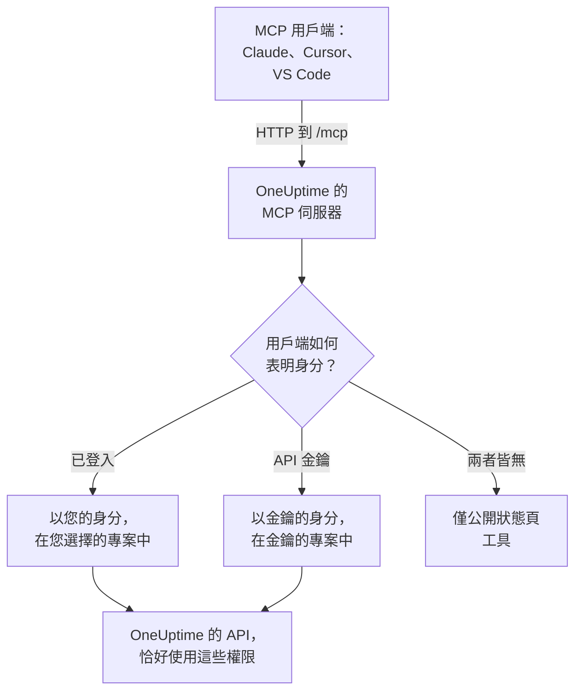

# MCP 伺服器

OneUptime MCP 伺服器讓 AI 助理可以直接操作您的 OneUptime 專案。連接 Claude、Cursor、搭配 GitHub Copilot 的 VS Code 或任何其他 Model Context Protocol（MCP）用戶端，然後請它調查事件、查詢日誌和追蹤、確認警示或設定監測器：它會以您的權限或 API 金鑰的權限呼叫 OneUptime 的工具。

:::cards
- [連接用戶端](#連接用戶端): 把伺服器的位址交給用戶端並登入。
- [使用 OneUptime 登入](#使用-oneuptime-登入): 已連接的用戶端可以做什麼，以及如何中斷它。
- [取得 API 金鑰](#取得-api-金鑰): 適用於無人看管執行的代理程式。
- [疑難排解](#疑難排解): 登入、權限和連線問題。
:::

## 運作方式

MCP 伺服器是每個 OneUptime 執行個體的一部分，位於與儀表板相同位址的 `/mcp`，使用 streamable HTTP 傳輸。不需要安裝任何東西。

- **OneUptime Cloud**: `https://oneuptime.com/mcp`
- **自行託管**: `https://your-oneuptime-domain.com/mcp`



伺服器是無狀態的：它不核發工作階段 ID，每個請求都是獨立的，因此它可以在負載平衡器後面執行，也可以執行多個複本。

## 工具涵蓋的範圍

- **監測器**：建立和設定監測器，檢查其狀態並檢視其歷史記錄。
- **事件應變**：建立、確認和解決事件，新增內部或公開備註，並追蹤到解決為止。
- **警示**：確認和解決警示，新增備註，管理警示狀態和嚴重程度。
- **團隊和待命**：管理團隊和待命原則。
- **狀態頁**：管理狀態頁並發布公告。
- **排定維護**：建立和管理維護事件。
- **遙測**：查詢日誌、指標、追蹤、例外、監測器日誌、安全性事件等，唯讀。

有針對 30 種記錄的建立、取得、列出、更新、刪除和計數工具，有針對 9 種遙測的列出和計數工具，還有專為事件應變打造的工具。唯讀工具帶有 `readOnlyHint`，每個會變更內容的工具都帶有 `destructiveHint`，只有公開狀態頁工具帶有 `openWorldHint`，因此用戶端可以自行執行唯讀呼叫，並在做出任何變更之前詢問您。失敗的工具呼叫會以工具結果（`isError: true`）傳回，其中包含 `statusCode`、詳細資料和建議，而不是以 MCP 通訊協定錯誤傳回，因此代理程式可以讀取失敗原因並自行修正。

## 開始之前

- 一個 OneUptime 執行個體：OneUptime Cloud 或自行託管。
- 一個 MCP 用戶端，例如 Claude Code、Claude、搭配 GitHub Copilot 的 VS Code 或 Cursor。
- 用於登入的 OneUptime 帳戶，或供無人看管執行的代理程式使用的 OneUptime API 金鑰。公開狀態頁工具兩者都不需要。
- 在 OneUptime Cloud 上，需要 Growth 或更高的方案：連接 MCP 用戶端與 API 金鑰在相同的方案中提供。

## 連接用戶端

只把伺服器的位址交給用戶端，其他什麼都不用。用戶端第一次需要您的資料時，會在瀏覽器中開啟 OneUptime 讓您登入（請參閱 [使用 OneUptime 登入](#使用-oneuptime-登入)）。在自行託管的執行個體上，請用 `https://your-oneuptime-domain.com/mcp` 取代 `https://oneuptime.com/mcp`。

:::tabs
@tab Claude Code
```bash
claude mcp add --transport http oneuptime https://oneuptime.com/mcp
```
然後在 Claude Code 中執行 `/mcp`，選擇 **oneuptime** 進行登入。
@tab Claude
在 Claude 中，開啟 **Customize → Connectors**，選擇 **Add custom connector**，然後輸入 `https://oneuptime.com/mcp`。Claude 第一次需要您的資料時，會請您登入 OneUptime。
@tab VS Code
把以下內容新增到您的 MCP 設定中（設定的位置請參閱 [搭配 GitHub Copilot 的 VS Code](#搭配-github-copilot-的-vs-code)）。啟動伺服器時，VS Code 會開啟 OneUptime 讓您登入：
```json
{
  "servers": {
    "oneuptime": {
      "type": "http",
      "url": "https://oneuptime.com/mcp"
    }
  }
}
```
@tab Cursor
```json
{
  "mcpServers": {
    "oneuptime": {
      "url": "https://oneuptime.com/mcp"
    }
  }
}
```
:::

任何其他支援 MCP 授權的用戶端都以相同方式運作：把位址交給它，它會自行探索其餘的一切。通訊協定請參閱 [登入（OAuth 2.1）](#登入oauth-21)。

儀表板中也有這些步驟，並已填好您執行個體的位址：**專案設定 → 人工智慧 → MCP 伺服器**。此外，在任何資源（監測器、事件、狀態頁等）中，展開其側邊選單中的 **開發者** 並選擇 **AI 助理**：該頁面也會建議包含該資源及其 ID 的提示詞，讓助理能立即找到它。對於 MCP 伺服器還沒有工具的資源（例如工作流程），該頁面會說明能執行命令的助理如何改用 REST API 來處理它。

## 使用 OneUptime 登入

最簡單的連接方式是只把伺服器的位址交給您的 MCP 用戶端。用戶端第一次需要您的資料時，會在瀏覽器中開啟一個 OneUptime 頁面：

:::steps
1. 如果尚未登入，請登入 OneUptime。
2. 選擇用戶端要在其中工作的專案。
3. 選擇 **讀取和寫入** 或 **唯讀**。
4. 按一下 **授權**。
:::

之後用戶端會在該專案中以您的身分操作。沒有需要建立、複製或輪替的 API 金鑰，也不會在設定檔中儲存任何機密。

已連接的用戶端可以做什麼：

- **它擁有您的權限，絕不會更多。** 您的團隊允許您在專案中做的事，就是用戶端能做的事。如果您的角色有所變更或您離開專案，從用戶端的下一個請求起就會生效。離開專案也會中斷用戶端：其授權會被刪除，若您重新加入專案，需要重新連接它。
- **唯讀就是唯讀。** 授權為唯讀的用戶端可以使用 `get_`、`list_` 和 `count_` 工具。建立、更新、刪除、確認或解決的工具會被 MCP 伺服器及其背後的 OneUptime API 拒絕。您永遠無法給用戶端超出其要求的存取權。
- **它只用於一個專案。** 若要使用另一個專案，請重新連接用戶端並選擇那個專案。
- **它只能透過 MCP 伺服器運作。** 用戶端的存取權杖只被 MCP 端點接受，其他任何地方都不接受。它不能用來直接呼叫 OneUptime REST API。
- **執行個體管理員也沒有特殊待遇。** 由主要管理員連接的用戶端只擁有此人的團隊在該專案中授予的權限，而不是整個執行個體的存取權。

### 管理已連接的用戶端

透過登入連接的每個用戶端都列在 **專案設定 → 人工智慧 → MCP 伺服器** 的 **已連線的 MCP 用戶端** 下，並顯示是誰連接的、可以做什麼以及上次使用的時間。您會看到自己連接的用戶端；專案擁有者和管理員則會看到所有人的用戶端。

按一下 **Disconnect** 可讓用戶端登出。它會立即停止運作。

只要用戶端持續在使用，它就保持連接。30 天未使用的用戶端必須重新登入。

### 控制誰可以連接用戶端

根據預設，每個專案成員都可以連接 MCP 用戶端。若要阻止某個團隊的成員這麼做，請開啟該團隊的 **權限** 頁面，開啟底部的 **更多設定**，然後在 **封鎖權限** 下新增 **Authorize MCP Client** 權限。這些成員已經連接的用戶端會立即停止運作。

如果專案要求單一登入，請在授權用戶端之前先在瀏覽器中使用 SSO 登入專案。用戶端的連線只在該 SSO 登入有效期間持續；當它過期，或您登入時使用的 SSO 提供者被關閉或刪除時，請重新連接用戶端。

在 OneUptime Cloud 上，連接 MCP 用戶端與 API 金鑰在相同的方案中提供（Growth 及以上）。

在 Enterprise Edition 中，已連接的用戶端所做的每項變更都會以連接者的名義記錄在稽核日誌中，並附上用戶端的名稱。使用 API 金鑰所做的變更會顯示金鑰的名稱。

## 取得 API 金鑰

對於無人看管執行的代理程式（例如排程工作或 CI 管線），沒有人能去登入，這時請使用 API 金鑰。

:::steps
### 建立金鑰

前往 **專案設定 → 進階 → API 金鑰**，然後按一下 **建立API 金鑰**。為它取一個名稱，例如 "MCP Server"。

### 選擇它可以做什麼

在 **存取** 下，為只讀取的代理程式選擇 **Viewer**，為還要建立、更新和刪除的代理程式選擇 **Project Admin**（請參閱 [API 金鑰權限](#api-金鑰權限)）。

### 複製金鑰

按一下 **建立API 金鑰**：金鑰的頁面會開啟。從那裡複製金鑰。
:::

API 金鑰屬於一個專案：MCP 伺服器從金鑰取得專案，因此建立工具從不需要 `projectId` 參數。

> [!WARNING]
> 永遠不要把主要金鑰交給 AI 代理程式。OneUptime 主要 API 金鑰也會在這個標頭中被接受，並授予整個執行個體的管理員存取權。請一律使用只具備代理程式所需最少權限的專案 API 金鑰：對於所有 `get_`、`list_` 和 `count_` 工具，唯讀金鑰就足夠了。

## 使用 API 金鑰連接

在 `x-api-key` 標頭中傳送金鑰。攜帶 API 金鑰的請求永遠不會被要求登入。在自行託管的執行個體上，請用您自己的網域取代 `oneuptime.com`。

:::tabs
@tab Claude Code
```bash
claude mcp add --transport http oneuptime https://oneuptime.com/mcp --header "x-api-key: your-api-key-here"
```
@tab Claude Desktop
把以下內容新增到 `claude_desktop_config.json`，它在 macOS 上位於 `~/Library/Application Support/Claude/`，在 Windows 上位於 `%APPDATA%\Claude\`，在 Linux 上位於 `~/.config/Claude/`：
```json
{
  "mcpServers": {
    "oneuptime": {
      "transport": "streamable-http",
      "url": "https://oneuptime.com/mcp",
      "headers": {
        "x-api-key": "your-api-key-here"
      }
    }
  }
}
```
@tab VS Code
帶有 `"password": true` 的輸入變數會在伺服器啟動時詢問金鑰，而不是以純文字保存它：
```json
{
  "servers": {
    "oneuptime": {
      "type": "http",
      "url": "https://oneuptime.com/mcp",
      "headers": {
        "x-api-key": "${input:oneuptime-api-key}"
      }
    }
  },
  "inputs": [
    {
      "type": "promptString",
      "id": "oneuptime-api-key",
      "description": "OneUptime API Key",
      "password": true
    }
  ]
}
```
@tab Cursor
```json
{
  "mcpServers": {
    "oneuptime": {
      "url": "https://oneuptime.com/mcp",
      "headers": {
        "x-api-key": "your-api-key-here"
      }
    }
  }
}
```
:::

## 搭配 GitHub Copilot 的 VS Code

VS Code 1.99 及更新版本在 GitHub Copilot Chat 中原生支援 MCP 伺服器。

:::steps
### 檢查所需條件

VS Code 1.99 或更新版本，已安裝並登入 GitHub Copilot 擴充功能，並已開啟 GitHub Copilot Chat。

### 開啟 MCP 設定

按 `Ctrl+Shift+P`（macOS 上為 `Cmd+Shift+P`），輸入 "MCP: Open User Configuration" 並按 Enter。它會開啟或建立 `mcp.json` 檔案。如果只用於一個工作區，請改為在其中建立 `.vscode/mcp.json`。

### 新增 OneUptime

貼上上方的 VS Code 設定：不帶金鑰用於登入的那個，或帶有 API 金鑰的那個。

### 啟動伺服器

按 `Ctrl+Shift+P`（macOS 上為 `Cmd+Shift+P`），輸入 "MCP: List Servers"，然後選擇 **oneuptime** 啟動它。VS Code 第一次會詢問您是否信任該伺服器，然後請您登入或輸入 API 金鑰。

### 詢問 Copilot

以代理程式模式開啟 GitHub Copilot Chat 並提問，例如「我在 OneUptime 中有哪些監測器？」、「給我看最近的事件」或「為 https://example.com 建立一個新的監測器」。
:::

## 驗證

MCP 伺服器有三種運作方式。

### 公開工具（不需要驗證）

不需要 API 金鑰或登入，用戶端就可以使用公開工具：

- **`oneuptime_help`**：關於 OneUptime MCP 工具的說明和指引
- **`oneuptime_list_resources`**：資源以及每種資源可以做什麼
- **`get_public_status_page_overview`**：公開狀態頁的概覽
- **`get_public_status_page_incidents`**：公開狀態頁的事件
- **`get_public_status_page_scheduled_maintenance`**：它的排定維護事件
- **`get_public_status_page_announcements`**：它的公告

公開狀態頁工具接受狀態頁的 ID（UUID）或其網域名稱。如果只使用這些工具，請只用位址連接，不帶任何認證：

```json
{
  "mcpServers": {
    "oneuptime": {
      "transport": "streamable-http",
      "url": "https://oneuptime.com/mcp"
    }
  }
}
```

狀態頁的擁有者可以為該頁面關閉 MCP 存取：在狀態頁側邊選單的 **人工智慧** 區段中開啟 **MCP**，然後關閉 **啟用 MCP 伺服器**。開關一經切換就會儲存。MCP 存取預設為開啟。關閉期間，四個 `get_public_status_page_*` 工具會對該狀態頁傳回錯誤；狀態頁網站、其 RSS 摘要和公開 JSON API 不受影響，需要登入的狀態頁工具（`get_status_page`、`list_status_pages` 等）在該頁面所屬的專案中仍可使用。

### 登入（OAuth 2.1）

其他所有工具都需要知道是誰在呼叫。未傳送認證就呼叫其中某個工具的用戶端，會收到 `401 Unauthorized`，並帶有一個指向伺服器受保護資源中繼資料的 `WWW-Authenticate` 標頭。這就是 MCP 用戶端據以讓您登入的訊號；`initialize`、`tools/list` 和公開工具從不要求登入。

伺服器實作了 [MCP 授權規格](https://modelcontextprotocol.io/specification/latest/basic/authorization)：

- **流程**：搭配 PKCE（僅 `S256`）的 OAuth 2.1 授權碼。存取權杖以 `Authorization: Bearer` 傳送。
- **探索**：受保護資源中繼資料（RFC 9728）和授權伺服器中繼資料（RFC 8414）。簽發者和資源都是 `https://<host>/mcp`。
- **用戶端身分**：Client ID Metadata Document（用戶端 ID 是伺服器擷取的 `https` URL），或動態用戶端註冊（RFC 7591）。不需要管理員註冊任何用戶端。
- **範圍**：`get_`、`list_` 和 `count_` 工具使用 `mcp:read`；`mcp:write` 加上所有會變更內容的工具，並包含 `mcp:read`。唯讀權杖呼叫寫入工具時會收到 `403`，並帶有 `error="insufficient_scope"`。
- **權杖有效期**：存取權杖的有效期為一小時。重新整理權杖的有效期為 30 天，每次使用時都會被替換；使用已被替換的重新整理權杖會結束連線。
- **資源指標**（RFC 8707）：權杖是為 `https://<host>/mcp` 簽發的，其他任何地方都不接受。
- **撤銷**（RFC 7009）：撤銷任一權杖都會結束連線。

### API 金鑰

無人看管執行的代理程式會在以下標頭之一中傳送 OneUptime API 金鑰：

- `x-api-key`：您的 OneUptime API 金鑰
- `Authorization`：帶有您 API 金鑰的 bearer 權杖（例如 `Bearer your-api-key-here`）

`Bearer` 配置不區分大小寫。攜帶 API 金鑰的請求永遠不會被要求登入。

在 OneUptime Cloud 上，只有當專案處於 **Growth** 或更高方案時，API 金鑰才能使用。低於該方案時，所有需要金鑰的工具都會傳回 `402`，並附上指明方案的訊息，同時告訴代理程式不要重試。不會刪除任何內容：專案回到 Growth 後，金鑰會原樣恢復可用，無需重新連接任何東西。透過登入連接的用戶端以人的身分操作，因此會繼續運作（[低於方案時的 API 金鑰和 SCIM](/docs/api-reference/api-reference#低於其方案時的-api-金鑰和-scim)）。

## 可用端點

| 端點 | 方法 | 說明 |
| --- | --- | --- |
| `/mcp` | POST | 用於工具呼叫和其他操作的 JSON-RPC 請求 |
| `/mcp` | GET | 不帶 SSE `Accept` 標頭時：伺服器的簡短 JSON 說明。帶有時：`405`，因為無狀態伺服器不提供獨立的 SSE 串流（遵循規格的用戶端沒有它也會繼續） |
| `/mcp` | DELETE | 不執行任何操作：伺服器是無狀態的，因此沒有要結束的工作階段 |
| `/mcp/health` | GET | 健康檢查 |
| `/mcp/tools` | GET | 工具清單，以一般 REST 提供 |

登入的 MCP 用戶端還會使用下方的 OAuth 端點。用戶端會自行找到它們；這裡列出它們，是為了撰寫用戶端或設定 Proxy 的人。

| 端點 | 方法 | 說明 |
| --- | --- | --- |
| `/mcp/.well-known/oauth-protected-resource` | GET | 受保護資源中繼資料（RFC 9728）。也位於 `/.well-known/oauth-protected-resource/mcp` |
| `/.well-known/oauth-authorization-server/mcp` | GET | 授權伺服器中繼資料（RFC 8414）。也位於 `/mcp/.well-known/oauth-authorization-server` |
| `/mcp/oauth/authorize` | GET | 授權端點：用戶端把您的瀏覽器送到這裡進行登入 |
| `/mcp/oauth/token` | POST | 權杖端點：交換授權碼或重新整理權杖 |
| `/mcp/oauth/register` | POST | 動態用戶端註冊（RFC 7591） |
| `/mcp/oauth/revoke` | POST | 權杖撤銷（RFC 7009） |

若要檢查伺服器是否在執行並列出其工具：

```bash
curl https://oneuptime.com/mcp/health
curl https://oneuptime.com/mcp/tools
```

## 用於事件應變的工具

除了每種記錄的工具之外，伺服器還有專為應變事件和警示而打造的工具：

- **`acknowledge_incident`** / **`resolve_incident`**：把事件移到專案的 Acknowledged 或 Resolved 狀態，與儀表板的按鈕作用相同
- **`acknowledge_alert`** / **`resolve_alert`**：對警示執行同樣的操作
- **`add_incident_note`**：使用 `visibility: "internal"`（僅團隊可見，預設）或 `visibility: "public"`（發布到狀態頁）為事件新增備註。支援 Markdown
- **`add_alert_note`**：為警示新增內部備註

典型的流程：`list_incidents` → `acknowledge_incident` → 用 `list_logs` 調查 → `add_incident_note`（公開） → `resolve_incident`。

**`oneuptime_whoami`** 工具會傳回您的認證所屬的專案（其 ID 和名稱）。對於已登入的用戶端，它還會說明以誰的身分登入以及是否可以進行變更。這是代理程式了解自身處境的理想首次呼叫，而且由於建立工具會從認證中取得 `projectId`，代理程式永遠不必傳遞專案 ID。

## 查詢遙測

日誌、指標、追蹤（span）、例外、監測器日誌和其他種類的遙測以唯讀的 `list_` 和 `count_` 工具提供（`list_logs`、`list_metrics`、`list_spans`、`list_exception_instances`、`list_monitor_logs` 及其對應的 `count_` 工具）。遙測透過 OpenTelemetry 傳入，因此沒有建立工具。

查詢遙測時請一律指定時間範圍。查詢欄位接受一個值或一個運算子物件：

```json
{
  "query": {
    "time": { "_type": "GreaterThan", "value": "2026-07-04T00:00:00.000Z" }
  },
  "sort": { "time": "DESC" },
  "limit": 50
}
```

運算子有 `EqualTo`、`NotEqual`、`IsNull`、`NotNull`、`EqualToOrNull`、`GreaterThan`、`LessThan`、`GreaterThanOrEqual`、`LessThanOrEqual`、`InBetween`、`Search` 和 `Includes`。排序值為 `"ASC"` 或 `"DESC"`。

## 欄位選擇和分頁

`get_` 和 `list_` 工具接受一個選用的欄位名稱陣列 `select`。根據預設，除了較重的欄位（JSON、很長的文字和 HTML 欄）之外，所有可讀取的欄位都會傳回，較重的欄位必須在 `select` 中要求。

清單工具使用 `limit`（預設 10，最多 100）和 `skip` 分頁，每個清單回應都會準確說明它傳回了什麼：

```json
{
  "returnedCount": 10,
  "totalCount": 42,
  "skip": 0,
  "limit": 10,
  "hasMore": true,
  "data": ["..."]
}
```

## 使用範例

### 日常問題

```text
"What's the current status of all my monitors?"
"Show me incidents from the last 24 hours"
"List the teams in this project"
"Show me our on-call policies"
```

### 監測器和事件

```text
"Create a new website monitor for https://example.com that checks every 5 minutes"
"Set up an API monitor for https://api.example.com/health with a 30-second timeout"
"Disable the monitor for staging.example.com while we're doing maintenance"
"Create a high-priority incident for the database outage affecting user authentication"
"Add a note to incident #123 saying 'Database connection restored, monitoring for stability'"
"Mark incident #456 as resolved"
```

### 狀態頁

```text
"Update our status page to show 'Investigating Payment Issues' for the payment service"
"Create a status page announcement about scheduled maintenance this weekend"
```

### 公開狀態頁查詢（不需要 API 金鑰）

這些範例不需要認證，只用公開狀態頁工具即可執行：

```text
"What's the current status of status.example.com?"
"Show me recent incidents from the OneUptime status page"
"Are there any scheduled maintenance events on status.acme.com?"
"Get the latest announcements from my public status page with ID abc123-..."
```

### 一次完成多個步驟

```text
"Create a scheduled maintenance window for Saturday 2-4 AM, disable all monitors for api.example.com during that time, and update the status page"
"Show me all monitors that have been down in the last hour, create incidents for any that don't already have one"
```

## API 金鑰權限

| 代理程式要做什麼 | 在 **存取** 下選擇 |
| --- | --- |
| 只讀取 | **Viewer**，或在金鑰的頁面上新增讀取權限 |
| 還要建立、更新和刪除 | **Project Admin**，或在金鑰的頁面上新增 Project Admin 角色 |

只給每個金鑰所需的最少權限，定期輪替金鑰，為每個環境使用個別的金鑰，並在 OneUptime 中留意每個金鑰的操作。

## 自行託管設定

在自行託管的執行個體上，登入功能開箱即用。有兩個設定可以改變它：

| 環境變數 | Helm 值 | 作用 |
| --- | --- | --- |
| `DISABLE_MCP_OAUTH` | `mcpOAuth.disabled` | 設為 `true` 可關閉登入。OAuth 端點不再提供服務，MCP 伺服器只接受 API 金鑰。不會刪除任何內容；重新開啟後，已連接的用戶端會恢復運作。 |
| `DISABLE_MCP_OAUTH_CLIENT_ID_METADATA_DOCUMENTS` | `mcpOAuth.disableClientIdMetadataDocuments` | 在無法連上網際網路的執行個體上設為 `true`。用戶端可以用一個由 OneUptime 擷取的 URL 來識別自己；設定此項後，用戶端會改為直接向您的執行個體註冊，這不需要任何對外請求。 |

如果您在 OneUptime 前面執行自己的反向 Proxy，請把 `/.well-known/oauth-protected-resource` 和 `/.well-known/oauth-authorization-server`（以及它們底下的所有內容）連同 `/mcp` 一起轉送給 OneUptime。隨附的 ingress 已經這麼做了。

伺服器根據 `HOST` 和 `HTTP_PROTOCOL` 設定建構每個 OAuth URL，因此它們必須與人們存取您執行個體所用的位址一致。

## 疑難排解

### 登入問題

- **用戶端從不要求我登入**：用戶端可能不支援 MCP 授權，或者它設定了一個優先生效的 API 金鑰標頭。移除該標頭即可改為登入。
- **我的專案在授權頁面上顯示為灰色**：頁面會在專案名稱旁說明原因：專案的方案不包括連接 MCP 用戶端；專案要求 SSO，而此瀏覽器尚未用 SSO 登入該專案；或您的團隊被封鎖而無法連接用戶端。
- **工具被以 "read-only" 拒絕**：用戶端被授權為唯讀。請重新連接並選擇 **讀取和寫入**。
- **用戶端停止運作**：它被中斷了、30 天未使用、您被移出了專案，或專案的 SSO 登入已過期或其提供者被關閉。請重新連接。
- **自行託管 - 用戶端說找不到授權伺服器**：檢查 `HOST` 和 `HTTP_PROTOCOL` 是否與您的公開位址一致，以及您的 Proxy 是否轉送了 `/.well-known/oauth-*` 路徑。

### 權限錯誤

API 金鑰（對於已登入的用戶端，則是您自己的帳戶）需要正確的權限：列出記錄需要讀取權限，建立和更新記錄需要寫入權限，刪除記錄需要刪除權限。

### 連線問題

檢查 OneUptime 位址是否正確且可連上、API 金鑰是否有效，以及健康檢查端點是否有回應（請參閱 [可用端點](#可用端點)）。

### 無效的 API 金鑰

- 在 OneUptime 設定中檢查 API 金鑰，確保沒有多餘的空格或字元
- 檢查金鑰是否已過期
- 在 OneUptime Cloud 上，如果傳回的 `402` 說 API 金鑰需要 Growth 方案，表示專案低於該方案：在 **專案設定 → 帳單與發票 → 帳單** 中升級專案，同一個金鑰就會恢復可用

### 工作階段錯誤

MCP 伺服器是無狀態的：它既不核發也不追蹤工作階段 ID，因此每個請求在任何複本上都能運作。傳送來自舊版伺服器的 `mcp-session-id` 標頭的用戶端可以省略它；它會被忽略。請更新預期伺服器會傳回工作階段 ID 的舊用戶端設定。

## 可用資源

| 領域 | 具有建立、取得、列出、更新、刪除和計數工具的記錄 |
| --- | --- |
| 監控 | Monitor, Monitor Status, Monitor Status Event |
| 事件 | Incident, Incident State, Incident Severity, Incident State Timeline, Incident Public Note, Incident Internal Note, Incident Alert, Postmortem Status |
| 警示 | Alert, Alert State, Alert Severity, Alert State Timeline, Alert Internal Note |
| 狀態頁 | Status Page, Status Page Announcement |
| 排定維護 | Scheduled Maintenance Event, Scheduled Maintenance State, Scheduled Maintenance State Timeline |
| 團隊和待命 | Team, On-Call Policy |
| 標籤 | Label |
| 安全性 | Security Case, Security Case Note, Security Case Priority, Security Case Status, Security Detection, Security Playbook |

| 領域 | 只有列出和計數工具的遙測 |
| --- | --- |
| 可觀測性 | Log, Metric, Span, Exception Instance, Monitor Log |
| 安全性 | Security Event, Threat Intel Indicator |
| 變更和成本 | Change Event, Kubernetes Cost Allocation |

工具以蛇形命名法命名：`create_incident`、`get_incident`、`list_incidents`、`update_incident`、`delete_incident` 和 `count_incidents`，遙測則為 `list_logs` 和 `count_spans`。

## 後續步驟

:::cards
- [詢問 AI](/docs/ai/ask-ai): 改為在 OneUptime 內部詢問您的專案。
- [OneUptime API 參考](/docs/api-reference/api-reference): 每個工具背後的 REST API。
- [權限](/docs/permissions/index): 角色、團隊或 API 金鑰可以做什麼。
:::
