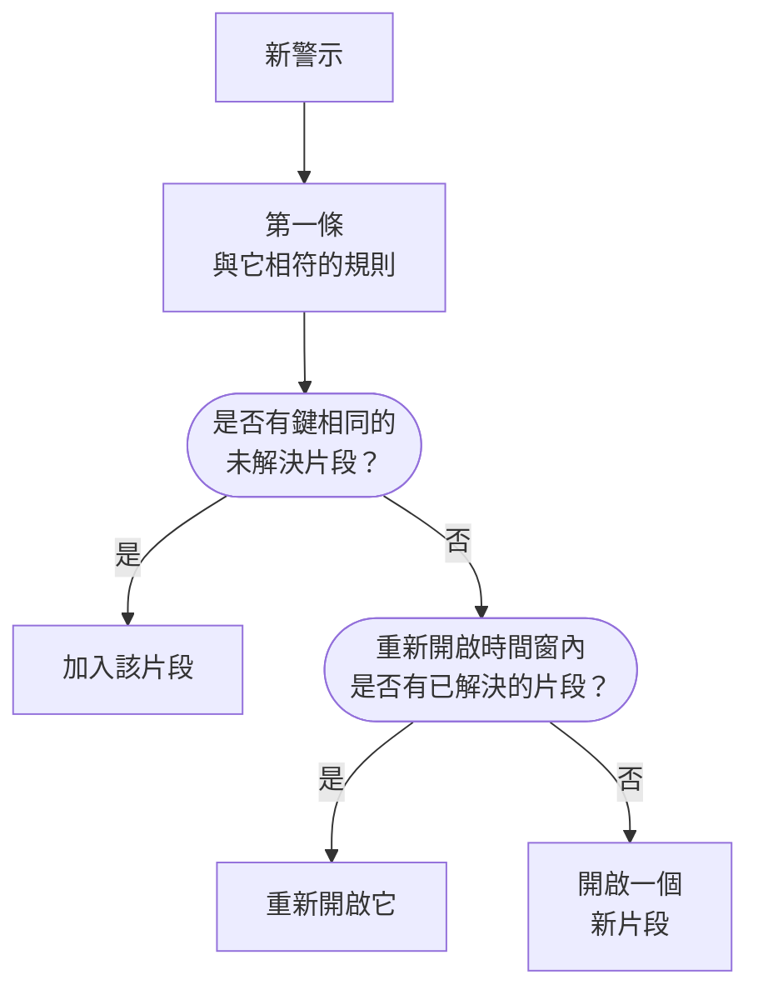
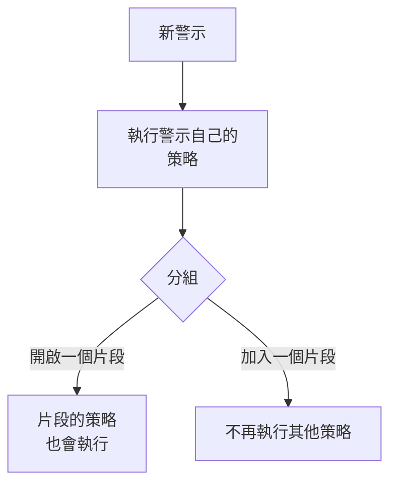

# 警示片段與分組規則

當資料庫當機時，二十個監測器可能在幾分鐘內觸發二十個警示。片段把它們放進同一筆紀錄，由你的團隊一起確認和解決，而分組規則決定哪些警示屬於它。本頁說明分組如何運作、如何設定規則，以及片段開啟之後的行為。

:::cards
- [分組如何運作](#分組如何運作): 規則、分組鍵和時間窗。
- [建立分組規則](#建立分組規則): 一鍵從範本建立，或建立你自己的規則。
- [片段的行為](#片段的行為): 它的嚴重程度、狀態以及何時解決。
- [片段會呼叫誰](#片段會呼叫誰): 規則的待命策略，以及警示自己的策略。
:::

## 分組如何運作

每個新警示都會執行一次分組，就在其待命策略執行之後。系統依從上到下的順序，用你已啟用的分組規則檢查該警示，第一個與它相符的規則決定它的片段。沒有任何規則相符的警示會保持獨立。

- **規則的條件** 決定它適用於哪些警示。沒有條件的規則適用於每個新警示。
- **分組鍵** 決定哪些警示共用一個片段：監測器相同、嚴重程度相同、標題相同，或在規則所依據的任意組合上相同的警示。不依任何內容分組的規則，會把它相符的每個警示都放進同一個片段。
- **時間窗** 決定片段持續接收警示的時間長度。開啟時，只有在片段最後一個警示之後的時間窗內到達的警示才會加入。關閉時，相符的警示會一直加入，直到片段被解決。

分組發生在警示建立時。你今天新增的規則只會對此後建立的警示分組；它不會重新分組已經存在的警示。

> [!NOTE]
> 建立時即已確認的警示可以加入已開啟的片段，但絕不會開啟新片段；建立時即已解決的警示則完全不會被分組。請參閱 [建立時即已確認或已解決](/docs/alerts/index#建立時即已確認或已解決)。

## 建立分組規則

前往 **警示 → 規則 → 分組規則**。側邊選單中的 **規則** 區段一開始是摺疊的，因此請先展開它。

### 從範本開始

沒有分組規則的專案會看到四條現成的規則，而不是一份空白清單；有了規則之後，卡片上的 **從範本建立** 會開啟它們。**新增規則** 只需按一下就會儲存一條規則：已啟用、位於清單末端，並適用於每個新警示。之後可以像編輯其他規則一樣編輯它。

| 範本                                          | 分組方式                                                                      | 時間窗      |
| --------------------------------------------- | ----------------------------------------------------------------------------- | ----------- |
| **將同一監測器的警示分組**                    | 每個監測器一個片段                                                            | 30 分鐘     |
| **將同時發生的警示分組**                      | 一個共用片段，無論來自哪個監測器                                              | 10 分鐘     |
| **依嚴重程度將警示分組**                      | 每個嚴重程度一個片段                                                          | 30 分鐘     |
| **將重複出現的同一警示分組**                  | 每個警示標題一個片段，忽略數字和大小寫                                        | 1 小時      |

### 建立你自己的規則

:::steps
#### 回答如何分組

按一下範本下方的 **建立自訂規則**，或在已有規則時按一下卡片上的 **建立警示分組規則**。在 **分組** 步驟中，**警示分組依據** 只問一個問題：**監測器**、**全部歸在一起**、**嚴重程度**、**標題** 或 **自訂**。在你輸入自己的名稱之前，**名稱** 會跟隨你的回答。

#### 設定時間窗

**僅將相近時間內到達的警示分組** 預設開啟，時間窗為 30 分鐘。修改分鐘數，或將其關閉，讓一個片段一直保持開啟，直到它被解決。

#### 組合欄位（用於自訂）

**自訂** 會新增一個 **分組依據** 步驟，其中有五個開關：**依監測器分組**、**依警示嚴重性分組**、**依警示標題分組**、**依警示標籤分組** 和 **依監測器標籤分組**。標籤依其確切的集合分組。

#### 縮小範圍

在 **哪些警示** 中，新規則預設的 **所有警示** 會對每個新警示分組。要縮小範圍，請選擇 **僅符合條件的警示** 並新增關於監測器、嚴重程度、標籤、標題和描述的條件。然後按一下 **建立警示分組規則**。
:::

規則能做的其他所有事情，都摺疊在 **分組** 步驟末端的 **更多欄位** 下，分為三組。摺疊時，其標題會說明它包含什麼，並顯示規則用到的每項設定的值，因此編輯規則時永遠不會隱藏它的作用。

| 組                        | 設定                                                                                                       |
| ------------------------- | ---------------------------------------------------------------------------------------------------------- |
| **待命與擁有權**          | 規則開啟片段時要執行的 **待命策略**，以及 **片段擁有者**。                                                 |
| **片段生命週期**          | **重新開啟最近解決的片段**、**解決片段前先等待** 和 **解決無新動態的片段**，每一項都是帶分鐘數的開關。     |
| **詳細資料**              | 規則的 **描述**、**片段標題範本**、**片段描述範本** 和 **片段標籤**。                                      |

規則依從上到下的順序檢查，第一個相符的勝出：拖曳規則即可改變它的位置。把具體的規則放在寬泛的規則之上。清單的 **分組** 欄用一句話說明每條規則的作用，例如「每個監測器一個片段」。

## 片段標題

沒有範本時，片段以其第一個警示的監測器命名；如果該警示沒有監測器，則以警示標題的前 50 個字元命名。使用 **片段標題範本** 或 **片段描述範本** 時，會填入下列變數。在任一欄位中輸入 `{{` 即可選擇一個變數。

| 變數                   | 填入內容                                                                                        |
| ---------------------- | ----------------------------------------------------------------------------------------------- |
| `{{alertTitle}}`       | 第一個警示的標題。                                                                              |
| `{{alertDescription}}` | 第一個警示的描述。                                                                              |
| `{{alertSeverity}}`    | 第一個警示的嚴重程度。                                                                          |
| `{{monitorName}}`      | 第一個警示的監測器名稱。                                                                        |
| `{{alertCount}}`       | 片段包含的警示數量，在警示加入或離開時重新寫入。                                                |

第一個警示沒有值的變數，或不在此清單中的變數，都會被省略。當第一個警示是私人的時，`{{alertTitle}}` 和 `{{alertDescription}}` 會顯示為「Private alert」，因為片段不是私人的。

## 片段的行為

片段經歷的是你的警示狀態，也就是警示使用的同一份清單，並且有自己的擁有者、備註、根本原因和補救備註。

- **它的嚴重程度隨其警示升高。** 它以第一個警示的嚴重程度開始，並在任何更嚴重的警示加入時採用該警示的嚴重程度；「更嚴重」指在 **警示 → 設定 → 警示嚴重性** 中的位置更高。
- **它的狀態會帶動其中的警示。** 確認或解決片段，或把它移到你自己的狀態，其中的每個警示也會隨之移動，已經處於或越過該狀態的警示除外。
- **它會自行解決**，只要其中的每個警示都已解決。**解決片段前先等待** 會先讓它再保持開啟這麼多分鐘，以防有警示再次出現。
- **它可以重新開啟。** 開啟 **重新開啟最近解決的片段** 後，在片段解決後的這些分鐘內到達的相符警示會重新開啟它，而不是開啟另一個片段。這是沿狀態清單往上的唯一一次移動，而且它不會重新開啟片段中的警示。

> [!WARNING]
> **解決無新動態的片段** 會在你設定的分鐘數內沒有新警示加入時解決片段，並且還會解決其中仍處於開啟狀態的每個警示。只把它用於你確定不需要任何回應的雜訊。

## 片段會呼叫誰

警示自己的待命策略會在它建立時執行，早於分組，無論它是否加入片段。片段還會新增自己的策略：

- **新片段** 會執行規則的 **待命策略**，以及 **警示 → 規則 → 待命規則** 中 **Episode Rules** 分頁上任何相符規則的策略。
- **加入已開啟片段的警示** 只執行它自己的策略。片段的策略不會再次執行。
- **回應片段的呼叫** 會確認該片段，並隨之確認其中的每個警示。

> [!TIP]
> 要依問題而不是依警示只呼叫一次，請把待命策略放在分組規則上，而不要放在警示上：不放在監測器的條件中，不放在建立表單中，也不放在警示的待命規則中。

片段的擁有者也會收到通知：**警示片段已建立**、**警示片段狀態已變更** 和 **警示已新增至警示片段** 預設透過電子郵件開啟，位於 **使用者設定 → 通知設定** 的 **警示** 分頁上。規則的 **片段擁有者** 會成為它開啟的每個片段的擁有者，並像其他擁有者一樣收到通知。

## 手動建立片段

:::steps
### 開啟表單

前往 **警示 → 所有片段** 並按一下 **建立片段**。**建立新警示片段** 表單隨即開啟。

### 描述片段

在 **片段詳細資料** 中填寫 **標題**，並視需要選擇一個 **警示嚴重性** 和填寫 **描述**。**初始狀態** 和 **標籤** 位於 **更多欄位** 下。

### 選擇呼叫誰以及由誰負責

在 **待命與擁有者** 中，選擇建立片段時要執行的 **待命策略**，以及它的 **擁有者**。然後按一下 **建立片段**。

你所屬的每個團隊在 **擁有者** 下方都只需按一下即可新增，摘要會列出將新增更多擁有者的擁有者規則。

### 新增警示

開啟片段的 **成員警示** 頁面，點選 **新增警示**，一次勾選屬於它的所有警示，需要幾個就選幾個。若想從警示出發，可在 **警示** 清單中選取它們，然後在 **批次動作** 中選擇 **新增至新片段**（請參閱[片段](/docs/incidents/episodes)）。
:::

你建立的片段沒有分組規則，因此清單中其 **分組規則** 顯示為 **手動**，也不會對它套用任何生命週期設定。當其中的每個警示都解決後，它仍會自行解決。

## 片段各頁面顯示的內容

| 側邊選單區段      | 頁面                                                               |
| ----------------- | ------------------------------------------------------------------ |
| **概覽** | **概覽**、**狀態時間軸** |
| **調查** | **描述**、**根本原因**、**補救備註** |
| **團隊** | **擁有者** |
| **警示** | **成員警示** |
| **備註** | **私人備註** |
| **開發者** | **Terraform**、**API**、**AI 助理** |
| **進階** | **稽核日誌**、**刪除片段** |

**開發者** 和 **進階** 一開始是摺疊的。**概覽** 的頁首列出片段的 **擁有者**（團隊在前），第一個區塊 **已建立** 顯示片段的建立時間——由分組規則開啟的片段顯示 **自動**。**事件經過** 卡片位於頁面最上方——片段的描述和 **根本原因**——接著是 **Alerts in this episode** 和 **片段動態**，旁邊是 **片段詳細資料** 卡片：其編號、狀態、嚴重程度、警示數量、分組規則和待命策略。其頁首有 **確認** 和 **解決**，**⋯** 選單中還有 **將片段移至**。

**警示 → 進行中片段** 列出尚未解決的片段，旁邊的徽章計算它們的數量。

## 疑難排解

:::details 新警示沒有加入我預期的片段
請依序檢查：規則已啟用；它上方沒有其他規則先與該警示相符；警示符合規則的條件；它與片段中的警示具有相同的分組鍵，例如相同的監測器；而且在時間窗開啟時，它是在片段最後一個警示之後的時間窗內到達的。建立時即已確認的警示絕不會開啟片段，建立時即已解決的警示絕不會被分組。
:::

:::details 同一個問題我們被呼叫了兩次
警示自己的待命策略執行了，新片段的策略也執行了。把策略保留在分組規則上，並從警示的條件、表單或待命規則中移除它們。
:::

:::details 片段自行解決了
其中的每個警示都已解決，因此片段在等待時間結束後解決了。開啟 **解決無新動態的片段** 時，它也會解決在這麼長時間內沒有新警示加入的片段。
:::

## 後續步驟

:::cards
- [警示規則與設定](/docs/alerts/settings): 作用於新警示和片段的其他規則。
- [警示狀態與嚴重程度](/docs/alerts/states-and-severities): 片段經歷的各個狀態。
- [上報規則](/docs/on-call/escalation-rules): 片段執行的策略如何呼叫人員。
- [事件設定與自動化](/docs/incidents/settings): 事件的分組規則。
:::
