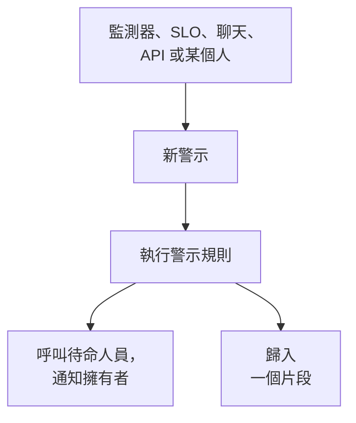

# 警示概觀

警示會在使用者察覺之前，讓你的團隊知道一個需要調查的問題：快要寫滿的磁碟、即將到期的憑證、悄悄攀升的錯誤率。它可以呼叫待命人員並通知其擁有者，但從不顯示在狀態頁面上，也從不通知你的訂閱者。本頁說明警示從何而來、它們在儀表板中的位置，以及你的團隊如何處理它們。

:::cards
- [警示與事件](#警示與事件): 一個問題應該屬於哪一種，以及兩者如何關聯。
- [警示從何而來](#警示從何而來): 監測器、SLO、聊天、API，或手動建立。
- [手動建立警示](#手動建立警示): 在儀表板中完成兩個步驟。
- [回應警示](#回應警示): 確認它、解決它，或宣告事件。
:::

## 運作方式

大多數警示由條件相符的監測器觸發。有些來自正在消耗錯誤預算的 SLO、一條安全性規則、從 Slack 或 Microsoft Teams 發出的呼叫，或者某個人。無論以哪種方式到達，警示都是同一種紀錄，並執行同樣的規則。

- **規則形塑它。** 隱私、擁有者、標籤和待命規則會在警示建立的那一刻執行，Runbook 規則則會啟動相符的程序。請參閱 [警示規則與設定](/docs/alerts/settings)。
- **待命策略呼叫人員。** 警示指定的策略，加上其待命規則新增的策略，會持續呼叫各自的人員，直到有人確認該警示。
- **片段收攏雜訊。** 分組規則把相關的警示放進同一個片段，這樣一次中斷產生的二十個警示就只是一件要處理的事。請參閱 [警示片段與分組規則](/docs/alerts/episodes)。

## 警示與事件

兩者都記錄問題，也都可以呼叫待命人員。不同之處在於問題影響的是誰。

|                              | 警示                                                   | 事件                                              |
| ---------------------------- | ------------------------------------------------------ | ------------------------------------------------- |
| **是什麼**                   | 在使用者受到影響之前，需要你的團隊調查的問題           | 影響你的使用者的問題，例如中斷                    |
| **在狀態頁面上**             | 從不顯示                                               | 可以顯示，並通知訂閱者                            |
| **備註**                     | 私人備註，僅限你的團隊                                 | 給客戶的公開備註，以及私人備註                    |
| **起始狀態**                 | **已識別**、**已確認**、**已解決**                 | **已識別**、**已確認**、**已解決**            |
| **起始嚴重程度**             | **高**、**低**                                      | Critical Incident、Major Incident、Minor Incident |
| **新專案中的編號**           | `ALT-42`，片段為 `AE-42`                               | `INC-42`，片段為 `IE-42`                          |

當你的團隊應該在外部任何人察覺之前查看時，就觸發警示；當使用者受到影響時，就宣告事件。如果一個警示原來是某次中斷的一部分，可以從它宣告事件，或把它連結到解釋它的事件：請參閱 [已連結的警示](/docs/incidents/linked-alerts)。

## 警示從何而來

- **監測器的條件。** 在某個條件的 **操作** 下，開啟 **當篩選器相符時，建立警示。** 並填寫它建立的警示：**警示標題** 和 **嚴重程度**，接著是各自摺疊的 **描述**、**擁有權與標籤**、**待命** 和 **更多欄位**，最後這一項包含 **自動解決警示**、**私人警示** 和 **補救備註**。一個條件同一時間只保留一個未解決的警示，在依欄位分組的監測器上則是每個序列一個；**自動解決警示** 會在條件不再相符時解決它。請參閱 [建立監測器](/docs/monitor/create-monitor) 和 [事件與警示範本](/docs/monitor/incident-alert-templating)。
- **手動。** 在警示清單中，或在監測器、主機、網路裝置或其他資源的 **警示** 分頁上按一下 **建立警示**，後者會替你選好該資源。請參閱 [手動建立警示](#手動建立警示)。
- **SLO 的消耗率。** 當 SLO 太快花掉其錯誤預算時，消耗率規則可以建立警示。請參閱 [消耗率警示與事件](/docs/slo/burn-rate-alerts)。
- **網路站點和安全性事件。** 設定為在不健康時發出警示的網路站點，會在其彙總狀態不再正常運作時開啟一個警示；你的安全性偵測規則也會開啟警示。請參閱 [網路站點(健康彙總與正常運作時間)](/docs/monitor/network-sites) 和 [安全性事件(SIEM)](/docs/telemetry/security-events)。
- **呼叫。** Slack 或 Microsoft Teams 中的 `/oneuptime page`，在事件或警示的專屬頻道之外的任何地方，會開啟一個以你的訊息為標題的警示，並呼叫你點名的人。工作流程的呼叫區塊會用你提供的標題和訊息做同樣的事。請參閱 [從 Slack 呼叫他人](/docs/workspace-connections/slack#從-slack-呼叫他人) 和 [Paging](/docs/workflows/components#paging)。
- **API、Terraform 和工作流程。** 警示是一種一般資源：`/api/alert`、Terraform 資源 `oneuptime_alert`，以及工作流程的 **Create One Alert** 步驟。

## 警示在儀表板中的位置

從頂端列的 **產品** 選單中開啟 **警示**。警示清單位於 `/dashboard/{projectId}/alerts`，它的側邊選單包含與警示有關的一切：

| 區段           | 你在那裡做什麼                                                                                                            |
| -------------- | ------------------------------------------------------------------------------------------------------------------------- |
| **警示**       | **所有警示** 和 **進行中警示**，後者的紅色徽章計算尚未解決的警示。                                                        |
| **片段** | **所有片段** 和 **進行中片段**：把相關警示歸為一個要處理的問題。 |
| **人工智慧**   | **洞察**、**日誌** 和 **設定**：OneUptime AI 從你的警示中學到了什麼、它做過的一切，以及它被允許做什麼。                    |
| **工作區**     | **Slack** 和 **Microsoft Teams**，取決於專案連線了哪一個；兩者都未連線時則為 **連線 Slack 或 Teams**。                     |
| **規則**       | **分組規則**、**待命規則**、**擁有者規則**、**Runbook 規則**、**隱私規則**、**標籤規則**、**Reminder Rules**。             |
| **設定**       | **警示狀態**、**警示嚴重性**、**備註範本**、**自訂欄位**、**測量**、**片段成員資格**、**編號規則**。                                         |

**警示** 和 **片段** 是展開的；**人工智慧**、**工作區**、**規則**、**設定** 和 **開發者** 一開始是摺疊的，當你位於某個區段的頁面上時，該區段會自動展開。警示的設定位於這裡，而不是 **專案設定** 中。

清單顯示 **警示編號**、**標題**、**狀態**、**嚴重程度**、**受影響的資源**（警示的監測器排在最前）、**已建立**、**持續時間**、**標籤** 和 **擁有者**。選取多個警示即可一次處理它們：**確認**、**解決**、**變更狀態**、**變更嚴重程度**、**指派給我**、**新增擁有者**、**移除擁有者**、**新增標籤**、**移除標籤**、**連結至事件**、**宣告事件**，或刪除它們。

每個警示列末端的 **⋯** 選單可對該警示單獨執行相同的操作：在警示還能進入下一步時提供 **確認** 和 **解決**，以及 **變更狀態**、**變更嚴重程度**、在你成為擁有者之前的 **指派給我**，和把它交給別人的 **新增擁有者**。

## 手動建立警示

:::steps
### 開啟表單

前往 **警示 → 所有警示** 並按一下 **建立警示**。**建立新警示** 表單會在第一個步驟 **警示詳細資訊** 開啟。

### 描述警示

填寫 **標題** 並選擇一個 **警示嚴重性**；兩者都是必填。如果有幫助，再新增 **描述**。在摺疊的 **更多欄位** 下，你可以選擇 **初始狀態**、新增 **標籤**，或將其設為 **私人警示**。**擁有者** 也在那裡：無論如何你都會成為你所建立警示的擁有者，而且你所屬的每個團隊在選擇器下方都只需按一下即可新增。負責管理整個安裝的主管理員是唯一的例外：不會成為其所建立內容的擁有者。

### 選擇它影響什麼以及呼叫誰

按一下 **下一步** 進入 **資源與待命**。選擇它所涉及的 **監測器** 以及任何 **其他受影響的資源**，例如主機、網路裝置、Kubernetes 叢集或服務。在 **待命策略** 中，選擇建立警示時要執行的策略。

### 建立它

按一下 **下一步** 檢查摘要，然後按一下 **建立警示**。警示自己的頁面會開啟，規則隨即開始執行。在摘要中，**擁有者** 列會列出每條將新增某人的擁有者規則，以及新增誰：請參閱 [誰將成為擁有者](/docs/incidents/declaring-incidents#誰將成為擁有者)。
:::

將 **初始狀態** 留空時，警示會從每個新警示的起點開始：你的建立狀態，在新專案中為 **已識別**。選擇較後面的狀態，記錄的就是一個已經有人在處理或已經結束的警示；請參閱 [建立時即已確認或已解決](#建立時即已確認或已解決)。

## 建立警示時會發生什麼

警示建立的那一刻，OneUptime 會依下列順序完成這些步驟：

1. **它取得一個編號和一個狀態。** 警示編號來自每個專案各自的計數器，並加上你的前綴顯示（`ALT-42`）。除非表單、API 或工作流程選擇了其他狀態，警示都從你的建立狀態開始。
2. **隱私規則最先執行**，因此之後的一切都知道該警示是否為私人。
3. **動態消息和你的聊天工具會得知此事。** 一筆 **警示已建立** 項目會寫入 **警示 動態消息**，你的 Slack 和 Microsoft Teams 規則指定的頻道會收到通知；規則也可以為該警示建立一個頻道。
4. **新增擁有者和標籤**：先是監測器的條件或請求指定的，然後是相符的擁有者規則和標籤規則新增的。
5. **待命規則新增其策略**，然後 Runbook 規則啟動相符的 Runbook。
6. **待命策略執行。** 警示上的每個策略都會平行呼叫各自的人員；其中一個失敗不會阻止其他策略。
7. **分組規則把它放進一個片段**，前提是有規則相符。請參閱 [警示片段與分組規則](/docs/alerts/episodes)。
8. **排定提醒**，前提是有提醒規則相符；當 **警示 → 人工智慧 → 設定** 中的 **調查新警示** 開啟時，**OneUptime AI** 會調查該警示，當 **自動修正新警示** 開啟時還會修正它。請參閱 [AI SRE](/docs/ai/ai-sre)。

背景工作會在一分鐘內通知警示的擁有者，**On Create Alert** 工作流程觸發器則會啟動所有以它為基礎的工作流程。

### 建立時即已確認或已解決

以較後面狀態開始的警示，記錄的是一個已經有人在處理的問題，因此不會被當成新的緊急狀況：

- **處於或越過你的已確認狀態時**，不會執行任何待命策略。警示保留其策略，其動態消息會用一行說明為什麼沒有呼叫任何人。它可以加入一個已開啟的片段，但絕不會開啟新片段，因為那樣會透過片段的策略進行呼叫。
- **處於或越過你的已解決狀態時**，警示已經結束：它不會被分組到片段中，不會有 Runbook 或自動修復作用於它，OneUptime AI 不會調查它，也不會為它建立 Slack 或 Microsoft Teams 頻道。

無論哪種情況，它的規則、擁有者、動態消息和第一個狀態都照常發生。事件遵循同樣的規則：請參閱 [宣告時即已確認或已解決](/docs/incidents/declaring-incidents#宣告時即已確認或已解決)。

## 回應警示

開啟警示。它的頁首顯示其狀態、嚴重程度、持續時長、擁有者，以及它所屬的監測器和片段，並提供下一步所需的按鈕：

- **確認** 表示有人在處理它。它會阻止警示的待命策略呼叫下一級。
- **解決** 會關閉它。警示離開 **進行中警示**，其提醒也會停止。
- 旁邊 **⋯** 選單中的 **將狀態變更為** 會把它移到你自己的狀態，例如「調查中」。
- **宣告事件** 會在問題原來影響到使用者時，開啟一個依該警示預先填寫的新事件。請參閱 [已連結的警示](/docs/incidents/linked-alerts)。

切換到另一個狀態時會要求你確認，並可在摺疊的 **新增私人備註** 下附上一則選用的私人備註。每個狀態的作用請見 [警示狀態與嚴重程度](/docs/alerts/states-and-severities)。

處理過程中，把你了解到的情況記為 **私人備註**，填寫其 **根本原因** 和 **補救** 頁面，並新增 **擁有者**。**警示 動態消息** 的 **操作** 選單還可以用 **Execute Runbook** 執行 Runbook，或用 **執行待命策略** 呼叫更多人員。

## 警示各頁面顯示的內容

| 側邊選單區段      | 頁面                                                                                                           |
| ----------------- | -------------------------------------------------------------------------------------------------------------- |
| **概覽** | **概覽** 和 **狀態時間軸** |
| **調查** | **描述**、**根本原因**、**補救**、**運行手冊**、**已連結的事件** |
| **團隊** | **待命執行** 和 **擁有者**：該警示呼叫了誰，以及誰擁有它 |
| **通知**          | **通知日誌** 和 **AI 日誌**：關於該警示傳送的每則訊息，以及 AI 為它做的一切                                    |
| **備註**      | **私人備註**                                                                                                   |
| **開發者**        | **Terraform**、**API** 和 **AI 助理**：透過程式碼管理該警示                                                    |
| **進階** | **自訂欄位**、**設定**、**稽核日誌**、**刪除警示** |

**概覽**、**調查**、**團隊** 和 **備註** 是展開的；其他區段在你按一下之前都是摺疊的。

- **概覽** —— 頁首在警示的監視器和片段旁列出警示的 **擁有者**（團隊在前）。三個區塊中，**已建立** 顯示警示的建立時間和來源，另外兩個顯示警示經過多久被確認和解決；持續時長是頁首中的第一項。**事件經過** 卡片位於頁面最上方——警示的描述和 **根本原因**——接著是 **OneUptime AI** 卡片，底部有 **Ask OneUptime AI**，**警示 動態消息** 記錄了該警示發生的一切。旁邊是 **受影響的資源** 卡片、**警示詳細資訊** 卡片和該警示的測量值。
- **狀態時間軸** —— 警示經歷過的每個狀態、何時進入以及持續多久。請參閱 [狀態時間軸](/docs/alerts/states-and-severities#狀態時間軸)。
- **已連結的事件** —— 此警示所屬的事件，並提供 **連結事件** 和 **宣告事件**。
- **設定** —— **誰可以查看此警示**，帶有 **私人警示** 開關；以及 **提醒**，帶有 **傳送提醒**。每個開關都會在你切換的那一刻儲存。

## 私人警示

私人警示只有其擁有者（即擁有者使用者和其擁有者團隊的成員）以及專案的管理員和擁有者可以看到。專案中的其他人都無法開啟它。

在建立表單或監測器條件的 **更多欄位** 下使用 **私人警示**，透過 **警示 → 規則 → 隱私規則**，或之後在其 **設定** 頁面上，都可以將警示設為私人；該頁面會在隱藏警示之前詢問 **要將此警示設為私人嗎？** 如果你不屬於這些人，你自己也會失去對它的存取權。

由私人警示開啟的片段不是私人的，因此它從不顯示該警示的標題或描述：在其標題或描述原本會包含這些內容的地方，會顯示「Private alert」。

## 誰會收到警示的通知

- **待命人員。** 警示的待命策略會呼叫各自的人員，每個人都依照自己在 **使用者設定 → 待命規則** 的 **警示** 分頁上設定的方式接收呼叫。回應呼叫即確認該警示，呼叫隨即停止。
- **其擁有者。** 透過電子郵件，除非他們在 **使用者設定 → 通知設定** 的 **警示** 分頁上選擇了其他管道：**警示已建立**、**警示狀態已變更** 和 **Alert reminder** 預設開啟，**警示備註已發布** 和 **已新增為警示擁有者** 在有人開啟之前保持關閉。沒有擁有者的警示會改為通知專案的擁有者。
- **你的聊天工具。** **警示 → 工作區** 包含將警示和片段發布到頻道的 Slack 和 Microsoft Teams 規則。請參閱 [Slack](/docs/workspace-connections/slack) 和 [Microsoft Teams](/docs/workspace-connections/microsoft-teams)。

## 疑難排解

:::details 新警示沒有呼叫任何人
開啟警示的 **待命執行** 頁面。如果它是空的，表示該警示沒有待命策略：表單和監測器的條件中都沒有選擇，也沒有待命規則與之相符。如果警示建立時即已確認或已解決，其動態消息會說明沒有呼叫任何人以及原因。
:::

:::details 監測器一直失敗，卻沒有出現新警示
一個條件同一時間只保留一個未解決的警示。在該警示解決之前，監測器不會為同一條件新增新的警示。解決它，或開啟 **自動解決警示**，讓監測器在條件不再相符時解決它。
:::

:::details 同事能開啟一個我找不到的警示
該警示很可能是私人的。請專案管理員把你新增為擁有者，或在該警示的 **設定** 頁面上關閉 **私人警示**。
:::

## 後續步驟

:::cards
- [警示狀態與嚴重程度](/docs/alerts/states-and-severities): 確認和解決的作用，以及如何新增自己的狀態。
- [警示片段與分組規則](/docs/alerts/episodes): 把大量警示變成一件要處理的事。
- [警示規則與設定](/docs/alerts/settings): 自動呼叫、指派擁有者、加上標籤和提醒。
- [已連結的警示](/docs/incidents/linked-alerts): 把警示連結到解釋它們的事件。
:::
