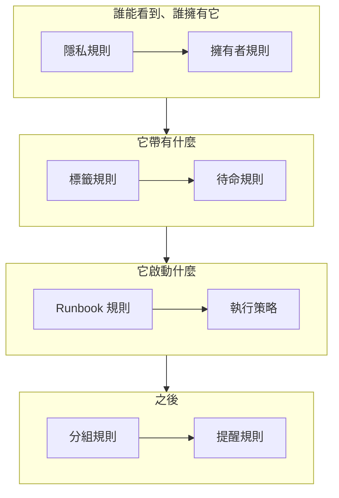

# 警示規則與設定

警示的設定位於 **警示** 中，而不是 **專案設定** 中：作用於每個新警示的規則，以及形塑專案中每個警示的設定。本頁是其中每一項的參考，也說明了警示建立時會自動執行哪些內容。

:::cards
- [新警示經過的規則](#新警示經過的規則): 依順序排列，以及每條規則的作用。
- [待命規則](#待命規則): 不必每次選擇策略，就能呼叫合適的人。
- [提醒規則](#提醒規則): 在警示保持開啟期間提醒擁有者。
- [設定](#設定): 備註範本、自訂欄位、測量、片段成員資格和編號規則。
:::

## 警示設定的位置

從頂端列的 **產品** 選單中開啟 **警示**。其側邊選單中的 **規則** 和 **設定** 區段一開始是摺疊的，因此請先展開它們。這裡的每個頁面都作用於整個專案，網址以 `/dashboard/{projectId}/alerts/settings/` 開頭。

| 規則頁面            | 作用                                                                                           |
| ------------------- | ---------------------------------------------------------------------------------------------- |
| **分組規則**        | 把相關警示放進片段。請參閱 [警示片段與分組規則](/docs/alerts/episodes)。                       |
| **待命規則**        | 為相符的警示和片段執行待命策略。                                                               |
| **擁有者規則**      | 為相符的警示和片段新增擁有者。                                                                 |
| **Runbook 規則**    | 為相符的警示啟動 Runbook。                                                                     |
| **隱私規則**        | 將相符的警示和片段設為私人。                                                                   |
| **標籤規則**        | 為相符的警示和片段新增標籤。                                                                   |
| **Reminder Rules**  | 在警示開啟期間依一定間隔提醒擁有者。                                                           |

**設定** 區段包含 **警示狀態** 和 **警示嚴重性**（在 [警示狀態與嚴重程度](/docs/alerts/states-and-severities) 中介紹），然後是 **備註範本**、**自訂欄位**、**測量**、**片段成員資格** 和 **編號規則**，下文將逐一介紹。

另外還有兩個區段作用於警示。**警示 → 人工智慧 → 設定** 決定 OneUptime AI 自行做什麼：**調查新警示**，新專案預設開啟；**自動修正新警示**，在你開啟之前保持關閉。請參閱 [AI SRE](/docs/ai/ai-sre)。**警示 → 工作區** 包含將警示和片段發布到頻道的 Slack 和 Microsoft Teams 規則，以及它的 **摘要** 分頁。請參閱 [Slack](/docs/workspace-connections/slack)。

## 新警示經過的規則

這些規則的差別在於多個規則相符時如何處理：

- **分組規則** 和 **Reminder Rules** 依從上到下的順序檢查各自的清單，第一個相符的勝出。拖曳規則即可改變其位置；新規則會排到最後。
- **待命規則**、**擁有者規則**、**標籤規則**、**隱私規則** 和 **Runbook 規則** 只要相符就都會生效。多條規則新增的同一待命策略、擁有者和標籤只會新增一次。

**待命規則**、**擁有者規則**、**標籤規則** 和 **隱私規則** 有兩個分頁：用於警示的 **Alert Rules**，以及以同樣方式作用於每個新警示片段的 **Episode Rules**。新規則建立時即為啟用狀態；在其編輯表單中關閉 **已啟用** 即可暫停它，清單會為每條規則顯示綠色的 **已啟用** 或紅色的 **已停用**。

大多數規則只作用於你儲存它們之後建立的警示和片段。要把擁有者、標籤或隱私規則套用到既有的警示和片段上，請使用 **立即執行**：請參閱 [對現有資源執行規則](/docs/configuration/run-rules-now)。提醒規則是例外：儲存一條提醒規則時，每個開啟的警示都會重新比對。

### 條件

規則的條件決定它作用於哪些警示，讀起來就像句子：「如果 **警示標題** 包含 `database`」「而且 **監測器標籤** 包含任一 *Production*」。沒有條件的規則與每個警示相符。

| 條件                                                          | 比較方式                                                                                                       |
| ------------------------------------------------------------- | -------------------------------------------------------------------------------------------------------------- |
| **監測器**、**警示 嚴重性**、**警示標籤**、**監測器標籤**     | 與你選擇的值進行 **包含任一**、**包含全部** 或 **不包含任何** 比較。                                           |
| **警示標題**、**警示描述**、**監測器名稱**、**監測器描述**    | **包含**、**不包含**、**等於**、**不等於**、**開頭為**、**結尾為**（不區分大小寫），或用於規則運算式或 `*` 萬用字元的 **符合模式** 和 **不符合模式**。 |

有兩個或更多條件時，選擇 **符合全部**（每個條件都必須成立）或 **符合任一**（滿足一個即可）。片段規則則改為比對片段的嚴重程度、標籤、標題和描述。

## 待命規則

**警示 → 規則 → 待命規則** 讓呼叫自動進行。每條相符的規則都會把其策略新增到新警示上，警示會連同它原有的策略一起執行這些策略，每個策略只執行一次。

:::steps
### 選擇警示

按一下 **建立Alert On-Call Rule**。在 **比對** 中，新規則預設的 **所有警示** 會與每個新警示相符。要縮小範圍，請選擇 **僅符合條件的警示** 並新增警示必須滿足的條件。

### 選擇策略

在 **待命策略** 中，選擇該規則要呼叫的 **待命策略**。在你輸入自己的名稱之前，**名稱** 會隨之變動，例如「呼叫 Platform on-call」；**描述** 在 **更多欄位** 中。然後建立規則。
:::

嚴重程度本身不會呼叫任何人：要設定「每個 High 警示都呼叫資料庫團隊」，就要用一條比對 **警示 嚴重性** 的待命規則。要查看某個警示執行了什麼，請開啟其 **待命執行** 頁面。隨後，每個人都會依照自己在 **使用者設定 → 待命規則** 的 **警示** 分頁上設定的方式收到呼叫；請參閱 [上報規則](/docs/on-call/escalation-rules)。

警示一與規則相符，規則就會立即呼叫。若要讓它等到工作時間，請在 **更多欄位** 中把 **此規則應在何時呼叫？** 選為 **僅在工作時間內**。 **工作時間** 預設是你所在時區的週一到週五 09:00 到 17:00：選擇其他日子、其他 **開始時間** 或 **結束時間**，或其他 **時區**，選項下方的一句話會說明將會發生什麼。在清單中，規則名稱下方會顯示它的工作時間。在這些時間之外相符的警示會得到一個等待中的執行，不呼叫任何人；工作時間一開始，策略就呼叫它的第一條上報規則，並照常上報。如果警示在此之前被確認或解決，就不會呼叫任何人。如果警示在等待期間發生變化，例如嚴重程度被調高，從而與一條立即呼叫的規則相符，執行會立刻開始呼叫，警示的動態消息也會說明原因。呼叫同一策略的兩條規則，只要其中任一條允許就會呼叫它：一條立即呼叫最高嚴重程度的規則，加上一條為其餘程度等待工作時間的規則，就能讓夜晚保持安靜。

## 擁有者規則和標籤規則

**擁有者規則** 會為相符的新警示新增擁有者使用者和團隊，**標籤規則** 則新增標籤。建立一條規則需要兩個步驟：**比對**，即條件；然後是 **擁有者** 或 **標籤**，即規則要新增的內容。在你輸入自己的名稱之前，規則的 **名稱** 會跟隨你的選擇。

- **規則可以繼承。** 摺疊在 **繼承擁有者** 或 **繼承標籤** 下的六個開關，會傳遞警示的監測器、主機、Kubernetes 叢集、Docker 主機、Podman 主機和服務的擁有者或標籤。片段規則沒有這樣的開關。擁有者規則的 **繼承擁有者** 以 **建立者的團隊** 結尾：在那裡列出的團隊中，建立警示的人所屬的每個團隊也會成為擁有者。
- **新規則必須新增一些內容**：至少選擇一個擁有者或標籤，或者開啟一個開關。對於事件或警示擁有者規則，在 **建立者的團隊** 下列出一個團隊也就足夠。
- 擁有者規則 **更多欄位** 下的 **通知擁有者** 決定是否告知被新增的人。

[標籤與擁有者規則](/docs/configuration/label-and-owner-rules) 針對每種資源，逐步介紹該表單。

## 隱私規則和 Runbook 規則

**隱私規則** 會在其他任何內容執行之前，把相符的新警示設為私人：只有它們的擁有者以及專案的管理員和擁有者可以看到它們。規則有兩個步驟：**比對**，即它設為私人的警示；然後是 **名稱**，已預先填寫為「將警示設為私人」。請參閱 [私人警示](/docs/alerts/index#私人警示)。

**Runbook 規則** 會在新警示相符時啟動一個 Runbook，除非該警示建立時即已解決。請參閱 [Runbook 規則](/docs/runbooks/rules)。

## 提醒規則

**警示 → 規則 → Reminder Rules** 會在警示保持開啟期間提醒其擁有者。每個新警示會依清單從上到下的順序，得到第一條與它相符的規則。

:::steps
### 選擇要提醒哪些警示

按一下 **建立Alert Reminder Rule**。在 **比對** 中保持選取 **所有警示**，則對每個警示進行提醒；選擇 **僅符合條件的警示** 後，再選擇它適用的 **警示 嚴重性** 和 **標籤**。

### 設定間隔

在 **提醒** 中，設定 **提醒間隔（分鐘）**（多久提醒一次擁有者）和 **停止提醒的時機**：**已解決**（預設值）或 **已確認**。在你輸入自己的名稱之前，**名稱** 會隨兩者變動，例如「每 30 分鐘提醒一次，直到解決」。然後建立規則。
:::

擁有者會以 **Alert reminder** 的形式收到每次提醒，它預設透過電子郵件開啟。當警示的嚴重程度或標籤發生變化時，會重新為它比對規則。要停止某個警示的提醒，請在其 **設定** 頁面上關閉 **傳送提醒**；切換的那一刻就會儲存。

## 設定

### 備註範本

**警示 → 設定 → 備註範本** 存放用於私人備註的現成文字。**警示的私人備註範本** 卡片列出它們；**建立警示 備註 範本** 會要求填寫 **範本名稱**、**範本描述** 和 **備註**。當有人為警示或片段撰寫私人備註，以及確認或解決它們時，會提供範本，而且其文字可以在發布前編輯。警示備註範本是純文字：與事件備註範本不同，它們不會填入任何變數。

### 自訂欄位

**警示 → 設定 → 自訂欄位** 為每個警示新增你自己的欄位，例如客戶等級或工單編號。在警示的 **自訂欄位** 頁面上填寫它們，或透過 API 以 `customFields` 填寫。欄位可以從監測器的自訂欄位複製其值，而不必手動輸入：請參閱 [從監測器複製的欄位](/docs/incidents/settings#從監測器複製的欄位)，它對警示的運作方式相同。

### 測量

**警示 → 設定 → 測量** 衡量每個警示的各個環節耗時多久。選擇 **確認用時** 或 **解決用時**，或你自己選擇的兩個時刻，例如 **警示建立時** 和它進入你所選狀態的時刻。每個測量都會顯示在警示的頁面上，並以 `oneuptime.alert.measurement.<key>` 繪製成圖表。請參閱 [測量](/docs/incidents/settings#測量)，它對警示的運作方式相同。

**呼叫後確認用時** 從 **首次有人被呼叫時** 開始計算，也就是待命策略或直接呼叫第一次就該警示通知到某人的時刻，而不是從警示建立時開始計算：夜裡觸發、早上才發出呼叫的警示，不會把整夜的時間計入其中。沒有呼叫過任何人的警示沒有值。請參閱 [呼叫後確認用時](/docs/incidents/settings#呼叫後確認用時)。

### 片段成員資格

**警示 → 設定 → 片段成員資格** 決定一個警示能否屬於多個片段。開啟 **一個警示只能屬於一個片段** 後，已在某個片段中的警示在被移出該片段之前，無論透過儀表板、API、工作流程還是分組規則，都不會被新增到其他片段。開關在你開啟之前是關閉的，只有 Project Owners 和 Project Admins 可以變更它。開啟它不會把任何警示移出片段。請參閱 [每個事件只屬於一個片段](/docs/incidents/episodes#每個事件只屬於一個片段)，它對警示的運作方式相同。

### 編號規則

**警示 → 設定 → 編號規則** 設定警示編號和片段編號前面的文字：新專案中為 `ALT-` 和 `AE-`，沒有前綴時為 `#`。**更新** 會開啟 **警示編號前綴** 和 **警示片段編號前綴**，並在你輸入時顯示預覽。只有之後建立的警示和片段才會使用新前綴。前綴的規則請見 [編號前綴](/docs/incidents/settings#編號前綴)。

其下方的 **下一個編號** 卡片設定下一個警示和下一個片段得到的編號，用來延續其他工具的編號：**更新** 會開啟 **下一個警示編號** 和 **下一個警示片段編號**，每個都必須大於迄今的最大編號。請參閱 [下一個編號](/docs/incidents/settings#下一個編號)。

> [!NOTE]
> 在 OneUptime Cloud 上，備註範本和自訂欄位需要 **Growth** 或更高的方案。

## 工作流程

每個警示模型都有以它命名的工作流程觸發器和動作：**On Create Alert**、**On Update Alert**、**On Create or Update Alert** 和 **On Delete Alert**，**警示 片段**、**警示 狀態 時間軸** 等也同樣如此，還有 **Create One Alert** 和 **Update One Alert** 等動作。唯一的例外是警示自訂欄位的定義：它們沒有工作流程觸發器。請參閱 [工作流程概觀](/docs/workflows/index)。

## 誰可以變更這些內容

規則、自訂欄位和測量需要 Project Owner 或 Project Admin，或擁有該規則自身權限的自訂角色。**警示成員** 可以處理警示和片段、它們的備註、擁有者和狀態時間軸，以及備註範本；**警示管理員** 還可以管理警示狀態和嚴重程度。請參閱 [使用者、團隊與權限](/docs/permissions/index)。

## 後續步驟

:::cards
- [警示片段與分組規則](/docs/alerts/episodes): 深入了解分組規則。
- [上報規則](/docs/on-call/escalation-rules): 待命規則執行策略之後會發生什麼。
- [標籤與擁有者規則](/docs/configuration/label-and-owner-rules): 逐步介紹規則表單。
- [AI SRE](/docs/ai/ai-sre): 自動調查和修正新警示。
:::
