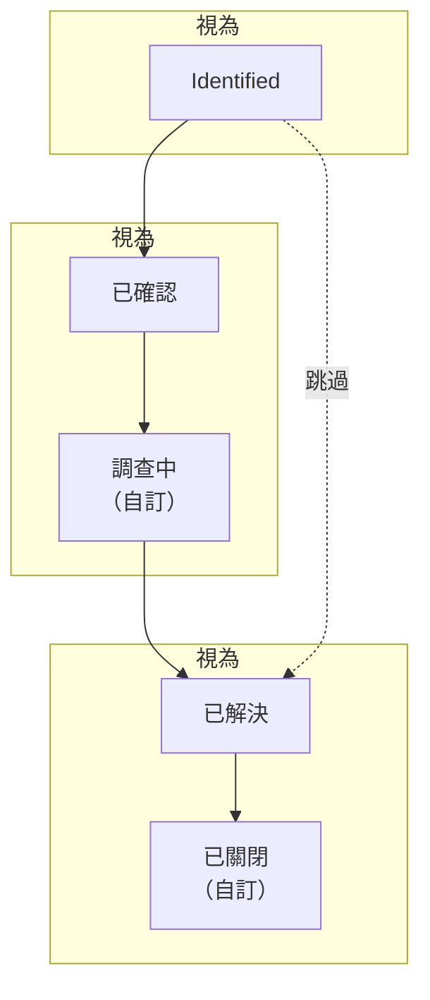

# 警示狀態與嚴重程度

每個警示都帶有一個 **狀態**，表示你的團隊處理到了哪一步，以及一個 **嚴重程度**，表示它有多重要。狀態決定 OneUptime 做什麼：誰仍會被呼叫、什麼算作進行中、片段何時解決。嚴重程度為警示排序，規則也可以依嚴重程度進行比對。本頁適合所有設定它們的人，以及想知道某個警示為什麼呼叫或沒有呼叫任何人的人。

:::cards
- [預設狀態](#預設狀態): Identified、已確認和已解決，以及各自的作用。
- [新增自己的狀態](#新增自己的狀態): 屬於你自己的步驟，例如「調查中」。
- [讓警示經過各個狀態](#讓警示經過各個狀態): 狀態發生變化的每一種方式。
- [嚴重程度](#預設嚴重程度): High 和 Low，以及如何新增自己的嚴重程度。
:::

## 運作方式

一個專案的警示狀態是一份有序清單，警示只會沿著它往下移動。狀態所處的位置決定了處於該狀態的警示算作什麼：尚未確認、已確認或已解決。警示片段也經過同一份清單。

`AlertState` 模型有 `name`、`description`、`color` 和 `order`，另外還有三個旗標：`isCreatedState`、`isAcknowledgedState` 和 `isResolvedState`。OneUptime 讀取的是旗標和順序，從不讀取名稱，因此你可以把 **已解決** 重新命名為「已關閉」，而不會破壞任何東西。`AlertSeverity` 模型有 `name`、`description`、`color` 和 `order`，沒有旗標。

> [!TIP]
> 這兩份清單都在 **警示 → 設定** 下，它在側邊選單中一開始是摺疊的：展開 **設定** 即可找到 **警示狀態** 和 **警示嚴重性**。

## 預設狀態

每個新專案都以三個警示狀態開始，順序如下：

| 狀態             | `order` | 旗標                  | 顏色      | 含義                                            |
| ---------------- | ------- | --------------------- | --------- | ----------------------------------------------- |
| **已識別**   | `1`     | `isCreatedState`      | `#fd625e` | 新警示開始時所處的狀態。                        |
| **已確認**       | `2`     | `isAcknowledgedState` | `#ffbf53` | 有人在處理它，呼叫隨之停止。                    |
| **已解決**       | `3`     | `isResolvedState`     | `#2ab57d` | 警示已經結束，不再算作進行中。                  |

這三個帶旗標的狀態在設定頁面上帶有 **內建** 標記。你可以重新命名、重新著色和拖曳它們，但它們會維持自己的順序（建立在確認之前，確認在解決之前），而且無法刪除：它們的 **刪除** 保持鎖定，並說明原因。

## 每個旗標的作用

| 旗標                  | OneUptime 用它做什麼                                                                                                                                                              |
| --------------------- | --------------------------------------------------------------------------------------------------------------------------------------------------------------------------------- |
| `isCreatedState`      | 沒有人選擇其他狀態時，新警示從這裡開始：監測器觸發的每個警示，以及 **初始狀態** 留空時建立的每個警示。                                                                            |
| `isAcknowledgedState` | **確認** 會把警示移到這裡。在此狀態或其後的任何狀態中，警示都算作已確認：它的待命策略停止呼叫，也不再提供 **確認**。                                                              |
| `isResolvedState`     | **解決** 會把警示移到這裡。在此狀態或其後的任何狀態中，警示都算作已解決：它離開 **進行中警示**，其提醒停止，其片段可以解決。                                                      |

## 新增自己的狀態

你新增的狀態，是你的團隊會經歷、而預設的三個狀態沒有命名的步驟：「調查中」「已緩解」「已關閉」。

:::steps
### 開啟狀態清單

前往 **警示 → 設定 → 警示狀態**。**警示 狀態** 卡片依順序列出你的狀態。每一列顯示其顏色和名稱、處於該狀態的警示 **視為** 什麼，以及它的描述。

### 建立狀態

按一下 **建立警示狀態**，並填寫 **名稱**、**描述** 和 **顏色**。顏色已經預先選好：一個尚未被其他狀態使用的顏色。新狀態會被新增到已解決狀態的正上方，因此它會讓警示保持進行中。

### 拖曳到適當位置

按住某一列的拖曳把手即可移動它；放開時就會儲存新的順序。**視為** 欄也會隨之變化：在已確認狀態之上的警示為 **未確認**，從它往下為 **已確認**，從已解決狀態往下為 **已解決**。
:::

你新增的狀態沒有旗標，因此它所處的位置就是它的含義。把緩解步驟放在 **已確認** 和 **已解決** 之間，把分流步驟放在 **已確認** 之上。放在 **已解決** 之下的狀態在任何地方都算作已解決。

你可以從警示頁首的 **⋯** 選單中，在 **將狀態變更為** 下把警示移到你自己的狀態，該選單會列出目前狀態之後的每個狀態。其確認對話方塊的標題為 **將警示標記為「{{state}}」**，其中帶有該狀態的名稱。

> [!NOTE]
> 在 OneUptime Cloud 上，新增或變更警示狀態和嚴重程度需要 **Growth** 或更高的方案。所有方案都可以讀取和使用它們，也可以刪除你新增的狀態。

## 順序是強制執行的

警示的每一次狀態變更都會對照該清單進行檢查，無論由誰發起：儀表板、Slack、Microsoft Teams、API、Terraform、工作流程，還是 OneUptime 本身。

- **往回移動會被拒絕**，並附上一則點明兩個狀態的訊息：「Alert cannot transition to Acknowledged state from Resolved state because Acknowledged is before Resolved in the order of alert states.」
- **移動到目前所處的狀態會被拒絕**：「Alert state cannot be same as previous state.」
- **選擇器只提供目前狀態之後的狀態**，因此沒有人會看到一個會被拒絕的移動。

警示片段遵循同一份清單，並使用自己的訊息（「Episode cannot transition to …」）。唯一一次沿清單往上的移動來自 OneUptime 本身：分組規則重新開啟一個最近解決的片段。要更正誤設的狀態，請在警示的 **狀態時間軸** 頁面上刪除對應的列；警示會回到其最新剩餘列的狀態。

## 預設嚴重程度

每個新專案都以兩個警示嚴重程度開始，最嚴重的在前：

| 嚴重程度 | `order` | 顏色      | 預設描述                                                                          |
| -------- | ------- | --------- | --------------------------------------------------------------------------------- |
| **高** | `1`     | `#b70400` | Issues causing very high impact to customers. Immediate attention is required.    |
| **低**  | `2`     | `#ffbf53` | Issues causing low impact to customers.                                           |

事件以三個嚴重程度開始，警示則以兩個開始。當監測器建議的範本寫的是 **嚴重** 或 **Warning** 時，OneUptime 會把它對應到你的第一個和第二個警示嚴重程度，在新專案中即 **高** 和 **低**。

## 編輯嚴重程度

前往 **警示 → 設定 → 警示嚴重性**。**警示 嚴重性** 卡片以最嚴重的在前列出它們；拖曳某一列即可改變其排名。**建立警示嚴重性** 會在清單末端新增一個最不嚴重的等級，欄位與狀態相同：**名稱**、**描述** 和 **顏色**。

排名決定了在 OneUptime 比較嚴重程度時哪一個勝出：片段的嚴重程度會升到加入它的最嚴重警示的等級。嚴重程度沒有旗標，也沒有刪除鎖定：任何嚴重程度都可以刪除，包括預設的兩個。

嚴重程度本身不會呼叫任何人。要依嚴重程度呼叫，請新增一條 **警示 嚴重性** 與之相符的待命規則：請參閱 [警示規則與設定](/docs/alerts/settings)。變更警示的嚴重程度會在其動態消息中寫入一筆項目，並重新比對其提醒規則。

## 封存狀態或嚴重性

對於團隊不應再使用的狀態或嚴重性，請將其封存而不是刪除。封存不會變更任何警示。刪除狀態會從每個警示的歷程記錄中移除其列，而嚴重性在仍有警示使用時無法刪除。

- **封存** 位於該列的 **⋯** 選單中。它會先要求確認，並列出設定為使用該值的規則、測量、監測器條件和工作流程：在您變更它們之前，它們會繼續使用該值。
- **每個人自己的待命規則會保留。** 對於嚴重程度，對話方塊還會顯示有多少人為它設定了待命規則。這些規則維持不變，因此帶有此嚴重程度的警示仍會呼叫這些人。在每個人的 **待命規則** 頁面上，已封存的嚴重程度排在最後，並標示為 **已封存**：其規則可以變更或移除，但無法新增規則。
- **任何人都無法再選擇它。** **變更狀態**、警示標題列、Slack、Microsoft Teams、規則和監測器條件都不會提供它。API、Terraform 和 MCP 會拒絕它，並說明是哪個值以及在哪裡取消封存。
- **警示會保留它。** 已有該值的警示在之後的每次編輯中都會保留它，其狀態時間軸仍會顯示它，您仍可依它篩選。
- **已封存的值會另外列出**，位於表格下方摺疊的 **已封存的警示狀態** 或 **已封存的警示嚴重性** 區段，並顯示每個值由誰在何時封存。**取消封存** 會將其恢復原樣。
- **有些值無法封存。** 建立、確認和已解決狀態，以及專案中最後一個未封存的嚴重性。它們的 **封存** 已鎖定，並說明原因。

**刪除** 會先說明將發生什麼。只要仍有警示或片段使用該值，刪除就會被拒絕，對話方塊會列出它們。否則，它會列出刪除將變更的內容，並提供 **改為封存**。若要一次刪除多個，請選取它們並在 **批次動作** 下選擇 **刪除**：對話方塊會先對所有項目說明同樣的內容，無法刪除的項目維持不變，其餘的會被刪除。

## 讓警示經過各個狀態

| 方式                 | 位置                                                                                      | 它詢問什麼                                                                                                                           |
| -------------------- | ----------------------------------------------------------------------------------------- | ------------------------------------------------------------------------------------------------------------------------------------ |
| **頁首按鈕**         | 警示的頁首：**確認**、**解決**，以及其 **⋯** 選單中的 **將狀態變更為**                | 一個簡短的確認，可在 **新增私人備註** 下附上一則選用的備註：**確認警示**、**解決警示** 或 **將警示標記為「{{state}}」**。          |
| **State timeline**   | 警示側邊選單中的 **狀態時間軸**                                                           | 你手動新增的一列，包含 **警示狀態** 和 **開始**。                                                                                     |
| **清單列** | 警示清單中警示列上的 **⋯** 選單：**確認**、**解決** 和 **變更狀態** | 與頁首相同的確認，並寫明警示的名稱。其間已被其他變更推進的警示維持不變，對話方塊會說明原因。 |
| **批次變更**         | 在警示清單中對選取的警示使用 **確認**、**解決** 或 **變更狀態**                                                 | 目標狀態，以及新增到每個警示的一則私人備註。已經處於或越過該狀態的警示會被略過。                                                     |
| **自動**             | 監測器、片段、已連結的事件或你自己的程式碼                                                | 監測器條件上的 **自動解決警示**、片段的狀態變更、[已連結的警示](/docs/incidents/linked-alerts) 上的事件開關，或在 `/api/alert-state-timeline` 建立的一列。 |

頁首在警示尚未確認時提供 **確認** 和 **解決**，確認之後只提供 **解決**。已解決的警示兩者都不顯示。角色不允許變更警示狀態的人會看到按鈕被鎖定，也沒有其他狀態的選單；將指標移到按鈕上會列出允許此操作的權限。

## 確認會做什麼

從警示移入你的已確認狀態或其後的任何狀態（包括已解決狀態）的那一刻起，它就算作已確認。此後：

- **待命不再為它呼叫。** 它的待命策略不會呼叫下一級。
- **不再提供確認**，無論是在頁首中，還是在 Slack 和 Microsoft Teams 中；在那裡再次確認會被拒絕，並提示「Alert is already acknowledged.」或「Alert is already resolved.」。此後才回應呼叫的人，其呼叫會被確認，而警示保持原樣。
- **確認用時就此確定**，從第一次這樣的移動算起：即 **概覽** 的第一個區塊，以及一個在 **警示被確認時** 結束的測量。

## 解決會做什麼

當警示移入你的已解決狀態或其後的任何狀態時，它就算作已解決。此後：

- **它離開進行中警示**，也不再計入側邊選單中的數量。
- **它的提醒停止**，無論其提醒規則如何規定。
- **它的片段可以解決。** 當片段中的每個警示都已解決時，片段會自行解決。請參閱 [警示片段與分組規則](/docs/alerts/episodes)。
- **它的監測器可以觸發新警示。** 一個條件同一時間只保留一個未解決的警示；該警示解決後，下一次相符會開啟另一個。

從 **已解決** 繼續移到其後的狀態（例如「已關閉」）不會改變上述任何一點：警示早已解決。

## 狀態時間軸

警示的 **狀態時間軸** 頁面記錄了它經歷過的每個狀態。其卡片將它們繪製成時間軸：一條色帶，每個狀態的長度與其持續時間相同，下方依從新到舊的順序列出每次變更。卡片標題中的 **表格** 則將它們按列列出，包含 **警示狀態**、**開始**、**結束** 和 **持續時間**。

- **檢視原因** 顯示隨該變更記錄的根本原因。
- **檢視日誌** 顯示警示變更時 OneUptime 記錄的內容，例如導致變更的那次監測器檢查。

列可以新增和刪除，但不能編輯，而且警示始終至少保留一列。刪除最新的一列會讓警示回到前一列的狀態。

> [!WARNING]
> 刪除一列會改寫警示的歷程，以及據此計算出的每個測量。用它來更正錯誤，而不是用來整理。

## 進行中警示清單

**警示 → 進行中警示** 包含狀態位於你的已解決狀態之上的每個警示，除此之外沒有任何其他決定因素：與嚴重程度無關，與存在時間長短無關，也與是否有人確認無關。側邊選單中它旁邊的紅色徽章計算的也正是這些警示。

因此，位於 **已解決** 之上的自訂狀態會讓警示留在清單中，而位於其下的狀態會像解決一樣把它們移出清單。**進行中片段** 對片段的運作方式相同。

## 後續步驟

:::cards
- [警示概觀](/docs/alerts/index): 警示從何而來，以及你的團隊如何處理它們。
- [警示片段與分組規則](/docs/alerts/episodes): 片段的狀態如何帶動其中的警示。
- [警示規則與設定](/docs/alerts/settings): 依嚴重程度呼叫和提醒。
- [事件狀態與嚴重程度](/docs/incidents/states-and-severities): 同樣的生命週期，用於事件。
:::
