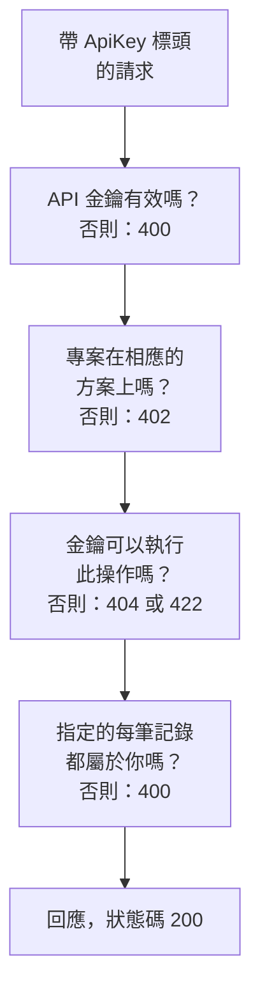

# OneUptime API 參考

你在 OneUptime 儀表板上能做的一切，也都可以透過它的 REST API 完成：自動化重複性的工作、把 OneUptime 連接到你的其他工具，或建置你自己的整合。本頁說明如何送出第一個請求，以及每個請求都遵循的規則。每個端點和欄位都列在 [完整的 API 參考](/reference) 中。

:::cards
- [送出第一個請求](#送出第一個請求): 一把 API 金鑰、一個標頭和一條 curl 指令。
- [請求與回應](#請求與回應): 每個資源都有的六種請求，以及每個狀態碼的意義。
- [方案與 API](#方案與-api): 方案提供什麼，以及低於方案時仍可使用什麼。
- [指定與寫入記錄](#指定與寫入記錄): ID、參照、開關，以及由 OneUptime 設定的欄位。
- [狀態與片段](#狀態與片段): 記錄的初始狀態以及它經歷的狀態。
- [請求能觸及的範圍](#請求能觸及的範圍): 讀取、變更和刪除，一次一個專案。
:::

## 請求如何獲得回應

這個 API 圍繞 REST 組織：標準的 HTTP 方法和狀態碼，輸入 JSON，輸出 JSON。每個請求都帶有一把 API 金鑰，並經過幾項檢查。請求未通過的第一項檢查會以一個狀態碼和 `{ "message": "..." }` 回應，因此訊息會說明是什麼擋下了它。



## 送出第一個請求

所有 API 請求都使用 API 金鑰進行驗證。一把金鑰屬於一個專案，並執行其權限允許的操作。

:::steps
### 建立 API 金鑰

開啟 **專案設定 → 進階 → API 金鑰**，然後點選 **建立API 金鑰**。為它填寫 **名稱**，並在 **存取** 下選擇它可以做什麼：**專案管理員**、**專案成員**、**檢視者**，或選擇 **稍後選擇權限** 以在金鑰的頁面上新增個別權限。除非你在 **進階** 下選擇其他日期，否則金鑰會在一年後到期。

### 複製金鑰

金鑰的頁面隨即開啟。從 **API 金鑰詳細資訊** 卡片中複製 **API 金鑰**，並且不要把它寫進程式碼：

```bash
export ONEUPTIME_API_KEY="your-api-key"
```

### 傳送請求

列出前十個監測器。金鑰讀取的是它自己的專案，因此請求不需要指明專案：

```bash
curl -X POST 'https://oneuptime.com/api/monitor/get-list?skip=0&limit=10' \
  -H "ApiKey: $ONEUPTIME_API_KEY" \
  -H 'Content-Type: application/json' \
  -d '{ "select": { "name": true } }'
```

回應為 `{ "data": [...], "count": ... }`：監測器，以及它們的總數。在自行託管的安裝中，請用你自己的 OneUptime 位址取代 `https://oneuptime.com`。
:::

### 每個資源的範例

OneUptime 儀表板中的每個資源在側邊選單中都有一個 **開發者** 區段，在你開啟之前是收合的。其中的 **API** 頁面提供了該資源可直接執行的 `curl` 指令，指向你的 OneUptime 並已填入你自己專案的資料：在資源自己的頁面上讀取、變更和刪除它，或在清單頁面（例如 **監測器**）上列出、計數和建立。這些指令從環境變數 `ONEUPTIME_API_KEY` 讀取你的 API 金鑰。

範例是針對該資源撰寫的。例如在 **事件** 清單上，清單請求會用你的第一個事件展示其回應；篩選器會使用你自己的狀態、嚴重程度和監測器，找出未解決的事件、某一嚴重程度的事件、與某個監測器相關的事件或最近七天內的事件；建立請求會用你的某個嚴重程度宣告一個事件，並用一行文字說明每個欄位的用途。事件自己的頁面會用真實的回應讀取它、把它改為你的另一個嚴重程度，並提供常用的工作：確認並解決它（使用你專案自己的狀態），以及新增內部或公開備註。每個 API 頁面的最後都會列出該資源的端點。

## 請求與回應

每個資源都有相同的請求，位於 `https://oneuptime.com/api` 加上資源路徑之下，例如 `/monitor` 或 `/incident`：

| 請求 | 方法與路徑 | 請求本文包含什麼 |
| --- | --- | --- |
| 列出 | `POST /api/<resource>/get-list` | `query`、`select` 和 `sort` |
| 計數 | `POST /api/<resource>/count` | `query` |
| 讀取單筆 | `POST /api/<resource>/<id>/get-item` | `select` |
| 建立 | `POST /api/<resource>` | `{ "data": { ... } }` |
| 變更單筆 | `PUT /api/<resource>/<id>` | `{ "data": { ... } }`，即要變更的欄位 |
| 刪除單筆 | `DELETE /api/<resource>/<id>` | 無 |

`POST /api/<resource>/<id>/update-item` 和 `POST /api/<resource>/<id>/delete-item` 也可以變更和刪除單筆記錄，供只能傳送 `POST` 的用戶端使用。

### 篩選、排序與分頁

清單或計數接受一個 `query`。帶值的欄位比對該值；帶 `_type` 的物件則進行比較：

| `_type` | 符合 |
| --- | --- |
| `Search` | 包含 `value` 的文字 |
| `NotEqual` | 除了 `value` 之外的任何內容 |
| `GreaterThan`、`LessThan` | 較晚的日期或較大的數字，或者較早、較小的 |
| `InBetween` | 介於 `startValue` 和 `endValue` 之間的日期或數字 |
| `Includes` | `value` 中的任一個值 |
| `IsNull`、`NotNull` | 沒有值，或有任何值 |

資源所指定記錄的欄位在其關聯下篩選：`"user": { "name": { "_type": "Search", "value": "ada" } }` 會找出其使用者名稱包含「ada」的團隊成員。依某個欄位篩選需要讀取該欄位的權限，經由關聯時與在資源本身上一樣：對你無權讀取的欄位進行篩選會被拒絕，回傳指明該欄位的 `422`。

`select` 指明要傳回的欄位，`_id` 一律會傳回。`sort` 依 `ASC` 或 `DESC` 排序；未指定時，最新的記錄排在最前。除非設定 `limit`，清單會傳回 10 筆記錄，最多可達 10,000 筆；`skip` 會先略過這麼多筆：持續依 `limit` 增加 `skip`，直到取得 `count` 筆為止。在清單請求中加上 `?output-type=csv` 即可取得 CSV 而不是 JSON。

例如，名稱包含「checkout」、自 2026 年初以來建立的監測器，最新的排在最前：

```bash
curl -X POST 'https://oneuptime.com/api/monitor/get-list' \
  -H "ApiKey: $ONEUPTIME_API_KEY" \
  -H 'Content-Type: application/json' \
  -d '{
    "query": {
      "name": { "_type": "Search", "value": "checkout" },
      "createdAt": { "_type": "GreaterThan", "value": "2026-01-01T00:00:00.000Z" }
    },
    "select": { "name": true, "createdAt": true },
    "sort": { "createdAt": "DESC" },
    "limit": 100
  }'
```

日期和 `_id` 以外的 ID 會經過包裝後傳回，形如 `{ "_type": "DateTime", "value": "..." }` 和 `{ "_type": "ObjectID", "value": "..." }`：請從 `value` 中讀取。

請求用來篩選或寫入的每個 ID——`_id`、`monitorId` 這樣的欄位，以及關聯列出的每筆記錄，例如 `"labels": [{ "_id": "..." }]`——都是 UUID，以文字形式傳送，或像傳回時那樣包裝後傳送。其他任何內容，例如不是 UUID 的文字，或代替 ID 的物件，都會被拒絕，並傳回一個指明欄位的 `400`，說明它在 `query` 還是 `data` 中，而且不會讀取或寫入任何內容：

```text
Invalid ID for "currentIncidentStateId" in the query: "resolved". An ID is a UUID, such as "550e8400-e29b-41d4-a716-446655440000".
```

### 狀態碼

| 狀態碼 | 意義 | 深入了解 |
| --- | --- | --- |
| `200` | 請求成功。清單或計數會以你可以讀取的記錄回應，沒有時則為空。 | [依 ID 讀取單筆記錄](#依-id-讀取單筆記錄) |
| `400` | 請求有誤：API 金鑰無效、某個值不被允許、某個欄位無法寫入、它指定的某筆記錄不屬於你，或者它一次變更多個專案。訊息會說明哪裡出錯。 | [請求所指定的記錄](#請求所指定的記錄) |
| `402` | 專案的方案不包含請求所使用的功能。訊息會指明方案。 | [你的方案不包含的功能](#你的方案不包含的功能) |
| `404` | 記錄不存在、位於另一個專案中，或是你無權讀取的記錄：每種情況的回應都相同。 | [變更或刪除你無權讀取的記錄](#變更或刪除你無權讀取的記錄) |
| `422` | 你無權這麼做：API 金鑰沒有這類記錄的權限，你可以讀取該記錄但不能變更它，或者某項權限的標籤排除了它。訊息會說明原因。 | [變更或刪除你無權讀取的記錄](#變更或刪除你無權讀取的記錄) |
| `500` | 伺服器上發生了錯誤。當新記錄的擁有者無法寫入時，該記錄會被再次移除，以便可以重試建立。 | [請求所指定的記錄](#請求所指定的記錄) |

## 方案與 API

### 你的方案不包含的功能

在 OneUptime Cloud 上，有些資源隨方案提供：單一登入提供者和 SCIM 連線在 **Scale** 中；API 金鑰、待命排程，以及 Slack 和 Microsoft Teams 的通知規則和摘要等在 **Growth** 中。建立、變更或啟用這類資源需要相應的方案。低於該方案時，請求會被拒絕並傳回 `402 Payment Required`，訊息會指明方案。

資源的某些設定也以同樣的方式隨方案提供。例如：私人的狀態頁面、隱藏其某個清單的狀態頁面，或帶有自訂 HTML、CSS 或 JavaScript、電子郵件報告、簡訊、Slack、Microsoft Teams 或 Webhook 訂閱者、IP 允許清單的狀態頁面；公開分享的儀表板或其 IP 允許清單；表單的 IP 允許清單；專案的稽核日誌。每項設定的指南以及儀表板中該設定旁的說明都會指明它所需的方案。這樣的設定每次寫入時都需要其方案——無論是帶著它建立資源，還是之後變更它——因此低於方案時啟用某項設定的建立也會以 `402` 被拒絕。維持預設值或恢復為預設值的設定在任何方案上都可用：不觸碰這些設定的建立可以通過，不設定它們的 Terraform 設定也可以。

專案已經擁有的東西，無論方案為何都仍可管理，例如試用期結束或方案降級之後：

- 你可以刪除這些記錄；
- 對於帶有 `isEnabled` 欄位的資源，你可以只傳送 `"isEnabled": false` 來關閉它；
- 你可以列出並讀取方案降級後專案需要找到的內容——以便關閉它們，或查看哪些已停止運作：單一登入提供者、SCIM 連線、API 金鑰及其權限、待命排程，以及 Slack 和 Microsoft Teams 的通知規則和摘要。

和在方案內時完全一樣，仍由一般權限決定誰可以做什麼。讀取方案提供的其他資源，例如範本、自訂欄位、監測器群組、待命日誌和表單提交，仍然需要方案：讀取它們就是在使用該功能。低於 **Growth** 時，API 金鑰的權限不會被逐一刪除，因為刪除一項封鎖權限會讓金鑰獲得更多存取權；請改為刪除金鑰。

### 低於其方案時的 API 金鑰和 SCIM

在 OneUptime Cloud 上，專案的 API 金鑰僅在專案處於 **Growth** 以上時可用，而它的 SCIM 連線（專案自己的以及其狀態頁面的）僅在處於 **Scale** 以上時才能完全運作。當專案降到該方案以下時：

- 使用專案某把 API 金鑰送出的每個請求，無論要求什麼，都會被拒絕並傳回 `402 Payment Required`：REST API，以及所有用 API 金鑰呼叫它的東西——Terraform、`oneuptime` CLI、用 API 金鑰連線的 MCP 用戶端、在請求標頭中傳送金鑰的工作流程，以及你自己的指令碼。訊息會指明方案：`API keys need the Growth plan. This project's plan does not include them, so its API keys stopped working. The keys are kept: upgrade the project to Growth in Project Settings > Billing and Invoices > Billing and they work again.`
- 它的 SCIM 連線只能移除人員。停用和刪除人員以及把他們移出群組仍然有效，因此離開的人仍會失去存取權；每個會新增或變更人員或群組的 SCIM 請求都會以 SCIM 錯誤格式傳回 `402` 並被拒絕，以便你的身分提供者顯示原因（[低於 Scale 方案時](/docs/identity/scim#低於-scale-方案時)）。

不會刪除或關閉任何內容。金鑰和連線都會保留，專案一回到該方案，它們就會原樣完全恢復運作：不需要建立新金鑰，也不需要在身分提供者中重新設定任何內容。方案變更會在一分鐘內生效。

低於 **Growth** 時，**專案設定** > **進階** > **API 金鑰** 會列出專案仍有的金鑰並說明它們已停止運作，因此在任何方案上都可以刪除（撤銷）其中任何一把。建立或變更金鑰需要 **Growth**。**專案設定** > **帳單與發票** > **帳單** 會針對你可以選擇的每個方案，說明較低方案會停止多少把 API 金鑰、限制多少個 SCIM 連線，以及專案的方案已停止了什麼；當方案變更使它們停止時，專案擁有者會收到一封電子郵件。在此機制開始時專案就已低於這些方案的擁有者，會收到一封電子郵件，說明哪些已停止以及如何重新啟用。

只有專案的 API 金鑰和 SCIM 連線受影響。人員不受影響：登入儀表板以及透過登入連線的 MCP 用戶端照常運作。遙測擷取金鑰、探針金鑰和代理程式金鑰不是 API 金鑰，會繼續運作。自行託管的安裝沒有方案，因此對它們沒有任何變化。

## 指定與寫入記錄

### 尋找資源的 ID

讀取、變更或刪除單一資源的請求會以其 ID（一個 UUID）指定它。在資源自己的頁面上，其詳細資料卡片的末尾有一行小小的 **ID**，顯示 ID 的開頭：點選 ID 或旁邊的複製按鈕即可複製完整的 ID。支援此功能的清單會在列的 **⋯** 選單中提供 **顯示 ID**，ID 也是頁面位址的最後一部分。你的專案的 ID 是 **專案設定 → 專案** 中 **專案詳細資訊** 卡片上的第一項。

### 請求所指定的記錄

許多資源會指定其他記錄：監測器指定其標籤和探針，狀態頁面訂閱者指定其狀態頁面，網路裝置指定其站點，事件成員指定事件和角色。以下每條規則對 API、Terraform 和工作流程同樣適用：

| 當請求 | 它必須 | 否則 |
| --- | --- | --- |
| 依 ID 指定記錄 | 指定你專案中的記錄 | `400` |
| 建立透過另一筆記錄讀取的記錄，例如備註 | 在你可以讀取的記錄下建立 | `400`，或在沒有讀取該類記錄的權限時傳回 `422` |
| 把記錄移到另一筆記錄之下 | 移到你可以讀取的記錄之下 | `400` |
| 列出記錄，或在專用的欄位中指定一筆記錄 | 指定你的讀取權限能觸及的記錄 | `400` |
| 指定存放憑證的設定 | 來自可以讀取該類設定的人 | `400` |
| 在限定於標籤的權限下建立記錄或重新設定其標籤 | 為記錄加上其中一個標籤 | `422` |
| 以兩種方式指定同一筆記錄 | 兩次都指定同一筆記錄 | `400` |

#### 每個 ID 都必須屬於你的專案

你為資源所指定的記錄傳送的每個 ID，都必須是你專案中的記錄——儀表板的選擇器不會提供其他選項——來自 Terraform 和工作流程的請求也遵循同樣的規則。另一個專案的記錄的 ID 和不存在的 ID 會以同樣的方式被拒絕，傳回一個指明欄位和 ID 的 `400`：

```text
This network device references records that are not in this project: Network Site "…". Please pick values from this project and try again.
```

人員依成員資格檢查：不是專案成員的人也會以同樣方式被拒絕。每個專案都能使用的全域探針被視為屬於你的專案。變更資源時只檢查變更所新增的 ID，因此指定了某個後來已不存在之物的資源仍然可以儲存。

#### 透過另一筆記錄讀取的記錄

透過另一筆記錄讀取的記錄——事件或警示的備註和狀態時間軸，狀態頁面的公告、網域和群組——也必須依照讀取它時所遵循的規則，指定一筆你可以讀取的記錄：一個事件，如果位於你讀取事件的權限所能觸及的標籤或擁有者之外，或帶有讀取事件的封鎖所移除的標籤，或被標記為私人而你既不直接也不透過團隊位於其擁有者之中（專案擁有者和管理員可以看到每個私人的事件、警示和片段），都會以同樣的 `400` 被拒絕，並且不會寫入任何內容。公告所指定的每個狀態頁面都必須是你可以讀取的，而讀取狀態頁面的權限只能觸及其中一部分的金鑰，必須至少指定一個。建立這類記錄的權限需要一項讀取其所屬記錄的權限；沒有時，建立會被拒絕，並傳回一個指明能讓它通過之權限的 `422`：

```text
You do not have permissions to create Incident Internal Note. It is read through its Incident, and you need one of these permissions to read Incidents: …
```

移動這類記錄的變更也遵循同樣的規則：它作為上層新增的每筆記錄——公告的另一個狀態頁面、透過其服務讀取之記錄的另一個服務——都必須是你可以讀取的，否則變更會以同樣的 `400` 被拒絕，並且不會寫入任何內容。記錄已有的上層不會再次檢查；而讓記錄不再位於任何上層之下的變更，和不指定任何上層的建立一樣，需要一項能觸及所有該類記錄的讀取權限。

#### 擁有者

資源的擁有者——監測器、待命策略、儀表板以及其他任何有擁有者之資源的使用者和團隊擁有者記錄——也以同樣的方式透過其所擁有的資源讀取：列出、讀取、新增和移除它們，需要在該資源的標籤和擁有者範圍內讀取該資源的權限；對於你無權讀取的資源，其擁有者記錄會被當作不存在來回應。新增和移除它們同樣遵循允許此操作的權限的範圍：`Owned` 範圍的權限只觸及你或你的某個團隊擁有的資源的擁有者，向其他任何資源新增擁有者都會被拒絕，並傳回說明原因的 `422`。

#### 寫入所列出或指定的記錄

建立或變更所列出的記錄——事件的監測器和待命策略、警示的服務、排定維護活動的狀態頁面、規則的 Runbook——在你有讀取該類記錄的權限時遵循該權限，並且無論如何都遵循對其讀取設定的帶標籤封鎖：超出範圍的記錄會以同樣的 `400` 被拒絕。變更只檢查它新增到清單中的記錄，因此清單中已有的記錄會保留。

建立或變更在專用欄位中指定的那一筆記錄——警示的監測器、狀態頁面資源所顯示的監測器、成本預算的服務、Runbook 執行所連結的事件——無論用它的哪個名稱，都遵循同樣的規則：超出你讀取該類記錄權限的記錄，或帶有讀取封鎖所移除之標籤的記錄，會以同樣的 `400` 被拒絕。變更只在指定了與欄位已有記錄不同的記錄時才檢查它。OneUptime 的全域探針和 AI 代理程式供每個專案使用，對每個專案保持開放。範本替你填入的記錄在填入後、儲存任何內容之前也以同樣方式檢查：事件範本向由它宣告的事件新增的監測器、狀態頁面和待命策略，必須是你可以讀取的，就像是你親自選擇的一樣。

#### 存放憑證的設定

存放憑證的設定——SMTP 伺服器、電話和簡訊提供者、SNMP 憑證、視訊通話連線、API 金鑰、外部 MCP 伺服器——只能由可以讀取該類設定的呼叫者指定：狀態頁面的 `smtpConfig` 和 `callSmsConfig`、來電策略的 `projectCallSMSConfig`、網路裝置或站點的 `snmpCredentialProfile`、事件或警示的視訊通話 `videoCallConnection`、API 金鑰權限的 `apiKey`，以及 AI 規則的 `externalMcpServers`。在沒有讀取該類設定的權限時指定其中之一——或使用被不帶標籤之封鎖所移除的權限——無論用哪個名稱，都會以同樣的 `400` 被拒絕；保留記錄已指定之設定的變更不會被檢查。來電策略的號碼搜尋和已擁有號碼清單，需要對其所指定的電話和簡訊設定有同樣的讀取權限。

#### 建立時的標籤和擁有者

限定於標籤的建立權限只會建立帶有其中一個標籤的記錄——對於沒有自己標籤的記錄，則是帶有標籤之記錄底下的記錄——除非另一項建立該類記錄的權限涵蓋整個專案；而建立權限上帶標籤的封鎖會拒絕帶有其中某個標籤的記錄。超出範圍的建立會被拒絕，並傳回一個指明這些標籤的 `422`：

```text
Your access lets you create Status Pages only with one of these labels: Production. Add one of them and try again.
```

範圍為 **Owned** 的建立權限，只會為某個人建立監測器、狀態頁面或其他有自己擁有者的記錄，此人會成為其擁有者之一；而備註或其他從所屬記錄繼承擁有者的記錄，只會建立在你或你的某個團隊所擁有的記錄之下。

建立者會在記錄儲存後、發生任何其他事情之前立即成為擁有者。如果無法寫入擁有者列，記錄會被再次移除，建立會以 `500` 被拒絕，因此不會留下建立者無法存取的記錄。

#### 標籤的變更

對記錄所帶標籤的變更——它自己的標籤，或者對於沒有自己標籤的記錄，它所指定的記錄——同樣遵循你變更該類記錄的權限：在限定於標籤的權限下，記錄至少要保留其中一個標籤，除非另一項變更它的權限涵蓋整個專案；而變更權限上帶標籤的封鎖會拒絕為記錄加上其中某個標籤。這樣的變更會被拒絕，並傳回一個指明這些標籤的 `422`：

```text
Your access lets you change Monitors only with one of these labels: Production. Keep one of them and try again.
```

#### 以兩種方式指定記錄

一筆記錄可以用兩種方式指定：用它的 ID 欄位（`monitorId`），或用關聯（`"monitor": { "_id": "…" }`），後者正是儀表板表單傳送的方式。請只傳送其中一個。如果請求同時傳送兩者，它們必須指定同一筆記錄：兩者不一致的請求——兩個不同的 ID，或一個 ID 和一個空值——會被拒絕，並傳回一個指明兩個欄位的 `400`：

```text
Conflicting Monitor references were provided. monitorId and monitor are names for the same field and must hold the same value: send only one of them, or the same id in each.
```

兩個名稱以同樣方式檢查。關於你所指定之記錄的規則，無論你用哪個名稱傳送都適用：狀態頁面群組的上層群組必須位於同一個狀態頁面上，一個狀態頁面最多有三個頁首連結，群組名稱在其狀態頁面上必須唯一。

### 開關

開或關的欄位——`isEnabled`、`isVisibleOnStatusPage`、`isArchived` 以及其他所有 `true` 或 `false` 欄位——接受 `true` 或 `false`。資料庫會讀作其中之一的文字和數字會被當作該值接受，對 API、Terraform 和工作流程都一樣：`"true"`、`"yes"`、`"on"`、`"1"` 和 `1` 是 `true`，`"false"`、`"no"`、`"off"`、`"0"` 和 `0` 是 `false`，不區分大小寫。OneUptime 對該記錄所做的一切也都把它當作該值處理：以 `"isVisibleOnStatusPage": "true"` 傳送的排定維護活動會在狀態頁面上顯示其圖片，而 `"isEnabled": "false"` 會像 `false` 一樣在低於方案時關閉資源。任何其他值，例如 `"maybe"`、`""` 或 `2`，都會被拒絕，並傳回一個指明欄位的 `400`：

```text
isVisibleOnStatusPage must be true or false.
```

以記錄現有的值寫入的更新不會改變任何東西：它不會啟動記錄的 **On Update** 工作流程，不會傳送即時更新，也不會新增稽核日誌項目。寫在 `false` 上的 `false` 算作相同的值，寫在 `false` 上的 `"false"`、以文字寫入的數字、以另一種格式寫入的同一時刻，以及以任意順序寫入的相同標籤也都一樣。當更新變更了一些值、又把另一些值按原樣寫回時，其稽核日誌項目只會列出變更了的值，工作流程的 **Fields to watch** 也只會收到這些值。

### 專案的購買管道

專案的經銷商、經銷商方案和經銷商授權（`resellerId`、`resellerPlanId`、`resellerLicenseId`，以及關聯 `reseller` 和 `resellerPlan`）只由 OneUptime 設定：在用經銷商的優惠碼建立專案時，以及經銷商變更方案時。傳送其中任何一個的專案建立或變更，無論由誰傳送，都會被拒絕，並傳回一個指明欄位的 `400`：

```text
User is not allowed to create on resellerId column of Project. No permission allows it: the column is set by the server, not by a request.
```

### 記錄的建立者

OneUptime 根據請求本身記錄是誰建立了記錄——以及是誰封存、解決、確認或觸發了它：已登入的人，或者在請求來自 API 金鑰或工作流程時為無人。這些欄位（`createdByUserId` 以及其他以 `ByUserId` 結尾的欄位，連同 `createdByUser` 等關聯）是唯讀的，記錄被封存或解決的時間（`archivedAt`、`markedAsResolvedAt`、`markedAsArchivedAt`）也是唯讀的：開啟 `isArchived` 或 `isResolved` 會記錄是誰、在何時做的，關閉則會清除兩者。依開關現有的狀態傳送它，會保留是誰、在何時切換的它。

API 參考將這些欄位標示為唯讀。請求在其他變更之外為其中某個欄位傳送的值會被忽略，因此其餘變更可以通過；除此之外什麼都不傳送的更新會被拒絕，並傳回一則指明這些欄位的訊息。OneUptime 代表某人自行建立的記錄——從 Slack 或 Microsoft Teams 發布的備註、透過邀請建立的帳戶——會指明那個人。

## 狀態與片段

### 新記錄的初始狀態

事件、警示、事件片段和警示片段都可以在你專案的任何狀態下建立，就像它們的建立表單中 **初始狀態** 欄位所做的那樣：傳送 `currentIncidentStateId`（事件和事件片段）或 `currentAlertStateId`（警示和警示片段），或者傳送關聯。記錄從該狀態開始，其狀態時間軸也從它開始。省略時，記錄會從你專案的建立狀態開始，即帶有 `isCreatedState` 標記的狀態——或者，對於從帶有初始狀態之範本宣告的事件，則從範本的狀態開始。另一個專案的狀態會像其他任何記錄一樣被拒絕。Terraform 的 `current_incident_state_id` 和 `current_alert_state_id` 的運作方式相同。在你的已確認狀態或之後的狀態下建立的記錄不會呼叫任何人，而以已解決狀態建立的記錄還不會被分組、自動修復或由 AI 調查，也不會取得 Slack 或 Microsoft Teams 頻道——請參閱 [宣告時即已確認或已解決](/docs/incidents/declaring-incidents#宣告時即已確認或已解決)。

### 變更記錄的狀態

記錄的狀態透過其狀態時間軸中的一列來變更——`POST /api/incident-state-timeline`、`/api/alert-state-timeline`、`/api/incident-episode-state-timeline`、`/api/alert-episode-state-timeline` 或 `/api/scheduled-maintenance-state-timeline`——或者透過寫入其目前狀態（`currentIncidentStateId`、`currentAlertStateId`、`currentScheduledMaintenanceStateId` 或關聯）的更新來變更，後者會記錄同樣的一列。無論哪種方式，都由一條規則約束狀態轉換，對片段和對事件、警示或排定維護活動都一樣：在你專案的順序中早於記錄目前狀態的狀態，會在儲存任何內容之前被拒絕，記錄已處於的狀態也一樣：

```text
Episode cannot transition to Acknowledged state from Resolved state because Acknowledged is before Resolved in the order of incident states.
```

誤設的狀態可以透過從記錄的狀態時間軸中刪除對應的列來修正。請參閱 [順序是真正的限制，而不是顯示偏好](/docs/incidents/states-and-severities#順序是真正的限制而不是顯示偏好)。

### 事件或警示所在的片段

事件的 `incidentEpisodeId` 和警示的 `alertEpisodeId`——以及它們的關聯 `incidentEpisode` 和 `alertEpisode`——指明它最近被加入且仍是其成員的片段，或者為空。它們是唯讀的：OneUptime 會根據片段的成員來設定它們。要把事件放入片段，請建立一個 Incident Episode Member（`POST /api/incident-episode-member`，帶 `incidentEpisodeId` 和 `incidentId`）；要把它移出，請刪除該成員，之後事件會指明它仍所在的最新片段，或者為空。警示透過 Alert Episode Members（`/api/alert-episode-member`，帶 `alertEpisodeId` 和 `alertId`）以同樣方式運作。分組規則也以同樣方式把事件和警示加入片段。傳送其片段的事件或警示的建立或更新會被拒絕，無論傳送者是誰——API、Terraform、MCP 工具還是工作流程。在 Terraform 中，`incident_episode_id` 和 `alert_episode_id` 可以讀取但不能設定；成員資格由 `oneuptime_incident_episode_member` 和 `oneuptime_alert_episode_member` 資源管理。

## 請求能觸及的範圍

### 變更或刪除你無權讀取的記錄

變更或刪除只會觸及 API 金鑰（或已登入的人）有權讀取的記錄。位於其標籤或擁有者之外的記錄、被讀取封鎖擋住的記錄，或透過另一筆它無權讀取的記錄來讀取的記錄（事件的備註、狀態頁面的公告），也都無法變更或刪除。變更或刪除某類記錄的權限要與讀取它的權限一起發揮作用，變更事件備註的權限要與讀取事件的權限一起發揮作用。

依 ID 變更或刪除單筆記錄的請求——`PUT /api/<resource>/<id>` 或 `POST /api/<resource>/<id>/update-item`、`DELETE /api/<resource>/<id>` 或 `POST /api/<resource>/<id>/delete-item`——如果什麼都沒有觸及，會這樣回應：

- `404`：當記錄不存在、位於另一個專案中，或是你無權讀取的記錄時——每種情況的回應都相同：

```text
Incident not found.
```

- `422`：當你可以讀取該記錄但不能變更或刪除它時，並附上原因：

```text
You do not have permission to update this incident.
```

過去，什麼都沒有觸及的刪除會傳回 `200`。依查詢進行的更新和刪除，例如工作流程的更新和刪除步驟，會以它們變更的記錄數回應，什麼都沒有觸及時為 `0`。Terraform 會把 `terraform destroy` 時的 `404` 當作已不存在的資源。

遙測遵循同樣的規則。刪除日誌、追蹤、指標、例外、效能剖析或工作階段重播時，會觸及那些你既可以讀取又可以刪除其遙測之資源（服務、主機、叢集等）的列，並且一次在一個專案中進行：跨你所有專案的請求會被拒絕。依 ID 刪除單一列而什麼都沒有觸及時，會如上所述傳回 `404` 或 `422`。

### 變更一次在一個專案中進行

對專案記錄的更新或刪除會在請求所指定的專案中進行：透過 `tenantid` 標頭，或者對於 API 金鑰，則是金鑰自己的專案。已登入使用者的更新或刪除，如果沒有指定專案，或透過 `is-multi-tenant-query` 標頭跨其所有專案進行，會被拒絕並傳回 `400`：

```text
Changes to incidents are made in one project at a time. Please pass the project ID in the 'tenantid' header.
```

這樣的請求過去會以 `500` 失敗。讀取仍然可以跨你的所有專案進行。

### 依 ID 讀取單筆記錄

依 ID 讀取單筆記錄——`POST /api/<resource>/<id>/get-item`——在記錄不存在、位於另一個專案中或是你無權讀取的記錄時傳回 `404`，每種情況的回應都相同：

```text
Incident not found.
```

它過去會傳回 `200` 和空的回應本文。清單（`get-list`）和計數仍然以 `200` 和你可以讀取的記錄回應，沒有時則為空。Terraform 提供者會把重新整理時的 `404` 當作已不存在的資源，並將其從 state 中移除，因此下一次 plan 會重新建立它：請給它所使用的 API 金鑰授予讀取它所管理之每個資源的權限和標籤。MCP 工具對 `404` 的回應是一個指向對應清單工具的錯誤，而 CLI 會以代碼 `3` 結束。

## 完整的端點參考

每個資源、端點和欄位都列在 [OneUptime API 參考](/reference) 中。它提供多種語言：語言會依你的瀏覽器選擇，你也可以隨時用頁面頂端的選擇器切換。

## 疑難排解

:::details 每個請求都傳回 400 Invalid API Key
`ApiKey` 標頭為空、不是金鑰，或指定了已到期或已重設的金鑰。請從 **專案設定 → 進階 → API 金鑰** 下該金鑰的頁面重新複製金鑰，那裡也有它的 **到期** 日期。
:::

:::details 每個請求都傳回 402 Payment Required
在 OneUptime Cloud 上，只有當專案處於 **Growth** 以上的方案時，API 金鑰才能運作。金鑰會保留，專案回到該方案後會原樣恢復運作：請參閱 [低於其方案時的 API 金鑰和 SCIM](#低於其方案時的-api-金鑰和-scim)。
:::

:::details 每個請求都傳回 422 You do not have permissions
該 API 金鑰沒有這類記錄的權限。用 **稍後選擇權限** 建立的金鑰在取得權限之前什麼也做不了：在 **專案設定 → 進階 → API 金鑰** 中開啟它，然後點選 **新增角色** 或 **新增權限**。訊息會列出能讓請求通過的權限。
:::

:::details 我在儀表板中看得到的記錄傳回 404
API 金鑰只會讀取其權限及其標籤所能觸及的內容，而金鑰能觸及的範圍可能比你自己的帳戶更小。請給金鑰授予能觸及該記錄的權限：請參閱 [依 ID 讀取單筆記錄](#依-id-讀取單筆記錄)。
:::

:::details 更新傳回 400 Invalid request body
更新要把需要變更的欄位放在 `data` 中傳送，例如 `{ "data": { "name": "New name" } }`。不帶它的請求本文會被拒絕，而不是傳回 `200` 卻什麼都不變更：

```text
Invalid request body. The update payload should be an object of the form { "data": { ...fields to update... } }.
```
:::

:::details 寫入傳回 400 並指明一個欄位和一個 ID
該 ID 指定的是另一個專案的記錄、不存在的記錄，或你的權限無法觸及的記錄。請參閱 [請求所指定的記錄](#請求所指定的記錄)。
:::

## 後續步驟

:::cards
- [使用者、團隊與權限](/docs/permissions/index): API 金鑰的權限和標籤能觸及什麼。
- [Terraform 提供者](/docs/terraform/index): 透過同一個 API，以程式碼方式管理 OneUptime 資源。
- [OneUptime CLI](/docs/cli/index): 從終端機和指令碼呼叫 API。
- [MCP 伺服器](/docs/ai/mcp-server): 讓 AI 助理處理你的專案。
:::
