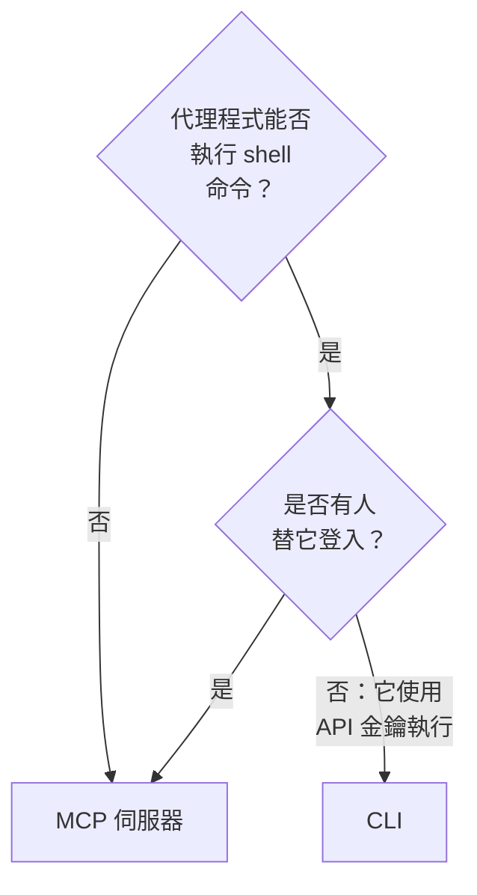

# 供 AI 代理程式使用的 CLI

能執行 shell 命令的 AI 代理程式，例如編輯器中的程式設計代理程式或管線中的作業，可以透過 CLI 而不是 [MCP 伺服器](/docs/ai/mcp-server) 使用 OneUptime。本頁說明各自適合的情況，以及代理程式如何安裝 CLI、找到用法並讀取回應。

:::cards
- [CLI 還是 MCP 伺服器](#cli-還是-mcp-伺服器): 代理程式應使用哪一個。
- [為代理程式設定](#為代理程式設定): 安裝它，並透過環境變數提供金鑰。
- [代理程式如何找到用法](#代理程式如何找到用法): 資源、它們的欄位以及說明。
- [讀取回應](#讀取回應): 每個命令都回應 JSON，錯誤也不例外。
:::

## CLI 還是 MCP 伺服器

兩者都存取 OneUptime API，並執行其認證資料允許的動作。差別在於代理程式存取它們需要什麼：



| | CLI | MCP 伺服器 |
| --- | --- | --- |
| 代理程式需要 | shell 以及 Node.js 22 或更新版本 | MCP 用戶端，例如 Claude 或 Cursor |
| 登入方式 | `ONEUPTIME_API_KEY` 中的專案 API 金鑰 | 你的 OneUptime 帳戶或 API 金鑰 |
| 可存取範圍 | API 的每個資源，450 多個 | 有對應工具的記錄和遙測資料，以及事件回應工具 |
| 適合 | 代理程式撰寫、供人保留的指令碼，管線中的檢查，以及處理大量記錄的工作 | 對話：調查事件、設定監測器 |

當代理程式本來就在執行命令（像程式設計代理程式那樣），或它建置的東西要在沒有它的情況下繼續執行（儲存庫中的指令碼、管線中的一個步驟）時，請使用 CLI。當有人在聊天用戶端中與代理程式交談時，請使用 MCP 伺服器，這樣代理程式以此人的權限工作，用戶端會在更改前徵求同意。

## 為代理程式設定

每個 OneUptime 都提供與自身版本對應的 CLI 安裝指令碼：下面的命令從 `https://oneuptime.com` 下載它，所以在自行託管的 OneUptime 上請把它換成你的 URL。指令碼會先儲存為 `install.sh`，方便你在執行前閱讀它：

```bash
curl -fsSL https://oneuptime.com/install/cli -o install.sh
ONEUPTIME_URL=https://oneuptime.com bash install.sh
```

給代理程式一個只具備其工作所需存取權限的專案 API 金鑰，透過環境變數而不是命令列提供，並讓它先檢查金鑰：

```bash
export ONEUPTIME_API_KEY="your-api-key"
export ONEUPTIME_URL=https://oneuptime.com
oneuptime whoami --check -o json
```

在 **專案設定 → 進階 → API 金鑰** 中建立金鑰：請參閱 [建立 API 金鑰](/docs/api-reference/api-reference#建立-api-金鑰)。只能讀取的金鑰只讓代理程式檢視，別無其他。

## 代理程式如何找到用法

CLI 會說明自己能做什麼，不需要 API 金鑰，也不傳送請求：

| 命令 | 回應的內容 |
| --- | --- |
| `oneuptime resources -o json` | 每個資源：它的命令、名稱、API 路徑、操作和動作 |
| `oneuptime incident fields -o json` | 資源的欄位：每個欄位的用途、類型、建立時是否需要以及它的旗標 |
| `oneuptime incident create --help` | 命令的引數和旗標 |

儲存 ID 的欄位會說明它接受哪個資源的 ID，因此代理程式會先列出該資源：`incidentSeverityId` 取自 `oneuptime incident-severity list` 的 ID。指定某人的欄位也接受此人的電子郵件地址，例如 `--user-email`。

## 讀取回應

讓代理程式在每個命令後加上 `-o json` 或 `--json`。這樣每個命令都用 JSON 回應，包括回應是一句話的命令，而錯誤是標準錯誤中的一個 JSON 物件：

```bash
oneuptime incident acknowledge 6f1c2a40-3b1e-4c55-9a0b-3e2f8d7c1a11 -o json
```

```json
{
  "_id": "6f1c2a40-3b1e-4c55-9a0b-3e2f8d7c1a11",
  "action": "acknowledge",
  "changed": true,
  "state": {
    "_id": "0b7d5e2c-8f4a-4d1b-9c3e-5a6f7b8c9d0e",
    "name": "Acknowledged"
  }
}
```

結束代碼說明發生了什麼：成功時為 `0`，失敗時為 `1`，API 金鑰缺少或被拒絕時為 `2`，記錄不存在時為 `3`。錯誤的 JSON 在 `exitCode` 中包含相同的代碼，在 `hint` 中給出下一步該做什麼。請參閱 [輸出格式](/docs/cli/output-formats#json) 和 [結束代碼](/docs/cli/scripting#結束代碼)。

## 後續步驟

:::cards
- [資源操作](/docs/cli/resource-operations): 每個操作及其旗標和篩選條件。
- [命令參考](/docs/cli/command-reference): 每個命令、選項和預設值。
- [MCP 伺服器](/docs/ai/mcp-server): 改為把聊天用戶端連接到 OneUptime。
:::
