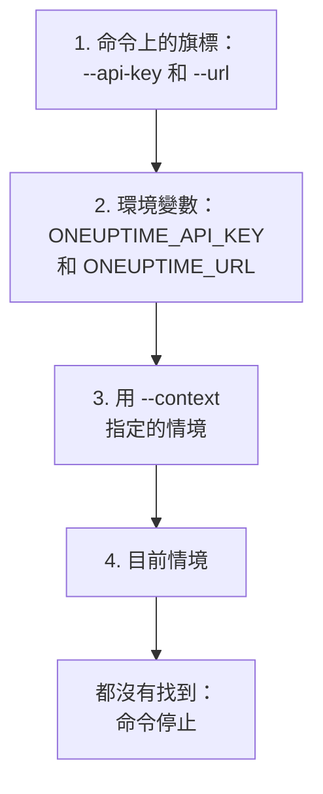

# 驗證

CLI 傳送的每個請求都帶有你專案的 API 金鑰。可以用 `oneuptime login` 一次儲存金鑰，每個環境一個情境；也可以像指令碼那樣，透過旗標或環境變數把金鑰交給命令。本頁介紹每種方式，以及同時存在多種時命令使用哪一種。

:::cards
- [登入](#登入): 儲存 API 金鑰和你的 OneUptime 位址。
- [情境](#情境): 為每個專案或環境儲存的登入，以及在它們之間切換。
- [命令使用哪些認證資訊](#命令使用哪些認證資訊): 先是旗標，然後是環境變數，再然後是情境。
- [疑難排解](#疑難排解): 找不到認證資訊、無效的金鑰和拒絕。
:::

## 開始之前

你需要專案的 API 金鑰。在 **專案設定 → 進階 → API 金鑰** 中透過 **建立API 金鑰** 建立一個，並賦予它命令所需的存取權限：請參閱 [建立 API 金鑰](/docs/api-reference/api-reference#建立-api-金鑰)。金鑰只能做其權限允許的事：只能讀取記錄的金鑰可以列出和讀取記錄，但不能更改它們。

在 OneUptime Cloud 上，只有當專案處於 **Growth** 方案或更高時，API 金鑰才有效。低於該方案時，每個命令都會傳回 `API error (402)` 以及一則指明方案的訊息，直到專案升級；之後同一個金鑰會重新生效。請參閱 [低於其方案時的 API 金鑰和 SCIM](/docs/api-reference/api-reference#低於其方案時的-api-金鑰和-scim)。

## 登入

`oneuptime login` 將 API 金鑰和你的 OneUptime 位址儲存為情境，並將其設為目前情境：

```bash
oneuptime login <api-key> <instance-url> [--context-name <name>]
```

| 引數或選項 | 說明 |
| --- | --- |
| `<api-key>` | 你專案的 API 金鑰 |
| `<instance-url>` | 你的 OneUptime 位址：`https://oneuptime.com`，或你自己伺服器的位址，例如 `https://oneuptime.example.com` |
| `--context-name <name>` | 儲存情境所用的名稱。預設值：`default` |

例如，一個名為 `production` 的情境：

```bash
oneuptime login <api-key> https://oneuptime.com --context-name production
```

它回應 `Logged in successfully. Context "production" is now active.`。位址末尾的斜線會被去掉，用同一名稱再次登入會替換該情境。

> [!NOTE]
> `login` 儲存金鑰時不會向 OneUptime 詢問它。執行一個命令，例如 `oneuptime incident count`，即可確認金鑰可用。

## 情境

情境就是儲存下來的登入：一個名稱、一個位址和一個 API 金鑰。為每個專案或環境儲存一個，然後為之後的所有命令或單一命令選擇一個。

:::steps
### 為每個環境儲存一個情境

```bash
oneuptime login <production-api-key> https://oneuptime.com --context-name production
oneuptime login <staging-api-key> https://oneuptime.example.com --context-name staging
```

每次登入都會把它的情境設為目前情境，所以現在 `staging` 是目前情境。

### 列出它們

```bash
oneuptime context list
```

```text
┌───┬────────────┬───────────────────────────────┐
│   │ Name       │ URL                           │
├───┼────────────┼───────────────────────────────┤
│   │ production │ https://oneuptime.com         │
├───┼────────────┼───────────────────────────────┤
│ * │ staging    │ https://oneuptime.example.com │
└───┴────────────┴───────────────────────────────┘
```

`*` 標出目前情境。API 金鑰永遠不會被列出。

### 切換到另一個情境

```bash
oneuptime context use production
```

它回應 `Switched to context "production".`，之後的命令都使用它。

### 為單一命令使用情境

```bash
oneuptime incident list --context staging
```

目前情境保持不變。
:::

| 命令 | 作用 |
| --- | --- |
| `oneuptime context list` | 列出已儲存的情境；`*` 標出目前情境。使用 `-o json` 時輸出每個情境的 `name`、`apiUrl` 和 `isCurrent`，從不輸出它的金鑰 |
| `oneuptime context use <name>` | 將已儲存的情境設為目前情境 |
| `oneuptime context current` | 顯示目前情境的名稱、URL 和 API 金鑰，金鑰除前四個和後四個字元外都被隱藏 |
| `oneuptime context delete <name>` | 刪除已儲存的情境。如果它是目前情境，剩下的第一個情境成為目前情境 |

## 命令使用哪些認證資訊

命令需要一個 API 金鑰和一個 URL。它從以下位置中第一個有值的位置分別取得這兩者：



所以可以混合使用：例如，API 金鑰來自環境變數，URL 來自目前情境。環境變數適合沒有已儲存情境的指令碼和 CI 作業：

:::tabs
@tab Linux
```bash
export ONEUPTIME_API_KEY=<api-key>
export ONEUPTIME_URL=https://oneuptime.com
oneuptime incident list
```
@tab macOS
```bash
export ONEUPTIME_API_KEY=<api-key>
export ONEUPTIME_URL=https://oneuptime.com
oneuptime incident list
```
@tab Windows
```powershell
$env:ONEUPTIME_API_KEY = "<api-key>"
$env:ONEUPTIME_URL = "https://oneuptime.com"
oneuptime incident list
```
:::

對單一命令而言，旗標優先於其他一切：

```bash
oneuptime --api-key <api-key> --url https://oneuptime.com incident list
```

> [!WARNING]
> 作為旗標傳入的金鑰會留在你的 shell 歷程記錄中，機器上的其他使用者也能在處理程序清單中看到它。在共享機器上，請改用情境或環境變數。

## 檢查 CLI 將使用什麼

`oneuptime whoami` 顯示下一個命令將使用的 URL 和 API 金鑰，以及它們來自的情境：

```bash
oneuptime whoami
```

```text
URL:     https://oneuptime.com
API Key: 4f1c****0a13
Context: production
```

只顯示金鑰的前四個和後四個字元。只有當 URL 和金鑰是該情境自己的值，而不是被旗標或環境變數替換的值時，才會顯示 `Context` 這一行。`whoami` 讀取你的設定時不呼叫 OneUptime：它顯示命令將傳送什麼，而不是 OneUptime 是否接受。如果什麼都沒有儲存或設定，它回應：

```text
Not authenticated. Run `oneuptime login` to authenticate.
```

## 設定檔

`oneuptime login` 將情境儲存在你主目錄下的 `~/.oneuptime/config.json` 中（在 Windows 上是 `%USERPROFILE%\.oneuptime\config.json`）。CLI 建立該檔案時，只有你的使用者可以讀寫它（模式 `0600`）：

```json title="~/.oneuptime/config.json"
{
  "currentContext": "production",
  "contexts": {
    "production": {
      "name": "production",
      "apiUrl": "https://oneuptime.com",
      "apiKey": "<api-key>"
    },
    "staging": {
      "name": "staging",
      "apiUrl": "https://oneuptime.example.com",
      "apiKey": "<api-key>"
    }
  }
}
```

該檔案原樣儲存 API 金鑰：不要把它放進共享資料夾、備份或程式碼儲存庫。要登出一個情境，用 `oneuptime context delete <name>` 刪除它；要登出所有情境，刪除該檔案。可能已外洩的金鑰會一直有效，直到你在 OneUptime 的 **專案設定 → 進階 → API 金鑰** 中刪除它。

輸出格式和清單大小不儲存在這裡：請為每個命令傳入 `-o` 和 `--limit`。

## 疑難排解

:::details 訊息「No credentials found」
`Authentication error: No credentials found.` 表示沒有任何旗標、環境變數或已儲存的情境為命令提供 API 金鑰和 URL。執行 `oneuptime login`，或同時設定 `ONEUPTIME_API_KEY` 和 `ONEUPTIME_URL`。命令以結束代碼 `2` 結束。
:::

:::details 訊息「API error (400): Invalid API Key」
該金鑰不是 OneUptime 的 API 金鑰，或已過期，或已被重設。從 **專案設定 → 進階 → API 金鑰** 中該金鑰的頁面重新複製它（它的 **到期** 日期也在那裡），並用同一情境名稱重新登入。命令以結束代碼 `2` 結束。
:::

:::details 訊息「API error (402): API keys need the Growth plan」
在 OneUptime Cloud 上，專案低於 **Growth** 方案，因此它的 API 金鑰停止運作。升級專案後，同一個金鑰會重新生效：CLI 中無需任何更改。
:::

:::details 訊息「API error (422): You do not have permissions」
金鑰的權限涵蓋不到命令所請求的內容。在 **專案設定 → 進階 → API 金鑰** 中該金鑰的頁面上為它指派角色或權限：訊息會指出能讓請求透過的權限。
:::

:::details 訊息「Context "staging" does not exist」
沒有儲存該名稱的情境。`oneuptime context list` 會顯示現有的名稱。
:::

:::details whoami 顯示的 URL 或金鑰與情境不同
環境變數或旗標替換了情境的值。`env | grep ONEUPTIME` 會顯示已設定的變數，`unset ONEUPTIME_API_KEY ONEUPTIME_URL` 讓你回到情境。
:::

:::details 傳送到該位址的請求失敗
`Error: Request failed to https://...` 表示 CLI 無法在該位址存取 OneUptime。用 `oneuptime whoami` 檢查 URL：它就是你開啟 OneUptime 時的位址，包含 `https://`，例如 `https://oneuptime.com`。
:::

## 後續步驟

:::cards
- [資源操作](/docs/cli/resource-operations): 列出、讀取、建立、更改、刪除和統計記錄。
- [指令碼與 CI/CD](/docs/cli/scripting): 透過環境變數把金鑰交給管線。
- [OneUptime API 參考](/docs/api-reference/api-reference): API 金鑰能做什麼，以及每個回應的含義。
:::
