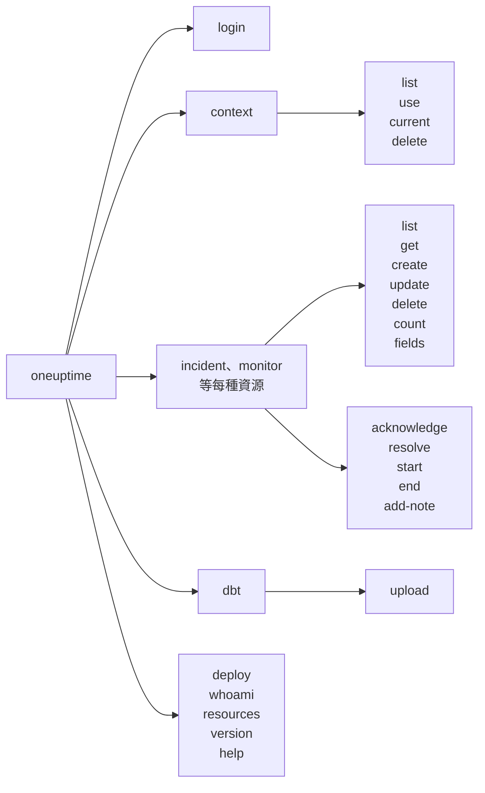

# 命令參考

`oneuptime` CLI 的每個命令，以及它的引數、選項和預設值。在任何命令後加上 `--help`，即可在終端機中看到相同的內容。

:::cards
- [全域選項](#全域選項): 每個命令都接受的選項。
- [登入與情境](#登入與情境): login 和 context 命令。
- [資源命令](#資源命令): 每個資源的操作、欄位和動作。
- [其他命令](#其他命令): deploy、dbt upload、data-checks apply、whoami、resources、version 和 help。
:::

## 命令總覽



## 全域選項

| 選項 | 作用 | 預設值 |
| --- | --- | --- |
| `--api-key <key>` | 此命令使用的 API 金鑰 | `ONEUPTIME_API_KEY`，然後是情境的金鑰 |
| `--url <url>` | 此命令使用的 OneUptime 位址 | `ONEUPTIME_URL`，然後是情境的 URL |
| `--context <name>` | 此命令使用的已儲存情境 | 目前情境 |
| `-o, --output <format>` | `json`、`table` 或 `wide` | 終端機中為 `table`，管道中為 `json` |
| `--json` | 等同於 `-o json` | |
| `--no-color` | 不帶顏色地印出 | 帶顏色，除非設定了 `NO_COLOR` |
| `-V, --version` | 印出 CLI 的版本 | |
| `-h, --help` | 顯示命令的說明 | |

選項可以寫在命令前後：`oneuptime --context staging incident list` 和 `oneuptime incident list --context staging` 的效果相同。

每個命令都接受 `-o` 和 `--json`，因此下面的表格省略了它們。回應是一句話的命令（例如 `delete`）會印出這句話，除非 `-o json` 或 `--json` 要求 JSON：請參閱 [輸出格式](/docs/cli/output-formats#json)。

## 登入與情境

### `oneuptime login`

將 API 金鑰和位址儲存為情境，並將其設為目前情境。請參閱 [登入](/docs/cli/authentication#登入)。

```bash
oneuptime login <api-key> <instance-url> [--context-name <name>]
```

| 引數或選項 | 必要 | 說明 | 預設值 |
| --- | --- | --- | --- |
| `<api-key>` | 是 | 你專案的 API 金鑰 | |
| `<instance-url>` | 是 | 你的 OneUptime 位址，例如 `https://oneuptime.com` | |
| `--context-name <name>` | 否 | 儲存情境所用的名稱 | `default` |

### `oneuptime context list`

列出已儲存的情境；`*` 標出目前的情境。API 金鑰從不列出：JSON 給出每個情境的 `name`、`apiUrl` 和 `isCurrent`。

```bash
oneuptime context list
```

### `oneuptime context use`

將已儲存的情境設為目前情境。

```bash
oneuptime context use <name>
```

| 引數 | 必要 | 說明 |
| --- | --- | --- |
| `<name>` | 是 | 已儲存情境的名稱 |

### `oneuptime context current`

顯示目前情境的名稱和 URL，以及除前四個和後四個字元外都被隱藏的 API 金鑰。

```bash
oneuptime context current
```

### `oneuptime context delete`

刪除已儲存的情境。如果它是目前情境，剩下的第一個情境成為目前情境。

```bash
oneuptime context delete <name>
```

| 引數 | 必要 | 說明 |
| --- | --- | --- |
| `<name>` | 是 | 已儲存情境的名稱 |

## 資源命令

`<resource>` 是某種記錄的命令，來自 [資源](#資源) 表格，例如 `incident` 或 `monitor`。資源帶有 API 為它接受的操作，大多數是全部六種，`oneuptime <resource> --help` 會列出它自己的操作。範例請參閱 [資源操作](/docs/cli/resource-operations)。

### `oneuptime <resource> list`

列出記錄，最新的在前。標籤則依名稱排列，帶編號的標籤在前（`2. Team` 在 `10. Owner` 之前）。

```bash
oneuptime <resource> list [--query <json>] [--limit <n>] [--skip <n>] [--sort <json>] [--fields <names>] [--all]
```

| 選項 | 作用 | 預設值 |
| --- | --- | --- |
| `--query <json>` | JSON 形式的篩選 | 金鑰可讀取的所有記錄 |
| `--limit <n>` | 最多傳回的記錄數，最多 10,000 | `10` |
| `--skip <n>` | 先跳過多少筆記錄 | `0` |
| `--sort <json>` | JSON 形式的順序：`{"<field>":"ASC"}` 或 `{"<field>":"DESC"}` | 最新的在前 |
| `--fields <names>` | 要傳回的欄位，以逗號分隔；關聯記錄的欄位寫在點號後面，例如 `currentIncidentState.name` | 金鑰可讀取的所有欄位 |
| `--all` | 每次 100 筆、最多 100,000 筆地傳回所有符合的記錄，取代 `--limit` 和 `--skip`。僅限記錄：遙測資料沒有 `--all` | |

### `oneuptime <resource> get`

讀取一筆記錄。

```bash
oneuptime <resource> get <id> [--fields <names>]
```

| 引數或選項 | 必要 | 說明 |
| --- | --- | --- |
| `<id>` | 是 | 記錄的 ID，一個 UUID |
| `--fields <names>` | 否 | 要傳回的欄位，以逗號分隔。預設：金鑰可讀取的所有欄位 |

### `oneuptime <resource> create`

建立一筆記錄並印出它。

```bash
oneuptime <resource> create [--<field> <value>]... [--data <json>] [--file <path>]
```

| 選項 | 必要 | 說明 |
| --- | --- | --- |
| `--<field> <value>` | 建立時必須提供的欄位 | 欄位的值：`--title <text>`、`--incident-severity-id <id>`、`--labels <ids>`。`oneuptime <resource> create --help` 會列出它們。僅限記錄 |
| `--data <json>` | 否 | 以 JSON 表示的記錄 |
| `--file <path>` | 否 | 包含該記錄的 JSON 檔案。與 `--data` 一起給出時使用檔案 |

旗標會疊加在 `--data` 或 `--file` 之上。以使用者 ID 指定某人的欄位還有一個以電子郵件地址指定此人的旗標：`--user-email` 對應 `--user-id`。

### `oneuptime <resource> update`

更改你給出的欄位。

```bash
oneuptime <resource> update <id> [--<field> <value>]... [--data <json>] [--file <path>]
```

| 引數或選項 | 必要 | 說明 |
| --- | --- | --- |
| `<id>` | 是 | 記錄的 ID |
| `--<field> <value>` | 否 | 要更改的欄位：`oneuptime <resource> update --help` 會列出它們。僅限記錄 |
| `--data <json>` | 否 | 以 JSON 表示的要更改的欄位 |
| `--file <path>` | 否 | 包含要更改欄位的 JSON 檔案。與 `--data` 一起給出時使用檔案 |

### `oneuptime <resource> delete`

立即刪除一筆記錄，不會詢問。

```bash
oneuptime <resource> delete <id> [--force]
```

| 引數或選項 | 必要 | 說明 |
| --- | --- | --- |
| `<id>` | 是 | 記錄的 ID |
| `--force` | 否 | 會被接受，但不改變任何行為：`delete` 從不請求確認 |

### `oneuptime <resource> count`

統計記錄並印出數字。

```bash
oneuptime <resource> count [--query <json>]
```

| 選項 | 必要 | 說明 |
| --- | --- | --- |
| `--query <json>` | 否 | JSON 形式的篩選。不給出時為金鑰可讀取的所有記錄 |

### `oneuptime <resource> fields`

列出資源的欄位：每個欄位的用途、類型、建立時是否必須提供，以及設定它的旗標。它直接從 CLI 本身讀取這些資訊，不需要 API 金鑰，也不傳送請求。

```bash
oneuptime <resource> fields
```

### `oneuptime <resource> acknowledge`

像儀表板按鈕那樣，把事件、警示或它們的片段移到專案的已確認狀態。已確認或處於之後狀態的記錄保持不變。

```bash
oneuptime <resource> acknowledge <id>
```

| 引數 | 必要 | 說明 |
| --- | --- | --- |
| `<id>` | 是 | 記錄的 ID |

### `oneuptime <resource> resolve`

把事件、警示或它們的片段移到專案的已解決狀態。

```bash
oneuptime <resource> resolve <id>
```

| 引數 | 必要 | 說明 |
| --- | --- | --- |
| `<id>` | 是 | 記錄的 ID |

### `oneuptime <resource> start`

把維護事件移到專案的進行中狀態。

```bash
oneuptime <resource> start <id>
```

| 引數 | 必要 | 說明 |
| --- | --- | --- |
| `<id>` | 是 | 該事件的 ID |

### `oneuptime <resource> end`

把維護事件移到專案的已結束狀態。

```bash
oneuptime <resource> end <id>
```

| 引數 | 必要 | 說明 |
| --- | --- | --- |
| `<id>` | 是 | 該事件的 ID |

### `oneuptime <resource> add-note`

為事件、警示、它們的片段或維護事件新增備註。

```bash
oneuptime <resource> add-note <id> --note <markdown> [--public]
```

| 引數或選項 | 必要 | 說明 |
| --- | --- | --- |
| `<id>` | 是 | 記錄的 ID |
| `--note <markdown>` | 是 | 以 Markdown 撰寫的備註 |
| `--public` | 否 | 在記錄的狀態頁面上發布備註，並通知其訂閱者。僅限事件、它們的片段和排定維護 |

### 資源

OneUptime API 的每個資源都是一個命令，帶有 API 為它接受的操作、`fields`，以及具備動作的記錄的那些動作：

{{CLI_RESOURCE_COMMANDS}}

CLI 與 OneUptime 一同發布，因此 `oneuptime resources` 列出的是你所安裝版本的命令。

### API 請求

每個操作都是對 API 的一次請求，金鑰放在 `APIKey` 標頭中。`<path>` 是資源的 API 路徑，由 `oneuptime resources` 給出：`incident` 對應 `/incident`，`on-call-policy` 對應 `/on-call-duty-policy`。

| 操作 | 請求 | 請求內文 |
| --- | --- | --- |
| `list` | `POST /api/<path>/get-list` | `query`、`select`、`skip`、`limit` 和 `sort` |
| `get` | `POST /api/<path>/<id>/get-item` | `select` |
| `create` | `POST /api/<path>` | `{"data": ...}` |
| `update` | `PUT /api/<path>/<id>/` | `{"data": ...}` |
| `delete` | `DELETE /api/<path>/<id>/` | 無 |
| `count` | `POST /api/<path>/count` | `query` |

動作會讀取專案的各個狀態和該記錄，然後像儀表板按鈕那樣在記錄的狀態時間軸上建立一列：對事件執行 `acknowledge` 會建立一個 `incident-state-timeline`。`add-note` 建立一個 `incident-internal-note`，加上 `--public` 時則建立一個 `incident-public-note`。電子郵件旗標會先列出專案中使用該地址的團隊成員。當 OneUptime 拒絕金鑰無法讀取的欄位時，列出或讀取會去掉該欄位重新請求。

## 其他命令

### `oneuptime deploy`

從管線記錄一次部署或其他變更：它會繪製在服務的圖表上，OneUptime AI 調查事件時也會讀取它。它使用遙測擷取金鑰寫入，而不是 API 金鑰。請參閱 [部署與變更](/docs/telemetry/change-events)。

```bash
oneuptime deploy [--service <name>] [--service-version <version>] [--previous-version <version>] [--commit <sha>] [--repository <url>] [--branch <name>] [--pull-request <number>] [--environment <name>] [--title <title>] [--description <text>] [--type <type>] [--time <time>] [--attribute <key=value...>] [--ingestion-key <key>]
```

| 選項 | 必要 | 說明 | 預設值 |
| --- | --- | --- | --- |
| `--service <name>` | 否 | 被部署的服務 | 作用於整個專案的變更 |
| `--service-version <version>` | 否 | 部署的版本 | |
| `--previous-version <version>` | 否 | 它所取代的版本 | |
| `--commit <sha>` | 否 | 部署的提交 | |
| `--repository <url>` | 否 | 該提交所在的儲存庫 | |
| `--branch <name>` | 否 | 部署的分支 | |
| `--pull-request <number>` | 否 | 部署的拉取請求 | |
| `--environment <name>` | 否 | 部署到的環境 | |
| `--title <title>` | 否 | 變更的標題；部署以外的其他類型需要提供 | `Deploy <version>` |
| `--description <text>` | 否 | 變更的詳細資訊 | |
| `--type <type>` | 否 | 變更的類型，例如 `config-change` 或 `rollback` | `deployment` |
| `--time <time>` | 否 | 變更發生的時間，例如 `2026-10-19T10:00:00Z` | 現在 |
| `--attribute <key=value...>` | 否 | 更多屬性，形式為 `key=value`，一個或多個 | |
| `--ingestion-key <key>` | 否 | 專案的遙測擷取金鑰 | `ONEUPTIME_TELEMETRY_INGESTION_KEY` |

### `oneuptime dbt upload`

在一次建置之後，從 CI 或 dbt Cloud 作業把 dbt 專案的產物傳送到資料可觀測性。它的模型顯示在它們建置的資料表上，並附有血緣；它的測試顯示在 OneUptime 的檢查旁邊，並且可以觸發警示；每次建置都是該專案管道的一次執行。它從 dbt 的目標資料夾讀取 `manifest.json` 和 `run_results.json`，只傳送資料可觀測性會讀取的內容，並使用遙測擷取金鑰寫入，而不是 API 金鑰。你的儀表板中資料可觀測性的文件頁面展示了如何在 CI 作業中使用它。

```bash
oneuptime dbt upload [--target-path <dir>] [--manifest <file>] [--run-results <file>] [--project <name>] [--ingestion-key <key>]
```

| 選項 | 必要 | 說明 | 預設值 |
| --- | --- | --- | --- |
| `--target-path <dir>` | 否 | dbt 寫入其產物的資料夾 | `target` |
| `--manifest <file>` | 否 | 要傳送的清單 | 目標資料夾中的 `manifest.json` |
| `--run-results <file>` | 否 | 要傳送的執行結果 | 目標資料夾中的 `run_results.json` |
| `--project <name>` | 否 | dbt 專案的名稱，僅在不傳送清單時需要 | 清單中的專案 |
| `--ingestion-key <key>` | 否 | 專案的遙測擷取金鑰 | `ONEUPTIME_TELEMETRY_INGESTION_KEY` |

### `oneuptime data-checks apply`

讓專案的資料檢查與一個 YAML 檔案一致，因此檢查可以保存在儲存庫中，並像程式碼一樣接受審查。檔案中任何一處有錯誤，就不會套用任何內容，並以錯誤結束。檔案的格式請參閱 [檢查與對帳](/docs/data-observability/checks)。

```bash
oneuptime data-checks apply <file> [--dry-run] [--prune]
```

| 選項 | 必要 | 說明 | 預設值 |
| --- | --- | --- | --- |
| `--dry-run` | 否 | 說明會有哪些變更，但不做任何變更 | 關閉 |
| `--prune` | 否 | 刪除先前的 apply 所建立、但檔案中已不再提到的檢查 | 關閉 |

### `oneuptime whoami`

顯示下一個命令將使用的 URL 和 API 金鑰（金鑰已遮蔽），以及它們來自的情境。不加 `--check` 時，它不呼叫 OneUptime。請參閱 [檢查 CLI 將使用什麼](/docs/cli/authentication#檢查-cli-將使用什麼)。

```bash
oneuptime whoami [--check]
```

| 選項 | 必要 | 說明 |
| --- | --- | --- |
| `--check` | 否 | 詢問 OneUptime 是否接受該金鑰，並顯示金鑰所屬的專案、你的 OneUptime 的版本和 CLI 的版本 |

### `oneuptime resources`

列出 CLI 為之提供命令的每種記錄：它的命令、單數和複數名稱、類型和 API 路徑，以及總數。JSON 給出每種記錄的 `name`、`singularName`、`pluralName`、`modelType`、`apiPath`、`operations` 和 `actions`。

```bash
oneuptime resources [--type <type>]
```

| 選項 | 必要 | 說明 | 預設值 |
| --- | --- | --- | --- |
| `--type <type>` | 否 | 記錄用 `database`，遙測資料用 `analytics` | 兩者都有 |

### `oneuptime version`

印出 CLI 的版本，與 `oneuptime --version` 相同。

```bash
oneuptime version
```

### `oneuptime help`

顯示 CLI 或某個命令的說明。

```bash
oneuptime help [command]
```

## 環境變數

| 變數 | 作用 |
| --- | --- |
| `ONEUPTIME_API_KEY` | 沒有 `--api-key` 旗標提供金鑰時使用的 API 金鑰 |
| `ONEUPTIME_URL` | 沒有 `--url` 旗標提供位址時使用的 OneUptime 位址 |
| `ONEUPTIME_TELEMETRY_INGESTION_KEY` | 沒有 `--ingestion-key` 旗標提供金鑰時，`oneuptime deploy` 寫入所用的遙測擷取金鑰 |
| `NO_COLOR` | 設為任意值即關閉顏色 |

## 檔案

| 檔案 | 儲存的內容 |
| --- | --- |
| `~/.oneuptime/config.json` | 已儲存的情境、它們的 API 金鑰和目前情境 |

## 結束代碼

| 代碼 | 含義 |
| --- | --- |
| `0` | 成功 |
| `1` | 失敗：OneUptime 拒絕了請求，或命令有誤 |
| `2` | 沒有可用的 API 金鑰：找不到、無效，或低於其方案 |
| `3` | 未找到：OneUptime 傳回 `404` |

範例請參閱 [結束代碼](/docs/cli/scripting#結束代碼)。

## 後續步驟

:::cards
- [CLI 概觀](/docs/cli/index): 安裝 CLI 並執行你的第一批命令。
- [資源操作](/docs/cli/resource-operations): 每個操作的範例。
- [指令碼與 CI/CD](/docs/cli/scripting): 在指令碼和管線中使用 CLI。
:::
