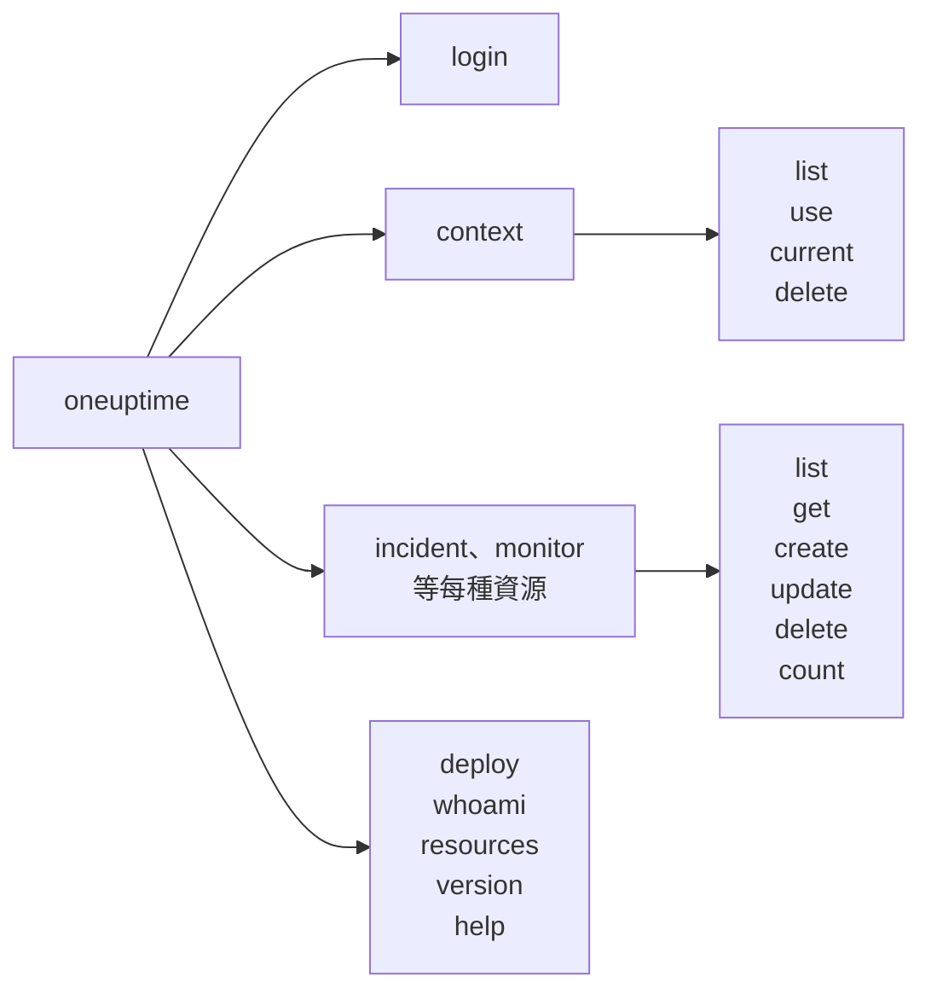

# 命令參考

`oneuptime` CLI 的每個命令，以及它的引數、選項和預設值。在任何命令後加上 `--help`，即可在終端機中看到相同的內容。

:::cards
- [全域選項](#全域選項): 每個命令都接受的選項。
- [登入與情境](#登入與情境): login 和 context 命令。
- [資源命令](#資源命令): list、get、create、update、delete 和 count。
- [其他命令](#其他命令): deploy、whoami、resources、version 和 help。
:::

## 命令總覽



## 全域選項

| 選項 | 作用 | 預設值 |
| --- | --- | --- |
| `--api-key <key>` | 此命令使用的 API 金鑰 | `ONEUPTIME_API_KEY`，然後是情境的金鑰 |
| `--url <url>` | 此命令使用的 OneUptime 位址 | `ONEUPTIME_URL`，然後是情境的 URL |
| `--context <name>` | 此命令使用的已儲存情境 | 目前情境 |
| `-o, --output <format>` | `json`、`table` 或 `wide` | 終端機中為 `table`，管道中為 `json` |
| `--no-color` | 不帶顏色地印出 | 帶顏色，除非設定了 `NO_COLOR` |
| `-V, --version` | 印出 CLI 的版本 | |
| `-h, --help` | 顯示命令的說明 | |

選項可以寫在命令前後：`oneuptime --context staging incident list` 和 `oneuptime incident list --context staging` 的效果相同。

## 登入與情境

### `oneuptime login`

將 API 金鑰和位址儲存為情境，並將其設為目前情境。請參閱 [登入](/docs/cli/authentication#登入)。

```bash
oneuptime login <api-key> <instance-url> [--context-name <name>]
```

| 引數或選項 | 必要 | 說明 | 預設值 |
| --- | --- | --- | --- |
| `<api-key>` | 是 | 你專案的 API 金鑰 | |
| `<instance-url>` | 是 | 你的 OneUptime 位址，例如 `https://oneuptime.com` | |
| `--context-name <name>` | 否 | 儲存情境所用的名稱 | `default` |

### `oneuptime context list`

列出已儲存的情境；`*` 標出目前情境。API 金鑰永遠不會被列出。

```bash
oneuptime context list [-o <format>]
```

| 選項 | 必要 | 說明 |
| --- | --- | --- |
| `-o, --output <format>` | 否 | `json`、`table` 或 `wide`。JSON 給出每個情境的 `name`、`apiUrl` 和 `isCurrent` |

### `oneuptime context use`

將已儲存的情境設為目前情境。

```bash
oneuptime context use <name>
```

| 引數 | 必要 | 說明 |
| --- | --- | --- |
| `<name>` | 是 | 已儲存情境的名稱 |

### `oneuptime context current`

顯示目前情境的名稱和 URL，以及除前四個和後四個字元外都被隱藏的 API 金鑰。

```bash
oneuptime context current
```

### `oneuptime context delete`

刪除已儲存的情境。如果它是目前情境，剩下的第一個情境成為目前情境。

```bash
oneuptime context delete <name>
```

| 引數 | 必要 | 說明 |
| --- | --- | --- |
| `<name>` | 是 | 已儲存情境的名稱 |

## 資源命令

`<resource>` 是某種記錄的命令，來自 [資源](#資源) 表格，例如 `incident` 或 `monitor`。範例請參閱 [資源操作](/docs/cli/resource-operations)。

### `oneuptime <resource> list`

列出記錄，最新的在前。標籤則依名稱排列，帶編號的標籤在前（`2. Team` 在 `10. Owner` 之前）。

```bash
oneuptime <resource> list [--query <json>] [--limit <n>] [--skip <n>] [--sort <json>] [-o <format>]
```

| 選項 | 作用 | 預設值 |
| --- | --- | --- |
| `--query <json>` | JSON 形式的篩選 | 金鑰可讀取的所有記錄 |
| `--limit <n>` | 最多傳回的記錄數，最多 10,000 | `10` |
| `--skip <n>` | 先跳過多少筆記錄 | `0` |
| `--sort <json>` | JSON 形式的順序：`{"<field>":"ASC"}` 或 `{"<field>":"DESC"}` | 最新的在前 |
| `-o, --output <format>` | `json`、`table` 或 `wide` | 終端機中為 `table`，管道中為 `json` |

### `oneuptime <resource> get`

讀取一筆記錄。僅限記錄：遙測資料沒有 `get`。

```bash
oneuptime <resource> get <id> [-o <format>]
```

| 引數或選項 | 必要 | 說明 |
| --- | --- | --- |
| `<id>` | 是 | 記錄的 ID，一個 UUID |
| `-o, --output <format>` | 否 | `json`、`table` 或 `wide` |

### `oneuptime <resource> create`

建立一筆記錄並印出它。

```bash
oneuptime <resource> create (--data <json> | --file <path>) [-o <format>]
```

| 選項 | 必要 | 說明 |
| --- | --- | --- |
| `--data <json>` | 兩者擇一 | JSON 形式的記錄 |
| `--file <path>` | 兩者擇一 | 包含該記錄的 JSON 檔案。與 `--data` 一起給出時使用檔案 |
| `-o, --output <format>` | 否 | `json`、`table` 或 `wide` |

### `oneuptime <resource> update`

更改你給出的欄位。僅限記錄：遙測資料沒有 `update`。

```bash
oneuptime <resource> update <id> --data <json> [-o <format>]
```

| 引數或選項 | 必要 | 說明 |
| --- | --- | --- |
| `<id>` | 是 | 記錄的 ID |
| `--data <json>` | 是 | 要更改的欄位，JSON 形式 |
| `-o, --output <format>` | 否 | `json`、`table` 或 `wide` |

### `oneuptime <resource> delete`

立即刪除一筆記錄，不會詢問。僅限記錄：遙測資料沒有 `delete`。

```bash
oneuptime <resource> delete <id> [--force]
```

| 引數或選項 | 必要 | 說明 |
| --- | --- | --- |
| `<id>` | 是 | 記錄的 ID |
| `--force` | 否 | 會被接受，但不改變任何行為：`delete` 從不請求確認 |

### `oneuptime <resource> count`

統計記錄並印出數字。

```bash
oneuptime <resource> count [--query <json>] [-o <format>]
```

| 選項 | 必要 | 說明 |
| --- | --- | --- |
| `--query <json>` | 否 | JSON 形式的篩選。不給出時為金鑰可讀取的所有記錄 |
| `-o, --output <format>` | 否 | `json`、`table` 或 `wide` |

### 資源

記錄支援 `list`、`get`、`create`、`update`、`delete` 和 `count`：

| 領域 | 命令 |
| --- | --- |
| 監控 | `monitor`, `monitor-status`, `monitor-status-event` |
| 事件 | `incident`, `incident-state`, `incident-severity`, `incident-state-timeline`, `incident-public-note`, `incident-internal-note`, `incident-alert`, `postmortem-status` |
| 警示 | `alert`, `alert-state`, `alert-severity`, `alert-state-timeline`, `alert-internal-note` |
| 狀態頁面 | `status-page`, `status-page-announcement` |
| 排定維護 | `scheduled-maintenance-event`, `scheduled-maintenance-state`, `scheduled-maintenance-state-timeline` |
| 團隊與待命 | `team`, `on-call-policy` |
| 安全性 | `security-case`, `security-case-evidence`, `security-case-note`, `security-case-priority`, `security-case-status`, `security-case-task`, `security-detection`, `security-playbook` |
| 標籤 | `label` |

遙測資料支援 `list`、`create` 和 `count`：

| 領域 | 命令 |
| --- | --- |
| 可觀測性 | `log`, `metric`, `span`, `exception-instance`, `monitor-log` |
| 安全性 | `security-event`, `threat-intel-indicator` |
| 變更與成本 | `change-event`, `kubernetes-cost-allocation` |

CLI 與 OneUptime 一同發布，因此 `oneuptime resources` 列出的是你所安裝版本的命令。

### API 請求

每個操作都是對 API 的一次請求，金鑰放在 `APIKey` 標頭中。`<path>` 是資源的 API 路徑，由 `oneuptime resources` 給出：`incident` 對應 `/incident`，`on-call-policy` 對應 `/on-call-duty-policy`。

| 操作 | 請求 | 請求內文 |
| --- | --- | --- |
| `list` | `POST /api/<path>/get-list` | `query`、`select`、`skip`、`limit` 和 `sort` |
| `get` | `POST /api/<path>/<id>/get-item` | `select` |
| `create` | `POST /api/<path>` | `{"data": ...}` |
| `update` | `PUT /api/<path>/<id>/` | `{"data": ...}` |
| `delete` | `DELETE /api/<path>/<id>/` | 無 |
| `count` | `POST /api/<path>/count` | `query` |

## 其他命令

### `oneuptime deploy`

從管線記錄一次部署或其他變更：它會繪製在服務的圖表上，OneUptime AI 調查事件時也會讀取它。它使用遙測擷取金鑰寫入，而不是 API 金鑰。請參閱 [部署與變更](/docs/telemetry/change-events)。

```bash
oneuptime deploy [--service <name>] [--service-version <version>] [--previous-version <version>] [--commit <sha>] [--repository <url>] [--branch <name>] [--pull-request <number>] [--environment <name>] [--title <title>] [--description <text>] [--type <type>] [--time <time>] [--attribute <key=value...>] [--ingestion-key <key>]
```

| 選項 | 必要 | 說明 | 預設值 |
| --- | --- | --- | --- |
| `--service <name>` | 否 | 被部署的服務 | 作用於整個專案的變更 |
| `--service-version <version>` | 否 | 部署的版本 | |
| `--previous-version <version>` | 否 | 它所取代的版本 | |
| `--commit <sha>` | 否 | 部署的提交 | |
| `--repository <url>` | 否 | 該提交所在的儲存庫 | |
| `--branch <name>` | 否 | 部署的分支 | |
| `--pull-request <number>` | 否 | 部署的拉取請求 | |
| `--environment <name>` | 否 | 部署到的環境 | |
| `--title <title>` | 否 | 變更的標題；部署以外的其他類型需要提供 | `Deploy <version>` |
| `--description <text>` | 否 | 變更的詳細資訊 | |
| `--type <type>` | 否 | 變更的類型，例如 `config-change` 或 `rollback` | `deployment` |
| `--time <time>` | 否 | 變更發生的時間，例如 `2026-10-19T10:00:00Z` | 現在 |
| `--attribute <key=value...>` | 否 | 更多屬性，形式為 `key=value`，一個或多個 | |
| `--ingestion-key <key>` | 否 | 專案的遙測擷取金鑰 | `ONEUPTIME_TELEMETRY_INGESTION_KEY` |

### `oneuptime whoami`

顯示下一個命令將使用的 URL 和 API 金鑰（金鑰已隱藏部分），以及它們來自的情境。它不呼叫 OneUptime。請參閱 [檢查 CLI 將使用什麼](/docs/cli/authentication#檢查-cli-將使用什麼)。

```bash
oneuptime whoami
```

### `oneuptime resources`

列出 CLI 有命令的每種記錄：它的命令、單數和複數名稱、類型和 API 路徑，以及總數。

```bash
oneuptime resources [--type <type>] [-o <format>]
```

| 選項 | 必要 | 說明 | 預設值 |
| --- | --- | --- | --- |
| `--type <type>` | 否 | 記錄用 `database`，遙測資料用 `analytics` | 兩者都有 |
| `-o, --output <format>` | 否 | `json`、`table` 或 `wide`。JSON 給出每一種的 `name`、`singularName`、`pluralName`、`modelType` 和 `apiPath` | 終端機中為 `table`，管道中為 `json` |

### `oneuptime version`

印出 CLI 的版本，與 `oneuptime --version` 相同。

```bash
oneuptime version
```

### `oneuptime help`

顯示 CLI 或某個命令的說明。

```bash
oneuptime help [command]
```

## 環境變數

| 變數 | 作用 |
| --- | --- |
| `ONEUPTIME_API_KEY` | 沒有 `--api-key` 旗標提供金鑰時使用的 API 金鑰 |
| `ONEUPTIME_URL` | 沒有 `--url` 旗標提供位址時使用的 OneUptime 位址 |
| `ONEUPTIME_TELEMETRY_INGESTION_KEY` | 沒有 `--ingestion-key` 旗標提供金鑰時，`oneuptime deploy` 寫入所用的遙測擷取金鑰 |
| `NO_COLOR` | 設為任意值即關閉顏色 |

## 檔案

| 檔案 | 儲存的內容 |
| --- | --- |
| `~/.oneuptime/config.json` | 已儲存的情境、它們的 API 金鑰和目前情境 |

## 結束代碼

| 代碼 | 含義 |
| --- | --- |
| `0` | 成功 |
| `1` | 失敗：OneUptime 拒絕了請求，或命令有誤 |
| `2` | 沒有可用的 API 金鑰：找不到、無效，或低於其方案 |
| `3` | 未找到：OneUptime 傳回 `404` |

範例請參閱 [結束代碼](/docs/cli/scripting#結束代碼)。

## 後續步驟

:::cards
- [CLI 概觀](/docs/cli/index): 安裝 CLI 並執行你的第一批命令。
- [資源操作](/docs/cli/resource-operations): 每個操作的範例。
- [指令碼與 CI/CD](/docs/cli/scripting): 在指令碼和管線中使用 CLI。
:::
