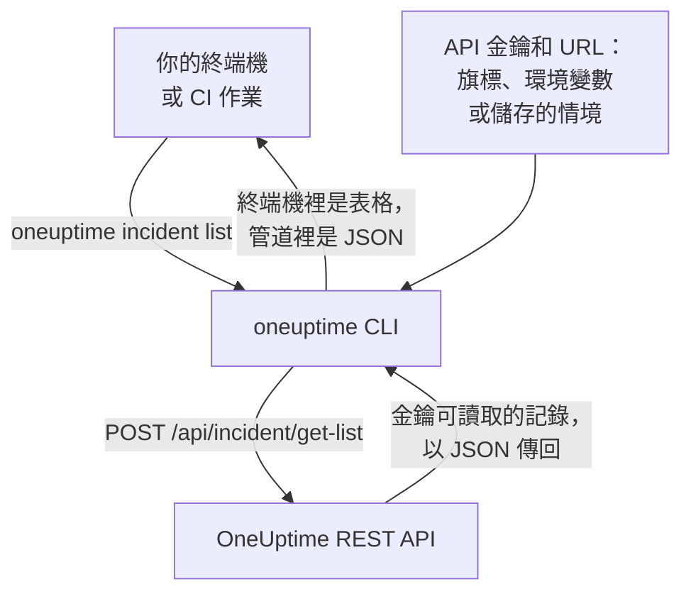

# CLI 概觀

OneUptime 的 CLI，即 `oneuptime`，讓你在終端機或指令碼中管理 OneUptime 專案。它使用專案的 API 金鑰，列出、讀取、建立、更改、刪除和統計監測器、事件、警示、狀態頁面以及 OneUptime API 提供的其他記錄。

:::cards
- [CLI 的運作方式](#cli-的運作方式): 一個命令，一次 API 請求，一個回應。
- [安裝 CLI](#安裝-cli): 一個 npm 命令，以及該選的版本。
- [執行你的第一批命令](#執行你的第一批命令): 儲存 API 金鑰，然後列出你的事件。
- [命令一覽](#命令一覽): 每個命令，以及講解它的頁面。
:::

## CLI 的運作方式

每個命令向 OneUptime 的 REST API 傳送一次請求，並印出回應。CLI 從旗標、環境變數或 `oneuptime login` 儲存的情境中取得 API 金鑰和你的 OneUptime 位址。命令能讀取和更改什麼由金鑰決定，和 API 完全一樣。



記錄的命令隨 CLI 一起提供：OneUptime API 向工具開放的每種記錄都有一個，與 [MCP 伺服器](/docs/ai/mcp-server) 提供工具的記錄相同。執行 `oneuptime resources` 即可列出它們。

## 開始之前

- **Node.js 和 npm**：目前的 LTS 版本，用於安裝 CLI。
- **專案的 API 金鑰。** 在 **專案設定 → 進階 → API 金鑰** 中透過 **建立API 金鑰** 建立：請參閱 [建立 API 金鑰](/docs/api-reference/api-reference#建立-api-金鑰)。
- **在 OneUptime Cloud 上，需要 Growth 方案或更高。** 專案的 API 金鑰只在該方案上有效：請參閱 [低於其方案時的 API 金鑰和 SCIM](/docs/api-reference/api-reference#低於其方案時的-api-金鑰和-scim)。

## 安裝 CLI

從 npm 安裝 `@oneuptime/cli` 套件。它會新增 `oneuptime` 命令，`--version` 會印出你安裝的版本：

```bash
npm install -g @oneuptime/cli
oneuptime --version
```

CLI 與 OneUptime 一同發布，版本號也相同。在自行託管的 OneUptime 上，請安裝與你的 OneUptime 版本相同的 CLI，讓它的命令與你伺服器上的記錄一致：

```bash
npm install -g @oneuptime/cli@<your-oneuptime-version>
```

> [!WARNING]
> 14.0.64 之前的 CLI 版本一啟動就會停止，並出現 `Cannot find module 'Common/Models/DatabaseModels/Index'` 之類的錯誤。請用 `npm install -g @oneuptime/cli@latest` 安裝 14.0.64 或更新的版本。在早於 14.0.64 的自行託管 OneUptime 上，請先[升級 OneUptime](/docs/installation/upgrading#如何升級)，再安裝與升級後版本相同的 CLI。

## 執行你的第一批命令

:::steps
### 儲存你的 API 金鑰

用金鑰和你的 OneUptime 位址登入。CLI 會把它們儲存為名為 `default` 的情境，並從此使用它：

```bash
oneuptime login <your-api-key> https://oneuptime.com
```

它回應 `Logged in successfully. Context "default" is now active.`。在自行託管的 OneUptime 上，請用它的位址代替 `https://oneuptime.com`。

### 列出你的事件

```bash
oneuptime incident list
```

最新的十個事件以表格顯示。`login` 儲存金鑰時不會檢查它，所以這個命令是第一個能證明金鑰可用的命令：如果被拒絕，請參閱 [疑難排解](/docs/cli/authentication#疑難排解)。

### 看看還能管理什麼

```bash
oneuptime resources
```

清單顯示你可以處理的每種記錄及其命令，例如 `monitor`、`status-page` 或 `on-call-policy`。
:::

## 命令一覽

| 命令 | 作用 | 瞭解更多 |
| --- | --- | --- |
| `oneuptime login <api-key> <instance-url>` | 將 API 金鑰和位址儲存為情境 | [驗證](/docs/cli/authentication#登入) |
| `oneuptime context list`, `use`, `current`, `delete` | 列出、切換、顯示和刪除已儲存的情境 | [驗證](/docs/cli/authentication#情境) |
| `oneuptime whoami` | 顯示下一個命令將使用的 URL 和 API 金鑰 | [驗證](/docs/cli/authentication#檢查-cli-將使用什麼) |
| `oneuptime deploy` | 為圖表和 OneUptime AI 記錄一次部署或其他變更 | [部署與變更](/docs/telemetry/change-events) |
| `oneuptime <resource> list`, `get`, `create`, `update`, `delete`, `count` | 處理一種記錄 | [資源操作](/docs/cli/resource-operations) |
| `oneuptime resources` | 列出各種記錄及其命令 | [命令參考](/docs/cli/command-reference#oneuptime-resources) |
| `oneuptime version` | 印出 CLI 的版本 | [命令參考](/docs/cli/command-reference#oneuptime-version) |
| `oneuptime help [command]` | 顯示命令的說明 | [取得說明](#取得說明) |

## 全域選項

這些選項適用於每個命令，寫在命令前後均可：

| 選項 | 作用 |
| --- | --- |
| `--api-key <key>` | 此命令使用的 API 金鑰，代替已儲存的金鑰 |
| `--url <url>` | 此命令使用的 OneUptime 位址 |
| `--context <name>` | 此命令使用的已儲存情境，代替目前情境 |
| `-o, --output <format>` | `table`、`json` 或 `wide`：請參閱 [輸出格式](/docs/cli/output-formats) |
| `--no-color` | 不帶顏色地印出 |
| `-V, --version` | 印出 CLI 的版本 |
| `-h, --help` | 顯示命令的說明 |

## 取得說明

每個命令都有自己的說明，列出它的引數、選項和預設值：

```bash
oneuptime --help
oneuptime help incident
oneuptime incident list --help
```

## 後續步驟

:::cards
- [驗證](/docs/cli/authentication): 每個環境的情境，以及命令使用哪個金鑰。
- [資源操作](/docs/cli/resource-operations): 列出、讀取、建立、更改、刪除和統計記錄。
- [輸出格式](/docs/cli/output-formats): 表格給人看，JSON 給指令碼用。
- [指令碼與 CI/CD](/docs/cli/scripting): 結束代碼、jq 和管線。
- [命令參考](/docs/cli/command-reference): 每個命令、選項和預設值。
:::
