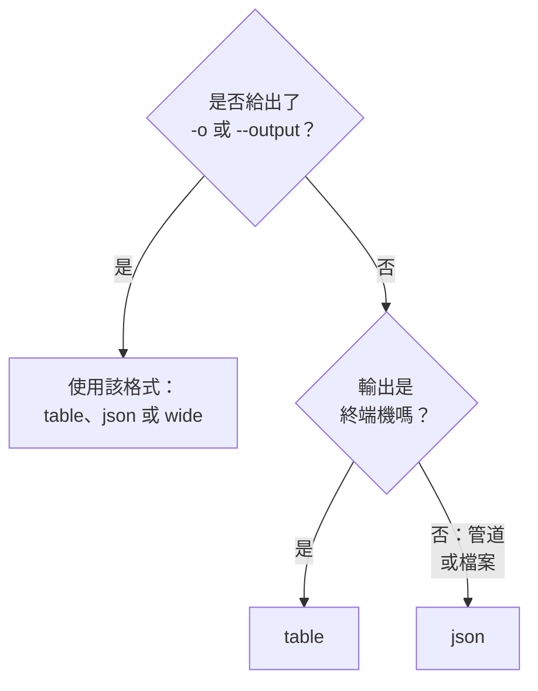

# 輸出格式

當你在終端機中閱讀回應時，CLI 印出表格；當指令碼或其他程式讀取回應時，它印出 JSON。任何命令都可以用 `-o` 或 `--output` 選擇格式。

:::cards
- [格式如何確定](#格式如何確定): 終端機得到表格，管道得到 JSON。
- [表格](#表格): 六欄，每個值在 60 個字元處截斷。
- [JSON](#json): 完整的每個欄位，供指令碼和 jq 使用。
- [寬表格](#寬表格): 包含所有欄的表格。
:::

## 格式如何確定



| 格式 | 印出的內容 | 最適合 |
| --- | --- | --- |
| `table` | 最多六欄的表格；單筆記錄以每個欄位一列顯示 | 在終端機中閱讀 |
| `json` | OneUptime 傳送的原樣回應，以兩個空格縮排 | 指令碼、`jq` 和檔案 |
| `wide` | 每個欄位一欄的表格 | 一眼比較許多欄位 |

`-o` 適用於每個印出記錄的命令：資源的 `list`、`get`、`create`、`update` 和 `count`，以及 `oneuptime resources` 和 `oneuptime context list`。它可以寫在命令列的任何位置。其他任何值都會在傳送請求之前被拒絕：

```text
error: option '-o, --output <format>' argument 'yaml' is invalid. Allowed choices are json, table, wide.
```

## 表格

在終端機中預設使用表格。例如，`oneuptime resources --type analytics` 會印出這個表格：

```text
┌────────────────────────────┬────────────────────────────┬─────────────────────────────┬───────────┬─────────────────────────────┐
│ Command                    │ Singular                   │ Plural                      │ Type      │ API Path                    │
├────────────────────────────┼────────────────────────────┼─────────────────────────────┼───────────┼─────────────────────────────┤
│ log                        │ Log                        │ Logs                        │ analytics │ /logs                       │
├────────────────────────────┼────────────────────────────┼─────────────────────────────┼───────────┼─────────────────────────────┤
│ span                       │ Span                       │ Spans                       │ analytics │ /span                       │
├────────────────────────────┼────────────────────────────┼─────────────────────────────┼───────────┼─────────────────────────────┤
│ metric                     │ Metric                     │ Metrics                     │ analytics │ /metrics                    │
├────────────────────────────┼────────────────────────────┼─────────────────────────────┼───────────┼─────────────────────────────┤
│ exception-instance         │ Exception Instance         │ Exception Instances         │ analytics │ /exceptions                 │
├────────────────────────────┼────────────────────────────┼─────────────────────────────┼───────────┼─────────────────────────────┤
│ monitor-log                │ Monitor Log                │ Monitor Logs                │ analytics │ /monitor-log                │
├────────────────────────────┼────────────────────────────┼─────────────────────────────┼───────────┼─────────────────────────────┤
│ kubernetes-cost-allocation │ Kubernetes Cost Allocation │ Kubernetes Cost Allocations │ analytics │ /kubernetes-cost-allocation │
├────────────────────────────┼────────────────────────────┼─────────────────────────────┼───────────┼─────────────────────────────┤
│ security-event             │ Security Event             │ Security Events             │ analytics │ /security-events            │
├────────────────────────────┼────────────────────────────┼─────────────────────────────┼───────────┼─────────────────────────────┤
│ change-event               │ Change Event               │ Change Events               │ analytics │ /change-events              │
├────────────────────────────┼────────────────────────────┼─────────────────────────────┼───────────┼─────────────────────────────┤
│ threat-intel-indicator     │ Threat Intel Indicator     │ Threat Intel Indicators     │ analytics │ /threat-intel-indicators    │
└────────────────────────────┴────────────────────────────┴─────────────────────────────┴───────────┴─────────────────────────────┘

Total: 9 resources
```

對於記錄清單，表格最多顯示六欄：先是 `_id`、`name`、`title`、`status`、`createdAt` 和 `updatedAt` 中記錄具有的那些，然後按順序是記錄的後續欄位。欄取自第一筆記錄。超過 60 個字元的值會截斷為前 57 個字元，後接 `...`。

`get` 和 `create` 印出的單筆記錄是一個兩欄的表格：欄位名稱和它的值，每個欄位一列。

OneUptime 將日期和其他記錄的 ID 作為物件傳送，例如 `{"_type":"DateTime","value":"2026-10-14T09:12:44.000Z"}`，表格會依原樣顯示它們。它們的值在 `value` 中：請參閱 [JSON](#json)。

## JSON

JSON 是 OneUptime 傳送的原樣回應，以兩個空格縮排：清單是記錄的陣列，單筆記錄是一個物件。

```bash
oneuptime incident list --limit 1 -o json
```

```json
[
  {
    "_id": "6f1c2a40-3b1e-4c55-9a0b-3e2f8d7c1a11",
    "createdAt": {
      "_type": "DateTime",
      "value": "2026-10-14T09:12:44.000Z"
    },
    "title": "Checkout API is down",
    "currentIncidentStateId": {
      "_type": "ObjectID",
      "value": "0b7d5e2c-8f4a-4d1b-9c3e-5a6f7b8c9d0e"
    }
  }
]
```

記錄包含金鑰可讀取的每個欄位；這筆記錄只保留了四個欄位。記錄自己的 `_id` 是文字，其他 ID 和日期則是物件，值儲存在其 `value` 中：

```bash
oneuptime incident list -o json | jq -r '.[] | "\(.createdAt.value)  \(.title)"'
```

當輸出不是終端機時，例如 `oneuptime incident list | jq '.[].title'`，即使沒有 `-o json`，CLI 也會印出 JSON。不過在指令碼中仍請寫上 `-o json`，讓指令碼不依賴這一點。

## 寬表格

`-o wide` 是記錄的每個欄位各佔一欄的表格。每個值仍在 60 個字元處截斷，而記錄的欄位很多，所以寬表格非常寬：請用 `less -S` 翻閱。

```bash
oneuptime incident list -o wide | less -S
```

## 顏色

表頭為青色；訊息在操作成功時為綠色，提示資訊為藍色，錯誤為紅色。使用 `--no-color`，或把 `NO_COLOR` 設為任意值，即可關閉顏色：

```bash
oneuptime incident list --no-color
NO_COLOR=1 oneuptime incident list
```

## 每個命令印出什麼

記錄和計數輸出到標準輸出，錯誤輸出到標準錯誤，因此管道只讀取回應。

| 命令 | 表格中 | JSON 中 |
| --- | --- | --- |
| 什麼都沒找到的 `list` | `No results found.` | `[]` |
| `get` 或 `create` | 每個欄位一列 | 該記錄 |
| `count` | 該數字 | 該數字 |
| `update` | 一個空白行 | `{}` |
| `delete` | `Monitor <id> deleted successfully.` | 同一行 |

## 後續步驟

:::cards
- [指令碼與 CI/CD](/docs/cli/scripting): 在指令碼和管線中用 jq 讀取 JSON。
- [資源操作](/docs/cli/resource-operations): 產生這些回應的操作。
- [命令參考](/docs/cli/command-reference): 每個命令和每個選項。
:::
