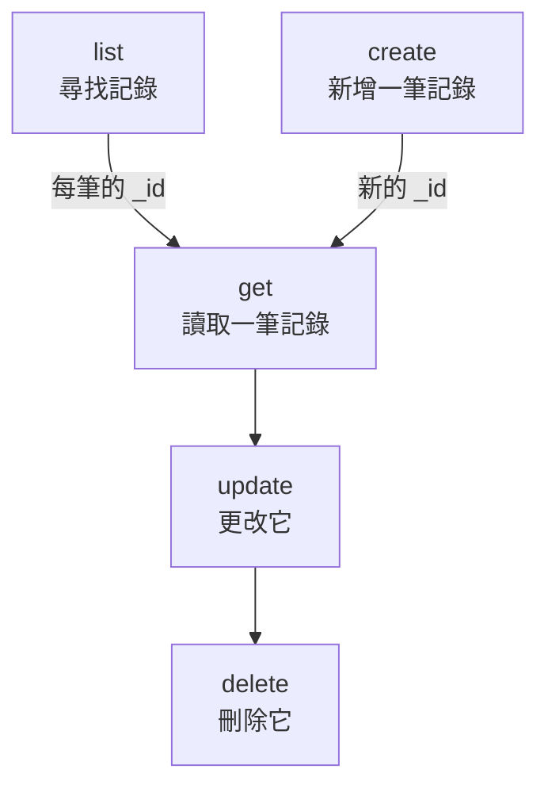

# 資源操作

每種記錄都有自己的命令，例如 `incident`、`monitor` 或 `status-page`，並帶有 API 為它接受的操作：大多數是 `list`、`get`、`create`、`update`、`delete` 和 `count`。本頁介紹每個操作，以及篩選、分頁和書寫記錄所用的旗標，還有執行儀表板按鈕所做動作的命令。

:::cards
- [找到某種記錄的命令](#找到某種記錄的命令): oneuptime resources 會把它們全部列出。
- [列出記錄](#列出記錄): 篩選、排序和分頁。
- [建立記錄](#建立記錄): 每個欄位一個旗標，或以 JSON 給出整筆記錄。
- [確認、解決和新增備註](#確認解決和新增備註): 把儀表板的按鈕變成命令。
- [刪除記錄](#刪除記錄): 立即刪除，無法復原。
:::

## 各操作如何配合

讀取、更改和刪除記錄都需要它的 ID。列出、統計和建立則不需要，而列出或建立的結果會給出其他操作所需的 ID：



ID 是一個 UUID，例如 `6f1c2a40-3b1e-4c55-9a0b-3e2f8d7c1a11`。你也可以在 OneUptime 中該記錄的頁面上複製它：請參閱 [尋找資源的 ID](/docs/api-reference/api-reference#尋找資源的-id)。

## 找到某種記錄的命令

```bash
oneuptime resources
```

清單顯示每種記錄的命令、名稱、類型和 API 路徑。類型有兩種：

| 類型 | 包含的內容 |
| --- | --- |
| `database` | 你管理的記錄：監測器、事件、警示、狀態頁面、團隊等 |
| `analytics` | 遙測資料：日誌、範圍、指標、例外和其他事件 |

用 `oneuptime resources --type database` 或 `--type analytics` 只顯示一種類型。[命令參考](/docs/cli/command-reference#資源) 列出了每個命令。

資源接受 API 為它接受的操作。大多數資源接受全部六種；由 OneUptime 自己寫入的資源（例如電子郵件日誌）是唯讀的。`oneuptime <resource> --help` 列出資源的子命令。

## 檢視資源的欄位

`fields` 直接從 CLI 本身列出資源的欄位，不需要 API 金鑰，也不傳送請求：

```bash
oneuptime incident fields
```

每個欄位都有類型、用途、建立時是否必須提供，以及設定它的旗標。儲存 ID 的欄位會指出該 ID 所屬的資源：`incidentSeverityId` 取自 `oneuptime incident-severity list` 的 ID。使用 `-o json` 時，指令碼或 AI 代理程式讀取的是相同的內容，每個欄位都有相同的鍵：`name`、`title`、`type`、`description`、`required`、`create`、`update`、`read`、`flag`、`emailFlag` 和 `relatedResource`。

## 列出記錄

```bash
oneuptime <resource> list [--query <json>] [--limit <n>] [--skip <n>] [--sort <json>] [--fields <names>] [--all] [-o <format>]
```

| 選項 | 作用 | 預設值 |
| --- | --- | --- |
| `--query <json>` | 只傳回符合的記錄：請參閱 [篩選清單](#篩選清單) | 金鑰可讀取的所有記錄 |
| `--limit <n>` | 最多傳回的記錄數，最多 10,000 | `10` |
| `--skip <n>` | 先跳過多少筆符合的記錄 | `0` |
| `--sort <json>` | 順序，例如 `{"createdAt":"ASC"}`，或用 `"DESC"` 讓最新的排在前面 | 最新的在前 |
| `--fields <names>` | 要傳回的欄位，以逗號分隔，例如 `title,createdAt` | 金鑰可讀取的所有欄位 |
| `--all` | 逐頁傳回所有符合的記錄，取代 `--limit` 和 `--skip`。僅限記錄 | |
| `-o, --output <format>` | `table`、`json` 或 `wide` | 終端機中為 `table`，管道中為 `json` |

```bash
# The ten newest incidents
oneuptime incident list

# The oldest monitors first, 50 at a time: the second page
oneuptime monitor list --sort '{"createdAt":"ASC"}' --limit 50 --skip 50

# Every field of each incident, as JSON
oneuptime incident list -o json

# The title, the state and the creation date of every incident
oneuptime incident list --all --fields title,currentIncidentState.name,createdAt -o json
```

清單會向 OneUptime 請求金鑰可讀取的每筆記錄的所有欄位。`--fields` 則只請求它指定的欄位，點號後面的則是關聯記錄的欄位，例如 `currentIncidentState.name`。表格顯示六個欄位；JSON 顯示全部（請參閱 [輸出格式](/docs/cli/output-formats)）。`--all` 每次讀取 100 筆記錄，逐頁讀完，最多 100,000 筆；`count` 會告訴你總數。

標籤依名稱排列，而不是最新的在前：名稱以數字開頭的標籤排在前面，依該數字的大小排序（`2. Team` 在 `10. Owner` 之前），其餘標籤依字母順序排在後面。要依其他順序列出，請指定 `--sort`。

### 篩選清單

`--query` 接受與 API 相同的篩選：帶值的欄位符合該值，帶 `_type` 的物件進行比較。

| 篩選 | 符合 |
| --- | --- |
| `{"title":"Checkout API is down"}` | 恰好具有該值的記錄 |
| `{"title":{"_type":"Search","value":"checkout"}}` | 包含該值的文字 |
| `{"createdAt":{"_type":"GreaterThan","value":"2026-10-01T00:00:00.000Z"}}` | 更晚的日期，或更大的數字 |
| `{"currentIncidentState":{"isResolvedState":false}}` | 資源所指向記錄的欄位：這裡是尚未解決的事件 |

```bash
oneuptime incident list --query '{"title":{"_type":"Search","value":"checkout"}}'
```

API 參考中的 [篩選、排序和分頁](/docs/api-reference/api-reference#篩選排序與分頁) 列出了每種 `_type`。

## 讀取記錄

```bash
oneuptime <resource> get <id> [--fields <names>] [-o <format>]
```

```bash
oneuptime incident get 6f1c2a40-3b1e-4c55-9a0b-3e2f8d7c1a11
```

表格為記錄的每個欄位顯示一列，每個值在 60 個字元處截斷；`-o json` 顯示完整的值。如果 ID 指向的不是你的金鑰可讀取的記錄，會傳回 `Not found`，命令以結束代碼 `3` 結束。

## 建立記錄

```bash
oneuptime <resource> create [--<field> <value>]... [--data <json>] [--file <path>] [-o <format>]
```

建立所接受的每個欄位都有一個旗標：`--title <text>`、`--incident-severity-id <id>`、用於逗號分隔 ID 的 `--labels <ids>`、用於是/否欄位且單獨給出時為 true 的 `--is-visible-on-status-page [true|false]`，以及用於儲存 JSON 的欄位的 `--monitor-steps <json>`。`oneuptime <resource> create --help` 會列出它們，[`fields`](#檢視資源的欄位) 說明每個欄位的用途。專案來自 API 金鑰，所以記錄中從不指定專案。

```bash
# A manual monitor
oneuptime monitor create --name "Checkout API" --monitor-type Manual

# An incident with one of your severities
oneuptime incident create --title "Checkout API is down" --incident-severity-id <severity-id>

# The same incident, from a file
oneuptime incident create --file incident.json
```

`--data` 以 JSON 形式接收記錄，`--file` 從 JSON 檔案中讀取它，使用的都是 API 的欄位：[API 參考](/reference) 列出了每個資源的欄位。兩者都給出時使用檔案，而旗標會疊加在其中任一個之上。

以使用者 ID 指定某人的欄位還有第二個旗標，以電子郵件地址指定此人：`--user-email` 對應 `--user-id`，`--owner-user-emails` 對應 `--owner-users`。CLI 會在 API 金鑰所屬專案的成員和受邀者中尋找此人。以專案中無人使用的地址指定的團隊成員會受邀加入專案，與在儀表板中邀請的效果相同：

```bash
oneuptime team-member create --team-id <team-id> --user-email alice@example.com
```

CLI 會印出新記錄及其 `_id`。事件從你專案的已建立狀態開始，除非 `currentIncidentStateId` 指定了其他狀態：請參閱 [新記錄的初始狀態](/docs/api-reference/api-reference#新記錄的初始狀態)。要尋找各嚴重程度的 ID：

```bash
oneuptime incident-severity list -o json | jq -r '.[] | "\(._id)  \(.name)"'
```

> [!TIP]
> 在 Windows 上，請用旗標給出欄位，或把 JSON 寫進檔案並使用 `--file`：PowerShell 和命令提示字元為命令列中的 JSON 加引號的方式與 Bash 不同。

## 更新記錄

```bash
oneuptime <resource> update <id> [--<field> <value>]... [--data <json>] [--file <path>] [-o <format>]
```

只給出要更改的欄位，可以用旗標，也可以用 JSON：

```bash
# Rename a monitor
oneuptime monitor update <monitor-id> --name "Checkout API (EU)"

# Record an incident's root cause
oneuptime incident update <incident-id> --root-cause "A full disk on the primary database"
```

OneUptime 用一個空物件回應更新：CLI 印出一個空白行，使用 `-o json` 時印出 `{}`。執行 `get` 檢視記錄的目前狀態。要把事件移到另一個狀態，請給出 `--current-incident-state-id`：這次更改會像儀表板那樣記錄在它的時間軸上，而早於目前狀態的狀態會被拒絕。[`acknowledge` 和 `resolve`](#確認解決和新增備註) 會替你找到狀態。要找到專案順序中第一個已解決狀態的 ID：

```bash
oneuptime incident-state list --query '{"isResolvedState":true}' --sort '{"order":"ASC"}' --limit 1 -o json | jq -r '.[0]._id'
```

## 確認、解決和新增備註

事件、警示、它們的片段以及維護事件都有命令，用來執行儀表板按鈕對它們所做的動作：

| 命令 | 作用 | 資源 |
| --- | --- | --- |
| `acknowledge <id>` | 把記錄移到專案的已確認狀態 | `incident`, `alert`, `incident-episode`, `alert-episode` |
| `resolve <id>` | 把它移到專案的已解決狀態 | 同樣這四種 |
| `start <id>` | 把該事件移到專案的進行中狀態 | `scheduled-maintenance-event` |
| `end <id>` | 把它移到專案的已結束狀態 | `scheduled-maintenance-event` |
| `add-note <id> --note <markdown>` | 新增只有能查看該記錄的人才能閱讀的備註，加上 `--public` 時則在記錄的狀態頁面上發布備註 | 全部五種 |

```bash
oneuptime incident acknowledge 6f1c2a40-3b1e-4c55-9a0b-3e2f8d7c1a11
oneuptime incident add-note 6f1c2a40-3b1e-4c55-9a0b-3e2f8d7c1a11 --note "Rolled back the 14:05 deploy."
oneuptime incident resolve 6f1c2a40-3b1e-4c55-9a0b-3e2f8d7c1a11
```

`acknowledge` 回應 `Incident 6f1c2a40-3b1e-4c55-9a0b-3e2f8d7c1a11 acknowledged: it is in Acknowledged now.` 已處於該狀態或之後狀態的記錄保持不變：命令會說明這一點，並以 `0` 結束。使用 `-o json` 時，它回應記錄的 `_id`、`action`、表示是否有更改的 `changed`，以及記錄所處的 `state`。警示和警示片段只接受內部備註。

## 刪除記錄

```bash
oneuptime <resource> delete <id>
```

```bash
oneuptime monitor delete 6f1c2a40-3b1e-4c55-9a0b-3e2f8d7c1a11
```

它回應 `Monitor 6f1c2a40-3b1e-4c55-9a0b-3e2f8d7c1a11 deleted successfully.` 使用 `-o json` 時，它回應記錄的 `_id` 和 `"deleted": true`。

> [!CAUTION]
> `delete` 會立即刪除記錄。CLI 不會請你確認，也無法復原。它接受 `--force`，以相容帶有該旗標的指令碼，但 `--force` 不會改變任何行為。

## 統計記錄

```bash
oneuptime <resource> count [--query <json>]
```

```bash
# Every incident
oneuptime incident count

# Incidents that are not resolved
oneuptime incident count --query '{"currentIncidentState":{"isResolvedState":false}}'
```

CLI 只印出一個數字，在表格和 JSON 中都一樣，所以指令碼可以直接讀取它。

## 疑難排解

:::details 訊息「Not found: API error (404)」
該記錄不存在、位於其他專案，或者金鑰無法讀取它：OneUptime 對每種情況的回應都相同。用 `list` 檢查 ID，並檢查金鑰的權限。命令以結束代碼 `3` 結束。
:::

:::details 訊息「Left out fields this API key may not read」
列出或讀取時會請求記錄的所有欄位，而 OneUptime 會拒絕金鑰無法讀取的欄位：CLI 會去掉該欄位重新請求，並在標準錯誤中指出被省略的欄位。請為金鑰指派可以讀取這些欄位的權限，或用 `--fields` 指定你需要的欄位：如果指定的欄位金鑰無法讀取，命令會以 `API error (422)` 停止。
:::

:::details 訊息「Error: Invalid JSON」
`--query`、`--sort` 或 `--data` 的值不是 JSON。在 Bash 和 zsh 中用單引號把它括起來；在 Windows 上用旗標給出欄位，或把記錄寫進檔案並使用 `--file`。
:::

:::details 建立或更新時傳回 API error (400)
OneUptime 拒絕了某個欄位：訊息會指出它，`oneuptime <resource> fields` 會列出欄位以及設定它們的旗標。完全沒有給出欄位的命令會在傳送前被拒絕，並列出應給出的旗標。
:::

:::details 訊息「No one in this project, or invited to it, has the email address」
電子郵件旗標指定的人既不是 API 金鑰所屬專案的成員，也未受邀加入。請用 `oneuptime team-member create --team-id <team-id> --user-email <email>` 邀請此人，或改用使用者 ID 指定。
:::

## 後續步驟

:::cards
- [輸出格式](/docs/cli/output-formats): 以表格或 JSON 形式讀取回應。
- [指令碼與 CI/CD](/docs/cli/scripting): 在指令碼和管線中使用這些操作。
- [命令參考](/docs/cli/command-reference): 每個命令、選項和預設值。
:::
