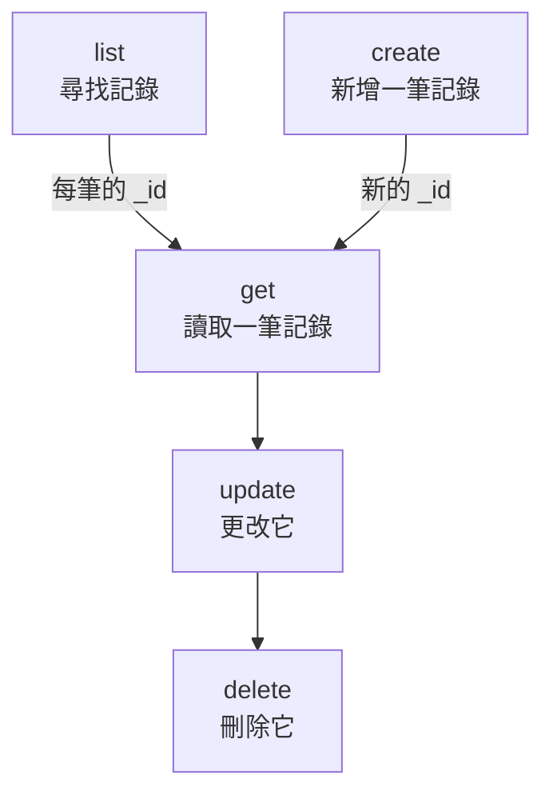

# 資源操作

每種記錄都有自己的命令，例如 `incident`、`monitor` 或 `status-page`，它們都接受相同的操作：`list`、`get`、`create`、`update`、`delete` 和 `count`。本頁介紹每個操作，以及篩選、分頁和書寫記錄所用的 JSON。

:::cards
- [找到某種記錄的命令](#找到某種記錄的命令): oneuptime resources 會把它們全部列出。
- [列出記錄](#列出記錄): 篩選、排序和分頁。
- [建立記錄](#建立記錄): 來自命令列或檔案中的 JSON。
- [刪除記錄](#刪除記錄): 立即刪除，無法復原。
:::

## 各操作如何配合

讀取、更改和刪除記錄都需要它的 ID。列出、統計和建立則不需要，而列出或建立的結果會給出其他操作所需的 ID：



ID 是一個 UUID，例如 `6f1c2a40-3b1e-4c55-9a0b-3e2f8d7c1a11`。你也可以在 OneUptime 中該記錄的頁面上複製它：請參閱 [尋找資源的 ID](/docs/api-reference/api-reference#尋找資源的-id)。

## 找到某種記錄的命令

```bash
oneuptime resources
```

清單顯示每種記錄的命令、名稱、類型和 API 路徑。類型有兩種：

| 類型 | 包含什麼 | 操作 |
| --- | --- | --- |
| `database` | 你管理的記錄：監測器、事件、警示、狀態頁面、團隊等 | `list`, `get`, `create`, `update`, `delete`, `count` |
| `analytics` | 遙測資料：日誌、span、指標、例外和其他事件 | `list`, `create`, `count` |

用 `oneuptime resources --type database` 或 `--type analytics` 只顯示一種類型。[命令參考](/docs/cli/command-reference#資源) 列出了每個命令。

## 列出記錄

```bash
oneuptime <resource> list [--query <json>] [--limit <n>] [--skip <n>] [--sort <json>] [-o <format>]
```

| 選項 | 作用 | 預設值 |
| --- | --- | --- |
| `--query <json>` | 只傳回符合的記錄：請參閱 [篩選清單](#篩選清單) | 金鑰可讀取的所有記錄 |
| `--limit <n>` | 最多傳回的記錄數，最多 10,000 | `10` |
| `--skip <n>` | 先跳過多少筆符合的記錄 | `0` |
| `--sort <json>` | 順序，例如 `{"createdAt":"ASC"}`，或用 `"DESC"` 讓最新的排在前面 | 最新的在前 |
| `-o, --output <format>` | `table`、`json` 或 `wide` | 終端機中為 `table`，管道中為 `json` |

```bash
# The ten newest incidents
oneuptime incident list

# The oldest monitors first, 50 at a time: the second page
oneuptime monitor list --sort '{"createdAt":"ASC"}' --limit 50 --skip 50

# Every field of each incident, as JSON
oneuptime incident list -o json
```

清單會向 OneUptime 請求金鑰可讀取的每筆記錄的所有欄位。表格顯示其中六個；JSON 顯示全部（請參閱 [輸出格式](/docs/cli/output-formats)）。要翻閱所有記錄，按 `--limit` 遞增 `--skip`，直到某一頁傳回為空；`count` 會告訴你總數。

### 篩選清單

`--query` 接受與 API 相同的篩選：帶值的欄位符合該值，帶 `_type` 的物件進行比較。

| 篩選 | 符合 |
| --- | --- |
| `{"title":"Checkout API is down"}` | 恰好具有該值的記錄 |
| `{"title":{"_type":"Search","value":"checkout"}}` | 包含該值的文字 |
| `{"createdAt":{"_type":"GreaterThan","value":"2026-10-01T00:00:00.000Z"}}` | 更晚的日期，或更大的數字 |
| `{"currentIncidentState":{"isResolvedState":false}}` | 資源所指向記錄的欄位：這裡是尚未解決的事件 |

```bash
oneuptime incident list --query '{"title":{"_type":"Search","value":"checkout"}}'
```

API 參考中的 [篩選、排序和分頁](/docs/api-reference/api-reference#篩選排序與分頁) 列出了每種 `_type`。

## 讀取記錄

```bash
oneuptime <resource> get <id> [-o <format>]
```

```bash
oneuptime incident get 6f1c2a40-3b1e-4c55-9a0b-3e2f8d7c1a11
```

表格為記錄的每個欄位顯示一列，每個值在 60 個字元處截斷；`-o json` 顯示完整的值。如果 ID 指向的不是你的金鑰可讀取的記錄，會傳回 `Not found`，命令以結束代碼 `3` 結束。

## 建立記錄

```bash
oneuptime <resource> create --data <json> [-o <format>]
oneuptime <resource> create --file <path> [-o <format>]
```

`--data` 以 JSON 形式接收記錄，`--file` 從 JSON 檔案中讀取它。兩者擇一即可；兩者都給出時使用檔案。欄位就是 API 的欄位，[API 參考](/reference) 列出了每個資源的欄位。專案來自 API 金鑰，所以記錄中從不指定專案。

```bash
# A manual monitor
oneuptime monitor create --data '{"name":"Checkout API","monitorType":"Manual"}'

# An incident with one of your severities
oneuptime incident create --data '{"title":"Checkout API is down","incidentSeverityId":"<severity-id>"}'

# The same incident, from a file
oneuptime incident create --file incident.json
```

CLI 會印出新記錄及其 `_id`。事件從你專案的已建立狀態開始，除非 `currentIncidentStateId` 指定了其他狀態：請參閱 [新記錄的初始狀態](/docs/api-reference/api-reference#新記錄的初始狀態)。要尋找各嚴重程度的 ID：

```bash
oneuptime incident-severity list -o json | jq -r '.[] | "\(._id)  \(.name)"'
```

> [!TIP]
> 在 Windows 上，把 JSON 寫進檔案並使用 `--file`：PowerShell 和命令提示字元為命令列中的 JSON 加引號的方式與 Bash 不同。

## 更新記錄

```bash
oneuptime <resource> update <id> --data <json> [-o <format>]
```

`--data` 是必要的，只包含要更改的欄位：

```bash
# Rename a monitor
oneuptime monitor update <monitor-id> --data '{"name":"Checkout API (EU)"}'

# Move an incident to your resolved state
oneuptime incident update <incident-id> --data '{"currentIncidentStateId":"<resolved-state-id>"}'
```

OneUptime 用一個空物件回應更新：CLI 印出一個空白行，使用 `-o json` 時印出 `{}`。執行 `get` 檢視記錄的目前狀態。用這種方式把事件移到另一個狀態，會像儀表板那樣在它的時間軸上記錄這次更改，而早於目前狀態的狀態會被拒絕。要尋找已解決狀態（在你專案的順序中排第一個）的 ID：

```bash
oneuptime incident-state list --query '{"isResolvedState":true}' --sort '{"order":"ASC"}' --limit 1 -o json | jq -r '.[0]._id'
```

## 刪除記錄

```bash
oneuptime <resource> delete <id>
```

```bash
oneuptime monitor delete 6f1c2a40-3b1e-4c55-9a0b-3e2f8d7c1a11
```

它回應 `Monitor 6f1c2a40-3b1e-4c55-9a0b-3e2f8d7c1a11 deleted successfully.`

> [!CAUTION]
> `delete` 會立即刪除記錄。CLI 不會請你確認，也無法復原。它接受 `--force`，以相容帶有該旗標的指令碼，但 `--force` 不會改變任何行為。

## 統計記錄

```bash
oneuptime <resource> count [--query <json>]
```

```bash
# Every incident
oneuptime incident count

# Incidents that are not resolved
oneuptime incident count --query '{"currentIncidentState":{"isResolvedState":false}}'
```

CLI 只印出一個數字，在表格和 JSON 中都一樣，所以指令碼可以直接讀取它。

## 每種類型能做什麼

| 操作 | `database` | `analytics` |
| --- | --- | --- |
| `list` | 是 | 是 |
| `get` | 是 | 否 |
| `create` | 是 | 是 |
| `update` | 是 | 否 |
| `delete` | 是 | 否 |
| `count` | 是 | 是 |

## 疑難排解

:::details 訊息「Not found: API error (404)」
該記錄不存在、位於其他專案，或者金鑰無法讀取它：OneUptime 對每種情況的回應都相同。用 `list` 檢查 ID，並檢查金鑰的權限。命令以結束代碼 `3` 結束。
:::

:::details 訊息「API error (422): You do not have permissions to select on」
列出或讀取時會請求記錄的所有欄位，而金鑰無法讀取其中一個：訊息會指出該欄位以及可以讀取它的權限。為金鑰指派其中一個權限。
:::

:::details 訊息「Error: Invalid JSON」
`--query`、`--sort` 或 `--data` 的值不是 JSON。在 Bash 和 zsh 中用單引號把它括起來；在 Windows 上把記錄寫進檔案並使用 `--file`。
:::

:::details 建立或更新時傳回 API error (400)
OneUptime 拒絕了某個欄位：訊息會指出它。`No fields to update` 表示 `--data` 中沒有要更改的欄位。
:::

## 後續步驟

:::cards
- [輸出格式](/docs/cli/output-formats): 以表格或 JSON 形式讀取回應。
- [指令碼與 CI/CD](/docs/cli/scripting): 在指令碼和管線中使用這些操作。
- [命令參考](/docs/cli/command-reference): 每個命令、選項和預設值。
:::
