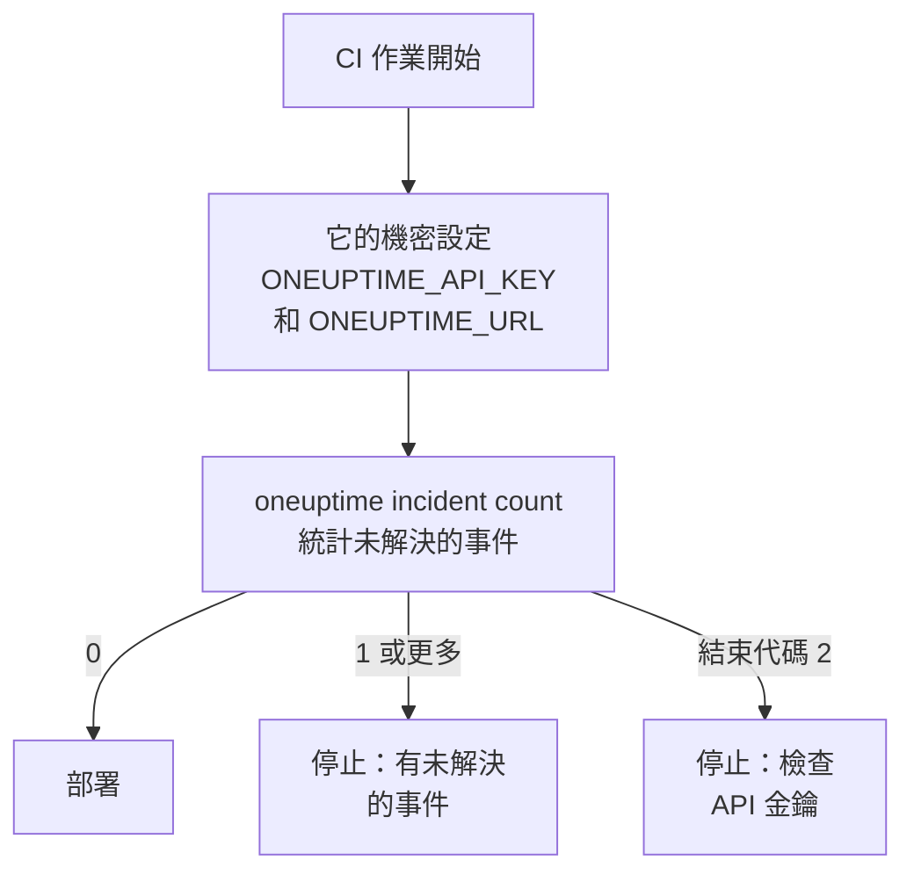

# 指令碼與 CI/CD

CLI 在指令碼中的運作方式與在終端機中相同。透過環境變數給它 API 金鑰，把它的回應當作 JSON 讀取，並讓它的結束代碼告訴指令碼發生了什麼。本頁介紹其中的每一項，以及適用於 GitHub Actions、GitLab CI 和 Docker 的完整管線。

:::cards
- [為指令碼提供 API 金鑰](#為指令碼提供-api-金鑰): 兩個環境變數，無需儲存的情境。
- [結束代碼](#結束代碼): 成功時為 0，失敗時說明原因。
- [用 jq 讀取回應](#用-jq-讀取回應): 從 JSON 中取出 ID、標題和日期。
- [管線範例](#管線範例): GitHub Actions、GitLab CI 和 Docker。
:::

## 指令碼如何使用 CLI

部署可以先詢問 OneUptime 是否有未解決的事件，如果有就停止：



## 為指令碼提供 API 金鑰

從 CI 系統的機密中設定 `ONEUPTIME_API_KEY` 和 `ONEUPTIME_URL`。這樣 CLI 既不需要 `login`，也不需要設定檔。對單一命令而言，旗標仍然優先於它們，而它們優先於已儲存的情境。

```bash
export ONEUPTIME_API_KEY="$CI_ONEUPTIME_API_KEY"
export ONEUPTIME_URL="https://oneuptime.com"
oneuptime incident count
```

> [!TIP]
> 為每個管線提供專屬的 API 金鑰，只賦予它需要的存取權限：唯讀的檢查只需要唯讀的金鑰。管線停用時，在 OneUptime 中刪除該金鑰。

如果一台機器為多個專案執行作業，請為每個專案儲存一個情境，並在每個命令中指定它，這樣作業永遠不會使用另一個作業的目前情境：

```bash
oneuptime --context production incident count
oneuptime --context staging monitor count
```

## 結束代碼

| 代碼 | 含義 | 範例 |
| --- | --- | --- |
| `0` | 成功 | 一次列出，即使什麼都沒找到 |
| `1` | 失敗 | OneUptime 拒絕了請求，例如 `API error (422)`；無效的 JSON；缺少或未知的選項；未儲存的情境 |
| `2` | 沒有可用的 API 金鑰 | 找不到認證資訊；無效的 API 金鑰；低於其方案的金鑰（`402`）；`401` |
| `3` | 未找到 | OneUptime 傳回 `404`：記錄不存在、位於其他專案，或金鑰無法讀取它 |

即使什麼都沒有儲存，`whoami` 和 `context current` 也以 `0` 結束：它們報告已設定的內容，但不檢查它。指令碼透過結束代碼區分各種情況：

```bash
oneuptime incident get "$INCIDENT_ID" -o json > incident.json
case $? in
  0) echo "Saved the incident to incident.json" ;;
  2) echo "Check ONEUPTIME_API_KEY and ONEUPTIME_URL" >&2; exit 1 ;;
  3) echo "There is no incident $INCIDENT_ID" >&2; exit 1 ;;
  *) echo "OneUptime refused the request" >&2; exit 1 ;;
esac
```

錯誤訊息輸出到標準錯誤，因此 `incident.json` 只包含回應。

## 用 jq 讀取回應

在指令碼中寫上 `-o json`。在管道中 CLI 本來就會印出 JSON，但有了這個旗標，指令碼在任何地方執行都能正常運作：

```bash
# The title of each incident
oneuptime incident list -o json | jq -r '.[].title'

# The ID of a new monitor
MONITOR_ID=$(oneuptime monitor create --data '{"name":"Checkout API","monitorType":"Manual"}' -o json | jq -r '._id')

# When each incident was created: dates come as objects
oneuptime incident list -o json | jq -r '.[] | "\(.createdAt.value)  \(.title)"'

# The newest 100 incidents as CSV
oneuptime incident list --limit 100 -o json | jq -r '.[] | [._id, .title, .createdAt.value] | @csv'
```

統計只印出一個數字，可直接用於比較：

```bash
OPEN=$(oneuptime incident count --query '{"currentIncidentState":{"isResolvedState":false}}')
echo "$OPEN incidents are open"
```

## 從檔案建立記錄

把記錄作為 JSON 檔案放在程式碼旁邊，並從那裡建立它們：

```json title="monitors/checkout-api.json"
{
  "name": "Checkout API",
  "monitorType": "Manual"
}
```

```bash
oneuptime monitor create --file monitors/checkout-api.json
```

從一個 JSON 陣列建立多筆記錄，每筆建立一次：

```bash
jq -c '.[]' monitors.json | while IFS= read -r monitor; do
  oneuptime monitor create --data "$monitor" -o json | jq -r '._id'
done
```

> [!NOTE]
> 每次執行都會建立新記錄。要讓監測器和狀態頁面與檔案保持同步，只更改變化的部分並刪除已不存在的部分，請使用 [Terraform 提供者](/docs/terraform/index)。

## 管線範例

:::tabs
@tab GitHub Actions
```yaml title=".github/workflows/deploy.yml"
name: Deploy
on:
  push:
    branches: [main]

jobs:
  deploy:
    runs-on: ubuntu-latest
    steps:
      - uses: actions/checkout@v4
      - uses: actions/setup-node@v4
        with:
          node-version: lts/*
      - name: Install the OneUptime CLI
        run: npm install -g @oneuptime/cli
      - name: Stop while an incident is open
        env:
          ONEUPTIME_API_KEY: ${{ secrets.ONEUPTIME_API_KEY }}
          ONEUPTIME_URL: https://oneuptime.com
        run: |
          OPEN=$(oneuptime incident count --query '{"currentIncidentState":{"isResolvedState":false}}')
          if [ "$OPEN" -gt 0 ]; then
            echo "$OPEN incidents are open: not deploying."
            exit 1
          fi
      - name: Deploy
        run: ./deploy.sh
```
@tab GitLab CI
```yaml title=".gitlab-ci.yml"
check-incidents:
  stage: test
  image: node:lts
  variables:
    ONEUPTIME_URL: https://oneuptime.com
  script:
    - npm install -g @oneuptime/cli
    - OPEN=$(oneuptime incident count --query '{"currentIncidentState":{"isResolvedState":false}}')
    - echo "$OPEN incidents are open"
    - test "$OPEN" -eq 0
```
@tab Docker
```dockerfile title="Dockerfile"
FROM node:lts-slim
RUN npm install -g @oneuptime/cli
ENTRYPOINT ["oneuptime"]
```
:::

在 GitHub Actions 中，在儲存庫的 **Settings → Secrets and variables → Actions** 下新增 `ONEUPTIME_API_KEY`；在 GitLab 中，把它新增為遮罩的 CI/CD 變數。使用 Docker 映像時，每次執行都傳入這些變數：

```bash
docker build -t oneuptime-cli .
docker run --rm -e ONEUPTIME_API_KEY -e ONEUPTIME_URL oneuptime-cli incident count
```

## 後續步驟

:::cards
- [驗證](/docs/cli/authentication): 設定了多個金鑰時命令使用哪一個。
- [輸出格式](/docs/cli/output-formats): 你的指令碼讀取的 JSON。
- [資源操作](/docs/cli/resource-operations): 篩選、分頁和記錄的欄位。
- [Terraform 提供者](/docs/terraform/index): 把 OneUptime 的設定儲存在檔案中。
:::
