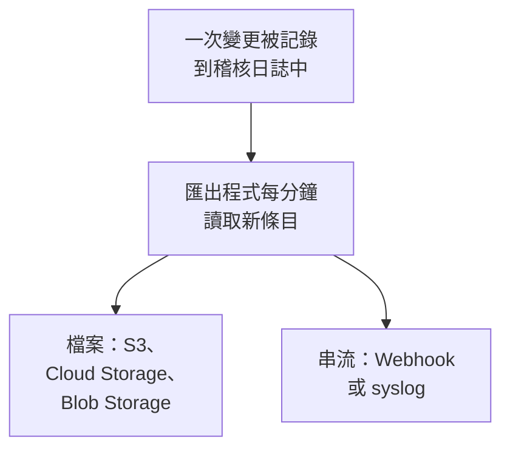

# 稽核日誌匯出

在稽核日誌記錄時，將其傳送到你選擇的儲存空間或服務：Amazon S3 或 S3 相容儲存空間、Google Cloud Storage、Azure Blob Storage、Webhook 或 syslog。條目可以在那裡保存到法規遵循審查所需的時間，並在你的 SIEM 中搜尋。專案的擁有者和管理員在專案設定中匯出該專案的稽核日誌，主管理員在 Admin Dashboard 中匯出所有專案的稽核日誌。在 OneUptime Cloud 上它屬於 Enterprise 方案，自行託管時屬於 Enterprise Edition。

:::cards
- [設定匯出](#設定匯出): 選擇目標，測試，然後儲存。
- [傳送的內容](#傳送的內容): 每個條目一個 JSON 物件，採用穩定的結構。
- [條目何時傳送](#條目何時傳送): 每分鐘一次，每個條目只傳送一次，依照順序。
- [目標失敗時](#目標失敗時): 重試、錯誤訊息，而且不會略過任何條目。
:::

## 條目如何抵達你的目標



- **一個匯出，一個目標。** 一個專案可以有多個匯出，每個匯出都會把所有條目傳送到自己的目標。
- **專案的匯出，或執行個體的匯出。** 專案的匯出傳送該專案的條目。在 Admin Dashboard 中設定的匯出會傳送所有記錄稽核日誌的專案的條目。
- **從儲存時開始。** 匯出傳送儲存之後記錄的內容，除非你把**匯出起始時間**設為更早的日期。

## 開始之前

- **在 OneUptime Cloud 上：Enterprise 方案。** 在其他方案上，此頁面會顯示該功能的作用以及如何取得。
- **自行託管時：Enterprise Edition**，以及包含稽核日誌的授權。請參閱[企業版](/docs/self-hosted/enterprise)。
- **已開啟稽核日誌**：在你要匯出的每個專案中開啟。請參閱[稽核日誌](/docs/configuration/audit-logs)。
- **Project Owner 或 Project Admin** 才能匯出專案的稽核日誌，匯出執行個體的稽核日誌則需要主管理員。

## 設定匯出

:::steps
### 開啟匯出頁面

對於專案，前往**專案設定 → 稽核日誌 → 匯出**。對於整個執行個體，在 Admin Dashboard 中前往**設定 → 稽核日誌匯出**。

### 選擇目標

點選**新增匯出**，從下面六個目標中選擇一個。匯出的目標之後無法變更。

### 填寫如何連線

填寫目標需要的內容。大多數人保持不變的設定位於**更多欄位**中，**設定指南**會開啟本頁上該目標的章節。

### 傳送測試

點選**寫入測試檔案**或**傳送測試條目**。儲存空間會在其資料夾中收到檔案 `oneuptime-audit-log-export-test.ndjson.gz`，Webhook 或 syslog 會收到一個操作為 `Test` 的條目。測試失敗時會說明需要修正什麼。

### 開始匯出

點選**下一步**，為匯出命名，然後點選**開始匯出**。第一批條目會在幾分鐘內抵達。
:::

匯出所在的列會顯示其狀態：**正在匯出**、**失敗**、**已暫停**、**等待條目**或**正在啟動**。**傳送測試**會使用已儲存的設定傳送一次測試，**編輯**用於變更設定：留空的憑證會保留已儲存的值。

## 目標

| 目標 | 收到的內容 | 登入方式 |
| --- | --- | --- |
| [Amazon S3](#amazon-s3) | 壓縮的 NDJSON 檔案 | 存取金鑰 |
| [S3 相容儲存空間](#s3-相容儲存空間) | 壓縮的 NDJSON 檔案 | 存取金鑰 |
| [Google Cloud Storage](#google-cloud-storage) | 壓縮的 NDJSON 檔案 | 服務帳戶金鑰 |
| [Azure Blob Storage](#azure-blob-storage) | 壓縮的 NDJSON 檔案 | SAS 權杖或存取金鑰 |
| [Webhook](#webhook) | HTTPS 要求 | 選用的標頭和簽署密鑰 |
| [Syslog](#syslog) | RFC 5424 訊息 | 無 |

### Amazon S3

| 欄位 | 填寫內容 |
| --- | --- |
| **儲存貯體** | 檔案寫入的儲存貯體。 |
| **地區** | 儲存貯體所在的地區。初始值為 `us-east-1`。 |
| **存取金鑰 ID** | 可以向儲存貯體寫入物件的存取金鑰。 |
| **秘密存取金鑰** | 該金鑰的秘密。 |
| **資料夾** | 位於**更多欄位**中。留空時，檔案寫入 `oneuptime/audit-logs/`。 |

該金鑰只需要對資料夾擁有 `s3:PutObject` 權限：

```json
{
  "Version": "2012-10-17",
  "Statement": [
    {
      "Effect": "Allow",
      "Action": "s3:PutObject",
      "Resource": "arn:aws:s3:::my-audit-logs/oneuptime/audit-logs/*"
    }
  ]
}
```

### S3 相容儲存空間

欄位與 Amazon S3 相同，另外先填寫**端點**：儲存空間的 S3 位址，例如 `https://minio.example.com:9000` 或 `https://<account>.r2.cloudflarestorage.com`。將**地區**設為儲存空間要求的值：MinIO 和 Wasabi 的預設值為 `us-east-1`，Cloudflare R2 為 `auto`。

### Google Cloud Storage

填寫**儲存貯體**，並貼上一個**服務帳戶金鑰**（JSON），該服務帳戶需要在儲存貯體上擁有 Storage Object Creator 角色。**資料夾**位於**更多欄位**中。

### Azure Blob Storage

填寫**儲存體帳戶**和**容器**，並選擇**登入方式**：在容器上擁有 Create 和 Write 權限的**SAS 權杖**，或儲存體帳戶的**存取金鑰**。SAS 權杖可以只限於此容器，因此是更安全的選擇。**雲端**和**資料夾**位於**更多欄位**中。

### Webhook

OneUptime 將每個批次以 POST 方式傳送到 **URL**，依照**內文格式**的設定，以 JSON 陣列（`application/json`）或每行一個條目（`application/x-ndjson`）的形式傳送，並帶有以下標頭：

| 標頭 | 值 |
| --- | --- |
| `X-OneUptime-Event` | `audit-log-export` |
| `X-OneUptime-Batch-Id` | 批次中第一個條目的 ID：同一批次再次傳送時帶有相同的 ID。 |
| `X-OneUptime-Entry-Count` | 內文中包含的條目數。 |
| `X-OneUptime-Signature` | 設定了**簽署密鑰**時，為 `sha256=` 加上用它計算的內文 HMAC-SHA256。 |

**憑證**（例如 `Bearer <token>`）透過你在**標頭名稱**中選擇的標頭傳送，未變更時為 `Authorization`。**內文格式**、**標頭名稱**和**簽署密鑰**位於**更多欄位**中。任何 2xx 回應都算作送達。`413` 會把批次一分為二，其他任何拒絕都會在稍後重新傳送整個批次。

### Syslog

每個條目是一則傳送到**主機**和**連接埠**的 RFC 5424 訊息，除非**協定**選擇 TCP，否則透過 TLS 傳送到連接埠 `6514`，facility 為 13（log audit），severity 為 6（informational）：

```text
<110>1 2026-10-24T09:15:03.000Z oneuptime.example.com oneuptime - audit-log - {"schemaVersion":1,"id":"..."}
```

訊息依八位元組計數（RFC 5425）分框，除非**分框方式**選擇每行一則訊息。如果接收端的憑證由私有 CA 簽發，需要在 **CA 憑證**中填寫該 CA 的憑證。這兩項都位於**更多欄位**中。

## 傳送的內容

每個條目是一個 JSON 物件，其鍵始終依以下順序排列：

| 鍵 | 包含的內容 |
| --- | --- |
| `schemaVersion` | `1`。結構的變更會隨新版本一起發布。 |
| `id` | 條目的 ID。同一條目傳送兩次時 ID 相同。 |
| `createdAt` | 變更被記錄的時間，採用 UTC。 |
| `projectId` | 進行變更的專案。 |
| `action` | `Create`、`Update`、`Delete` 或 `Download`。 |
| `resourceType`, `resourceId`, `resourceName` | 被變更的內容。 |
| `rootResourceType`, `rootResourceId` | 它所屬的資源，例如規則所屬的 SLO。 |
| `userId`, `userName`, `userEmail`, `userType` | 進行變更的人。 |
| `apiKeyId`, `apiKeyName` | 進行變更所用的 API 金鑰（如有）。 |
| `mcpOAuthGrantId`, `mcpClientName` | 進行變更所經由的 MCP 用戶端（如有）。 |
| `workflowId`, `workflowName` | 進行變更的工作流程（如有）。 |
| `changes` | 每個被變更的欄位：`field`，以及 `oldValue` 和 `newValue`。 |

檔案每行一個條目，使用 gzip 壓縮，並依其第一個條目所在的小時歸檔：`oneuptime/audit-logs/2026/10/24/09/20261024T091503Z_<first entry id>.ndjson.gz`。

金鑰、權杖和密碼永遠不會外送：它們被記錄為 `[REDACTED]`，任何人都無權讀取的欄位不會出現在任何條目中。

## 條目何時傳送

- **每分鐘。** 記錄時間超過一分鐘的條目會依從舊到新的順序讀取，並分批傳送：每個檔案最多 5,000 個條目或 16 MB，每個 Webhook 要求或 syslog 連線最多 500 個條目。
- **不會為每個條目都寫一個檔案。** 當批次已滿，或其第一個條目已有五分鐘時，才寫入檔案。
- **每個條目只傳送一次，依照順序。** 每次送達後，匯出都會記住最後傳送的條目，因此重新啟動或其他工作程序會從那裡繼續。
- **重複可以辨識。** 當機後重新傳送的批次會寫入相同的檔名，或帶有相同的 `X-OneUptime-Batch-Id`，而且每個條目都帶有其 `id`。

## 目標失敗時

一個批次會嘗試三次，每次間隔幾秒，之後匯出會等待一段時間再重試：先是一分鐘，然後兩分鐘、四分鐘，依此類推，最長一小時。其所在列顯示**失敗**，**檢視錯誤**會顯示目標的回應以及下次嘗試的時間。

不會略過任何條目：條目在稽核日誌中等待，下一次成功的送達會從最舊的條目開始追趕。但無論是否已傳送，每個條目一旦早於記錄時的保留期就會被刪除，因此請在該期限內修正失敗的匯出。延長保留期只會讓變更之後記錄的條目保存得更久。

失敗的匯出會寄電子郵件給能修正它的人：專案的匯出寄給專案擁有者，執行個體的匯出寄給所有主管理員。第一封郵件在連續失敗 30 分鐘後寄出，附上目標的回應。第二封郵件在匯出尚未傳送的最舊條目被刪除前一天寄出，說明條目從何時開始遺失。失敗持續期間每封郵件只寄一次，一次成功的送達會讓兩封都重新開始。

要暫停匯出，請在其所在列的選單中選擇**關閉**：它會保留自己的位置，**開啟**後會傳送期間記錄的內容。在 OneUptime Cloud 上，離開 Enterprise 方案的專案會停止匯出，其匯出會在升級卡片下等待，可以在那裡關閉或刪除。自行託管時，只要授權不包含稽核日誌，匯出就會停止，一旦授權包含稽核日誌，就會從停止處繼續。

## 疑難排解

:::details 測試提示存取被拒絕
金鑰、權杖或服務帳戶無權寫入匯出所寫的位置。依照上面各目標章節的說明，授予它在資料夾中建立物件的權限，然後再次傳送測試。
:::

:::details 測試無法連線到該位址
OneUptime Cloud 上的專案匯出無法連線到私人網路位址。自行託管時可以連線，除非 `DATA_SOURCE_BLOCK_PRIVATE_ADDRESSES` 為 `true`，而在 Admin Dashboard 中設定的匯出始終可以連線。迴路位址和鏈路本機位址永遠不會被連線。
:::

:::details 什麼都沒有收到
檢查專案中是否已開啟稽核日誌，以及儲存匯出後是否有人變更過內容。儲存空間只有在批次已滿或已有五分鐘時才會收到檔案。
:::

## 後續步驟

:::cards
- [稽核日誌](/docs/configuration/audit-logs): 記錄哪些內容，以及保留多久。
- [使用者、團隊與權限](/docs/permissions/index): 決定誰可以設定匯出。
- [企業版](/docs/self-hosted/enterprise): 自行託管安裝上的稽核日誌。
:::
