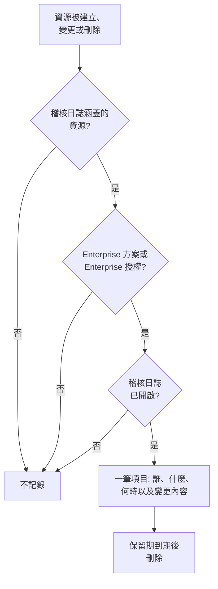

# 稽核日誌

稽核日誌記錄誰在你的專案中變更了什麼：它所涵蓋資源的每一次建立、變更和刪除，以及變更前後的值，還有每一次有人登入或登出。用它查明誰關閉了某個監測器或變更了某個 API 金鑰、誰從哪裡登入，並為法規遵循審查保留紀錄。在 OneUptime Cloud 上它屬於 Enterprise 方案，自行託管時屬於 Enterprise Edition。

:::cards
- [開啟稽核日誌](#開啟稽核日誌): 所有專案預設關閉。
- [閱讀稽核日誌](#閱讀稽核日誌): 誰在何時變更了什麼。
- [記錄哪些內容](#記錄哪些內容): 它涵蓋的資源和操作。
- [登入與工作階段](#登入與工作階段): 誰登入了，以及每個工作階段如何結束。
- [項目保留多久](#項目保留多久): 7 到 180 天。
:::

## 變更如何成為項目

- **預設關閉。** 在有人開啟稽核日誌之前，專案不會記錄任何內容，也不會記錄開啟之前發生的事。
- **記錄人們所做的事。** 由人員、API 金鑰、MCP 用戶端或工作流程做出的變更會被記錄。OneUptime 自身做出的變更（例如來自背景工作的變更）不會被記錄，除非你開啟**儲存系統事件**。
- **項目無法變更。** 任何人都無法在儀表板中或透過 API 編輯或刪除項目。項目只有在保留期到期時才會消失。

## 開始之前

- **在 OneUptime Cloud 上：Enterprise 方案。** 在其他方案上，稽核日誌頁面會顯示該功能的作用以及如何取得。
- **自行託管時：Enterprise Edition**，以及包含稽核日誌的授權。請參閱[企業版](/docs/self-hosted/enterprise)。
- **可以讀取稽核日誌的角色。** Project Owner、Project Admin、Settings Admin 或 **Read Audit Log** 權限。開啟稽核日誌和變更其設定需要 Project Owner、Project Admin 或編輯專案的權限。

## 開啟稽核日誌

:::steps
### 開啟稽核日誌設定

前往**專案設定 → 稽核日誌 → 設定**。**稽核日誌**在側邊選單中預設收合：點選它即可展開。

### 編輯設定

點選 **Edit Audit Log Settings**。

### 開啟

開啟**啟用稽核日誌**，設定**保留時間（天）**，並選擇是否**儲存系統事件**。點選**儲存變更**。
:::

| 設定 | 初始值 | 作用 |
| --- | --- | --- |
| **啟用稽核日誌** | 關閉 | 從現在起記錄專案資源的變更。 |
| **保留時間（天）** | 7 | 每個項目保留的天數：7 到 180。 |
| **儲存系統事件** | 關閉 | 同時記錄 OneUptime 自身做出的、不是由人員或金鑰發起的變更。 |

對這些設定的變更會在一分鐘內生效。

## 閱讀稽核日誌

**專案設定 → 稽核日誌 → 稽核日誌**列出專案中的每個項目，最新的在前：

| 欄 | 顯示內容 |
| --- | --- |
| **何時** | 多久以前，附帶日期和時間。 |
| **操作** | `Create`、`Update` 或 `Delete`，對於有人下載的封包擷取檔案為 `Download`，對於工作階段則為 `Sign In`、`Sign Out`、`Session Timeout` 或 `Session Revoked`。 |
| **資源** | 資源名稱（資源存在時可點選開啟）及其類型。 |
| **執行者** | 做出變更的主體：人員、API 金鑰、工作流程，或對於 OneUptime 自身做出的變更為 `System`。人員透過 MCP 用戶端做出的變更會註明是哪個用戶端。 |
| **變更** | 變更了多少個欄位，或在建立或刪除時記錄了多少個欄位。對於工作階段，則是它如何登入或為何結束。點選可查看每個欄位。 |

依**資源類型**、**資源名稱**、**操作**、**使用者電子郵件**或**時間**篩選。變更只顯示被變更的欄位及其前後值，未做任何變更的儲存不會新增項目。

沒有自身名稱的資源，會以 OneUptime 中指稱它的內容命名：例外以其類型和訊息的開頭命名，其中的 ID、位址以及任何看起來像機密的內容都會被遮蓋；Runbook 的執行以其 Runbook 命名；來電原則的電話號碼以該號碼命名；範本或網域以其自身的名稱命名。

監測器、事件、警示、狀態頁面、SLO 以及許多其他資源，在其側邊選單的收合區段（如**進階**）中也有自己的**稽核日誌**頁面。它只顯示該資源的項目，以及屬於它的內容的項目：SLO 的頁面還會顯示其規則和擁有者。

## 記錄哪些內容

人們在專案中建立、變更或刪除的一切都會被記錄：監視器、事件、警示、狀態頁、工作流程及其步驟、佇列、儀表板、待命政策、團隊及其成員、API 金鑰以及每一項設定。**資源類型** 說明項目所涉及的內容，例如 `Monitor`、`Workflow` 或 `Queue`。

| 不記錄的內容 | 原因 |
| --- | --- |
| 訊息日誌 | 每一筆本身就是 OneUptime 傳送或接收的電子郵件、簡訊、電話、推播通知或聊天訊息的紀錄。 |
| 執行紀錄 | 每一筆本身就是一次工作流程執行、待命升級、掃描、匯入或 AI 執行的紀錄。 |
| 代理程式和遙測回報的內容 | 發現的資源、讀數和用量隨每次回報而變化，並不是因為有人變更了它們。 |
| 活動動態 | 動態顯示的是稽核日誌已經記錄的變更。 |
| OneUptime 的工作狀態 | 狀態頁面讀者的工作階段、排隊的作業以及 OneUptime 在工作時保留的其他狀態。 |
| 個人自己的通知設定 | 每個人的地址、號碼和如何聯絡我只屬於其本人。 |
| 個人自己的偏好 | 每個人釘選在自己頂端列中的產品只屬於其本人，也只有其本人看得到。 |

當管理員在他人的帳戶上新增或移除通知方式或如何聯絡我時，也會記錄，但不包含地址或號碼本身。

只有 OneUptime 寫入的欄位（例如主機最後一次被看到的時間）會從所有項目中省略，任何人都無權讀取的欄位也是如此。當 OneUptime 應某人的請求寫入這類欄位時（例如把一個例外合併到另一個例外，或重設 Webhook URL），項目會將其記錄為此人的變更。金鑰、權杖和密碼記錄為 `[REDACTED]`：項目只顯示它們已變更，絕不顯示其值。工作流程的步驟會依照所發生的變更來記錄，寫出步驟設定的名稱，但絕不記錄其中輸入的內容，在畫布上移動步驟不會被記錄。

OneUptime 因為有人要求而做的以下事情，也會記錄為該人的變更，無論專案是否儲存系統事件：

- 啟動、核准、完成、略過和取消 Runbook 的執行。其步驟會記錄為對每個步驟所做的操作，例如 `Approved "Restart the API" (step 3)`，絕不會帶上步驟輸出的內容。
- 有人執行規則時規則所做的變更：它新增的標籤和擁有者、隱私規則設為私人的記錄、站點指派規則移動的裝置、自動匯入規則建立的裝置和監測器，以及狀態頁面或 SLO 的監測器規則在其頁面或 SLO 上做的變更。
- 購買、連結和釋出來電原則的電話號碼。
- 解決有人標記為預期之中或不是問題的資料警示。
- 重設行事曆訂閱的連結。
- 某人透過 SSO 登入時加入的團隊。

規則自行做的事屬於 OneUptime 自身的變更，在開啟 **儲存系統事件** 時記錄：規則在建立記錄時新增的標籤和擁有者，以及當時設為私人的記錄；自動匯入規則根據新的掃描結果建立的裝置和監測器；以及在儲存規則、監測器或標籤時，狀態頁面或 SLO 的監測器規則所做的變更。

重設主機、叢集或雲端帳戶的 AI 代理程式，會記錄在該資源自己的 **稽核日誌** 頁面上，作為重設者對 `aiAgentResetAt` 的變更：誰重設的，以及何時。為雲端帳戶的 AI 代理程式建立金鑰也是如此：金鑰會顯示為已變更，絕不會帶上金鑰或雜湊值。代理程式在連線和回報時上報的內容，仍和以前一樣不會記錄。

## 登入與工作階段

專案成員每次登入 OneUptime 時，稽核日誌都會記錄下來，該工作階段結束時還會再記錄一次。登入針對的是 OneUptime，而不是某一個專案，因此此人所屬的每個專案都會記錄。

| 操作 | 何時記錄 |
| --- | --- |
| `Sign In` | 有人登入：使用密碼或登入連結、通行密鑰、Google、Microsoft、Vercel 或單一登入。 |
| `Sign Out` | 此人登出。 |
| `Session Timeout` | OneUptime 因時間到期而結束工作階段：伺服器管理員設定的閒置時間或工作階段長度已到，或 30 天未使用。 |
| `Session Revoked` | OneUptime 因密碼已變更、帳戶被封鎖，或伺服器管理員重設或要求雙重驗證而結束工作階段。 |

項目的**資源**是該工作階段，以登入所用的裝置命名，例如 `Chrome 130 on macOS`。它的**執行者**是工作階段所屬的人，因此依**使用者電子郵件**篩選可以找到此人的每一次登入和每一個工作階段。其詳細資料會說明此人如何登入、使用了哪種第二因素、IP 位址和位置；對於已結束的工作階段，還會說明它何時登入、最後一次使用的時間以及何時逾時。專案自己的 SSO 提供者只會在該專案的稽核日誌中寫明。

無論專案是否儲存系統事件，登入和工作階段都會被記錄。工作階段長度或 30 天未使用會在到期後幾分鐘內記錄。閒置時間則在此人開啟的分頁或行動應用程式下一次連線到 OneUptime 時記錄。

## 項目保留多久

每個項目的保留時間，是其被記錄時專案所設的**保留時間（天）**，之後會被刪除。新的保留時間適用於新項目：已記錄的項目保持原有日期。透過 API 設定時也一樣，保留時間是 7 到 180 之間的整數天數：其他值都會被拒絕。

要將項目保留超過 180 天，請在記錄時將它們傳送到你自己的儲存空間或 SIEM：請參閱[稽核日誌匯出](/docs/configuration/audit-log-export)。你也可以使用擁有 **Read Audit Log** 的 API 金鑰透過 API 讀取它們，並儲存到你需要的地方。請參閱[OneUptime API 參考](/docs/api-reference/api-reference)。

## 當方案或授權不再包含稽核日誌時

- **在 OneUptime Cloud 上**，離開 Enterprise 方案的專案會停止記錄，其稽核日誌頁面會顯示升級卡片，直到重新回到該方案。
- **自行託管時**，如果 Enterprise 試用期或寬限期結束時沒有授權，或者授權不包含稽核日誌，稽核日誌就會停止記錄。稽核日誌會以紅色顯示這一點。已記錄的項目會保留，一旦啟用授權，就會以相同的設定恢復記錄。請參閱[授權到期或缺少時](/docs/self-hosted/enterprise#授權到期或缺少時)。

## 疑難排解

:::details 稽核日誌為空
稽核日誌預設關閉，不會記錄開啟之前的任何內容。如果清單提示稽核日誌已關閉，請依其連結前往設定並開啟。否則，變更一個監測器或事件，然後重新整理清單。
:::

:::details 稽核日誌中缺少某項變更
檢查該資源是否列在[記錄哪些內容](#記錄哪些內容)中，以及變更是否發生在開啟稽核日誌之後。OneUptime 自身做出的變更只有在開啟**儲存系統事件**時才會被記錄。
:::

## 後續步驟

:::cards
- [稽核日誌匯出](/docs/configuration/audit-log-export): 將稽核日誌傳送到你自己的儲存空間或 SIEM。
- [使用者、團隊與權限](/docs/permissions/index): 決定誰可以讀取稽核日誌。
- [專案設定](/docs/configuration/project-settings): 專案的其他設定。
- [帳單與用量](/docs/configuration/billing): 變更專案的方案。
- [企業版](/docs/self-hosted/enterprise): 自行託管的安裝中的稽核日誌。
:::
